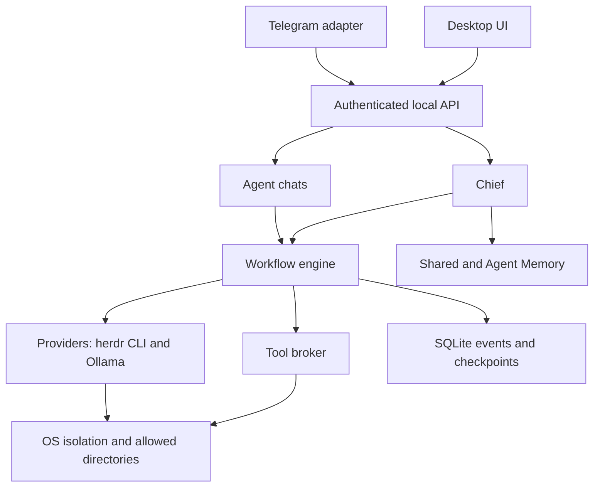

# Overmind

_Honeycomb logo asset pending._

An open-source macOS desktop app where one Owner leads teams of AI agents through a Chief, with visual workflows and real OS-level isolation as the target security boundary.

## Status

**Pre-alpha; not usable yet. macOS only.** The repository has a workspace, development checks and a minimal Tauri/React shell. Product workflows, agent orchestration and release isolation are still being implemented. Prototype findings do not prove that a released application is secure. Follow the [specification](docs/SPECIFICATION.md) and [backlog](tasks/INDEX.md).

## What it will do

- Execute visual, versioned Workflows with branches, loops, Discussions and Review.
- Keep knowledge in the Task Board, Decision Register and Agent Memory.
- Enforce allowed access through real OS-level isolation.
- Keep work within Project Documentation and Owner Rules.

## How it works

The Owner defines Project Documentation and Owner Rules.
The Chief plans work and assigns Tasks to Agents.
Each Agent works within one Workspace and its effective permissions.
A Workflow describes executable work rather than a static diagram.
Each Run pins a Workflow Version and records evidence.
Discussions and Review guide changes through Quality Gates.
The Task Board records work and its current Lane.
The Decision Register retains decisions and observed outcomes.
Agent Memory supports work without overriding Owner Rules.

## Architecture at a glance

This is the target architecture from SPEC 13; implementation stages differ.



The [architecture document](docs/architecture/ARCHITECTURE.md) defines the target package and process boundaries. Dependencies point inward toward contracts, domain rules and application ports; OVE_ARCH002 supplies their executable enforcement.

## Security model

The design denies access by default. Effective permissions are the **intersection** of Owner, Workspace, Agent, Workflow and Tool policies. Agents can only file Access Requests; Telegram cannot widen permissions permanently. Secrets belong in Keychain and are referenced by ID, never copied into prompts or logs.

Isolation targets Apple's `container` on **macOS 26 with Apple silicon**. A release must pass real escape tests; the current shell is not a completed isolation boundary. Read [SECURITY](SECURITY.md), SPEC 11 and ADR 0003, ADR 0004, ADR 0006 and ADR 0020.

## Requirements

- Target users: macOS 26 and Apple silicon for isolation; an official CLI such as `claude` or `codex`, installed and authenticated by the Owner.
- Developers: Node **22.23.3**, pnpm **12.11.2** through Corepack, and Rust **1.90.0** when working on the native shell.
- No supported end-user release exists yet. Windows and Linux are later work (ADR 0009).

## Quick start for developers

From a checkout of DEVELOP:

```bash
corepack enable
pnpm install --frozen-lockfile
pnpm dev:tauri
```

`pnpm dev:tauri` runs the current desktop shell. Unified `pnpm dev` is reserved until OVE_SETUP012 provides it; its name alone does not mean it works. Run the available project checks separately:

```bash
pnpm check
```

Some foundation commands remain reserved until their owning tasks merge. Checks report unavailable tools explicitly. Consult real acceptance evidence before treating a planned capability as complete.

## Repository layout

| Path        | Purpose                                                         |
| ----------- | --------------------------------------------------------------- |
| `apps/`     | Desktop shell and engine composition root                       |
| `packages/` | Contracts, pure rules, use cases, adapters and UI primitives    |
| `skills/`   | Planned runtime integration; personal Skills stay user-selected |
| `tools/`    | Development checks and build tooling                            |
| `docs/`     | Specification, decisions, research and engineering guidance     |
| `tasks/`    | Scoped tasks, dependencies, ownership and acceptance criteria   |

## Documentation

- [Documentation index](docs/README.md)
- [Specification](docs/SPECIFICATION.md)
- [Current glossary source](GLOSSARY.md); [planned bilingual glossary](docs/GLOSSARY.md), OVE_OSS005
- [Architecture decisions](docs/adr/); [planned ADR index](docs/adr/README.md), OVE_OSS006
- [Task conventions](tasks/CONVENTIONS.md)
- [Visual style source](docs/design/styl-wizualny.md); [planned English visual style](docs/design/visual-style.md), OVE_OSS012

## Contributing

Issues and discussions are open. External pull requests require an accepted issue unless the contribution policy grants an exception. Read [CONTRIBUTING](CONTRIBUTING.md), claim dependency-ready work and keep changes within task ownership. Explicit Owner session authorization governs integration into DEVELOP.

## Provider terms and disclaimers

Overmind does not provide Claude or ChatGPT logins. The Owner logs into official CLIs themselves and uses their own accounts under the providers' terms. Subscription limits belong to those CLIs. Automated control of third-party CLIs is a grey area whose terms may change (ADR 0022, SPEC 17). Third-party names and trademarks belong to their owners; Overmind is not affiliated with those providers.

## License

[Apache-2.0](LICENSE). See [NOTICE](NOTICE) and [the dependency inventory](docs/dependencies.md). Bundled code must retain approved notices and source-availability obligations.

## Credits

The planned terminal layer is [herdr](https://github.com/herdrdev/herdr). The shell uses Tauri and React; the planned canvas uses React Flow. The dependency inventory is authoritative for adopted versions and licenses.

<!-- docs-credits:start -->

Inventory entries, including reserved tooling:

- `@axe-core/playwright`, `@commitlint/cli`, `@commitlint/config-conventional`, `@eslint/js`, `@playwright/test`, `@storybook/addon-a11y`
- `@storybook/react-vite`, `@tauri-apps/api`, `@tauri-apps/cli`, `@testing-library/dom`, `@testing-library/jest-dom`, `@testing-library/react`
- `@types/node`, `@types/react`, `@types/react-dom`, `@types/semver`, `@vitejs/plugin-react`, `@vitest/coverage-v8`
- `@xyflow/react`, `dependency-cruiser`, `eslint`, `eslint-config-prettier`, `eslint-plugin-boundaries`, `eslint-plugin-react-refresh`
- `globals`, `happy-dom`, `lefthook`, `markdownlint-cli2`, `markdownlint`, `oxlint`
- `playwright`, `prettier`, `react`, `react-dom`, `semver`, `spdx-license-ids`
- `storybook`, `tsx`, `typescript`, `typescript-eslint`, `vite`, `vitest`
- `yaml`, `zod`, `actionlint`, `zizmor`, `cargo-deny`, `cargo-audit`
- `gitleaks`, `syft`, `crate:tauri`, `crate:tauri-build`, `crate:tauri-plugin-shell`, `crate:tauri-plugin-single-instance`
- `crate:tauri-plugin-dialog`, `crate:serde`, `crate:serde_json`, `crate:tokio`, `Node.js`, `pnpm`
- `actions/checkout`, `actions/setup-node`, `actions/cache/restore`, `actions/cache/save`, `actions/upload-artifact`, `actions/download-artifact`
- `actions/dependency-review-action`, `github/codeql-action/upload-sarif`, `@vitejs/plugin-react-swc`, `esbuild`, `crate:nix`, `crate:hyper`
- `crate:hyper-util`, `crate:http-body-util`, `crate:exacl`

<!-- docs-credits:end -->
