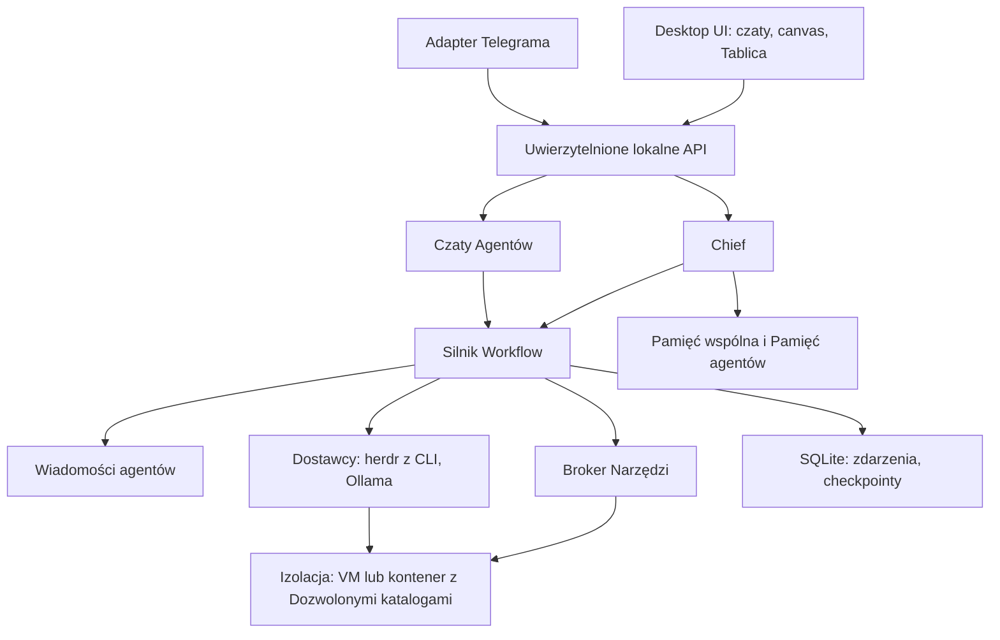

# Overmind — specyfikacja produktu i architektury

**Wersja:** 1.4 | **Data:** 2026-10-13 | **Status:** dokument projektowy do implementacji

Specyfikacja 1.1 powstała z wersji 1.0 po sesji doprecyzowania (grill-with-docs). Wersja 1.4 dodaje Widoczność (publiczny/prywatny, ADR 0028) i wygląd kafelków canvasu z projektu widoków (`docs/design/styl-wizualny.md`). Pojęcia pisane wielką literą (Właściciel, Chief, Workspace, Run, Węzeł…) są zdefiniowane w `GLOSSARY.md`. Decyzje, które trudno odwrócić, są uzasadnione w `docs/adr/` (odwołania w nawiasach, np. ADR 0016).

**Legenda:** USTALONE = decyzja Właściciela; PROPONOWANE = rekomendacja techniczna do weryfikacji w implementacji; OTWARTE = do ustalenia.

## 1. Wizja

Overmind to otwartoźródłowa (Apache-2.0, ADR 0013) aplikacja desktopowa na macOS, w której jedna osoba, Właściciel, prowadzi zespoły agentów AI. Chief planuje, dzieli pracę na Zadania, deleguje je Agentom, nadzoruje Workflow i raportuje. Właściciel może rozmawiać z Chiefem albo bezpośrednio z każdym Agentem, jak w Grok Bot. System nie ogranicza się do programowania: obejmuje research, projektowanie, dokumentację, analizę i inne dozwolone działania.

Cztery filary:

1. **Programowalny Visual Workflow Builder.** Właściciel układa na canvasie kafelki Agentów, łączy je, przeciąga na nie Skille, dodaje rozgałęzienia, pętle, Dyskusje i Review.
2. **Pamięć organizacyjna.** Tablica Zadań, Rejestr decyzji i Pamięć agentów pozwalają poprawiać dawne decyzje i powtarzać dobre w kolejnych projektach.
3. **Realne ograniczenie dostępu do komputera.** Wymusza je system operacyjny, a nie przełącznik w interfejsie.
4. **Dyscyplina zakresu.** Wszystko wynika z Dokumentacji projektu i Reguł Właściciela. Agenci niczego nie dorzucają od siebie.

## 2. Zasady nadrzędne — USTALONE

1. Jedna instalacja to jeden Właściciel na jego Macu. Brak kont, ról i serwera centralnego (ADR 0010).
2. Chief koordynuje pracę, a Właściciel może rozmawiać z nim i z każdym Agentem osobno (ADR 0023).
3. Właściciel jest głównodowodzącym, Chief głównym decydującym w codziennej pracy (ADR 0016).
4. Kolejność pierwszeństwa: Reguły Właściciela, potem Dokumentacja projektu, potem Decyzje Chiefa, a na końcu Pamięć agenta (ADR 0016).
5. Workflow to wykonywalny program z wersjami przypiętymi do Runu, a nie diagram (ADR 0002).
6. Uprawnienia są domyślnie zabronione, Efektywne uprawnienia to przecięcie polityk, a Agent może jedynie złożyć Prośbę o dostęp (ADR 0003).
7. Izolację egzekwuje system: polecenia Agentów działają w maszynie wirtualnej lub kontenerze (ADR 0004, 0020).
8. Praca trwa po zamknięciu okna, ale nie po uśpieniu lub wyłączeniu komputera (ADR 0005).
9. Telegram to drugi Kanał do tego samego Chiefa i Agentów, z mniejszymi prawami (ADR 0006).
10. Model jest wybierany per Agent i per Węzeł. Subskrypcje działają przez oficjalne CLI uruchamiane w terminalu Overmind, tak jak w herdr (ADR 0007, 0022).
11. Rejestr decyzji działa wyłącznie przez dopisywanie, a pamięć opiera się na wyszukiwaniu, nie na trenowaniu modeli (ADR 0008).
12. Pierwsze wydanie tylko na macOS (ADR 0009). Kod, repozytorium i dokumentacja po angielsku, a polski jako tłumaczenie interfejsu (ADR 0017).
13. Agent stały, Skill i Workflow są publiczne (we wszystkich Workspace'ach) albo prywatne (tylko w swoim Workspace) (ADR 0028).

## 3. Scenariusze

**Start projektu.** Właściciel rozmawia z Chiefem albo przekazuje gotową dokumentację lub plan. Razem ustalają Dokumentację projektu (pliki Markdown w folderze projektu, w Gicie) oraz Reguły Właściciela, np. „wszystko ma być przetestowane, test penetracyjny po każdym Zadaniu”. Od tej chwili Chief działa sam: prowadzi Dyskusje z Product Ownerem i innymi Agentami, dzieli projekt na Zadania, umieszcza je na Tablicy i rozdziela. Właściciel niczego nie dotyka, dopóki Chief go nie zawoła.

**Pętla jakości.** PO i Designer pracują równolegle, potem następuje Join i Dyskusja o MVP (np. ze Skillem grill-me). Dalej Developer, równolegle QA i Security, a na końcu Quality Gate. Gdy kryteria nie są spełnione, praca wraca do Developera z raportem. Gdy są spełnione, ocenia Senior Reviewer (może pracować na mocniejszym modelu). Po wyczerpaniu limitu iteracji następuje Eskalacja. Zakończenie zapisuje Decyzje.

**Tablica jak na zrzucie referencyjnym.** Workflow „collect” zbiera zweryfikowane zgłoszenia i zasila Tablicę. Workflow „board” przeprowadza Zadania przez Tory Build, QA i Review. Pętla „review done → collect next” bierze kolejne Zadania.

**Bezpośredni czat.** Właściciel pisze do Testera „pomiń testy wydajności”. Tester wykonuje polecenie, od razu informuje Chiefa, a Chief aktualizuje plan i Tablicę. Gdyby polecenie łamało Regułę Właściciela, Tester go nie wykonuje i wskazuje, którą Regułę trzeba zmienić.

**Telegram.** „Jak idą testy?” trafia do Chiefa, który odpowiada jednym zdaniem o każdym aktywnym Workspace. „@tester co padło w ostatnim przebiegu?” trafia do Testera. Agent prosi o katalog spoza Dozwolonych: Właściciel zatwierdza z Telegrama tylko na ten Run, a na stałe wyłącznie przy komputerze.

**Wiedza.** W nowym projekcie Chief znajduje podobną Decyzję w innym Workspace (o ile tamten nie jest izolowany). Pokazuje alternatywy, uzasadnienie, dowody i Wynik decyzji, a do tego niepewność. Nie ocenia Decyzji bez dowodów.

## 4. Role

**Właściciel.** Jedyny użytkownik instalacji i jedyne źródło uprawnień, Reguł i Dokumentacji projektu. Ma ostatnie słowo w każdej Dyskusji i w każdym Wyniku decyzji.

**Chief.** Jeden na instalację. Widzi wszystkie Workspace'y poza izolowanymi. Dobiera Agentów, tworzy Agentów dynamicznych, prowadzi plan, uruchamia Workflow, rozstrzyga spory w granicach Budżetu i Dokumentacji (ADR 0015). Na proste pytania odpowiada sam, bez uruchamiania Zespołu. Na ogólne pytanie o postęp odpowiada po jednym zdaniu o każdym Workspace, na szczegółowe tylko o tym, o co pytano.

**Agenci.**
- *Agent stały:* wielokrotnego użytku, z własną Pamięcią agenta. Domyślnie publiczny, jeśli utworzył go Właściciel.
- *Agent dynamiczny:* tworzony przez Chiefa na potrzeby Zadania, prywatny w swoim Workspace. Po akceptacji Właściciela staje się stały razem ze swoją pamięcią, a Właściciel decyduje, czy ma być publiczny.
- Agent widzi tylko Workspace, w którym aktualnie pracuje.
- Definicja (PROPONOWANE): `id`, `name`, `role`, `instructions`, `providerId`, `modelId`, `skills[]`, `tools[]`, `permissionProfileId`, `budget`, `timeout`, `retryPolicy`, `lifecycle`, `visibility`, `ownerWorkspaceId?`, `createdBy`, `version`.

**Zespoły i Team Lead.** Hierarchia Chief → Team Lead → Agenci to możliwość docelowa, nie warunek MVP.

## 5. Rozmowa i Kanały

- Każdy Agent i Chief ma osobny czat w aplikacji, jak w Grok Bot (ADR 0023).
- Polecenie Właściciela wydane bezpośrednio Agentowi jest wiążące, a Agent od razu informuje o nim Chiefa.
- Właściciel może podglądać Dyskusję na żywo i pisać w niej. Jego głos rozstrzyga.
- Telegram: jeden bot, jedno Parowanie jednorazowym kodem z desktopu, wiadomości od innych osób są ignorowane. Bez wzmianki odpowiada Chief, ze wzmianką `@agent` odpowiada wskazany Agent.
- Telegram nie rozszerza uprawnień na stałe. Przez Telegram nie przesyła się sekretów, bo rozmowy z botem nie są szyfrowane end-to-end.
- PROPONOWANE: Telegram Bot API z long pollingiem, bez publicznego webhooka; deduplikacja `update_id`, rate limiting, log audytowy.

## 6. Praca: Dokumentacja, Zadania, Dyskusje

**Dokumentacja projektu** to pliki Markdown w folderze projektu, w Gicie, wspólne dla Chiefa i Agentów (ADR 0016). Każde Zadanie wskazuje miejsce w Dokumentacji, z którego wynika. Zadanie bez takiego powiązania jest odrzucane albo wymaga Eskalacji.

**Reguły Właściciela** obowiązują wszystkich i niczym nie da się ich osłabić. Zmienia je tylko Właściciel, a Chief może jedynie zaproponować zmianę.

**Luki w Dokumentacji.** Brak odpowiedzi na pytanie „jak” (np. wybór biblioteki) Chief rozstrzyga sam i zapisuje jako Decyzję. Brak odpowiedzi na pytanie „co” zawsze idzie do Właściciela.

**Tablica Zadań** (ADR 0011). Każdy Workspace ma jedną Tablicę. Workflow definiuje jej Tory (np. Build, QA, Review), a Zadanie przechodzi po Torach w miarę wykonywania Węzłów. Tablica jest źródłem prawdy, a synchronizacja z GitHub Issues, Linear czy Todoist może dojść później.

**Dyskusja** to moderowana rozmowa Agentów (także Chiefa) z agendą i limitem rund, w której uczestnicy używają swoich Skilli. Zwykle kończy się Zadaniami, a nie kolejnym Skillem.
- Dyskusja wpisana jako Węzeł w Workflow rusza sama.
- Gdy Chief sam uzna, że coś trzeba przedyskutować, wstrzymuje dany Run lub gałąź, wysyła powiadomienie i czeka na Właściciela. Reszta pracuje dalej.
- Brak porozumienia po limicie rund: Chief rozstrzyga, jeśli mieści się w Budżecie, Dokumentacji i Regułach; w przeciwnym razie Eskalacja. Rozstrzygnięcie trafia do Rejestru decyzji z argumentami stron.

## 7. Visual Workflow Builder

**USTALONE:** Workflow to wykonywalny program. Edytor tylko go tworzy i pokazuje, a wykonuje go własny silnik (ADR 0002, 0019).

**Canvas** (PROPONOWANE, wygląd wg `docs/design/styl-wizualny.md`):
- ciemne tło z siatką kropek;
- kafelek Węzła ma: zakładkę typu w lewym górnym rogu (PUBLICZNY, PRYWATNY, TOR, DYSKUSJA), zakładkę z liczbą Skilli w prawym górnym rogu, na którą upuszcza się Skill („2 skille”), ikonę, nazwę na środku, krótki stan pod nazwą, pigułkę z awatarem Agenta i modelem na dolnej krawędzi, stos kart pod spodem i porty po bokach;
- ramki grupujące podgrafy (Subworkflow, Loop, Tory Tablicy) z opisem w lewym górnym rogu;
- przerywane, opisane krawędzie powrotu (np. „nie spełnia → wróć do Developera”);
- pas „Chief nadzoruje” nad canvasem ze stanem każdego Agenta;
- panel zainstalowanych Skilli i paleta Węzłów do przeciągania;
- zoom, pan, minimapa, snap-to-grid, multi-select, undo/redo, wyszukiwanie Węzłów, walidacja i podświetlanie stanu wykonania.

**Katalog Węzłów.** W MVP: Start/End, Agent, Parallel, Join, IF, Loop, Dyskusja, Review. Później: Switch, Retry/Fallback, Approval, Memory Read/Write, Subworkflow, Transform, Trigger/Wait, Notification, Model Router.

**Semantyka:**
- Typowane porty i kontrakty wejścia/wyjścia. Warunki operują na danych strukturalnych (wyjście Agenta wg schematu JSON), a nie na swobodnym tekście. Wyrażenia liczy bezpieczny ewaluator, nigdy `eval`.
- Cykle tylko jako jawny Węzeł Loop z limitem iteracji, czasu i kosztu oraz wyjściem `onExhausted`. Surowa krawędź wstecz to błąd walidacji.
- Join: polityka all, any albo quorum, timeout i zachowanie przy częściowym błędzie.
- Run przypina niezmienną Wersję workflow. Edycja tworzy nową Wersję i nie zmienia działającego Runu.
- Statusy Węzła: `pending`, `ready`, `running`, `waiting`, `succeeded`, `failed`, `skipped`, `cancelled`.
- Checkpoint, resume, pause, cancel, dry-run, trace i replay zdarzeń. Akcje nieidempotentne nigdy nie są ślepo powtarzane.

**Quality Gate.** Konfigurowalny warunek oparty na dowodach, np. `testsPassed = 100% AND criticalVulnerabilities = 0 AND seniorReview = approved`. Raporty testów i skanów są przechowywane jako Artefakty. Ocena AI to opinia, nie dowód bezpieczeństwa.

## 8. Skille

- Skill to wersjonowana instrukcja. Sam nie daje dostępu do żadnego Narzędzia (ADR 0003, 0012).
- Właściciel przypisuje Skille, przeciągając je na zakładkę Skilli na kafelku Agenta. Przypisanie jest stałe, we wszystkich Workflow i Workspace'ach, w których widać i Agenta, i Skill (ADR 0028). Agent sam decyduje, kiedy użyć Skilla.
- Skill jest publiczny albo prywatny (ADR 0028). Skill Właściciela jest domyślnie publiczny, Skill zaproponowany przez Chiefa domyślnie prywatny.
- Każde użycie Skilla zapisuje jego nazwę i wersję w historii Dyskusji lub Runu.
- Chief może pisać Skille sam i proponować nowe na podstawie udanych, powtarzalnych procesów. Do biblioteki trafiają po akceptacji Właściciela.
- Skille z internetu (np. społecznościowe grill-me) dostarcza wyłącznie Właściciel. Chief ich nie pobiera.
- Każdy Skill ma źródło (Właściciel, Chief, import), wersję i Widoczność.

## 9. Modele i Dostawcy

- **MVP:** oficjalne CLI, czyli `claude` (Claude Code) i `codex` (Codex CLI). Właściciel loguje się w nich sam, a Overmind nie widzi haseł ani tokenów (ADR 0022). Ollama służy jako model zapasowy.
- **Warstwa terminali to herdr** (Apache-2.0), działający wewnątrz izolacji (ADR 0026). Przez jego lokalne API Overmind zakłada terminale, uruchamia CLI, wysyła polecenia, odczytuje Stan agenta (pracuje, czeka na Zgodę, bezczynny, skończył) i wznawia sesje po restarcie (`--resume`). Dostęp do herdr idzie wyłącznie przez interfejs adaptera Overmind, żeby dało się go wymienić.
- Polecenie nie trafia do Agenta, który czeka na zgodę w CLI, i nie jest ponawiane na ślepo po timeoucie.
- **Skill „overmind”** (ADR 0027) jest instalowany każdemu CLI uruchomionemu przez Overmind. Uczy Agenta raportować postęp i zakończenie Zadania, składać Prośbę o dostęp, pisać do innych Agentów i zapisywać Decyzje. Raport Agenta to deklaracja; Quality Gate nadal wymaga rzeczywistych dowodów.
- **Później:** klucze API (Anthropic, OpenAI i inni) oraz Model Router.
- W aplikacji Właściciel przypisuje Agentom modele dostępne w podłączonych CLI.
- Limity i czas resetu Overmind pokazuje tak, jak raportuje je samo CLI, z oznaczeniem źródła.
- Kończący się limit subskrypcji: Chief przełącza Agentów na model zapasowy (drugie CLI albo Ollama) i wysyła powiadomienie. Gdy zapasowego modelu nie ma, następuje Eskalacja.
- Równoległość: domyślnie 3 Agentów naraz na całą instalację, z możliwością zmiany w ustawieniach. Później opcja, w której Chief sam dobiera liczbę do pozostałego limitu.
- Kontrakt adaptera (PROPONOWANE): `capabilities()`, `invoke()`, `stream()`, `cancel()`, `health()`, `usage()`. Brak funkcji daje czytelny błąd albo skonfigurowany fallback.
- Agenci pracują w CLI w trybie automatycznym. Granicę wyznacza izolacja, a okna zgody CLI Overmind zamienia na Zgody z podglądem zmiany (ADR 0022).
- Stan z herdr to wskazówka, nie dowód: Zadanie idzie dalej dopiero po sprawdzeniu efektu lub raportu Skilla „overmind”. Overmind rozpoznaje dodatkowo „wymaga zalogowania” i „okno wyboru w CLI” (ADR 0026).
- Automatyczne sterowanie CLI to obszar, w którym dostawcy mogą zmienić zasady. Ryzyko trzeba okresowo weryfikować (rozdz. 17).

## 10. Pamięć

**Dwie warstwy** (ADR 0014):
- *Pamięć agenta:* rola, ustawienia i streszczenia wcześniejszych Zadań Agenta stałego. Granice Workspace'ów obowiązują także tutaj, również dla Agenta publicznego. Właściciel może ją przeglądać, ale nie edytuje; zachowanie koryguje Regułami.
- *Pamięć wspólna:* Tablica Zadań i Rejestr decyzji.

**Rejestr decyzji** (ADR 0008) przechowuje: `title`, `problem`, `context`, `alternatives[]`, `selectedOption`, `rationale`, `participants[]`, `evidenceRefs[]`, `assumptions[]`, `risks[]`, `skillsUsed[]` (z wersjami), `workspaceId`, `runId`, `createdAt`, `reviewDate`, `outcome`, `outcomeEvidence[]`, `confidence`, `status`, `supersedesId`.
- Statusy: `proposed`, `accepted`, `rejected`, `superseded`, `needs_review`.
- Wynik decyzji: `unknown`, `positive`, `mixed`, `negative`. Chief stale zbiera dowody i proponuje Wynik, a Właściciel wydaje werdykt i może go zmienić.

**Między Workspace'ami.** Chief automatycznie przeszukuje Decyzje ze wszystkich Workspace'ów. Workspace izolowany (opcja, domyślnie wyłączona) nie udostępnia niczego na zewnątrz, a wszystko, co w nim powstaje, jest prywatne.

**Kopia i usuwanie:**
- Codzienna kopia bazy do folderu wskazanego przez Właściciela oraz eksport ręczny.
- Usunięcie Workspace'u kasuje jego Decyzje, Tablicę, Pamięć agentów z tego Workspace'u oraz jego prywatnych Agentów, Skille i Workflow, po Zgodzie lokalnej z ostrzeżeniem.

**PROPONOWANE:** SQLite + FTS; później wyszukiwanie hybrydowe lub wektorowe.

## 11. Uprawnienia i izolacja — krytyczne

**Zasady** (ADR 0003):
- Pusta lista Dozwolonych katalogów oznacza brak dostępu. Przy pierwszym uruchomieniu kreator prosi o wskazanie folderu.
- Katalogi mają prawa `read`, `write` i opcjonalnie `execute`. Osobne uprawnienia dotyczą terminala, sieci, Git, MCP, a później Chrome i symulatorów.
- Efektywne uprawnienia to przecięcie polityk Właściciela, Workspace'u, Agenta, Workflow i Narzędzia. Delegowanie zadania może prawa tylko zawężać. Widoczność (publiczny/prywatny) nie zmienia uprawnień.
- Ścieżki są kanonizowane, symlinki i mounty sprawdzane, próby naruszeń logowane. Sekrety leżą w Keychain, nigdy w promptach ani logach. Treść stron, repozytoriów i dokumentów to dane, nie polecenia.

**Prośba o dostęp.** Agent, który potrzebuje katalogu spoza listy, wstrzymuje się, daje sygnał dźwiękowy i wysyła powiadomienie (sygnał OTWARTY). Zgoda udzielona przy komputerze dodaje katalog na stałe do Workspace'u. Zgoda z Telegrama obowiązuje tylko w bieżącym Runie.

**Domyślna lista Zgód** (ADR 0021): usuwanie plików, `git push` i każda publikacja, wysyłanie wiadomości lub maili na zewnątrz, płatności, wejście na nową domenę, przekroczenie Budżetu. Właściciel może w Regułach zdjąć wymóg Zgody z wybranej akcji (np. pozwolić na `git push`), ale tylko lokalnie.

**Izolacja na macOS** (ADR 0020):
- Polecenia Agentów i oficjalne CLI działają w lekkiej maszynie wirtualnej lub kontenerze, do którego zamontowane są wyłącznie Dozwolone katalogi.
- Chrome i symulatory (po MVP) obsługuje Overmind po stronie macOS, na polecenie Agenta.
- Gdy izolacji nie da się zapewnić, akcja jest blokowana.
- Potwierdzone w prototypie: narzędzie `container` od Apple (macOS 26, Apple silicon), ok. 1,3 GiB RAM na aktywnego Agenta. CLI startuje zawsze w folderze Workspace'u, reszta systemu plików kontenera jest tylko do odczytu lub nietrwała, a dane logowania CLI leżą w osobnym trwałym wolumenie. Szczegóły w ADR 0020 i `docs/research/prototyp-wnioski.md`.
- Testy ucieczki z izolacji są częścią CI.

## 12. Praca w tle

- Silnik działa jako osobny proces, uruchamiany jak usługa użytkownika i niezależny od okna (ADR 0005).
- Tray pokazuje status i pozwala otworzyć aplikację, wstrzymać i wznowić pracę, a także włączyć Global Pause.
- Powiadomienia: zakończenie, błąd, Prośba o dostęp, Zgoda, Eskalacja, Dyskusja rozpoczęta przez Chiefa.
- Stan Runów jest zapisywany jako ciąg zdarzeń w SQLite (WAL). Po restarcie silnik wznawia pracę bez ponawiania akcji nieidempotentnych.
- Budżet, timeouty, retry z backoffem i dead-letter egzekwuje silnik.

## 13. Architektura i stos

**USTALONE** (ADR 0018, 0019, 0026): Tauri + React + TypeScript (canvas na React Flow), osobny silnik w TypeScripcie, SQLite. Własny silnik Workflow zamiast frameworka. Jeden język we własnym kodzie, plus dołączony plik binarny herdr w przypiętej wersji jako warstwa terminali.

**Wzorce z herdr** (szczegóły w `docs/research/herdr-analiza.md`):
- silnik jako serwer w tle, a UI, Telegram i CLI jako cienkie klienty przez lokalne gniazdo dostępne tylko dla właściciela;
- publiczne API JSON ze schematem generowanym z typów, zmiany tylko addytywne;
- atomowe zapisy i rolujące migawki;
- osobny `git worktree` na Agenta, gałęzie nigdy nie kasowane automatycznie;
- kod systemowy wyłącznie w `platform/<os>`.

**Moduły** (PROPONOWANE): `desktop`, `gateway`, `chief`, `agents`, `chat`, `board`, `workflows/editor`, `workflows/runtime`, `providers`, `tools`, `sandbox`, `permissions`, `memory`, `integrations/telegram`, `persistence`, `observability`, `shared-contracts`. Kod zależny od systemu (sandbox, Keychain, tray, usługa) siedzi za interfejsami, żeby późniejsze porty na Windows i Linux nie wymagały przebudowy rdzenia.

## 14. Model danych (PROPONOWANE)

| Encja | Pola kluczowe |
|---|---|
| Workspace | id, name, allowedRoots, policyId, isolated, budget |
| OwnerRule | id, workspaceId?, text, consentOverrides, version |
| ProjectDocRef | workspaceId, path, gitCommit |
| Agent | id, name, role, providerId, modelId, skills, configVersion, lifecycle, visibility, ownerWorkspaceId? |
| AgentMemory | id, agentId, workspaceId, kind, content, sourceRunId |
| Skill | id, version, source, instructions, requiredTools, visibility, ownerWorkspaceId? |
| Workflow / WorkflowVersion | id, workspaceId, visibility, nodesJson, edgesJson, schemaVersion |
| WorkflowRun / NodeExecution | id, versionId, status, attempt, checkpointRef |
| Board / Lane | id, workspaceId, lanes[] (z przypisanym Agentem lub Zespołem) |
| Task | id, boardId, laneId, docRef, assigneeAgentId, status, originDiscussionId |
| Discussion | id, runId?, participants, agenda, rounds, skillsUsed, outcome |
| ChatMessage | id, channel, agentId, author, text, timestamp |
| AgentMessage | id, runId, sender, recipient, payloadRef, correlationId, timestamp |
| Decision | zob. rozdz. 10 |
| AccessRequest | id, agentId, path, scope (run lub stały), status, channel |
| ApprovalRequest | id, runId, action, status, expiresAt |
| Connection | id, type (cli, ollama, telegram), status, secretRef |
| Artifact | id, workspaceId, pathOrBlobRef, checksum, provenance |
| AuditEvent | id, actor, action, target, result, timestamp |
| ModelUsage | id, runId, provider, model, tokens, reportedLimit |

Stosujemy migracje, transakcje, indeksy po run, workspace i status oraz niezmienne zdarzenia audytowe. Sekrety przechowujemy wyłącznie jako referencje do Keychain.

## 15. Obserwowalność

- Activity: kto, kiedy, co zlecił, jakie Narzędzie wywołał, z jakim wynikiem i błędem.
- Podgląd rozmów Agentów i Dyskusji na żywo, z filtrami po Runie i Agencie.
- Zużycie per Dostawca, model, Agent, Run i Workspace, a dla CLI limit raportowany przez samo CLI.
- Odtwarzalność Runu: wersja grafu, Agenta, Skilla i modelu.
- Redakcja sekretów i danych osobowych w logach, eksport raportów.

## 16. MVP i kryteria odbioru

**Zakres** (ADR 0024):
- **w MVP:** Chief i Agenci z czatami; canvas z Węzłami Agent, Parallel, Join, IF, Loop, Dyskusja, Review i przeciąganymi Skillami; Widoczność publiczny/prywatny; Tablica Zadań; Rejestr decyzji; Pamięć agenta; izolacja folderów; praca w tle; CLI `claude` i `codex` z Ollamą jako zapasem; Telegram z czatami, statusem i Zgodami na Run.
- **później:** klucze API, Chrome i symulatory, głos i pliki w Telegramie, Model Router, synchronizacja Tablicy, Windows i Linux.

**Kryteria odbioru:**
1. Kreator przy pierwszym uruchomieniu wymaga wskazania folderu. Bez niego Agenci nie mają dostępu do niczego.
2. Właściciel tworzy co najmniej trzech Agentów z różnymi modelami z podłączonych CLI i rozmawia z każdym w osobnym czacie.
3. Skill przeciągnięty na kafelek jest dostępny dla Agenta we wszystkich Workspace'ach, w których widać oba elementy, a jego użycie (z wersją) widać w historii. Prywatny Agent ani Skill nie pojawia się w innym Workspace.
4. Z Dokumentacji projektu Chief tworzy Zadania na Tablicy, każde z odnośnikiem do miejsca w Dokumentacji.
5. Workflow z Parallel, Join, IF, Loop, Dyskusją i Review wykonuje się, a nieudany Quality Gate wraca do wskazanego Węzła. Wyczerpanie limitu powoduje Eskalację.
6. Dyskusja Agentów kończy się Zadaniami. Brak porozumienia rozstrzyga Chief i zapisuje Decyzję z argumentami stron.
7. Zamknięcie okna nie zatrzymuje Runu. Po restarcie silnika stan jest zachowany, a akcje nieidempotentne nie są powtarzane.
8. Odczyt pliku spoza Dozwolonych katalogów jest blokowany przez izolację, także dla poleceń wydanych przez CLI. Test ucieczki przechodzi w CI.
9. Prośba o dostęp zatwierdzona z Telegrama działa tylko w bieżącym Runie. Zatwierdzona przy komputerze dodaje katalog na stałe.
10. Żaden Agent ani Telegram nie rozszerza uprawnień ani nie zdejmuje wymogu Zgody.
11. Polecenie Właściciela wydane bezpośrednio Agentowi aktualizuje plan Chiefa i Tablicę.
12. Wyczerpanie limitu CLI przełącza Agentów na model zapasowy i wysyła powiadomienie.
13. Telegram i desktop pokazują ten sam stan Chiefa, Agentów i Runów.
14. Pause, cancel, limit 3 równoległych Agentów, Budżety i timeouty są egzekwowane przez silnik.
15. Codzienna kopia bazy powstaje we wskazanym folderze.

## 17. Ryzyka

- **Warunki dostawców:** automatyczne sterowanie `claude` i `codex` przez Overmind to szara strefa. Anthropic nie pozwala zewnętrznym produktom oferować logowania do claude.ai ani limitów subskrypcji. Mitygacja: Overmind nie loguje się sam i nie przedstawia limitów jako swoich (ADR 0022); klucze API jako alternatywa po MVP; okresowa weryfikacja zasad; ewentualna prośba do dostawców o zgodę.
- Pozorna izolacja przy niepełnej konfiguracji maszyny wirtualnej lub mountów.
- Prompt injection z repozytoriów, stron, dokumentów i Skilli z internetu.
- Niekończące się pętle i wyczerpanie wspólnego limitu subskrypcji.
- Powielone efekty uboczne po awarii lub retry.
- Rozjazd planu Chiefa z poleceniami wydanymi Agentom bezpośrednio.
- Rozbieżność stanu między Telegramem, desktopem i silnikiem.
- Konflikty Agentów w jednym repozytorium. Mitygacja: osobny `git worktree` na Agenta i kontrolowany merge (wzorzec z herdr).
- Zależność od herdr: zmiany w jego API lub zaniechanie projektu. Mitygacja: przypięta wersja, interfejs adaptera, możliwość własnej implementacji (ADR 0026).
- Fałszywe poczucie bezpieczeństwa po ocenie AI.

## 18. Otwarte decyzje

- Konkretna technologia VM lub kontenera na macOS i jej wydajność z CLI.
- Rodzaj sygnału dźwiękowego i powiadomień przy Prośbie o dostęp.
- Moment i forma kontaktu z Anthropic i OpenAI w sprawie automatyzacji CLI.
- Team Lead i hierarchia Zespołów po MVP.
- Branding wizualny i nazwa w sklepie. Kierunek wizualny interfejsu jest już wybrany (`docs/design/styl-wizualny.md`).
- Szczegóły `CONTRIBUTING.md` i code of conduct. Model jest już ustalony: zgłoszenia otwarte, PR po akceptacji zgłoszenia, lista zaufanych kontrybutorów (ADR 0025).
- Uruchamianie herdr wewnątrz maszyny wirtualnej: przez jego tryb zdalnych maszyn (SSH) albo bezpośrednie gniazdo.

## 19. Instrukcja dla agenta implementującego

1. USTALONE i ADR-y to wymagania, PROPONOWANE to rekomendacje.
2. Najpierw działający vertical slice z testami: czat z Chiefem → jeden Agent na CLI w izolacji → zapis Zadania i Decyzji.
3. Przed każdą ryzykowną operacją sprawdź Efektywne uprawnienia i listę Zgód.
4. Nie zastępuj silnika wizualizacją React Flow.
5. Nie symuluj testów ani audytów. Zapisuj rzeczywiste dowody.
6. Każdy moduł ma kontrakty, testy i obsługę błędów.
7. Nową zależność uzasadnij wartością i kosztem utrzymania.
8. Decyzje architektoniczne zapisuj jako ADR, a pojęcia w `GLOSSARY.md`.
9. Przy pracy równoległej używaj osobnych worktree i review.
10. Nie łam istniejących Wersji workflow.

## 20. Referencje

- herdr (warstwa terminali, licencja Apache-2.0): https://github.com/herdrdev/herdr, analiza w `docs/research/herdr-analiza.md`
- Claude Agent SDK, zasady uwierzytelniania: https://code.claude.com/docs/en/agent-sdk/overview
- Codex z planem ChatGPT: https://help.openai.com/en/articles/11369540-using-codex-with-your-chatgpt-plan
- React Flow: https://reactflow.dev/learn
- Telegram Bot API: https://core.telegram.org/bots/api
- Tauri: https://tauri.app
- Ollama: https://docs.ollama.com
