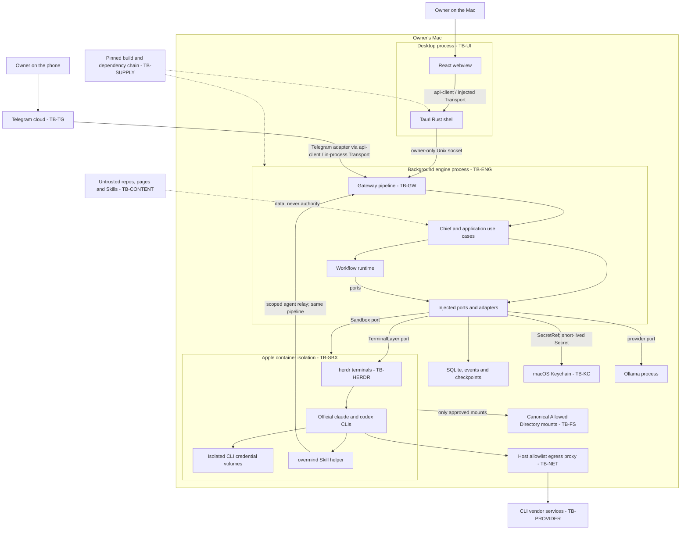

# Overmind architecture

## 1. Purpose, audience and use

This document defines the target package and process boundaries for Overmind. It is for implementers,
reviewers and task authors; read sections 3-6 before adding an import, use case, adapter or gateway route. It
implements [OVE_ARCH001](../../tasks/OVE_ARCH001/TASK.md), grounded in [SPECIFICATION 2,
11-13](../SPECIFICATION.md), [PLAN](../../tasks/PLAN.md), [CONVENTIONS](../../tasks/CONVENTIONS.md) and the
[root glossary](../../GLOSSARY.md). Owner Rules take precedence over Project Documentation, Chief Decisions
and Agent Memory (ADR 0016); neither code nor imported content can expand that scope.

**Target, not completion evidence.** At the reviewed baseline `e8a300ffc45e38a0ba7bd5123d88f78e23a43918` there
are 17 npm workspaces. Most public `src/index.ts` files are empty placeholders. The desktop has a minimal
Tauri/React shell; the engine use cases, gateway, adapters and isolation described here are mostly future
work. An export declaration or successful scaffold test does not prove those features.

The normative import data is [boundaries.json](boundaries.json), version 1. Section 4 is its human-readable
projection, including explicit test overlays. [OVE_ARCH002](../../tasks/OVE_ARCH002/TASK.md) owns enforcement
and the Markdown/JSON consistency test; that checker is not delivered by this document. Reviewers use the
final checklist and the owning task's real test evidence. A target rule marked MUST is binding on its
implementation, not a claim that a future mitigation already exists or that an unknown check passed.

## 2. System context and trust boundaries

One installation belongs to one Owner on one Mac (ADR 0010). The Owner uses the desktop or the paired Telegram
account on their phone. Chief and Agents are application actors; they are not additional trusted Owners.
Desktop and engine are separate processes, and closing a window does not stop a Run (ADR 0005). Sleep and
shutdown stop progress; there is no cloud engine.

The desktop consists of a React webview and a minimal Tauri Rust shell. The TypeScript engine is a background
process, packaged as Node SEA with `node:sqlite` under [ADR
0030](../adr/0030-engine-packaging-and-sqlite-driver.md). SQLite is an engine-owned file, not a service
available to the webview. herdr and official `claude`/`codex` CLIs run inside Apple `container` isolation.
Ollama is a separate local model service used through a provider port.
[OVE_ENGINE002](../../tasks/OVE_ENGINE002/TASK.md), OVE_BOX003 and OVE_PROV005 implement these compositions;
packaging alone does not implement them.

Source: [system-context.mmd](diagrams/system-context.mmd). This is a C4-style process/context view; its arrows
are calls or data flows, not permission to import one adapter from another.



The sandbox-to-gateway arrow denotes a scoped agent relay, not an unrestricted host socket mounted into a
container. [OVE_ENGINE028](../../tasks/OVE_ENGINE028/TASK.md) and
[OVE_SKILL012](../../tasks/OVE_SKILL012/TASK.md) own its final agent-facing mechanism; OVE_BOX002/020 owns its
sandbox channel/relay. It must preserve the same gateway authorization and no default TCP listener. This
document does not choose an additional public network service.

Stable identifiers below match the register requested by [OVE_SEC001](../../tasks/OVE_SEC001/TASK.md). The
nine ARCH001 identifiers are preserved, with the three additional SEC001 identifiers included; none are
renumbered or aliased.

| Boundary    | What crosses                                                    | Authentication, trust and enforcing task                                                                                                  |
| ----------- | --------------------------------------------------------------- | ----------------------------------------------------------------------------------------------------------------------------------------- |
| TB-UI       | Webview frames to Rust and engine; rendered agent content       | The shell authenticates requests without exposing its token to JS; UI content is untrusted. OVE_SETUP010, OVE_ENGINE022, OVE_SEC005.      |
| TB-GW       | Every channel request and subscription                          | Owner-only socket plus session/scoped authentication, authorization and schema validation. OVE_ENGINE010/011/012/013, OVE_SEC005.         |
| TB-ENG      | Engine process against other host processes and persistent data | Same-user processes are not assumed trustworthy; protect files and reconcile crash state. OVE_ARCH005/013, OVE_ENGINE003/005, OVE_SEC001. |
| TB-SBX      | Agent commands and mounted directories against the host         | OS isolation, canonical mounts, resource and egress limits; unavailable isolation denies execution. OVE_BOX003, OVE_ARCH012, OVE_TEST007. |
| TB-HERDR    | Terminal commands, state hints and CLI output                   | Only TerminalLayer reaches herdr; blocked/login/choice states require evidence and safe handling. OVE_PROV005, ADR 0026.                  |
| TB-TG       | Telegram cloud messages and Owner approvals                     | Exactly one paired chat; deduplication and Run-only approval; Telegram is not end-to-end encrypted. OVE_TG001/013, OVE_SEC008.            |
| TB-KC       | Secret references and short-lived secret values                 | Keychain ACLs and Secret wrappers; never prompts, logs or persisted plaintext. OVE_ARCH012, OVE_SEC003.                                   |
| TB-NET      | Sandbox/provider traffic and temporary login forwarding         | Host allowlist and bounded forwards; a new domain needs the required Approval. OVE_BOX011/012/013/015, OVE_SEC009, ADR 0021.              |
| TB-CONTENT  | Repositories, pages, documents, Skills, CLI and Agent output    | Data with provenance and delimiters, never approval or configuration authority. OVE_SEC004.                                               |
| TB-FS       | Host files, including paths outside Allowed Directories         | Canonicalize and check symlinks/mounts before policy decisions; no broad mounts. OVE_SEC002, OVE_BOX007/019/021, OVE_TEST007.             |
| TB-SUPPLY   | Dependencies, actions, binaries, images and imported Skills     | Pins, verified hashes, script denial, license policy, provenance and Owner-imported Skills. OVE_SETUP006/007/008/014/015, OVE_SEC006.     |
| TB-PROVIDER | Official CLI vendor services and subscription sessions          | Login stays in official CLI; isolated credential volumes and no invented quota evidence. OVE_PROV005, OVE_SEC009, ADR 0022.               |

## 3. Package catalogue

Package IDs in JSON are architectural IDs, not npm specifiers. For example `adapters/sqlite` maps to
`@overmind/adapter-sqlite`. Layers are L0 contracts, L1 domain, L2 application, L3 interfaces/adapters and L4
executable composition. `layer: -1` means outside this production layering: ui-kit, testing, tooling or
non-importable Skill content; it is not an additional inner layer.
[OVE_ARCH002](../../tasks/OVE_ARCH002/TASK.md) must resolve entries by longest path prefix, so the Rust
subtree does not inherit webview rules.

The table lists **target public export keys**, not implemented symbols. Existing npm workspaces currently
expose `"."` to an empty `src/index.ts` unless their owning task has replaced it. New keys and future packages
are created by their named owners, not ARCH001. Only listed public exports may be consumed; `internal/` is
never exported (OVE_ARCH002, OVE_ARCH009).

| Name                                  | Path                                  | Layer              | Purpose and owner                                                                                         | Public exports target                                          | Runtime         |
| ------------------------------------- | ------------------------------------- | ------------------ | --------------------------------------------------------------------------------------------------------- | -------------------------------------------------------------- | --------------- |
| @overmind/contracts                   | packages/contracts                    | L0                 | zod DTOs, errors, Result, IDs; OVE_ARCH003/007/008                                                        | `.`; generated public contract entries via OVE_ARCH008/009     | both            |
| @overmind/domain                      | packages/domain                       | L1                 | Pure models and business rules; domain area tasks                                                         | `.`                                                            | both            |
| @overmind/application                 | packages/application                  | L2                 | Use cases and injected ports; OVE_ARCH006/012                                                             | `.`, `./ports`                                                 | both            |
| @overmind/workflow-runtime            | packages/workflow-runtime             | L3                 | Pure executable Workflow library; OVE_WFRT001                                                             | `.`                                                            | both            |
| @overmind/gateway                     | packages/gateway                      | L3                 | Authentication, route validation and transport adaptation; OVE_ENGINE010/011                              | `.`                                                            | node            |
| @overmind/api-client                  | packages/api-client                   | L3                 | Typed client and Transport; OVE_ENGINE019/021                                                             | `.` browser-safe core; `./node` separate Node transport        | both, by export |
| @overmind/ui-kit                      | packages/ui-kit                       | outside            | Props-driven design primitives/composites; OVE_DS001                                                      | `.`                                                            | browser         |
| @overmind/adapter-sqlite              | packages/adapters/sqlite              | L3                 | SQLite connection/repositories; OVE_DATA001/002/003/007/008                                               | `.`                                                            | node            |
| @overmind/adapter-herdr               | packages/adapters/herdr               | L3                 | TerminalLayer and Agent-terminal map; OVE_PROV005                                                         | `.`                                                            | node            |
| @overmind/adapter-sandbox-macos       | packages/adapters/sandbox-macos       | L3                 | Apple container isolation; OVE_BOX004/007/010/019/022                                                     | `.`                                                            | node, macOS     |
| @overmind/adapter-providers           | packages/adapters/providers           | L3                 | Provider protocol adaptation; OVE_PROV026                                                                 | `.`                                                            | node            |
| @overmind/adapter-telegram            | packages/adapters/telegram            | L3                 | Telegram channel via api-client; OVE_TG013                                                                | `.`                                                            | node            |
| @overmind/adapter-keychain-macos      | packages/adapters/keychain-macos      | L3                 | Keychain port implementation; OVE_ARCH012, security tasks                                                 | `.`                                                            | node, macOS     |
| @overmind/adapter-notifications-macos | packages/adapters/notifications-macos | L3                 | Notifier implementation; OVE_NOTIF011                                                                     | `.`                                                            | node, macOS     |
| @overmind/adapter-system              | packages/adapters/system              | L3, planned        | SystemClock, UlidIdGenerator, AtomicFileWriter, ProcessRunner, PathProbe; OVE_ARCH007/013/014, OVE_SEC002 | `.`                                                            | node            |
| @overmind/adapter-logging             | packages/adapters/logging             | L3, planned        | Structured diagnostics and redaction destination; OVE_ARCH004                                             | `.`                                                            | node            |
| @overmind/adapter-i18n                | packages/adapters/i18n                | L3, planned        | In-memory engine Translator; OVE_ARCH015                                                                  | `.`                                                            | node            |
| @overmind/adapter-service-macos       | packages/adapters/service-macos       | L3, planned        | User ServiceManager implementation; OVE_ARCH012, OVE_ENGINE008                                            | `.`                                                            | node, macOS     |
| @overmind/testing                     | packages/testing                      | test-only, planned | Fakes, builders and shared port contract suites; OVE_TEST002/003                                          | `.`                                                            | node tests      |
| @overmind/desktop                     | apps/desktop                          | L4                 | React composition, features and platform seam; OVE_SETUP009, SHELL tasks                                  | Current `.` is a scaffold marker; no consumers outside the app | browser         |
| overmind-desktop (Cargo)              | apps/desktop/src-tauri                | L4                 | Window, tray and opaque bridge; OVE_SETUP010, OVE_ENGINE022                                               | No npm exports; Rust lib/bin are shell-local                   | native macOS    |
| @overmind/engine                      | apps/engine                           | L4                 | Explicit composition and startup/shutdown; OVE_SETUP016, OVE_ENGINE002/004/005                            | Current `.` is a scaffold marker; no library consumers         | node            |
| @overmind/tools                       | tools                                 | tooling            | Development checks/generation; owning SETUP/ARCH tasks                                                    | Current `.` is a scaffold marker; never a product dependency   | node            |
| overmind Skill content                | skills/overmind                       | content, planned   | Markdown and API/CLI helper scripts; ADR 0027, OVE_SKILL012/013                                           | None; not importable TypeScript                                | sandbox scripts |

Five npm packages in this catalogue do not exist at the baseline: system, logging, i18n, service-macos and
testing. The Rust shell and Skill content have catalog entries without pretending to be npm packages. ARCH002
must not demand package.json for those non-TS entries. SKILL012 currently names
`packages/skills-builtin/overmind` instead of the PLAN path; the conflict is recorded in the proposal, not
silently relocated here.

The current engine declares api-client/ui-kit dependencies outside its target row, Telegram declares domain
and lacks api-client, and application lacks `./ports`. They remain visible scaffold drift. The [alignment
proposal](../../tasks/_proposals/OVE_ARCH001-conventions-fix.md) assigns their correction to owning tasks
before ARCH002 enables production gates. This document does not weaken the target to fit those declarations.

## 4. Dependency matrix and interpretation

Rows import columns. `Y` permits the dependency; `N` denies it. `ports` permits only
`@overmind/application/ports`, never the application root. `-` denotes the same package: internal relative
imports are allowed, while public exports and no-deep-import rules still apply. There is no `types`-only
allowance in version 1; `import type` cannot bypass `N`. ARCH002 owns both import analysis and package.json
dependency checks.

| importer / importee       | contracts | domain | application | application/ports | workflow-runtime | gateway | api-client | ui-kit | adapters/* | testing |
| ------------------------- | --------- | ------ | ----------- | ----------------- | ---------------- | ------- | ---------- | ------ | ---------- | ------- |
| contracts                 | -         | N      | N           | N                 | N                | N       | N          | N      | N          | N       |
| domain                    | Y         | -      | N           | N                 | N                | N       | N          | N      | N          | N       |
| application               | Y         | Y      | -           | Y                 | N                | N       | N          | N      | N          | N       |
| workflow-runtime          | Y         | Y      | Y           | Y                 | -                | N       | N          | N      | N          | N       |
| gateway                   | Y         | N      | Y           | Y                 | N                | -       | N          | N      | N          | N       |
| api-client                | Y         | N      | N           | N                 | N                | N       | -          | N      | N          | N       |
| ui-kit                    | N         | N      | N           | N                 | N                | N       | N          | -      | N          | N       |
| adapters/* (not telegram) | Y         | Y      | ports       | Y                 | N                | N       | N          | N      | N          | N       |
| adapters/telegram         | Y         | N      | ports       | Y                 | N                | N       | Y          | N      | N          | N       |
| apps/engine               | Y         | Y      | Y           | Y                 | Y                | Y       | N          | N      | Y          | N       |
| apps/desktop              | Y         | N      | N           | N                 | N                | N       | Y          | Y      | N          | N       |
| tests                     | Y         | Y      | Y           | Y                 | Y                | Y       | Y          | Y      | Y          | Y       |
| tools/                    | Y         | Y      | Y           | Y                 | Y                | Y       | Y          | Y      | Y          | Y       |
| testing (package)         | Y         | Y      | ports       | Y                 | N                | N       | N          | N      | N          | -       |

The first thirteen rows reproduce ARCH001's required matrix. The final row makes the test-support package's
own narrow dependencies explicit. All eleven adapter rows in JSON have the generic adapter policy except
Telegram. Adapters MUST NOT import each other, including type-only imports (OVE_ARCH002); composition injects
another capability through a port. The engine wires all adapters, but MUST NOT become a reusable library.
Nothing imports `apps/*` as an internal package; tools can inspect entry files as data and same-app tests can
test their own app (OVE_ARCH002, OVE_TEST001).

`allowedImports` grants the package root, not every deep path. `allowedSubpaths.application = ["ports"]`
grants that exact public subpath; having only that entry does not grant `@overmind/application`. Allowed root
and subpath imports are additive within the import policy. Effective runtime permissions remain the
**intersection** of Owner, Workspace, Agent, Workflow and Tool policies; import allowances never grant runtime
access (ADR 0003, OVE_PERM005/007/010).

Tests (`*.test.ts`/`*.test.tsx` and `test/**`) may use all matrix columns. Only tests and
`packages/*/test-support/**` may import testing; the latter retain their production package's other
restrictions. ARCH002 must include nested `packages/adapters/*/test-support/**` and `testOnly: ["testing"]` in
that check. A production entry MUST NOT re-export or reach test-only helpers (OVE_ARCH002, OVE_TEST002).

`toolsMayImportAny: true` is the explicit development-tool allowance for the catalogued library columns; tools
MUST NOT be imported by product packages. Non-importable app/Skill/Rust entries are not a loophole for
executable reuse. ARCH002 owns static imports, re-exports, dynamic literal imports, require, relative escapes,
dependency declarations and unknown workspace detection. Its fixtures must prove allowed and denied cases; no
eslint-disable escape exists.

Every JSON entry has only the version-1 keys required by ARCH001: `id`, `path`, `layer`, `allowedImports`,
`allowedSubpaths`, `forbiddenBuiltins`, `forbiddenGlobals` and `forbiddenPackages`. Names without `node:` and
builtin subpaths are equivalent for forbidden checks. `node:*` forbids all Node builtins in browser code
(OVE_ARCH002). `new Date()` denotes a zero-argument constructor, not parsing a supplied date. Root scalar keys
are `version`, `testOnly` and `toolsMayImportAny`. No undocumented schema key or broad bypass is added.

The JSON denies Tauri packages by default. ARCH002 requirement 5 owns its single explicit desktop exception at
`apps/desktop/src/shared/platform/tauri/**`; all other UI locations remain denied. That source-location rule
does not permit filesystem/CLI business operations from the webview. The version-1 schema has no
path-exception field; the proposal records this limitation rather than adding an unrecognized key.

## 5. Layer rules

### L0: contracts

Contracts MUST contain validated DTOs, schemas, error codes, Result and ID value primitives; they MUST NOT
contain I/O or internal package dependencies (OVE_ARCH003/007/008, enforcement OVE_ARCH002). Types are derived
from schemas rather than maintained as a second contract. Contract additions are additive and versioned;
ARCH008 owns compatibility gates. A DTO exposes the data the client needs, not a domain object with methods.

### L1: domain

Domain MUST contain pure entities, value objects and business policy. It may import contracts and nothing
farther out (OVE_ARCH002). Domain MUST NOT open files, access a database, call a provider or read ambient
time, environment, randomness or network. It computes from arguments; OVE_ARCH007 provides Clock/IdGenerator
abstractions to application callers, which pass values into pure domain operations.

### L2: application

Use cases MUST be classes or factory functions with constructor/parameter injection of small ports, one file
per use case under `src/<area>/`. They return `Result<T, AppError>` across boundaries (OVE_ARCH003/006). They
decide orchestration and policy; adapters implement the effects. Application MUST NOT construct concrete
adapters, discover service locators, start processes, read configuration from process.env or import gateway/UI
(OVE_ARCH002/005/006). Ports live under `src/ports/<PortName>.ts` and expose capabilities and typed errors
where required by OVE_ARCH012.

### L3: runtime, gateway, client and adapters

Workflow-runtime MUST be a pure library receiving ports; it MUST NOT construct adapters or depend on their
checkpoint types (OVE_ARCH002, OVE_WFRT001). WorkflowVersion is pinned per Run; safe evaluation, bounded
loops, retry and non-idempotent recovery are runtime behavior, never React Flow behavior (WFRT tasks,
OVE_ENGINE005).

Gateway MUST translate transport into validated use-case calls and map errors. Authentication, authorization,
request limits and audit are its pipeline; business decisions stay in application/domain. Gateway MUST NOT
import domain directly or any adapter (OVE_ARCH002, OVE_ENGINE010/011/012/013/014/016).

api-client MUST depend only on contracts internally (OVE_ARCH002). Its default entry and Transport interface
are browser-safe; the separate `@overmind/api-client/node` transport owns Unix-socket I/O (OVE_ENGINE019/021).
Browser builds MUST exclude that Node entry (OVE_ENGINE021 test). The ENGINE019 zero-Node wording must be
interpreted per public export, with its conflict recorded in the proposal, not by importing Node into the
default bundle.

Adapters MUST implement ports from application/ports, convert foreign failures to AppError and contain no
business policy (OVE_ARCH003/006). A pure shared rule belongs in domain/contracts; a shared effect is a small
injected port with an implementation, commonly adapters/system. No adapter-to-adapter import is allowed,
including logging or translation helpers (OVE_ARCH002, OVE_ARCH004/015).

### L4 and ui-kit

apps/engine is the composition root: it constructs adapters, registers modules, injects ports and controls
lifecycle (OVE_ARCH006, OVE_ENGINE002). It does not expose its wiring as a package API for other production
code. apps/desktop MUST use `components -> hooks -> api-client`; features MUST NOT import other features
(OVE_ARCH002, OVE_ARCH009). Shared browser-safe code goes in `src/shared`, visual primitives in ui-kit. ui-kit
MUST have no data fetching, domain knowledge, internal dependencies or translation loading: props in, events
out, translated labels supplied by callers (OVE_ARCH002/011, DS tasks).

### No ambient effects in pure layers

contracts, domain, application and workflow-runtime MUST NOT use fs, net, http/https/http2, dgram,
child_process, os, worker_threads or crypto randomness. The manifest conservatively forbids the crypto module
in those layers rather than trying to infer which imported function is random (OVE_ARCH002). They MUST NOT use
fetch, process.env, console, Date.now(), zero-argument new Date(), Math.random(), setTimeout or setInterval;
Clock, IdGenerator and injected scheduling/effect ports own nondeterminism (OVE_ARCH002/007/014). Parsing a
supplied timestamp does not authorize reading the system clock. No layer evaluates untrusted code using
eval/new Function (OVE_ARCH002, OVE_SEC004, WFRT safe-evaluator tasks).

## 6. Process boundary and the gateway

The UI process MUST NOT open SQLite, read files outside its bundle or execute CLIs; all business actions enter
the gateway (OVE_ARCH002, OVE_SETUP010). A native file picker returns a path as data; only the engine
canonicalizes and authorizes it (OVE_ARCH012, OVE_SEC002). The shell's narrow token/endpoint discovery is an
explicit native responsibility, not a filesystem capability exposed to JavaScript (OVE_ENGINE022).

Every UI, Telegram, future CLI and Agent request MUST pass through the same authentication, authorization,
validation, error and audit pipeline (OVE_ENGINE011/012/013/016/028, OVE_SEC005). Agents use a restricted,
Run-bound Skill API; they cannot call Owner routes, read unrelated Runs or enlarge permission policies
(OVE_ENGINE028, OVE_SKILL012). An in-process call is not implicitly trusted.

Telegram's adapter runs in the engine process but MUST call api-client through an in-process Transport that
re-enters the gateway with channel `telegram` (OVE_ENGINE020, OVE_TG013). It MUST NOT import application use
cases or bypass route authorization. Outbound delivery uses an injected channel capability; inbound commands
remain gateway calls. The in-process transport lives with its gateway binding, not as a forbidden gateway
import inside api-client (OVE_ENGINE020, OVE_ARCH006).

The Rust shell owns window, tray, engine sidecar startup and bounded opaque request forwarding. It checks
framing and permitted headers/paths, not business DTOs or permissions; ENGINE022 owns token injection and
bridge-session proof. No command returns the Owner token to the webview (OVE_ENGINE022, OVE_SEC005).
Subscriptions also pass authorization and are cancelled on window close; the engine and other Runs keep their
independent lifetime (OVE_ENGINE004/017/027). No unsandboxed CLI fallback may be added to the shell
(OVE_SETUP010, OVE_BOX003).

`Transport` in api-client is the seam for Unix-socket Node clients, IPC-forwarded webview clients, in-process
Telegram and test HTTP (OVE_ENGINE019/020/021/022/023). It carries bounded frames/results, not domain objects
or direct repository calls. Production listens on an owner-only Unix socket (0600, parent 0700); no TCP
listener is enabled by default (OVE_ENGINE010/012, OVE_ARCH005, OVE_SEC005). Any dev/test HTTP transport
requires explicit opt-in and Host/Origin protections; a later production TCP fallback requires its own
decision (OVE_ENGINE023).

herdr and CLI agents MUST live inside the sandbox. Only TerminalLayer via adapters/herdr and Sandbox via
adapters/sandbox-macos may reach them; callers use ports, never another adapter's implementation (OVE_PROV005,
OVE_BOX003, OVE_ARCH012). The terminal state is a hint; completion requires authenticated reports and real
evidence, and no prompt is blindly sent to a blocked CLI (ADR 0026). CLI subscription login remains inside the
official CLI (OVE_SEC009).

## 7. Platform abstraction

macOS-specific implementation MUST exist only in `packages/adapters/*-macos` and `apps/desktop/src-tauri`
(OVE_ARCH002/012, ADR 0009). Portable Node APIs belong in adapters/system; invoking `security`, `launchctl`,
`osascript` or Apple `container` belongs in the appropriate macOS adapter. Interfaces remain independent of
the platform implementation. Future OS implementations use a `platform/<os>` implementation folder under a
separately owned platform adapter, after an ADR; no Windows/Linux release or weaker isolation fallback is
implied (OVE_ARCH012, OVE_BOX004/019).

Engine-side ports are Keychain, Sandbox, ServiceManager and Notifier. Clock, IdGenerator, ProcessRunner,
AtomicFileWriter and PathProbe cover portable effects (OVE_ARCH007/012/013/014, OVE_SEC002). Desktop-side
interfaces are Tray, FileDialog, Clipboard and DesktopShell; their TypeScript interfaces are browser-safe and
Tauri imports are confined to `src/shared/platform/tauri/**` (OVE_ARCH012, OVE_ARCH002). Portable browser
wrappers do not become a second macOS implementation.

Every non-macOS package MUST compile and run unit tests on Linux using fakes (OVE_ARCH002, OVE_TEST001/002).
Sandbox/Keychain capability unavailable means fail closed. Notifier/Tray unavailable may degrade as explicitly
specified by ARCH012; convenience failure does not grant a security capability. The MVP's Apple container
requirement is macOS 26 on Apple silicon. A Lima or older-macOS fallback requires actual implementation,
evidence and approval of its risks; declaring a port is not that evidence (OVE_ARCH012, OVE_TEST007,
OVE_SEC001).

## 8. Cross-cutting concerns

**Errors — OVE_ARCH003.** [Task](../../tasks/OVE_ARCH003/TASK.md) defines Result, AppError, registered codes
and gateway mapping; future document: `docs/architecture/errors.md`. Foreign stacks and credentials stay out
of DTOs.

**Logging — OVE_ARCH004.** [Task](../../tasks/OVE_ARCH004/TASK.md) defines Logger, redaction and correlation;
future `docs/architecture/logging.md`. Diagnostics are not the append-only audit event store. UI logging uses
the gateway, never a direct host-file sink.

**Configuration — OVE_ARCH005.** [Task](../../tasks/OVE_ARCH005/TASK.md) owns validated config, owner-only
data directories and socket resolution; future `docs/architecture/data-directory.md`. Ambient config reads
stay outside core.

**Dependency injection — OVE_ARCH006.** [Task](../../tasks/OVE_ARCH006/TASK.md) owns explicit tokens/modules
and constructor injection; future `docs/architecture/dependency-injection.md`. No global service locator.

**IDs and time — OVE_ARCH007.** [Task](../../tasks/OVE_ARCH007/TASK.md) owns typed ULIDs and Clock/IdGenerator
ports; pure callers receive values or ports rather than using system time or randomness.

**Contracts — OVE_ARCH008.** [Task](../../tasks/OVE_ARCH008/TASK.md) owns schema-derived types, JSON Schema,
route tables and additive-only checks; future `docs/architecture/contracts-pipeline.md`. No handwritten
duplicate contract.

**Extension points — OVE_ARCH009.** [Task](../../tasks/OVE_ARCH009/TASK.md) owns feature manifests, route
modules, generated barrels and ownership checks; future `docs/architecture/extension-points.md`. Shared
aggregators are generated.

**Events — OVE_ARCH010.** [Task](../../tasks/OVE_ARCH010/TASK.md) owns the event envelope and injected
EventBus; future `docs/architecture/events.md`. In-process delivery is not durable storage or authorization.

**UI i18n — OVE_ARCH011.** [Task](../../tasks/OVE_ARCH011/TASK.md) owns EN-default/PL feature namespaces, key
lint and pseudo-locale; future `docs/architecture/i18n.md`. ui-kit receives text via props.

**Engine i18n — OVE_ARCH015.** [Task](../../tasks/OVE_ARCH015/TASK.md) owns Translator and outbound
Telegram/notification safety; bundles are injected and preloaded. Sharing strings never permits an
adapter-to-adapter import.

**Platform ports — OVE_ARCH012.** [Task](../../tasks/OVE_ARCH012/TASK.md) owns capability/error contracts and
Secret; future `docs/architecture/platform-abstraction.md`. Unsupported security effects deny.

**Atomic files — OVE_ARCH013.** [Task](../../tasks/OVE_ARCH013/TASK.md) owns AtomicFileWriter, safe
replacement and rolling snapshots; partial or unsafe writes fail rather than masquerading as a completed
checkpoint.

**Subprocesses — OVE_ARCH014.** [Task](../../tasks/OVE_ARCH014/TASK.md) owns ProcessRunner with argv, bounds
and cancellation. Shell strings and unconstrained ambient environment are not a shortcut around Sandbox or
approvals.

## 9. Worked flows

These are target collaborations, not end-to-end test results. Participant names describe responsibilities;
final route/use-case names are defined by the owning CHAT/CHIEF/PERM/ENGINE tasks.

### Owner message to Chief

The UI sends a validated DTO through its injected Transport. The shell supplies credentials; the gateway
checks caller context. A durable accepted message precedes asynchronous Chief work; the UI reads the same
engine-owned state as other channels. OVE_ENGINE011, [OVE_ENGINE022](../../tasks/OVE_ENGINE022/TASK.md),
OVE_CHAT006/009/013, OVE_CHIEF006 and OVE_ARCH010 own delivery, persistence and subscriptions. No UI component
calls a repository or schedules an Agent directly.

Source: [owner-message.mmd](diagrams/owner-message.mmd).

```mermaid
sequenceDiagram
  actor Owner
  participant UI as React feature
  participant Client as api-client / Transport
  participant Shell as Rust shell
  participant GW as Gateway pipeline
  participant UC as SendChiefMessage use case
  participant Repo as Message and event ports
  participant Chief as Chief scheduling
  Owner->>UI: Send message with Workspace context
  UI->>Client: Typed request and cancellation signal
  Client->>Shell: Opaque gateway frame
  Shell->>GW: Inject authentication; owner-only socket
  GW->>GW: Authenticate, authorize, validate, audit
  GW->>UC: Validated DTO plus caller context
  UC->>Repo: Persist message and append event atomically
  Repo-->>UC: Result with durable message id
  UC->>Chief: Schedule through injected application boundary
  UC-->>GW: Result with accepted message DTO
  GW-->>Shell: Versioned response envelope
  Shell-->>Client: Filtered response, never session token
  Client-->>UI: Result for rendering
  Chief->>Repo: Append progress and reply events
  Repo-->>GW: Event stream through injected subscription port
  GW-->>Client: Authorized subscription via shell Transport
  Client-->>UI: Render current shared engine state
```

### Agent Access Request approved from Telegram

An Agent request does not grant access; it creates a pending request. The paired Owner may authorize only the
current Run from Telegram. Approval is bound to the request, Run, action, expiry and single use; canonical
path validation and actual mount enforcement precede resumed execution. Failures keep the Agent paused; no
persisted permanent policy is widened (OVE_PERM014/016/017, OVE_SEC002/008, OVE_ARCH012, OVE_TG010/011/013).
Outbound notification arrows represent injected ports/events, not imports between repositories and Telegram or
between adapters.

Source: [telegram-access-request.mmd](diagrams/telegram-access-request.mmd).

```mermaid
sequenceDiagram
  participant Agent as Sandboxed Agent / Skill
  participant GW as Gateway pipeline
  participant Access as Access Request use case
  participant Store as Request and audit ports
  participant TG as Telegram adapter / api-client
  actor Owner as Paired Owner on phone
  participant Approve as ApproveForRun use case
  participant Path as PathProbe port
  participant Sandbox as Sandbox port
  Agent->>GW: Scoped report requesting access for active Run
  GW->>GW: Authenticate agent scope; validate bounded input
  GW->>Access: Validated request, no permission grant
  Access->>Store: Persist pending request and audit decision
  Store-->>Access: Pending request persisted
  Access->>TG: Redacted notification through injected channel port
  TG->>Owner: Request id, purpose and Run scope
  Owner->>TG: Approve this request for this Run
  TG->>TG: Verify paired sender; deduplicate callback
  TG->>GW: api-client via in-process Transport, channel telegram
  GW->>GW: Same authn, authz, validation and audit pipeline
  GW->>Approve: Validated approval identity and Run context
  Approve->>Store: Check active Run, expiry, action binding and single use
  Approve->>Path: Revalidate canonical path, symlinks and mounts
  Path-->>Approve: Result with canonical allowed mount
  Approve->>Store: Record Run-only approval intent; keep execution paused
  Approve->>Sandbox: Apply mount constrained to this Run
  Sandbox-->>Approve: Result with isolation update
  alt Mount enforcement succeeded
    Approve->>Store: Activate Run-only grant and append audit event
    Approve-->>GW: Result; never permanent Workspace rights
    GW-->>TG: Redacted approval result
    GW-->>Agent: Authorized Run may resume
  else Enforcement failed or became unknown
    Approve->>Store: Audit failure; grant inactive; Agent stays paused
    Approve-->>GW: Fail-closed Result
    GW-->>TG: Safe refusal requiring local attention
  end
  Note over Approve,Store: Refuse permanent changes from Telegram; revoke Run grant when Run ends
```

### Engine crash and Run resume

A checkpoint stores the pinned WorkflowVersion and action intent. After a crash, bootstrap revalidates
security prerequisites and reconciles incomplete effects; it does not treat missing acknowledgment as
permission to repeat a commit, publication, message or payment. Verified outcomes allow safe continuation;
ambiguity waits for evidence or Owner decision (OVE_ENGINE005, OVE_AGENT019, OVE_DATA006, OVE_ARCH013). This
also covers a timeout whose remote side effect may already have happened.

Source: [crash-and-resume.mmd](diagrams/crash-and-resume.mmd).

```mermaid
sequenceDiagram
  participant Runtime as Workflow runtime
  participant Ledger as Checkpoint and action-ledger ports
  participant Effect as Injected effect port
  participant Service as User service manager
  participant Engine as Restarted composition root
  actor Owner
  Runtime->>Ledger: Persist pinned WorkflowVersion and action intent
  Ledger-->>Runtime: Durable started marker
  Runtime->>Effect: Execute one authorized non-idempotent action
  Note over Runtime,Effect: Engine crashes before outcome is durably confirmed
  Service->>Engine: Restart independently of the desktop window
  Engine->>Engine: Validate config, data permissions and adapters
  Engine->>Ledger: Load Run checkpoint and incomplete action intents
  Ledger-->>Engine: Action started; completion unknown
  Engine->>Engine: Reconcile evidence; do not blindly execute again
  alt Verified completion evidence exists
    Engine->>Ledger: Record reconciled result and append recovery event
    Engine->>Runtime: Resume from next safe transition
  else Side effect remains ambiguous
    Engine->>Ledger: Record waiting or escalation state
    Engine-->>Owner: Request a decision with redacted evidence
    Note over Engine,Effect: No automatic replay, including after timeout or retry
  end
  Note over Service,Owner: Closing the window does not stop the service; sleep stops progress
```

## 10. Naming and file conventions

Folders MUST use kebab-case; one-class/port files use `PascalCase.ts` and function modules use `camelCase.ts`
(OVE_ARCH009, owning task reviews). Special suffixes take precedence: `*.route.ts`, `*.usecase.ts`,
`*.repository.ts`, `*.contract.ts`, `*.test.ts` and `*.stories.tsx`. `*.contract.ts` denotes a shared
contract-test suite, not a DTO schema. Feature registration uses `feature.manifest.ts` (OVE_ARCH009). The
extension-point generator owns authoritative naming details.

Default exports MUST NOT be used except manifests and route modules in product modules (OVE_ARCH009); existing
build-tool configs are not product modules. Public imports use `@overmind/<package>` and the explicitly
exported subpaths. Barrels are generated as `index.generated.ts`; owners replace scaffold `index.ts` markers
rather than treating them as already generated (OVE_ARCH008/009, OVE_ARCH002 no-deep-imports).

Contracts live under `packages/contracts/src/<entity>/`. Use cases/domain code live under their area folders;
ports are one file each. Routes use `packages/gateway/src/routes/<area>/*.route.ts`. UI features own
components, hooks and locale namespaces, with shared code in `src/shared` or ui-kit (OVE_ARCH009, CONVENTIONS
5-6). Migrations are additive `V<YYYYMMDDHHmm>__<TASKID>__<name>.sql`; never edit a merged migration
(OVE_ARCH009, OVE_DATA003).

## 11. Testing seams

[OVE_TEST001](../../tasks/OVE_TEST001/TASK.md) defines the testing strategy,
[OVE_TEST002](../../tasks/OVE_TEST002/TASK.md) provides fakes/builders, and
[OVE_TEST003](../../tasks/OVE_TEST003/TASK.md) owns reusable port contract suites. They are future
enforcement; existing scaffold tests are not substitutes.

Pure domain tests pass values; application/runtime tests inject Clock, IDs, repositories, Sandbox and effect
fakes. Gateway tests inject use cases and authentication/context dependencies. api-client tests inject
Transport; desktop tests inject browser platform seams. FakeKeychain never contains real credentials;
MemoryLogger assertions verify redaction (OVE_TEST002/003, OVE_SEC003). Production packages MUST NOT import
testing; only the test contexts in section 4 may do so (OVE_ARCH002).

A port's fake and real implementation run the same contract suite (OVE_TEST003); an in-memory fake does not
prove OS isolation or durability. SQLite integration tests use real transactions and temporary owner-only
files (OVE_DATA001/002/008). Actual escape tests require the real Sandbox and dedicated safe infrastructure
(OVE_TEST007, OVE_SETUP021); missing hardware blocks that claim and release. ARCH002 adds static bad/good
fixtures and an actual failing hosted scratch PR; ARCH001's matrix validation only proves document/data
agreement.

## 12. Security architecture summary

Permissions MUST deny by default; an empty Allowed Directory list means no access. Delegation narrows the
intersection and Visibility never widens it (OVE_PERM005/007/010, ADR 0003/0028). Any unavailable
permission/path/isolation check MUST fail closed and append the required security decision audit event
(OVE_SEC002/007, OVE_PERM019/020/021, OVE_DATA005). Logs are redacted diagnostics, not a substitute for
append-only audit events.

The gateway is the only door into engine capabilities across all channels. Authentication does not replace
route scope, Local Approval or Run boundaries (OVE_ENGINE012/013/016/028, OVE_SEC005). Telegram and Agents
MUST NOT change Owner Rules, remove approval requirements or grant permanent directory access (OVE_SEC008,
OVE_PERM009/012/016, OVE_TG011, ADR 0006). A local desktop approval still requires validated request context.

Agent effects MUST run under real isolation with only canonical Allowed Directory mounts, isolated credential
volumes, bounded resources and permitted egress. No sandbox means no execution (OVE_BOX007/009/011/017/019,
OVE_ARCH012, OVE_TEST007). CLI login credentials remain in official CLI volumes, never captured by Overmind
(OVE_SEC009, ADR 0022). herdr state and Agent completion reports are hints/declarations, not Quality Gate
evidence; gates require actual reports/artifacts and review (OVE_PROV006/008/015, OVE_WFRT056).

Secrets MUST remain Keychain references across ordinary ports. Only Keychain.read may yield a short-lived
in-memory Secret; any necessary plaintext reveal is confined to the audited destination adapter and never
becomes a plain-string application-port result (OVE_ARCH012, OVE_SEC003). Skills from the internet are
supplied only by the Owner, never fetched by Chief (OVE_SKILL007/008, OVE_SEC004, ADR 0012). No secret appears
in DTOs, database, prompts, logs, errors, snapshots or Telegram. Session/scoped transport credentials remain
transport-owned, short-lived and non-serializable to the UI; exact handoff is owned by OVE_ENGINE028 and
OVE_SEC003. The SKILL environment-token wording conflict is explicitly proposed for alignment.

Repositories, pages, documents, Skills, terminal output and other Agent output MUST remain untrusted data and
cannot alter permissions/configuration (OVE_SEC004, ADR 0012/0016). No network listener is enabled by default;
the gateway uses its owner-only Unix socket. Outbound provider/Ollama/Telegram traffic still needs its own
capability and redaction checks (OVE_ENGINE010, OVE_BOX011/013, OVE_TG009, OVE_PROV016).
[OVE_SEC001](../../tasks/OVE_SEC001/TASK.md) owns the full threat register, abuse cases and residual risks;
this summary does not replace it. No AI review, diagram or successful scaffold CI run proves the security
model.

## 13. Evolution and package changes

A forbidden dependency is not fixed by a local suppression. The author MUST file an ownership proposal and an
ADR for a matrix change, then update boundaries.json, this table and ARCH002 fixtures in the same PR
(OVE_ARCH002/009, CONVENTIONS 5-7). A change to a trust boundary also updates SEC001's threat model and
required security tests; unknown risks remain visible rather than silently accepted.

To add a package: identify its owner, layer, public export and runtime; justify why an existing port/pure
module cannot hold the responsibility. Add its catalogue row and JSON entry, update package references through
the owning setup task, and add both allowed and denied boundary fixtures. The reviewer checks every affected
matrix cell and real test output (OVE_ARCH002/006/009, OVE_SETUP008 dependency policy). Do not add a
dependency merely to simplify wiring; prefer an injected port.

A helper shared by two adapters becomes pure domain/contracts code or a small port with an implementation; it
never creates a cross-adapter import. A UI need for domain information becomes a contracts DTO, not a domain
import. ui-kit receives translated text through props, not an application/i18n dependency
(OVE_ARCH002/006/011/015).

Use one claimed task branch/worktree per Agent and respect owns boundaries. The Owner's current development
instruction uses latest `DEVELOP` as the base and merge target, with tests/security and independent reviews
before an authorized merge; it supersedes CONVENTIONS' generic main/human-only wording. This does not
authorize bypassing repository protection or changing production settings (OVE_SETUP013/018, the recorded
conventions proposal). ARCH001 changes no runtime, package manifest, generated index or live setting.

## 14. Appendix: architectural terms

| Term               | Meaning in this document                                                                                              |
| ------------------ | --------------------------------------------------------------------------------------------------------------------- |
| Port               | A small application-owned interface describing a required capability; callers inject it. It is not a network port.    |
| Adapter            | An outer implementation translating a foreign system into a port's types, errors and capabilities.                    |
| Use case           | An application operation coordinating domain policy and ports for one intention.                                      |
| Composition root   | apps/engine or app startup code that constructs concrete dependencies explicitly; never an importable domain library. |
| Route module       | A gateway extension mapping a contract route to validated use-case invocation, with no business rule.                 |
| Feature module     | A desktop capability with components/hooks/manifest/locales; it does not import peer features.                        |
| Gateway            | The one authenticated, authorized, validated and audited entrance shared by channels.                                 |
| Channel            | A way the Owner communicates with Chief/Agents: desktop or Telegram, with distinct effective rights.                  |
| DTO                | Schema-defined boundary data; not a live domain object or database handle.                                            |
| Capability         | A port's declared supported behavior; its presence does not grant Owner permission.                                   |
| Trust boundary     | A place data crosses different authority assumptions, named TB-* and analyzed by SEC001.                              |
| Runtime permission | Owner-authorized access to effects, computed by policy intersection; independent of import allowance.                 |

### Rules checklist

- Keep contracts, domain, application and workflow-runtime free of I/O (OVE_ARCH002).
- Derive DTO types from contracts and preserve additive compatibility (OVE_ARCH008).
- Inject ports; construct adapters only in composition roots (OVE_ARCH006).
- Import application/ports only from adapters; never application use cases (OVE_ARCH002).
- Never import another adapter, including its types/helpers (OVE_ARCH002).
- Keep gateway transport/security logic separate from business rules (OVE_ENGINE011).
- Route UI, Telegram, CLI and Agent actions through the same gateway (OVE_ENGINE020/028).
- Keep Owner credentials out of webview JavaScript (OVE_ENGINE022).
- Keep UI components above hooks/api-client; never import peer features (OVE_ARCH002).
- Keep ui-kit props-driven, data-free and internally independent (OVE_ARCH002).
- Confine macOS implementations and Tauri imports to their platform seams (OVE_ARCH012).
- Deny unknown permissions and fail closed on missing safety checks (OVE_SEC007).
- Enforce canonical mounts and real isolation before Agent execution (OVE_SEC002, OVE_TEST007).
- Keep secrets referenced/redacted and untrusted content without authority (OVE_SEC003/004).
- Never replay ambiguous non-idempotent effects after crash or timeout (OVE_ENGINE005).
- Treat herdr/Agent status as a hint; require real completion evidence (OVE_PROV005).
- Restrict testing imports to test/test-support contexts (OVE_ARCH002).
- Change the matrix only with ADR, data/table agreement and proving fixtures (OVE_ARCH002).
