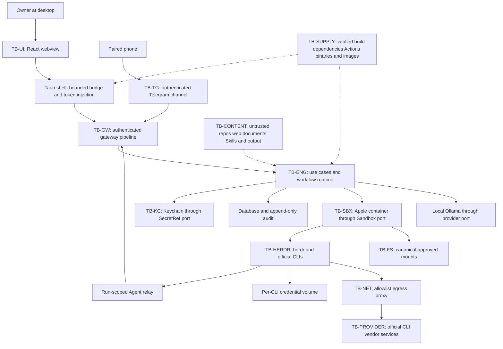

# Overmind threat model

## 1. Purpose and method

This is the target security model for the MVP, derived from [SPECIFICATION](../SPECIFICATION.md),
[ARCHITECTURE](../architecture/ARCHITECTURE.md) and [OVE_SEC001](../../tasks/OVE_SEC001/TASK.md).
It documents required controls; it does not certify that the product or any isolation mechanism is secure.
The bounded document owner is OVE_SEC010; the parent retains aggregate security acceptance.

Apply STRIDE to each data-flow trust boundary, assuming a model or CLI may obey an attacker completely.
For every threat, likelihood L and impact I each use 1 (low), 2 (medium) or 3 (high); the risk score is L x I.
Likelihood describes exposure and prerequisites, not a measured probability. Impact considers the most
sensitive reachable asset. These ordinal scores prioritize review and do not replace a reproducible finding.
Re-score when real mitigation evidence, an ADR, deployment assumptions or a failure changes the analysis.

Threat identifiers are `T-<literal boundary id>-<1..6>`, in STRIDE order: Spoofing, Tampering, Repudiation,
Information disclosure, Denial of service and Elevation of privilege. Published identifiers are never reused.
SR-01..SR-38 are reserved by OVE_SEC001 and defined once in the forthcoming OVE_SEC011 register;
AC-01..AC-40 are reserved for the OVE_SEC012 catalogue. These references are not completed document evidence.

Every mitigation row names an implementing owner and SR references. A residual entry is an exposure remaining
when the named control is implemented correctly, not an acceptance. Implementation and verifying activities
are assigned in section 7; task status, authenticated Agent reports and AI review are not proof of the effect.
Missing checks, unreadable policy and unavailable isolation block execution; no implicit host fallback exists.

## 2. Assets

| Asset | Protected value and required property                                                                           |
| ----- | --------------------------------------------------------------------------------------------------------------- |
| A1    | Owner files in Allowed Directories: authorized reads and changes only, with durable work.                       |
| A2    | Files outside Allowed Directories, including SSH keys, other projects and browser data: no Agent access.        |
| A3    | Official CLI subscription sessions in isolated credential volumes: confidentiality and Workspace separation.    |
| A4    | Keychain secrets, including bot tokens and future API keys: id references, destination-limited short-lived use. |
| A5    | Database, Decisions, Agent Memory, Tasks, checkpoints and audit: integrity, scope, recovery and availability.   |
| A6    | Owner Rules and Project Documentation: provenance and scope integrity, without content granting authority.      |
| A7    | Gateway session and scoped credentials: confidentiality, expiry, rotation and caller binding.                   |
| A8    | Owner attention and Approval authority: authentic context, explicit scope and resistance to replay or fatigue.  |
| A9    | Provider quotas, budgets, CPU, memory, process slots and time: bounded consumption and honest attribution.      |
| A10   | Owner reputation through outbound messages, publication and Git effects: authorized, single intended effect.    |

## 3. Actors

| Actor                                   | Authority and adversarial assumption                                                                     |
| --------------------------------------- | -------------------------------------------------------------------------------------------------------- |
| Owner                                   | Sole installation principal; authenticated desktop actions can grant local authority within Owner Rules. |
| Compromised Agent or CLI                | Can execute arbitrary commands inside its sandbox; reports and text cannot grant authority.              |
| Prompt-injecting content author         | Controls repository, page, issue, document, tool output or Agent-consumed content.                       |
| Remote Telegram attacker                | Sends forged, replayed, edited or flooding messages and callbacks, including from groups.                |
| Local unprivileged process or macOS app | May run as the same uid; socket file modes alone do not authenticate it.                                 |
| Other local user                        | Can probe exposed files, sockets, shared folders or backups without the Owner's authority.               |
| Supply-chain attacker                   | Can compromise dependencies, Actions, release binaries, base images or distribution metadata.            |
| Malicious Skill author                  | Controls imported instructions; Owner import does not give the Skill tools or permissions.               |
| Bystander or stolen-phone holder        | May use an unlocked device or paired account; remote authority remains Run-scoped.                       |

## 4. Data flows and trust boundaries

These arrows describe calls or data, not allowed package imports or permission grants. The scoped Agent relay
must re-enter the same gateway pipeline; no unrestricted host socket is mounted into a sandbox. Telegram uses
api-client's in-process Transport with authenticated channel context, never direct application use-case access.
The shell injects credentials and bounds frames without becoming a business-policy or arbitrary filesystem API.
The engine's host privileges are a separate risk from sandbox isolation: other same-user apps are untrusted.

| Boundary    | What crosses                                            | Authentication, trust and enforcement                                                                                                |
| ----------- | ------------------------------------------------------- | ------------------------------------------------------------------------------------------------------------------------------------ |
| TB-UI       | Rendered content and webview frames to shell/engine     | Shell authenticates its bridge; no Owner token to JS, minimal capabilities; SETUP010, ENGINE022.                                     |
| TB-GW       | Every request, subscription and scoped Agent call       | Socket 0600 in directory 0700, rotated/scoped credentials and route authorization; ENGINE010..016/028, SEC005.                       |
| TB-ENG      | Host process state, files and crash recovery            | No implicit trust in another app or recovered state; owner-only data, durable intent and reconciliation; ARCH005/013, ENGINE003/005. |
| TB-SBX      | Commands, mounts, credential volumes and resource use   | Sandbox port verifies real OS isolation before use; only canonical authorized mounts; BOX003/007/009/017/019, TEST007.               |
| TB-HERDR    | Terminal commands, screen text and state hints          | TerminalLayer owns mapping, bounded protocol, blocked/login/choice gate and evidence; PROV005/006/008/015.                           |
| TB-TG       | Cloud messages, callbacks and redacted results          | One paired chat/sender, dedupe and current-Run Approvals, no permanent grants; TG003/010/011/013, SEC008.                            |
| TB-KC       | SecretRef and short-lived Secret to a destination       | Keychain ACL plus audited adapter-only reveal; references elsewhere, no plaintext serialization; ARCH012, SEC003.                    |
| TB-NET      | Egress and temporary login forwarding                   | Allowlist proxy validates destinations/redirects; authenticated Run Approval for a new domain; BOX011/012/013/015, SEC009.           |
| TB-CONTENT  | Repos, web, docs, Skills, CLI/tool/Agent output         | Provenance and bounded schemas/fences; no content-to-capability authority path; SEC004.                                              |
| TB-FS       | Host paths and files inside/outside Allowed Directories | Canonical identity, symlink/mount checks and verified opens before policy/effects; SEC002, BOX007/019/021.                           |
| TB-SUPPLY   | Packages, Actions, binaries, images, imported Skills    | Pins, checksums/provenance, script and license restrictions, explicit Owner Skill import; SETUP006/007/008/014/015, SEC006.          |
| TB-PROVIDER | Vendor traffic and official CLI-owned sessions          | Official CLI authenticates vendor; Overmind does not obtain subscription secrets; PROV005, SEC009, ADR 0022.                         |

## 5. STRIDE analysis

All controls below are requirements until an implementing task supplies exact-head evidence. A task id names
an owner, not a completed mitigation. No row authorizes a new route, network destination, mount or fallback.

### TB-UI

| Threat    | STRIDE                 | Description                                                                    | L   | I   | Mitigation          | Owner                 | Residual                                                         |
| --------- | ---------------------- | ------------------------------------------------------------------------------ | --- | --- | ------------------- | --------------------- | ---------------------------------------------------------------- |
| T-TB-UI-1 | Spoofing               | A content link impersonates an application or provider destination.            | 2   | 2   | SR-35, SR-36        | SETUP010 / ENGINE022  | Owner may still choose a deceptive external destination.         |
| T-TB-UI-2 | Tampering              | Malformed Rust-forwarded frames or headers alter the intended gateway request. | 2   | 3   | SR-12, SR-34, SR-36 | ENGINE022 / SEC005    | A shell implementation defect can corrupt framing.               |
| T-TB-UI-3 | Repudiation            | A displayed message is mistaken for authenticated Approval evidence.           | 2   | 3   | SR-17, SR-24, SR-25 | ENGINE016 / PERM020   | Owner interpretation is fallible; audit must retain context.     |
| T-TB-UI-4 | Information disclosure | Webview content reads a bridge token, host path or sensitive result.           | 2   | 3   | SR-06, SR-07, SR-12 | ENGINE022 / SEC003    | Same-user native compromise remains outside webview containment. |
| T-TB-UI-5 | Denial of service      | Unbounded Markdown rendering or event subscriptions exhaust the UI.            | 2   | 2   | SR-35, SR-37        | CHATUI008 / ENGINE017 | Bounded expensive content can still degrade responsiveness.      |
| T-TB-UI-6 | Elevation of privilege | Agent Markdown XSS reaches Tauri IPC or arbitrary shell/filesystem plugins.    | 2   | 3   | SR-35, SR-36        | SETUP010 / CHATUI008  | Renderer or webview CVEs need patching and regression tests.     |

### TB-GW

| Threat    | STRIDE                 | Description                                                                           | L   | I   | Mitigation                 | Owner                      | Residual                                                          |
| --------- | ---------------------- | ------------------------------------------------------------------------------------- | --- | --- | -------------------------- | -------------------------- | ----------------------------------------------------------------- |
| T-TB-GW-1 | Spoofing               | Another local process or dev-HTTP DNS rebinding/CSRF impersonates the Owner.          | 3   | 3   | SR-10, SR-11, SR-12, SR-13 | ENGINE010/012/023 / SEC005 | Same-uid credential theft can defeat token authentication.        |
| T-TB-GW-2 | Tampering              | Approval replay or Rust-forwarder request smuggling changes the authenticated action. | 2   | 3   | SR-12, SR-34, SR-36        | ENGINE015/022 / SEC005     | A binding or framing bug can misapply a valid credential.         |
| T-TB-GW-3 | Repudiation            | A mutation or denial lacks durable caller/action audit attribution.                   | 2   | 3   | SR-17, SR-34               | ENGINE016 / PERM020        | Local storage compromise can destroy audit availability.          |
| T-TB-GW-4 | Information disclosure | Session/scoped tokens leak through logs, environment, URLs or errors.                 | 2   | 3   | SR-06, SR-07, SR-12, SR-13 | ENGINE012/028 / SEC003     | A compromised authenticated endpoint can observe its own traffic. |
| T-TB-GW-5 | Denial of service      | Malformed or oversized frames, concurrent calls and subscriptions exhaust queues.     | 3   | 2   | SR-03, SR-37               | ENGINE011/014/017          | Allowed-rate requests can still consume finite resources.         |
| T-TB-GW-6 | Elevation of privilege | An Agent token calls Owner routes or reads another Run.                               | 3   | 3   | SR-02, SR-12, SR-25, SR-31 | ENGINE013/028 / SEC005     | Route registration drift needs exact-scope regression tests.      |

### TB-ENG

| Threat     | STRIDE                 | Description                                                                             | L   | I   | Mitigation                 | Owner                               | Residual                                                                     |
| ---------- | ---------------------- | --------------------------------------------------------------------------------------- | --- | --- | -------------------------- | ----------------------------------- | ---------------------------------------------------------------------------- |
| T-TB-ENG-1 | Spoofing               | An untrusted host process presents itself as the engine or replaces stale socket state. | 2   | 3   | SR-10, SR-12, SR-26        | ENGINE003 / ARCH005                 | Arbitrary same-user code can attack local credentials.                       |
| T-TB-ENG-2 | Tampering              | Crash mid-action, partial writes or DB tamper corrupt state or repeat an effect.        | 2   | 3   | SR-17, SR-18, SR-26, SR-34 | ENGINE005 / DATA005/006 / ARCH013   | An ambiguous remote effect needs reconciliation, not blind retry.            |
| T-TB-ENG-3 | Repudiation            | Restart loses the action-intent or security decision record.                            | 2   | 3   | SR-17, SR-18               | ENGINE005/016 / DATA005             | Storage loss can make a result unknowable; execution stays blocked.          |
| T-TB-ENG-4 | Information disclosure | Data directory, backup folder or exported diagnostics disclose protected data.          | 2   | 3   | SR-06, SR-07, SR-26, SR-27 | ARCH005/013 / BACKUP003/004/007/008 | An Owner-selected destination may have external synchronization.             |
| T-TB-ENG-5 | Denial of service      | Host resource failure or unavailable Keychain/policy breaks recovery.                   | 2   | 2   | SR-03, SR-30, SR-37        | ENGINE004/005 / PAUSE005            | Power loss/sleep stops progress and may need manual recovery.                |
| T-TB-ENG-6 | Elevation of privilege | An internal or recovered call bypasses gateway scope or reuses a stale grant.           | 2   | 3   | SR-02, SR-03, SR-25, SR-31 | ENGINE011/013 / PERM010             | A compromised engine has host authority; isolation is not engine sandboxing. |

### TB-SBX

| Threat     | STRIDE                 | Description                                                                                  | L   | I   | Mitigation                 | Owner                             | Residual                                                                   |
| ---------- | ---------------------- | -------------------------------------------------------------------------------------------- | --- | --- | -------------------------- | --------------------------------- | -------------------------------------------------------------------------- |
| T-TB-SBX-1 | Spoofing               | A forged environment/Agent mapping selects another Workspace credential volume.              | 2   | 3   | SR-05, SR-28, SR-33        | BOX003/009 / PROV005              | Incorrect runtime identity binding can cross Workspaces.                   |
| T-TB-SBX-2 | Tampering              | Writes outside /work, a shared writable mount, or wrong CLI cwd corrupt or lose work.        | 3   | 3   | SR-04, SR-05, SR-33        | BOX007/010/019 / PROV005          | Approved shared project writes can still conflict; use separate worktrees. |
| T-TB-SBX-3 | Repudiation            | An isolation denial or mount change has no durable attribution.                              | 2   | 2   | SR-17, SR-29               | PERM020 / BOX022 / TEST007        | A dead runtime may prevent complete forensic reconstruction.               |
| T-TB-SBX-4 | Information disclosure | An Agent reads host SSH files, another credential volume, or exfiltrates via network.        | 3   | 3   | SR-01, SR-05, SR-20, SR-33 | BOX007/009/011/019                | Provider-allowed traffic remains a potential covert channel.               |
| T-TB-SBX-5 | Denial of service      | A fork bomb or memory/CPU exhaustion starves the host or other Agents.                       | 3   | 2   | SR-30, SR-37               | BOX017 / PAUSE005                 | Host memory pressure can still affect work inside configured limits.       |
| T-TB-SBX-6 | Elevation of privilege | Symlink/bind-mount escape, broad non-canonical mounts or runtime socket access reaches host. | 3   | 3   | SR-03, SR-04, SR-05, SR-29 | SEC002 / BOX007/019/021 / TEST007 | Uncovered runtime/kernel CVEs remain a residual release risk.              |

### TB-HERDR

| Threat       | STRIDE                 | Description                                                                                  | L   | I   | Mitigation                 | Owner                      | Residual                                                                |
| ------------ | ---------------------- | -------------------------------------------------------------------------------------------- | --- | --- | -------------------------- | -------------------------- | ----------------------------------------------------------------------- |
| T-TB-HERDR-1 | Spoofing               | A substituted terminal identity or false Agent report impersonates a completion.             | 3   | 3   | SR-19, SR-24, SR-28        | PROV005/006/008            | Authenticated report attribution still does not prove work succeeded.   |
| T-TB-HERDR-2 | Tampering              | Remote manifest updates alter detection, or blind agent.prompt retry duplicates publication. | 3   | 3   | SR-18, SR-19, SR-22, SR-28 | PROV004/005/008 / SETUP015 | Pinned detection may become stale when an official CLI changes.         |
| T-TB-HERDR-3 | Repudiation            | False done after login expiry/choice dialog advances a Task without effect evidence.         | 3   | 3   | SR-17, SR-19, SR-24        | PROV006/008 / WFRT056      | Evidence can be incomplete; Quality Gate must keep outcome unknown.     |
| T-TB-HERDR-4 | Information disclosure | Terminal output or login screen content exposes subscription credentials.                    | 2   | 3   | SR-06, SR-07, SR-21        | PROV005 / SEC003/009       | The official CLI itself remains trusted to protect its credentials.     |
| T-TB-HERDR-5 | Denial of service      | herdr API/version drift or lost acknowledgment stalls work.                                  | 3   | 2   | SR-03, SR-18, SR-28        | PROV004/005/008 / SETUP015 | A stalled provider requires a supported fallback or escalation.         |
| T-TB-HERDR-6 | Elevation of privilege | A prompt is typed into a permission/choice dialog and grants unintended CLI authority.       | 3   | 3   | SR-08, SR-19, SR-25        | PROV006/008 / SEC004       | Screen classification can fail; uncertain dialog state remains blocked. |

### TB-TG

| Threat    | STRIDE                 | Description                                                                          | L   | I   | Mitigation          | Owner                   | Residual                                                                  |
| --------- | ---------------------- | ------------------------------------------------------------------------------------ | --- | --- | ------------------- | ----------------------- | ------------------------------------------------------------------------- |
| T-TB-TG-1 | Spoofing               | Forged sender/update, another user, or a group chat impersonates the paired Owner.   | 3   | 3   | SR-14, SR-16        | TG003/013 / SEC008      | A genuinely compromised paired account passes sender authentication.      |
| T-TB-TG-2 | Tampering              | Replayed update_id, callback forgery or edited message changes an approved action.   | 3   | 3   | SR-15, SR-17, SR-34 | TG010/011 / SEC008      | Message delivery ordering can be ambiguous; durable dedupe is required.   |
| T-TB-TG-3 | Repudiation            | Desktop and Telegram disagree on which Run/action was approved.                      | 2   | 3   | SR-17, SR-34        | TG013 / ENGINE016       | Network delay can show stale views; engine remains authoritative.         |
| T-TB-TG-4 | Information disclosure | Bot token or sensitive content leaks through Telegram non-E2E transport.             | 2   | 3   | SR-06, SR-07, SR-14 | TG009 / SEC003/008      | Telegram/cloud/account compromise exposes already delivered safe content. |
| T-TB-TG-5 | Denial of service      | Flooding unpaired/paired messages overwhelms queues or Owner attention.              | 3   | 2   | SR-14, SR-37        | TG013 / ENGINE014       | A valid sender can still consume its permitted rate and attention.        |
| T-TB-TG-6 | Elevation of privilege | Stolen phone grants permanent directories, removes Approvals or weakens Owner Rules. | 3   | 3   | SR-15, SR-16, SR-25 | TG011 / PERM009/012/016 | Run-scoped authorized actions can still be harmful before revocation.     |

### TB-KC

| Threat    | STRIDE                 | Description                                                                          | L   | I   | Mitigation                 | Owner                       | Residual                                                                |
| --------- | ---------------------- | ------------------------------------------------------------------------------------ | --- | --- | -------------------------- | --------------------------- | ----------------------------------------------------------------------- |
| T-TB-KC-1 | Spoofing               | An app or forged secret reference impersonates the intended Keychain destination.    | 2   | 3   | SR-06, SR-12               | ARCH012 / SEC003            | Same-user compromise can attack platform authorization/UI.              |
| T-TB-KC-2 | Tampering              | A secret id is replaced or stale credentials are applied to the wrong connection.    | 2   | 3   | SR-06, SR-17               | ARCH012 / SEC003            | A compromised destination adapter can misuse plaintext it must receive. |
| T-TB-KC-3 | Repudiation            | A secret read/replacement lacks an attributable security decision.                   | 2   | 3   | SR-06, SR-17               | ARCH012 / PERM020           | OS-level events may not provide complete application correlation.       |
| T-TB-KC-4 | Information disclosure | Another app reads a secret, or plaintext reaches logs, prompts, errors or snapshots. | 2   | 3   | SR-06, SR-07               | ARCH012 / ARCH004 / SEC003  | Memory inspection by a compromised host process is a remaining risk.    |
| T-TB-KC-5 | Denial of service      | Locked or unavailable Keychain during unattended work prevents safe execution.       | 3   | 2   | SR-03, SR-06               | ARCH012 / SEC003            | Owner presence may be required; do not cache a plaintext fallback.      |
| T-TB-KC-6 | Elevation of privilege | An Agent requests Keychain files or uses a broad secret-read capability.             | 3   | 3   | SR-01, SR-05, SR-06, SR-31 | SEC003 / ENGINE028 / BOX007 | Overbroad native ACLs need real integration tests.                      |

### TB-NET

| Threat     | STRIDE                 | Description                                                                   | L   | I   | Mitigation                 | Owner                   | Residual                                                                      |
| ---------- | ---------------------- | ----------------------------------------------------------------------------- | --- | --- | -------------------------- | ----------------------- | ----------------------------------------------------------------------------- |
| T-TB-NET-1 | Spoofing               | A local port squatter intercepts the CLI login callback on localhost:1455.    | 2   | 3   | SR-21, SR-28               | SEC009 / BOX015         | Login remains vendor protocol-dependent; uncertain binding blocks the flow.   |
| T-TB-NET-2 | Tampering              | Redirect or DNS rebinding changes an allowlisted provider destination.        | 3   | 3   | SR-03, SR-20               | BOX011/012/013          | A compromised legitimate provider host remains within that host identity.     |
| T-TB-NET-3 | Repudiation            | An egress Approval has no durable domain/Run/action attribution.              | 2   | 2   | SR-17, SR-34               | PERM020 / BOX013        | Network logs cannot alone prove the content of an encrypted request.          |
| T-TB-NET-4 | Information disclosure | DNS/HTTPS to a new domain or allowed provider traffic carries protected data. | 3   | 3   | SR-06, SR-07, SR-20, SR-38 | BOX011/012/013 / SEC003 | TLS/protocol and provider access limits cannot eliminate covert exfiltration. |
| T-TB-NET-5 | Denial of service      | Connection floods, large responses or login forwards consume resources.       | 3   | 2   | SR-21, SR-37               | BOX013/015/017          | Remote provider outage may still stop supported workflows.                    |
| T-TB-NET-6 | Elevation of privilege | A permanent login forward or direct DNS/socket path bypasses approval/proxy.  | 2   | 3   | SR-03, SR-20, SR-21        | BOX011/012/015 / SEC009 | Runtime network configuration must be proved on actual release hardware.      |

### TB-CONTENT

| Threat         | STRIDE                 | Description                                                                          | L   | I   | Mitigation                               | Owner                           | Residual                                                                     |
| -------------- | ---------------------- | ------------------------------------------------------------------------------------ | --- | --- | ---------------------------------------- | ------------------------------- | ---------------------------------------------------------------------------- |
| T-TB-CONTENT-1 | Spoofing               | Repo/page/issue/Skill/CLI/Agent text pretends to be Owner or Telegram approval.      | 3   | 3   | SR-08, SR-16, SR-24                      | SEC004 / CHIEF005 / AGENT014    | A model can still believe the text; capabilities must ignore that belief.    |
| T-TB-CONTENT-2 | Tampering              | Invisible Unicode, delimiter forgery or permission-like JSON changes prompt meaning. | 3   | 3   | SR-08, SR-23, SR-24                      | SEC004 / WFRT015                | Fences reduce confusion and are not an authorization boundary.               |
| T-TB-CONTENT-3 | Repudiation            | An Agent claims tests passed or Owner approved without attributable evidence.        | 3   | 3   | SR-17, SR-19, SR-24                      | AGENT014 / WFRT056              | A forged artifact requires independent provenance/effect verification.       |
| T-TB-CONTENT-4 | Information disclosure | Injected content asks the model to disclose secrets, private context or prompts.     | 3   | 3   | SR-06, SR-07, SR-08, SR-32               | SEC003/004 / CHIEF005           | Already authorized context may still be exposed to the configured provider.  |
| T-TB-CONTENT-5 | Denial of service      | Huge, nested or repetitive data exhausts context or evaluator budgets.               | 3   | 2   | SR-08, SR-23, SR-24, SR-37               | SEC004 / WFRT015                | Valid bounded content still consumes time and model quota.                   |
| T-TB-CONTENT-6 | Elevation of privilege | Model text installs a Skill, executes code, changes Rules or grants access.          | 3   | 3   | SR-02, SR-08, SR-09, SR-16, SR-23, SR-25 | SEC004 / SKILL007/008 / PERM009 | Authorized effect implementations remain responsible for policy enforcement. |

### TB-FS

| Threat    | STRIDE                 | Description                                                                              | L   | I   | Mitigation                 | Owner                    | Residual                                                                      |
| --------- | ---------------------- | ---------------------------------------------------------------------------------------- | --- | --- | -------------------------- | ------------------------ | ----------------------------------------------------------------------------- |
| T-TB-FS-1 | Spoofing               | A parent, case/Unicode/firmlink alias presents a forbidden path as an allowed directory. | 3   | 3   | SR-01, SR-04               | SEC002 / PERM031         | Filesystem identity rules vary by volume and must be probed safely.           |
| T-TB-FS-2 | Tampering              | Symlink or mount changes between decision and open redirects an effect.                  | 3   | 3   | SR-04, SR-05               | SEC002 / BOX021          | Host mutation races require verified handles and revalidation.                |
| T-TB-FS-3 | Repudiation            | An allowed/denied path decision lacks safe canonical identity audit.                     | 2   | 2   | SR-04, SR-17               | SEC002 / PERM020         | Audit must omit sensitive absolute paths from outbound channels.              |
| T-TB-FS-4 | Information disclosure | Traversal, bind mounts or broad roots expose files outside Allowed Directories.          | 3   | 3   | SR-01, SR-04, SR-05        | SEC002 / BOX007/019      | An Owner-approved broad directory inherently exposes its authorized contents. |
| T-TB-FS-5 | Denial of service      | Dangling symlink, mount churn or inaccessible root stalls canonicalization.              | 2   | 2   | SR-03, SR-04, SR-37        | SEC002 / BOX021          | Unavailable files block that action; unrelated Runs may proceed.              |
| T-TB-FS-6 | Elevation of privilege | A path Access Request or restored grant widens another policy through union semantics.   | 3   | 3   | SR-02, SR-04, SR-25, SR-32 | PERM005/007/010 / SEC002 | A valid Local Approval must still be constrained by every other policy.       |

### TB-SUPPLY

| Threat        | STRIDE                 | Description                                                                            | L   | I   | Mitigation          | Owner                            | Residual                                                                            |
| ------------- | ---------------------- | -------------------------------------------------------------------------------------- | --- | --- | ------------------- | -------------------------------- | ----------------------------------------------------------------------------------- |
| T-TB-SUPPLY-1 | Spoofing               | Typosquat, swapped herdr binary or forged artifact impersonates an approved version.   | 3   | 3   | SR-22, SR-28        | SEC006 / SETUP008/015            | A compromised upstream signing/release account can publish valid-looking artifacts. |
| T-TB-SUPPLY-2 | Tampering              | Dependency/postinstall, Action, base-image or detection-manifest content is modified.  | 3   | 3   | SR-22, SR-28        | SEC006 / SETUP006/007/008/015    | Pins do not remove vulnerabilities in the pinned content.                           |
| T-TB-SUPPLY-3 | Repudiation            | A release lacks provenance, dependency/license notices or reproducible check evidence. | 2   | 3   | SR-17, SR-22, SR-29 | SEC006 / SETUP007/014            | An incomplete inventory can miss embedded components; release remains blocked.      |
| T-TB-SUPPLY-4 | Information disclosure | A compromised build action or install script leaks credentials or signing material.    | 3   | 3   | SR-06, SR-07, SR-22 | SEC006 / SETUP006/007/014        | A trusted build runner remains a sensitive security boundary.                       |
| T-TB-SUPPLY-5 | Denial of service      | Upstream outage, removed artifact or incompatible CLI release blocks builds/runs.      | 2   | 2   | SR-03, SR-22, SR-28 | SEC006 / SETUP008/015            | Fail-closed checks may delay delivery; no floating-version bypass exists.           |
| T-TB-SUPPLY-6 | Elevation of privilege | Malicious internet Skill, postinstall or unpinned Action obtains host execution.       | 3   | 3   | SR-09, SR-22, SR-28 | SEC006 / SETUP006/008 / SKILL007 | Owner import is provenance, not proof of benign behaviour.                          |

### TB-PROVIDER

| Threat          | STRIDE                 | Description                                                                             | L   | I   | Mitigation                        | Owner                        | Residual                                                                           |
| --------------- | ---------------------- | --------------------------------------------------------------------------------------- | --- | --- | --------------------------------- | ---------------------------- | ---------------------------------------------------------------------------------- |
| T-TB-PROVIDER-1 | Spoofing               | A forged vendor/login endpoint or CLI identity captures the intended session.           | 2   | 3   | SR-20, SR-21, SR-22, SR-28        | SEC009 / SETUP015 / PROV005  | Official endpoint compromise is beyond local authentication checks.                |
| T-TB-PROVIDER-2 | Tampering              | Changed CLI resume semantics, model output or usage claims alter workflow decisions.    | 3   | 3   | SR-18, SR-19, SR-24, SR-28        | PROV005/008/015              | Vendor behaviour may change without an Overmind release.                           |
| T-TB-PROVIDER-3 | Repudiation            | Usage/quota or completion is attributed to Overmind without source evidence.            | 2   | 2   | SR-17, SR-19, SR-28               | PROV017 / WFRT056            | Provider-reported limits may be delayed; label source and uncertainty.             |
| T-TB-PROVIDER-4 | Information disclosure | Provider traffic or credential-volume sharing discloses data/subscription credentials.  | 2   | 3   | SR-06, SR-21, SR-33, SR-38        | PROV005 / SEC009 / BOX009    | Configured provider sees authorized submitted content under its own terms.         |
| T-TB-PROVIDER-5 | Denial of service      | Shared subscription limit exhaustion, account revocation or vendor outage stops Agents. | 3   | 2   | SR-03, SR-28, SR-37               | PROV018/019 / CHIEF006       | Fallback availability and its own quota are not guaranteed.                        |
| T-TB-PROVIDER-6 | Elevation of privilege | Login/session or provider-suggested tool settings enlarge local permissions.            | 2   | 3   | SR-02, SR-05, SR-16, SR-21, SR-31 | SEC009 / PROV005 / ENGINE028 | Vendor auto-mode is not the security boundary; OS/policy controls remain required. |

## 6. Abuse cases summary

The following identifiers are reserved for OVE_SEC012; descriptions are data, not executable attack payloads.
All future test hooks must assert denial/failure effects, not only an error string or a model's claimed refusal.

| Cases        | Required family and expected control                                                                                                                       |
| ------------ | ---------------------------------------------------------------------------------------------------------------------------------------------------------- |
| AC-01..AC-08 | Host secret files, relative/symlink/bind-mount escape, new-domain DNS/HTTPS, parent directory and path aliases: deny outside effective policy.             |
| AC-09..AC-15 | Repo, web, issue, Skill, Agent authority forgery and unknown permission fields: data/proposal only, never authority.                                       |
| AC-16..AC-21 | Unpaired/group sender, update/callback replay, expired Run, stolen phone and edited approval: authenticated, bound, single-use Run scope.                  |
| AC-22..AC-25 | False done, login-required, choice dialog and ambiguous prompt retry: block delivery/advancement, inspect real evidence.                                   |
| AC-26..AC-28 | Crash after started intent, tokenless gateway client and Agent token on Owner route: no replay, no scope escalation.                                       |
| AC-29..AC-30 | Token in diagnostics and host path in Telegram errors: redact at the boundary, do not expose plaintext.                                                    |
| AC-31..AC-33 | Postinstall, unpinned Action and replaced binary: deny unapproved supply-chain execution.                                                                  |
| AC-34..AC-40 | Login-port squatter, malicious Markdown, oversized request, fork bomb, other-Workspace credentials, Pause bypass and Telegram Rule weakening: fail closed. |

## 7. Mitigation map and coverage

The single normative SR register belongs to OVE_SEC011 (`requirements.md`). The map assigns responsibility;
verification remains planned until its owning task records actual evidence. No AI review substitutes for
escape tests, authenticated effect provenance, denied-path tests or checks for the exact release artifact.

| Area                     | SR responsibilities                                                         | Implementing and verifying task examples                                                                |
| ------------------------ | --------------------------------------------------------------------------- | ------------------------------------------------------------------------------------------------------- |
| PERM                     | SR-01, SR-02, SR-03, SR-04, SR-15, SR-16, SR-17, SR-25, SR-34               | PERM005/007/010/016/020/031; permission/Approval unit, contract and integration negatives.              |
| BOX                      | SR-04, SR-05, SR-20, SR-21, SR-29, SR-33, SR-37                             | BOX007/009/011/012/013/015/017/019/021/022; TEST007 real escape and resource/egress tests.              |
| PROV                     | SR-18, SR-19, SR-21, SR-24, SR-28, SR-37                                    | PROV004/005/006/008/015/017/018/019; TEST006/009 simulator cases plus actual sandboxed CLI integration. |
| TG                       | SR-07, SR-14, SR-15, SR-16, SR-17, SR-34                                    | TG003/009/010/011/013; SEC008 pairing, forgery, replay and remote-scope integration.                    |
| ENGINE                   | SR-03, SR-10, SR-11, SR-12, SR-13, SR-17, SR-18, SR-25, SR-31, SR-34, SR-37 | ENGINE005/010..018/022/023/028; SEC005 actual public-gateway negative tests.                            |
| WFRT                     | SR-02, SR-18, SR-19, SR-23, SR-24, SR-30, SR-37                             | WFRT015/052/056; safe evaluation, bounded loops, crash recovery and real Quality Gate evidence.         |
| CHIEF                    | SR-08, SR-09, SR-16, SR-19, SR-24                                           | CHIEF005/006/016/020; SEC004 corpus and authority/plan synchronization negatives.                       |
| AGENT                    | SR-08, SR-19, SR-24, SR-31                                                  | AGENT014/019; strict authenticated reports and ambiguous-session recovery tests.                        |
| SKILL                    | SR-02, SR-08, SR-09, SR-24, SR-31                                           | SKILL007/008/012/013; Owner-only import and Run-scoped helper denial tests.                             |
| DATA                     | SR-06, SR-17, SR-18, SR-26, SR-27                                           | DATA005/006/018/020; real SQLite durability, audit and artifact provenance integration.                 |
| BACKUP                   | SR-06, SR-07, SR-26, SR-27                                                  | BACKUP tasks; secret-free export/restore and Owner-selected directory integration.                      |
| UI / ONB / WSPACE        | SR-01, SR-07, SR-21, SR-25, SR-32, SR-35, SR-36                             | CHATUI008/009, ONB004/008, WSPACE and permission UI; sanitized render and local-approval e2e.           |
| SETUP                    | SR-22, SR-28, SR-29, SR-35, SR-36                                           | SETUP006/007/008/010/014/015/021; license/provenance, capability and dedicated runner checks.           |
| ARCH                     | SR-03, SR-06, SR-07, SR-10, SR-17, SR-23, SR-26, SR-38                      | ARCH002/004/005/012/013/015; boundary, redaction, secret and owner-only startup negatives.              |
| SEC / TEST / VIS / PAUSE | SR-03..SR-09, SR-14..SR-16, SR-20..SR-24, SR-29..SR-33, SR-35, SR-37        | SEC002..009, TEST006/007/009/011/012, VIS/PERM and PAUSE; assigned review and adversarial suites.       |

Parent acceptance checks: every SR-01..SR-38 has an existing threat, an implementing task and a verifying
activity; all AC ids resolve; SPECIFICATION 16 criteria 1/7/8/9/10/14 and every required ADR consequence map to
SRs. OVE_SEC011 supplies that explicit criterion/ADR mapping. Every OPEN item remains visible. The three
final documents together must contain 600..900 lines; the parent is not done when this first child merges.

## 8. Residual risks and acceptance

All entries below are OPEN; none is represented as accepted by the Owner. The acceptance authority is the
Owner for every row. Routine implementation delegation, source review and historical prototypes do not
constitute acceptance. Review due dates are 2027-01-23, or immediately when the listed signal occurs.
Release still requires implemented mitigations, real verification and any explicit risk decision that applies.

| Risk                                                                                                   | L   | I   | Detection / review signal                                                        | Acceptance authority and status | Due        |
| ------------------------------------------------------------------------------------------------------ | --- | --- | -------------------------------------------------------------------------------- | ------------------------------- | ---------- |
| R-01 Provider terms may restrict automated official-CLI use; current vendor terms are unverified here. | 3   | 3   | Terms/CLI auth change, account restriction or quarterly primary-source review.   | Owner; OPEN                     | 2027-01-23 |
| R-02 Incomplete VM, mount, credential or egress configuration creates apparent isolation.              | 2   | 3   | Real release-artifact escape failure, unsupported runtime or mount drift.        | Owner; OPEN                     | 2027-01-23 |
| R-03 Prompt injection persists despite structural content controls.                                    | 3   | 3   | Corpus regression, forged proposal, unexpected authority or outbound effect.     | Owner; OPEN                     | 2027-01-23 |
| R-04 Infinite loops/resource use exhaust a shared subscription quota or host budget.                   | 3   | 2   | Loop/budget/queue limit breach, quota reset drift or resource saturation.        | Owner; OPEN                     | 2027-01-23 |
| R-05 Crash/timeout/retry leaves a non-idempotent remote effect ambiguous.                              | 2   | 3   | Started intent without verified outcome; conflicting remote/effect evidence.     | Owner; OPEN                     | 2027-01-23 |
| R-06 Chief plan and a direct Agent command diverge.                                                    | 2   | 2   | Unacknowledged command, inconsistent Task state or missing Chief update.         | Owner; OPEN                     | 2027-01-23 |
| R-07 Telegram, desktop and engine views diverge.                                                       | 2   | 2   | Event gap, replay mismatch or reconnect showing stale state.                     | Owner; OPEN                     | 2027-01-23 |
| R-08 Concurrent Agents conflict in the same repository.                                                | 3   | 2   | Overlapping owns, dirty/reused worktree or conflicting integration diff.         | Owner; OPEN                     | 2027-01-23 |
| R-09 herdr is discontinued or its API/detection becomes incompatible.                                  | 2   | 2   | Pinned-protocol mismatch, unsupported CLI state or upstream maintenance change.  | Owner; OPEN                     | 2027-01-23 |
| R-10 AI review creates a false sense of security.                                                      | 3   | 3   | Missing real test artifacts, weak negative tests or unverified claimed coverage. | Owner; OPEN                     | 2027-01-23 |
| R-11 A compromised same-user host app steals transport credentials or tampers with data.               | 2   | 3   | Session misuse, file identity drift or OS/app compromise report.                 | Owner; OPEN                     | 2027-01-23 |
| R-12 A stolen phone/account performs an otherwise valid current-Run action.                            | 2   | 3   | Unexpected paired activity, Approval pattern or revocation request.              | Owner; OPEN                     | 2027-01-23 |
| R-13 Unknown runtime/kernel or provider compromise defeats an assumed boundary.                        | 2   | 3   | Upstream advisory, release provenance drift or new escape evidence.              | Owner; OPEN                     | 2027-01-23 |

No weaker Lima/older-macOS fallback is implemented or accepted here. Unsupported isolation means no execution.
A proposed replacement must preserve boundary strength, real escape evidence and dependency/license policy;
free availability alone does not authorize an unsafe alternative or establish provider-terms compliance.

## 9. Assumptions and out-of-scope threats

- One local installation has one Owner; there is no centralized account service or telemetry. SR-38 forbids
  unexpected outbound data. Configured provider and Telegram traffic still need capability and data checks.
- The MVP isolation baseline is Apple silicon and macOS 26. Prototype observations demonstrate historical
  feasibility only: false done, wrong CLI cwd and cross-container login redirects are documented failure modes.
- SR-11 peer-uid verification remains SHOULD pending actual platform support; token/scope checks remain MUST.
- Scoped Agent relay details belong to ENGINE028/SKILL012 and BOX002/020; no broad host-socket/TCP substitute.
- Keychain stores application secrets. Official CLI subscription credentials stay in their isolated CLI volumes;
  transport tokens remain short-lived, transport-owned and absent from prompts/UI/logs. No blanket secret export.
- Nation-state attacks, new macOS kernel exploits, runtime escapes beyond tested coverage and a malicious Owner
  are not claimed solved. R-13 records the residual; discovered integration impact still requires mitigation.
- Physical-access social engineering is outside the vulnerability-reporting scope, but stolen-phone authority is
  modeled because remote actions must never grant permanent rights. An unlocked host can defeat local assumptions.
- Penetration and escape execution is owned by the implementation/test tasks, on disposable data and approved
  infrastructure; this document executes no attack and grants no rights over third-party systems or other apps.

## 10. Review cadence and change procedure

Review this model whenever an ADR changes any trust boundary, caller, transport, mount, credential, data flow,
provider or release artifact, after a security incident, and before a release that changes its assumptions.
Review provider automation terms at least quarterly using current primary sources; record date, exact source,
scope and explicit decision. R-01 stays OPEN until that evidence exists; this is not a legal conclusion.

The document owner proposes changes to stable threats/SRs/ACs without renumbering them. Deprecate rather than
reuse ids; give each new OPEN threat an implementing owner or a proposal for a bounded missing task. Do not
silently weaken a MUST to pass tests. The integrator coordinates owned-path changes and the parent coverage
review. Independent specification and standards reviewers check the exact head and actual test limitations.

Keep evidence secret-free: synthetic fixtures, relative paths, authenticated caller/action bindings, commands,
exit codes and artifact provenance as applicable. Do not reproduce an injection payload in an incident summary.
A skipped/missing runner, incomplete scan or asserted Agent completion is never a passing security gate.
