# Task dependencies

Generated by `pnpm gen:task-index`. Do not edit.

## Dependencies

| ID | depends_on | soft_depends_on | blocks |
| --- | --- | --- | --- |
| OVE_AGENT001 | OVE_ARCH003, OVE_ARCH007, OVE_ARCH008, OVE_PERM001, OVE_PROV002, OVE_VIS001 | OVE_ARCH010 | OVE_AGENT002, OVE_AGENT003, OVE_AGENT004, OVE_AGENT009, OVE_AGENT011, OVE_AGENT013, OVE_AGENT018, OVE_AGENT020, OVE_AGUI001, OVE_APPRUI001, OVE_CHAT001, OVE_CHATUI002, OVE_CHIEF001, OVE_PROV003, OVE_SKILL001, OVE_WFED023, OVE_WFED064 |
| OVE_AGENT002 | OVE_AGENT001, OVE_PERM005, OVE_VIS002 | - | OVE_AGENT003, OVE_AGENT004 |
| OVE_AGENT003 | OVE_AGENT001, OVE_AGENT002, OVE_DATA001, OVE_DATA002, OVE_DATA005 | - | OVE_AGENT004, OVE_AGENT016, OVE_AGENT017, OVE_AGENT020, OVE_NOTIF004, OVE_PROV025, OVE_PROV035, OVE_SKILL005, OVE_SKILL010 |
| OVE_AGENT004 | OVE_AGENT001, OVE_AGENT002, OVE_AGENT003, OVE_ARCH007, OVE_ARCH010, OVE_DATA002, OVE_DATA005, OVE_DATA010, OVE_PERM011, OVE_PERM020, OVE_SKILL003 | - | OVE_AGENT005, OVE_AGENT006, OVE_AGENT007, OVE_AGENT008, OVE_AGENT010, OVE_AGENT016, OVE_AGENT020, OVE_CHAT006, OVE_CHAT011, OVE_CHIEF010, OVE_CHIEF018, OVE_MEM009 |
| OVE_AGENT005 | OVE_AGENT004, OVE_ARCH009, OVE_ENGINE012, OVE_ENGINE019 | - | OVE_AGUI002, OVE_AGUI005, OVE_AGUI008, OVE_AGUI009, OVE_AGUI012, OVE_AGUI013, OVE_AGUI014, OVE_APPRUI002, OVE_APPRUI005, OVE_CHATUI004, OVE_CHATUI021, OVE_CHATUI023, OVE_CHATUI024, OVE_CHATUI028, OVE_CHATUI029, OVE_CHATUI030, OVE_CONNUI007, OVE_CONNUI010, OVE_PROV036, OVE_SKUI008, OVE_TG007, OVE_WFED023, OVE_WFED043, OVE_WFED050, OVE_WFED066, OVE_WFED067, OVE_WFED074, OVE_WFED075, OVE_WSPACE018 |
| OVE_AGENT006 | OVE_AGENT004, OVE_DATA010, OVE_VIS002, OVE_VIS005 | OVE_AGENT005 | OVE_AGENT007, OVE_AGUI008, OVE_CHIEF014, OVE_WFED065, OVE_WSPACE028 |
| OVE_AGENT007 | OVE_AGENT004, OVE_AGENT006, OVE_CHIEF014, OVE_DATA010, OVE_MEM003, OVE_NOTIF004, OVE_PERM020 | OVE_AGENT005 | OVE_AGUI012, OVE_CHIEF010, OVE_MEM009 |
| OVE_AGENT008 | OVE_AGENT004, OVE_PERM011, OVE_PROV025, OVE_SKILL003 | - | OVE_CHIEF009, OVE_SKILL010 |
| OVE_AGENT009 | OVE_AGENT001 | - | OVE_AGENT010, OVE_WFED064 |
| OVE_AGENT010 | OVE_AGENT004, OVE_AGENT009, OVE_ARCH007, OVE_ARCH010, OVE_PERM016, OVE_PROV009 | OVE_AGENT005 | OVE_AGENT012, OVE_AGENT014, OVE_AGENT017, OVE_AGUI001, OVE_AGUI002, OVE_CHAT008, OVE_CHAT011, OVE_CHATUI004, OVE_CHATUI024, OVE_CHATUI028, OVE_CHIEF007, OVE_TRAY004, OVE_WFED064, OVE_WFED079, OVE_WSPACE002 |
| OVE_AGENT011 | OVE_AGENT001, OVE_DATA001, OVE_DATA002, OVE_DATA018 | OVE_AGENT003 | OVE_AGENT012, OVE_AGENT017 |
| OVE_AGENT012 | OVE_AGENT010, OVE_AGENT011, OVE_AGENT018, OVE_ARCH004, OVE_ARCH007, OVE_ARCH010, OVE_PERM020, OVE_PROV009, OVE_SEC004 | - | OVE_AGENT015, OVE_AGENT017 |
| OVE_AGENT013 | OVE_AGENT001, OVE_AGENT018, OVE_ENGINE028, OVE_PERM020, OVE_VIS002 | OVE_AGENT004 | OVE_AGENT014, OVE_AGENT015 |
| OVE_AGENT014 | OVE_AGENT010, OVE_AGENT013, OVE_AGENT018, OVE_DATA018, OVE_PERM016, OVE_SEC004 | OVE_AGENT012 | OVE_AGENT015, OVE_PROV015, OVE_PROV030 |
| OVE_AGENT015 | OVE_AGENT012, OVE_AGENT013, OVE_AGENT014, OVE_ARCH009, OVE_ENGINE010, OVE_ENGINE028 | - | - |
| OVE_AGENT016 | OVE_AGENT003, OVE_AGENT004, OVE_ARCH007 | - | OVE_AGUI001, OVE_PERM010, OVE_WFED023 |
| OVE_AGENT017 | OVE_AGENT003, OVE_AGENT010, OVE_AGENT011, OVE_AGENT012, OVE_ARCH007, OVE_DATA012, OVE_ENGINE004, OVE_ENGINE005 | - | - |
| OVE_AGENT018 | OVE_AGENT001, OVE_ARCH007, OVE_WFRT006 | - | OVE_AGENT012, OVE_AGENT013, OVE_AGENT014, OVE_AGENT019, OVE_CHIEF005, OVE_CHIEF007, OVE_CHIEF009, OVE_PERM010, OVE_PERM014, OVE_PERM016, OVE_TRAY004, OVE_WFRT051 |
| OVE_AGENT019 | OVE_AGENT018, OVE_ARCH007, OVE_DATA005, OVE_ENGINE004, OVE_ENGINE005, OVE_PERM010, OVE_WFRT052 | - | - |
| OVE_AGENT020 | OVE_AGENT001, OVE_AGENT003, OVE_AGENT004, OVE_ARCH003 | - | OVE_BOARD005, OVE_BOARD006, OVE_BOARD008, OVE_BOARD010, OVE_BOARD011, OVE_DEC005, OVE_DISC005, OVE_DISC007, OVE_DISC008, OVE_DISC013, OVE_MEM005 |
| OVE_AGUI001 | OVE_AGENT001, OVE_AGENT010, OVE_AGENT016, OVE_ARCH011, OVE_BOARDUI002, OVE_DS040, OVE_MEM001, OVE_PERM005, OVE_SKILL001 | - | OVE_AGUI002, OVE_AGUI004, OVE_AGUI005, OVE_AGUI007, OVE_AGUI011 |
| OVE_AGUI002 | OVE_AGENT005, OVE_AGENT010, OVE_AGUI001, OVE_BOARDUI001, OVE_PROV002, OVE_PROV021, OVE_SHELL011, OVE_SHELL027 | - | OVE_AGUI003, OVE_AGUI004, OVE_AGUI005, OVE_AGUI015 |
| OVE_AGUI003 | OVE_AGUI002, OVE_BOARDUI003, OVE_DS044, OVE_SHELL012 | - | OVE_AGUI004, OVE_AGUI006, OVE_AGUI007, OVE_AGUI008, OVE_AGUI009, OVE_AGUI010, OVE_AGUI011, OVE_AGUI012, OVE_AGUI013, OVE_AGUI014, OVE_AGUI015, OVE_AGUI016 |
| OVE_AGUI004 | OVE_AGUI001, OVE_AGUI002, OVE_AGUI003, OVE_DS032, OVE_DS066 | - | OVE_AGUI012, OVE_AGUI015, OVE_AGUI017 |
| OVE_AGUI005 | OVE_AGENT005, OVE_AGUI001, OVE_AGUI002, OVE_BOARDUI001, OVE_PERM026, OVE_SKILL011 | - | OVE_AGUI006, OVE_AGUI007, OVE_AGUI008, OVE_AGUI009, OVE_AGUI010, OVE_AGUI012, OVE_AGUI013, OVE_AGUI014, OVE_AGUI015 |
| OVE_AGUI006 | OVE_AGUI003, OVE_AGUI005, OVE_DS035, OVE_DS066, OVE_SHELL027 | - | OVE_AGUI007, OVE_AGUI014, OVE_AGUI017 |
| OVE_AGUI007 | OVE_AGUI001, OVE_AGUI003, OVE_AGUI005, OVE_AGUI006, OVE_DS026, OVE_DS030, OVE_DS068, OVE_PROV002 | - | OVE_AGUI008, OVE_AGUI009, OVE_AGUI010, OVE_AGUI013, OVE_AGUI017 |
| OVE_AGUI008 | OVE_AGENT005, OVE_AGENT006, OVE_AGUI003, OVE_AGUI005, OVE_AGUI007, OVE_BOARDUI001, OVE_DS025, OVE_DS036, OVE_VIS008 | - | OVE_AGUI017 |
| OVE_AGUI009 | OVE_AGENT005, OVE_AGUI003, OVE_AGUI005, OVE_AGUI007, OVE_DS018, OVE_DS067, OVE_DS068, OVE_SKILL011, OVE_VIS005 | - | OVE_AGUI017 |
| OVE_AGUI010 | OVE_AGUI003, OVE_AGUI005, OVE_AGUI007, OVE_DS040, OVE_DS070, OVE_PERM026, OVE_SHELL027 | - | OVE_AGUI017 |
| OVE_AGUI011 | OVE_AGUI001, OVE_AGUI003, OVE_BOARDUI001, OVE_DS070, OVE_MEM012 | - | OVE_AGUI017 |
| OVE_AGUI012 | OVE_AGENT005, OVE_AGENT007, OVE_AGUI003, OVE_AGUI004, OVE_AGUI005, OVE_BOARDUI001, OVE_DS025, OVE_DS036 | - | OVE_AGUI017 |
| OVE_AGUI013 | OVE_AGENT005, OVE_AGUI003, OVE_AGUI005, OVE_AGUI007, OVE_BOARDUI001, OVE_DS025, OVE_DS026, OVE_DS030, OVE_DS036, OVE_PERM026 | - | OVE_AGUI017 |
| OVE_AGUI014 | OVE_AGENT005, OVE_AGUI003, OVE_AGUI005, OVE_AGUI006, OVE_BOARDUI001, OVE_DS036, OVE_DS051 | - | - |
| OVE_AGUI015 | OVE_AGUI002, OVE_AGUI003, OVE_AGUI004, OVE_AGUI005, OVE_DS032, OVE_DS109 | - | OVE_AGUI017 |
| OVE_AGUI016 | OVE_AGUI003, OVE_ARCH009, OVE_ARCH011, OVE_SHELL009 | - | OVE_AGUI017 |
| OVE_AGUI017 | OVE_AGUI004, OVE_AGUI006, OVE_AGUI007, OVE_AGUI008, OVE_AGUI009, OVE_AGUI010, OVE_AGUI011, OVE_AGUI012, OVE_AGUI013, OVE_AGUI015, OVE_AGUI016, OVE_SETUP012, OVE_TEST002, OVE_TEST004, OVE_TEST005 | - | - |
| OVE_APPRUI001 | OVE_AGENT001, OVE_ARCH011, OVE_BOARDUI002, OVE_CHIEF001, OVE_DS040, OVE_DS051, OVE_PERM006, OVE_PERM013, OVE_PERM015 | - | OVE_APPRUI002, OVE_APPRUI004, OVE_APPRUI005, OVE_APPRUI006, OVE_APPRUI007, OVE_APPRUI012 |
| OVE_APPRUI002 | OVE_AGENT005, OVE_APPRUI001, OVE_BOARDUI001, OVE_CHIEF015, OVE_CHIEF019, OVE_PERM027, OVE_PERM028, OVE_SHELL011 | - | OVE_APPRUI003, OVE_APPRUI004, OVE_APPRUI005, OVE_APPRUI013 |
| OVE_APPRUI003 | OVE_APPRUI002, OVE_BOARDUI003, OVE_DS044, OVE_SHELL012 | - | OVE_APPRUI004, OVE_APPRUI006, OVE_APPRUI007, OVE_APPRUI008, OVE_APPRUI009, OVE_APPRUI010, OVE_APPRUI011, OVE_APPRUI012, OVE_APPRUI013, OVE_APPRUI014 |
| OVE_APPRUI004 | OVE_APPRUI001, OVE_APPRUI002, OVE_APPRUI003, OVE_DS032, OVE_DS056 | - | OVE_APPRUI013, OVE_APPRUI015 |
| OVE_APPRUI005 | OVE_AGENT005, OVE_APPRUI001, OVE_APPRUI002, OVE_BOARDUI001, OVE_CHIEF015, OVE_PERM027, OVE_PERM028 | - | OVE_APPRUI006, OVE_APPRUI008, OVE_APPRUI010, OVE_APPRUI011, OVE_APPRUI012, OVE_APPRUI013 |
| OVE_APPRUI006 | OVE_APPRUI001, OVE_APPRUI003, OVE_APPRUI005, OVE_DS032, OVE_DS040, OVE_DS051, OVE_DS058 | - | OVE_APPRUI007, OVE_APPRUI008, OVE_APPRUI010, OVE_APPRUI011, OVE_APPRUI015 |
| OVE_APPRUI007 | OVE_APPRUI001, OVE_APPRUI003, OVE_APPRUI006, OVE_BOARDUI002, OVE_DATA019, OVE_DS051, OVE_DS052 | - | OVE_APPRUI015 |
| OVE_APPRUI008 | OVE_APPRUI003, OVE_APPRUI005, OVE_APPRUI006, OVE_APPRUI012, OVE_BOARDUI001, OVE_DS026, OVE_DS036, OVE_DS055, OVE_PERM027 | - | OVE_APPRUI009, OVE_APPRUI015 |
| OVE_APPRUI009 | OVE_APPRUI003, OVE_APPRUI008, OVE_BOARDUI001, OVE_DS036, OVE_DS055, OVE_PERM026, OVE_WSPACE014, OVE_WSPACE015 | - | OVE_APPRUI015 |
| OVE_APPRUI010 | OVE_APPRUI003, OVE_APPRUI005, OVE_APPRUI006, OVE_APPRUI012, OVE_BOARDUI001, OVE_DS026, OVE_DS036, OVE_DS055, OVE_DS058, OVE_PERM028, OVE_WSPACE014, OVE_WSPACE015 | - | OVE_APPRUI015 |
| OVE_APPRUI011 | OVE_APPRUI003, OVE_APPRUI005, OVE_APPRUI006, OVE_APPRUI012, OVE_BOARDUI001, OVE_CHIEF015, OVE_CHIEF019, OVE_DS025, OVE_DS026, OVE_DS036, OVE_DS058 | - | OVE_APPRUI015 |
| OVE_APPRUI012 | OVE_APPRUI001, OVE_APPRUI003, OVE_APPRUI005, OVE_DS040, OVE_DS055, OVE_SHELL004 | - | OVE_APPRUI008, OVE_APPRUI010, OVE_APPRUI011, OVE_APPRUI015 |
| OVE_APPRUI013 | OVE_APPRUI002, OVE_APPRUI003, OVE_APPRUI004, OVE_APPRUI005, OVE_DS032, OVE_DS040, OVE_DS109 | - | OVE_APPRUI015 |
| OVE_APPRUI014 | OVE_APPRUI003, OVE_ARCH009, OVE_ARCH011, OVE_SHELL009 | - | OVE_APPRUI015 |
| OVE_APPRUI015 | OVE_APPRUI004, OVE_APPRUI006, OVE_APPRUI007, OVE_APPRUI008, OVE_APPRUI009, OVE_APPRUI010, OVE_APPRUI011, OVE_APPRUI012, OVE_APPRUI013, OVE_APPRUI014, OVE_SETUP012, OVE_TEST002, OVE_TEST004, OVE_TEST005, OVE_WSPACE014 | - | - |
| OVE_ARCH001 | OVE_SETUP001 | - | OVE_ARCH002, OVE_ARCH003, OVE_ARCH006, OVE_ARCH007, OVE_ARCH008, OVE_ENGINE001, OVE_SEC001, OVE_TEST001 |
| OVE_ARCH002 | OVE_ARCH001, OVE_SETUP003 | OVE_SETUP006 | - |
| OVE_ARCH003 | OVE_ARCH001, OVE_SETUP002 | OVE_ARCH008 | OVE_AGENT001, OVE_AGENT020, OVE_ARCH004, OVE_ARCH005, OVE_ARCH006, OVE_ARCH007, OVE_ARCH010, OVE_ARCH012, OVE_ARCH013, OVE_ARCH014, OVE_BACKUP001, OVE_BOARD001, OVE_BOARD002, OVE_BOARD005, OVE_BOARD006, OVE_BOARD007, OVE_BOARD008, OVE_BOARD009, OVE_BOARD010, OVE_BOARD011, OVE_BOARD012, OVE_BOARD013, OVE_BOARDUI001, OVE_BOX003, OVE_BOX018, OVE_CHAT001, OVE_CHIEF001, OVE_DATA001, OVE_DATA002, OVE_DATA009, OVE_DATA013, OVE_DEC001, OVE_DEC002, OVE_DEC005, OVE_DEC006, OVE_DEC007, OVE_DEC008, OVE_DEC009, OVE_DEC010, OVE_DEC011, OVE_DISC001, OVE_DISC002, OVE_DISC005, OVE_DISC006, OVE_DISC007, OVE_DISC008, OVE_DISC009, OVE_DISC010, OVE_DISC011, OVE_DISC012, OVE_DISC013, OVE_DISC014, OVE_ENGINE001, OVE_ENGINE010, OVE_ENGINE011, OVE_ENGINE019, OVE_ENGINE029, OVE_MEM001, OVE_MEM002, OVE_MEM007, OVE_NOTIF001, OVE_NOTIF002, OVE_ONB001, OVE_PAUSE001, OVE_PERM001, OVE_PERM002, OVE_PERM008, OVE_PERM019, OVE_PERM020, OVE_PROV001, OVE_PROV002, OVE_PROV004, OVE_PROV009, OVE_PROV034, OVE_PROV035, OVE_SEC002, OVE_SEC004, OVE_SETUP015, OVE_SHELL004, OVE_SHELL005, OVE_SKILL001, OVE_TG001, OVE_VIS001, OVE_VIS002, OVE_WFED001, OVE_WFED002, OVE_WFED005, OVE_WFED006, OVE_WFED007, OVE_WFED013, OVE_WFED018, OVE_WFED041, OVE_WFRT004, OVE_WFRT005, OVE_WFRT010, OVE_WFRT011, OVE_WFRT015, OVE_WFRT016, OVE_WFRT018, OVE_WFRT019, OVE_WFRT020, OVE_WFRT021, OVE_WFRT022, OVE_WFRT023, OVE_WFRT048, OVE_WFRT049, OVE_WFRT050, OVE_WFRT051, OVE_WFRT052, OVE_WFRT054 |
| OVE_ARCH004 | OVE_ARCH003, OVE_ARCH005, OVE_ARCH007 | - | OVE_AGENT012, OVE_ARCH014, OVE_BACKUP006, OVE_BOX003, OVE_BOX010, OVE_BOX011, OVE_BOX015, OVE_BOX018, OVE_CHAT006, OVE_CHAT009, OVE_DATA001, OVE_DATA002, OVE_DATA003, OVE_DATA019, OVE_DATA020, OVE_DISC005, OVE_DISC006, OVE_DISC013, OVE_ENGINE002, OVE_ENGINE003, OVE_ENGINE004, OVE_ENGINE005, OVE_ENGINE006, OVE_ENGINE008, OVE_ENGINE010, OVE_ENGINE011, OVE_ENGINE012, OVE_ENGINE014, OVE_ENGINE016, OVE_ENGINE025, OVE_MEM005, OVE_MEM007, OVE_NOTIF007, OVE_NOTIF011, OVE_PAUSE005, OVE_PAUSE006, OVE_PERM010, OVE_PERM018, OVE_PERM020, OVE_PERM021, OVE_PROV004, OVE_PROV005, OVE_PROV006, OVE_PROV007, OVE_PROV008, OVE_PROV010, OVE_PROV011, OVE_PROV012, OVE_PROV013, OVE_PROV014, OVE_PROV015, OVE_PROV016, OVE_PROV017, OVE_PROV022, OVE_PROV026, OVE_PROV029, OVE_PROV031, OVE_PROV032, OVE_PROV033, OVE_SEC003, OVE_TEST002, OVE_TEST003, OVE_TG002, OVE_TG005, OVE_TG006, OVE_TG007, OVE_TG009, OVE_WFRT010 |
| OVE_ARCH005 | OVE_ARCH003, OVE_ARCH007, OVE_ARCH013 | - | OVE_ARCH004, OVE_BACKUP001, OVE_BACKUP004, OVE_BACKUP006, OVE_BACKUP009, OVE_BOX006, OVE_BOX008, OVE_BOX011, OVE_BOX017, OVE_CHIEF006, OVE_CHIEF019, OVE_DATA001, OVE_DATA019, OVE_DATA020, OVE_ENGINE002, OVE_ENGINE003, OVE_ENGINE008, OVE_ENGINE010, OVE_ENGINE012, OVE_ENGINE021, OVE_ENGINE024, OVE_ENGINE025, OVE_PERM022, OVE_PROV019, OVE_SETUP012, OVE_TEST003 |
| OVE_ARCH006 | OVE_ARCH001, OVE_ARCH003 | OVE_ARCH002 | OVE_ARCH009, OVE_ARCH012, OVE_ARCH015, OVE_BOX022, OVE_DATA001, OVE_DATA020, OVE_ENGINE002, OVE_ENGINE004, OVE_ENGINE005, OVE_ENGINE006, OVE_ENGINE013, OVE_ENGINE029, OVE_PAUSE008, OVE_PAUSE009, OVE_PERM010, OVE_PROV001, OVE_PROV026, OVE_SEC002, OVE_TEST011, OVE_TG013, OVE_VIS005, OVE_VIS006 |
| OVE_ARCH007 | OVE_ARCH001, OVE_ARCH003 | - | OVE_AGENT001, OVE_AGENT004, OVE_AGENT010, OVE_AGENT012, OVE_AGENT016, OVE_AGENT017, OVE_AGENT018, OVE_AGENT019, OVE_ARCH004, OVE_ARCH005, OVE_ARCH010, OVE_ARCH013, OVE_ARCH014, OVE_BACKUP001, OVE_BACKUP002, OVE_BACKUP006, OVE_BOARD002, OVE_BOARD005, OVE_BOARD006, OVE_BOARD007, OVE_BOARD008, OVE_BOARD009, OVE_BOARD010, OVE_BOX003, OVE_BOX004, OVE_BOX006, OVE_BOX007, OVE_BOX008, OVE_BOX009, OVE_BOX010, OVE_BOX011, OVE_BOX014, OVE_BOX015, OVE_BOX016, OVE_BOX017, OVE_BOX018, OVE_BOX019, OVE_CHAT001, OVE_CHAT006, OVE_CHAT008, OVE_CHAT014, OVE_CHIEF001, OVE_DATA001, OVE_DATA002, OVE_DATA003, OVE_DATA005, OVE_DATA007, OVE_DATA009, OVE_DATA011, OVE_DATA012, OVE_DATA013, OVE_DATA015, OVE_DATA017, OVE_DATA019, OVE_DATA020, OVE_DEC005, OVE_DEC006, OVE_DEC008, OVE_DEC009, OVE_DEC010, OVE_DISC006, OVE_DISC007, OVE_DISC008, OVE_DISC009, OVE_DISC010, OVE_DISC011, OVE_DISC012, OVE_ENGINE003, OVE_ENGINE004, OVE_ENGINE005, OVE_ENGINE006, OVE_ENGINE009, OVE_ENGINE010, OVE_ENGINE011, OVE_ENGINE012, OVE_ENGINE014, OVE_ENGINE015, OVE_ENGINE016, OVE_ENGINE017, OVE_ENGINE025, OVE_ENGINE028, OVE_ENGINE029, OVE_NOTIF001, OVE_NOTIF004, OVE_NOTIF006, OVE_NOTIF007, OVE_NOTIF008, OVE_ONB003, OVE_ONB004, OVE_ONB007, OVE_PAUSE001, OVE_PAUSE002, OVE_PAUSE003, OVE_PAUSE004, OVE_PAUSE006, OVE_PERM001, OVE_PERM009, OVE_PERM010, OVE_PERM011, OVE_PERM012, OVE_PERM014, OVE_PERM016, OVE_PERM018, OVE_PERM019, OVE_PERM020, OVE_PERM022, OVE_PERM031, OVE_PROV001, OVE_PROV002, OVE_PROV003, OVE_PROV004, OVE_PROV005, OVE_PROV008, OVE_PROV009, OVE_PROV010, OVE_PROV011, OVE_PROV012, OVE_PROV013, OVE_PROV014, OVE_PROV015, OVE_PROV016, OVE_PROV017, OVE_PROV018, OVE_PROV019, OVE_PROV020, OVE_PROV022, OVE_PROV023, OVE_PROV025, OVE_PROV026, OVE_PROV027, OVE_PROV028, OVE_PROV029, OVE_PROV030, OVE_PROV031, OVE_PROV032, OVE_PROV035, OVE_SHELL001, OVE_SKILL001, OVE_SKILL004, OVE_SKILL005, OVE_SKILL006, OVE_SKILL007, OVE_SKILL008, OVE_SKILL009, OVE_SKILL010, OVE_SKILL012, OVE_SKILL013, OVE_TEST002, OVE_TEST003, OVE_TG001, OVE_TG002, OVE_TG003, OVE_TG004, OVE_TG005, OVE_TG006, OVE_TRAY003, OVE_VIS001, OVE_VIS007, OVE_WFED008, OVE_WFED019, OVE_WFED022, OVE_WFRT002, OVE_WFRT003, OVE_WFRT005, OVE_WFRT006, OVE_WFRT021, OVE_WFRT023, OVE_WFRT052 |
| OVE_ARCH008 | OVE_ARCH001, OVE_SETUP002 | OVE_ARCH003, OVE_SETUP006 | OVE_AGENT001, OVE_ARCH009, OVE_ARCH010, OVE_BOARD001, OVE_BOX023, OVE_CHAT001, OVE_CHIEF001, OVE_DATA009, OVE_DATA013, OVE_DEC001, OVE_DISC001, OVE_ENGINE001, OVE_ENGINE007, OVE_ENGINE011, OVE_ENGINE013, OVE_ENGINE019, OVE_MEM001, OVE_ONB001, OVE_PERM001, OVE_PERM019, OVE_PROV002, OVE_PROV009, OVE_PROV021, OVE_SHELL001, OVE_SKILL001, OVE_TEST004, OVE_TRAY003, OVE_VIS001, OVE_WFRT002, OVE_WFRT003, OVE_WFRT006 |
| OVE_ARCH009 | OVE_ARCH006, OVE_ARCH008, OVE_SETUP013 | OVE_ARCH002 | OVE_AGENT005, OVE_AGENT015, OVE_AGUI016, OVE_APPRUI014, OVE_ARCH011, OVE_BOARDUI003, OVE_BOARDUI015, OVE_CHAT013, OVE_CHATUI001, OVE_CHIEF007, OVE_CHIEF014, OVE_CHIEF015, OVE_CHIEF019, OVE_CONNUI001, OVE_DATA003, OVE_DATA011, OVE_DATA015, OVE_DATA017, OVE_DATA019, OVE_DECUI014, OVE_DISCUI001, OVE_ENGINE002, OVE_ENGINE006, OVE_ENGINE007, OVE_ENGINE013, OVE_ENGINE024, OVE_ENGINE025, OVE_NOTIF010, OVE_ONB011, OVE_ONB032, OVE_ONB033, OVE_ONB034, OVE_ONB035, OVE_ONB036, OVE_PAUSE007, OVE_PAUSE010, OVE_PERM009, OVE_PERM023, OVE_PERM026, OVE_PERM027, OVE_PERM028, OVE_PROV021, OVE_PROV036, OVE_RUNUI019, OVE_SETUI001, OVE_SHELL001, OVE_SHELL007, OVE_SHELL009, OVE_SHELL022, OVE_SHELL027, OVE_SKILL011, OVE_SKUI015, OVE_TRAY002, OVE_VIS008, OVE_WFED001, OVE_WFED085, OVE_WFRT003, OVE_WFRT010, OVE_WFRT048, OVE_WFRT049, OVE_WFRT050, OVE_WFRT051, OVE_WFRT052, OVE_WFRT054, OVE_WFRT057, OVE_WSPACE003, OVE_WSPACE014, OVE_WSPACE017 |
| OVE_ARCH010 | OVE_ARCH003, OVE_ARCH007, OVE_ARCH008 | OVE_ARCH004 | OVE_AGENT004, OVE_AGENT010, OVE_AGENT012, OVE_BACKUP001, OVE_BACKUP006, OVE_BOARD001, OVE_BOARD005, OVE_BOARD006, OVE_BOARD007, OVE_BOARD008, OVE_BOARD009, OVE_BOARD010, OVE_BOARD012, OVE_BOX006, OVE_BOX008, OVE_BOX010, OVE_BOX011, OVE_BOX013, OVE_BOX017, OVE_BOX018, OVE_BOX019, OVE_CHAT005, OVE_CHAT006, OVE_DATA002, OVE_DATA005, OVE_DATA008, OVE_DATA009, OVE_DATA013, OVE_DATA020, OVE_DEC001, OVE_DEC005, OVE_DEC006, OVE_DEC008, OVE_DEC009, OVE_DEC010, OVE_DISC001, OVE_DISC006, OVE_DISC007, OVE_DISC008, OVE_DISC009, OVE_DISC010, OVE_DISC011, OVE_DISC012, OVE_ENGINE006, OVE_ENGINE017, OVE_ENGINE019, OVE_ENGINE024, OVE_ENGINE027, OVE_ENGINE028, OVE_MEM001, OVE_NOTIF001, OVE_NOTIF004, OVE_NOTIF005, OVE_ONB001, OVE_PAUSE001, OVE_PAUSE003, OVE_PAUSE004, OVE_PAUSE005, OVE_PAUSE006, OVE_PERM011, OVE_PERM012, OVE_PERM013, OVE_PERM014, OVE_PERM015, OVE_PERM016, OVE_PERM017, OVE_PERM018, OVE_PERM019, OVE_PROV005, OVE_PROV013, OVE_PROV014, OVE_PROV015, OVE_PROV017, OVE_PROV018, OVE_PROV019, OVE_PROV020, OVE_PROV023, OVE_PROV026, OVE_PROV027, OVE_PROV028, OVE_PROV029, OVE_PROV030, OVE_SHELL006, OVE_SKILL004, OVE_SKILL005, OVE_SKILL007, OVE_SKILL008, OVE_SKILL009, OVE_SKILL010, OVE_TEST003, OVE_TEST011, OVE_TG001, OVE_TG003, OVE_TG005, OVE_TG013, OVE_TRAY003, OVE_VIS006, OVE_VIS007, OVE_WFRT002, OVE_WFRT007, OVE_WFRT008, OVE_WFRT009 |
| OVE_ARCH011 | OVE_ARCH009, OVE_SETUP009 | OVE_ARCH003 | OVE_AGUI001, OVE_AGUI016, OVE_APPRUI001, OVE_APPRUI014, OVE_ARCH015, OVE_BOARDUI004, OVE_BOARDUI015, OVE_CHATUI001, OVE_CHATUI034, OVE_DECUI001, OVE_DECUI009, OVE_DECUI014, OVE_DISCUI001, OVE_NOTIF001, OVE_RUNUI003, OVE_RUNUI004, OVE_RUNUI006, OVE_RUNUI008, OVE_RUNUI011, OVE_RUNUI012, OVE_RUNUI014, OVE_RUNUI016, OVE_RUNUI017, OVE_RUNUI018, OVE_RUNUI019, OVE_RUNUI020, OVE_SETUI001, OVE_SHELL004, OVE_SHELL007, OVE_SHELL019, OVE_SKUI001, OVE_SKUI015, OVE_WFED001, OVE_WFED007, OVE_WFED015, OVE_WFED020, OVE_WFED021, OVE_WFED024, OVE_WFED027, OVE_WFED029, OVE_WFED030, OVE_WFED032, OVE_WFED033, OVE_WFED034, OVE_WFED035, OVE_WFED036, OVE_WFED037, OVE_WFED038, OVE_WFED039, OVE_WFED040, OVE_WFED042, OVE_WFED043, OVE_WFED044, OVE_WFED046, OVE_WFED052, OVE_WFED056, OVE_WFED062, OVE_WFED063, OVE_WFED064, OVE_WFED069, OVE_WFED070, OVE_WFED071, OVE_WFED072, OVE_WFED073, OVE_WFED074, OVE_WFED075, OVE_WFED076, OVE_WFED077, OVE_WFED079, OVE_WFED084, OVE_WFED085, OVE_WFED086, OVE_WSPACE001, OVE_WSPACE003, OVE_WSPACE014 |
| OVE_ARCH012 | OVE_ARCH003, OVE_ARCH006, OVE_SEC002 | OVE_ARCH014 | OVE_BACKUP010, OVE_BOX003, OVE_BOX004, OVE_BOX007, OVE_BOX008, OVE_BOX009, OVE_BOX010, OVE_BOX012, OVE_BOX015, OVE_BOX016, OVE_BOX019, OVE_BOX020, OVE_BOX021, OVE_BOX022, OVE_ENGINE008, OVE_ENGINE009, OVE_NOTIF007, OVE_NOTIF008, OVE_NOTIF011, OVE_NOTIF012, OVE_PERM017, OVE_PERM022, OVE_PROV002, OVE_PROV007, OVE_PROV010, OVE_PROV012, OVE_PROV014, OVE_PROV015, OVE_PROV019, OVE_PROV020, OVE_PROV022, OVE_PROV026, OVE_PROV027, OVE_PROV028, OVE_SEC009, OVE_SHELL003, OVE_SHELL023, OVE_TEST002, OVE_TEST003, OVE_TEST007, OVE_TG001, OVE_TG005, OVE_TG012, OVE_TG013, OVE_TG015, OVE_TRAY001, OVE_TRAY007, OVE_WSPACE012, OVE_WSPACE020 |
| OVE_ARCH013 | OVE_ARCH003, OVE_ARCH007 | - | OVE_ARCH005, OVE_BACKUP002, OVE_BACKUP003, OVE_BACKUP008, OVE_BOX006, OVE_BOX008, OVE_BOX014, OVE_BOX020, OVE_DATA003, OVE_DATA019, OVE_ENGINE003, OVE_ENGINE008, OVE_ENGINE012, OVE_ENGINE025, OVE_PERM022, OVE_TEST002, OVE_TEST003 |
| OVE_ARCH014 | OVE_ARCH003, OVE_ARCH004, OVE_ARCH007 | OVE_SEC004 | OVE_BOX003, OVE_BOX010, OVE_BOX014, OVE_BOX017, OVE_BOX022, OVE_DATA017, OVE_ENGINE003, OVE_ENGINE008, OVE_NOTIF011, OVE_TEST002, OVE_TEST003, OVE_WFRT056 |
| OVE_ARCH015 | OVE_ARCH006, OVE_ARCH011 | OVE_ARCH003 | OVE_CHAT005, OVE_NOTIF004, OVE_NOTIF007, OVE_NOTIF013, OVE_ONB036, OVE_TEST002, OVE_TEST003, OVE_TG008, OVE_TG009, OVE_TG010 |
| OVE_BACKUP001 | OVE_ARCH003, OVE_ARCH005, OVE_ARCH007, OVE_ARCH010 | - | OVE_BACKUP002, OVE_BACKUP003, OVE_BACKUP004, OVE_BACKUP005, OVE_BACKUP006, OVE_NOTIF005, OVE_SETUI007 |
| OVE_BACKUP002 | OVE_ARCH007, OVE_ARCH013, OVE_BACKUP001, OVE_DATA001 | - | OVE_BACKUP003, OVE_BACKUP006 |
| OVE_BACKUP003 | OVE_ARCH013, OVE_BACKUP001, OVE_BACKUP002 | - | OVE_BACKUP005, OVE_BACKUP006, OVE_BACKUP008, OVE_BACKUP010, OVE_BOARD004, OVE_DEC004, OVE_DISC004, OVE_MEM011 |
| OVE_BACKUP004 | OVE_ARCH005, OVE_BACKUP001, OVE_ENGINE016, OVE_PERM031 | OVE_PERM031 | OVE_BACKUP006, OVE_BACKUP008, OVE_BACKUP009 |
| OVE_BACKUP005 | OVE_BACKUP001, OVE_BACKUP003, OVE_ENGINE016 | - | OVE_BACKUP006, OVE_BACKUP009 |
| OVE_BACKUP006 | OVE_ARCH004, OVE_ARCH005, OVE_ARCH007, OVE_ARCH010, OVE_BACKUP001, OVE_BACKUP002, OVE_BACKUP003, OVE_BACKUP004, OVE_BACKUP005 | OVE_PAUSE005 | OVE_BACKUP007, OVE_BACKUP008 |
| OVE_BACKUP007 | OVE_BACKUP006, OVE_ENGINE011, OVE_ENGINE016, OVE_NOTIF004, OVE_PERM031 | OVE_NOTIF005 | OVE_BACKUP009 |
| OVE_BACKUP008 | OVE_ARCH013, OVE_BACKUP003, OVE_BACKUP004, OVE_BACKUP006, OVE_DATA003, OVE_DATA020, OVE_PERM031 | OVE_PERM031 | OVE_BACKUP009, OVE_BACKUP011, OVE_PAUSE008, OVE_TG015 |
| OVE_BACKUP009 | OVE_ARCH005, OVE_BACKUP004, OVE_BACKUP005, OVE_BACKUP007, OVE_BACKUP008, OVE_ENGINE011, OVE_ENGINE017, OVE_ENGINE019 | - | OVE_BACKUP011, OVE_SETUI007, OVE_SETUI008, OVE_WSPACE009 |
| OVE_BACKUP010 | OVE_ARCH012, OVE_BACKUP003 | - | - |
| OVE_BACKUP011 | OVE_BACKUP008, OVE_BACKUP009, OVE_ENGINE018, OVE_TEST002 | - | - |
| OVE_BOARD001 | OVE_ARCH003, OVE_ARCH008, OVE_ARCH010, OVE_DATA016, OVE_PERM008 | - | OVE_BOARD002, OVE_BOARD003, OVE_BOARD007, OVE_BOARDUI004, OVE_BOARDUI013, OVE_DISC001, OVE_MEM005, OVE_WFED078, OVE_WSPACE001 |
| OVE_BOARD002 | OVE_ARCH003, OVE_ARCH007, OVE_BOARD001 | OVE_ARCH003 | OVE_BOARD003, OVE_BOARD006, OVE_BOARD008 |
| OVE_BOARD003 | OVE_BOARD001, OVE_BOARD002, OVE_DATA002, OVE_TEST002, OVE_TEST003 | OVE_TEST003 | OVE_BOARD004, OVE_BOARD005, OVE_BOARD006, OVE_BOARD008, OVE_CHIEF005, OVE_CHIEF007, OVE_CHIEF008, OVE_CHIEF017, OVE_MEM010 |
| OVE_BOARD004 | OVE_BACKUP003, OVE_BOARD003, OVE_DATA001, OVE_DATA002, OVE_DATA005 | OVE_TEST003 | OVE_BOARD011, OVE_BOARD015 |
| OVE_BOARD005 | OVE_AGENT020, OVE_ARCH003, OVE_ARCH007, OVE_ARCH010, OVE_BOARD003, OVE_DATA002, OVE_PERM020 | OVE_BOARD004 | OVE_BOARD010, OVE_WFED078 |
| OVE_BOARD006 | OVE_AGENT020, OVE_ARCH003, OVE_ARCH007, OVE_ARCH010, OVE_BOARD002, OVE_BOARD003, OVE_CHIEF015, OVE_DATA002, OVE_DATA010, OVE_DATA017, OVE_PERM008, OVE_PERM020, OVE_SEC002 | OVE_BOARD005 | OVE_BOARD007, OVE_BOARD013, OVE_CHIEF008, OVE_DISC012 |
| OVE_BOARD007 | OVE_ARCH003, OVE_ARCH007, OVE_ARCH010, OVE_BOARD001, OVE_BOARD006, OVE_CHIEF015, OVE_DATA002, OVE_DISC001, OVE_PERM008, OVE_PERM020 | - | OVE_DISC012 |
| OVE_BOARD008 | OVE_AGENT020, OVE_ARCH003, OVE_ARCH007, OVE_ARCH010, OVE_BOARD002, OVE_BOARD003, OVE_DATA002, OVE_DATA018, OVE_PAUSE005, OVE_PERM008, OVE_PERM020 | OVE_BOARD006 | OVE_BOARD009, OVE_BOARD010, OVE_BOARD011, OVE_BOARD013, OVE_CHIEF009, OVE_CHIEF017 |
| OVE_BOARD009 | OVE_ARCH003, OVE_ARCH007, OVE_ARCH010, OVE_BOARD008, OVE_DATA002, OVE_PERM008, OVE_PERM013, OVE_PERM020 | - | OVE_BOARD013 |
| OVE_BOARD010 | OVE_AGENT020, OVE_ARCH003, OVE_ARCH007, OVE_ARCH010, OVE_BOARD005, OVE_BOARD008, OVE_DATA002, OVE_PAUSE005, OVE_PERM008, OVE_PERM020, OVE_WFRT008 | OVE_BOARD009 | OVE_BOARD014 |
| OVE_BOARD011 | OVE_AGENT020, OVE_ARCH003, OVE_BOARD004, OVE_BOARD008, OVE_DATA001, OVE_DATA010, OVE_DATA018, OVE_PERM014 | OVE_BOARD009 | OVE_BOARD012, OVE_BOARD013, OVE_MEM010 |
| OVE_BOARD012 | OVE_ARCH003, OVE_ARCH010, OVE_BOARD011, OVE_DATA001, OVE_DATA010 | - | OVE_BOARD013 |
| OVE_BOARD013 | OVE_ARCH003, OVE_BOARD006, OVE_BOARD008, OVE_BOARD009, OVE_BOARD011, OVE_BOARD012, OVE_ENGINE011, OVE_ENGINE013, OVE_ENGINE019, OVE_SHELL006 | OVE_BOARD007 | OVE_BOARD014, OVE_BOARDUI005, OVE_BOARDUI008, OVE_BOARDUI009, OVE_BOARDUI010, OVE_BOARDUI011, OVE_BOARDUI012, OVE_BOARDUI015, OVE_CHATUI024, OVE_WFED078, OVE_WSPACE002 |
| OVE_BOARD014 | OVE_BOARD010, OVE_BOARD013, OVE_SEC004, OVE_TEST002 | OVE_BOARD007 | - |
| OVE_BOARD015 | OVE_BOARD004, OVE_DATA002, OVE_DATA012 | - | - |
| OVE_BOARDUI001 | OVE_ARCH003, OVE_ENGINE019, OVE_ENGINE027, OVE_SHELL004 | - | OVE_AGUI002, OVE_AGUI005, OVE_AGUI008, OVE_AGUI011, OVE_AGUI012, OVE_AGUI013, OVE_AGUI014, OVE_APPRUI002, OVE_APPRUI005, OVE_APPRUI008, OVE_APPRUI009, OVE_APPRUI010, OVE_APPRUI011, OVE_BOARDUI005, OVE_BOARDUI008, OVE_BOARDUI009, OVE_BOARDUI010, OVE_BOARDUI012, OVE_BOARDUI013, OVE_DECUI002, OVE_DECUI005, OVE_DECUI007, OVE_DECUI008, OVE_DECUI010, OVE_DECUI012, OVE_ONB013, OVE_ONB020, OVE_ONB038, OVE_ONB039, OVE_ONB041, OVE_SKUI002, OVE_SKUI006, OVE_SKUI007, OVE_SKUI008, OVE_SKUI009, OVE_SKUI010, OVE_SKUI011, OVE_SKUI012, OVE_SKUI013 |
| OVE_BOARDUI002 | OVE_DS022, OVE_DS052, OVE_SEC004 | - | OVE_AGUI001, OVE_APPRUI001, OVE_APPRUI007, OVE_BOARDUI004, OVE_DECUI001, OVE_SKUI001, OVE_SKUI007, OVE_SKUI012 |
| OVE_BOARDUI003 | OVE_ARCH009 | - | OVE_AGUI003, OVE_APPRUI003, OVE_BOARDUI006, OVE_BOARDUI007, OVE_BOARDUI011, OVE_BOARDUI012, OVE_BOARDUI014, OVE_DECUI003, OVE_DECUI004, OVE_DECUI006, OVE_DECUI010, OVE_DECUI011, OVE_SKUI003 |
| OVE_BOARDUI004 | OVE_ARCH011, OVE_BOARD001, OVE_BOARDUI002, OVE_DS040 | - | OVE_BOARDUI005, OVE_BOARDUI007, OVE_BOARDUI009 |
| OVE_BOARDUI005 | OVE_BOARD013, OVE_BOARDUI001, OVE_BOARDUI004, OVE_SHELL011, OVE_SHELL027 | - | OVE_BOARDUI006, OVE_BOARDUI007, OVE_BOARDUI008, OVE_BOARDUI009, OVE_BOARDUI011, OVE_BOARDUI013, OVE_BOARDUI014 |
| OVE_BOARDUI006 | OVE_BOARDUI003, OVE_BOARDUI005, OVE_DS013, OVE_DS019, OVE_DS025, OVE_DS044, OVE_DS045, OVE_DS062, OVE_SHELL012 | - | OVE_BOARDUI007, OVE_BOARDUI009, OVE_BOARDUI011, OVE_BOARDUI012, OVE_BOARDUI014, OVE_BOARDUI015 |
| OVE_BOARDUI007 | OVE_BOARDUI003, OVE_BOARDUI004, OVE_BOARDUI005, OVE_BOARDUI006, OVE_DS061, OVE_DS062 | - | OVE_BOARDUI008, OVE_BOARDUI013, OVE_BOARDUI014, OVE_BOARDUI016 |
| OVE_BOARDUI008 | OVE_BOARD013, OVE_BOARDUI001, OVE_BOARDUI005, OVE_BOARDUI007, OVE_DS062 | - | - |
| OVE_BOARDUI009 | OVE_BOARD013, OVE_BOARDUI001, OVE_BOARDUI004, OVE_BOARDUI005, OVE_BOARDUI006, OVE_DS032, OVE_DS040, OVE_DS044, OVE_DS063, OVE_SHELL027 | - | OVE_BOARDUI010, OVE_BOARDUI013, OVE_BOARDUI014, OVE_BOARDUI016 |
| OVE_BOARDUI010 | OVE_BOARD013, OVE_BOARDUI001, OVE_BOARDUI009, OVE_DS013, OVE_DS026, OVE_DS036, OVE_DS037, OVE_DS063, OVE_SHELL027 | - | OVE_BOARDUI011, OVE_BOARDUI016 |
| OVE_BOARDUI011 | OVE_BOARD013, OVE_BOARDUI003, OVE_BOARDUI005, OVE_BOARDUI006, OVE_BOARDUI010, OVE_DS013, OVE_DS032, OVE_DS061 | - | OVE_BOARDUI016 |
| OVE_BOARDUI012 | OVE_BOARD013, OVE_BOARDUI001, OVE_BOARDUI003, OVE_BOARDUI006, OVE_DATA017, OVE_DS013, OVE_DS026, OVE_DS030, OVE_DS036 | - | OVE_BOARDUI016 |
| OVE_BOARDUI013 | OVE_BOARD001, OVE_BOARDUI001, OVE_BOARDUI005, OVE_BOARDUI007, OVE_BOARDUI009, OVE_ENGINE027 | - | - |
| OVE_BOARDUI014 | OVE_BOARDUI003, OVE_BOARDUI005, OVE_BOARDUI006, OVE_BOARDUI007, OVE_BOARDUI009, OVE_DS013, OVE_DS032, OVE_DS062 | - | OVE_BOARDUI016 |
| OVE_BOARDUI015 | OVE_ARCH009, OVE_ARCH011, OVE_BOARD013, OVE_BOARDUI006 | - | OVE_BOARDUI016 |
| OVE_BOARDUI016 | OVE_BOARDUI007, OVE_BOARDUI009, OVE_BOARDUI010, OVE_BOARDUI011, OVE_BOARDUI012, OVE_BOARDUI014, OVE_BOARDUI015, OVE_TEST004, OVE_TEST005, OVE_TEST010 | - | - |
| OVE_BOX001 | - | OVE_SETUP015, OVE_SETUP021 | OVE_BOX008 |
| OVE_BOX002 | - | OVE_BOX001, OVE_SETUP015 | OVE_BOX005, OVE_BOX011, OVE_BOX012, OVE_BOX020, OVE_PROV004 |
| OVE_BOX003 | OVE_ARCH003, OVE_ARCH004, OVE_ARCH007, OVE_ARCH012, OVE_ARCH014 | OVE_BOX002, OVE_TEST002 | OVE_BOX004, OVE_BOX006, OVE_BOX007, OVE_BOX009, OVE_BOX010, OVE_BOX011, OVE_BOX014, OVE_BOX017 |
| OVE_BOX004 | OVE_ARCH007, OVE_ARCH012, OVE_BOX003, OVE_ENGINE016, OVE_PERM014, OVE_SETUP015 | OVE_SETUP015 | OVE_BOX008, OVE_BOX019, OVE_BOX022, OVE_ONB006 |
| OVE_BOX005 | OVE_BOX002, OVE_SETUP015 | OVE_BOX001, OVE_SETUP008 | OVE_BOX006 |
| OVE_BOX006 | OVE_ARCH005, OVE_ARCH007, OVE_ARCH010, OVE_ARCH013, OVE_BOX003, OVE_BOX005, OVE_ENGINE016 | OVE_ARCH013 | OVE_BOX008, OVE_ONB006, OVE_PROV022, OVE_PROV027 |
| OVE_BOX007 | OVE_ARCH007, OVE_ARCH012, OVE_BOX003, OVE_PERM017, OVE_SEC002 | OVE_BOX001, OVE_BOX005 | OVE_BOX008, OVE_BOX021, OVE_PROV022, OVE_PROV027 |
| OVE_BOX008 | OVE_ARCH005, OVE_ARCH007, OVE_ARCH010, OVE_ARCH012, OVE_ARCH013, OVE_BOX001, OVE_BOX004, OVE_BOX006, OVE_BOX007 | OVE_BOX017 | OVE_BOX010, OVE_BOX012, OVE_BOX015, OVE_BOX016, OVE_BOX020, OVE_BOX021, OVE_BOX022, OVE_ONB006, OVE_ONB008 |
| OVE_BOX009 | OVE_ARCH007, OVE_ARCH012, OVE_BOX003, OVE_DATA009, OVE_ENGINE016, OVE_PERM014 | OVE_BOX001, OVE_SEC009 | OVE_BOX022, OVE_PROV020, OVE_PROV022, OVE_PROV027 |
| OVE_BOX010 | OVE_ARCH004, OVE_ARCH007, OVE_ARCH010, OVE_ARCH012, OVE_ARCH014, OVE_BOX003, OVE_BOX008 | OVE_ARCH014 | OVE_BOX015, OVE_BOX020, OVE_BOX021, OVE_BOX022, OVE_ONB006, OVE_PROV012, OVE_PROV022 |
| OVE_BOX011 | OVE_ARCH004, OVE_ARCH005, OVE_ARCH007, OVE_ARCH010, OVE_BOX002, OVE_BOX003 | OVE_SEC009 | OVE_BOX012, OVE_BOX013, OVE_BOX022, OVE_BOX023 |
| OVE_BOX012 | OVE_ARCH012, OVE_BOX002, OVE_BOX008, OVE_BOX011 | OVE_BOX020 | OVE_BOX021, OVE_BOX022 |
| OVE_BOX013 | OVE_ARCH010, OVE_BOX011, OVE_ENGINE016, OVE_PAUSE001, OVE_PERM013 | OVE_BOX012, OVE_BOX018 | OVE_BOX022 |
| OVE_BOX014 | OVE_ARCH007, OVE_ARCH013, OVE_ARCH014, OVE_BOX003, OVE_ENGINE016, OVE_PERM014, OVE_SEC002 | OVE_ARCH014, OVE_BOX007 | OVE_BOX021, OVE_BOX022, OVE_PROV027 |
| OVE_BOX015 | OVE_ARCH004, OVE_ARCH007, OVE_ARCH012, OVE_BOX008, OVE_BOX010, OVE_ENGINE016, OVE_SEC009 | OVE_BOX020, OVE_SEC009 | OVE_BOX022, OVE_ONB008, OVE_PROV014 |
| OVE_BOX016 | OVE_ARCH007, OVE_ARCH012, OVE_BOX008, OVE_ENGINE016, OVE_ENGINE029 | OVE_BOX011, OVE_BOX015, OVE_BOX020 | OVE_BOX022, OVE_PROV028 |
| OVE_BOX017 | OVE_ARCH005, OVE_ARCH007, OVE_ARCH010, OVE_ARCH014, OVE_BOX003 | OVE_BOX001, OVE_BOX008 | OVE_BOX022, OVE_PROV019 |
| OVE_BOX018 | OVE_ARCH003, OVE_ARCH004, OVE_ARCH007, OVE_ARCH010, OVE_ENGINE016, OVE_PERM019 | OVE_ARCH010 | OVE_BOX019, OVE_BOX022, OVE_ONB006, OVE_ONB015, OVE_ONB016 |
| OVE_BOX019 | OVE_ARCH007, OVE_ARCH010, OVE_ARCH012, OVE_BOX004, OVE_BOX018, OVE_ENGINE016, OVE_PAUSE001 | OVE_BOX016 | OVE_BOX022, OVE_ONB006, OVE_PROV008, OVE_PROV014, OVE_PROV022, OVE_PROV026, OVE_PROV027, OVE_PROV028, OVE_PROV030 |
| OVE_BOX020 | OVE_ARCH012, OVE_ARCH013, OVE_BOX002, OVE_BOX008, OVE_BOX010, OVE_ENGINE010, OVE_ENGINE028, OVE_SEC005, OVE_SETUP015 | OVE_BOX012, OVE_SETUP015 | OVE_BOX021, OVE_BOX022, OVE_PROV004, OVE_PROV012, OVE_PROV026, OVE_PROV027 |
| OVE_BOX021 | OVE_ARCH012, OVE_BOX007, OVE_BOX008, OVE_BOX010, OVE_BOX012, OVE_BOX014, OVE_BOX020, OVE_SEC002 | OVE_SETUP021, OVE_TEST007 | OVE_BOX022 |
| OVE_BOX022 | OVE_ARCH006, OVE_ARCH012, OVE_ARCH014, OVE_BOX004, OVE_BOX008, OVE_BOX009, OVE_BOX010, OVE_BOX011, OVE_BOX012, OVE_BOX013, OVE_BOX014, OVE_BOX015, OVE_BOX016, OVE_BOX017, OVE_BOX018, OVE_BOX019, OVE_BOX020, OVE_BOX021, OVE_ENGINE029, OVE_PAUSE001, OVE_SETUP015 | OVE_ARCH006 | OVE_PROV022, OVE_PROV026, OVE_PROV027, OVE_TEST007 |
| OVE_BOX023 | OVE_ARCH008, OVE_BOX011 | OVE_BOX012, OVE_BOX015 | OVE_PERM017, OVE_PROV022 |
| OVE_CHAT001 | OVE_AGENT001, OVE_ARCH003, OVE_ARCH007, OVE_ARCH008 | OVE_ARCH010 | OVE_CHAT002, OVE_CHAT003, OVE_CHAT004, OVE_CHAT005, OVE_CHATUI002, OVE_CHATUI005, OVE_CHATUI006, OVE_CHATUI034 |
| OVE_CHAT002 | OVE_CHAT001, OVE_DATA013, OVE_DATA018, OVE_PERM013 | - | OVE_CHAT005, OVE_CHATUI002, OVE_CHATUI016 |
| OVE_CHAT003 | OVE_CHAT001 | OVE_CHAT002 | OVE_CHAT004, OVE_CHAT006 |
| OVE_CHAT004 | OVE_CHAT001, OVE_CHAT003, OVE_DATA001, OVE_DATA002, OVE_DATA005 | OVE_CHAT002 | OVE_CHAT006, OVE_CHAT009, OVE_CHAT011, OVE_CHAT012, OVE_CHAT014 |
| OVE_CHAT005 | OVE_ARCH010, OVE_ARCH015, OVE_CHAT001, OVE_CHAT002, OVE_SHELL006 | OVE_CHAT004 | OVE_CHAT007, OVE_CHAT009, OVE_CHAT014 |
| OVE_CHAT006 | OVE_AGENT004, OVE_ARCH004, OVE_ARCH007, OVE_ARCH010, OVE_CHAT003, OVE_CHAT004, OVE_DATA002, OVE_DATA005, OVE_DATA010, OVE_PERM010, OVE_PERM020 | OVE_CHAT002, OVE_CHAT005 | OVE_CHAT007, OVE_CHAT008, OVE_CHAT010, OVE_CHAT011, OVE_CHAT013, OVE_CHIEF006, OVE_ONB036 |
| OVE_CHAT007 | OVE_CHAT005, OVE_CHAT006, OVE_SEC008 | - | - |
| OVE_CHAT008 | OVE_AGENT010, OVE_ARCH007, OVE_CHAT006, OVE_NOTIF004, OVE_PERM010, OVE_PROV009, OVE_PROV027, OVE_SEC004 | OVE_CHAT010 | OVE_CHAT009, OVE_CHAT010, OVE_CHAT014 |
| OVE_CHAT009 | OVE_ARCH004, OVE_CHAT004, OVE_CHAT005, OVE_CHAT008, OVE_PERM013, OVE_PERM014, OVE_PROV009, OVE_SEC004 | OVE_AGENT014 | OVE_CHAT010, OVE_CHAT013, OVE_CHAT014, OVE_CHATUI006, OVE_CHATUI012, OVE_CHIEF006, OVE_CHIEF017, OVE_ONB036 |
| OVE_CHAT010 | OVE_CHAT006, OVE_CHAT008, OVE_CHAT009, OVE_CHIEF016, OVE_CHIEF017, OVE_DATA014 | OVE_CHIEF016, OVE_CHIEF017 | - |
| OVE_CHAT011 | OVE_AGENT004, OVE_AGENT010, OVE_CHAT004, OVE_CHAT006 | OVE_AGENT010 | OVE_CHAT013 |
| OVE_CHAT012 | OVE_CHAT004, OVE_DATA010, OVE_VIS002 | OVE_CHAT011 | OVE_CHAT013 |
| OVE_CHAT013 | OVE_ARCH009, OVE_CHAT006, OVE_CHAT009, OVE_CHAT011, OVE_CHAT012, OVE_ENGINE012, OVE_ENGINE019, OVE_SHELL006 | OVE_CHAT010 | OVE_CHATUI004, OVE_CHATUI005, OVE_CHATUI006, OVE_CHATUI007, OVE_CHATUI015, OVE_CHATUI031, OVE_TG007 |
| OVE_CHAT014 | OVE_ARCH007, OVE_CHAT004, OVE_CHAT005, OVE_CHAT008, OVE_CHAT009, OVE_DATA012, OVE_ENGINE004, OVE_ENGINE005 | - | - |
| OVE_CHATUI001 | OVE_ARCH009, OVE_ARCH011, OVE_DS038, OVE_SHELL027 | - | OVE_CHATUI002, OVE_CHATUI003, OVE_CHATUI008, OVE_CHATUI009, OVE_CHATUI017, OVE_CHATUI019, OVE_CHATUI020 |
| OVE_CHATUI002 | OVE_AGENT001, OVE_CHAT001, OVE_CHAT002, OVE_CHATUI001, OVE_DS040, OVE_DS046, OVE_DS049, OVE_DS050 | - | OVE_CHATUI004, OVE_CHATUI005, OVE_CHATUI011, OVE_CHATUI017, OVE_CHATUI020 |
| OVE_CHATUI003 | OVE_CHATUI001, OVE_ENGINE019, OVE_ENGINE027, OVE_SHELL004 | - | OVE_CHATUI004, OVE_CHATUI006, OVE_CHATUI024, OVE_CHATUI029, OVE_CHATUI034, OVE_DISCUI003, OVE_DISCUI004 |
| OVE_CHATUI004 | OVE_AGENT005, OVE_AGENT010, OVE_CHAT013, OVE_CHATUI002, OVE_CHATUI003, OVE_SHELL011 | - | OVE_CHATUI006, OVE_CHATUI007, OVE_CHATUI021, OVE_CHATUI023, OVE_CHATUI028 |
| OVE_CHATUI005 | OVE_CHAT001, OVE_CHAT013, OVE_CHATUI002 | - | OVE_CHATUI006, OVE_CHATUI007, OVE_CHATUI010 |
| OVE_CHATUI006 | OVE_CHAT001, OVE_CHAT009, OVE_CHAT013, OVE_CHATUI003, OVE_CHATUI004, OVE_CHATUI005, OVE_ENGINE027 | - | OVE_CHATUI012, OVE_CHATUI021, OVE_CHATUI022, OVE_CHATUI028, OVE_CHATUI033 |
| OVE_CHATUI007 | OVE_CHAT013, OVE_CHATUI004, OVE_CHATUI005, OVE_ENGINE015, OVE_PAUSE012 | - | OVE_CHATUI023, OVE_CHATUI031, OVE_DISCUI013 |
| OVE_CHATUI008 | OVE_CHATUI001, OVE_DS005, OVE_DS009, OVE_DS022, OVE_SEC004 | - | OVE_CHATUI011, OVE_DISCUI012 |
| OVE_CHATUI009 | OVE_CHATUI001, OVE_DS052, OVE_SEC003 | - | OVE_CHATUI011, OVE_CHATUI024, OVE_CHATUI027, OVE_CHATUI029, OVE_DISCUI012 |
| OVE_CHATUI010 | OVE_CHATUI005, OVE_DS032, OVE_DS046 | - | OVE_CHATUI022, OVE_DISCUI012 |
| OVE_CHATUI011 | OVE_CHATUI002, OVE_CHATUI008, OVE_CHATUI009, OVE_DS016, OVE_DS018, OVE_DS022, OVE_DS040, OVE_DS046, OVE_DS047 | - | OVE_CHATUI012, OVE_CHATUI013, OVE_CHATUI015, OVE_CHATUI016, OVE_CHATUI018, OVE_CHATUI022, OVE_CHATUI026, OVE_CHATUI033, OVE_CHATUI035 |
| OVE_CHATUI012 | OVE_CHAT009, OVE_CHATUI006, OVE_CHATUI011, OVE_DS046, OVE_DS047 | - | OVE_CHATUI022 |
| OVE_CHATUI013 | OVE_CHATUI011, OVE_DS055, OVE_PAUSE012, OVE_PERM013, OVE_PERM015, OVE_PERM027, OVE_PERM028 | - | OVE_CHATUI014, OVE_CHATUI018 |
| OVE_CHATUI014 | OVE_CHATUI013, OVE_DS022, OVE_DS024, OVE_DS036, OVE_PERM009, OVE_PERM028 | - | OVE_CHATUI036 |
| OVE_CHATUI015 | OVE_CHAT013, OVE_CHATUI011, OVE_DATA015, OVE_DS057, OVE_SHELL027 | - | OVE_CHATUI018, OVE_CHATUI026, OVE_CHATUI031 |
| OVE_CHATUI016 | OVE_CHAT002, OVE_CHATUI011, OVE_CHIEF014, OVE_DS057, OVE_SHELL027 | - | OVE_CHATUI036 |
| OVE_CHATUI017 | OVE_CHATUI001, OVE_CHATUI002, OVE_DS019, OVE_DS020, OVE_DS022, OVE_DS032, OVE_DS033, OVE_DS044, OVE_DS049 | - | OVE_CHATUI021 |
| OVE_CHATUI018 | OVE_CHATUI011, OVE_CHATUI013, OVE_CHATUI015, OVE_DS044, OVE_DS046, OVE_DS050 | - | OVE_CHATUI022 |
| OVE_CHATUI019 | OVE_CHATUI001, OVE_DS048, OVE_PAUSE012 | - | OVE_CHATUI023 |
| OVE_CHATUI020 | OVE_CHATUI001, OVE_CHATUI002, OVE_DS044, OVE_DS051, OVE_DS052, OVE_DS054 | - | OVE_CHATUI024 |
| OVE_CHATUI021 | OVE_AGENT005, OVE_CHATUI004, OVE_CHATUI006, OVE_CHATUI017, OVE_SHELL011, OVE_SHELL027 | - | OVE_CHATUI025, OVE_CHATUI032 |
| OVE_CHATUI022 | OVE_CHATUI006, OVE_CHATUI010, OVE_CHATUI011, OVE_CHATUI012, OVE_CHATUI018, OVE_CHIEF019, OVE_SHELL011 | - | OVE_CHATUI025, OVE_CHATUI032 |
| OVE_CHATUI023 | OVE_AGENT005, OVE_CHATUI004, OVE_CHATUI007, OVE_CHATUI019, OVE_PAUSE012, OVE_SHELL027 | - | OVE_CHATUI025 |
| OVE_CHATUI024 | OVE_AGENT005, OVE_AGENT010, OVE_BOARD013, OVE_CHATUI003, OVE_CHATUI009, OVE_CHATUI020, OVE_DEC011, OVE_PROV002, OVE_PROV019, OVE_PROV036, OVE_SHELL011, OVE_SHELL027 | - | OVE_CHATUI025 |
| OVE_CHATUI025 | OVE_CHATUI021, OVE_CHATUI022, OVE_CHATUI023, OVE_CHATUI024, OVE_DS044, OVE_PAUSE011, OVE_PAUSE012, OVE_SHELL011 | - | OVE_CHATUI036 |
| OVE_CHATUI026 | OVE_CHATUI011, OVE_CHATUI015, OVE_DS018, OVE_DS046, OVE_DS047, OVE_DS050 | - | OVE_CHATUI027, OVE_CHATUI028, OVE_CHATUI032 |
| OVE_CHATUI027 | OVE_CHATUI009, OVE_CHATUI026, OVE_DS040, OVE_DS044, OVE_DS051, OVE_DS052, OVE_DS053 | - | OVE_CHATUI030, OVE_CHATUI032 |
| OVE_CHATUI028 | OVE_AGENT005, OVE_AGENT010, OVE_CHATUI004, OVE_CHATUI006, OVE_CHATUI026, OVE_PROV002, OVE_SHELL011, OVE_SHELL027 | - | OVE_CHATUI030, OVE_CHATUI031, OVE_CHATUI032 |
| OVE_CHATUI029 | OVE_AGENT005, OVE_CHATUI003, OVE_CHATUI009, OVE_DS052, OVE_PROV036 | - | OVE_CHATUI032 |
| OVE_CHATUI030 | OVE_AGENT005, OVE_CHATUI027, OVE_CHATUI028, OVE_DS036, OVE_DS053, OVE_PAUSE012, OVE_PROV036 | - | OVE_CHATUI032 |
| OVE_CHATUI031 | OVE_CHAT013, OVE_CHATUI007, OVE_CHATUI015, OVE_CHATUI028, OVE_DS040, OVE_DS047, OVE_DS048, OVE_PAUSE012, OVE_SHELL027 | - | OVE_CHATUI032 |
| OVE_CHATUI032 | OVE_CHATUI021, OVE_CHATUI022, OVE_CHATUI026, OVE_CHATUI027, OVE_CHATUI028, OVE_CHATUI029, OVE_CHATUI030, OVE_CHATUI031, OVE_DS044, OVE_PAUSE012, OVE_SHELL011 | - | OVE_CHATUI037 |
| OVE_CHATUI033 | OVE_CHATUI006, OVE_CHATUI011, OVE_DS017, OVE_DS018, OVE_DS040, OVE_PROV002, OVE_TG005 | - | OVE_CHATUI037 |
| OVE_CHATUI034 | OVE_ARCH011, OVE_CHAT001, OVE_CHATUI003, OVE_DS037, OVE_DS040 | - | - |
| OVE_CHATUI035 | OVE_CHATUI011, OVE_SEC003, OVE_TEST004 | - | OVE_CHATUI036, OVE_CHATUI037 |
| OVE_CHATUI036 | OVE_CHATUI014, OVE_CHATUI016, OVE_CHATUI025, OVE_CHATUI035, OVE_DS105, OVE_TEST004, OVE_TEST005, OVE_TEST010 | - | - |
| OVE_CHATUI037 | OVE_CHATUI032, OVE_CHATUI033, OVE_CHATUI035, OVE_DS105, OVE_TEST004, OVE_TEST005, OVE_TEST010 | - | - |
| OVE_CHIEF001 | OVE_AGENT001, OVE_ARCH003, OVE_ARCH007, OVE_ARCH008, OVE_DATA013, OVE_DATA016, OVE_VIS001 | OVE_ARCH010 | OVE_APPRUI001, OVE_CHIEF002, OVE_CHIEF003, OVE_CHIEF004, OVE_CHIEF005, OVE_CHIEF006, OVE_CHIEF007, OVE_CHIEF014, OVE_CHIEF015 |
| OVE_CHIEF002 | OVE_CHIEF001, OVE_DATA013, OVE_DATA016, OVE_DEC001, OVE_MEM001 | - | OVE_CHIEF003, OVE_CHIEF005, OVE_CHIEF016 |
| OVE_CHIEF003 | OVE_CHIEF001, OVE_CHIEF002, OVE_DATA009, OVE_PERM005 | - | OVE_CHIEF006, OVE_CHIEF009, OVE_CHIEF010, OVE_CHIEF011, OVE_CHIEF012, OVE_CHIEF013, OVE_CHIEF017, OVE_CHIEF018 |
| OVE_CHIEF004 | OVE_CHIEF001, OVE_DATA016, OVE_SEC002 | OVE_CHIEF003 | OVE_CHIEF008, OVE_CHIEF016 |
| OVE_CHIEF005 | OVE_AGENT018, OVE_BOARD003, OVE_CHIEF001, OVE_CHIEF002, OVE_DATA010, OVE_DATA014, OVE_DEC003, OVE_MEM003, OVE_SEC004, OVE_VIS002 | OVE_CHIEF004 | OVE_CHIEF006, OVE_CHIEF008, OVE_CHIEF016 |
| OVE_CHIEF006 | OVE_ARCH005, OVE_CHAT006, OVE_CHAT009, OVE_CHIEF001, OVE_CHIEF003, OVE_CHIEF005, OVE_ENGINE004, OVE_ENGINE005, OVE_NOTIF004, OVE_PERM010, OVE_PERM020, OVE_PROV001, OVE_SEC004 | OVE_CHIEF004 | OVE_CHIEF007, OVE_CHIEF008, OVE_CHIEF009, OVE_CHIEF010, OVE_CHIEF011, OVE_CHIEF012, OVE_CHIEF013, OVE_CHIEF014, OVE_CHIEF015, OVE_CHIEF016, OVE_CHIEF017, OVE_SKILL009 |
| OVE_CHIEF007 | OVE_AGENT010, OVE_AGENT018, OVE_ARCH009, OVE_BOARD003, OVE_CHIEF001, OVE_CHIEF006, OVE_DATA010, OVE_DEC003, OVE_PERM014 | - | OVE_CHIEF019, OVE_WSPACE002, OVE_WSPACE004 |
| OVE_CHIEF008 | OVE_BOARD003, OVE_BOARD006, OVE_CHIEF004, OVE_CHIEF005, OVE_CHIEF006, OVE_CHIEF012, OVE_CHIEF015 | OVE_CHIEF003, OVE_CHIEF012 | OVE_CHIEF020 |
| OVE_CHIEF009 | OVE_AGENT008, OVE_AGENT018, OVE_BOARD008, OVE_CHIEF003, OVE_CHIEF006, OVE_PERM005, OVE_PERM020 | OVE_CHIEF010 | - |
| OVE_CHIEF010 | OVE_AGENT004, OVE_AGENT007, OVE_CHIEF003, OVE_CHIEF006, OVE_CHIEF015, OVE_SKILL003, OVE_VIS002 | OVE_CHIEF009 | - |
| OVE_CHIEF011 | OVE_CHIEF003, OVE_CHIEF006, OVE_CHIEF015, OVE_PERM010, OVE_VIS002, OVE_WFRT052 | OVE_CHIEF009 | - |
| OVE_CHIEF012 | OVE_CHIEF003, OVE_CHIEF006, OVE_DEC003, OVE_DEC005, OVE_PERM020 | - | OVE_CHIEF008, OVE_CHIEF013, OVE_CHIEF017 |
| OVE_CHIEF013 | OVE_CHIEF003, OVE_CHIEF006, OVE_CHIEF012, OVE_CHIEF015, OVE_DISC008, OVE_NOTIF004, OVE_WFRT053 | OVE_CHIEF015 | OVE_CHIEF020 |
| OVE_CHIEF014 | OVE_AGENT006, OVE_ARCH009, OVE_CHIEF001, OVE_CHIEF006, OVE_DATA012, OVE_DATA015, OVE_NOTIF004, OVE_PERM020, OVE_SKILL008 | OVE_AGENT007 | OVE_AGENT007, OVE_CHATUI016, OVE_CHIEF019, OVE_SKILL009, OVE_SKUI013 |
| OVE_CHIEF015 | OVE_ARCH009, OVE_CHIEF001, OVE_CHIEF006, OVE_DATA002, OVE_DATA012, OVE_NOTIF004, OVE_PERM020, OVE_WFRT053 | OVE_CHIEF014 | OVE_APPRUI002, OVE_APPRUI005, OVE_APPRUI011, OVE_BOARD006, OVE_BOARD007, OVE_CHIEF008, OVE_CHIEF010, OVE_CHIEF011, OVE_CHIEF013, OVE_CHIEF017, OVE_CHIEF018, OVE_CHIEF019, OVE_DISC010, OVE_DISC011, OVE_NOTIF005, OVE_PROV013, OVE_PROV018, OVE_SHELL002, OVE_TRAY004 |
| OVE_CHIEF016 | OVE_CHIEF002, OVE_CHIEF004, OVE_CHIEF005, OVE_CHIEF006, OVE_DATA014, OVE_SEC004 | OVE_CHAT010 | OVE_CHAT010, OVE_CHIEF020 |
| OVE_CHIEF017 | OVE_BOARD003, OVE_BOARD008, OVE_CHAT009, OVE_CHIEF003, OVE_CHIEF006, OVE_CHIEF012, OVE_CHIEF015 | OVE_CHIEF015, OVE_CHIEF016 | OVE_CHAT010, OVE_CHIEF020 |
| OVE_CHIEF018 | OVE_AGENT004, OVE_CHIEF003, OVE_CHIEF015, OVE_NOTIF004, OVE_PROV018, OVE_PROV025 | OVE_CHIEF006 | OVE_CHIEF020, OVE_NOTIF005 |
| OVE_CHIEF019 | OVE_ARCH005, OVE_ARCH009, OVE_CHIEF007, OVE_CHIEF014, OVE_CHIEF015, OVE_ENGINE012, OVE_ENGINE019 | - | OVE_APPRUI002, OVE_APPRUI011, OVE_CHATUI022, OVE_SKUI013 |
| OVE_CHIEF020 | OVE_CHIEF008, OVE_CHIEF013, OVE_CHIEF016, OVE_CHIEF017, OVE_CHIEF018, OVE_SEC004, OVE_TEST002, OVE_TEST006, OVE_TEST009 | OVE_TEST006 | - |
| OVE_CONNUI001 | OVE_ARCH009, OVE_DS044, OVE_DS045, OVE_DS079 | - | OVE_CONNUI002, OVE_CONNUI003, OVE_CONNUI004, OVE_CONNUI005, OVE_CONNUI006, OVE_CONNUI008, OVE_CONNUI009, OVE_CONNUI011, OVE_CONNUI012 |
| OVE_CONNUI002 | OVE_CONNUI001, OVE_PROV002, OVE_PROV021 | - | OVE_CONNUI003, OVE_CONNUI004, OVE_CONNUI006, OVE_CONNUI007, OVE_CONNUI010 |
| OVE_CONNUI003 | OVE_CONNUI001, OVE_CONNUI002, OVE_CONNUI010, OVE_DS013, OVE_DS018, OVE_DS079 | - | OVE_CONNUI013 |
| OVE_CONNUI004 | OVE_CONNUI001, OVE_CONNUI002, OVE_CONNUI010, OVE_DS021, OVE_DS026, OVE_DS036, OVE_DS079, OVE_PROV002 | - | OVE_CONNUI013 |
| OVE_CONNUI005 | OVE_CONNUI001, OVE_DS013, OVE_DS018, OVE_DS079, OVE_SETUI005, OVE_SETUI006 | - | OVE_CONNUI013 |
| OVE_CONNUI006 | OVE_CONNUI001, OVE_CONNUI002, OVE_DS013, OVE_DS032, OVE_DS036, OVE_DS040, OVE_DS052, OVE_PROV021, OVE_SHELL011 | - | OVE_CONNUI013 |
| OVE_CONNUI007 | OVE_AGENT005, OVE_CONNUI002, OVE_DS024, OVE_DS036, OVE_DS037, OVE_PROV021, OVE_WSPACE014 | OVE_CONNUI003 | OVE_CONNUI013 |
| OVE_CONNUI008 | OVE_CONNUI001, OVE_DS044, OVE_DS080, OVE_ENGINE024, OVE_SETUI001 | - | OVE_CONNUI013 |
| OVE_CONNUI009 | OVE_CONNUI001, OVE_DS040, OVE_DS080, OVE_ENGINE024, OVE_SETUI001 | - | OVE_CONNUI013 |
| OVE_CONNUI010 | OVE_AGENT005, OVE_CONNUI002, OVE_DS051, OVE_DS077 | - | OVE_CONNUI003, OVE_CONNUI004, OVE_CONNUI013 |
| OVE_CONNUI011 | OVE_CONNUI001, OVE_DS013, OVE_DS018, OVE_DS051, OVE_DS079, OVE_ENGINE006 | - | OVE_CONNUI013 |
| OVE_CONNUI012 | OVE_CONNUI001, OVE_DS040, OVE_DS079 | - | OVE_CONNUI013 |
| OVE_CONNUI013 | OVE_CONNUI003, OVE_CONNUI004, OVE_CONNUI005, OVE_CONNUI006, OVE_CONNUI007, OVE_CONNUI008, OVE_CONNUI009, OVE_CONNUI010, OVE_CONNUI011, OVE_CONNUI012, OVE_DS032, OVE_DS040, OVE_TEST004 | - | - |
| OVE_DATA001 | OVE_ARCH003, OVE_ARCH004, OVE_ARCH005, OVE_ARCH006, OVE_ARCH007 | OVE_ARCH004, OVE_SETUP011 | OVE_AGENT003, OVE_AGENT011, OVE_BACKUP002, OVE_BOARD004, OVE_BOARD011, OVE_BOARD012, OVE_CHAT004, OVE_DATA002, OVE_DATA003, OVE_DATA004, OVE_DATA007, OVE_DEC004, OVE_DEC007, OVE_DISC004, OVE_DISC013, OVE_MEM004, OVE_NOTIF003, OVE_NOTIF006, OVE_ONB002, OVE_PAUSE002, OVE_PERM020, OVE_PERM024, OVE_PERM025, OVE_PROV017, OVE_PROV018, OVE_PROV020, OVE_PROV023, OVE_PROV028, OVE_SKILL003, OVE_TG004, OVE_VIS007 |
| OVE_DATA002 | OVE_ARCH003, OVE_ARCH004, OVE_ARCH007, OVE_ARCH010, OVE_DATA001 | - | OVE_AGENT003, OVE_AGENT004, OVE_AGENT011, OVE_BOARD003, OVE_BOARD004, OVE_BOARD005, OVE_BOARD006, OVE_BOARD007, OVE_BOARD008, OVE_BOARD009, OVE_BOARD010, OVE_BOARD015, OVE_CHAT004, OVE_CHAT006, OVE_CHIEF015, OVE_DATA005, OVE_DATA006, OVE_DATA007, OVE_DATA008, OVE_DATA010, OVE_DATA011, OVE_DATA012, OVE_DATA014, OVE_DATA015, OVE_DATA016, OVE_DATA017, OVE_DATA018, OVE_DATA019, OVE_DATA020, OVE_DEC003, OVE_DEC004, OVE_DEC005, OVE_DEC006, OVE_DEC008, OVE_DEC009, OVE_DEC010, OVE_DEC013, OVE_DISC003, OVE_DISC004, OVE_DISC006, OVE_DISC007, OVE_DISC008, OVE_DISC009, OVE_DISC010, OVE_DISC011, OVE_DISC012, OVE_DISC016, OVE_ENGINE004, OVE_ENGINE005, OVE_ENGINE015, OVE_ENGINE016, OVE_MEM003, OVE_MEM004, OVE_ONB002, OVE_ONB003, OVE_ONB007, OVE_ONB032, OVE_PERM011, OVE_PERM012, OVE_PERM014, OVE_PERM016, OVE_PERM020, OVE_PERM024, OVE_PERM025, OVE_PERM032, OVE_PROV020, OVE_SKILL003, OVE_SKILL004, OVE_SKILL005, OVE_SKILL007, OVE_SKILL008, OVE_SKILL009, OVE_SKILL010, OVE_VIS006, OVE_VIS007, OVE_WFRT052, OVE_WFRT053 |
| OVE_DATA003 | OVE_ARCH004, OVE_ARCH007, OVE_ARCH009, OVE_ARCH013, OVE_DATA001 | - | OVE_BACKUP008, OVE_DATA004, OVE_DATA005, OVE_DATA020, OVE_ONB002, OVE_PERM020, OVE_PERM024, OVE_PERM025, OVE_PROV017, OVE_PROV018, OVE_PROV020, OVE_PROV023, OVE_PROV028, OVE_VIS007 |
| OVE_DATA004 | OVE_DATA001, OVE_DATA003 | - | - |
| OVE_DATA005 | OVE_ARCH007, OVE_ARCH010, OVE_DATA002, OVE_DATA003 | - | OVE_AGENT003, OVE_AGENT004, OVE_AGENT019, OVE_BOARD004, OVE_CHAT004, OVE_CHAT006, OVE_DATA006, OVE_DATA008, OVE_DATA011, OVE_DATA012, OVE_DATA015, OVE_DATA020, OVE_DEC004, OVE_DISC004, OVE_ENGINE004, OVE_ENGINE005, OVE_ENGINE016, OVE_ENGINE017, OVE_SKILL003, OVE_TEST011, OVE_WFRT051, OVE_WFRT057 |
| OVE_DATA006 | OVE_DATA002, OVE_DATA005 | - | OVE_DATA008, OVE_DATA012, OVE_DATA020, OVE_ENGINE004, OVE_ENGINE005, OVE_ENGINE025, OVE_RUNUI013, OVE_WFED081 |
| OVE_DATA007 | OVE_ARCH007, OVE_DATA001, OVE_DATA002 | - | OVE_DATA008, OVE_DATA010, OVE_DATA014, OVE_DATA016, OVE_DATA018, OVE_ENGINE015, OVE_ONB002, OVE_PROV017, OVE_PROV018, OVE_PROV020, OVE_PROV023, OVE_PROV028, OVE_WSPACE014 |
| OVE_DATA008 | OVE_ARCH010, OVE_DATA002, OVE_DATA005, OVE_DATA006, OVE_DATA007, OVE_TEST002, OVE_TEST003 | - | OVE_DATA010, OVE_DATA014, OVE_DATA016, OVE_DATA018 |
| OVE_DATA009 | OVE_ARCH003, OVE_ARCH007, OVE_ARCH008, OVE_ARCH010 | - | OVE_BOX009, OVE_CHIEF003, OVE_DATA010, OVE_DATA016, OVE_ONB001, OVE_PROV035, OVE_SHELL011, OVE_SHELL022, OVE_WSPACE001 |
| OVE_DATA010 | OVE_DATA002, OVE_DATA007, OVE_DATA008, OVE_DATA009, OVE_TEST003 | - | OVE_AGENT004, OVE_AGENT006, OVE_AGENT007, OVE_BOARD006, OVE_BOARD011, OVE_BOARD012, OVE_CHAT006, OVE_CHAT012, OVE_CHIEF005, OVE_CHIEF007, OVE_DATA011, OVE_DATA014, OVE_DATA016, OVE_DATA018, OVE_DEC005, OVE_DEC007, OVE_DEC008, OVE_DISC007, OVE_DISC013, OVE_MEM002, OVE_NOTIF004, OVE_PAUSE004, OVE_SKILL004, OVE_VIS005 |
| OVE_DATA011 | OVE_ARCH007, OVE_ARCH009, OVE_DATA002, OVE_DATA005, OVE_DATA010, OVE_ENGINE010, OVE_PERM031 | - | OVE_DATA012, OVE_DATA015, OVE_DECUI002, OVE_ONB003, OVE_ONB005, OVE_ONB019, OVE_ONB032, OVE_ONB035, OVE_ONB036, OVE_SHELL011, OVE_TRAY004, OVE_WSPACE002, OVE_WSPACE011, OVE_WSPACE012, OVE_WSPACE017, OVE_WSPACE018, OVE_WSPACE027, OVE_WSPACE029 |
| OVE_DATA012 | OVE_ARCH007, OVE_DATA002, OVE_DATA005, OVE_DATA006, OVE_DATA011, OVE_PERM031 | - | OVE_AGENT017, OVE_BOARD015, OVE_CHAT014, OVE_CHIEF014, OVE_CHIEF015, OVE_DATA019, OVE_DEC013, OVE_DISC016, OVE_MEM014, OVE_NOTIF014, OVE_ONB005, OVE_PAUSE017, OVE_PERM032, OVE_SKILL003, OVE_TG015, OVE_WSPACE030 |
| OVE_DATA013 | OVE_ARCH003, OVE_ARCH007, OVE_ARCH008, OVE_ARCH010 | - | OVE_CHAT002, OVE_CHIEF001, OVE_CHIEF002, OVE_DATA014 |
| OVE_DATA014 | OVE_DATA002, OVE_DATA007, OVE_DATA008, OVE_DATA010, OVE_DATA013, OVE_TEST003 | - | OVE_CHAT010, OVE_CHIEF005, OVE_CHIEF016, OVE_DATA015, OVE_DISC005 |
| OVE_DATA015 | OVE_ARCH007, OVE_ARCH009, OVE_DATA002, OVE_DATA005, OVE_DATA011, OVE_DATA014, OVE_PERM031 | - | OVE_CHATUI015, OVE_CHIEF014, OVE_DISC011, OVE_WSPACE018, OVE_WSPACE023, OVE_WSPACE024 |
| OVE_DATA016 | OVE_DATA002, OVE_DATA007, OVE_DATA008, OVE_DATA009, OVE_DATA010, OVE_TEST003 | - | OVE_BOARD001, OVE_CHIEF001, OVE_CHIEF002, OVE_CHIEF004, OVE_DATA017, OVE_DISC001, OVE_ONB031, OVE_ONB033 |
| OVE_DATA017 | OVE_ARCH007, OVE_ARCH009, OVE_ARCH014, OVE_DATA002, OVE_DATA016, OVE_PERM031, OVE_SEC002 | - | OVE_BOARD006, OVE_BOARDUI012, OVE_DISC011, OVE_ONB033, OVE_ONB035, OVE_ONB036, OVE_WSPACE018, OVE_WSPACE026 |
| OVE_DATA018 | OVE_DATA002, OVE_DATA007, OVE_DATA008, OVE_DATA010, OVE_TEST003 | - | OVE_AGENT011, OVE_AGENT014, OVE_BOARD008, OVE_BOARD011, OVE_CHAT002, OVE_DATA019, OVE_DEC005, OVE_DEC006, OVE_MEM005, OVE_SKILL013, OVE_WFRT055, OVE_WFRT056 |
| OVE_DATA019 | OVE_ARCH004, OVE_ARCH005, OVE_ARCH007, OVE_ARCH009, OVE_ARCH013, OVE_DATA002, OVE_DATA012, OVE_DATA018, OVE_SEC002 | OVE_SEC002 | OVE_APPRUI007, OVE_WFRT056 |
| OVE_DATA020 | OVE_ARCH004, OVE_ARCH005, OVE_ARCH006, OVE_ARCH007, OVE_ARCH010, OVE_DATA002, OVE_DATA003, OVE_DATA005, OVE_DATA006, OVE_SETUP011 | - | OVE_BACKUP008, OVE_ENGINE004, OVE_ENGINE005 |
| OVE_DEC001 | OVE_ARCH003, OVE_ARCH008, OVE_ARCH010, OVE_PERM008 | - | OVE_CHIEF002, OVE_DEC002, OVE_DEC003, OVE_DECUI001, OVE_DECUI009, OVE_DECUI013, OVE_DISC001 |
| OVE_DEC002 | OVE_ARCH003, OVE_DEC001 | - | OVE_DEC003, OVE_DEC005 |
| OVE_DEC003 | OVE_DATA002, OVE_DEC001, OVE_DEC002, OVE_TEST002, OVE_TEST003 | OVE_TEST003 | OVE_CHIEF005, OVE_CHIEF007, OVE_CHIEF012, OVE_DEC004, OVE_DEC005, OVE_DEC009, OVE_MEM010 |
| OVE_DEC004 | OVE_BACKUP003, OVE_DATA001, OVE_DATA002, OVE_DATA005, OVE_DEC003 | OVE_TEST003 | OVE_DEC007, OVE_DEC013 |
| OVE_DEC005 | OVE_AGENT020, OVE_ARCH003, OVE_ARCH007, OVE_ARCH010, OVE_DATA002, OVE_DATA010, OVE_DATA018, OVE_DEC002, OVE_DEC003, OVE_PAUSE005, OVE_PERM008, OVE_PERM020, OVE_SEC002, OVE_SKILL003 | - | OVE_CHIEF012, OVE_DEC006, OVE_DEC007, OVE_DEC010, OVE_DEC011, OVE_DISC011, OVE_DISC012 |
| OVE_DEC006 | OVE_ARCH003, OVE_ARCH007, OVE_ARCH010, OVE_DATA002, OVE_DATA018, OVE_DEC005, OVE_NOTIF004, OVE_PERM008, OVE_PERM020 | - | OVE_DEC009, OVE_DEC011 |
| OVE_DEC007 | OVE_ARCH003, OVE_DATA001, OVE_DATA010, OVE_DEC004, OVE_DEC005, OVE_MEM002 | OVE_DEC006 | OVE_DEC008, OVE_DEC011, OVE_MEM010 |
| OVE_DEC008 | OVE_ARCH003, OVE_ARCH007, OVE_ARCH010, OVE_DATA002, OVE_DATA010, OVE_DEC007, OVE_MEM002, OVE_PERM008, OVE_PERM020 | - | OVE_DEC009 |
| OVE_DEC009 | OVE_ARCH003, OVE_ARCH007, OVE_ARCH010, OVE_DATA002, OVE_DEC003, OVE_DEC006, OVE_DEC008, OVE_MEM002, OVE_PERM008, OVE_PERM020 | - | OVE_DEC012 |
| OVE_DEC010 | OVE_ARCH003, OVE_ARCH007, OVE_ARCH010, OVE_DATA002, OVE_DEC005, OVE_ENGINE029, OVE_NOTIF004, OVE_PAUSE005, OVE_PERM008, OVE_PERM020 | OVE_DEC006 | OVE_DEC012 |
| OVE_DEC011 | OVE_ARCH003, OVE_DEC005, OVE_DEC006, OVE_DEC007, OVE_ENGINE011, OVE_ENGINE013, OVE_ENGINE019, OVE_MEM002, OVE_SHELL006 | OVE_DEC009 | OVE_CHATUI024, OVE_DEC012, OVE_DECUI002, OVE_DECUI005, OVE_DECUI007, OVE_DECUI008, OVE_DECUI010, OVE_DECUI011, OVE_DECUI012, OVE_DECUI014 |
| OVE_DEC012 | OVE_DEC009, OVE_DEC010, OVE_DEC011, OVE_SEC004, OVE_TEST002 | - | - |
| OVE_DEC013 | OVE_DATA002, OVE_DATA012, OVE_DEC004 | OVE_DEC007 | - |
| OVE_DECUI001 | OVE_ARCH011, OVE_BOARDUI002, OVE_DEC001, OVE_DS040 | - | OVE_DECUI002, OVE_DECUI004, OVE_DECUI005, OVE_DECUI009 |
| OVE_DECUI002 | OVE_BOARDUI001, OVE_DATA011, OVE_DEC011, OVE_DECUI001, OVE_SHELL027 | - | OVE_DECUI003, OVE_DECUI004, OVE_DECUI005, OVE_DECUI013 |
| OVE_DECUI003 | OVE_BOARDUI003, OVE_DECUI002, OVE_DS044, OVE_SHELL012 | - | OVE_DECUI004, OVE_DECUI006, OVE_DECUI014 |
| OVE_DECUI004 | OVE_BOARDUI003, OVE_DECUI001, OVE_DECUI002, OVE_DECUI003, OVE_DS026, OVE_DS029, OVE_DS030, OVE_DS034, OVE_DS064 | - | OVE_DECUI013, OVE_DECUI015 |
| OVE_DECUI005 | OVE_BOARDUI001, OVE_DEC011, OVE_DECUI001, OVE_DECUI002 | - | OVE_DECUI006, OVE_DECUI011 |
| OVE_DECUI006 | OVE_BOARDUI003, OVE_DECUI003, OVE_DECUI005, OVE_DS016, OVE_DS018, OVE_DS022, OVE_DS032, OVE_DS040, OVE_DS065 | - | OVE_DECUI007, OVE_DECUI008, OVE_DECUI010, OVE_DECUI011, OVE_DECUI013, OVE_DECUI015 |
| OVE_DECUI007 | OVE_BOARDUI001, OVE_DEC011, OVE_DECUI006, OVE_DS025, OVE_DS028, OVE_DS037, OVE_DS040, OVE_DS065 | - | OVE_DECUI012, OVE_DECUI015 |
| OVE_DECUI008 | OVE_BOARDUI001, OVE_DEC011, OVE_DECUI006, OVE_DS013, OVE_DS026, OVE_DS036, OVE_DS037, OVE_DS065 | - | OVE_DECUI015 |
| OVE_DECUI009 | OVE_ARCH011, OVE_DEC001, OVE_DECUI001 | - | OVE_DECUI010 |
| OVE_DECUI010 | OVE_BOARDUI001, OVE_BOARDUI003, OVE_DEC011, OVE_DECUI006, OVE_DECUI009, OVE_DS013, OVE_DS025, OVE_DS026, OVE_DS036, OVE_DS037, OVE_DS065 | - | OVE_DECUI015 |
| OVE_DECUI011 | OVE_BOARDUI003, OVE_DEC011, OVE_DECUI005, OVE_DECUI006, OVE_DS040, OVE_DS063 | - | OVE_DECUI015 |
| OVE_DECUI012 | OVE_BOARDUI001, OVE_DEC011, OVE_DECUI007, OVE_DS026, OVE_DS028, OVE_DS040 | - | - |
| OVE_DECUI013 | OVE_DEC001, OVE_DECUI002, OVE_DECUI004, OVE_DECUI006, OVE_DS013, OVE_DS032, OVE_ENGINE027 | - | OVE_DECUI015 |
| OVE_DECUI014 | OVE_ARCH009, OVE_ARCH011, OVE_DEC011, OVE_DECUI003 | - | OVE_DECUI015 |
| OVE_DECUI015 | OVE_DECUI004, OVE_DECUI006, OVE_DECUI007, OVE_DECUI008, OVE_DECUI010, OVE_DECUI011, OVE_DECUI013, OVE_DECUI014, OVE_TEST004, OVE_TEST005, OVE_TEST010 | - | - |
| OVE_DISC001 | OVE_ARCH003, OVE_ARCH008, OVE_ARCH010, OVE_BOARD001, OVE_DATA016, OVE_DEC001, OVE_PERM008 | - | OVE_BOARD007, OVE_DISC002, OVE_DISC003, OVE_DISCUI002, OVE_DISCUI004, OVE_NOTIF005, OVE_WFED074 |
| OVE_DISC002 | OVE_ARCH003, OVE_DISC001 | - | OVE_DISC003, OVE_DISC006 |
| OVE_DISC003 | OVE_DATA002, OVE_DISC001, OVE_DISC002, OVE_SEC004, OVE_TEST002, OVE_TEST003 | OVE_TEST003 | OVE_DISC004, OVE_DISC005, OVE_DISC006, OVE_DISC015, OVE_PROV031 |
| OVE_DISC004 | OVE_BACKUP003, OVE_DATA001, OVE_DATA002, OVE_DATA005, OVE_DISC003 | OVE_TEST003 | OVE_DISC013, OVE_DISC016 |
| OVE_DISC005 | OVE_AGENT020, OVE_ARCH003, OVE_ARCH004, OVE_DATA014, OVE_DISC003, OVE_SEC004, OVE_SKILL003 | OVE_DISC002 | OVE_DISC006 |
| OVE_DISC006 | OVE_ARCH003, OVE_ARCH004, OVE_ARCH007, OVE_ARCH010, OVE_DATA002, OVE_DISC002, OVE_DISC003, OVE_DISC005, OVE_ENGINE029, OVE_PAUSE005, OVE_PERM008, OVE_PERM020, OVE_SEC004 | OVE_DISC004 | OVE_DISC007, OVE_DISC008, OVE_DISC009, OVE_DISC010, OVE_DISC011, OVE_DISC012, OVE_DISC013 |
| OVE_DISC007 | OVE_AGENT020, OVE_ARCH003, OVE_ARCH007, OVE_ARCH010, OVE_DATA002, OVE_DATA010, OVE_DISC006, OVE_PERM008, OVE_PERM020, OVE_SKILL003 | - | OVE_DISC008 |
| OVE_DISC008 | OVE_AGENT020, OVE_ARCH003, OVE_ARCH007, OVE_ARCH010, OVE_DATA002, OVE_DISC006, OVE_DISC007, OVE_NOTIF004, OVE_PAUSE005, OVE_PERM008, OVE_PERM020, OVE_WFRT053 | - | OVE_CHIEF013 |
| OVE_DISC009 | OVE_ARCH003, OVE_ARCH007, OVE_ARCH010, OVE_DATA002, OVE_DISC006, OVE_ENGINE011, OVE_PAUSE005, OVE_PERM008, OVE_PERM020 | OVE_DISC002 | OVE_DISC012, OVE_DISC014 |
| OVE_DISC010 | OVE_ARCH003, OVE_ARCH007, OVE_ARCH010, OVE_CHIEF015, OVE_DATA002, OVE_DISC006, OVE_NOTIF004, OVE_PAUSE001, OVE_PAUSE005, OVE_PERM008, OVE_PERM020, OVE_PROV035 | OVE_DISC009 | OVE_DISC011 |
| OVE_DISC011 | OVE_ARCH003, OVE_ARCH007, OVE_ARCH010, OVE_CHIEF015, OVE_DATA002, OVE_DATA015, OVE_DATA017, OVE_DEC005, OVE_DISC006, OVE_DISC010, OVE_NOTIF004, OVE_PERM008, OVE_PERM020, OVE_PROV035 | OVE_DISC005 | OVE_DISC015 |
| OVE_DISC012 | OVE_ARCH003, OVE_ARCH007, OVE_ARCH010, OVE_BOARD006, OVE_BOARD007, OVE_DATA002, OVE_DEC005, OVE_DISC006, OVE_DISC009, OVE_NOTIF004, OVE_PERM008, OVE_PERM020, OVE_WFRT053 | OVE_DISC011 | OVE_DISC014, OVE_DISC015 |
| OVE_DISC013 | OVE_AGENT020, OVE_ARCH003, OVE_ARCH004, OVE_DATA001, OVE_DATA010, OVE_DISC004, OVE_DISC006 | OVE_DISC012 | OVE_DISC014 |
| OVE_DISC014 | OVE_ARCH003, OVE_DISC009, OVE_DISC012, OVE_DISC013, OVE_ENGINE011, OVE_ENGINE013, OVE_ENGINE019, OVE_SHELL006 | - | OVE_DISC015, OVE_DISCUI003, OVE_DISCUI004, OVE_DISCUI016 |
| OVE_DISC015 | OVE_DISC003, OVE_DISC011, OVE_DISC012, OVE_DISC014, OVE_SEC004, OVE_TEST002 | OVE_DISC008 | - |
| OVE_DISC016 | OVE_DATA002, OVE_DATA012, OVE_DISC004 | - | - |
| OVE_DISCUI001 | OVE_ARCH009, OVE_ARCH011, OVE_DS038, OVE_SHELL027 | - | OVE_DISCUI002, OVE_DISCUI008 |
| OVE_DISCUI002 | OVE_DISC001, OVE_DISCUI001, OVE_DS040, OVE_DS083 | - | OVE_DISCUI003, OVE_DISCUI005, OVE_DISCUI006, OVE_DISCUI007, OVE_DISCUI009 |
| OVE_DISCUI003 | OVE_CHATUI003, OVE_DISC014, OVE_DISCUI002, OVE_SHELL011 | - | OVE_DISCUI004 |
| OVE_DISCUI004 | OVE_CHATUI003, OVE_DISC001, OVE_DISC014, OVE_DISCUI003, OVE_ENGINE027 | - | OVE_DISCUI010, OVE_DISCUI011, OVE_DISCUI012, OVE_DISCUI013, OVE_DISCUI014, OVE_DISCUI018 |
| OVE_DISCUI005 | OVE_DISCUI002, OVE_DS032, OVE_DS044 | - | OVE_DISCUI010 |
| OVE_DISCUI006 | OVE_DISCUI002, OVE_DS013, OVE_DS017, OVE_DS040, OVE_DS083 | - | OVE_DISCUI011 |
| OVE_DISCUI007 | OVE_DISCUI002, OVE_DS016, OVE_DS018, OVE_DS032, OVE_DS040, OVE_DS047, OVE_DS083 | - | OVE_DISCUI012 |
| OVE_DISCUI008 | OVE_DISCUI001, OVE_DS025, OVE_DS048, OVE_PAUSE012 | - | OVE_DISCUI013 |
| OVE_DISCUI009 | OVE_DISCUI002, OVE_DS013, OVE_DS040, OVE_DS083, OVE_DS084 | - | OVE_DISCUI014 |
| OVE_DISCUI010 | OVE_DISCUI004, OVE_DISCUI005, OVE_SHELL011, OVE_SHELL027 | - | OVE_DISCUI017 |
| OVE_DISCUI011 | OVE_DISCUI004, OVE_DISCUI006, OVE_DS036, OVE_DS037, OVE_PAUSE012, OVE_SHELL027 | - | OVE_DISCUI017 |
| OVE_DISCUI012 | OVE_CHATUI008, OVE_CHATUI009, OVE_CHATUI010, OVE_DISCUI004, OVE_DISCUI007 | - | OVE_DISCUI015, OVE_DISCUI016, OVE_DISCUI017 |
| OVE_DISCUI013 | OVE_CHATUI007, OVE_DISCUI004, OVE_DISCUI008, OVE_DS036, OVE_PAUSE012 | - | OVE_DISCUI017 |
| OVE_DISCUI014 | OVE_DISCUI004, OVE_DISCUI009, OVE_DS036, OVE_DS037, OVE_PAUSE012, OVE_SHELL027 | - | OVE_DISCUI015, OVE_DISCUI016, OVE_DISCUI017 |
| OVE_DISCUI015 | OVE_DISCUI012, OVE_DISCUI014, OVE_DS013, OVE_DS040, OVE_DS057, OVE_DS084 | - | OVE_DISCUI017 |
| OVE_DISCUI016 | OVE_DISC014, OVE_DISCUI012, OVE_DISCUI014, OVE_DS013, OVE_DS032, OVE_SHELL003 | - | OVE_DISCUI017 |
| OVE_DISCUI017 | OVE_DISCUI010, OVE_DISCUI011, OVE_DISCUI012, OVE_DISCUI013, OVE_DISCUI014, OVE_DISCUI015, OVE_DISCUI016, OVE_DS109, OVE_SHELL011, OVE_SHELL027 | - | OVE_DISCUI019 |
| OVE_DISCUI018 | OVE_DISCUI004, OVE_SEC003, OVE_TEST004 | - | OVE_DISCUI019 |
| OVE_DISCUI019 | OVE_DISCUI017, OVE_DISCUI018, OVE_TEST004, OVE_TEST005, OVE_TEST010 | - | - |
| OVE_DS001 | OVE_SETUP001, OVE_SETUP002, OVE_SETUP003, OVE_SETUP004, OVE_SETUP008 | OVE_ARCH002 | OVE_DS002, OVE_DS003, OVE_DS004, OVE_DS005, OVE_DS006, OVE_DS007, OVE_DS008, OVE_DS009, OVE_DS010, OVE_DS012, OVE_DS013, OVE_DS015, OVE_DS016, OVE_DS017, OVE_DS019, OVE_DS020, OVE_DS021, OVE_DS022, OVE_DS023, OVE_DS024, OVE_DS025, OVE_DS026, OVE_DS027, OVE_DS028, OVE_DS029, OVE_DS030, OVE_DS031, OVE_DS032, OVE_DS033, OVE_DS034, OVE_DS035, OVE_DS036, OVE_DS037, OVE_DS038, OVE_DS039, OVE_TEST005, OVE_TEST010 |
| OVE_DS002 | OVE_DS001, OVE_DS039 | - | OVE_DS003, OVE_DS004, OVE_DS005, OVE_DS007, OVE_DS008, OVE_DS010, OVE_DS017 |
| OVE_DS003 | OVE_DS001, OVE_DS002, OVE_DS039 | - | OVE_DS007, OVE_DS008, OVE_DS010, OVE_DS016, OVE_DS017, OVE_DS018, OVE_DS019, OVE_DS020, OVE_DS021, OVE_DS022, OVE_DS023, OVE_DS024, OVE_DS025, OVE_DS026, OVE_DS027, OVE_DS028, OVE_DS029, OVE_DS030, OVE_DS031, OVE_DS032, OVE_DS033, OVE_DS034, OVE_DS035, OVE_DS036, OVE_DS037 |
| OVE_DS004 | OVE_DS001, OVE_DS002, OVE_DS039 | - | OVE_DS005, OVE_DS008, OVE_DS016, OVE_DS017, OVE_SHELL008, OVE_TEST005 |
| OVE_DS005 | OVE_DS001, OVE_DS002, OVE_DS004 | - | OVE_CHATUI008, OVE_DS022, OVE_DS033, OVE_DS040, OVE_DS045, OVE_DS046, OVE_DS047, OVE_DS048, OVE_DS049, OVE_DS050, OVE_DS051, OVE_DS052, OVE_DS053, OVE_DS054, OVE_DS055, OVE_DS056, OVE_DS057, OVE_DS058, OVE_DS059, OVE_DS060, OVE_DS061, OVE_DS062, OVE_DS063, OVE_DS064, OVE_DS065, OVE_DS066, OVE_DS067, OVE_DS068, OVE_DS069, OVE_DS070, OVE_DS071, OVE_DS072, OVE_DS073, OVE_DS074, OVE_DS075, OVE_DS076, OVE_DS077, OVE_DS078, OVE_DS079, OVE_DS080, OVE_DS081, OVE_DS082, OVE_DS083, OVE_DS084, OVE_DS085, OVE_DS086, OVE_DS087, OVE_DS088, OVE_DS089, OVE_DS090, OVE_DS091, OVE_DS092, OVE_DS093, OVE_DS094, OVE_DS095, OVE_DS096, OVE_DS097, OVE_DS098, OVE_DS099, OVE_DS100, OVE_DS101, OVE_DS102, OVE_DS103, OVE_DS104, OVE_DS105, OVE_DS106, OVE_DS107, OVE_DS108, OVE_DS109, OVE_WSPACE003 |
| OVE_DS006 | OVE_DS001, OVE_DS039 | - | OVE_DS008, OVE_DS021, OVE_DS109 |
| OVE_DS007 | OVE_DS001, OVE_DS002, OVE_DS003, OVE_DS039 | - | OVE_DS008, OVE_DS010, OVE_DS016, OVE_DS019, OVE_DS020, OVE_DS021, OVE_DS023, OVE_DS024, OVE_DS025, OVE_DS026, OVE_DS027, OVE_DS028, OVE_DS029, OVE_DS030, OVE_DS031, OVE_DS032, OVE_DS033, OVE_DS034, OVE_DS035, OVE_DS036, OVE_DS037 |
| OVE_DS008 | OVE_DS001, OVE_DS002, OVE_DS003, OVE_DS004, OVE_DS006, OVE_DS007, OVE_DS039 | - | OVE_DS009, OVE_DS012, OVE_DS013, OVE_DS015, OVE_DS016, OVE_DS017, OVE_DS019, OVE_DS020, OVE_DS021, OVE_DS022, OVE_DS023, OVE_DS024, OVE_DS025, OVE_DS026, OVE_DS027, OVE_DS028, OVE_DS029, OVE_DS030, OVE_DS031, OVE_DS032, OVE_DS033, OVE_DS034, OVE_DS035, OVE_DS036, OVE_DS037, OVE_DS109, OVE_SHELL008 |
| OVE_DS009 | OVE_DS001, OVE_DS008 | - | OVE_CHATUI008, OVE_DS010, OVE_DS011, OVE_DS013, OVE_DS015, OVE_DS017, OVE_DS019, OVE_DS020, OVE_DS023, OVE_DS024, OVE_DS025, OVE_DS026, OVE_DS027, OVE_DS029, OVE_DS030, OVE_DS032, OVE_DS033, OVE_DS034, OVE_DS035, OVE_DS036, OVE_DS037, OVE_DS040, OVE_DS041, OVE_DS042, OVE_DS043, OVE_DS046, OVE_DS047, OVE_DS048, OVE_DS049, OVE_DS050, OVE_DS051, OVE_DS052, OVE_DS053, OVE_DS054, OVE_DS055, OVE_DS056, OVE_DS057, OVE_DS058, OVE_DS059, OVE_DS060, OVE_DS061, OVE_DS062, OVE_DS063, OVE_DS064, OVE_DS065, OVE_DS066, OVE_DS067, OVE_DS068, OVE_DS069, OVE_DS070, OVE_DS071, OVE_DS072, OVE_DS073, OVE_DS074, OVE_DS075, OVE_DS076, OVE_DS077, OVE_DS078, OVE_DS079, OVE_DS080, OVE_DS081, OVE_DS082, OVE_DS083, OVE_DS084, OVE_DS085, OVE_DS086, OVE_DS087, OVE_DS088, OVE_DS089, OVE_DS090, OVE_DS091, OVE_DS092, OVE_DS093, OVE_DS094, OVE_DS095, OVE_DS096, OVE_DS097, OVE_DS098, OVE_DS099, OVE_DS100, OVE_DS101, OVE_DS102, OVE_DS103, OVE_DS104, OVE_DS105, OVE_DS106, OVE_DS107, OVE_DS108, OVE_ONB037, OVE_SHELL009, OVE_SHELL013, OVE_WSPACE015 |
| OVE_DS010 | OVE_DS001, OVE_DS002, OVE_DS003, OVE_DS007, OVE_DS009 | - | OVE_DS041, OVE_DS079, OVE_DS085, OVE_DS086, OVE_ONB011, OVE_SHELL013, OVE_SHELL020, OVE_TRAY006 |
| OVE_DS011 | OVE_DS009 | - | OVE_DS015, OVE_DS017, OVE_DS019, OVE_DS020, OVE_DS026, OVE_DS030, OVE_DS034 |
| OVE_DS012 | OVE_DS001, OVE_DS008, OVE_SETUP004, OVE_TEST005 | - | OVE_DS013, OVE_DS015, OVE_DS017, OVE_DS018, OVE_DS019, OVE_DS020, OVE_DS021, OVE_DS022, OVE_DS023, OVE_DS024, OVE_DS025, OVE_DS026, OVE_DS027, OVE_DS028, OVE_DS029, OVE_DS030, OVE_DS031, OVE_DS032, OVE_DS033, OVE_DS034, OVE_DS035, OVE_DS036, OVE_DS037, OVE_RUNUI021, OVE_WFED087 |
| OVE_DS013 | OVE_DS001, OVE_DS008, OVE_DS009, OVE_DS012, OVE_DS022, OVE_DS038 | - | OVE_BOARDUI006, OVE_BOARDUI010, OVE_BOARDUI011, OVE_BOARDUI012, OVE_BOARDUI014, OVE_CONNUI003, OVE_CONNUI005, OVE_CONNUI006, OVE_CONNUI011, OVE_DECUI008, OVE_DECUI010, OVE_DECUI013, OVE_DISCUI006, OVE_DISCUI009, OVE_DISCUI015, OVE_DISCUI016, OVE_DS014, OVE_DS015, OVE_DS023, OVE_DS026, OVE_DS032, OVE_DS036, OVE_DS042, OVE_DS043, OVE_DS045, OVE_DS046, OVE_DS049, OVE_DS050, OVE_DS052, OVE_DS053, OVE_DS055, OVE_DS057, OVE_DS058, OVE_DS059, OVE_DS060, OVE_DS062, OVE_DS063, OVE_DS065, OVE_DS066, OVE_DS067, OVE_DS068, OVE_DS069, OVE_DS071, OVE_DS072, OVE_DS073, OVE_DS074, OVE_DS078, OVE_DS079, OVE_DS081, OVE_DS082, OVE_DS083, OVE_DS084, OVE_DS085, OVE_DS086, OVE_DS098, OVE_DS099, OVE_DS102, OVE_DS103, OVE_DS109, OVE_ONB014, OVE_ONB017, OVE_ONB020, OVE_ONB021, OVE_ONB037, OVE_ONB040, OVE_PAUSE011, OVE_RUNUI004, OVE_RUNUI008, OVE_RUNUI012, OVE_RUNUI014, OVE_RUNUI018, OVE_RUNUI020, OVE_SETUI004, OVE_SETUI006, OVE_SETUI008, OVE_SETUI009, OVE_SETUI011, OVE_SETUI012, OVE_SHELL010, OVE_SHELL018, OVE_SHELL019, OVE_SHELL021, OVE_SKUI004, OVE_TRAY009, OVE_WFED020, OVE_WFED022, OVE_WFED036, OVE_WFED040, OVE_WFED052, OVE_WFED056, OVE_WFED068, OVE_WFED086, OVE_WSPACE010, OVE_WSPACE011, OVE_WSPACE012, OVE_WSPACE015, OVE_WSPACE017, OVE_WSPACE019, OVE_WSPACE020, OVE_WSPACE023, OVE_WSPACE025, OVE_WSPACE026, OVE_WSPACE031 |
| OVE_DS014 | OVE_DS013 | - | OVE_DS036 |
| OVE_DS015 | OVE_DS001, OVE_DS008, OVE_DS009, OVE_DS011, OVE_DS012, OVE_DS013, OVE_DS038 | - | OVE_DS027, OVE_DS036, OVE_DS037, OVE_DS080, OVE_DS099, OVE_ONB037, OVE_RUNUI014, OVE_SETUI010, OVE_WFED029, OVE_WFED084 |
| OVE_DS016 | OVE_DS001, OVE_DS003, OVE_DS004, OVE_DS007, OVE_DS008, OVE_DS020, OVE_DS038 | - | OVE_CHATUI011, OVE_DECUI006, OVE_DISCUI007, OVE_DS018, OVE_DS033, OVE_DS046, OVE_DS047, OVE_DS048, OVE_DS049, OVE_DS050, OVE_DS054, OVE_DS056, OVE_DS057, OVE_DS058, OVE_DS059, OVE_DS061, OVE_DS065, OVE_DS066, OVE_DS071, OVE_DS072, OVE_DS076, OVE_DS083, OVE_DS084, OVE_DS085, OVE_DS088, OVE_DS101, OVE_DS103, OVE_WSPACE005 |
| OVE_DS017 | OVE_DS001, OVE_DS002, OVE_DS003, OVE_DS004, OVE_DS008, OVE_DS009, OVE_DS011, OVE_DS012, OVE_DS020, OVE_DS038 | - | OVE_CHATUI033, OVE_DISCUI006, OVE_DS018, OVE_DS019, OVE_DS025, OVE_DS040, OVE_DS042, OVE_DS045, OVE_DS047, OVE_DS048, OVE_DS050, OVE_DS052, OVE_DS053, OVE_DS059, OVE_DS062, OVE_DS064, OVE_DS065, OVE_DS067, OVE_DS068, OVE_DS070, OVE_DS071, OVE_DS072, OVE_DS073, OVE_DS075, OVE_DS076, OVE_DS079, OVE_DS081, OVE_DS082, OVE_DS083, OVE_DS084, OVE_DS088, OVE_DS089, OVE_DS091, OVE_DS092, OVE_DS097, OVE_DS098, OVE_DS099, OVE_DS101, OVE_DS102, OVE_DS103, OVE_ONB037, OVE_ONB040, OVE_RUNUI004, OVE_RUNUI008, OVE_RUNUI016, OVE_SHELL018, OVE_WFED029, OVE_WFED052, OVE_WFED056, OVE_WFED059, OVE_WFED070, OVE_WFED083, OVE_WSPACE017, OVE_WSPACE022, OVE_WSPACE023, OVE_WSPACE025 |
| OVE_DS018 | OVE_DS003, OVE_DS012, OVE_DS016, OVE_DS017, OVE_DS020, OVE_DS038 | - | OVE_AGUI009, OVE_CHATUI011, OVE_CHATUI026, OVE_CHATUI033, OVE_CONNUI003, OVE_CONNUI005, OVE_CONNUI011, OVE_DECUI006, OVE_DISCUI007, OVE_DS045, OVE_DS050, OVE_DS054, OVE_DS083, OVE_DS103, OVE_ONB040, OVE_SETUI006, OVE_SETUI011, OVE_WFED056, OVE_WFED067 |
| OVE_DS019 | OVE_DS001, OVE_DS003, OVE_DS007, OVE_DS008, OVE_DS009, OVE_DS011, OVE_DS012, OVE_DS017, OVE_DS038 | - | OVE_BOARDUI006, OVE_CHATUI017, OVE_DS025, OVE_DS033, OVE_DS035, OVE_DS041, OVE_DS045, OVE_DS049, OVE_DS062, OVE_DS065, OVE_DS066, OVE_DS068, OVE_DS071, OVE_DS072, OVE_DS088, OVE_DS097, OVE_DS098, OVE_DS102, OVE_WFED052, OVE_WFED059, OVE_WFED078, OVE_WSPACE028 |
| OVE_DS020 | OVE_DS001, OVE_DS003, OVE_DS007, OVE_DS008, OVE_DS009, OVE_DS011, OVE_DS012, OVE_DS038 | - | OVE_CHATUI017, OVE_DS016, OVE_DS017, OVE_DS018, OVE_DS033, OVE_DS040, OVE_DS042, OVE_DS043, OVE_DS046, OVE_DS049, OVE_DS055, OVE_DS059, OVE_DS060, OVE_DS061, OVE_DS066, OVE_DS069, OVE_DS070, OVE_DS074, OVE_DS075, OVE_DS076, OVE_DS079, OVE_DS085, OVE_DS088, OVE_DS089, OVE_DS090, OVE_DS091, OVE_DS101, OVE_DS102 |
| OVE_DS021 | OVE_DS001, OVE_DS003, OVE_DS006, OVE_DS007, OVE_DS008, OVE_DS012, OVE_DS038 | - | OVE_CONNUI004, OVE_DS042, OVE_DS059, OVE_DS076, OVE_DS077, OVE_DS083, OVE_ONB016, OVE_SHELL020 |
| OVE_DS022 | OVE_DS001, OVE_DS003, OVE_DS005, OVE_DS008, OVE_DS012 | - | OVE_BOARDUI002, OVE_CHATUI008, OVE_CHATUI011, OVE_CHATUI014, OVE_CHATUI017, OVE_DECUI006, OVE_DS013, OVE_DS026, OVE_DS028, OVE_DS029, OVE_DS031, OVE_DS035, OVE_DS037, OVE_DS041, OVE_DS044, OVE_DS049, OVE_DS051, OVE_DS052, OVE_DS053, OVE_DS054, OVE_DS055, OVE_DS056, OVE_DS057, OVE_DS058, OVE_DS063, OVE_DS065, OVE_DS066, OVE_DS068, OVE_DS070, OVE_DS072, OVE_DS073, OVE_DS074, OVE_DS075, OVE_DS077, OVE_DS078, OVE_DS083, OVE_DS084, OVE_DS085, OVE_DS098, OVE_DS099, OVE_DS103, OVE_DS109, OVE_ONB012, OVE_ONB014, OVE_SHELL012, OVE_WFED030, OVE_WFED037, OVE_WFED038, OVE_WFED039, OVE_WFED044, OVE_WFED068, OVE_WSPACE004, OVE_WSPACE009 |
| OVE_DS023 | OVE_DS001, OVE_DS003, OVE_DS007, OVE_DS008, OVE_DS009, OVE_DS012, OVE_DS013, OVE_DS038 | - | OVE_DS024, OVE_DS078, OVE_DS081, OVE_RUNUI006, OVE_SETUI002, OVE_SETUI003, OVE_SETUI004, OVE_SETUI007, OVE_SETUI009, OVE_WFED071, OVE_WFED072, OVE_WFED073, OVE_WFED074, OVE_WFED075, OVE_WFED076, OVE_WFED077, OVE_WSPACE011, OVE_WSPACE023, OVE_WSPACE027 |
| OVE_DS024 | OVE_DS001, OVE_DS003, OVE_DS007, OVE_DS008, OVE_DS009, OVE_DS012, OVE_DS023, OVE_DS038 | - | OVE_CHATUI014, OVE_CONNUI007, OVE_DS025, OVE_DS058, OVE_DS074, OVE_DS081, OVE_RUNUI017, OVE_SETUI008, OVE_SETUI011, OVE_SKUI008, OVE_SKUI012, OVE_WSPACE020, OVE_WSPACE025 |
| OVE_DS025 | OVE_DS001, OVE_DS003, OVE_DS007, OVE_DS008, OVE_DS009, OVE_DS012, OVE_DS017, OVE_DS019, OVE_DS024, OVE_DS038 | - | OVE_AGUI008, OVE_AGUI012, OVE_AGUI013, OVE_APPRUI011, OVE_BOARDUI006, OVE_DECUI007, OVE_DECUI010, OVE_DISCUI008, OVE_DS035, OVE_DS058, OVE_DS062, OVE_DS065, OVE_DS068, OVE_DS103, OVE_RUNUI003, OVE_RUNUI011, OVE_RUNUI014, OVE_RUNUI017, OVE_SKUI009, OVE_WFED040, OVE_WFED065, OVE_WFED066, OVE_WSPACE020 |
| OVE_DS026 | OVE_DS001, OVE_DS003, OVE_DS007, OVE_DS008, OVE_DS009, OVE_DS011, OVE_DS012, OVE_DS013, OVE_DS022, OVE_DS038 | - | OVE_AGUI007, OVE_AGUI013, OVE_APPRUI008, OVE_APPRUI010, OVE_APPRUI011, OVE_BOARDUI010, OVE_BOARDUI012, OVE_CONNUI004, OVE_DECUI004, OVE_DECUI008, OVE_DECUI010, OVE_DECUI012, OVE_DS027, OVE_DS030, OVE_DS036, OVE_DS064, OVE_DS068, OVE_DS097, OVE_ONB017, OVE_ONB019, OVE_ONB020, OVE_SETUI004, OVE_SETUI006, OVE_SKUI007, OVE_SKUI009, OVE_SKUI011, OVE_WFED035, OVE_WFED036, OVE_WFED038, OVE_WFED039, OVE_WFED040, OVE_WFED054, OVE_WFED056, OVE_WFED069, OVE_WFED070, OVE_WFED071, OVE_WFED072, OVE_WFED073, OVE_WFED074, OVE_WFED075, OVE_WFED076, OVE_WFED077, OVE_WSPACE011, OVE_WSPACE017, OVE_WSPACE022, OVE_WSPACE023, OVE_WSPACE024, OVE_WSPACE029, OVE_WSPACE030 |
| OVE_DS027 | OVE_DS001, OVE_DS003, OVE_DS007, OVE_DS008, OVE_DS009, OVE_DS012, OVE_DS015, OVE_DS026, OVE_DS038 | - | OVE_DS048 |
| OVE_DS028 | OVE_DS001, OVE_DS003, OVE_DS007, OVE_DS008, OVE_DS012, OVE_DS022, OVE_DS038 | - | OVE_DECUI007, OVE_DECUI012, OVE_DS029, OVE_DS030, OVE_DS036, OVE_DS037, OVE_DS041, OVE_DS042, OVE_DS043, OVE_DS076, OVE_DS089, OVE_DS099, OVE_RUNUI006, OVE_RUNUI008, OVE_RUNUI014, OVE_SHELL013, OVE_SHELL016, OVE_SHELL018, OVE_WFED030, OVE_WFED035, OVE_WFED039, OVE_WFED059, OVE_WFED062, OVE_WFED066, OVE_WFED070, OVE_WFED078, OVE_WFED084, OVE_WSPACE022, OVE_WSPACE026 |
| OVE_DS029 | OVE_DS001, OVE_DS003, OVE_DS007, OVE_DS008, OVE_DS009, OVE_DS012, OVE_DS022, OVE_DS028, OVE_DS038 | - | OVE_DECUI004, OVE_DS030, OVE_DS043, OVE_DS048, OVE_DS064, OVE_DS067, OVE_DS078, OVE_DS085, OVE_DS097, OVE_SHELL017, OVE_TRAY006, OVE_WFED031, OVE_WFED035, OVE_WFED036, OVE_WFED037, OVE_WFED042 |
| OVE_DS030 | OVE_DS001, OVE_DS003, OVE_DS007, OVE_DS008, OVE_DS009, OVE_DS011, OVE_DS012, OVE_DS026, OVE_DS028, OVE_DS029, OVE_DS038 | - | OVE_AGUI007, OVE_AGUI013, OVE_BOARDUI012, OVE_DECUI004, OVE_DS064, OVE_DS068, OVE_DS078, OVE_DS103, OVE_RUNUI008, OVE_SETUI002, OVE_SETUI003, OVE_SETUI004, OVE_SETUI007, OVE_WFED066, OVE_WFED071, OVE_WFED072, OVE_WFED073, OVE_WFED074, OVE_WFED075, OVE_WFED076, OVE_WFED077, OVE_WFED078, OVE_WSPACE029 |
| OVE_DS031 | OVE_DS001, OVE_DS003, OVE_DS007, OVE_DS008, OVE_DS012, OVE_DS022, OVE_DS038 | - | OVE_DS032, OVE_DS033, OVE_DS034, OVE_DS040, OVE_DS046, OVE_DS047, OVE_DS049, OVE_DS051, OVE_DS052, OVE_DS054, OVE_DS055, OVE_DS057, OVE_DS058, OVE_DS059, OVE_DS060, OVE_DS061, OVE_DS063, OVE_DS065, OVE_DS066, OVE_DS070, OVE_DS071, OVE_DS074, OVE_DS076, OVE_DS078, OVE_DS079, OVE_DS080, OVE_DS081, OVE_DS082, OVE_DS083, OVE_DS084, OVE_DS098, OVE_DS101, OVE_DS103, OVE_ONB012, OVE_ONB019, OVE_ONB021, OVE_ONB037, OVE_ONB040, OVE_SHELL019, OVE_WFED056, OVE_WFED069, OVE_WFED071, OVE_WFED072, OVE_WFED073, OVE_WFED074, OVE_WFED075, OVE_WFED076, OVE_WFED077, OVE_WSPACE010 |
| OVE_DS032 | OVE_DS001, OVE_DS003, OVE_DS007, OVE_DS008, OVE_DS009, OVE_DS012, OVE_DS013, OVE_DS031, OVE_DS038 | - | OVE_AGUI004, OVE_AGUI015, OVE_APPRUI004, OVE_APPRUI006, OVE_APPRUI013, OVE_BOARDUI009, OVE_BOARDUI011, OVE_BOARDUI014, OVE_CHATUI010, OVE_CHATUI017, OVE_CONNUI006, OVE_CONNUI013, OVE_DECUI006, OVE_DECUI013, OVE_DISCUI005, OVE_DISCUI007, OVE_DISCUI016, OVE_DS049, OVE_DS056, OVE_DS059, OVE_DS060, OVE_DS062, OVE_DS063, OVE_DS064, OVE_DS069, OVE_DS070, OVE_DS072, OVE_DS074, OVE_DS075, OVE_DS076, OVE_DS077, OVE_DS087, OVE_DS095, OVE_DS097, OVE_DS103, OVE_ONB011, OVE_ONB037, OVE_ONB040, OVE_RUNUI020, OVE_SETUI012, OVE_SHELL005, OVE_SHELL010, OVE_SHELL012, OVE_SHELL016, OVE_SHELL018, OVE_SHELL019, OVE_SHELL020, OVE_SHELL021, OVE_SKUI005, OVE_SKUI006, OVE_SKUI014, OVE_TRAY009, OVE_WFED020, OVE_WFED024, OVE_WFED029, OVE_WFED030, OVE_WFED039, OVE_WFED040, OVE_WFED056, OVE_WFED059, OVE_WFED063, OVE_WFED086, OVE_WSPACE003, OVE_WSPACE004, OVE_WSPACE008, OVE_WSPACE009, OVE_WSPACE010, OVE_WSPACE017, OVE_WSPACE019, OVE_WSPACE026, OVE_WSPACE028, OVE_WSPACE030, OVE_WSPACE031 |
| OVE_DS033 | OVE_DS001, OVE_DS003, OVE_DS005, OVE_DS007, OVE_DS008, OVE_DS009, OVE_DS012, OVE_DS016, OVE_DS019, OVE_DS020, OVE_DS031, OVE_DS038 | - | OVE_CHATUI017, OVE_DS034, OVE_DS049, OVE_DS056, OVE_DS060, OVE_DS064, OVE_DS066, OVE_DS075, OVE_DS082, OVE_DS083, OVE_WFED059, OVE_WFED083, OVE_WSPACE008, OVE_WSPACE028 |
| OVE_DS034 | OVE_DS001, OVE_DS003, OVE_DS007, OVE_DS008, OVE_DS009, OVE_DS011, OVE_DS012, OVE_DS031, OVE_DS033, OVE_DS038 | - | OVE_DECUI004, OVE_WFED040 |
| OVE_DS035 | OVE_DS001, OVE_DS003, OVE_DS007, OVE_DS008, OVE_DS009, OVE_DS012, OVE_DS019, OVE_DS022, OVE_DS025, OVE_DS038 | - | OVE_AGUI006, OVE_DS045, OVE_DS068, OVE_SHELL014, OVE_SKUI011 |
| OVE_DS036 | OVE_DS001, OVE_DS003, OVE_DS007, OVE_DS008, OVE_DS009, OVE_DS012, OVE_DS013, OVE_DS014, OVE_DS015, OVE_DS026, OVE_DS028, OVE_DS038 | - | OVE_AGUI008, OVE_AGUI012, OVE_AGUI013, OVE_AGUI014, OVE_APPRUI008, OVE_APPRUI009, OVE_APPRUI010, OVE_APPRUI011, OVE_BOARDUI010, OVE_BOARDUI012, OVE_CHATUI014, OVE_CHATUI030, OVE_CONNUI004, OVE_CONNUI006, OVE_CONNUI007, OVE_DECUI008, OVE_DECUI010, OVE_DISCUI011, OVE_DISCUI013, OVE_DISCUI014, OVE_ONB016, OVE_PAUSE010, OVE_RUNUI011, OVE_RUNUI016, OVE_RUNUI017, OVE_SETUI006, OVE_SETUI008, OVE_SETUI011, OVE_SKUI007, OVE_SKUI008, OVE_SKUI009, OVE_SKUI010, OVE_SKUI011, OVE_SKUI012, OVE_SKUI013, OVE_WFED021, OVE_WFED022, OVE_WFED036, OVE_WFED038, OVE_WFED053, OVE_WFED054, OVE_WFED056, OVE_WFED058, OVE_WFED065, OVE_WFED067, OVE_WSPACE011, OVE_WSPACE012, OVE_WSPACE015, OVE_WSPACE020, OVE_WSPACE021, OVE_WSPACE022, OVE_WSPACE024, OVE_WSPACE025, OVE_WSPACE027, OVE_WSPACE028, OVE_WSPACE029, OVE_WSPACE030, OVE_WSPACE031 |
| OVE_DS037 | OVE_DS001, OVE_DS003, OVE_DS007, OVE_DS008, OVE_DS009, OVE_DS012, OVE_DS015, OVE_DS022, OVE_DS028, OVE_DS038 | - | OVE_BOARDUI010, OVE_CHATUI034, OVE_CONNUI007, OVE_DECUI007, OVE_DECUI008, OVE_DECUI010, OVE_DISCUI011, OVE_DISCUI014, OVE_PAUSE010, OVE_RUNUI017, OVE_SETUI002, OVE_SETUI010, OVE_SHELL010, OVE_SHELL011, OVE_SHELL020, OVE_SHELL022, OVE_WFED031, OVE_WFED032, OVE_WFED033, OVE_WFED034, OVE_WFED042, OVE_WFED043, OVE_WFED053, OVE_WFED057, OVE_WSPACE007, OVE_WSPACE008, OVE_WSPACE011, OVE_WSPACE014, OVE_WSPACE017, OVE_WSPACE021, OVE_WSPACE030 |
| OVE_DS038 | OVE_DS001, OVE_SHELL007 | OVE_ARCH011 | OVE_CHATUI001, OVE_DISCUI001, OVE_DS013, OVE_DS015, OVE_DS016, OVE_DS017, OVE_DS018, OVE_DS019, OVE_DS020, OVE_DS021, OVE_DS023, OVE_DS024, OVE_DS025, OVE_DS026, OVE_DS027, OVE_DS028, OVE_DS029, OVE_DS030, OVE_DS031, OVE_DS032, OVE_DS033, OVE_DS034, OVE_DS035, OVE_DS036, OVE_DS037 |
| OVE_DS039 | OVE_DS001 | - | OVE_DS002, OVE_DS003, OVE_DS004, OVE_DS006, OVE_DS007, OVE_DS008, OVE_DS040, OVE_DS041, OVE_DS042, OVE_DS043, OVE_DS044, OVE_DS045, OVE_DS046, OVE_DS047, OVE_DS048, OVE_DS049, OVE_DS050, OVE_DS051, OVE_DS052, OVE_DS053, OVE_DS054, OVE_DS055, OVE_DS056, OVE_DS057, OVE_DS058, OVE_DS059, OVE_DS060, OVE_DS061, OVE_DS062, OVE_DS063, OVE_DS064, OVE_DS065, OVE_DS066, OVE_DS067, OVE_DS068, OVE_DS069, OVE_DS070, OVE_DS071, OVE_DS072, OVE_DS073, OVE_DS074, OVE_DS075, OVE_DS076, OVE_DS077, OVE_DS078, OVE_DS079, OVE_DS080, OVE_DS081, OVE_DS082, OVE_DS083, OVE_DS084, OVE_DS085, OVE_DS086, OVE_DS087, OVE_DS088, OVE_DS089, OVE_DS090, OVE_DS091, OVE_DS092, OVE_DS093, OVE_DS094, OVE_DS095, OVE_DS096, OVE_DS097, OVE_DS098, OVE_DS099, OVE_DS100, OVE_DS101, OVE_DS102, OVE_DS103, OVE_DS104, OVE_DS105, OVE_DS106, OVE_DS107, OVE_DS108 |
| OVE_DS040 | OVE_DS005, OVE_DS009, OVE_DS017, OVE_DS020, OVE_DS031, OVE_DS039 | - | OVE_AGUI001, OVE_AGUI010, OVE_APPRUI001, OVE_APPRUI006, OVE_APPRUI012, OVE_APPRUI013, OVE_BOARDUI004, OVE_BOARDUI009, OVE_CHATUI002, OVE_CHATUI011, OVE_CHATUI027, OVE_CHATUI031, OVE_CHATUI033, OVE_CHATUI034, OVE_CONNUI006, OVE_CONNUI009, OVE_CONNUI012, OVE_CONNUI013, OVE_DECUI001, OVE_DECUI006, OVE_DECUI007, OVE_DECUI011, OVE_DECUI012, OVE_DISCUI002, OVE_DISCUI006, OVE_DISCUI007, OVE_DISCUI009, OVE_DISCUI015, OVE_DS041, OVE_DS042, OVE_DS046, OVE_DS051, OVE_DS052, OVE_DS054, OVE_DS055, OVE_DS057, OVE_DS059, OVE_DS060, OVE_DS061, OVE_DS063, OVE_DS064, OVE_DS065, OVE_DS066, OVE_DS067, OVE_DS069, OVE_DS070, OVE_DS071, OVE_DS073, OVE_DS074, OVE_DS075, OVE_DS076, OVE_DS077, OVE_DS078, OVE_DS079, OVE_DS080, OVE_DS081, OVE_DS082, OVE_DS083, OVE_DS084, OVE_DS085, OVE_DS086, OVE_DS087, OVE_DS097, OVE_DS098, OVE_DS101, OVE_DS102, OVE_DS103, OVE_ONB016, OVE_ONB018, OVE_ONB020, OVE_ONB021, OVE_ONB037, OVE_ONB040, OVE_RUNUI002, OVE_RUNUI004, OVE_RUNUI005, OVE_RUNUI007, OVE_RUNUI010, OVE_RUNUI014, OVE_RUNUI015, OVE_RUNUI016, OVE_RUNUI018, OVE_RUNUI020, OVE_SETUI003, OVE_SETUI004, OVE_SETUI006, OVE_SETUI007, OVE_SETUI012, OVE_SHELL020, OVE_SKUI001, OVE_SKUI011, OVE_TRAY009, OVE_WFED020, OVE_WFED022, OVE_WFED059, OVE_WFED060, OVE_WFED068, OVE_WFED069, OVE_WFED070, OVE_WFED083, OVE_WFED086, OVE_WSPACE012, OVE_WSPACE020, OVE_WSPACE021, OVE_WSPACE022, OVE_WSPACE023, OVE_WSPACE026, OVE_WSPACE027, OVE_WSPACE029, OVE_WSPACE031 |
| OVE_DS041 | OVE_DS009, OVE_DS010, OVE_DS019, OVE_DS022, OVE_DS028, OVE_DS039, OVE_DS040 | - | OVE_DS044, OVE_DS073, OVE_DS105, OVE_DS106, OVE_DS107, OVE_SHELL013 |
| OVE_DS042 | OVE_DS009, OVE_DS013, OVE_DS017, OVE_DS020, OVE_DS021, OVE_DS028, OVE_DS039, OVE_DS040 | - | OVE_DS043, OVE_PAUSE010, OVE_PAUSE013, OVE_SHELL015, OVE_SHELL016, OVE_WFED079 |
| OVE_DS043 | OVE_DS009, OVE_DS013, OVE_DS020, OVE_DS028, OVE_DS029, OVE_DS039, OVE_DS042 | - | OVE_DS044, OVE_DS105, OVE_DS106, OVE_DS107, OVE_PAUSE010, OVE_PAUSE011, OVE_SHELL016 |
| OVE_DS044 | OVE_DS022, OVE_DS039, OVE_DS041, OVE_DS043 | - | OVE_AGUI003, OVE_APPRUI003, OVE_BOARDUI006, OVE_BOARDUI009, OVE_CHATUI017, OVE_CHATUI018, OVE_CHATUI020, OVE_CHATUI025, OVE_CHATUI027, OVE_CHATUI032, OVE_CONNUI001, OVE_CONNUI008, OVE_DECUI003, OVE_DISCUI005, OVE_DS045, OVE_DS049, OVE_DS064, OVE_DS083, OVE_DS105, OVE_DS106, OVE_DS107, OVE_RUNUI003, OVE_RUNUI019, OVE_SHELL012, OVE_SKUI003, OVE_WFED044, OVE_WFED063, OVE_WFED085, OVE_WSPACE003 |
| OVE_DS045 | OVE_DS005, OVE_DS013, OVE_DS017, OVE_DS018, OVE_DS019, OVE_DS035, OVE_DS039, OVE_DS044 | - | OVE_BOARDUI006, OVE_CONNUI001, OVE_DS062, OVE_DS102, OVE_DS105, OVE_DS106, OVE_DS107, OVE_RUNUI004, OVE_RUNUI019, OVE_SETUI001, OVE_SHELL014, OVE_SKUI004, OVE_WFED085, OVE_WSPACE003 |
| OVE_DS046 | OVE_DS005, OVE_DS009, OVE_DS013, OVE_DS016, OVE_DS020, OVE_DS031, OVE_DS039, OVE_DS040 | - | OVE_CHATUI002, OVE_CHATUI010, OVE_CHATUI011, OVE_CHATUI012, OVE_CHATUI018, OVE_CHATUI026, OVE_DS047, OVE_DS048, OVE_DS050, OVE_DS105, OVE_ONB037 |
| OVE_DS047 | OVE_DS005, OVE_DS009, OVE_DS016, OVE_DS017, OVE_DS031, OVE_DS039, OVE_DS046 | - | OVE_CHATUI011, OVE_CHATUI012, OVE_CHATUI026, OVE_CHATUI031, OVE_DISCUI007 |
| OVE_DS048 | OVE_DS005, OVE_DS009, OVE_DS016, OVE_DS017, OVE_DS027, OVE_DS029, OVE_DS039, OVE_DS046 | - | OVE_CHATUI019, OVE_CHATUI031, OVE_DISCUI008, OVE_DS104, OVE_DS105, OVE_PAUSE012 |
| OVE_DS049 | OVE_DS005, OVE_DS009, OVE_DS013, OVE_DS016, OVE_DS019, OVE_DS020, OVE_DS022, OVE_DS031, OVE_DS032, OVE_DS033, OVE_DS039, OVE_DS044 | - | OVE_CHATUI002, OVE_CHATUI017, OVE_DS105 |
| OVE_DS050 | OVE_DS005, OVE_DS009, OVE_DS013, OVE_DS016, OVE_DS017, OVE_DS018, OVE_DS039, OVE_DS046 | - | OVE_CHATUI002, OVE_CHATUI018, OVE_CHATUI026, OVE_DS105 |
| OVE_DS051 | OVE_DS005, OVE_DS009, OVE_DS022, OVE_DS031, OVE_DS039, OVE_DS040 | - | OVE_AGUI014, OVE_APPRUI001, OVE_APPRUI006, OVE_APPRUI007, OVE_CHATUI020, OVE_CHATUI027, OVE_CONNUI010, OVE_CONNUI011, OVE_DS053, OVE_DS054, OVE_DS058, OVE_DS068, OVE_DS077, OVE_DS079, OVE_ONB019, OVE_ONB037, OVE_ONB040, OVE_RUNUI012, OVE_SETUI011, OVE_SHELL021, OVE_WSPACE015, OVE_WSPACE030 |
| OVE_DS052 | OVE_DS005, OVE_DS009, OVE_DS013, OVE_DS017, OVE_DS022, OVE_DS031, OVE_DS039, OVE_DS040 | - | OVE_APPRUI007, OVE_BOARDUI002, OVE_CHATUI009, OVE_CHATUI020, OVE_CHATUI027, OVE_CHATUI029, OVE_CONNUI006, OVE_DS053, OVE_DS054, OVE_DS104, OVE_DS105, OVE_DS107, OVE_ONB014, OVE_ONB017 |
| OVE_DS053 | OVE_DS005, OVE_DS009, OVE_DS013, OVE_DS017, OVE_DS022, OVE_DS039, OVE_DS051, OVE_DS052 | - | OVE_CHATUI027, OVE_CHATUI030, OVE_DS105 |
| OVE_DS054 | OVE_DS005, OVE_DS009, OVE_DS016, OVE_DS018, OVE_DS022, OVE_DS031, OVE_DS039, OVE_DS040, OVE_DS051, OVE_DS052 | - | OVE_CHATUI020, OVE_DS105 |
| OVE_DS055 | OVE_DS005, OVE_DS009, OVE_DS013, OVE_DS020, OVE_DS022, OVE_DS031, OVE_DS039, OVE_DS040 | - | OVE_APPRUI008, OVE_APPRUI009, OVE_APPRUI010, OVE_APPRUI012, OVE_CHATUI013, OVE_DS056, OVE_DS058, OVE_DS105, OVE_PAUSE012 |
| OVE_DS056 | OVE_DS005, OVE_DS009, OVE_DS016, OVE_DS022, OVE_DS032, OVE_DS033, OVE_DS039, OVE_DS055 | - | OVE_APPRUI004, OVE_DS058, OVE_DS106 |
| OVE_DS057 | OVE_DS005, OVE_DS009, OVE_DS013, OVE_DS016, OVE_DS022, OVE_DS031, OVE_DS039, OVE_DS040 | - | OVE_CHATUI015, OVE_CHATUI016, OVE_DISCUI015, OVE_DS066, OVE_DS106, OVE_SKUI013 |
| OVE_DS058 | OVE_DS005, OVE_DS009, OVE_DS013, OVE_DS016, OVE_DS022, OVE_DS024, OVE_DS025, OVE_DS031, OVE_DS039, OVE_DS051, OVE_DS055, OVE_DS056 | - | OVE_APPRUI006, OVE_APPRUI010, OVE_APPRUI011, OVE_DS104, OVE_DS106 |
| OVE_DS059 | OVE_DS005, OVE_DS009, OVE_DS013, OVE_DS016, OVE_DS017, OVE_DS020, OVE_DS021, OVE_DS031, OVE_DS032, OVE_DS039, OVE_DS040 | - | OVE_DS105, OVE_PAUSE014, OVE_WSPACE004, OVE_WSPACE005, OVE_WSPACE006 |
| OVE_DS060 | OVE_DS005, OVE_DS009, OVE_DS013, OVE_DS020, OVE_DS031, OVE_DS032, OVE_DS033, OVE_DS039, OVE_DS040 | - | OVE_DS105, OVE_WSPACE008, OVE_WSPACE009 |
| OVE_DS061 | OVE_DS005, OVE_DS009, OVE_DS016, OVE_DS020, OVE_DS031, OVE_DS039, OVE_DS040 | - | OVE_BOARDUI007, OVE_BOARDUI011, OVE_DS062, OVE_DS063 |
| OVE_DS062 | OVE_DS005, OVE_DS009, OVE_DS013, OVE_DS017, OVE_DS019, OVE_DS025, OVE_DS032, OVE_DS039, OVE_DS045, OVE_DS061 | - | OVE_BOARDUI006, OVE_BOARDUI007, OVE_BOARDUI008, OVE_BOARDUI014, OVE_DS105 |
| OVE_DS063 | OVE_DS005, OVE_DS009, OVE_DS013, OVE_DS022, OVE_DS031, OVE_DS032, OVE_DS039, OVE_DS040, OVE_DS061 | - | OVE_BOARDUI009, OVE_BOARDUI010, OVE_DECUI011, OVE_DS065, OVE_DS072, OVE_DS105 |
| OVE_DS064 | OVE_DS005, OVE_DS009, OVE_DS017, OVE_DS026, OVE_DS029, OVE_DS030, OVE_DS032, OVE_DS033, OVE_DS039, OVE_DS040, OVE_DS044 | - | OVE_DECUI004, OVE_DS065 |
| OVE_DS065 | OVE_DS005, OVE_DS009, OVE_DS013, OVE_DS016, OVE_DS017, OVE_DS019, OVE_DS022, OVE_DS025, OVE_DS031, OVE_DS039, OVE_DS040, OVE_DS063, OVE_DS064 | - | OVE_DECUI006, OVE_DECUI007, OVE_DECUI008, OVE_DECUI010, OVE_DS105 |
| OVE_DS066 | OVE_DS005, OVE_DS009, OVE_DS013, OVE_DS016, OVE_DS019, OVE_DS020, OVE_DS022, OVE_DS031, OVE_DS033, OVE_DS039, OVE_DS040, OVE_DS057 | - | OVE_AGUI004, OVE_AGUI006, OVE_DS068, OVE_DS103, OVE_DS106 |
| OVE_DS067 | OVE_DS005, OVE_DS009, OVE_DS013, OVE_DS017, OVE_DS029, OVE_DS039, OVE_DS040 | - | OVE_AGUI009, OVE_DS068, OVE_DS096, OVE_DS097, OVE_DS103, OVE_WFED040, OVE_WFED042, OVE_WFED067 |
| OVE_DS068 | OVE_DS005, OVE_DS009, OVE_DS013, OVE_DS017, OVE_DS019, OVE_DS022, OVE_DS025, OVE_DS026, OVE_DS030, OVE_DS035, OVE_DS039, OVE_DS051, OVE_DS066, OVE_DS067 | - | OVE_AGUI007, OVE_AGUI009, OVE_DS104, OVE_DS106 |
| OVE_DS069 | OVE_DS005, OVE_DS009, OVE_DS013, OVE_DS020, OVE_DS032, OVE_DS039, OVE_DS040 | - | OVE_DS070, OVE_DS081, OVE_DS106, OVE_RUNUI008, OVE_RUNUI011, OVE_RUNUI016, OVE_SKUI012 |
| OVE_DS070 | OVE_DS005, OVE_DS009, OVE_DS017, OVE_DS020, OVE_DS022, OVE_DS031, OVE_DS032, OVE_DS039, OVE_DS040, OVE_DS069 | - | OVE_AGUI010, OVE_AGUI011, OVE_DS106 |
| OVE_DS071 | OVE_DS005, OVE_DS009, OVE_DS013, OVE_DS016, OVE_DS017, OVE_DS019, OVE_DS031, OVE_DS039, OVE_DS040 | - | OVE_DS072, OVE_DS106, OVE_SKUI005 |
| OVE_DS072 | OVE_DS005, OVE_DS009, OVE_DS013, OVE_DS016, OVE_DS017, OVE_DS019, OVE_DS022, OVE_DS032, OVE_DS039, OVE_DS063, OVE_DS071 | - | OVE_DS104, OVE_DS106, OVE_SKUI006, OVE_SKUI012, OVE_SKUI013 |
| OVE_DS073 | OVE_DS005, OVE_DS009, OVE_DS013, OVE_DS017, OVE_DS022, OVE_DS039, OVE_DS040, OVE_DS041 | - | OVE_DS074, OVE_DS107, OVE_ONB011, OVE_ONB040 |
| OVE_DS074 | OVE_DS005, OVE_DS009, OVE_DS013, OVE_DS020, OVE_DS022, OVE_DS024, OVE_DS031, OVE_DS032, OVE_DS039, OVE_DS040, OVE_DS073 | - | OVE_DS104, OVE_DS107, OVE_ONB012, OVE_ONB014, OVE_SETUI007, OVE_SETUI008, OVE_SETUI011, OVE_WSPACE012 |
| OVE_DS075 | OVE_DS005, OVE_DS009, OVE_DS017, OVE_DS020, OVE_DS022, OVE_DS032, OVE_DS033, OVE_DS039, OVE_DS040 | - | OVE_DS106, OVE_RUNUI003 |
| OVE_DS076 | OVE_DS005, OVE_DS009, OVE_DS016, OVE_DS017, OVE_DS020, OVE_DS021, OVE_DS028, OVE_DS031, OVE_DS032, OVE_DS039, OVE_DS040 | - | OVE_DS104, OVE_DS106, OVE_RUNUI006 |
| OVE_DS077 | OVE_DS005, OVE_DS009, OVE_DS021, OVE_DS022, OVE_DS032, OVE_DS039, OVE_DS040, OVE_DS051 | - | OVE_CONNUI010, OVE_DS106, OVE_RUNUI011 |
| OVE_DS078 | OVE_DS005, OVE_DS009, OVE_DS013, OVE_DS022, OVE_DS023, OVE_DS029, OVE_DS030, OVE_DS031, OVE_DS039, OVE_DS040 | - | OVE_DS079, OVE_DS080, OVE_DS081, OVE_DS082, OVE_DS106, OVE_PAUSE015, OVE_SETUI001, OVE_SETUI002, OVE_SETUI003, OVE_SETUI004, OVE_SETUI006, OVE_SETUI007, OVE_SETUI009, OVE_SETUI011, OVE_WSPACE011, OVE_WSPACE019, OVE_WSPACE022, OVE_WSPACE023, OVE_WSPACE026, OVE_WSPACE027, OVE_WSPACE028, OVE_WSPACE029 |
| OVE_DS079 | OVE_DS005, OVE_DS009, OVE_DS010, OVE_DS013, OVE_DS017, OVE_DS020, OVE_DS031, OVE_DS039, OVE_DS040, OVE_DS051, OVE_DS078 | - | OVE_CONNUI001, OVE_CONNUI003, OVE_CONNUI004, OVE_CONNUI005, OVE_CONNUI011, OVE_CONNUI012, OVE_DS104, OVE_DS106 |
| OVE_DS080 | OVE_DS005, OVE_DS009, OVE_DS015, OVE_DS031, OVE_DS039, OVE_DS040, OVE_DS078 | - | OVE_CONNUI008, OVE_CONNUI009, OVE_DS106, OVE_SETUI007, OVE_WFED066, OVE_WFED071, OVE_WFED072, OVE_WFED073, OVE_WFED074, OVE_WFED075, OVE_WFED076, OVE_WFED077 |
| OVE_DS081 | OVE_DS005, OVE_DS009, OVE_DS013, OVE_DS017, OVE_DS023, OVE_DS024, OVE_DS031, OVE_DS039, OVE_DS040, OVE_DS069, OVE_DS078 | - | OVE_DS104, OVE_DS106, OVE_ONB019, OVE_WSPACE019, OVE_WSPACE021, OVE_WSPACE022 |
| OVE_DS082 | OVE_DS005, OVE_DS009, OVE_DS013, OVE_DS017, OVE_DS031, OVE_DS033, OVE_DS039, OVE_DS040, OVE_DS078 | - | OVE_DS106, OVE_SKUI012, OVE_WSPACE017, OVE_WSPACE023, OVE_WSPACE024, OVE_WSPACE025, OVE_WSPACE026, OVE_WSPACE030 |
| OVE_DS083 | OVE_DS005, OVE_DS009, OVE_DS013, OVE_DS016, OVE_DS017, OVE_DS018, OVE_DS021, OVE_DS022, OVE_DS031, OVE_DS033, OVE_DS039, OVE_DS040, OVE_DS044 | - | OVE_DISCUI002, OVE_DISCUI006, OVE_DISCUI007, OVE_DISCUI009, OVE_DS084, OVE_DS105 |
| OVE_DS084 | OVE_DS005, OVE_DS009, OVE_DS013, OVE_DS016, OVE_DS017, OVE_DS022, OVE_DS031, OVE_DS039, OVE_DS040, OVE_DS083 | - | OVE_DISCUI009, OVE_DISCUI015, OVE_DS104, OVE_DS105 |
| OVE_DS085 | OVE_DS005, OVE_DS009, OVE_DS010, OVE_DS013, OVE_DS016, OVE_DS020, OVE_DS022, OVE_DS029, OVE_DS039, OVE_DS040 | - | OVE_DS104, OVE_DS107, OVE_PAUSE013, OVE_TRAY005, OVE_TRAY006, OVE_TRAY009 |
| OVE_DS086 | OVE_DS005, OVE_DS009, OVE_DS010, OVE_DS013, OVE_DS039, OVE_DS040 | - | OVE_DS104, OVE_DS107 |
| OVE_DS087 | OVE_DS005, OVE_DS009, OVE_DS032, OVE_DS039, OVE_DS040 | - | OVE_DS088, OVE_DS090, OVE_DS091, OVE_DS092, OVE_DS093, OVE_DS095, OVE_DS099, OVE_DS100, OVE_DS104, OVE_WFED014, OVE_WFED015, OVE_WFED024, OVE_WFED027, OVE_WFED028, OVE_WFED062, OVE_WFED080 |
| OVE_DS088 | OVE_DS005, OVE_DS009, OVE_DS016, OVE_DS017, OVE_DS019, OVE_DS020, OVE_DS039, OVE_DS087 | - | OVE_DS089, OVE_DS093, OVE_DS095, OVE_DS098, OVE_DS100, OVE_WFED082 |
| OVE_DS089 | OVE_DS005, OVE_DS009, OVE_DS017, OVE_DS020, OVE_DS028, OVE_DS039, OVE_DS088 | - | OVE_DS095, OVE_WFED082 |
| OVE_DS090 | OVE_DS005, OVE_DS009, OVE_DS020, OVE_DS039, OVE_DS087 | - | OVE_DS091, OVE_DS093, OVE_DS095, OVE_WFED082 |
| OVE_DS091 | OVE_DS005, OVE_DS009, OVE_DS017, OVE_DS020, OVE_DS039, OVE_DS087, OVE_DS090 | - | OVE_DS093, OVE_DS095, OVE_WFED082 |
| OVE_DS092 | OVE_DS005, OVE_DS009, OVE_DS017, OVE_DS039, OVE_DS087 | - | OVE_DS093, OVE_DS095, OVE_WFED035, OVE_WFED082 |
| OVE_DS093 | OVE_DS005, OVE_DS009, OVE_DS039, OVE_DS087, OVE_DS088, OVE_DS090, OVE_DS091, OVE_DS092 | - | OVE_DS094, OVE_DS095 |
| OVE_DS094 | OVE_DS005, OVE_DS009, OVE_DS039, OVE_DS093 | - | OVE_DS095, OVE_WFED082 |
| OVE_DS095 | OVE_DS005, OVE_DS009, OVE_DS032, OVE_DS039, OVE_DS087, OVE_DS088, OVE_DS089, OVE_DS090, OVE_DS091, OVE_DS092, OVE_DS093, OVE_DS094 | OVE_SETUP008 | OVE_DS096, OVE_DS107, OVE_WFED016, OVE_WFED024, OVE_WFED025, OVE_WFED032, OVE_WFED045, OVE_WFED082 |
| OVE_DS096 | OVE_DS005, OVE_DS009, OVE_DS039, OVE_DS067, OVE_DS095 | OVE_SETUP010 | OVE_DS104, OVE_DS107, OVE_WFED008, OVE_WFED016, OVE_WFED024, OVE_WFED026, OVE_WFED031, OVE_WFED032, OVE_WFED042 |
| OVE_DS097 | OVE_DS005, OVE_DS009, OVE_DS017, OVE_DS019, OVE_DS026, OVE_DS029, OVE_DS032, OVE_DS039, OVE_DS040, OVE_DS067 | - | OVE_DS107, OVE_WFED040 |
| OVE_DS098 | OVE_DS005, OVE_DS009, OVE_DS013, OVE_DS017, OVE_DS019, OVE_DS022, OVE_DS031, OVE_DS039, OVE_DS040, OVE_DS088 | - | OVE_DS107, OVE_WFED029, OVE_WFED030, OVE_WFED084 |
| OVE_DS099 | OVE_DS005, OVE_DS009, OVE_DS013, OVE_DS015, OVE_DS017, OVE_DS022, OVE_DS028, OVE_DS039, OVE_DS087 | - | OVE_DS107, OVE_WFED027, OVE_WFED062 |
| OVE_DS100 | OVE_DS005, OVE_DS009, OVE_DS039, OVE_DS087, OVE_DS088 | - | OVE_DS107, OVE_WFED027 |
| OVE_DS101 | OVE_DS005, OVE_DS009, OVE_DS016, OVE_DS017, OVE_DS020, OVE_DS031, OVE_DS039, OVE_DS040 | - | OVE_DS104, OVE_DS107, OVE_WFED079 |
| OVE_DS102 | OVE_DS005, OVE_DS009, OVE_DS013, OVE_DS017, OVE_DS019, OVE_DS020, OVE_DS039, OVE_DS040, OVE_DS045 | - | OVE_DS107, OVE_WFED052 |
| OVE_DS103 | OVE_DS005, OVE_DS009, OVE_DS013, OVE_DS016, OVE_DS017, OVE_DS018, OVE_DS022, OVE_DS025, OVE_DS030, OVE_DS031, OVE_DS032, OVE_DS039, OVE_DS040, OVE_DS066, OVE_DS067 | - | OVE_DS104, OVE_DS107, OVE_WFED063, OVE_WFED064 |
| OVE_DS104 | OVE_DS005, OVE_DS009, OVE_DS039, OVE_DS048, OVE_DS052, OVE_DS058, OVE_DS068, OVE_DS072, OVE_DS074, OVE_DS076, OVE_DS079, OVE_DS081, OVE_DS084, OVE_DS085, OVE_DS086, OVE_DS087, OVE_DS096, OVE_DS101, OVE_DS103 | - | OVE_DS108, OVE_RUNUI021, OVE_SHELL026, OVE_TRAY010, OVE_WFED087 |
| OVE_DS105 | OVE_DS005, OVE_DS009, OVE_DS039, OVE_DS041, OVE_DS043, OVE_DS044, OVE_DS045, OVE_DS046, OVE_DS048, OVE_DS049, OVE_DS050, OVE_DS052, OVE_DS053, OVE_DS054, OVE_DS055, OVE_DS059, OVE_DS060, OVE_DS062, OVE_DS063, OVE_DS065, OVE_DS083, OVE_DS084 | - | OVE_CHATUI036, OVE_CHATUI037, OVE_DS108 |
| OVE_DS106 | OVE_DS005, OVE_DS009, OVE_DS039, OVE_DS041, OVE_DS043, OVE_DS044, OVE_DS045, OVE_DS056, OVE_DS057, OVE_DS058, OVE_DS066, OVE_DS068, OVE_DS069, OVE_DS070, OVE_DS071, OVE_DS072, OVE_DS075, OVE_DS076, OVE_DS077, OVE_DS078, OVE_DS079, OVE_DS080, OVE_DS081, OVE_DS082 | - | OVE_RUNUI022 |
| OVE_DS107 | OVE_DS005, OVE_DS009, OVE_DS039, OVE_DS041, OVE_DS043, OVE_DS044, OVE_DS045, OVE_DS052, OVE_DS073, OVE_DS074, OVE_DS085, OVE_DS086, OVE_DS095, OVE_DS096, OVE_DS097, OVE_DS098, OVE_DS099, OVE_DS100, OVE_DS101, OVE_DS102, OVE_DS103 | - | OVE_WFED088 |
| OVE_DS108 | OVE_DS005, OVE_DS009, OVE_DS039, OVE_DS104, OVE_DS105 | - | - |
| OVE_DS109 | OVE_DS005, OVE_DS006, OVE_DS008, OVE_DS013, OVE_DS022 | - | OVE_AGUI015, OVE_APPRUI013, OVE_DISCUI017, OVE_SKUI014 |
| OVE_ENGINE001 | OVE_ARCH001, OVE_ARCH003, OVE_ARCH008, OVE_SEC001 | OVE_SETUP011 | OVE_ENGINE010 |
| OVE_ENGINE002 | OVE_ARCH004, OVE_ARCH005, OVE_ARCH006, OVE_ARCH009, OVE_SETUP016 | - | OVE_ENGINE003, OVE_ENGINE004, OVE_ENGINE005, OVE_ENGINE006, OVE_ENGINE010, OVE_ENGINE018, OVE_ENGINE024, OVE_PROV026, OVE_TEST011 |
| OVE_ENGINE003 | OVE_ARCH004, OVE_ARCH005, OVE_ARCH007, OVE_ARCH013, OVE_ARCH014, OVE_ENGINE002 | - | OVE_ENGINE004, OVE_ENGINE009 |
| OVE_ENGINE004 | OVE_ARCH004, OVE_ARCH006, OVE_ARCH007, OVE_DATA002, OVE_DATA005, OVE_DATA006, OVE_DATA020, OVE_ENGINE002, OVE_ENGINE003 | - | OVE_AGENT017, OVE_AGENT019, OVE_CHAT014, OVE_CHIEF006, OVE_ENGINE029, OVE_PROV026, OVE_TRAY009 |
| OVE_ENGINE005 | OVE_ARCH004, OVE_ARCH006, OVE_ARCH007, OVE_DATA002, OVE_DATA005, OVE_DATA006, OVE_DATA020, OVE_ENGINE002 | - | OVE_AGENT017, OVE_AGENT019, OVE_CHAT014, OVE_CHIEF006, OVE_ENGINE028, OVE_PROV026, OVE_PROV028 |
| OVE_ENGINE006 | OVE_ARCH004, OVE_ARCH006, OVE_ARCH007, OVE_ARCH009, OVE_ARCH010, OVE_ENGINE002, OVE_ENGINE010 | - | OVE_CONNUI011, OVE_ENGINE007, OVE_ENGINE025, OVE_SETUI009, OVE_SETUI011, OVE_SHELL004, OVE_TRAY004, OVE_WSPACE009 |
| OVE_ENGINE007 | OVE_ARCH008, OVE_ARCH009, OVE_ENGINE006, OVE_SETUP016 | - | OVE_ENGINE009, OVE_ENGINE019, OVE_RUNUI020, OVE_SETUI010, OVE_SHELL004, OVE_SHELL021, OVE_WFED086, OVE_WSPACE009 |
| OVE_ENGINE008 | OVE_ARCH004, OVE_ARCH005, OVE_ARCH012, OVE_ARCH013, OVE_ARCH014 | OVE_SETUP011 | OVE_ENGINE009, OVE_SHELL020 |
| OVE_ENGINE009 | OVE_ARCH007, OVE_ARCH012, OVE_ENGINE003, OVE_ENGINE007, OVE_ENGINE008, OVE_ENGINE021, OVE_SETUP016 | - | OVE_SHELL020 |
| OVE_ENGINE010 | OVE_ARCH003, OVE_ARCH004, OVE_ARCH005, OVE_ARCH007, OVE_ENGINE001, OVE_ENGINE002 | OVE_ENGINE026 | OVE_AGENT015, OVE_BOX020, OVE_DATA011, OVE_ENGINE006, OVE_ENGINE011, OVE_ENGINE018, OVE_ENGINE023, OVE_ENGINE026, OVE_SEC005 |
| OVE_ENGINE011 | OVE_ARCH003, OVE_ARCH004, OVE_ARCH007, OVE_ARCH008, OVE_ENGINE010 | - | OVE_BACKUP007, OVE_BACKUP009, OVE_BOARD013, OVE_DEC011, OVE_DISC009, OVE_DISC014, OVE_ENGINE012, OVE_ENGINE013, OVE_ENGINE014, OVE_ENGINE015, OVE_ENGINE016, OVE_ENGINE019, OVE_ENGINE020, OVE_MEM012, OVE_NOTIF010, OVE_ONB009, OVE_ONB010, OVE_PAUSE003, OVE_PAUSE004, OVE_PAUSE007, OVE_PROV036, OVE_TG003, OVE_TG012, OVE_WFRT048, OVE_WFRT049, OVE_WFRT050, OVE_WFRT051, OVE_WFRT052, OVE_WFRT054, OVE_WFRT057 |
| OVE_ENGINE012 | OVE_ARCH004, OVE_ARCH005, OVE_ARCH007, OVE_ARCH013, OVE_ENGINE011, OVE_SEC005 | OVE_ENGINE026 | OVE_AGENT005, OVE_CHAT013, OVE_CHIEF019, OVE_ENGINE013, OVE_ENGINE018, OVE_ENGINE021, OVE_ENGINE022, OVE_ENGINE023, OVE_ENGINE028, OVE_PERM023, OVE_PERM026, OVE_PERM027, OVE_PERM028, OVE_SKILL011, OVE_VIS008 |
| OVE_ENGINE013 | OVE_ARCH006, OVE_ARCH008, OVE_ARCH009, OVE_ENGINE011, OVE_ENGINE012 | - | OVE_BOARD013, OVE_DEC011, OVE_DISC014, OVE_ENGINE016, OVE_ENGINE017, OVE_ENGINE018, OVE_ENGINE020, OVE_ENGINE022, OVE_ENGINE023, OVE_ENGINE024, OVE_ENGINE025, OVE_ENGINE028, OVE_MEM012, OVE_ONB009, OVE_ONB010, OVE_PROV021, OVE_PROV036, OVE_SHELL002, OVE_TRAY004, OVE_WFRT048, OVE_WFRT049, OVE_WFRT050, OVE_WFRT051, OVE_WFRT052, OVE_WFRT054, OVE_WFRT057 |
| OVE_ENGINE014 | OVE_ARCH004, OVE_ARCH007, OVE_ENGINE011 | - | OVE_ENGINE017, OVE_ONB009 |
| OVE_ENGINE015 | OVE_ARCH007, OVE_DATA002, OVE_DATA007, OVE_ENGINE011 | - | OVE_CHATUI007, OVE_ONB009, OVE_SHELL005 |
| OVE_ENGINE016 | OVE_ARCH004, OVE_ARCH007, OVE_DATA002, OVE_DATA005, OVE_ENGINE011, OVE_ENGINE013 | - | OVE_BACKUP004, OVE_BACKUP005, OVE_BACKUP007, OVE_BOX004, OVE_BOX006, OVE_BOX009, OVE_BOX013, OVE_BOX014, OVE_BOX015, OVE_BOX016, OVE_BOX018, OVE_BOX019, OVE_ONB010, OVE_ONB032, OVE_ONB033, OVE_ONB034, OVE_PAUSE003, OVE_PAUSE004, OVE_PAUSE008, OVE_PROV008, OVE_PROV012, OVE_PROV013, OVE_PROV014, OVE_PROV015, OVE_PROV018, OVE_PROV019, OVE_PROV022, OVE_PROV023, OVE_PROV026, OVE_PROV027, OVE_PROV028, OVE_PROV030, OVE_PROV031, OVE_PROV032, OVE_TG003, OVE_TG006, OVE_TG011, OVE_TG012 |
| OVE_ENGINE017 | OVE_ARCH007, OVE_ARCH010, OVE_DATA005, OVE_ENGINE013, OVE_ENGINE014 | - | OVE_BACKUP009, OVE_ENGINE022, OVE_ENGINE027, OVE_NOTIF010, OVE_NOTIF012, OVE_PAUSE007, OVE_PROV036, OVE_RUNUI009, OVE_SHELL006, OVE_SHELL023, OVE_TG012, OVE_WFED081 |
| OVE_ENGINE018 | OVE_ENGINE002, OVE_ENGINE010, OVE_ENGINE012, OVE_ENGINE013, OVE_TEST002 | OVE_ENGINE017 | OVE_BACKUP011, OVE_ONB009, OVE_ONB010, OVE_PROV021, OVE_TG014, OVE_TG017 |
| OVE_ENGINE019 | OVE_ARCH003, OVE_ARCH008, OVE_ARCH010, OVE_ENGINE007, OVE_ENGINE011 | - | OVE_AGENT005, OVE_BACKUP009, OVE_BOARD013, OVE_BOARDUI001, OVE_CHAT013, OVE_CHATUI003, OVE_CHIEF019, OVE_DEC011, OVE_DISC014, OVE_ENGINE020, OVE_ENGINE021, OVE_ENGINE022, OVE_ENGINE023, OVE_ENGINE027, OVE_MEM012, OVE_NOTIF010, OVE_ONB009, OVE_ONB010, OVE_PAUSE007, OVE_PERM023, OVE_PERM026, OVE_PERM027, OVE_PERM028, OVE_PROV021, OVE_PROV036, OVE_RUNUI001, OVE_SHELL002, OVE_SHELL004, OVE_SHELL005, OVE_SKILL011, OVE_TEST004, OVE_TG007, OVE_TG011, OVE_TG012, OVE_TRAY004, OVE_VIS008, OVE_WFED018, OVE_WFED050, OVE_WFRT050, OVE_WFRT054, OVE_WSPACE002, OVE_WSPACE011, OVE_WSPACE014, OVE_WSPACE018 |
| OVE_ENGINE020 | OVE_ENGINE011, OVE_ENGINE013, OVE_ENGINE019 | - | OVE_TG007, OVE_TG011, OVE_TG013 |
| OVE_ENGINE021 | OVE_ARCH005, OVE_ENGINE012, OVE_ENGINE019 | - | OVE_ENGINE009 |
| OVE_ENGINE022 | OVE_ENGINE012, OVE_ENGINE013, OVE_ENGINE017, OVE_ENGINE019, OVE_SETUP010 | - | OVE_ONB010, OVE_SETUI004, OVE_SHELL004 |
| OVE_ENGINE023 | OVE_ENGINE010, OVE_ENGINE012, OVE_ENGINE013, OVE_ENGINE019 | OVE_SEC005 | OVE_SHELL004 |
| OVE_ENGINE024 | OVE_ARCH005, OVE_ARCH009, OVE_ARCH010, OVE_ENGINE002, OVE_ENGINE013 | - | OVE_CONNUI008, OVE_CONNUI009, OVE_SETUI001, OVE_SETUI002, OVE_SETUI009 |
| OVE_ENGINE025 | OVE_ARCH004, OVE_ARCH005, OVE_ARCH007, OVE_ARCH009, OVE_ARCH013, OVE_DATA006, OVE_ENGINE006, OVE_ENGINE013 | - | OVE_SETUI011 |
| OVE_ENGINE026 | OVE_ENGINE010, OVE_SETUP011 | OVE_SEC005 | - |
| OVE_ENGINE027 | OVE_ARCH010, OVE_ENGINE017, OVE_ENGINE019 | OVE_ENGINE021, OVE_ENGINE022 | OVE_BOARDUI001, OVE_BOARDUI013, OVE_CHATUI003, OVE_CHATUI006, OVE_DECUI013, OVE_DISCUI004, OVE_RUNUI001, OVE_RUNUI009, OVE_SHELL006, OVE_WFED023, OVE_WFED050, OVE_WFED081, OVE_WFRT054, OVE_WSPACE002, OVE_WSPACE018 |
| OVE_ENGINE028 | OVE_ARCH007, OVE_ARCH010, OVE_ENGINE005, OVE_ENGINE012, OVE_ENGINE013, OVE_SEC005 | - | OVE_AGENT013, OVE_AGENT015, OVE_BOX020, OVE_PROV027, OVE_PROV028, OVE_SKILL012 |
| OVE_ENGINE029 | OVE_ARCH003, OVE_ARCH006, OVE_ARCH007, OVE_ENGINE004, OVE_PAUSE005 | - | OVE_BOX016, OVE_BOX022, OVE_DEC010, OVE_DISC006, OVE_MEM005, OVE_MEM006, OVE_MEM009, OVE_PERM014, OVE_PERM016, OVE_PERM022, OVE_PROV017, OVE_PROV018, OVE_PROV019, OVE_PROV022, OVE_PROV023, OVE_PROV026, OVE_WFRT052 |
| OVE_MEM001 | OVE_ARCH003, OVE_ARCH008, OVE_ARCH010, OVE_PERM008 | - | OVE_AGUI001, OVE_CHIEF002, OVE_MEM002, OVE_MEM003, OVE_MEM007, OVE_MEM008 |
| OVE_MEM002 | OVE_ARCH003, OVE_DATA010, OVE_MEM001, OVE_PERM020 | - | OVE_DEC007, OVE_DEC008, OVE_DEC009, OVE_DEC011, OVE_MEM003, OVE_MEM008, OVE_MEM010, OVE_MEM012 |
| OVE_MEM003 | OVE_DATA002, OVE_MEM001, OVE_MEM002, OVE_SEC004, OVE_TEST002, OVE_TEST003 | OVE_TEST003 | OVE_AGENT007, OVE_CHIEF005, OVE_MEM004, OVE_MEM005, OVE_MEM006, OVE_MEM007, OVE_MEM008, OVE_MEM009, OVE_MEM011, OVE_MEM012, OVE_MEM013, OVE_PROV032 |
| OVE_MEM004 | OVE_DATA001, OVE_DATA002, OVE_MEM003 | OVE_DATA003 | OVE_MEM005, OVE_MEM006, OVE_MEM008, OVE_MEM009, OVE_MEM011, OVE_MEM012, OVE_MEM014 |
| OVE_MEM005 | OVE_AGENT020, OVE_ARCH004, OVE_BOARD001, OVE_DATA018, OVE_ENGINE029, OVE_MEM003, OVE_MEM004, OVE_MEM007, OVE_SEC004 | OVE_SEC004 | OVE_MEM006, OVE_MEM013 |
| OVE_MEM006 | OVE_ENGINE029, OVE_MEM003, OVE_MEM004, OVE_MEM005, OVE_SEC004 | - | - |
| OVE_MEM007 | OVE_ARCH003, OVE_ARCH004, OVE_MEM001, OVE_MEM003, OVE_SEC004 | OVE_SEC004 | OVE_MEM005, OVE_MEM008, OVE_MEM009, OVE_MEM012 |
| OVE_MEM008 | OVE_MEM001, OVE_MEM002, OVE_MEM003, OVE_MEM004, OVE_MEM007, OVE_SEC004 | OVE_SEC004 | OVE_MEM013 |
| OVE_MEM009 | OVE_AGENT004, OVE_AGENT007, OVE_ENGINE029, OVE_MEM003, OVE_MEM004, OVE_MEM007 | - | - |
| OVE_MEM010 | OVE_BOARD003, OVE_BOARD011, OVE_DEC003, OVE_DEC007, OVE_MEM002 | - | - |
| OVE_MEM011 | OVE_BACKUP003, OVE_MEM003, OVE_MEM004 | OVE_DATA010 | - |
| OVE_MEM012 | OVE_ENGINE011, OVE_ENGINE013, OVE_ENGINE019, OVE_MEM002, OVE_MEM003, OVE_MEM004, OVE_MEM007 | OVE_ENGINE010 | OVE_AGUI011, OVE_MEM013 |
| OVE_MEM013 | OVE_MEM003, OVE_MEM005, OVE_MEM008, OVE_MEM012, OVE_SEC004 | - | - |
| OVE_MEM014 | OVE_DATA012, OVE_MEM004 | OVE_DATA012 | - |
| OVE_NOTIF001 | OVE_ARCH003, OVE_ARCH007, OVE_ARCH010, OVE_ARCH011 | OVE_ARCH008 | OVE_NOTIF002, OVE_NOTIF003, OVE_NOTIF004, OVE_NOTIF013, OVE_WSPACE001 |
| OVE_NOTIF002 | OVE_ARCH003, OVE_NOTIF001 | - | OVE_NOTIF004, OVE_NOTIF006 |
| OVE_NOTIF003 | OVE_DATA001, OVE_NOTIF001 | - | OVE_NOTIF004, OVE_NOTIF014 |
| OVE_NOTIF004 | OVE_AGENT003, OVE_ARCH007, OVE_ARCH010, OVE_ARCH015, OVE_DATA010, OVE_NOTIF001, OVE_NOTIF002, OVE_NOTIF003 | - | OVE_AGENT007, OVE_BACKUP007, OVE_CHAT008, OVE_CHIEF006, OVE_CHIEF013, OVE_CHIEF014, OVE_CHIEF015, OVE_CHIEF018, OVE_DEC006, OVE_DEC010, OVE_DISC008, OVE_DISC010, OVE_DISC011, OVE_DISC012, OVE_NOTIF005, OVE_NOTIF007, OVE_NOTIF010, OVE_PAUSE008, OVE_PROV013, OVE_PROV014, OVE_PROV018, OVE_PROV023 |
| OVE_NOTIF005 | OVE_ARCH010, OVE_BACKUP001, OVE_CHIEF015, OVE_CHIEF018, OVE_DISC001, OVE_NOTIF004, OVE_PERM013, OVE_PERM014, OVE_PERM015, OVE_TG005, OVE_WFRT007 | - | - |
| OVE_NOTIF006 | OVE_ARCH007, OVE_DATA001, OVE_NOTIF002 | - | OVE_NOTIF007, OVE_NOTIF010 |
| OVE_NOTIF007 | OVE_ARCH004, OVE_ARCH007, OVE_ARCH012, OVE_ARCH015, OVE_NOTIF004, OVE_NOTIF006, OVE_TG005 | - | OVE_NOTIF008, OVE_NOTIF011, OVE_TG016 |
| OVE_NOTIF008 | OVE_ARCH007, OVE_ARCH012, OVE_NOTIF007 | - | - |
| OVE_NOTIF009 | - | OVE_NOTIF008 | - |
| OVE_NOTIF010 | OVE_ARCH009, OVE_ENGINE011, OVE_ENGINE017, OVE_ENGINE019, OVE_NOTIF004, OVE_NOTIF006 | - | OVE_SETUI003, OVE_WSPACE008 |
| OVE_NOTIF011 | OVE_ARCH004, OVE_ARCH012, OVE_ARCH014, OVE_NOTIF007 | - | OVE_NOTIF012 |
| OVE_NOTIF012 | OVE_ARCH012, OVE_ENGINE017, OVE_NOTIF011, OVE_SHELL023 | - | - |
| OVE_NOTIF013 | OVE_ARCH015, OVE_NOTIF001 | - | - |
| OVE_NOTIF014 | OVE_DATA012, OVE_NOTIF003 | - | - |
| OVE_ONB001 | OVE_ARCH003, OVE_ARCH008, OVE_ARCH010, OVE_DATA009, OVE_PERM009, OVE_TG001 | - | OVE_ONB002, OVE_ONB003, OVE_ONB004, OVE_ONB006, OVE_ONB008, OVE_ONB015, OVE_ONB018, OVE_ONB031, OVE_ONB036 |
| OVE_ONB002 | OVE_DATA001, OVE_DATA002, OVE_DATA003, OVE_DATA007, OVE_ONB001, OVE_TEST003 | - | OVE_ONB003, OVE_ONB007 |
| OVE_ONB003 | OVE_ARCH007, OVE_DATA002, OVE_DATA011, OVE_ONB001, OVE_ONB002, OVE_PERM031, OVE_PROV020 | - | OVE_ONB005, OVE_ONB007, OVE_ONB009, OVE_ONB032, OVE_ONB034, OVE_ONB035 |
| OVE_ONB004 | OVE_ARCH007, OVE_ONB001, OVE_PERM002, OVE_PERM031, OVE_SEC002 | - | OVE_ONB005, OVE_ONB009, OVE_ONB033 |
| OVE_ONB005 | OVE_DATA011, OVE_DATA012, OVE_ONB003, OVE_ONB004, OVE_PERM002, OVE_PERM008, OVE_PERM011, OVE_PERM020, OVE_PERM031 | - | OVE_ONB009, OVE_ONB023 |
| OVE_ONB006 | OVE_BOX004, OVE_BOX006, OVE_BOX008, OVE_BOX010, OVE_BOX018, OVE_BOX019, OVE_ONB001, OVE_PERM017, OVE_PROV022, OVE_SETUP015 | - | OVE_ONB007, OVE_ONB009, OVE_ONB035 |
| OVE_ONB007 | OVE_ARCH007, OVE_DATA002, OVE_ONB002, OVE_ONB003, OVE_ONB006, OVE_PERM020, OVE_PERM031, OVE_TG003 | - | OVE_ONB009, OVE_ONB023, OVE_ONB036 |
| OVE_ONB008 | OVE_BOX008, OVE_BOX015, OVE_ONB001, OVE_PROV005, OVE_PROV014, OVE_PROV034, OVE_SEC009 | - | OVE_ONB010 |
| OVE_ONB009 | OVE_ENGINE011, OVE_ENGINE013, OVE_ENGINE014, OVE_ENGINE015, OVE_ENGINE018, OVE_ENGINE019, OVE_ONB003, OVE_ONB004, OVE_ONB005, OVE_ONB006, OVE_ONB007 | - | OVE_ONB010, OVE_ONB011, OVE_ONB013, OVE_ONB015, OVE_ONB016, OVE_ONB018, OVE_ONB019, OVE_ONB022, OVE_ONB041 |
| OVE_ONB010 | OVE_ENGINE011, OVE_ENGINE013, OVE_ENGINE016, OVE_ENGINE018, OVE_ENGINE019, OVE_ENGINE022, OVE_ONB008, OVE_ONB009 | - | OVE_ONB017, OVE_ONB023 |
| OVE_ONB011 | OVE_ARCH009, OVE_DS010, OVE_DS032, OVE_DS073, OVE_ONB009, OVE_SHELL005, OVE_SHELL006, OVE_SHELL012 | OVE_SHELL010, OVE_SHELL012 | OVE_ONB012, OVE_ONB013, OVE_ONB014, OVE_ONB015, OVE_ONB018, OVE_ONB019, OVE_ONB020, OVE_ONB022, OVE_ONB037, OVE_ONB038, OVE_ONB039, OVE_ONB040, OVE_ONB041, OVE_SHELL025 |
| OVE_ONB012 | OVE_DS022, OVE_DS031, OVE_DS074, OVE_ONB011 | - | OVE_ONB013 |
| OVE_ONB013 | OVE_BOARDUI001, OVE_ONB009, OVE_ONB011, OVE_ONB012, OVE_PERM009, OVE_SHELL003, OVE_SHELL004 | - | OVE_ONB023 |
| OVE_ONB014 | OVE_DS013, OVE_DS022, OVE_DS052, OVE_DS074, OVE_ONB011 | - | OVE_ONB015, OVE_ONB017 |
| OVE_ONB015 | OVE_BOX018, OVE_ONB001, OVE_ONB009, OVE_ONB011, OVE_ONB014, OVE_SHELL005, OVE_SHELL006 | - | OVE_ONB016, OVE_ONB017, OVE_ONB018 |
| OVE_ONB016 | OVE_BOX018, OVE_DS021, OVE_DS036, OVE_DS040, OVE_ONB009, OVE_ONB015, OVE_PERM009, OVE_SHELL003 | - | OVE_ONB023 |
| OVE_ONB017 | OVE_DS013, OVE_DS026, OVE_DS052, OVE_ONB010, OVE_ONB014, OVE_ONB015, OVE_SHELL003 | - | OVE_ONB023 |
| OVE_ONB018 | OVE_DS040, OVE_ONB001, OVE_ONB009, OVE_ONB011, OVE_ONB015 | OVE_ONB017 | OVE_ONB023 |
| OVE_ONB019 | OVE_DATA011, OVE_DS026, OVE_DS031, OVE_DS051, OVE_DS081, OVE_ONB009, OVE_ONB011, OVE_SHELL011 | - | OVE_ONB023, OVE_ONB038 |
| OVE_ONB020 | OVE_BOARDUI001, OVE_DS013, OVE_DS026, OVE_DS040, OVE_ONB011, OVE_TG012 | - | OVE_ONB021, OVE_ONB042 |
| OVE_ONB021 | OVE_DS013, OVE_DS031, OVE_DS040, OVE_ONB020, OVE_SHELL003, OVE_SHELL006, OVE_TG003, OVE_TG012 | - | OVE_ONB023, OVE_ONB042 |
| OVE_ONB022 | OVE_ONB009, OVE_ONB011, OVE_SHELL010, OVE_SHELL011, OVE_SHELL022 | OVE_ONB020 | OVE_ONB023, OVE_ONB040 |
| OVE_ONB023 | OVE_ONB005, OVE_ONB007, OVE_ONB010, OVE_ONB013, OVE_ONB016, OVE_ONB017, OVE_ONB018, OVE_ONB019, OVE_ONB021, OVE_ONB022, OVE_SEC003, OVE_TEST002, OVE_TEST004, OVE_TEST005, OVE_TEST006, OVE_TEST009, OVE_TEST010, OVE_TEST012 | - | - |
| OVE_ONB031 | OVE_DATA016, OVE_ONB001, OVE_TG001 | - | OVE_ONB032, OVE_ONB033, OVE_ONB034, OVE_ONB035, OVE_ONB036, OVE_ONB037 |
| OVE_ONB032 | OVE_ARCH009, OVE_DATA002, OVE_DATA011, OVE_ENGINE016, OVE_ONB003, OVE_ONB031 | OVE_ONB009 | - |
| OVE_ONB033 | OVE_ARCH009, OVE_DATA016, OVE_DATA017, OVE_ENGINE016, OVE_ONB004, OVE_ONB031, OVE_PERM031, OVE_SEC002 | OVE_ONB009 | OVE_ONB038 |
| OVE_ONB034 | OVE_ARCH009, OVE_ENGINE016, OVE_ONB003, OVE_ONB031, OVE_TG003, OVE_TG005 | OVE_ONB007 | OVE_ONB035, OVE_ONB039, OVE_ONB041 |
| OVE_ONB035 | OVE_ARCH009, OVE_DATA011, OVE_DATA017, OVE_ONB003, OVE_ONB006, OVE_ONB031, OVE_ONB034, OVE_PERM031, OVE_TG005 | OVE_ONB033 | OVE_ONB040 |
| OVE_ONB036 | OVE_ARCH009, OVE_ARCH015, OVE_CHAT006, OVE_CHAT009, OVE_DATA011, OVE_DATA017, OVE_ONB001, OVE_ONB007, OVE_ONB031 | OVE_ONB033 | OVE_ONB038 |
| OVE_ONB037 | OVE_DS009, OVE_DS013, OVE_DS015, OVE_DS017, OVE_DS031, OVE_DS032, OVE_DS040, OVE_DS046, OVE_DS051, OVE_ONB011, OVE_ONB031 | OVE_ONB019 | OVE_ONB038 |
| OVE_ONB038 | OVE_BOARDUI001, OVE_ONB011, OVE_ONB019, OVE_ONB033, OVE_ONB036, OVE_ONB037, OVE_SHELL003, OVE_SHELL005, OVE_SHELL006 | - | OVE_ONB043 |
| OVE_ONB039 | OVE_BOARDUI001, OVE_ONB011, OVE_ONB034, OVE_SHELL005, OVE_TG005, OVE_TG012 | OVE_ONB020, OVE_ONB021 | OVE_ONB040, OVE_ONB042, OVE_ONB043 |
| OVE_ONB040 | OVE_DS013, OVE_DS017, OVE_DS018, OVE_DS031, OVE_DS032, OVE_DS040, OVE_DS051, OVE_DS073, OVE_ONB011, OVE_ONB022, OVE_ONB035, OVE_ONB039, OVE_SHELL005 | OVE_ONB036 | OVE_ONB043 |
| OVE_ONB041 | OVE_BOARDUI001, OVE_ONB009, OVE_ONB011, OVE_ONB034, OVE_SHELL010 | OVE_ONB019, OVE_ONB020, OVE_ONB040 | OVE_ONB042, OVE_ONB043 |
| OVE_ONB042 | OVE_ONB020, OVE_ONB021, OVE_ONB039, OVE_ONB041, OVE_TEST002, OVE_TEST004, OVE_TEST012, OVE_TG014 | OVE_ONB034, OVE_TG012 | - |
| OVE_ONB043 | OVE_ONB038, OVE_ONB039, OVE_ONB040, OVE_ONB041, OVE_TEST002, OVE_TEST004, OVE_TEST012 | OVE_ONB023, OVE_ONB036 | - |
| OVE_OSS001 | OVE_SETUP001 | OVE_SETUP006, OVE_SETUP015 | - |
| OVE_OSS002 | OVE_SETUP001 | OVE_OSS001, OVE_OSS003, OVE_SETUP018, OVE_SETUP019 | - |
| OVE_OSS003 | OVE_SETUP001, OVE_SETUP006 | OVE_OSS002, OVE_SETUP008, OVE_SETUP018 | OVE_OSS007 |
| OVE_OSS004 | OVE_SETUP001 | OVE_OSS001, OVE_OSS002, OVE_SETUP006, OVE_SETUP008 | OVE_OSS005 |
| OVE_OSS005 | OVE_OSS004, OVE_SETUP001 | OVE_OSS006, OVE_SETUP005 | OVE_OSS008, OVE_OSS009, OVE_OSS010, OVE_OSS011, OVE_OSS012 |
| OVE_OSS006 | OVE_SETUP001 | OVE_OSS004, OVE_OSS005 | OVE_OSS008, OVE_OSS009, OVE_OSS010, OVE_OSS011, OVE_OSS012 |
| OVE_OSS007 | OVE_OSS003, OVE_SETUP006 | OVE_SEC007, OVE_SETUP018 | - |
| OVE_OSS008 | OVE_OSS005, OVE_OSS006 | - | OVE_OSS013 |
| OVE_OSS009 | OVE_OSS005, OVE_OSS006 | OVE_OSS008 | OVE_OSS013 |
| OVE_OSS010 | OVE_OSS005, OVE_OSS006 | - | OVE_OSS013 |
| OVE_OSS011 | OVE_OSS005, OVE_OSS006 | - | OVE_OSS013 |
| OVE_OSS012 | OVE_OSS005, OVE_OSS006 | - | OVE_OSS013 |
| OVE_OSS013 | OVE_OSS008, OVE_OSS009, OVE_OSS010, OVE_OSS011, OVE_OSS012 | - | - |
| OVE_PAUSE001 | OVE_ARCH003, OVE_ARCH007, OVE_ARCH010 | OVE_ARCH008 | OVE_BOX013, OVE_BOX019, OVE_BOX022, OVE_DISC010, OVE_PAUSE002, OVE_PAUSE003, OVE_PAUSE004, OVE_PAUSE005, OVE_PAUSE006, OVE_PERM029, OVE_PROV008, OVE_PROV013, OVE_PROV019, OVE_PROV030, OVE_PROV031, OVE_PROV032, OVE_SHELL001, OVE_SHELL022, OVE_WFED051, OVE_WSPACE001 |
| OVE_PAUSE002 | OVE_ARCH007, OVE_DATA001, OVE_PAUSE001 | - | OVE_PAUSE005, OVE_PAUSE008, OVE_PAUSE017 |
| OVE_PAUSE003 | OVE_ARCH007, OVE_ARCH010, OVE_ENGINE011, OVE_ENGINE016, OVE_PAUSE001 | - | OVE_PAUSE004, OVE_PAUSE007, OVE_PAUSE008, OVE_PAUSE009, OVE_SHELL002, OVE_TRAY004 |
| OVE_PAUSE004 | OVE_ARCH007, OVE_ARCH010, OVE_DATA010, OVE_ENGINE011, OVE_ENGINE016, OVE_PAUSE001, OVE_PAUSE003 | - | OVE_PAUSE007, OVE_PAUSE008, OVE_PAUSE009 |
| OVE_PAUSE005 | OVE_ARCH004, OVE_ARCH010, OVE_PAUSE001, OVE_PAUSE002 | - | OVE_BOARD008, OVE_BOARD010, OVE_DEC005, OVE_DEC010, OVE_DISC006, OVE_DISC008, OVE_DISC009, OVE_DISC010, OVE_ENGINE029, OVE_PAUSE006, OVE_PAUSE008, OVE_PAUSE009, OVE_PROV036, OVE_TG011, OVE_TG013, OVE_TG016, OVE_WFRT052, OVE_WFRT053 |
| OVE_PAUSE006 | OVE_ARCH004, OVE_ARCH007, OVE_ARCH010, OVE_PAUSE001, OVE_PAUSE005 | - | OVE_PAUSE007, OVE_PAUSE008, OVE_PAUSE009 |
| OVE_PAUSE007 | OVE_ARCH009, OVE_ENGINE011, OVE_ENGINE017, OVE_ENGINE019, OVE_PAUSE003, OVE_PAUSE004, OVE_PAUSE006 | - | OVE_PAUSE009, OVE_PAUSE010, OVE_PAUSE013, OVE_PAUSE014, OVE_SHELL019, OVE_TG007, OVE_TG008, OVE_TRAY008, OVE_WSPACE002, OVE_WSPACE006 |
| OVE_PAUSE008 | OVE_ARCH006, OVE_BACKUP008, OVE_ENGINE016, OVE_NOTIF004, OVE_PAUSE002, OVE_PAUSE003, OVE_PAUSE004, OVE_PAUSE005, OVE_PAUSE006 | - | OVE_PAUSE009 |
| OVE_PAUSE009 | OVE_ARCH006, OVE_PAUSE003, OVE_PAUSE004, OVE_PAUSE005, OVE_PAUSE006, OVE_PAUSE007, OVE_PAUSE008, OVE_TEST002, OVE_TEST012, OVE_TG013 | OVE_TEST012 | - |
| OVE_PAUSE010 | OVE_ARCH009, OVE_DS036, OVE_DS037, OVE_DS042, OVE_DS043, OVE_PAUSE007 | - | OVE_PAUSE011, OVE_PAUSE012, OVE_PAUSE013, OVE_PAUSE014, OVE_PAUSE015, OVE_PAUSE016, OVE_RUNUI019, OVE_SHELL017, OVE_WFED053, OVE_WFED079, OVE_WFED085 |
| OVE_PAUSE011 | OVE_DS013, OVE_DS043, OVE_PAUSE010 | - | OVE_CHATUI025, OVE_PAUSE016, OVE_SHELL017 |
| OVE_PAUSE012 | OVE_DS048, OVE_DS055, OVE_PAUSE010 | - | OVE_CHATUI007, OVE_CHATUI013, OVE_CHATUI019, OVE_CHATUI023, OVE_CHATUI025, OVE_CHATUI030, OVE_CHATUI031, OVE_CHATUI032, OVE_DISCUI008, OVE_DISCUI011, OVE_DISCUI013, OVE_DISCUI014, OVE_PAUSE016, OVE_WFED051, OVE_WFED053 |
| OVE_PAUSE013 | OVE_DS042, OVE_DS085, OVE_PAUSE007, OVE_PAUSE010 | - | OVE_PAUSE016, OVE_TRAY005, OVE_TRAY008, OVE_TRAY009 |
| OVE_PAUSE014 | OVE_DS059, OVE_PAUSE007, OVE_PAUSE010 | - | OVE_PAUSE016, OVE_WSPACE002, OVE_WSPACE006, OVE_WSPACE017 |
| OVE_PAUSE015 | OVE_DS078, OVE_PAUSE010 | - | OVE_PAUSE016, OVE_SETUI001 |
| OVE_PAUSE016 | OVE_PAUSE010, OVE_PAUSE011, OVE_PAUSE012, OVE_PAUSE013, OVE_PAUSE014, OVE_PAUSE015, OVE_SETUP012, OVE_TEST004 | - | - |
| OVE_PAUSE017 | OVE_DATA012, OVE_PAUSE002 | - | - |
| OVE_PERM001 | OVE_ARCH003, OVE_ARCH007, OVE_ARCH008, OVE_SEC002 | OVE_SEC001 | OVE_AGENT001, OVE_PERM002, OVE_PERM003, OVE_PERM004, OVE_PERM005, OVE_PERM006, OVE_PERM007, OVE_PERM008, OVE_PERM009, OVE_PERM013, OVE_PERM015, OVE_PERM018 |
| OVE_PERM002 | OVE_ARCH003, OVE_PERM001, OVE_SEC002 | - | OVE_ONB004, OVE_ONB005, OVE_PERM003, OVE_PERM011 |
| OVE_PERM003 | OVE_PERM001, OVE_PERM002 | - | OVE_PERM005 |
| OVE_PERM004 | OVE_PERM001 | - | OVE_PERM005, OVE_PERM006, OVE_PERM011 |
| OVE_PERM005 | OVE_PERM001, OVE_PERM003, OVE_PERM004 | - | OVE_AGENT002, OVE_AGUI001, OVE_CHIEF003, OVE_CHIEF009, OVE_PERM007, OVE_PERM010, OVE_PERM011, OVE_PERM017, OVE_VIS009, OVE_WFED068 |
| OVE_PERM006 | OVE_PERM001, OVE_PERM004 | - | OVE_APPRUI001, OVE_PERM007, OVE_PERM010, OVE_PERM012, OVE_PERM013, OVE_PERM014 |
| OVE_PERM007 | OVE_PERM001, OVE_PERM005, OVE_PERM006, OVE_SEC002 | - | OVE_PERM010, OVE_PERM017, OVE_RUNUI015 |
| OVE_PERM008 | OVE_ARCH003, OVE_PERM001 | OVE_SEC005, OVE_SEC008 | OVE_BOARD001, OVE_BOARD006, OVE_BOARD007, OVE_BOARD008, OVE_BOARD009, OVE_BOARD010, OVE_DEC001, OVE_DEC005, OVE_DEC006, OVE_DEC008, OVE_DEC009, OVE_DEC010, OVE_DISC001, OVE_DISC006, OVE_DISC007, OVE_DISC008, OVE_DISC009, OVE_DISC010, OVE_DISC011, OVE_DISC012, OVE_MEM001, OVE_ONB005, OVE_PERM009, OVE_PERM010, OVE_PERM011, OVE_PERM012, OVE_PERM013, OVE_PERM014, OVE_PERM015, OVE_PERM016, OVE_PERM023 |
| OVE_PERM009 | OVE_ARCH007, OVE_ARCH009, OVE_PERM001, OVE_PERM008, OVE_PERM020, OVE_SEC005 | OVE_PERM019, OVE_SEC005 | OVE_CHATUI014, OVE_ONB001, OVE_ONB013, OVE_ONB016, OVE_PERM011, OVE_PERM012, OVE_PERM016, OVE_PERM026, OVE_PERM031, OVE_PROV020, OVE_PROV023, OVE_WSPACE014 |
| OVE_PERM010 | OVE_AGENT016, OVE_AGENT018, OVE_ARCH004, OVE_ARCH006, OVE_ARCH007, OVE_PERM005, OVE_PERM006, OVE_PERM007, OVE_PERM008, OVE_PERM012, OVE_PERM018, OVE_PERM020, OVE_SEC002 | OVE_PERM018, OVE_PERM020 | OVE_AGENT019, OVE_CHAT006, OVE_CHAT008, OVE_CHIEF006, OVE_CHIEF011, OVE_PERM014, OVE_PERM016, OVE_PERM017, OVE_PERM026, OVE_PERM029, OVE_PERM030 |
| OVE_PERM011 | OVE_ARCH007, OVE_ARCH010, OVE_DATA002, OVE_PERM002, OVE_PERM004, OVE_PERM005, OVE_PERM008, OVE_PERM009, OVE_PERM020, OVE_SEC002 | OVE_PERM024 | OVE_AGENT004, OVE_AGENT008, OVE_ONB005, OVE_PERM016, OVE_PERM024, OVE_PERM026 |
| OVE_PERM012 | OVE_ARCH007, OVE_ARCH010, OVE_DATA002, OVE_PERM006, OVE_PERM008, OVE_PERM009, OVE_PERM020 | OVE_PERM024 | OVE_PERM010, OVE_PERM024, OVE_PERM026, OVE_PERM032 |
| OVE_PERM013 | OVE_ARCH010, OVE_PERM001, OVE_PERM006, OVE_PERM008 | - | OVE_APPRUI001, OVE_BOARD009, OVE_BOX013, OVE_CHAT002, OVE_CHAT009, OVE_CHATUI013, OVE_NOTIF005, OVE_PERM014, OVE_PROV013, OVE_SHELL022, OVE_TG010, OVE_WSPACE001 |
| OVE_PERM014 | OVE_AGENT018, OVE_ARCH007, OVE_ARCH010, OVE_DATA002, OVE_ENGINE029, OVE_PERM006, OVE_PERM008, OVE_PERM010, OVE_PERM013, OVE_PERM018, OVE_PERM020 | OVE_PERM025, OVE_PERM029 | OVE_BOARD011, OVE_BOX004, OVE_BOX009, OVE_BOX014, OVE_CHAT009, OVE_CHIEF007, OVE_NOTIF005, OVE_PERM025, OVE_PERM027, OVE_PERM029, OVE_PERM030, OVE_PROV013, OVE_SHELL002, OVE_TG010, OVE_TRAY004 |
| OVE_PERM015 | OVE_ARCH010, OVE_PERM001, OVE_PERM008, OVE_SEC002 | - | OVE_APPRUI001, OVE_CHATUI013, OVE_NOTIF005, OVE_PERM016, OVE_SHELL022, OVE_TG010, OVE_WSPACE001 |
| OVE_PERM016 | OVE_AGENT018, OVE_ARCH007, OVE_ARCH010, OVE_DATA002, OVE_ENGINE029, OVE_PERM008, OVE_PERM009, OVE_PERM010, OVE_PERM011, OVE_PERM015, OVE_PERM017, OVE_PERM018, OVE_PERM020, OVE_SEC002 | OVE_PERM017, OVE_PERM029 | OVE_AGENT010, OVE_AGENT014, OVE_PERM025, OVE_PERM028, OVE_PERM029, OVE_PERM030, OVE_SHELL002, OVE_TRAY004 |
| OVE_PERM017 | OVE_ARCH010, OVE_ARCH012, OVE_BOX023, OVE_PERM005, OVE_PERM007, OVE_PERM010, OVE_PERM020, OVE_SEC002 | OVE_PERM016, OVE_TEST007 | OVE_BOX007, OVE_ONB006, OVE_PERM016, OVE_PERM030, OVE_PROV022, OVE_PROV027 |
| OVE_PERM018 | OVE_ARCH004, OVE_ARCH007, OVE_ARCH010, OVE_PERM001, OVE_PERM019, OVE_PERM020 | OVE_PERM020 | OVE_PERM010, OVE_PERM014, OVE_PERM016 |
| OVE_PERM019 | OVE_ARCH003, OVE_ARCH007, OVE_ARCH008, OVE_ARCH010 | OVE_SEC003 | OVE_BOX018, OVE_PERM018, OVE_PERM020, OVE_PERM021, OVE_PERM022, OVE_RUNUI001, OVE_RUNUI007, OVE_WFRT057 |
| OVE_PERM020 | OVE_ARCH003, OVE_ARCH004, OVE_ARCH007, OVE_DATA001, OVE_DATA002, OVE_DATA003, OVE_PERM019 | OVE_PERM021 | OVE_AGENT004, OVE_AGENT007, OVE_AGENT012, OVE_AGENT013, OVE_BOARD005, OVE_BOARD006, OVE_BOARD007, OVE_BOARD008, OVE_BOARD009, OVE_BOARD010, OVE_CHAT006, OVE_CHIEF006, OVE_CHIEF009, OVE_CHIEF012, OVE_CHIEF014, OVE_CHIEF015, OVE_DEC005, OVE_DEC006, OVE_DEC008, OVE_DEC009, OVE_DEC010, OVE_DISC006, OVE_DISC007, OVE_DISC008, OVE_DISC009, OVE_DISC010, OVE_DISC011, OVE_DISC012, OVE_MEM002, OVE_ONB005, OVE_ONB007, OVE_PERM009, OVE_PERM010, OVE_PERM011, OVE_PERM012, OVE_PERM014, OVE_PERM016, OVE_PERM017, OVE_PERM018, OVE_PERM022, OVE_PERM023, OVE_PERM032, OVE_PROV020, OVE_SKILL004, OVE_SKILL005, OVE_SKILL007, OVE_SKILL008, OVE_SKILL009, OVE_SKILL010, OVE_VIS006, OVE_VIS007, OVE_WFRT049, OVE_WFRT052, OVE_WFRT053 |
| OVE_PERM021 | OVE_ARCH004, OVE_PERM019, OVE_SEC002, OVE_SEC003 | OVE_SEC003 | OVE_PERM022 |
| OVE_PERM022 | OVE_ARCH005, OVE_ARCH007, OVE_ARCH012, OVE_ARCH013, OVE_ENGINE029, OVE_PERM019, OVE_PERM020, OVE_PERM021, OVE_SEC002 | OVE_PERM008 | OVE_PERM023 |
| OVE_PERM023 | OVE_ARCH009, OVE_ENGINE012, OVE_ENGINE019, OVE_PERM008, OVE_PERM020, OVE_PERM022 | - | OVE_RUNUI001 |
| OVE_PERM024 | OVE_DATA001, OVE_DATA002, OVE_DATA003, OVE_PERM011, OVE_PERM012 | - | OVE_PERM031, OVE_PERM032 |
| OVE_PERM025 | OVE_DATA001, OVE_DATA002, OVE_DATA003, OVE_PERM014, OVE_PERM016 | - | OVE_PERM027, OVE_PERM028, OVE_PERM032 |
| OVE_PERM026 | OVE_ARCH009, OVE_ENGINE012, OVE_ENGINE019, OVE_PERM009, OVE_PERM010, OVE_PERM011, OVE_PERM012 | - | OVE_AGUI005, OVE_AGUI010, OVE_AGUI013, OVE_APPRUI009, OVE_PERM030, OVE_SHELL011, OVE_WFED050, OVE_WFED068, OVE_WSPACE012, OVE_WSPACE018, OVE_WSPACE020, OVE_WSPACE021, OVE_WSPACE022, OVE_WSPACE025 |
| OVE_PERM027 | OVE_ARCH009, OVE_ENGINE012, OVE_ENGINE019, OVE_PERM014, OVE_PERM025 | - | OVE_APPRUI002, OVE_APPRUI005, OVE_APPRUI008, OVE_CHATUI013, OVE_PERM028, OVE_PERM030, OVE_TG011, OVE_WSPACE002 |
| OVE_PERM028 | OVE_ARCH009, OVE_ENGINE012, OVE_ENGINE019, OVE_PERM016, OVE_PERM025, OVE_PERM027 | - | OVE_APPRUI002, OVE_APPRUI005, OVE_APPRUI010, OVE_CHATUI013, OVE_CHATUI014, OVE_PERM030, OVE_TG011, OVE_WSPACE002, OVE_WSPACE018 |
| OVE_PERM029 | OVE_PAUSE001, OVE_PERM010, OVE_PERM014, OVE_PERM016 | - | - |
| OVE_PERM030 | OVE_PERM010, OVE_PERM014, OVE_PERM016, OVE_PERM017, OVE_PERM026, OVE_PERM027, OVE_PERM028, OVE_SEC005, OVE_TEST002, OVE_TEST012 | OVE_PERM029, OVE_SEC008, OVE_TEST007 | - |
| OVE_PERM031 | OVE_ARCH007, OVE_PERM009, OVE_PERM024 | - | OVE_BACKUP004, OVE_BACKUP007, OVE_BACKUP008, OVE_DATA011, OVE_DATA012, OVE_DATA015, OVE_DATA017, OVE_ONB003, OVE_ONB004, OVE_ONB005, OVE_ONB007, OVE_ONB033, OVE_ONB035 |
| OVE_PERM032 | OVE_DATA002, OVE_DATA012, OVE_PERM012, OVE_PERM020, OVE_PERM024, OVE_PERM025 | OVE_PERM031 | - |
| OVE_PROV001 | OVE_ARCH003, OVE_ARCH006, OVE_ARCH007 | OVE_ARCH008 | OVE_CHIEF006, OVE_PROV002, OVE_PROV003, OVE_PROV006, OVE_PROV009, OVE_PROV010, OVE_PROV016, OVE_PROV017, OVE_PROV018, OVE_PROV020, OVE_PROV022, OVE_PROV023, OVE_PROV024, OVE_PROV025, OVE_PROV030, OVE_PROV034, OVE_RUNUI010 |
| OVE_PROV002 | OVE_ARCH003, OVE_ARCH007, OVE_ARCH008, OVE_ARCH012, OVE_PROV001 | OVE_ARCH012 | OVE_AGENT001, OVE_AGUI002, OVE_AGUI007, OVE_CHATUI024, OVE_CHATUI028, OVE_CHATUI033, OVE_CONNUI002, OVE_CONNUI004, OVE_PROV003, OVE_PROV016, OVE_PROV017, OVE_PROV020, OVE_PROV021, OVE_PROV022, OVE_PROV024, OVE_PROV025, OVE_RUNUI001, OVE_RUNUI010, OVE_SHELL001, OVE_WFED066 |
| OVE_PROV003 | OVE_AGENT001, OVE_ARCH007, OVE_PROV001, OVE_PROV002, OVE_PROV020 | OVE_PROV018 | OVE_PROV018, OVE_PROV025 |
| OVE_PROV004 | OVE_ARCH003, OVE_ARCH004, OVE_ARCH007, OVE_BOX002, OVE_BOX020, OVE_SETUP015, OVE_TEST009 | OVE_BOX020, OVE_TEST009 | OVE_PROV005, OVE_PROV007, OVE_PROV026 |
| OVE_PROV005 | OVE_ARCH004, OVE_ARCH007, OVE_ARCH010, OVE_PROV004, OVE_PROV006, OVE_TEST009 | OVE_BOX020 | OVE_ONB008, OVE_PROV008, OVE_PROV013, OVE_PROV024, OVE_PROV026, OVE_PROV027, OVE_PROV028, OVE_PROV029, OVE_PROV036 |
| OVE_PROV006 | OVE_ARCH004, OVE_PROV001, OVE_TEST006 | OVE_TEST006 | OVE_PROV005, OVE_PROV007, OVE_PROV008, OVE_PROV009, OVE_PROV013, OVE_PROV014, OVE_PROV015, OVE_PROV017, OVE_PROV018, OVE_PROV034, OVE_PROV036 |
| OVE_PROV007 | OVE_ARCH004, OVE_ARCH012, OVE_PROV004, OVE_PROV006, OVE_SETUP015 | OVE_BOX002 | OVE_PROV027 |
| OVE_PROV008 | OVE_ARCH004, OVE_ARCH007, OVE_BOX019, OVE_ENGINE016, OVE_PAUSE001, OVE_PROV005, OVE_PROV006, OVE_PROV009, OVE_PROV019 | OVE_PROV028 | OVE_PROV013, OVE_PROV026, OVE_PROV028, OVE_PROV029, OVE_PROV033 |
| OVE_PROV009 | OVE_ARCH003, OVE_ARCH007, OVE_ARCH008, OVE_PROV001, OVE_PROV006 | OVE_AGENT001 | OVE_AGENT010, OVE_AGENT012, OVE_CHAT008, OVE_CHAT009, OVE_PROV008, OVE_PROV010, OVE_PROV013, OVE_PROV014, OVE_PROV015, OVE_PROV018, OVE_PROV019, OVE_PROV024, OVE_PROV027, OVE_PROV028, OVE_PROV029, OVE_PROV030, OVE_PROV033, OVE_PROV036 |
| OVE_PROV010 | OVE_ARCH004, OVE_ARCH007, OVE_ARCH012, OVE_PROV001, OVE_PROV009, OVE_PROV015, OVE_PROV020, OVE_PROV027, OVE_PROV029, OVE_PROV034, OVE_TEST006 | OVE_PROV013, OVE_PROV014, OVE_PROV017, OVE_TEST006 | OVE_PROV011, OVE_PROV026, OVE_PROV030, OVE_PROV031, OVE_PROV032 |
| OVE_PROV011 | OVE_ARCH004, OVE_ARCH007, OVE_PROV010, OVE_PROV034, OVE_TEST006 | OVE_PROV014, OVE_PROV017, OVE_TEST006 | OVE_PROV026 |
| OVE_PROV012 | OVE_ARCH004, OVE_ARCH007, OVE_ARCH012, OVE_BOX010, OVE_BOX020, OVE_ENGINE016, OVE_PROV034, OVE_SKILL013 | OVE_PROV010, OVE_PROV011, OVE_SKILL012 | OVE_PROV026, OVE_PROV027 |
| OVE_PROV013 | OVE_ARCH004, OVE_ARCH007, OVE_ARCH010, OVE_CHIEF015, OVE_ENGINE016, OVE_NOTIF004, OVE_PAUSE001, OVE_PERM013, OVE_PERM014, OVE_PROV005, OVE_PROV006, OVE_PROV008, OVE_PROV009, OVE_PROV034 | OVE_PERM006, OVE_PROV029 | OVE_PROV026, OVE_PROV033 |
| OVE_PROV014 | OVE_ARCH004, OVE_ARCH007, OVE_ARCH010, OVE_ARCH012, OVE_BOX015, OVE_BOX019, OVE_ENGINE016, OVE_NOTIF004, OVE_PROV006, OVE_PROV009, OVE_PROV019, OVE_PROV020, OVE_PROV034, OVE_SEC009 | OVE_PROV010, OVE_PROV011, OVE_PROV029 | OVE_ONB008, OVE_PROV021, OVE_PROV026, OVE_PROV033, OVE_SHELL022 |
| OVE_PROV015 | OVE_AGENT014, OVE_ARCH004, OVE_ARCH007, OVE_ARCH010, OVE_ARCH012, OVE_ENGINE016, OVE_PROV006, OVE_PROV009, OVE_PROV019 | OVE_BOX010, OVE_PROV008 | OVE_PROV010, OVE_PROV026, OVE_PROV030, OVE_PROV033 |
| OVE_PROV016 | OVE_ARCH004, OVE_ARCH007, OVE_PROV001, OVE_PROV002, OVE_PROV020, OVE_PROV034 | OVE_PROV010, OVE_PROV017 | OVE_PROV022, OVE_PROV026, OVE_PROV031, OVE_PROV032 |
| OVE_PROV017 | OVE_ARCH004, OVE_ARCH007, OVE_ARCH010, OVE_DATA001, OVE_DATA003, OVE_DATA007, OVE_ENGINE029, OVE_PROV001, OVE_PROV002, OVE_PROV006, OVE_PROV019, OVE_PROV020, OVE_PROV034 | OVE_PROV010, OVE_PROV011, OVE_PROV029 | OVE_PROV018, OVE_PROV021, OVE_PROV026, OVE_PROV030, OVE_PROV031, OVE_PROV032, OVE_SHELL002 |
| OVE_PROV018 | OVE_ARCH007, OVE_ARCH010, OVE_CHIEF015, OVE_DATA001, OVE_DATA003, OVE_DATA007, OVE_ENGINE016, OVE_ENGINE029, OVE_NOTIF004, OVE_PROV001, OVE_PROV003, OVE_PROV006, OVE_PROV009, OVE_PROV017, OVE_PROV019, OVE_PROV020 | OVE_PROV009, OVE_PROV014, OVE_PROV025, OVE_PROV029 | OVE_CHIEF018, OVE_PROV026, OVE_PROV033, OVE_SHELL022, OVE_WFED066 |
| OVE_PROV019 | OVE_ARCH005, OVE_ARCH007, OVE_ARCH010, OVE_ARCH012, OVE_BOX017, OVE_ENGINE016, OVE_ENGINE029, OVE_PAUSE001, OVE_PROV009 | OVE_BOX016, OVE_PROV027, OVE_PROV028 | OVE_CHATUI024, OVE_PROV008, OVE_PROV014, OVE_PROV015, OVE_PROV017, OVE_PROV018, OVE_PROV021, OVE_PROV023, OVE_PROV024, OVE_PROV026, OVE_PROV027, OVE_PROV032, OVE_SHELL002, OVE_TRAY004 |
| OVE_PROV020 | OVE_ARCH007, OVE_ARCH010, OVE_ARCH012, OVE_BOX009, OVE_DATA001, OVE_DATA002, OVE_DATA003, OVE_DATA007, OVE_PERM009, OVE_PERM020, OVE_PROV001, OVE_PROV002 | OVE_BOX009 | OVE_ONB003, OVE_PROV003, OVE_PROV010, OVE_PROV014, OVE_PROV016, OVE_PROV017, OVE_PROV018, OVE_PROV021, OVE_PROV022, OVE_PROV023, OVE_PROV024, OVE_PROV025, OVE_PROV026, OVE_SHELL002 |
| OVE_PROV021 | OVE_ARCH008, OVE_ARCH009, OVE_ENGINE013, OVE_ENGINE018, OVE_ENGINE019, OVE_PROV002, OVE_PROV014, OVE_PROV017, OVE_PROV019, OVE_PROV020, OVE_PROV022 | OVE_PROV018, OVE_PROV023 | OVE_AGUI002, OVE_CONNUI002, OVE_CONNUI006, OVE_CONNUI007 |
| OVE_PROV022 | OVE_ARCH004, OVE_ARCH007, OVE_ARCH012, OVE_BOX006, OVE_BOX007, OVE_BOX009, OVE_BOX010, OVE_BOX019, OVE_BOX022, OVE_BOX023, OVE_ENGINE016, OVE_ENGINE029, OVE_PERM017, OVE_PROV001, OVE_PROV002, OVE_PROV016, OVE_PROV020, OVE_PROV034 | OVE_PROV010, OVE_PROV011, OVE_PROV017, OVE_PROV027 | OVE_ONB006, OVE_PROV021, OVE_PROV026 |
| OVE_PROV023 | OVE_ARCH007, OVE_ARCH010, OVE_DATA001, OVE_DATA003, OVE_DATA007, OVE_ENGINE016, OVE_ENGINE029, OVE_NOTIF004, OVE_PERM009, OVE_PROV001, OVE_PROV019, OVE_PROV020 | OVE_PROV003, OVE_PROV025 | OVE_PROV025, OVE_PROV026 |
| OVE_PROV024 | OVE_PROV001, OVE_PROV002, OVE_PROV005, OVE_PROV009, OVE_PROV019, OVE_PROV020, OVE_PROV034, OVE_TEST002, OVE_TEST003, OVE_TEST006, OVE_TEST009 | OVE_TEST003, OVE_TEST006, OVE_TEST009 | OVE_PROV033 |
| OVE_PROV025 | OVE_AGENT003, OVE_ARCH007, OVE_PROV001, OVE_PROV002, OVE_PROV003, OVE_PROV020, OVE_PROV023 | OVE_PROV018, OVE_PROV023 | OVE_AGENT008, OVE_CHIEF018, OVE_PROV026, OVE_PROV027, OVE_PROV030, OVE_PROV031, OVE_PROV032, OVE_PROV035 |
| OVE_PROV026 | OVE_ARCH004, OVE_ARCH006, OVE_ARCH007, OVE_ARCH010, OVE_ARCH012, OVE_BOX019, OVE_BOX020, OVE_BOX022, OVE_ENGINE002, OVE_ENGINE004, OVE_ENGINE005, OVE_ENGINE016, OVE_ENGINE029, OVE_PROV004, OVE_PROV005, OVE_PROV008, OVE_PROV010, OVE_PROV011, OVE_PROV012, OVE_PROV013, OVE_PROV014, OVE_PROV015, OVE_PROV016, OVE_PROV017, OVE_PROV018, OVE_PROV019, OVE_PROV020, OVE_PROV022, OVE_PROV023, OVE_PROV025, OVE_PROV027, OVE_PROV028, OVE_PROV029, OVE_PROV034 | OVE_PROV021, OVE_PROV030, OVE_PROV031, OVE_PROV032 | - |
| OVE_PROV027 | OVE_ARCH007, OVE_ARCH010, OVE_ARCH012, OVE_BOX006, OVE_BOX007, OVE_BOX009, OVE_BOX014, OVE_BOX019, OVE_BOX020, OVE_BOX022, OVE_ENGINE016, OVE_ENGINE028, OVE_PERM017, OVE_PROV005, OVE_PROV007, OVE_PROV009, OVE_PROV012, OVE_PROV019, OVE_PROV025, OVE_PROV034 | OVE_PROV028 | OVE_CHAT008, OVE_PROV010, OVE_PROV026, OVE_PROV028, OVE_PROV029, OVE_PROV030, OVE_PROV032, OVE_PROV033 |
| OVE_PROV028 | OVE_ARCH007, OVE_ARCH010, OVE_ARCH012, OVE_BOX016, OVE_BOX019, OVE_DATA001, OVE_DATA003, OVE_DATA007, OVE_ENGINE005, OVE_ENGINE016, OVE_ENGINE028, OVE_PROV005, OVE_PROV008, OVE_PROV009, OVE_PROV027 | OVE_PROV014 | OVE_PROV026, OVE_PROV029 |
| OVE_PROV029 | OVE_ARCH004, OVE_ARCH007, OVE_ARCH010, OVE_PROV005, OVE_PROV008, OVE_PROV009, OVE_PROV027, OVE_PROV028 | OVE_PROV013, OVE_PROV014, OVE_PROV015, OVE_PROV018 | OVE_PROV010, OVE_PROV026, OVE_PROV030, OVE_PROV033, OVE_PROV036 |
| OVE_PROV030 | OVE_AGENT014, OVE_ARCH007, OVE_ARCH010, OVE_BOX019, OVE_ENGINE016, OVE_PAUSE001, OVE_PROV001, OVE_PROV009, OVE_PROV010, OVE_PROV015, OVE_PROV017, OVE_PROV025, OVE_PROV027, OVE_PROV029, OVE_WFRT019 | OVE_PROV011, OVE_PROV016, OVE_PROV018 | - |
| OVE_PROV031 | OVE_ARCH004, OVE_ARCH007, OVE_DISC003, OVE_ENGINE016, OVE_PAUSE001, OVE_PROV010, OVE_PROV016, OVE_PROV017, OVE_PROV025, OVE_PROV034 | OVE_PROV011, OVE_PROV017, OVE_PROV027 | - |
| OVE_PROV032 | OVE_ARCH004, OVE_ARCH007, OVE_ENGINE016, OVE_MEM003, OVE_PAUSE001, OVE_PROV010, OVE_PROV016, OVE_PROV017, OVE_PROV019, OVE_PROV025, OVE_PROV027, OVE_PROV034 | OVE_PROV011, OVE_PROV017, OVE_PROV019 | - |
| OVE_PROV033 | OVE_ARCH004, OVE_PROV008, OVE_PROV009, OVE_PROV013, OVE_PROV014, OVE_PROV015, OVE_PROV018, OVE_PROV024, OVE_PROV027, OVE_PROV029, OVE_TEST002, OVE_TEST006, OVE_TEST009 | OVE_BOX021, OVE_PROV030, OVE_TEST011 | - |
| OVE_PROV034 | OVE_ARCH003, OVE_PROV001, OVE_PROV006 | OVE_BOX005 | OVE_ONB008, OVE_PROV010, OVE_PROV011, OVE_PROV012, OVE_PROV013, OVE_PROV014, OVE_PROV016, OVE_PROV017, OVE_PROV022, OVE_PROV024, OVE_PROV026, OVE_PROV027, OVE_PROV031, OVE_PROV032 |
| OVE_PROV035 | OVE_AGENT003, OVE_ARCH003, OVE_ARCH007, OVE_DATA009, OVE_PROV025 | - | OVE_DISC010, OVE_DISC011 |
| OVE_PROV036 | OVE_AGENT005, OVE_ARCH009, OVE_ENGINE011, OVE_ENGINE013, OVE_ENGINE017, OVE_ENGINE019, OVE_PAUSE005, OVE_PROV005, OVE_PROV006, OVE_PROV009, OVE_PROV029 | - | OVE_CHATUI024, OVE_CHATUI029, OVE_CHATUI030 |
| OVE_RUNUI001 | OVE_ENGINE019, OVE_ENGINE027, OVE_PERM019, OVE_PERM023, OVE_PROV002, OVE_SHELL005, OVE_WFRT006, OVE_WFRT054, OVE_WFRT057 | - | OVE_RUNUI002, OVE_RUNUI003, OVE_RUNUI004, OVE_RUNUI005, OVE_RUNUI006, OVE_RUNUI007, OVE_RUNUI008, OVE_RUNUI009, OVE_RUNUI010, OVE_RUNUI011, OVE_RUNUI012, OVE_RUNUI013, OVE_RUNUI015, OVE_RUNUI016, OVE_RUNUI018, OVE_RUNUI020 |
| OVE_RUNUI002 | OVE_DS040, OVE_RUNUI001, OVE_WFRT006 | - | OVE_RUNUI003, OVE_RUNUI004 |
| OVE_RUNUI003 | OVE_ARCH011, OVE_DS025, OVE_DS044, OVE_DS075, OVE_RUNUI001, OVE_RUNUI002, OVE_SHELL027 | - | OVE_RUNUI019 |
| OVE_RUNUI004 | OVE_ARCH011, OVE_DS013, OVE_DS017, OVE_DS040, OVE_DS045, OVE_RUNUI001, OVE_RUNUI002, OVE_WFED053 | - | OVE_RUNUI014, OVE_RUNUI017, OVE_RUNUI018, OVE_RUNUI019 |
| OVE_RUNUI005 | OVE_DS040, OVE_RUNUI001, OVE_WFRT003, OVE_WFRT006 | - | OVE_RUNUI006, OVE_RUNUI009 |
| OVE_RUNUI006 | OVE_ARCH011, OVE_DS023, OVE_DS028, OVE_DS076, OVE_RUNUI001, OVE_RUNUI005 | - | OVE_RUNUI014, OVE_RUNUI019 |
| OVE_RUNUI007 | OVE_DS040, OVE_PERM019, OVE_RUNUI001, OVE_WFRT057 | - | OVE_RUNUI008, OVE_RUNUI009 |
| OVE_RUNUI008 | OVE_ARCH011, OVE_DS013, OVE_DS017, OVE_DS028, OVE_DS030, OVE_DS069, OVE_RUNUI001, OVE_RUNUI007 | - | OVE_RUNUI016, OVE_RUNUI019 |
| OVE_RUNUI009 | OVE_ENGINE017, OVE_ENGINE027, OVE_RUNUI001, OVE_RUNUI005, OVE_RUNUI007, OVE_WFED080 | - | OVE_RUNUI019, OVE_RUNUI023 |
| OVE_RUNUI010 | OVE_DS040, OVE_PROV001, OVE_PROV002, OVE_RUNUI001 | - | OVE_RUNUI011 |
| OVE_RUNUI011 | OVE_ARCH011, OVE_DS025, OVE_DS036, OVE_DS069, OVE_DS077, OVE_RUNUI001, OVE_RUNUI010 | - | OVE_RUNUI019 |
| OVE_RUNUI012 | OVE_ARCH011, OVE_DS013, OVE_DS051, OVE_RUNUI001, OVE_SHELL027, OVE_WFRT006, OVE_WFRT007, OVE_WFRT051 | - | OVE_RUNUI014, OVE_RUNUI017 |
| OVE_RUNUI013 | OVE_DATA006, OVE_RUNUI001, OVE_WFED080, OVE_WFRT006, OVE_WFRT007, OVE_WFRT051 | - | OVE_RUNUI014 |
| OVE_RUNUI014 | OVE_ARCH011, OVE_DS013, OVE_DS015, OVE_DS025, OVE_DS028, OVE_DS040, OVE_RUNUI004, OVE_RUNUI006, OVE_RUNUI012, OVE_RUNUI013 | - | OVE_RUNUI019, OVE_RUNUI023 |
| OVE_RUNUI015 | OVE_DS040, OVE_PERM007, OVE_RUNUI001, OVE_WFRT057 | - | OVE_RUNUI016 |
| OVE_RUNUI016 | OVE_ARCH011, OVE_DS017, OVE_DS036, OVE_DS040, OVE_DS069, OVE_RUNUI001, OVE_RUNUI008, OVE_RUNUI015, OVE_SHELL027 | - | OVE_RUNUI019, OVE_RUNUI023 |
| OVE_RUNUI017 | OVE_ARCH011, OVE_DS024, OVE_DS025, OVE_DS036, OVE_DS037, OVE_RUNUI004, OVE_RUNUI012, OVE_SHELL003, OVE_WFRT051, OVE_WFRT054 | - | OVE_RUNUI019, OVE_RUNUI023 |
| OVE_RUNUI018 | OVE_ARCH011, OVE_DS013, OVE_DS040, OVE_RUNUI001, OVE_RUNUI004, OVE_SHELL027, OVE_WFRT006, OVE_WFRT007 | - | OVE_RUNUI019 |
| OVE_RUNUI019 | OVE_ARCH009, OVE_ARCH011, OVE_DS044, OVE_DS045, OVE_PAUSE010, OVE_RUNUI003, OVE_RUNUI004, OVE_RUNUI006, OVE_RUNUI008, OVE_RUNUI009, OVE_RUNUI011, OVE_RUNUI014, OVE_RUNUI016, OVE_RUNUI017, OVE_RUNUI018, OVE_SHELL027 | - | OVE_RUNUI020, OVE_RUNUI021, OVE_RUNUI022, OVE_RUNUI023 |
| OVE_RUNUI020 | OVE_ARCH011, OVE_DS013, OVE_DS032, OVE_DS040, OVE_ENGINE007, OVE_RUNUI001, OVE_RUNUI019 | - | OVE_RUNUI021 |
| OVE_RUNUI021 | OVE_DS012, OVE_DS104, OVE_RUNUI019, OVE_RUNUI020, OVE_TEST004, OVE_TEST010, OVE_WFED087 | - | - |
| OVE_RUNUI022 | OVE_DS106, OVE_RUNUI019, OVE_TEST004, OVE_TEST005 | - | - |
| OVE_RUNUI023 | OVE_RUNUI009, OVE_RUNUI014, OVE_RUNUI016, OVE_RUNUI017, OVE_RUNUI019, OVE_TEST004 | - | - |
| OVE_SEC001 | OVE_ARCH001 | - | OVE_ENGINE001, OVE_SEC003, OVE_SEC004, OVE_SEC005, OVE_SEC006, OVE_SEC007, OVE_SEC008, OVE_SEC009 |
| OVE_SEC002 | OVE_ARCH003, OVE_ARCH006 | OVE_SEC001 | OVE_ARCH012, OVE_BOARD006, OVE_BOX007, OVE_BOX014, OVE_BOX021, OVE_CHIEF004, OVE_DATA017, OVE_DATA019, OVE_DEC005, OVE_ONB004, OVE_ONB033, OVE_PERM001, OVE_PERM002, OVE_PERM007, OVE_PERM010, OVE_PERM011, OVE_PERM015, OVE_PERM016, OVE_PERM017, OVE_PERM021, OVE_PERM022, OVE_TEST007 |
| OVE_SEC003 | OVE_ARCH004, OVE_SEC001 | OVE_ARCH015 | OVE_CHATUI009, OVE_CHATUI035, OVE_DISCUI018, OVE_ONB023, OVE_PERM021, OVE_SEC008, OVE_SEC009 |
| OVE_SEC004 | OVE_ARCH003, OVE_SEC001, OVE_SEC005 | OVE_SEC003, OVE_TEST002 | OVE_AGENT012, OVE_AGENT014, OVE_BOARD014, OVE_BOARDUI002, OVE_CHAT008, OVE_CHAT009, OVE_CHATUI008, OVE_CHIEF005, OVE_CHIEF006, OVE_CHIEF016, OVE_CHIEF020, OVE_DEC012, OVE_DISC003, OVE_DISC005, OVE_DISC006, OVE_DISC015, OVE_MEM003, OVE_MEM005, OVE_MEM006, OVE_MEM007, OVE_MEM008, OVE_MEM013, OVE_SKILL013, OVE_WFRT017, OVE_WFRT019, OVE_WFRT055 |
| OVE_SEC005 | OVE_ENGINE010, OVE_SEC001, OVE_TEST001 | - | OVE_BOX020, OVE_ENGINE012, OVE_ENGINE028, OVE_PERM009, OVE_PERM030, OVE_SEC004, OVE_TG003 |
| OVE_SEC006 | OVE_SEC001, OVE_SETUP006, OVE_SETUP008 | OVE_SETUP007, OVE_SETUP014, OVE_SETUP015 | - |
| OVE_SEC007 | OVE_SEC001 | OVE_OSS003, OVE_SEC002, OVE_SEC003, OVE_SEC004 | - |
| OVE_SEC008 | OVE_SEC001, OVE_SEC003, OVE_TEST001, OVE_TEST012, OVE_TG013 | OVE_TEST012 | OVE_CHAT007 |
| OVE_SEC009 | OVE_ARCH012, OVE_SEC001, OVE_SEC003 | OVE_TEST006 | OVE_BOX015, OVE_ONB008, OVE_PROV014 |
| OVE_SETUI001 | OVE_ARCH009, OVE_ARCH011, OVE_DS045, OVE_DS078, OVE_ENGINE024, OVE_PAUSE015 | - | OVE_CONNUI008, OVE_CONNUI009, OVE_SETUI002, OVE_SETUI003, OVE_SETUI005, OVE_SETUI006, OVE_SETUI007, OVE_SETUI009, OVE_SETUI010, OVE_SETUI011, OVE_SETUI012 |
| OVE_SETUI002 | OVE_DS023, OVE_DS030, OVE_DS037, OVE_DS078, OVE_ENGINE024, OVE_SETUI001 | - | OVE_SETUI013 |
| OVE_SETUI003 | OVE_DS023, OVE_DS030, OVE_DS040, OVE_DS078, OVE_NOTIF010, OVE_SETUI001, OVE_TG012 | OVE_SETUI005 | OVE_SETUI004, OVE_SETUI013 |
| OVE_SETUI004 | OVE_DS013, OVE_DS023, OVE_DS026, OVE_DS030, OVE_DS040, OVE_DS078, OVE_ENGINE022, OVE_SETUI003 | - | OVE_SETUI013 |
| OVE_SETUI005 | OVE_SETUI001, OVE_SHELL004, OVE_TG005, OVE_TG012 | - | OVE_CONNUI005, OVE_SETUI006 |
| OVE_SETUI006 | OVE_DS013, OVE_DS018, OVE_DS026, OVE_DS036, OVE_DS040, OVE_DS078, OVE_SETUI001, OVE_SETUI005 | - | OVE_CONNUI005, OVE_SETUI013 |
| OVE_SETUI007 | OVE_BACKUP001, OVE_BACKUP009, OVE_DS023, OVE_DS030, OVE_DS040, OVE_DS074, OVE_DS078, OVE_DS080, OVE_SETUI001, OVE_WSPACE014 | - | OVE_SETUI008, OVE_SETUI013 |
| OVE_SETUI008 | OVE_BACKUP009, OVE_DS013, OVE_DS024, OVE_DS036, OVE_DS074, OVE_SETUI007, OVE_WSPACE014 | - | OVE_SETUI013 |
| OVE_SETUI009 | OVE_DS013, OVE_DS023, OVE_DS078, OVE_ENGINE006, OVE_ENGINE024, OVE_SETUI001 | - | OVE_SETUI013 |
| OVE_SETUI010 | OVE_DS015, OVE_DS037, OVE_ENGINE007, OVE_SETUI001 | - | OVE_SETUI013 |
| OVE_SETUI011 | OVE_DS013, OVE_DS018, OVE_DS024, OVE_DS036, OVE_DS051, OVE_DS074, OVE_DS078, OVE_ENGINE006, OVE_ENGINE025, OVE_SETUI001 | - | OVE_SETUI013 |
| OVE_SETUI012 | OVE_DS013, OVE_DS032, OVE_DS040, OVE_SETUI001 | - | OVE_SETUI013 |
| OVE_SETUI013 | OVE_SETUI002, OVE_SETUI003, OVE_SETUI004, OVE_SETUI006, OVE_SETUI007, OVE_SETUI008, OVE_SETUI009, OVE_SETUI010, OVE_SETUI011, OVE_SETUI012, OVE_TEST004, OVE_WSPACE016 | - | - |
| OVE_SETUP001 | - | OVE_SETUP008 | OVE_ARCH001, OVE_DS001, OVE_OSS001, OVE_OSS002, OVE_OSS003, OVE_OSS004, OVE_OSS005, OVE_OSS006, OVE_SETUP002, OVE_SETUP003, OVE_SETUP004, OVE_SETUP005, OVE_SETUP006, OVE_SETUP007, OVE_SETUP008, OVE_SETUP009, OVE_SETUP010, OVE_SETUP011, OVE_SETUP012, OVE_SETUP013, OVE_SETUP015, OVE_SETUP016, OVE_SETUP019 |
| OVE_SETUP002 | OVE_SETUP001 | OVE_SETUP008 | OVE_ARCH003, OVE_ARCH008, OVE_DS001, OVE_SETUP003, OVE_SETUP004, OVE_SETUP006, OVE_SETUP009, OVE_SETUP011, OVE_SETUP012, OVE_SETUP013, OVE_SETUP016 |
| OVE_SETUP003 | OVE_SETUP001, OVE_SETUP002 | OVE_SETUP008 | OVE_ARCH002, OVE_DS001, OVE_SETUP005, OVE_SETUP006 |
| OVE_SETUP004 | OVE_SETUP001, OVE_SETUP002 | OVE_SETUP008 | OVE_DS001, OVE_DS012, OVE_SETUP006, OVE_TEST001 |
| OVE_SETUP005 | OVE_SETUP001, OVE_SETUP003 | OVE_SETUP004, OVE_SETUP008 | OVE_SETUP006, OVE_SETUP007 |
| OVE_SETUP006 | OVE_SETUP001, OVE_SETUP002, OVE_SETUP003, OVE_SETUP004, OVE_SETUP005 | OVE_SETUP008, OVE_SETUP013, OVE_SETUP021 | OVE_OSS003, OVE_OSS007, OVE_SEC006, OVE_SETUP007, OVE_SETUP014, OVE_SETUP015, OVE_SETUP017, OVE_SETUP018, OVE_SETUP021, OVE_TEST008 |
| OVE_SETUP007 | OVE_SETUP001, OVE_SETUP005, OVE_SETUP006 | OVE_SETUP008 | OVE_SETUP014 |
| OVE_SETUP008 | OVE_SETUP001 | OVE_SETUP006 | OVE_DS001, OVE_SEC006 |
| OVE_SETUP009 | OVE_SETUP001, OVE_SETUP002 | OVE_SETUP003, OVE_SETUP004, OVE_SETUP008 | OVE_ARCH011, OVE_SETUP010, OVE_SETUP012, OVE_SHELL003, OVE_SHELL010, OVE_TEST004, OVE_WFED001 |
| OVE_SETUP010 | OVE_SETUP001, OVE_SETUP009 | OVE_SETUP008, OVE_SETUP011 | OVE_ENGINE022, OVE_SETUP014, OVE_SHELL003, OVE_SHELL008, OVE_SHELL020, OVE_SHELL023, OVE_TRAY001, OVE_TRAY007 |
| OVE_SETUP011 | OVE_SETUP001, OVE_SETUP002 | OVE_SETUP008, OVE_SETUP010 | OVE_DATA020, OVE_ENGINE026, OVE_SETUP016, OVE_SETUP017 |
| OVE_SETUP012 | OVE_ARCH005, OVE_SETUP001, OVE_SETUP002, OVE_SETUP009 | OVE_SETUP004, OVE_SETUP016 | OVE_AGUI017, OVE_APPRUI015, OVE_PAUSE016, OVE_SHELL026, OVE_SKUI016, OVE_TEST004, OVE_TRAY010 |
| OVE_SETUP013 | OVE_SETUP001, OVE_SETUP002 | OVE_SETUP004, OVE_SETUP005 | OVE_ARCH009, OVE_SETUP020, OVE_SETUP022, OVE_SETUP023 |
| OVE_SETUP014 | OVE_SETUP006, OVE_SETUP007, OVE_SETUP010, OVE_SETUP017 | OVE_SETUP007, OVE_SETUP011, OVE_SETUP015, OVE_SETUP018 | - |
| OVE_SETUP015 | OVE_ARCH003, OVE_SETUP001, OVE_SETUP006, OVE_SETUP016 | OVE_SETUP008, OVE_SETUP010, OVE_SETUP014 | OVE_BOX004, OVE_BOX005, OVE_BOX020, OVE_BOX022, OVE_ONB006, OVE_PROV004, OVE_PROV007 |
| OVE_SETUP016 | OVE_SETUP001, OVE_SETUP002, OVE_SETUP011 | OVE_SETUP004, OVE_SETUP010 | OVE_ENGINE002, OVE_ENGINE007, OVE_ENGINE009, OVE_SETUP015, OVE_SETUP017 |
| OVE_SETUP017 | OVE_SETUP006, OVE_SETUP011, OVE_SETUP016 | OVE_SETUP006, OVE_SETUP010, OVE_SETUP014 | OVE_SETUP014 |
| OVE_SETUP018 | OVE_SETUP006 | OVE_OSS003, OVE_SETUP007, OVE_SETUP014 | - |
| OVE_SETUP019 | OVE_SETUP001 | OVE_OSS002, OVE_SETUP013, OVE_SETUP022 | - |
| OVE_SETUP020 | OVE_SETUP013 | OVE_SETUP006, OVE_SETUP022 | - |
| OVE_SETUP021 | OVE_SETUP006 | OVE_SETUP015, OVE_SETUP018 | - |
| OVE_SETUP022 | OVE_SETUP013 | OVE_SETUP006 | - |
| OVE_SETUP023 | OVE_SETUP013 | OVE_SETUP006, OVE_SETUP022 | - |
| OVE_SHELL001 | OVE_ARCH007, OVE_ARCH008, OVE_ARCH009, OVE_PAUSE001, OVE_PROV002, OVE_TG001 | - | OVE_SHELL002, OVE_SHELL006, OVE_SHELL015 |
| OVE_SHELL002 | OVE_CHIEF015, OVE_ENGINE013, OVE_ENGINE019, OVE_PAUSE003, OVE_PERM014, OVE_PERM016, OVE_PROV017, OVE_PROV019, OVE_PROV020, OVE_SHELL001, OVE_TEST002, OVE_TG005 | - | OVE_SHELL015 |
| OVE_SHELL003 | OVE_ARCH012, OVE_SETUP009, OVE_SETUP010 | - | OVE_DISCUI016, OVE_ONB013, OVE_ONB016, OVE_ONB017, OVE_ONB021, OVE_ONB038, OVE_RUNUI017, OVE_SHELL004, OVE_SHELL008, OVE_SHELL010, OVE_SHELL019, OVE_SHELL020, OVE_SHELL023, OVE_TRAY007 |
| OVE_SHELL004 | OVE_ARCH003, OVE_ARCH011, OVE_ENGINE006, OVE_ENGINE007, OVE_ENGINE019, OVE_ENGINE022, OVE_ENGINE023, OVE_SHELL003 | - | OVE_APPRUI012, OVE_BOARDUI001, OVE_CHATUI003, OVE_ONB013, OVE_SETUI005, OVE_SHELL005, OVE_SHELL006, OVE_SHELL008, OVE_SHELL010, OVE_SHELL019, OVE_SHELL020, OVE_TRAY002 |
| OVE_SHELL005 | OVE_ARCH003, OVE_DS032, OVE_ENGINE015, OVE_ENGINE019, OVE_SHELL004 | - | OVE_ONB011, OVE_ONB015, OVE_ONB038, OVE_ONB039, OVE_ONB040, OVE_RUNUI001, OVE_SHELL006, OVE_SHELL010, OVE_SHELL011, OVE_SHELL015, OVE_TRAY002, OVE_TRAY005, OVE_WFED050 |
| OVE_SHELL006 | OVE_ARCH010, OVE_ENGINE017, OVE_ENGINE027, OVE_SHELL001, OVE_SHELL004, OVE_SHELL005 | - | OVE_BOARD013, OVE_CHAT005, OVE_CHAT013, OVE_DEC011, OVE_DISC014, OVE_ONB011, OVE_ONB015, OVE_ONB021, OVE_ONB038, OVE_SHELL010, OVE_SHELL011, OVE_SHELL015, OVE_SHELL022, OVE_SHELL023, OVE_SKILL011, OVE_TRAY002, OVE_TRAY005 |
| OVE_SHELL007 | OVE_ARCH009, OVE_ARCH011, OVE_SHELL009 | - | OVE_DS038, OVE_SHELL010, OVE_SHELL013, OVE_SHELL014, OVE_SHELL015, OVE_SHELL016, OVE_SHELL024, OVE_SHELL028, OVE_TRAY002 |
| OVE_SHELL008 | OVE_DS004, OVE_DS008, OVE_SETUP010, OVE_SHELL003, OVE_SHELL004 | OVE_SETUP010 | OVE_SHELL010, OVE_SHELL022, OVE_TRAY002 |
| OVE_SHELL009 | OVE_ARCH009, OVE_DS009 | - | OVE_AGUI016, OVE_APPRUI014, OVE_SHELL007, OVE_SHELL010, OVE_SHELL012, OVE_SHELL013, OVE_SHELL014, OVE_SHELL024, OVE_SHELL025, OVE_SHELL027, OVE_SKUI015, OVE_TRAY008 |
| OVE_SHELL010 | OVE_DS013, OVE_DS032, OVE_DS037, OVE_SETUP009, OVE_SHELL003, OVE_SHELL004, OVE_SHELL005, OVE_SHELL006, OVE_SHELL007, OVE_SHELL008, OVE_SHELL009 | - | OVE_ONB022, OVE_ONB041, OVE_SHELL012, OVE_SHELL013, OVE_SHELL014, OVE_SHELL017, OVE_SHELL019, OVE_SHELL020, OVE_SHELL022, OVE_SHELL023, OVE_SHELL024, OVE_SHELL025, OVE_SHELL027, OVE_SHELL028, OVE_TRAY002, OVE_TRAY008 |
| OVE_SHELL011 | OVE_DATA009, OVE_DATA011, OVE_DS037, OVE_PERM026, OVE_SHELL005, OVE_SHELL006 | - | OVE_AGUI002, OVE_APPRUI002, OVE_BOARDUI005, OVE_CHATUI004, OVE_CHATUI021, OVE_CHATUI022, OVE_CHATUI024, OVE_CHATUI025, OVE_CHATUI028, OVE_CHATUI032, OVE_CONNUI006, OVE_DISCUI003, OVE_DISCUI010, OVE_DISCUI017, OVE_ONB019, OVE_ONB022, OVE_SHELL015, OVE_SHELL017, OVE_SHELL026, OVE_SKUI002, OVE_WFED023, OVE_WFED040, OVE_WSPACE007, OVE_WSPACE017, OVE_WSPACE030 |
| OVE_SHELL012 | OVE_DS022, OVE_DS032, OVE_DS044, OVE_SHELL009, OVE_SHELL010 | - | OVE_AGUI003, OVE_APPRUI003, OVE_BOARDUI006, OVE_DECUI003, OVE_ONB011, OVE_SHELL013, OVE_SHELL014, OVE_SHELL016, OVE_SHELL026, OVE_SKUI003 |
| OVE_SHELL013 | OVE_DS009, OVE_DS010, OVE_DS028, OVE_DS041, OVE_SHELL007, OVE_SHELL009, OVE_SHELL010, OVE_SHELL012 | - | OVE_SHELL014, OVE_SHELL026 |
| OVE_SHELL014 | OVE_DS035, OVE_DS045, OVE_SHELL007, OVE_SHELL009, OVE_SHELL010, OVE_SHELL012, OVE_SHELL013 | - | OVE_SHELL026 |
| OVE_SHELL015 | OVE_DS042, OVE_SHELL001, OVE_SHELL002, OVE_SHELL005, OVE_SHELL006, OVE_SHELL007, OVE_SHELL011 | - | OVE_SHELL016 |
| OVE_SHELL016 | OVE_DS028, OVE_DS032, OVE_DS042, OVE_DS043, OVE_SHELL007, OVE_SHELL012, OVE_SHELL015 | - | OVE_SHELL017, OVE_SHELL018, OVE_SHELL026 |
| OVE_SHELL017 | OVE_DS029, OVE_PAUSE010, OVE_PAUSE011, OVE_SHELL010, OVE_SHELL011, OVE_SHELL016 | - | OVE_SHELL026 |
| OVE_SHELL018 | OVE_DS013, OVE_DS017, OVE_DS028, OVE_DS032, OVE_SHELL016 | - | OVE_SHELL026 |
| OVE_SHELL019 | OVE_ARCH011, OVE_DS013, OVE_DS031, OVE_DS032, OVE_PAUSE007, OVE_SHELL003, OVE_SHELL004, OVE_SHELL010 | - | OVE_SHELL020, OVE_SHELL026, OVE_TRAY009 |
| OVE_SHELL020 | OVE_DS010, OVE_DS021, OVE_DS032, OVE_DS037, OVE_DS040, OVE_ENGINE008, OVE_ENGINE009, OVE_SETUP010, OVE_SHELL003, OVE_SHELL004, OVE_SHELL010, OVE_SHELL019 | - | OVE_SHELL021, OVE_SHELL026 |
| OVE_SHELL021 | OVE_DS013, OVE_DS032, OVE_DS051, OVE_ENGINE007, OVE_SHELL020 | - | OVE_SHELL026 |
| OVE_SHELL022 | OVE_ARCH009, OVE_DATA009, OVE_DS037, OVE_PAUSE001, OVE_PERM013, OVE_PERM015, OVE_PROV014, OVE_PROV018, OVE_SHELL006, OVE_SHELL008, OVE_SHELL010 | - | OVE_ONB022, OVE_SHELL026 |
| OVE_SHELL023 | OVE_ARCH012, OVE_ENGINE017, OVE_SETUP010, OVE_SHELL003, OVE_SHELL006, OVE_SHELL010 | - | OVE_NOTIF012 |
| OVE_SHELL024 | OVE_SHELL007, OVE_SHELL009, OVE_SHELL010 | OVE_SHELL013 | OVE_SHELL026, OVE_TRAY005 |
| OVE_SHELL025 | OVE_ONB011, OVE_SHELL009, OVE_SHELL010 | OVE_ONB011 | OVE_SHELL026, OVE_SHELL028 |
| OVE_SHELL026 | OVE_DS104, OVE_SETUP012, OVE_SHELL011, OVE_SHELL012, OVE_SHELL013, OVE_SHELL014, OVE_SHELL016, OVE_SHELL017, OVE_SHELL018, OVE_SHELL019, OVE_SHELL020, OVE_SHELL021, OVE_SHELL022, OVE_SHELL024, OVE_SHELL025, OVE_TEST004, OVE_TEST005 | - | - |
| OVE_SHELL027 | OVE_ARCH009, OVE_SHELL009, OVE_SHELL010 | OVE_SHELL011 | OVE_AGUI002, OVE_AGUI006, OVE_AGUI010, OVE_BOARDUI005, OVE_BOARDUI009, OVE_BOARDUI010, OVE_CHATUI001, OVE_CHATUI015, OVE_CHATUI016, OVE_CHATUI021, OVE_CHATUI023, OVE_CHATUI024, OVE_CHATUI028, OVE_CHATUI031, OVE_DECUI002, OVE_DISCUI001, OVE_DISCUI010, OVE_DISCUI011, OVE_DISCUI014, OVE_DISCUI017, OVE_RUNUI003, OVE_RUNUI012, OVE_RUNUI016, OVE_RUNUI018, OVE_RUNUI019, OVE_WFED057, OVE_WFED065, OVE_WFED068, OVE_WFED078, OVE_WFED085, OVE_WSPACE008, OVE_WSPACE028 |
| OVE_SHELL028 | OVE_SHELL007, OVE_SHELL010, OVE_SHELL025 | OVE_SHELL025 | - |
| OVE_SKILL001 | OVE_AGENT001, OVE_ARCH003, OVE_ARCH007, OVE_ARCH008, OVE_VIS001 | OVE_ARCH010 | OVE_AGUI001, OVE_SKILL002, OVE_SKILL003, OVE_SKILL004, OVE_SKILL006, OVE_SKUI001, OVE_WFED040 |
| OVE_SKILL002 | OVE_SKILL001, OVE_VIS002 | - | OVE_SKILL003, OVE_SKILL004, OVE_SKILL007, OVE_SKILL008 |
| OVE_SKILL003 | OVE_DATA001, OVE_DATA002, OVE_DATA005, OVE_DATA012, OVE_SKILL001, OVE_SKILL002 | - | OVE_AGENT004, OVE_AGENT008, OVE_CHIEF010, OVE_DEC005, OVE_DISC005, OVE_DISC007, OVE_SKILL004, OVE_SKILL005, OVE_SKILL007, OVE_SKILL008, OVE_SKILL009, OVE_SKILL010, OVE_SKILL012, OVE_SKILL013 |
| OVE_SKILL004 | OVE_ARCH007, OVE_ARCH010, OVE_DATA002, OVE_DATA010, OVE_PERM020, OVE_SKILL001, OVE_SKILL002, OVE_SKILL003, OVE_SKILL006 | - | OVE_SKILL005, OVE_SKILL007, OVE_SKILL008, OVE_SKILL009, OVE_SKILL010, OVE_SKILL011 |
| OVE_SKILL005 | OVE_AGENT003, OVE_ARCH007, OVE_ARCH010, OVE_DATA002, OVE_PERM020, OVE_SKILL003, OVE_SKILL004, OVE_VIS002 | OVE_AGENT003 | OVE_SKILL011 |
| OVE_SKILL006 | OVE_ARCH007, OVE_SKILL001 | - | OVE_SKILL004, OVE_SKILL007, OVE_SKILL008, OVE_SKILL009, OVE_SKILL012 |
| OVE_SKILL007 | OVE_ARCH007, OVE_ARCH010, OVE_DATA002, OVE_PERM020, OVE_SKILL002, OVE_SKILL003, OVE_SKILL004, OVE_SKILL006 | - | OVE_SKILL011 |
| OVE_SKILL008 | OVE_ARCH007, OVE_ARCH010, OVE_DATA002, OVE_PERM020, OVE_SKILL002, OVE_SKILL003, OVE_SKILL004, OVE_SKILL006 | - | OVE_CHIEF014, OVE_SKILL011, OVE_SKILL014 |
| OVE_SKILL009 | OVE_ARCH007, OVE_ARCH010, OVE_CHIEF006, OVE_CHIEF014, OVE_DATA002, OVE_PERM020, OVE_SKILL003, OVE_SKILL004, OVE_SKILL006 | - | OVE_SKILL014 |
| OVE_SKILL010 | OVE_AGENT003, OVE_AGENT008, OVE_ARCH007, OVE_ARCH010, OVE_DATA002, OVE_PERM020, OVE_SKILL003, OVE_SKILL004 | OVE_AGENT003 | OVE_SKILL011, OVE_SKILL013, OVE_WFED067 |
| OVE_SKILL011 | OVE_ARCH009, OVE_ENGINE012, OVE_ENGINE019, OVE_SHELL006, OVE_SKILL004, OVE_SKILL005, OVE_SKILL007, OVE_SKILL008, OVE_SKILL010 | - | OVE_AGUI005, OVE_AGUI009, OVE_SKILL014, OVE_SKUI002, OVE_SKUI006, OVE_SKUI007, OVE_SKUI008, OVE_SKUI009, OVE_SKUI010, OVE_SKUI011, OVE_SKUI012, OVE_SKUI013, OVE_WFED040, OVE_WFED050, OVE_WFED067, OVE_WSPACE018, OVE_WSPACE028 |
| OVE_SKILL012 | OVE_ARCH007, OVE_ENGINE028, OVE_SKILL003, OVE_SKILL006 | - | OVE_SKILL013 |
| OVE_SKILL013 | OVE_ARCH007, OVE_DATA018, OVE_SEC004, OVE_SKILL003, OVE_SKILL010, OVE_SKILL012 | - | OVE_PROV012, OVE_SKILL014 |
| OVE_SKILL014 | OVE_SKILL008, OVE_SKILL009, OVE_SKILL011, OVE_SKILL013, OVE_TEST002 | - | - |
| OVE_SKUI001 | OVE_ARCH011, OVE_BOARDUI002, OVE_DS040, OVE_SKILL001 | - | OVE_SKUI002, OVE_SKUI004, OVE_SKUI005, OVE_SKUI006 |
| OVE_SKUI002 | OVE_BOARDUI001, OVE_SHELL011, OVE_SKILL011, OVE_SKUI001 | - | OVE_SKUI003, OVE_SKUI004, OVE_SKUI005, OVE_SKUI014 |
| OVE_SKUI003 | OVE_BOARDUI003, OVE_DS044, OVE_SHELL012, OVE_SKUI002 | - | OVE_SKUI004, OVE_SKUI005, OVE_SKUI006, OVE_SKUI007, OVE_SKUI008, OVE_SKUI009, OVE_SKUI010, OVE_SKUI011, OVE_SKUI012, OVE_SKUI013, OVE_SKUI014, OVE_SKUI015 |
| OVE_SKUI004 | OVE_DS013, OVE_DS045, OVE_SKUI001, OVE_SKUI002, OVE_SKUI003 | - | - |
| OVE_SKUI005 | OVE_DS032, OVE_DS071, OVE_SKUI001, OVE_SKUI002, OVE_SKUI003 | - | OVE_SKUI014, OVE_SKUI016 |
| OVE_SKUI006 | OVE_BOARDUI001, OVE_DS032, OVE_DS072, OVE_SKILL011, OVE_SKUI001, OVE_SKUI003 | - | OVE_SKUI007, OVE_SKUI008, OVE_SKUI010, OVE_SKUI012, OVE_SKUI013, OVE_SKUI014, OVE_SKUI016 |
| OVE_SKUI007 | OVE_BOARDUI001, OVE_BOARDUI002, OVE_DS026, OVE_DS036, OVE_SKILL011, OVE_SKUI003, OVE_SKUI006 | - | OVE_SKUI016 |
| OVE_SKUI008 | OVE_AGENT005, OVE_BOARDUI001, OVE_DS024, OVE_DS036, OVE_SKILL011, OVE_SKUI003, OVE_SKUI006 | - | OVE_SKUI016 |
| OVE_SKUI009 | OVE_BOARDUI001, OVE_DS025, OVE_DS026, OVE_DS036, OVE_SKILL011, OVE_SKUI003 | - | OVE_SKUI016 |
| OVE_SKUI010 | OVE_BOARDUI001, OVE_DS036, OVE_SKILL011, OVE_SKUI003, OVE_SKUI006, OVE_VIS008 | - | OVE_SKUI016 |
| OVE_SKUI011 | OVE_BOARDUI001, OVE_DS026, OVE_DS035, OVE_DS036, OVE_DS040, OVE_SKILL011, OVE_SKUI003 | - | OVE_SKUI012, OVE_SKUI016 |
| OVE_SKUI012 | OVE_BOARDUI001, OVE_BOARDUI002, OVE_DS024, OVE_DS036, OVE_DS069, OVE_DS072, OVE_DS082, OVE_SKILL011, OVE_SKUI003, OVE_SKUI006, OVE_SKUI011 | - | OVE_SKUI016 |
| OVE_SKUI013 | OVE_BOARDUI001, OVE_CHIEF014, OVE_CHIEF019, OVE_DS036, OVE_DS057, OVE_DS072, OVE_SKILL011, OVE_SKUI003, OVE_SKUI006 | - | OVE_SKUI016 |
| OVE_SKUI014 | OVE_DS032, OVE_DS109, OVE_SKUI002, OVE_SKUI003, OVE_SKUI005, OVE_SKUI006 | - | OVE_SKUI016 |
| OVE_SKUI015 | OVE_ARCH009, OVE_ARCH011, OVE_SHELL009, OVE_SKUI003 | - | OVE_SKUI016 |
| OVE_SKUI016 | OVE_SETUP012, OVE_SKUI005, OVE_SKUI006, OVE_SKUI007, OVE_SKUI008, OVE_SKUI009, OVE_SKUI010, OVE_SKUI011, OVE_SKUI012, OVE_SKUI013, OVE_SKUI014, OVE_SKUI015, OVE_TEST002, OVE_TEST004, OVE_TEST005 | - | - |
| OVE_TEST001 | OVE_ARCH001, OVE_SETUP004 | OVE_SETUP003 | OVE_SEC005, OVE_SEC008, OVE_TEST002, OVE_TEST004, OVE_TEST005, OVE_TEST006, OVE_TEST007, OVE_TEST008, OVE_TEST009, OVE_TEST012 |
| OVE_TEST002 | OVE_ARCH004, OVE_ARCH007, OVE_ARCH012, OVE_ARCH013, OVE_ARCH014, OVE_ARCH015, OVE_TEST001 | OVE_ARCH010 | OVE_AGUI017, OVE_APPRUI015, OVE_BACKUP011, OVE_BOARD003, OVE_BOARD014, OVE_CHIEF020, OVE_DATA008, OVE_DEC003, OVE_DEC012, OVE_DISC003, OVE_DISC015, OVE_ENGINE018, OVE_MEM003, OVE_ONB023, OVE_ONB042, OVE_ONB043, OVE_PAUSE009, OVE_PERM030, OVE_PROV024, OVE_PROV033, OVE_SHELL002, OVE_SKILL014, OVE_SKUI016, OVE_TEST003, OVE_TEST007, OVE_TEST011, OVE_TEST012, OVE_TG014, OVE_TG017, OVE_VIS004, OVE_VIS009, OVE_WFED017, OVE_WFED045, OVE_WFED047, OVE_WFED049, OVE_WSPACE016 |
| OVE_TEST003 | OVE_ARCH004, OVE_ARCH005, OVE_ARCH007, OVE_ARCH010, OVE_ARCH012, OVE_ARCH013, OVE_ARCH014, OVE_ARCH015, OVE_TEST002 | OVE_ARCH010 | OVE_BOARD003, OVE_DATA008, OVE_DATA010, OVE_DATA014, OVE_DATA016, OVE_DATA018, OVE_DEC003, OVE_DISC003, OVE_MEM003, OVE_ONB002, OVE_PROV024, OVE_VIS004 |
| OVE_TEST004 | OVE_ARCH008, OVE_ENGINE019, OVE_SETUP009, OVE_SETUP012, OVE_TEST001 | OVE_ARCH011, OVE_TEST002 | OVE_AGUI017, OVE_APPRUI015, OVE_BOARDUI016, OVE_CHATUI035, OVE_CHATUI036, OVE_CHATUI037, OVE_CONNUI013, OVE_DECUI015, OVE_DISCUI018, OVE_DISCUI019, OVE_ONB023, OVE_ONB042, OVE_ONB043, OVE_PAUSE016, OVE_RUNUI021, OVE_RUNUI022, OVE_RUNUI023, OVE_SETUI013, OVE_SHELL026, OVE_SKUI016, OVE_TEST005, OVE_TEST010, OVE_TRAY010, OVE_WFED045, OVE_WFED046, OVE_WFED047, OVE_WFED048, OVE_WFED087, OVE_WFED088, OVE_WFED089, OVE_WSPACE013, OVE_WSPACE016, OVE_WSPACE032 |
| OVE_TEST005 | OVE_DS001, OVE_DS004, OVE_TEST001, OVE_TEST004 | OVE_ARCH011 | OVE_AGUI017, OVE_APPRUI015, OVE_BOARDUI016, OVE_CHATUI036, OVE_CHATUI037, OVE_DECUI015, OVE_DISCUI019, OVE_DS012, OVE_ONB023, OVE_RUNUI022, OVE_SHELL026, OVE_SKUI016, OVE_TRAY010, OVE_WFED048, OVE_WFED088, OVE_WSPACE013, OVE_WSPACE032 |
| OVE_TEST006 | OVE_TEST001 | OVE_TEST009 | OVE_CHIEF020, OVE_ONB023, OVE_PROV006, OVE_PROV010, OVE_PROV011, OVE_PROV024, OVE_PROV033, OVE_TEST009, OVE_TEST011 |
| OVE_TEST007 | OVE_ARCH012, OVE_BOX022, OVE_SEC002, OVE_TEST001, OVE_TEST002 | OVE_SEC001, OVE_TEST006 | - |
| OVE_TEST008 | OVE_SETUP006, OVE_TEST001 | OVE_TEST007 | - |
| OVE_TEST009 | OVE_TEST001, OVE_TEST006 | OVE_ARCH014 | OVE_CHIEF020, OVE_ONB023, OVE_PROV004, OVE_PROV005, OVE_PROV024, OVE_PROV033 |
| OVE_TEST010 | OVE_DS001, OVE_TEST004 | OVE_ARCH011 | OVE_BOARDUI016, OVE_CHATUI036, OVE_CHATUI037, OVE_DECUI015, OVE_DISCUI019, OVE_ONB023, OVE_RUNUI021, OVE_WFED087, OVE_WSPACE013, OVE_WSPACE032 |
| OVE_TEST011 | OVE_ARCH006, OVE_ARCH010, OVE_DATA005, OVE_ENGINE002, OVE_TEST002, OVE_TEST006, OVE_WFRT052 | OVE_TEST003, OVE_TEST009 | - |
| OVE_TEST012 | OVE_TEST001, OVE_TEST002 | OVE_ARCH015 | OVE_ONB023, OVE_ONB042, OVE_ONB043, OVE_PAUSE009, OVE_PERM030, OVE_SEC008, OVE_TG002, OVE_TG005, OVE_TG014, OVE_TG017 |
| OVE_TG001 | OVE_ARCH003, OVE_ARCH007, OVE_ARCH010, OVE_ARCH012 | OVE_ARCH008, OVE_SEC008 | OVE_ONB001, OVE_ONB031, OVE_SHELL001, OVE_TG002, OVE_TG003, OVE_TG004, OVE_TG005, OVE_TG011 |
| OVE_TG002 | OVE_ARCH004, OVE_ARCH007, OVE_TEST012, OVE_TG001 | OVE_TEST012 | OVE_TG005, OVE_TG009, OVE_TG012 |
| OVE_TG003 | OVE_ARCH007, OVE_ARCH010, OVE_ENGINE011, OVE_ENGINE016, OVE_SEC005, OVE_TG001 | - | OVE_ONB007, OVE_ONB021, OVE_ONB034, OVE_TG006, OVE_TG012 |
| OVE_TG004 | OVE_ARCH007, OVE_DATA001, OVE_TG001 | - | OVE_TG005, OVE_TG007, OVE_TG010, OVE_TG012, OVE_TG015 |
| OVE_TG005 | OVE_ARCH004, OVE_ARCH007, OVE_ARCH010, OVE_ARCH012, OVE_TEST012, OVE_TG001, OVE_TG002, OVE_TG004 | - | OVE_CHATUI033, OVE_NOTIF005, OVE_NOTIF007, OVE_ONB034, OVE_ONB035, OVE_ONB039, OVE_SETUI005, OVE_SHELL002, OVE_TG006, OVE_TG012, OVE_TG013 |
| OVE_TG006 | OVE_ARCH004, OVE_ARCH007, OVE_ENGINE016, OVE_TG003, OVE_TG005 | - | OVE_TG007, OVE_TG010, OVE_TG011, OVE_TG013 |
| OVE_TG007 | OVE_AGENT005, OVE_ARCH004, OVE_CHAT013, OVE_ENGINE019, OVE_ENGINE020, OVE_PAUSE007, OVE_TG004, OVE_TG006 | - | OVE_TG008, OVE_TG013 |
| OVE_TG008 | OVE_ARCH015, OVE_PAUSE007, OVE_TG007, OVE_TG009 | - | OVE_TG013 |
| OVE_TG009 | OVE_ARCH004, OVE_ARCH015, OVE_TG002 | - | OVE_TG008, OVE_TG010 |
| OVE_TG010 | OVE_ARCH015, OVE_PERM013, OVE_PERM014, OVE_PERM015, OVE_TG004, OVE_TG006, OVE_TG009 | - | OVE_TG011, OVE_TG013, OVE_TG016 |
| OVE_TG011 | OVE_ENGINE016, OVE_ENGINE019, OVE_ENGINE020, OVE_PAUSE005, OVE_PERM027, OVE_PERM028, OVE_TG001, OVE_TG006, OVE_TG010 | OVE_PAUSE005 | OVE_TG013 |
| OVE_TG012 | OVE_ARCH012, OVE_ENGINE011, OVE_ENGINE016, OVE_ENGINE017, OVE_ENGINE019, OVE_TG002, OVE_TG003, OVE_TG004, OVE_TG005 | - | OVE_ONB020, OVE_ONB021, OVE_ONB039, OVE_SETUI003, OVE_SETUI005, OVE_TG013, OVE_WSPACE009 |
| OVE_TG013 | OVE_ARCH006, OVE_ARCH010, OVE_ARCH012, OVE_ENGINE020, OVE_PAUSE005, OVE_TG005, OVE_TG006, OVE_TG007, OVE_TG008, OVE_TG010, OVE_TG011, OVE_TG012 | OVE_PAUSE008 | OVE_PAUSE009, OVE_SEC008, OVE_TG014, OVE_TG016 |
| OVE_TG014 | OVE_ENGINE018, OVE_TEST002, OVE_TEST012, OVE_TG013 | - | OVE_ONB042, OVE_TG017 |
| OVE_TG015 | OVE_ARCH012, OVE_BACKUP008, OVE_DATA012, OVE_TG004 | OVE_DATA012 | - |
| OVE_TG016 | OVE_NOTIF007, OVE_PAUSE005, OVE_TG010, OVE_TG013 | OVE_NOTIF007 | - |
| OVE_TG017 | OVE_ENGINE018, OVE_TEST002, OVE_TEST012, OVE_TG014 | - | - |
| OVE_TRAY001 | OVE_ARCH012, OVE_SETUP010 | - | OVE_TRAY002, OVE_TRAY007 |
| OVE_TRAY002 | OVE_ARCH009, OVE_SHELL004, OVE_SHELL005, OVE_SHELL006, OVE_SHELL007, OVE_SHELL008, OVE_SHELL010, OVE_TRAY001 | OVE_SHELL003 | OVE_TRAY005, OVE_TRAY006 |
| OVE_TRAY003 | OVE_ARCH007, OVE_ARCH008, OVE_ARCH010 | - | OVE_TRAY004, OVE_TRAY005 |
| OVE_TRAY004 | OVE_AGENT010, OVE_AGENT018, OVE_CHIEF015, OVE_DATA011, OVE_ENGINE006, OVE_ENGINE013, OVE_ENGINE019, OVE_PAUSE003, OVE_PERM014, OVE_PERM016, OVE_PROV019, OVE_TRAY003 | - | OVE_TRAY005 |
| OVE_TRAY005 | OVE_DS085, OVE_PAUSE013, OVE_SHELL005, OVE_SHELL006, OVE_SHELL024, OVE_TRAY002, OVE_TRAY003, OVE_TRAY004 | OVE_SHELL024 | OVE_TRAY006, OVE_TRAY008, OVE_TRAY010 |
| OVE_TRAY006 | OVE_DS010, OVE_DS029, OVE_DS085, OVE_TRAY002, OVE_TRAY005 | OVE_TRAY005 | OVE_TRAY009, OVE_TRAY010 |
| OVE_TRAY007 | OVE_ARCH012, OVE_SETUP010, OVE_SHELL003, OVE_TRAY001 | - | OVE_TRAY008, OVE_TRAY009, OVE_TRAY010 |
| OVE_TRAY008 | OVE_PAUSE007, OVE_PAUSE013, OVE_SHELL009, OVE_SHELL010, OVE_TRAY005, OVE_TRAY007 | OVE_SHELL010 | OVE_TRAY009, OVE_TRAY010 |
| OVE_TRAY009 | OVE_DS013, OVE_DS032, OVE_DS040, OVE_DS085, OVE_ENGINE004, OVE_PAUSE013, OVE_SHELL019, OVE_TRAY006, OVE_TRAY007, OVE_TRAY008 | - | OVE_TRAY010 |
| OVE_TRAY010 | OVE_DS104, OVE_SETUP012, OVE_TEST004, OVE_TEST005, OVE_TRAY005, OVE_TRAY006, OVE_TRAY007, OVE_TRAY008, OVE_TRAY009 | - | - |
| OVE_VIS001 | OVE_ARCH003, OVE_ARCH007, OVE_ARCH008 | - | OVE_AGENT001, OVE_CHIEF001, OVE_SKILL001, OVE_VIS002, OVE_VIS003, OVE_WFED014, OVE_WFED023, OVE_WFRT002, OVE_WFRT014 |
| OVE_VIS002 | OVE_ARCH003, OVE_VIS001 | OVE_PERM008 | OVE_AGENT002, OVE_AGENT006, OVE_AGENT013, OVE_CHAT012, OVE_CHIEF005, OVE_CHIEF010, OVE_CHIEF011, OVE_SKILL002, OVE_SKILL005, OVE_VIS004, OVE_VIS005, OVE_VIS006, OVE_VIS007, OVE_WFRT014 |
| OVE_VIS003 | OVE_VIS001 | - | OVE_VIS004, OVE_VIS005 |
| OVE_VIS004 | OVE_TEST002, OVE_TEST003, OVE_VIS002, OVE_VIS003 | OVE_TEST003 | OVE_VIS009 |
| OVE_VIS005 | OVE_ARCH006, OVE_DATA010, OVE_VIS002, OVE_VIS003 | - | OVE_AGENT006, OVE_AGUI009, OVE_VIS006, OVE_VIS008, OVE_WFED041, OVE_WFED065 |
| OVE_VIS006 | OVE_ARCH006, OVE_ARCH010, OVE_DATA002, OVE_PERM020, OVE_VIS002, OVE_VIS005 | OVE_PERM020 | OVE_VIS007, OVE_VIS008, OVE_VIS009, OVE_WFED065 |
| OVE_VIS007 | OVE_ARCH007, OVE_ARCH010, OVE_DATA001, OVE_DATA002, OVE_DATA003, OVE_PERM020, OVE_VIS002, OVE_VIS006 | OVE_VIS008 | OVE_VIS008 |
| OVE_VIS008 | OVE_ARCH009, OVE_ENGINE012, OVE_ENGINE019, OVE_VIS005, OVE_VIS006, OVE_VIS007 | - | OVE_AGUI008, OVE_SKUI010, OVE_VIS009, OVE_WFED050, OVE_WFED065, OVE_WSPACE028 |
| OVE_VIS009 | OVE_PERM005, OVE_TEST002, OVE_VIS004, OVE_VIS006, OVE_VIS008 | OVE_PERM005, OVE_PERM030 | - |
| OVE_WFED001 | OVE_ARCH003, OVE_ARCH009, OVE_ARCH011, OVE_SETUP009 | - | OVE_WFED002, OVE_WFED044 |
| OVE_WFED002 | OVE_ARCH003, OVE_WFED001, OVE_WFRT003, OVE_WFRT004 | - | OVE_WFED003, OVE_WFED004, OVE_WFED005, OVE_WFED006, OVE_WFED007, OVE_WFED009, OVE_WFED010, OVE_WFED011, OVE_WFED012, OVE_WFED013, OVE_WFED014, OVE_WFED015, OVE_WFED017, OVE_WFED018, OVE_WFED019, OVE_WFED041, OVE_WFED045, OVE_WFED046, OVE_WFED049, OVE_WFED050, OVE_WFED055, OVE_WFED057, OVE_WFED058, OVE_WFED061, OVE_WFED069, OVE_WFED071, OVE_WFED072, OVE_WFED073, OVE_WFED074, OVE_WFED075, OVE_WFED076, OVE_WFED077 |
| OVE_WFED003 | OVE_WFED002 | - | OVE_WFED007, OVE_WFED009, OVE_WFED010, OVE_WFED011, OVE_WFED012, OVE_WFED016, OVE_WFED019 |
| OVE_WFED004 | OVE_WFED002 | - | OVE_WFED006, OVE_WFED015, OVE_WFED049 |
| OVE_WFED005 | OVE_ARCH003, OVE_WFED002, OVE_WFRT004, OVE_WFRT048 | - | OVE_WFED006, OVE_WFED007, OVE_WFED009, OVE_WFED011, OVE_WFED013, OVE_WFED014, OVE_WFED015, OVE_WFED018, OVE_WFED019, OVE_WFED020, OVE_WFED030, OVE_WFED039 |
| OVE_WFED006 | OVE_ARCH003, OVE_WFED002, OVE_WFED004, OVE_WFED005, OVE_WFRT004 | - | OVE_WFED007, OVE_WFED010, OVE_WFED016, OVE_WFED032, OVE_WFED049 |
| OVE_WFED007 | OVE_ARCH003, OVE_ARCH011, OVE_WFED002, OVE_WFED003, OVE_WFED005, OVE_WFED006 | - | OVE_WFED008, OVE_WFED009, OVE_WFED010, OVE_WFED011, OVE_WFED012, OVE_WFED016, OVE_WFED019, OVE_WFED045, OVE_WFED049, OVE_WFED066, OVE_WFED069, OVE_WFED071, OVE_WFED072, OVE_WFED073, OVE_WFED074, OVE_WFED075, OVE_WFED076, OVE_WFED077, OVE_WFED078 |
| OVE_WFED008 | OVE_ARCH007, OVE_DS096, OVE_WFED007 | - | OVE_WFED019, OVE_WFED021, OVE_WFED022, OVE_WFED026, OVE_WFED027, OVE_WFED045, OVE_WFED049 |
| OVE_WFED009 | OVE_WFED002, OVE_WFED003, OVE_WFED005, OVE_WFED007 | - | OVE_WFED012, OVE_WFED016, OVE_WFED026, OVE_WFED031, OVE_WFED049 |
| OVE_WFED010 | OVE_WFED002, OVE_WFED003, OVE_WFED006, OVE_WFED007 | - | OVE_WFED012, OVE_WFED016, OVE_WFED032, OVE_WFED049 |
| OVE_WFED011 | OVE_WFED002, OVE_WFED003, OVE_WFED005, OVE_WFED007 | - | OVE_WFED012, OVE_WFED016, OVE_WFED035, OVE_WFED036, OVE_WFED049 |
| OVE_WFED012 | OVE_WFED002, OVE_WFED003, OVE_WFED007, OVE_WFED009, OVE_WFED010, OVE_WFED011 | - | OVE_WFED017, OVE_WFED034, OVE_WFED049 |
| OVE_WFED013 | OVE_ARCH003, OVE_WFED002, OVE_WFED005, OVE_WFRT003 | - | OVE_WFED017, OVE_WFED018, OVE_WFED020, OVE_WFED022, OVE_WFED049, OVE_WFED057, OVE_WFED059, OVE_WFED061 |
| OVE_WFED014 | OVE_DS087, OVE_VIS001, OVE_WFED002, OVE_WFED005 | - | OVE_WFED015, OVE_WFED023, OVE_WFED036, OVE_WFED041, OVE_WFED042, OVE_WFED048 |
| OVE_WFED015 | OVE_ARCH011, OVE_DS087, OVE_WFED002, OVE_WFED004, OVE_WFED005, OVE_WFED014 | - | OVE_WFED017, OVE_WFED024, OVE_WFED045, OVE_WFED049 |
| OVE_WFED016 | OVE_DS095, OVE_DS096, OVE_WFED003, OVE_WFED006, OVE_WFED007, OVE_WFED009, OVE_WFED010, OVE_WFED011 | - | OVE_WFED017, OVE_WFED024, OVE_WFED026, OVE_WFED030, OVE_WFED031, OVE_WFED032, OVE_WFED033, OVE_WFED049 |
| OVE_WFED017 | OVE_TEST002, OVE_WFED002, OVE_WFED012, OVE_WFED013, OVE_WFED015, OVE_WFED016 | - | OVE_WFED047, OVE_WFED048 |
| OVE_WFED018 | OVE_ARCH003, OVE_ENGINE019, OVE_WFED002, OVE_WFED005, OVE_WFED013, OVE_WFRT002, OVE_WFRT010, OVE_WFRT048, OVE_WFRT049, OVE_WFRT050 | - | OVE_WFED020, OVE_WFED022, OVE_WFED040, OVE_WFED043, OVE_WFED047 |
| OVE_WFED019 | OVE_ARCH007, OVE_WFED002, OVE_WFED003, OVE_WFED005, OVE_WFED007, OVE_WFED008 | - | OVE_WFED020, OVE_WFED021, OVE_WFED022, OVE_WFED023, OVE_WFED024, OVE_WFED025, OVE_WFED026, OVE_WFED027, OVE_WFED028, OVE_WFED029, OVE_WFED030, OVE_WFED033, OVE_WFED038, OVE_WFED039, OVE_WFED040, OVE_WFED042, OVE_WFED044, OVE_WFED045, OVE_WFED047 |
| OVE_WFED020 | OVE_ARCH011, OVE_DS013, OVE_DS032, OVE_DS040, OVE_WFED005, OVE_WFED013, OVE_WFED018, OVE_WFED019 | - | OVE_WFED022, OVE_WFED047 |
| OVE_WFED021 | OVE_ARCH011, OVE_DS036, OVE_WFED008, OVE_WFED019 | - | OVE_WFED022, OVE_WFED038 |
| OVE_WFED022 | OVE_ARCH007, OVE_DS013, OVE_DS036, OVE_DS040, OVE_WFED008, OVE_WFED013, OVE_WFED018, OVE_WFED019, OVE_WFED020, OVE_WFED021 | - | OVE_WFED038, OVE_WFED045, OVE_WFED047, OVE_WFED049, OVE_WFED057 |
| OVE_WFED023 | OVE_AGENT001, OVE_AGENT005, OVE_AGENT016, OVE_ENGINE027, OVE_SHELL011, OVE_VIS001, OVE_WFED014, OVE_WFED019 | - | OVE_WFED024, OVE_WFED034, OVE_WFED039, OVE_WFED040, OVE_WFED041, OVE_WFED042, OVE_WFED043 |
| OVE_WFED024 | OVE_ARCH011, OVE_DS032, OVE_DS087, OVE_DS095, OVE_DS096, OVE_WFED015, OVE_WFED016, OVE_WFED019, OVE_WFED023, OVE_WFED028 | - | OVE_WFED025, OVE_WFED026, OVE_WFED027, OVE_WFED029, OVE_WFED031, OVE_WFED032, OVE_WFED033, OVE_WFED034, OVE_WFED035, OVE_WFED036, OVE_WFED037, OVE_WFED038, OVE_WFED039, OVE_WFED042, OVE_WFED043, OVE_WFED044, OVE_WFED045, OVE_WFED046, OVE_WFED047, OVE_WFED048 |
| OVE_WFED025 | OVE_DS095, OVE_WFED019, OVE_WFED024 | - | OVE_WFED031, OVE_WFED032, OVE_WFED033, OVE_WFED034, OVE_WFED035, OVE_WFED036, OVE_WFED037, OVE_WFED038, OVE_WFED039, OVE_WFED042, OVE_WFED045, OVE_WFED046, OVE_WFED063, OVE_WFED079, OVE_WFED085 |
| OVE_WFED026 | OVE_DS096, OVE_WFED008, OVE_WFED009, OVE_WFED016, OVE_WFED019, OVE_WFED024 | - | OVE_WFED031, OVE_WFED034, OVE_WFED035, OVE_WFED038, OVE_WFED045, OVE_WFED046 |
| OVE_WFED027 | OVE_ARCH011, OVE_DS087, OVE_DS099, OVE_DS100, OVE_WFED008, OVE_WFED019, OVE_WFED024, OVE_WFED039 | - | OVE_WFED038, OVE_WFED048 |
| OVE_WFED028 | OVE_DS087, OVE_WFED019 | - | OVE_WFED024 |
| OVE_WFED029 | OVE_ARCH011, OVE_DS015, OVE_DS017, OVE_DS032, OVE_DS098, OVE_WFED019, OVE_WFED024 | - | OVE_WFED048 |
| OVE_WFED030 | OVE_ARCH011, OVE_DS022, OVE_DS028, OVE_DS032, OVE_DS098, OVE_WFED005, OVE_WFED016, OVE_WFED019 | - | OVE_WFED031, OVE_WFED044 |
| OVE_WFED031 | OVE_DS029, OVE_DS037, OVE_DS096, OVE_WFED009, OVE_WFED016, OVE_WFED024, OVE_WFED025, OVE_WFED026, OVE_WFED030, OVE_WFED038 | - | OVE_WFED037, OVE_WFED046, OVE_WFED047 |
| OVE_WFED032 | OVE_ARCH011, OVE_DS037, OVE_DS095, OVE_DS096, OVE_WFED006, OVE_WFED010, OVE_WFED016, OVE_WFED024, OVE_WFED025 | - | OVE_WFED046, OVE_WFED047 |
| OVE_WFED033 | OVE_ARCH011, OVE_DS037, OVE_WFED016, OVE_WFED019, OVE_WFED024, OVE_WFED025, OVE_WFED038 | - | OVE_WFED037, OVE_WFED046, OVE_WFED047 |
| OVE_WFED034 | OVE_ARCH011, OVE_DS037, OVE_WFED012, OVE_WFED023, OVE_WFED024, OVE_WFED025, OVE_WFED026, OVE_WFED038 | - | OVE_WFED037, OVE_WFED046, OVE_WFED047 |
| OVE_WFED035 | OVE_ARCH011, OVE_DS026, OVE_DS028, OVE_DS029, OVE_DS092, OVE_WFED011, OVE_WFED024, OVE_WFED025, OVE_WFED026, OVE_WFED038 | - | OVE_WFED037, OVE_WFED046, OVE_WFED047, OVE_WFED048 |
| OVE_WFED036 | OVE_ARCH011, OVE_DS013, OVE_DS026, OVE_DS029, OVE_DS036, OVE_WFED011, OVE_WFED014, OVE_WFED024, OVE_WFED025 | - | OVE_WFED037, OVE_WFED047 |
| OVE_WFED037 | OVE_ARCH011, OVE_DS022, OVE_DS029, OVE_WFED024, OVE_WFED025, OVE_WFED031, OVE_WFED033, OVE_WFED034, OVE_WFED035, OVE_WFED036, OVE_WFED038, OVE_WFED042 | - | OVE_WFED046, OVE_WFED047 |
| OVE_WFED038 | OVE_ARCH011, OVE_DS022, OVE_DS026, OVE_DS036, OVE_WFED019, OVE_WFED021, OVE_WFED022, OVE_WFED024, OVE_WFED025, OVE_WFED026, OVE_WFED027 | - | OVE_WFED031, OVE_WFED033, OVE_WFED034, OVE_WFED035, OVE_WFED037, OVE_WFED044, OVE_WFED045, OVE_WFED046, OVE_WFED047 |
| OVE_WFED039 | OVE_ARCH011, OVE_DS022, OVE_DS026, OVE_DS028, OVE_DS032, OVE_WFED005, OVE_WFED019, OVE_WFED023, OVE_WFED024, OVE_WFED025 | - | OVE_WFED027, OVE_WFED045, OVE_WFED046, OVE_WFED047 |
| OVE_WFED040 | OVE_ARCH011, OVE_DS013, OVE_DS025, OVE_DS026, OVE_DS032, OVE_DS034, OVE_DS067, OVE_DS097, OVE_SHELL011, OVE_SKILL001, OVE_SKILL011, OVE_WFED018, OVE_WFED019, OVE_WFED023 | - | OVE_WFED041, OVE_WFED042, OVE_WFED043, OVE_WFED044 |
| OVE_WFED041 | OVE_ARCH003, OVE_VIS005, OVE_WFED002, OVE_WFED014, OVE_WFED023, OVE_WFED040 | - | OVE_WFED042, OVE_WFED043 |
| OVE_WFED042 | OVE_ARCH011, OVE_DS029, OVE_DS037, OVE_DS067, OVE_DS096, OVE_WFED014, OVE_WFED019, OVE_WFED023, OVE_WFED024, OVE_WFED025, OVE_WFED040, OVE_WFED041 | - | OVE_WFED037, OVE_WFED044, OVE_WFED046, OVE_WFED047, OVE_WFED048 |
| OVE_WFED043 | OVE_AGENT005, OVE_ARCH011, OVE_DS037, OVE_WFED018, OVE_WFED023, OVE_WFED024, OVE_WFED040, OVE_WFED041 | - | OVE_WFED044, OVE_WFED047 |
| OVE_WFED044 | OVE_ARCH011, OVE_DS022, OVE_DS044, OVE_WFED001, OVE_WFED019, OVE_WFED024, OVE_WFED030, OVE_WFED038, OVE_WFED040, OVE_WFED042, OVE_WFED043 | - | OVE_WFED046, OVE_WFED047, OVE_WFED048 |
| OVE_WFED045 | OVE_DS095, OVE_TEST002, OVE_TEST004, OVE_WFED002, OVE_WFED007, OVE_WFED008, OVE_WFED015, OVE_WFED019, OVE_WFED022, OVE_WFED024, OVE_WFED025, OVE_WFED026, OVE_WFED038, OVE_WFED039 | - | - |
| OVE_WFED046 | OVE_ARCH011, OVE_TEST004, OVE_WFED002, OVE_WFED024, OVE_WFED025, OVE_WFED026, OVE_WFED031, OVE_WFED032, OVE_WFED033, OVE_WFED034, OVE_WFED035, OVE_WFED037, OVE_WFED038, OVE_WFED039, OVE_WFED042, OVE_WFED044 | - | - |
| OVE_WFED047 | OVE_TEST002, OVE_TEST004, OVE_WFED017, OVE_WFED018, OVE_WFED019, OVE_WFED020, OVE_WFED022, OVE_WFED024, OVE_WFED031, OVE_WFED032, OVE_WFED033, OVE_WFED034, OVE_WFED035, OVE_WFED036, OVE_WFED037, OVE_WFED038, OVE_WFED039, OVE_WFED042, OVE_WFED043, OVE_WFED044 | - | - |
| OVE_WFED048 | OVE_TEST004, OVE_TEST005, OVE_WFED014, OVE_WFED017, OVE_WFED024, OVE_WFED027, OVE_WFED029, OVE_WFED035, OVE_WFED042, OVE_WFED044 | - | - |
| OVE_WFED049 | OVE_TEST002, OVE_WFED002, OVE_WFED004, OVE_WFED006, OVE_WFED007, OVE_WFED008, OVE_WFED009, OVE_WFED010, OVE_WFED011, OVE_WFED012, OVE_WFED013, OVE_WFED015, OVE_WFED016, OVE_WFED022 | - | - |
| OVE_WFED050 | OVE_AGENT005, OVE_ENGINE019, OVE_ENGINE027, OVE_PERM026, OVE_SHELL005, OVE_SKILL011, OVE_VIS008, OVE_WFED002, OVE_WFRT002, OVE_WFRT006, OVE_WFRT010, OVE_WFRT050, OVE_WFRT054 | - | OVE_WFED051, OVE_WFED052, OVE_WFED053, OVE_WFED054, OVE_WFED056, OVE_WFED057, OVE_WFED058, OVE_WFED059, OVE_WFED060, OVE_WFED061, OVE_WFED063, OVE_WFED064, OVE_WFED079, OVE_WFED080, OVE_WFED081, OVE_WFED084, OVE_WFED086 |
| OVE_WFED051 | OVE_PAUSE001, OVE_PAUSE012, OVE_WFED050, OVE_WFRT002, OVE_WFRT006, OVE_WFRT010 | - | OVE_WFED052 |
| OVE_WFED052 | OVE_ARCH011, OVE_DS013, OVE_DS017, OVE_DS019, OVE_DS102, OVE_WFED050, OVE_WFED051 | - | OVE_WFED053, OVE_WFED054, OVE_WFED057, OVE_WFED058, OVE_WFED059, OVE_WFED085 |
| OVE_WFED053 | OVE_DS036, OVE_DS037, OVE_PAUSE010, OVE_PAUSE012, OVE_WFED050, OVE_WFED052, OVE_WFRT052 | - | OVE_RUNUI004, OVE_WFED085, OVE_WFED089 |
| OVE_WFED054 | OVE_DS026, OVE_DS036, OVE_WFED050, OVE_WFED052, OVE_WFRT004, OVE_WFRT006, OVE_WFRT010, OVE_WFRT052 | - | OVE_WFED089 |
| OVE_WFED055 | OVE_WFED002, OVE_WFRT003 | - | OVE_WFED056, OVE_WFED059 |
| OVE_WFED056 | OVE_ARCH011, OVE_DS013, OVE_DS017, OVE_DS018, OVE_DS026, OVE_DS031, OVE_DS032, OVE_DS036, OVE_WFED050, OVE_WFED055 | - | OVE_WFED057 |
| OVE_WFED057 | OVE_DS037, OVE_SHELL027, OVE_WFED002, OVE_WFED013, OVE_WFED022, OVE_WFED050, OVE_WFED052, OVE_WFED056, OVE_WFED061, OVE_WFRT049 | - | OVE_WFED085, OVE_WFED089 |
| OVE_WFED058 | OVE_DS036, OVE_WFED002, OVE_WFED050, OVE_WFED052, OVE_WFRT049 | - | OVE_WFED085 |
| OVE_WFED059 | OVE_DS017, OVE_DS019, OVE_DS028, OVE_DS032, OVE_DS033, OVE_DS040, OVE_WFED013, OVE_WFED050, OVE_WFED052, OVE_WFED055, OVE_WFRT048 | - | OVE_WFED060, OVE_WFED089 |
| OVE_WFED060 | OVE_DS040, OVE_WFED050, OVE_WFED059 | - | OVE_WFED085 |
| OVE_WFED061 | OVE_WFED002, OVE_WFED013, OVE_WFED050, OVE_WFRT010, OVE_WFRT049 | - | OVE_WFED057, OVE_WFED062, OVE_WFED063, OVE_WFED069, OVE_WFED071, OVE_WFED072, OVE_WFED073, OVE_WFED074, OVE_WFED075, OVE_WFED076, OVE_WFED077, OVE_WFED082 |
| OVE_WFED062 | OVE_ARCH011, OVE_DS028, OVE_DS087, OVE_DS099, OVE_WFED061 | - | OVE_WFED085 |
| OVE_WFED063 | OVE_ARCH011, OVE_DS032, OVE_DS044, OVE_DS103, OVE_WFED025, OVE_WFED050, OVE_WFED061 | - | OVE_WFED064, OVE_WFED065, OVE_WFED066, OVE_WFED067, OVE_WFED068, OVE_WFED069, OVE_WFED083, OVE_WFED085 |
| OVE_WFED064 | OVE_AGENT001, OVE_AGENT009, OVE_AGENT010, OVE_ARCH011, OVE_DS103, OVE_WFED050, OVE_WFED063 | - | - |
| OVE_WFED065 | OVE_AGENT006, OVE_DS025, OVE_DS036, OVE_SHELL027, OVE_VIS005, OVE_VIS006, OVE_VIS008, OVE_WFED063 | - | OVE_WFED089 |
| OVE_WFED066 | OVE_AGENT005, OVE_DS025, OVE_DS028, OVE_DS030, OVE_DS080, OVE_PROV002, OVE_PROV018, OVE_WFED007, OVE_WFED063 | - | - |
| OVE_WFED067 | OVE_AGENT005, OVE_DS018, OVE_DS036, OVE_DS067, OVE_SKILL010, OVE_SKILL011, OVE_WFED063 | - | - |
| OVE_WFED068 | OVE_DS013, OVE_DS022, OVE_DS040, OVE_PERM005, OVE_PERM026, OVE_SHELL027, OVE_WFED063 | - | - |
| OVE_WFED069 | OVE_ARCH011, OVE_DS026, OVE_DS031, OVE_DS040, OVE_WFED002, OVE_WFED007, OVE_WFED061, OVE_WFED063, OVE_WFRT003, OVE_WFRT005, OVE_WFRT010 | - | OVE_WFED070, OVE_WFED071, OVE_WFED072, OVE_WFED073, OVE_WFED074, OVE_WFED075, OVE_WFED076, OVE_WFED077, OVE_WFED078 |
| OVE_WFED070 | OVE_ARCH011, OVE_DS017, OVE_DS026, OVE_DS028, OVE_DS040, OVE_WFED069, OVE_WFRT015, OVE_WFRT016, OVE_WFRT049 | - | OVE_WFED071, OVE_WFED076 |
| OVE_WFED071 | OVE_ARCH011, OVE_DS023, OVE_DS026, OVE_DS030, OVE_DS031, OVE_DS080, OVE_WFED002, OVE_WFED007, OVE_WFED061, OVE_WFED069, OVE_WFED070, OVE_WFRT003, OVE_WFRT005, OVE_WFRT010, OVE_WFRT022 | - | - |
| OVE_WFED072 | OVE_ARCH011, OVE_DS023, OVE_DS026, OVE_DS030, OVE_DS031, OVE_DS080, OVE_WFED002, OVE_WFED007, OVE_WFED061, OVE_WFED069, OVE_WFRT003, OVE_WFRT005, OVE_WFRT010, OVE_WFRT023 | - | OVE_WFED080, OVE_WFED082 |
| OVE_WFED073 | OVE_ARCH011, OVE_DS023, OVE_DS026, OVE_DS030, OVE_DS031, OVE_DS080, OVE_WFED002, OVE_WFED007, OVE_WFED061, OVE_WFED069, OVE_WFED080, OVE_WFRT003, OVE_WFRT005, OVE_WFRT010, OVE_WFRT020, OVE_WFRT021 | - | - |
| OVE_WFED074 | OVE_AGENT005, OVE_ARCH011, OVE_DISC001, OVE_DS023, OVE_DS026, OVE_DS030, OVE_DS031, OVE_DS080, OVE_WFED002, OVE_WFED007, OVE_WFED061, OVE_WFED069, OVE_WFRT003, OVE_WFRT005, OVE_WFRT010 | - | - |
| OVE_WFED075 | OVE_AGENT005, OVE_ARCH011, OVE_DS023, OVE_DS026, OVE_DS030, OVE_DS031, OVE_DS080, OVE_WFED002, OVE_WFED007, OVE_WFED061, OVE_WFED069, OVE_WFRT003, OVE_WFRT005, OVE_WFRT010, OVE_WFRT055 | - | - |
| OVE_WFED076 | OVE_ARCH011, OVE_DS023, OVE_DS026, OVE_DS030, OVE_DS031, OVE_DS080, OVE_WFED002, OVE_WFED007, OVE_WFED061, OVE_WFED069, OVE_WFED070, OVE_WFRT003, OVE_WFRT005, OVE_WFRT010, OVE_WFRT048, OVE_WFRT056 | - | - |
| OVE_WFED077 | OVE_ARCH011, OVE_DS023, OVE_DS026, OVE_DS030, OVE_DS031, OVE_DS080, OVE_WFED002, OVE_WFED007, OVE_WFED061, OVE_WFED069, OVE_WFRT003, OVE_WFRT004, OVE_WFRT005, OVE_WFRT010, OVE_WFRT019 | - | - |
| OVE_WFED078 | OVE_BOARD001, OVE_BOARD005, OVE_BOARD013, OVE_DS019, OVE_DS028, OVE_DS030, OVE_SHELL027, OVE_WFED007, OVE_WFED069, OVE_WFRT003 | - | - |
| OVE_WFED079 | OVE_AGENT010, OVE_ARCH011, OVE_DS042, OVE_DS101, OVE_PAUSE010, OVE_WFED025, OVE_WFED050 | - | OVE_WFED085 |
| OVE_WFED080 | OVE_DS087, OVE_WFED050, OVE_WFED072, OVE_WFRT006, OVE_WFRT007, OVE_WFRT008, OVE_WFRT009 | - | OVE_RUNUI009, OVE_RUNUI013, OVE_WFED073, OVE_WFED081, OVE_WFED082, OVE_WFED083 |
| OVE_WFED081 | OVE_DATA006, OVE_ENGINE017, OVE_ENGINE027, OVE_WFED050, OVE_WFED080, OVE_WFRT051 | - | OVE_WFED082, OVE_WFED089 |
| OVE_WFED082 | OVE_DS088, OVE_DS089, OVE_DS090, OVE_DS091, OVE_DS092, OVE_DS094, OVE_DS095, OVE_WFED061, OVE_WFED072, OVE_WFED080, OVE_WFED081 | - | OVE_WFED083, OVE_WFED085, OVE_WFED087, OVE_WFED088 |
| OVE_WFED083 | OVE_DS017, OVE_DS033, OVE_DS040, OVE_WFED063, OVE_WFED080, OVE_WFED082, OVE_WFRT006, OVE_WFRT051 | - | - |
| OVE_WFED084 | OVE_ARCH011, OVE_DS015, OVE_DS028, OVE_DS098, OVE_WFED050 | - | OVE_WFED085 |
| OVE_WFED085 | OVE_ARCH009, OVE_ARCH011, OVE_DS044, OVE_DS045, OVE_PAUSE010, OVE_SHELL027, OVE_WFED025, OVE_WFED052, OVE_WFED053, OVE_WFED057, OVE_WFED058, OVE_WFED060, OVE_WFED062, OVE_WFED063, OVE_WFED079, OVE_WFED082, OVE_WFED084 | - | OVE_WFED086, OVE_WFED087, OVE_WFED088, OVE_WFED089 |
| OVE_WFED086 | OVE_ARCH011, OVE_DS013, OVE_DS032, OVE_DS040, OVE_ENGINE007, OVE_WFED050, OVE_WFED085 | - | OVE_WFED087 |
| OVE_WFED087 | OVE_DS012, OVE_DS104, OVE_TEST004, OVE_TEST010, OVE_WFED082, OVE_WFED085, OVE_WFED086 | - | OVE_RUNUI021 |
| OVE_WFED088 | OVE_DS107, OVE_TEST004, OVE_TEST005, OVE_WFED082, OVE_WFED085 | - | - |
| OVE_WFED089 | OVE_TEST004, OVE_WFED053, OVE_WFED054, OVE_WFED057, OVE_WFED059, OVE_WFED065, OVE_WFED081, OVE_WFED085 | - | - |
| OVE_WFRT001 | - | - | - |
| OVE_WFRT002 | OVE_ARCH007, OVE_ARCH008, OVE_ARCH010, OVE_VIS001, OVE_WFRT003 | OVE_WFRT001 | OVE_WFED018, OVE_WFED050, OVE_WFED051, OVE_WFRT048, OVE_WFRT049, OVE_WFRT052 |
| OVE_WFRT003 | OVE_ARCH007, OVE_ARCH008, OVE_ARCH009, OVE_WFRT004 | OVE_WFRT001 | OVE_RUNUI005, OVE_WFED002, OVE_WFED013, OVE_WFED055, OVE_WFED069, OVE_WFED071, OVE_WFED072, OVE_WFED073, OVE_WFED074, OVE_WFED075, OVE_WFED076, OVE_WFED077, OVE_WFED078, OVE_WFRT002, OVE_WFRT005, OVE_WFRT006, OVE_WFRT010 |
| OVE_WFRT004 | OVE_ARCH003 | OVE_WFRT001 | OVE_WFED002, OVE_WFED005, OVE_WFED006, OVE_WFED054, OVE_WFED077, OVE_WFRT003, OVE_WFRT005, OVE_WFRT012, OVE_WFRT016, OVE_WFRT017, OVE_WFRT019, OVE_WFRT055, OVE_WFRT056 |
| OVE_WFRT005 | OVE_ARCH003, OVE_ARCH007, OVE_WFRT003, OVE_WFRT004 | OVE_WFRT001 | OVE_WFED069, OVE_WFED071, OVE_WFED072, OVE_WFED073, OVE_WFED074, OVE_WFED075, OVE_WFED076, OVE_WFED077, OVE_WFRT010, OVE_WFRT018, OVE_WFRT019, OVE_WFRT020, OVE_WFRT021, OVE_WFRT022, OVE_WFRT023, OVE_WFRT048, OVE_WFRT055, OVE_WFRT056 |
| OVE_WFRT006 | OVE_ARCH007, OVE_ARCH008, OVE_WFRT003 | OVE_WFRT001 | OVE_AGENT018, OVE_RUNUI001, OVE_RUNUI002, OVE_RUNUI005, OVE_RUNUI012, OVE_RUNUI013, OVE_RUNUI018, OVE_WFED050, OVE_WFED051, OVE_WFED054, OVE_WFED080, OVE_WFED083, OVE_WFRT007, OVE_WFRT008, OVE_WFRT009, OVE_WFRT051, OVE_WFRT052, OVE_WFRT053, OVE_WFRT055, OVE_WFRT056, OVE_WFRT057 |
| OVE_WFRT007 | OVE_ARCH010, OVE_WFRT006 | OVE_WFRT001 | OVE_NOTIF005, OVE_RUNUI012, OVE_RUNUI013, OVE_RUNUI018, OVE_WFED080, OVE_WFRT051, OVE_WFRT052, OVE_WFRT057 |
| OVE_WFRT008 | OVE_ARCH010, OVE_WFRT006 | OVE_WFRT001 | OVE_BOARD010, OVE_WFED080, OVE_WFRT055 |
| OVE_WFRT009 | OVE_ARCH010, OVE_WFRT006 | OVE_WFRT001 | OVE_WFED080, OVE_WFRT053, OVE_WFRT056 |
| OVE_WFRT010 | OVE_ARCH003, OVE_ARCH004, OVE_ARCH009, OVE_WFRT003, OVE_WFRT005 | OVE_WFRT001 | OVE_WFED018, OVE_WFED050, OVE_WFED051, OVE_WFED054, OVE_WFED061, OVE_WFED069, OVE_WFED071, OVE_WFED072, OVE_WFED073, OVE_WFED074, OVE_WFED075, OVE_WFED076, OVE_WFED077, OVE_WFRT011, OVE_WFRT012, OVE_WFRT013, OVE_WFRT014, OVE_WFRT017, OVE_WFRT048, OVE_WFRT049, OVE_WFRT055, OVE_WFRT056 |
| OVE_WFRT011 | OVE_ARCH003, OVE_WFRT010 | - | - |
| OVE_WFRT012 | OVE_WFRT004, OVE_WFRT010 | OVE_WFRT011 | OVE_WFRT017 |
| OVE_WFRT013 | OVE_WFRT010 | OVE_WFRT011 | OVE_WFRT023 |
| OVE_WFRT014 | OVE_VIS001, OVE_VIS002, OVE_WFRT010 | OVE_WFRT011 | - |
| OVE_WFRT015 | OVE_ARCH003 | OVE_WFRT001 | OVE_WFED070, OVE_WFRT016 |
| OVE_WFRT016 | OVE_ARCH003, OVE_WFRT004, OVE_WFRT015 | OVE_WFRT001 | OVE_WFED070, OVE_WFRT017, OVE_WFRT018, OVE_WFRT022, OVE_WFRT055, OVE_WFRT056 |
| OVE_WFRT017 | OVE_SEC004, OVE_WFRT004, OVE_WFRT010, OVE_WFRT012, OVE_WFRT016 | OVE_WFRT005 | OVE_WFRT022, OVE_WFRT049 |
| OVE_WFRT018 | OVE_ARCH003, OVE_WFRT005, OVE_WFRT016 | OVE_WFRT017 | - |
| OVE_WFRT019 | OVE_ARCH003, OVE_SEC004, OVE_WFRT004, OVE_WFRT005 | OVE_WFRT014 | OVE_PROV030, OVE_WFED077, OVE_WFRT055 |
| OVE_WFRT020 | OVE_ARCH003, OVE_WFRT005 | OVE_WFRT011 | OVE_WFED073, OVE_WFRT021 |
| OVE_WFRT021 | OVE_ARCH003, OVE_ARCH007, OVE_WFRT005, OVE_WFRT020 | OVE_WFRT009 | OVE_WFED073 |
| OVE_WFRT022 | OVE_ARCH003, OVE_WFRT005, OVE_WFRT016, OVE_WFRT017 | - | OVE_WFED071 |
| OVE_WFRT023 | OVE_ARCH003, OVE_ARCH007, OVE_WFRT005, OVE_WFRT013 | OVE_WFRT009 | OVE_WFED072 |
| OVE_WFRT048 | OVE_ARCH003, OVE_ARCH009, OVE_ENGINE011, OVE_ENGINE013, OVE_WFRT002, OVE_WFRT005, OVE_WFRT010 | - | OVE_WFED005, OVE_WFED018, OVE_WFED059, OVE_WFED076, OVE_WFRT049, OVE_WFRT050, OVE_WSPACE018 |
| OVE_WFRT049 | OVE_ARCH003, OVE_ARCH009, OVE_ENGINE011, OVE_ENGINE013, OVE_PERM020, OVE_WFRT002, OVE_WFRT010, OVE_WFRT017, OVE_WFRT048 | - | OVE_WFED018, OVE_WFED057, OVE_WFED058, OVE_WFED061, OVE_WFED070, OVE_WFRT050 |
| OVE_WFRT050 | OVE_ARCH003, OVE_ARCH009, OVE_ENGINE011, OVE_ENGINE013, OVE_ENGINE019, OVE_WFRT048, OVE_WFRT049 | - | OVE_WFED018, OVE_WFED050 |
| OVE_WFRT051 | OVE_AGENT018, OVE_ARCH003, OVE_ARCH009, OVE_DATA005, OVE_ENGINE011, OVE_ENGINE013, OVE_WFRT006, OVE_WFRT007 | - | OVE_RUNUI012, OVE_RUNUI013, OVE_RUNUI017, OVE_WFED081, OVE_WFED083, OVE_WFRT052, OVE_WFRT054, OVE_WFRT057, OVE_WSPACE001, OVE_WSPACE002 |
| OVE_WFRT052 | OVE_ARCH003, OVE_ARCH007, OVE_ARCH009, OVE_DATA002, OVE_ENGINE011, OVE_ENGINE013, OVE_ENGINE029, OVE_PAUSE005, OVE_PERM020, OVE_WFRT002, OVE_WFRT006, OVE_WFRT007, OVE_WFRT051 | - | OVE_AGENT019, OVE_CHIEF011, OVE_TEST011, OVE_WFED053, OVE_WFED054, OVE_WFRT053, OVE_WFRT054 |
| OVE_WFRT053 | OVE_DATA002, OVE_PAUSE005, OVE_PERM020, OVE_WFRT006, OVE_WFRT009, OVE_WFRT052 | - | OVE_CHIEF013, OVE_CHIEF015, OVE_DISC008, OVE_DISC012 |
| OVE_WFRT054 | OVE_ARCH003, OVE_ARCH009, OVE_ENGINE011, OVE_ENGINE013, OVE_ENGINE019, OVE_ENGINE027, OVE_WFRT051, OVE_WFRT052 | - | OVE_RUNUI001, OVE_RUNUI017, OVE_WFED050 |
| OVE_WFRT055 | OVE_DATA018, OVE_SEC004, OVE_WFRT004, OVE_WFRT005, OVE_WFRT006, OVE_WFRT008, OVE_WFRT010, OVE_WFRT016, OVE_WFRT019 | - | OVE_WFED075 |
| OVE_WFRT056 | OVE_ARCH014, OVE_DATA018, OVE_DATA019, OVE_WFRT004, OVE_WFRT005, OVE_WFRT006, OVE_WFRT009, OVE_WFRT010, OVE_WFRT016 | - | OVE_WFED076 |
| OVE_WFRT057 | OVE_ARCH009, OVE_DATA005, OVE_ENGINE011, OVE_ENGINE013, OVE_PERM019, OVE_WFRT006, OVE_WFRT007, OVE_WFRT051 | - | OVE_RUNUI001, OVE_RUNUI007, OVE_RUNUI015 |
| OVE_WSPACE001 | OVE_ARCH011, OVE_BOARD001, OVE_DATA009, OVE_NOTIF001, OVE_PAUSE001, OVE_PERM013, OVE_PERM015, OVE_WFRT051 | - | OVE_WSPACE002, OVE_WSPACE003, OVE_WSPACE004, OVE_WSPACE005, OVE_WSPACE008, OVE_WSPACE009 |
| OVE_WSPACE002 | OVE_AGENT010, OVE_BOARD013, OVE_CHIEF007, OVE_DATA011, OVE_ENGINE019, OVE_ENGINE027, OVE_PAUSE007, OVE_PAUSE014, OVE_PERM027, OVE_PERM028, OVE_WFRT051, OVE_WSPACE001 | OVE_PAUSE014 | OVE_WSPACE004, OVE_WSPACE005, OVE_WSPACE010 |
| OVE_WSPACE003 | OVE_ARCH009, OVE_ARCH011, OVE_DS005, OVE_DS032, OVE_DS044, OVE_DS045, OVE_WSPACE001 | - | OVE_WSPACE004, OVE_WSPACE005, OVE_WSPACE008, OVE_WSPACE009, OVE_WSPACE010, OVE_WSPACE011 |
| OVE_WSPACE004 | OVE_CHIEF007, OVE_DS022, OVE_DS032, OVE_DS059, OVE_WSPACE001, OVE_WSPACE002, OVE_WSPACE003 | - | - |
| OVE_WSPACE005 | OVE_DS016, OVE_DS059, OVE_WSPACE001, OVE_WSPACE002, OVE_WSPACE003 | OVE_DS059 | OVE_WSPACE006, OVE_WSPACE007, OVE_WSPACE013 |
| OVE_WSPACE006 | OVE_DS059, OVE_PAUSE007, OVE_PAUSE014, OVE_WSPACE005 | OVE_PAUSE014 | OVE_WSPACE013 |
| OVE_WSPACE007 | OVE_DS037, OVE_SHELL011, OVE_WSPACE005 | - | - |
| OVE_WSPACE008 | OVE_DS032, OVE_DS033, OVE_DS037, OVE_DS060, OVE_NOTIF010, OVE_SHELL027, OVE_WSPACE001, OVE_WSPACE003 | - | OVE_WSPACE013 |
| OVE_WSPACE009 | OVE_BACKUP009, OVE_DS022, OVE_DS032, OVE_DS060, OVE_ENGINE006, OVE_ENGINE007, OVE_TG012, OVE_WSPACE001, OVE_WSPACE003 | - | OVE_WSPACE013 |
| OVE_WSPACE010 | OVE_DS013, OVE_DS031, OVE_DS032, OVE_WSPACE002, OVE_WSPACE003 | OVE_WSPACE011 | OVE_WSPACE013 |
| OVE_WSPACE011 | OVE_DATA011, OVE_DS013, OVE_DS023, OVE_DS026, OVE_DS036, OVE_DS037, OVE_DS078, OVE_ENGINE019, OVE_WSPACE003 | - | OVE_WSPACE012, OVE_WSPACE013 |
| OVE_WSPACE012 | OVE_ARCH012, OVE_DATA011, OVE_DS013, OVE_DS036, OVE_DS040, OVE_DS074, OVE_PERM026, OVE_WSPACE011, OVE_WSPACE014 | OVE_WSPACE015 | - |
| OVE_WSPACE013 | OVE_TEST004, OVE_TEST005, OVE_TEST010, OVE_WSPACE005, OVE_WSPACE006, OVE_WSPACE008, OVE_WSPACE009, OVE_WSPACE010, OVE_WSPACE011 | - | - |
| OVE_WSPACE014 | OVE_ARCH009, OVE_ARCH011, OVE_DATA007, OVE_DS037, OVE_ENGINE019, OVE_PERM009 | - | OVE_APPRUI009, OVE_APPRUI010, OVE_APPRUI015, OVE_CONNUI007, OVE_SETUI007, OVE_SETUI008, OVE_WSPACE012, OVE_WSPACE015, OVE_WSPACE016, OVE_WSPACE020, OVE_WSPACE021, OVE_WSPACE022, OVE_WSPACE023, OVE_WSPACE024, OVE_WSPACE025, OVE_WSPACE027, OVE_WSPACE030 |
| OVE_WSPACE015 | OVE_DS009, OVE_DS013, OVE_DS036, OVE_DS051, OVE_WSPACE014 | - | OVE_APPRUI009, OVE_APPRUI010, OVE_WSPACE016, OVE_WSPACE020, OVE_WSPACE021, OVE_WSPACE022, OVE_WSPACE023, OVE_WSPACE025, OVE_WSPACE027, OVE_WSPACE030 |
| OVE_WSPACE016 | OVE_TEST002, OVE_TEST004, OVE_WSPACE014, OVE_WSPACE015 | - | OVE_SETUI013, OVE_WSPACE032 |
| OVE_WSPACE017 | OVE_ARCH009, OVE_DATA011, OVE_DS013, OVE_DS017, OVE_DS026, OVE_DS032, OVE_DS037, OVE_DS082, OVE_PAUSE014, OVE_SHELL011 | OVE_PAUSE014 | OVE_WSPACE018, OVE_WSPACE019, OVE_WSPACE022, OVE_WSPACE023, OVE_WSPACE026, OVE_WSPACE027, OVE_WSPACE031 |
| OVE_WSPACE018 | OVE_AGENT005, OVE_DATA011, OVE_DATA015, OVE_DATA017, OVE_ENGINE019, OVE_ENGINE027, OVE_PERM026, OVE_PERM028, OVE_SKILL011, OVE_WFRT048, OVE_WSPACE017 | - | OVE_WSPACE019, OVE_WSPACE020, OVE_WSPACE021, OVE_WSPACE022, OVE_WSPACE023, OVE_WSPACE025, OVE_WSPACE026, OVE_WSPACE027, OVE_WSPACE028, OVE_WSPACE029, OVE_WSPACE030, OVE_WSPACE031 |
| OVE_WSPACE019 | OVE_DS013, OVE_DS032, OVE_DS078, OVE_DS081, OVE_WSPACE017, OVE_WSPACE018 | - | OVE_WSPACE020, OVE_WSPACE021, OVE_WSPACE032 |
| OVE_WSPACE020 | OVE_ARCH012, OVE_DS013, OVE_DS024, OVE_DS025, OVE_DS036, OVE_DS040, OVE_PERM026, OVE_WSPACE014, OVE_WSPACE015, OVE_WSPACE018, OVE_WSPACE019 | - | OVE_WSPACE032 |
| OVE_WSPACE021 | OVE_DS036, OVE_DS037, OVE_DS040, OVE_DS081, OVE_PERM026, OVE_WSPACE014, OVE_WSPACE015, OVE_WSPACE018, OVE_WSPACE019 | - | OVE_WSPACE032 |
| OVE_WSPACE022 | OVE_DS017, OVE_DS026, OVE_DS028, OVE_DS036, OVE_DS040, OVE_DS078, OVE_DS081, OVE_PERM026, OVE_WSPACE014, OVE_WSPACE015, OVE_WSPACE017, OVE_WSPACE018 | - | OVE_WSPACE032 |
| OVE_WSPACE023 | OVE_DATA015, OVE_DS013, OVE_DS017, OVE_DS023, OVE_DS026, OVE_DS040, OVE_DS078, OVE_DS082, OVE_WSPACE014, OVE_WSPACE015, OVE_WSPACE017, OVE_WSPACE018 | - | OVE_WSPACE024, OVE_WSPACE025, OVE_WSPACE032 |
| OVE_WSPACE024 | OVE_DATA015, OVE_DS026, OVE_DS036, OVE_DS082, OVE_WSPACE014, OVE_WSPACE023 | - | OVE_WSPACE032 |
| OVE_WSPACE025 | OVE_DS013, OVE_DS017, OVE_DS024, OVE_DS036, OVE_DS082, OVE_PERM026, OVE_WSPACE014, OVE_WSPACE015, OVE_WSPACE018, OVE_WSPACE023 | - | OVE_WSPACE032 |
| OVE_WSPACE026 | OVE_DATA017, OVE_DS013, OVE_DS028, OVE_DS032, OVE_DS040, OVE_DS078, OVE_DS082, OVE_WSPACE017, OVE_WSPACE018 | - | OVE_WSPACE032 |
| OVE_WSPACE027 | OVE_DATA011, OVE_DS023, OVE_DS036, OVE_DS040, OVE_DS078, OVE_WSPACE014, OVE_WSPACE015, OVE_WSPACE017, OVE_WSPACE018 | - | OVE_WSPACE028, OVE_WSPACE029, OVE_WSPACE030, OVE_WSPACE032 |
| OVE_WSPACE028 | OVE_AGENT006, OVE_DS019, OVE_DS032, OVE_DS033, OVE_DS036, OVE_DS078, OVE_SHELL027, OVE_SKILL011, OVE_VIS008, OVE_WSPACE018, OVE_WSPACE027 | - | OVE_WSPACE032 |
| OVE_WSPACE029 | OVE_DATA011, OVE_DS026, OVE_DS030, OVE_DS036, OVE_DS040, OVE_DS078, OVE_WSPACE018, OVE_WSPACE027 | - | OVE_WSPACE032 |
| OVE_WSPACE030 | OVE_DATA012, OVE_DS026, OVE_DS032, OVE_DS036, OVE_DS037, OVE_DS051, OVE_DS082, OVE_SHELL011, OVE_WSPACE014, OVE_WSPACE015, OVE_WSPACE018, OVE_WSPACE027 | - | OVE_WSPACE032 |
| OVE_WSPACE031 | OVE_DS013, OVE_DS032, OVE_DS036, OVE_DS040, OVE_WSPACE017, OVE_WSPACE018 | - | OVE_WSPACE032 |
| OVE_WSPACE032 | OVE_TEST004, OVE_TEST005, OVE_TEST010, OVE_WSPACE016, OVE_WSPACE019, OVE_WSPACE020, OVE_WSPACE021, OVE_WSPACE022, OVE_WSPACE023, OVE_WSPACE024, OVE_WSPACE025, OVE_WSPACE026, OVE_WSPACE027, OVE_WSPACE028, OVE_WSPACE029, OVE_WSPACE030, OVE_WSPACE031 | - | - |

## Topological layers

- Wave 0: OVE_BOX001, OVE_BOX002, OVE_NOTIF009, OVE_SETUP001, OVE_WFRT001
- Wave 1: OVE_ARCH001, OVE_OSS001, OVE_OSS002, OVE_OSS004, OVE_OSS006, OVE_SETUP002, OVE_SETUP008, OVE_SETUP019
- Wave 2: OVE_ARCH003, OVE_ARCH008, OVE_OSS005, OVE_SEC001, OVE_SETUP003, OVE_SETUP004, OVE_SETUP009, OVE_SETUP011, OVE_SETUP013
- Wave 3: OVE_ARCH002, OVE_ARCH006, OVE_ARCH007, OVE_DS001, OVE_ENGINE001, OVE_OSS008, OVE_OSS009, OVE_OSS010, OVE_OSS011, OVE_OSS012, OVE_SEC007, OVE_SETUP005, OVE_SETUP010, OVE_SETUP016, OVE_SETUP020, OVE_SETUP022, OVE_SETUP023, OVE_TEST001, OVE_WFRT004, OVE_WFRT015
- Wave 4: OVE_ARCH009, OVE_ARCH010, OVE_ARCH013, OVE_DS039, OVE_OSS013, OVE_PROV001, OVE_SEC002, OVE_SETUP006, OVE_TEST006, OVE_VIS001, OVE_WFRT016
- Wave 5: OVE_ARCH005, OVE_ARCH011, OVE_ARCH012, OVE_BOARDUI003, OVE_DATA009, OVE_DATA013, OVE_DS002, OVE_DS006, OVE_OSS003, OVE_PAUSE001, OVE_PERM001, OVE_PERM019, OVE_SEC006, OVE_SETUP007, OVE_SETUP015, OVE_SETUP017, OVE_SETUP018, OVE_SETUP021, OVE_TEST008, OVE_TEST009, OVE_TRAY003, OVE_VIS002, OVE_VIS003, OVE_WFRT003
- Wave 6: OVE_ARCH004, OVE_ARCH015, OVE_BACKUP001, OVE_BOX005, OVE_DS003, OVE_DS004, OVE_NOTIF001, OVE_OSS007, OVE_PERM002, OVE_PERM004, OVE_PERM008, OVE_PROV002, OVE_SETUP012, OVE_SETUP014, OVE_SHELL003, OVE_TG001, OVE_TRAY001, OVE_WFED001, OVE_WFRT002, OVE_WFRT005, OVE_WFRT006
- Wave 7: OVE_AGENT001, OVE_ARCH014, OVE_DATA001, OVE_DEC001, OVE_DS005, OVE_DS007, OVE_ENGINE002, OVE_MEM001, OVE_NOTIF002, OVE_NOTIF013, OVE_PERM003, OVE_PERM006, OVE_PERM015, OVE_PROV006, OVE_SEC003, OVE_SHELL001, OVE_TRAY007, OVE_WFED002, OVE_WFRT007, OVE_WFRT008, OVE_WFRT009, OVE_WFRT010, OVE_WFRT018, OVE_WFRT020
- Wave 8: OVE_AGENT009, OVE_AGENT018, OVE_BACKUP002, OVE_BOX003, OVE_CHAT001, OVE_DATA002, OVE_DATA003, OVE_DEC002, OVE_DS008, OVE_ENGINE003, OVE_ENGINE008, OVE_ENGINE010, OVE_NOTIF003, OVE_NOTIF006, OVE_PAUSE002, OVE_PERM005, OVE_PERM013, OVE_PERM021, OVE_PROV009, OVE_PROV034, OVE_SEC009, OVE_SKILL001, OVE_TEST002, OVE_TG004, OVE_WFED003, OVE_WFED004, OVE_WFED055, OVE_WFRT011, OVE_WFRT012, OVE_WFRT013, OVE_WFRT014, OVE_WFRT021
- Wave 9: OVE_AGENT002, OVE_BACKUP003, OVE_BOX011, OVE_BOX017, OVE_CHAT003, OVE_DATA004, OVE_DATA005, OVE_DATA007, OVE_DS009, OVE_ENGINE006, OVE_ENGINE011, OVE_ENGINE026, OVE_PAUSE005, OVE_PERM007, OVE_PERM020, OVE_SEC005, OVE_SKILL002, OVE_SKILL006, OVE_TEST003, OVE_TEST012, OVE_WFRT023
- Wave 10: OVE_AGENT003, OVE_BACKUP010, OVE_BOX023, OVE_CHAT004, OVE_DATA006, OVE_DEC003, OVE_DS010, OVE_DS011, OVE_ENGINE007, OVE_ENGINE012, OVE_ENGINE014, OVE_ENGINE015, OVE_PAUSE006, OVE_PERM009, OVE_PERM018, OVE_SEC004, OVE_SHELL009, OVE_TG002, OVE_VIS004
- Wave 11: OVE_DATA008, OVE_DATA020, OVE_DEC004, OVE_ENGINE013, OVE_ENGINE019, OVE_ONB001, OVE_PERM011, OVE_PERM012, OVE_SHELL007, OVE_TG005, OVE_TG009, OVE_WFRT017, OVE_WFRT019
- Wave 12: OVE_DATA010, OVE_DS038, OVE_ENGINE004, OVE_ENGINE005, OVE_ENGINE016, OVE_ENGINE017, OVE_ENGINE018, OVE_ENGINE020, OVE_ENGINE021, OVE_ENGINE023, OVE_ENGINE024, OVE_ENGINE025, OVE_ONB002, OVE_PERM024, OVE_TEST004, OVE_WFRT022, OVE_WFRT048, OVE_WFRT051
- Wave 13: OVE_BACKUP005, OVE_BOX006, OVE_BOX013, OVE_BOX018, OVE_CHAT012, OVE_DATA014, OVE_DATA016, OVE_DATA018, OVE_ENGINE009, OVE_ENGINE022, OVE_ENGINE027, OVE_ENGINE028, OVE_ENGINE029, OVE_MEM002, OVE_NOTIF004, OVE_PAUSE003, OVE_PERM031, OVE_TEST005, OVE_TEST010, OVE_TG003, OVE_VIS005, OVE_WFED005, OVE_WFRT049, OVE_WFRT057
- Wave 14: OVE_AGENT011, OVE_AGENT013, OVE_BACKUP004, OVE_BOARD001, OVE_CHAT002, OVE_CHIEF001, OVE_DATA011, OVE_DATA017, OVE_DS012, OVE_MEM003, OVE_NOTIF007, OVE_NOTIF010, OVE_ONB004, OVE_ONB031, OVE_PAUSE004, OVE_PERM022, OVE_PROV019, OVE_SHELL004, OVE_TG006, OVE_TG012, OVE_VIS006, OVE_WFED006, OVE_WFED013, OVE_WFRT050, OVE_WFRT052, OVE_WFRT055
- Wave 15: OVE_BACKUP006, OVE_BOARD002, OVE_BOARDUI001, OVE_CHIEF002, OVE_CHIEF004, OVE_DATA012, OVE_DATA015, OVE_DISC001, OVE_DS020, OVE_DS021, OVE_DS022, OVE_MEM004, OVE_MEM007, OVE_NOTIF008, OVE_NOTIF011, OVE_ONB033, OVE_PAUSE007, OVE_PERM023, OVE_SHELL008, OVE_TEST011, OVE_VIS007, OVE_WFED007, OVE_WFED018, OVE_WFRT053, OVE_WFRT054, OVE_WSPACE001
- Wave 16: OVE_BACKUP007, OVE_BACKUP008, OVE_BOARD003, OVE_CHIEF003, OVE_DATA019, OVE_DEC013, OVE_DISC002, OVE_DS013, OVE_DS016, OVE_DS017, OVE_DS028, OVE_DS031, OVE_MEM008, OVE_MEM011, OVE_MEM012, OVE_MEM014, OVE_NOTIF014, OVE_PAUSE017, OVE_SKILL003, OVE_VIS008, OVE_WFED009, OVE_WFED010, OVE_WFED011
- Wave 17: OVE_AGENT004, OVE_BACKUP009, OVE_BOARD004, OVE_CHIEF005, OVE_DISC003, OVE_DS014, OVE_DS015, OVE_DS018, OVE_DS019, OVE_DS023, OVE_DS026, OVE_DS029, OVE_DS032, OVE_DS040, OVE_DS109, OVE_PAUSE008, OVE_SKILL004, OVE_SKILL012, OVE_TG015, OVE_VIS009, OVE_WFED012, OVE_WFRT056
- Wave 18: OVE_AGENT005, OVE_AGENT006, OVE_AGENT016, OVE_AGENT020, OVE_BACKUP011, OVE_BOARD015, OVE_DISC004, OVE_DS024, OVE_DS027, OVE_DS030, OVE_DS033, OVE_DS036, OVE_DS037, OVE_DS041, OVE_DS042, OVE_DS046, OVE_DS051, OVE_DS052, OVE_DS055, OVE_DS057, OVE_DS059, OVE_DS061, OVE_DS067, OVE_DS069, OVE_DS071, OVE_DS076, OVE_DS085, OVE_DS086, OVE_DS087, OVE_DS101, OVE_SHELL005, OVE_SKILL005, OVE_SKILL007, OVE_SKILL008
- Wave 19: OVE_BOARD005, OVE_BOARD008, OVE_BOARDUI002, OVE_DEC005, OVE_DISC005, OVE_DISC016, OVE_DS025, OVE_DS034, OVE_DS043, OVE_DS047, OVE_DS048, OVE_DS050, OVE_DS053, OVE_DS054, OVE_DS056, OVE_DS060, OVE_DS063, OVE_DS066, OVE_DS070, OVE_DS073, OVE_DS075, OVE_DS077, OVE_DS078, OVE_DS088, OVE_DS090, OVE_DS092, OVE_DS097, OVE_DS099, OVE_MEM005, OVE_PERM010, OVE_RUNUI001, OVE_SHELL006, OVE_WFED014, OVE_WSPACE014
- Wave 20: OVE_AGENT019, OVE_APPRUI001, OVE_BOARD009, OVE_BOARD010, OVE_BOARDUI004, OVE_CHAT005, OVE_CHAT006, OVE_DEC006, OVE_DEC007, OVE_DEC010, OVE_DECUI001, OVE_DISC006, OVE_DS035, OVE_DS044, OVE_DS058, OVE_DS072, OVE_DS074, OVE_DS079, OVE_DS080, OVE_DS081, OVE_DS082, OVE_DS089, OVE_DS091, OVE_DS098, OVE_DS100, OVE_DS103, OVE_MEM006, OVE_MEM013, OVE_PAUSE010, OVE_PERM014, OVE_PERM017, OVE_PERM026, OVE_RUNUI002, OVE_RUNUI005, OVE_RUNUI007, OVE_RUNUI010, OVE_RUNUI015, OVE_SHELL010, OVE_SKUI001, OVE_WFED015, OVE_WSPACE015
- Wave 21: OVE_BOARD011, OVE_BOX004, OVE_BOX007, OVE_BOX009, OVE_BOX014, OVE_DEC008, OVE_DEC011, OVE_DECUI009, OVE_DISC007, OVE_DISC009, OVE_DISC013, OVE_DS045, OVE_DS049, OVE_DS064, OVE_DS068, OVE_DS083, OVE_DS093, OVE_PAUSE011, OVE_PAUSE012, OVE_PAUSE013, OVE_PAUSE014, OVE_PAUSE015, OVE_PERM016, OVE_RUNUI006, OVE_RUNUI008, OVE_RUNUI011, OVE_SHELL011, OVE_SHELL012, OVE_SHELL019, OVE_SHELL023, OVE_SHELL024, OVE_SHELL027, OVE_TG010, OVE_TRAY002, OVE_WSPACE016
- Wave 22: OVE_AGENT010, OVE_BOARD012, OVE_BOX008, OVE_BOX019, OVE_CHATUI001, OVE_CONNUI001, OVE_DEC009, OVE_DECUI002, OVE_DISC008, OVE_DISCUI001, OVE_DS062, OVE_DS065, OVE_DS084, OVE_DS094, OVE_DS102, OVE_DS106, OVE_MEM010, OVE_NOTIF012, OVE_PAUSE016, OVE_PERM025, OVE_PERM029, OVE_PROV020, OVE_RUNUI003, OVE_RUNUI012, OVE_RUNUI016, OVE_SETUI001, OVE_SHELL013, OVE_SHELL020, OVE_WSPACE003, OVE_WSPACE017
- Wave 23: OVE_AGENT012, OVE_AGENT014, OVE_AGUI001, OVE_BOX010, OVE_BOX012, OVE_BOX016, OVE_CHAT011, OVE_CHATUI002, OVE_CHATUI003, OVE_CHATUI008, OVE_CHATUI009, OVE_CHATUI019, OVE_CONNUI008, OVE_CONNUI009, OVE_CONNUI011, OVE_CONNUI012, OVE_DEC012, OVE_DECUI003, OVE_DECUI005, OVE_DISCUI002, OVE_DISCUI008, OVE_DS095, OVE_DS105, OVE_ONB003, OVE_PERM027, OVE_PERM032, OVE_PROV003, OVE_PROV016, OVE_PROV017, OVE_PROV023, OVE_SETUI002, OVE_SETUI003, OVE_SETUI005, OVE_SETUI007, OVE_SETUI009, OVE_SETUI010, OVE_SETUI011, OVE_SETUI012, OVE_SHELL014, OVE_SHELL021, OVE_WSPACE008, OVE_WSPACE009, OVE_WSPACE011
- Wave 24: OVE_AGENT015, OVE_AGENT017, OVE_BOX015, OVE_BOX020, OVE_CHATUI011, OVE_CHATUI017, OVE_CHATUI020, OVE_CHATUI034, OVE_DECUI004, OVE_DECUI006, OVE_DECUI014, OVE_DISCUI005, OVE_DISCUI006, OVE_DISCUI007, OVE_DISCUI009, OVE_DS096, OVE_ONB005, OVE_ONB032, OVE_ONB034, OVE_PERM028, OVE_PROV015, OVE_PROV025, OVE_SETUI004, OVE_SETUI006, OVE_SETUI008, OVE_WSPACE012
- Wave 25: OVE_AGENT008, OVE_BOX021, OVE_CHATUI013, OVE_CHATUI035, OVE_CONNUI005, OVE_DECUI007, OVE_DECUI008, OVE_DECUI010, OVE_DECUI011, OVE_DECUI013, OVE_DS104, OVE_DS107, OVE_PERM030, OVE_PROV004, OVE_PROV014, OVE_PROV035, OVE_SETUI013, OVE_TG011, OVE_WFED008, OVE_WFED016
- Wave 26: OVE_BOX022, OVE_CHATUI014, OVE_DECUI012, OVE_DECUI015, OVE_DS108, OVE_PROV005, OVE_PROV007, OVE_SKILL010, OVE_WFED017, OVE_WFED019
- Wave 27: OVE_ONB008, OVE_PROV008, OVE_PROV022, OVE_PROV024, OVE_SKILL011, OVE_SKILL013, OVE_TEST007, OVE_WFED020, OVE_WFED021, OVE_WFED023, OVE_WFED028, OVE_WFED030
- Wave 28: OVE_ONB006, OVE_PROV012, OVE_PROV021, OVE_SKUI002, OVE_WFED022, OVE_WFED024, OVE_WFED040, OVE_WFED050, OVE_WSPACE018
- Wave 29: OVE_AGUI002, OVE_CONNUI002, OVE_ONB007, OVE_ONB035, OVE_PROV027, OVE_SKUI003, OVE_WFED025, OVE_WFED026, OVE_WFED029, OVE_WFED041, OVE_WFED049, OVE_WFED051, OVE_WFED056, OVE_WFED061, OVE_WFED084, OVE_WSPACE019, OVE_WSPACE022, OVE_WSPACE023, OVE_WSPACE026, OVE_WSPACE027, OVE_WSPACE031
- Wave 30: OVE_AGUI003, OVE_AGUI005, OVE_CHAT008, OVE_CONNUI006, OVE_CONNUI007, OVE_CONNUI010, OVE_ONB009, OVE_PROV028, OVE_SKUI004, OVE_SKUI005, OVE_SKUI006, OVE_SKUI009, OVE_SKUI011, OVE_SKUI015, OVE_WFED032, OVE_WFED036, OVE_WFED039, OVE_WFED042, OVE_WFED043, OVE_WFED052, OVE_WFED062, OVE_WFED063, OVE_WFED079, OVE_WSPACE020, OVE_WSPACE021, OVE_WSPACE024, OVE_WSPACE025, OVE_WSPACE028, OVE_WSPACE029, OVE_WSPACE030
- Wave 31: OVE_AGUI004, OVE_AGUI006, OVE_AGUI011, OVE_AGUI016, OVE_CHAT009, OVE_CONNUI003, OVE_CONNUI004, OVE_ONB010, OVE_ONB011, OVE_PROV029, OVE_SKUI007, OVE_SKUI008, OVE_SKUI010, OVE_SKUI012, OVE_SKUI014, OVE_WFED027, OVE_WFED053, OVE_WFED054, OVE_WFED057, OVE_WFED058, OVE_WFED059, OVE_WFED064, OVE_WFED065, OVE_WFED067, OVE_WFED068, OVE_WFED069, OVE_WSPACE032
- Wave 32: OVE_AGUI007, OVE_AGUI014, OVE_AGUI015, OVE_CHAT013, OVE_CHAT014, OVE_CHIEF006, OVE_CONNUI013, OVE_ONB012, OVE_ONB014, OVE_ONB019, OVE_ONB020, OVE_ONB036, OVE_ONB037, OVE_ONB039, OVE_ONB041, OVE_PROV010, OVE_PROV036, OVE_RUNUI004, OVE_SHELL025, OVE_WFED038, OVE_WFED060, OVE_WFED070, OVE_WFED072, OVE_WFED074, OVE_WFED075, OVE_WFED077
- Wave 33: OVE_AGUI008, OVE_AGUI009, OVE_AGUI010, OVE_AGUI013, OVE_CHATUI004, OVE_CHATUI005, OVE_CHATUI015, OVE_CHATUI029, OVE_CHIEF007, OVE_CHIEF009, OVE_CHIEF012, OVE_CHIEF014, OVE_CHIEF015, OVE_CHIEF016, OVE_ONB013, OVE_ONB015, OVE_ONB021, OVE_ONB038, OVE_PROV011, OVE_PROV030, OVE_PROV031, OVE_PROV032, OVE_RUNUI017, OVE_RUNUI018, OVE_SHELL028, OVE_TG007, OVE_WFED031, OVE_WFED033, OVE_WFED034, OVE_WFED035, OVE_WFED044, OVE_WFED045, OVE_WFED071, OVE_WFED076, OVE_WFED080
- Wave 34: OVE_AGENT007, OVE_BOARD006, OVE_CHATUI006, OVE_CHATUI007, OVE_CHATUI010, OVE_CHATUI016, OVE_CHATUI018, OVE_CHATUI026, OVE_CHIEF011, OVE_CHIEF013, OVE_CHIEF017, OVE_CHIEF019, OVE_DISC010, OVE_ONB016, OVE_ONB017, OVE_ONB018, OVE_PROV013, OVE_PROV018, OVE_RUNUI009, OVE_RUNUI013, OVE_SHELL002, OVE_SKILL009, OVE_TG008, OVE_TRAY004, OVE_WFED037, OVE_WFED048, OVE_WFED073, OVE_WFED081
- Wave 35: OVE_AGUI012, OVE_APPRUI002, OVE_BOARD007, OVE_BOARD013, OVE_CHAT010, OVE_CHATUI012, OVE_CHATUI021, OVE_CHATUI023, OVE_CHATUI027, OVE_CHATUI028, OVE_CHATUI033, OVE_CHIEF008, OVE_CHIEF010, OVE_CHIEF018, OVE_DISC011, OVE_MEM009, OVE_PROV026, OVE_PROV033, OVE_RUNUI014, OVE_SHELL015, OVE_SHELL022, OVE_SKILL014, OVE_SKUI013, OVE_TG013, OVE_TRAY005, OVE_WFED046, OVE_WFED047, OVE_WFED066, OVE_WFED082
- Wave 36: OVE_AGUI017, OVE_APPRUI003, OVE_APPRUI005, OVE_BOARD014, OVE_BOARDUI005, OVE_CHATUI022, OVE_CHATUI024, OVE_CHATUI030, OVE_CHATUI031, OVE_CHIEF020, OVE_DISC012, OVE_NOTIF005, OVE_ONB022, OVE_PAUSE009, OVE_RUNUI019, OVE_SEC008, OVE_SHELL016, OVE_SKUI016, OVE_TG014, OVE_TG016, OVE_TRAY006, OVE_TRAY008, OVE_WFED078, OVE_WFED083, OVE_WFED085, OVE_WSPACE002
- Wave 37: OVE_APPRUI004, OVE_APPRUI006, OVE_APPRUI012, OVE_APPRUI014, OVE_BOARDUI006, OVE_CHAT007, OVE_CHATUI025, OVE_CHATUI032, OVE_DISC014, OVE_ONB023, OVE_ONB040, OVE_ONB042, OVE_RUNUI020, OVE_RUNUI022, OVE_RUNUI023, OVE_SHELL017, OVE_SHELL018, OVE_TG017, OVE_TRAY009, OVE_WFED086, OVE_WFED088, OVE_WFED089, OVE_WSPACE004, OVE_WSPACE005, OVE_WSPACE010
- Wave 38: OVE_APPRUI007, OVE_APPRUI008, OVE_APPRUI010, OVE_APPRUI011, OVE_APPRUI013, OVE_BOARDUI007, OVE_BOARDUI009, OVE_BOARDUI012, OVE_BOARDUI015, OVE_CHATUI036, OVE_CHATUI037, OVE_DISC015, OVE_DISCUI003, OVE_ONB043, OVE_SHELL026, OVE_TRAY010, OVE_WFED087, OVE_WSPACE006, OVE_WSPACE007
- Wave 39: OVE_APPRUI009, OVE_BOARDUI008, OVE_BOARDUI010, OVE_BOARDUI013, OVE_BOARDUI014, OVE_DISCUI004, OVE_RUNUI021, OVE_WSPACE013
- Wave 40: OVE_APPRUI015, OVE_BOARDUI011, OVE_DISCUI010, OVE_DISCUI011, OVE_DISCUI012, OVE_DISCUI013, OVE_DISCUI014, OVE_DISCUI018
- Wave 41: OVE_BOARDUI016, OVE_DISCUI015, OVE_DISCUI016
- Wave 42: OVE_DISCUI017
- Wave 43: OVE_DISCUI019

## Critical path

OVE_SETUP001 → OVE_ARCH001 → OVE_ARCH003 → OVE_ARCH007 → OVE_ARCH013 → OVE_ARCH005 → OVE_ARCH004 → OVE_DATA001 → OVE_DATA002 → OVE_PERM020 → OVE_PERM009 → OVE_PERM011 → OVE_PERM024 → OVE_PERM031 → OVE_DATA011 → OVE_DATA012 → OVE_SKILL003 → OVE_AGENT004 → OVE_AGENT016 → OVE_PERM010 → OVE_PERM014 → OVE_BOX009 → OVE_PROV020 → OVE_PROV003 → OVE_PROV025 → OVE_AGENT008 → OVE_SKILL010 → OVE_SKILL013 → OVE_PROV012 → OVE_PROV027 → OVE_CHAT008 → OVE_CHAT009 → OVE_CHIEF006 → OVE_CHIEF015 → OVE_BOARD006 → OVE_BOARD007 → OVE_DISC012 → OVE_DISC014 → OVE_DISCUI003 → OVE_DISCUI004 → OVE_DISCUI012 → OVE_DISCUI015 → OVE_DISCUI017 → OVE_DISCUI019

## Area diagrams

### SETUP

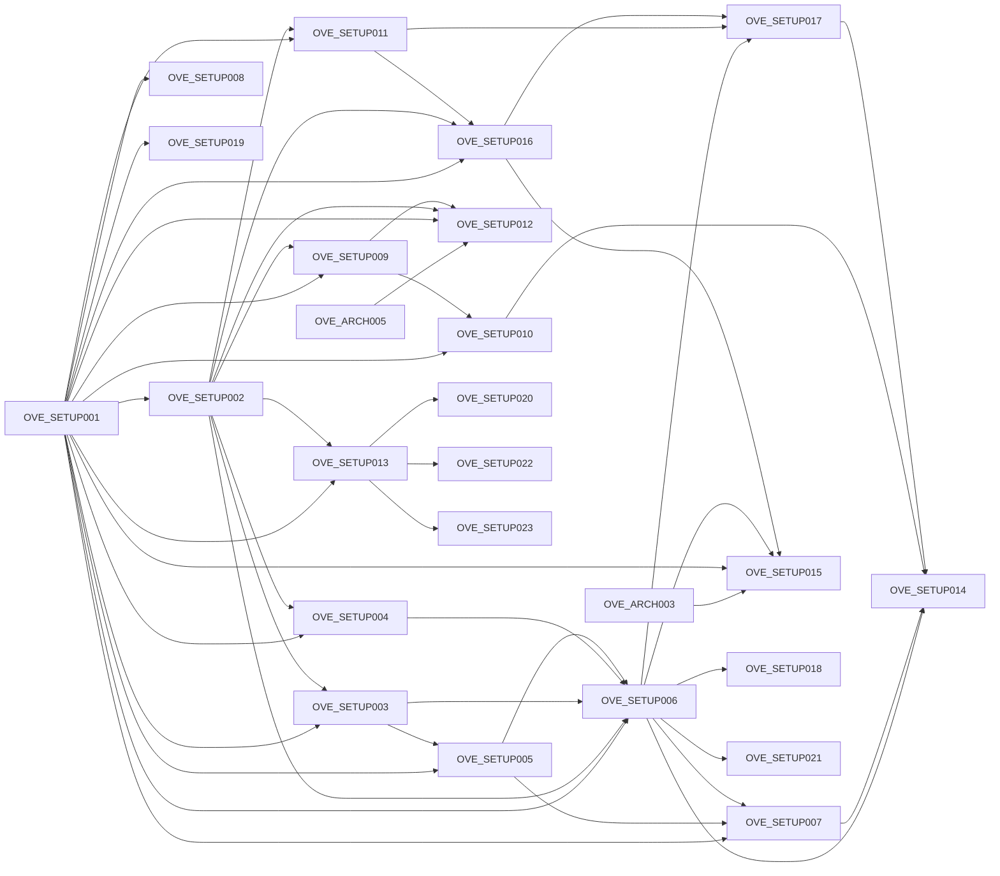

### OSS

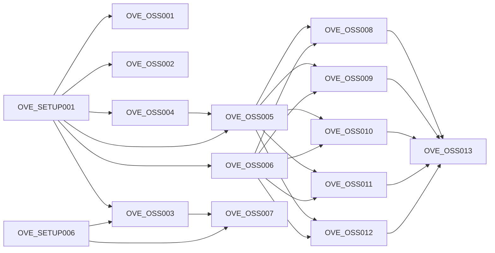

### ARCH

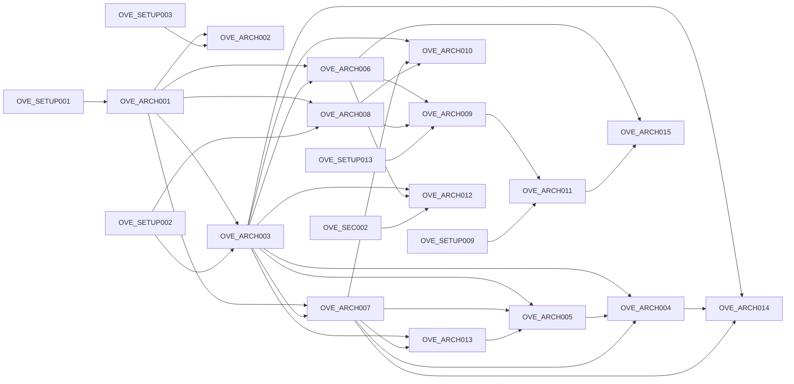

### SEC

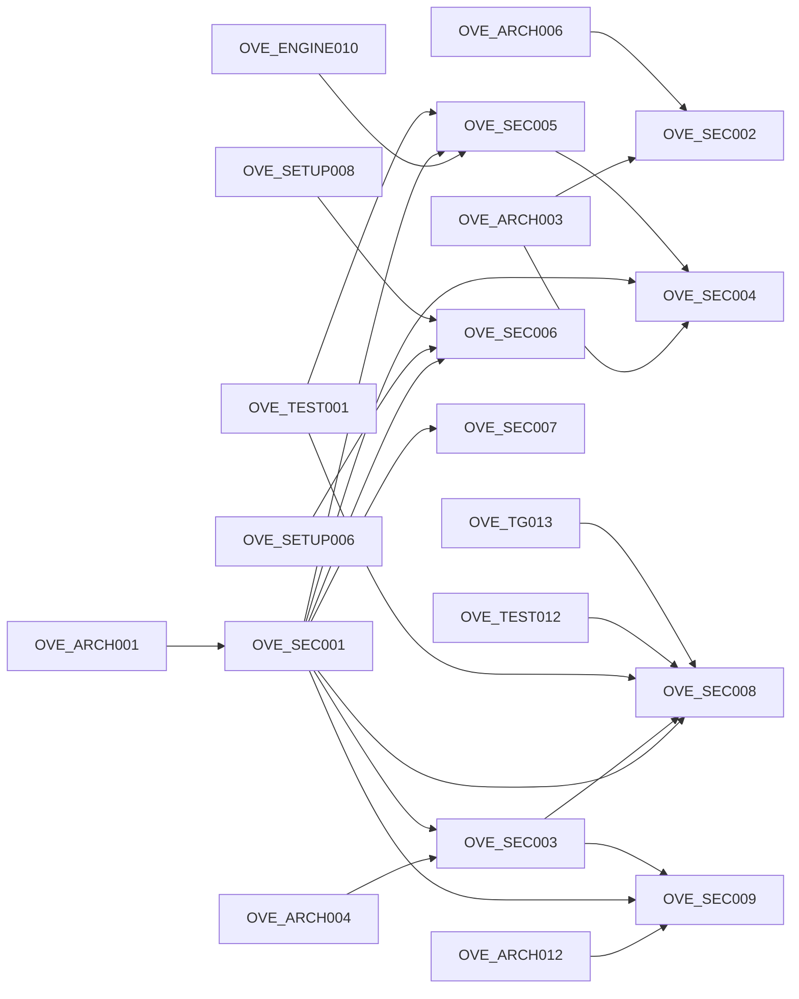

### TEST

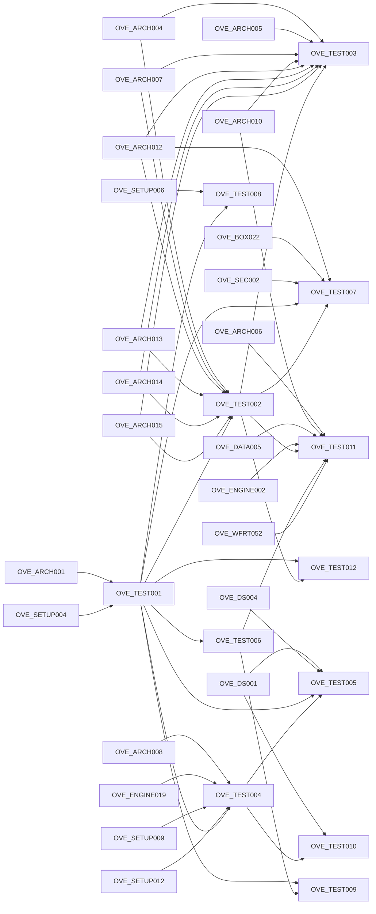

### DS

```mermaid
flowchart LR
  OVE_SETUP001 --> OVE_DS001
  OVE_SETUP002 --> OVE_DS001
  OVE_SETUP003 --> OVE_DS001
  OVE_SETUP004 --> OVE_DS001
  OVE_SETUP008 --> OVE_DS001
  OVE_DS001 --> OVE_DS002
  OVE_DS039 --> OVE_DS002
  OVE_DS001 --> OVE_DS003
  OVE_DS002 --> OVE_DS003
  OVE_DS039 --> OVE_DS003
  OVE_DS001 --> OVE_DS004
  OVE_DS002 --> OVE_DS004
  OVE_DS039 --> OVE_DS004
  OVE_DS001 --> OVE_DS005
  OVE_DS002 --> OVE_DS005
  OVE_DS004 --> OVE_DS005
  OVE_DS001 --> OVE_DS006
  OVE_DS039 --> OVE_DS006
  OVE_DS001 --> OVE_DS007
  OVE_DS002 --> OVE_DS007
  OVE_DS003 --> OVE_DS007
  OVE_DS039 --> OVE_DS007
  OVE_DS001 --> OVE_DS008
  OVE_DS002 --> OVE_DS008
  OVE_DS003 --> OVE_DS008
  OVE_DS004 --> OVE_DS008
  OVE_DS006 --> OVE_DS008
  OVE_DS007 --> OVE_DS008
  OVE_DS039 --> OVE_DS008
  OVE_DS001 --> OVE_DS009
  OVE_DS008 --> OVE_DS009
  OVE_DS001 --> OVE_DS010
  OVE_DS002 --> OVE_DS010
  OVE_DS003 --> OVE_DS010
  OVE_DS007 --> OVE_DS010
  OVE_DS009 --> OVE_DS010
  OVE_DS009 --> OVE_DS011
  OVE_DS001 --> OVE_DS012
  OVE_DS008 --> OVE_DS012
  OVE_SETUP004 --> OVE_DS012
  OVE_TEST005 --> OVE_DS012
  OVE_DS001 --> OVE_DS013
  OVE_DS008 --> OVE_DS013
  OVE_DS009 --> OVE_DS013
  OVE_DS012 --> OVE_DS013
  OVE_DS022 --> OVE_DS013
  OVE_DS038 --> OVE_DS013
  OVE_DS013 --> OVE_DS014
  OVE_DS001 --> OVE_DS015
  OVE_DS008 --> OVE_DS015
  OVE_DS009 --> OVE_DS015
  OVE_DS011 --> OVE_DS015
  OVE_DS012 --> OVE_DS015
  OVE_DS013 --> OVE_DS015
  OVE_DS038 --> OVE_DS015
  OVE_DS001 --> OVE_DS016
  OVE_DS003 --> OVE_DS016
  OVE_DS004 --> OVE_DS016
  OVE_DS007 --> OVE_DS016
  OVE_DS008 --> OVE_DS016
  OVE_DS020 --> OVE_DS016
  OVE_DS038 --> OVE_DS016
  OVE_DS001 --> OVE_DS017
  OVE_DS002 --> OVE_DS017
  OVE_DS003 --> OVE_DS017
  OVE_DS004 --> OVE_DS017
  OVE_DS008 --> OVE_DS017
  OVE_DS009 --> OVE_DS017
  OVE_DS011 --> OVE_DS017
  OVE_DS012 --> OVE_DS017
  OVE_DS020 --> OVE_DS017
  OVE_DS038 --> OVE_DS017
  OVE_DS003 --> OVE_DS018
  OVE_DS012 --> OVE_DS018
  OVE_DS016 --> OVE_DS018
  OVE_DS017 --> OVE_DS018
  OVE_DS020 --> OVE_DS018
  OVE_DS038 --> OVE_DS018
  OVE_DS001 --> OVE_DS019
  OVE_DS003 --> OVE_DS019
  OVE_DS007 --> OVE_DS019
  OVE_DS008 --> OVE_DS019
  OVE_DS009 --> OVE_DS019
  OVE_DS011 --> OVE_DS019
  OVE_DS012 --> OVE_DS019
  OVE_DS017 --> OVE_DS019
  OVE_DS038 --> OVE_DS019
  OVE_DS001 --> OVE_DS020
  OVE_DS003 --> OVE_DS020
  OVE_DS007 --> OVE_DS020
  OVE_DS008 --> OVE_DS020
  OVE_DS009 --> OVE_DS020
  OVE_DS011 --> OVE_DS020
  OVE_DS012 --> OVE_DS020
  OVE_DS038 --> OVE_DS020
  OVE_DS001 --> OVE_DS021
  OVE_DS003 --> OVE_DS021
  OVE_DS006 --> OVE_DS021
  OVE_DS007 --> OVE_DS021
  OVE_DS008 --> OVE_DS021
  OVE_DS012 --> OVE_DS021
  OVE_DS038 --> OVE_DS021
  OVE_DS001 --> OVE_DS022
  OVE_DS003 --> OVE_DS022
  OVE_DS005 --> OVE_DS022
  OVE_DS008 --> OVE_DS022
  OVE_DS012 --> OVE_DS022
  OVE_DS001 --> OVE_DS023
  OVE_DS003 --> OVE_DS023
  OVE_DS007 --> OVE_DS023
  OVE_DS008 --> OVE_DS023
  OVE_DS009 --> OVE_DS023
  OVE_DS012 --> OVE_DS023
  OVE_DS013 --> OVE_DS023
  OVE_DS038 --> OVE_DS023
  OVE_DS001 --> OVE_DS024
  OVE_DS003 --> OVE_DS024
  OVE_DS007 --> OVE_DS024
  OVE_DS008 --> OVE_DS024
  OVE_DS009 --> OVE_DS024
  OVE_DS012 --> OVE_DS024
  OVE_DS023 --> OVE_DS024
  OVE_DS038 --> OVE_DS024
  OVE_DS001 --> OVE_DS025
  OVE_DS003 --> OVE_DS025
  OVE_DS007 --> OVE_DS025
  OVE_DS008 --> OVE_DS025
  OVE_DS009 --> OVE_DS025
  OVE_DS012 --> OVE_DS025
  OVE_DS017 --> OVE_DS025
  OVE_DS019 --> OVE_DS025
  OVE_DS024 --> OVE_DS025
  OVE_DS038 --> OVE_DS025
  OVE_DS001 --> OVE_DS026
  OVE_DS003 --> OVE_DS026
  OVE_DS007 --> OVE_DS026
  OVE_DS008 --> OVE_DS026
  OVE_DS009 --> OVE_DS026
  OVE_DS011 --> OVE_DS026
  OVE_DS012 --> OVE_DS026
  OVE_DS013 --> OVE_DS026
  OVE_DS022 --> OVE_DS026
  OVE_DS038 --> OVE_DS026
  OVE_DS001 --> OVE_DS027
  OVE_DS003 --> OVE_DS027
  OVE_DS007 --> OVE_DS027
  OVE_DS008 --> OVE_DS027
  OVE_DS009 --> OVE_DS027
  OVE_DS012 --> OVE_DS027
  OVE_DS015 --> OVE_DS027
  OVE_DS026 --> OVE_DS027
  OVE_DS038 --> OVE_DS027
  OVE_DS001 --> OVE_DS028
  OVE_DS003 --> OVE_DS028
  OVE_DS007 --> OVE_DS028
  OVE_DS008 --> OVE_DS028
  OVE_DS012 --> OVE_DS028
  OVE_DS022 --> OVE_DS028
  OVE_DS038 --> OVE_DS028
  OVE_DS001 --> OVE_DS029
  OVE_DS003 --> OVE_DS029
  OVE_DS007 --> OVE_DS029
  OVE_DS008 --> OVE_DS029
  OVE_DS009 --> OVE_DS029
  OVE_DS012 --> OVE_DS029
  OVE_DS022 --> OVE_DS029
  OVE_DS028 --> OVE_DS029
  OVE_DS038 --> OVE_DS029
  OVE_DS001 --> OVE_DS030
  OVE_DS003 --> OVE_DS030
  OVE_DS007 --> OVE_DS030
  OVE_DS008 --> OVE_DS030
  OVE_DS009 --> OVE_DS030
  OVE_DS011 --> OVE_DS030
  OVE_DS012 --> OVE_DS030
  OVE_DS026 --> OVE_DS030
  OVE_DS028 --> OVE_DS030
  OVE_DS029 --> OVE_DS030
  OVE_DS038 --> OVE_DS030
  OVE_DS001 --> OVE_DS031
  OVE_DS003 --> OVE_DS031
  OVE_DS007 --> OVE_DS031
  OVE_DS008 --> OVE_DS031
  OVE_DS012 --> OVE_DS031
  OVE_DS022 --> OVE_DS031
  OVE_DS038 --> OVE_DS031
  OVE_DS001 --> OVE_DS032
  OVE_DS003 --> OVE_DS032
  OVE_DS007 --> OVE_DS032
  OVE_DS008 --> OVE_DS032
  OVE_DS009 --> OVE_DS032
  OVE_DS012 --> OVE_DS032
  OVE_DS013 --> OVE_DS032
  OVE_DS031 --> OVE_DS032
  OVE_DS038 --> OVE_DS032
  OVE_DS001 --> OVE_DS033
  OVE_DS003 --> OVE_DS033
  OVE_DS005 --> OVE_DS033
  OVE_DS007 --> OVE_DS033
  OVE_DS008 --> OVE_DS033
  OVE_DS009 --> OVE_DS033
  OVE_DS012 --> OVE_DS033
  OVE_DS016 --> OVE_DS033
  OVE_DS019 --> OVE_DS033
  OVE_DS020 --> OVE_DS033
  OVE_DS031 --> OVE_DS033
  OVE_DS038 --> OVE_DS033
  OVE_DS001 --> OVE_DS034
  OVE_DS003 --> OVE_DS034
  OVE_DS007 --> OVE_DS034
  OVE_DS008 --> OVE_DS034
  OVE_DS009 --> OVE_DS034
  OVE_DS011 --> OVE_DS034
  OVE_DS012 --> OVE_DS034
  OVE_DS031 --> OVE_DS034
  OVE_DS033 --> OVE_DS034
  OVE_DS038 --> OVE_DS034
  OVE_DS001 --> OVE_DS035
  OVE_DS003 --> OVE_DS035
  OVE_DS007 --> OVE_DS035
  OVE_DS008 --> OVE_DS035
  OVE_DS009 --> OVE_DS035
  OVE_DS012 --> OVE_DS035
  OVE_DS019 --> OVE_DS035
  OVE_DS022 --> OVE_DS035
  OVE_DS025 --> OVE_DS035
  OVE_DS038 --> OVE_DS035
  OVE_DS001 --> OVE_DS036
  OVE_DS003 --> OVE_DS036
  OVE_DS007 --> OVE_DS036
  OVE_DS008 --> OVE_DS036
  OVE_DS009 --> OVE_DS036
  OVE_DS012 --> OVE_DS036
  OVE_DS013 --> OVE_DS036
  OVE_DS014 --> OVE_DS036
  OVE_DS015 --> OVE_DS036
  OVE_DS026 --> OVE_DS036
  OVE_DS028 --> OVE_DS036
  OVE_DS038 --> OVE_DS036
  OVE_DS001 --> OVE_DS037
  OVE_DS003 --> OVE_DS037
  OVE_DS007 --> OVE_DS037
  OVE_DS008 --> OVE_DS037
  OVE_DS009 --> OVE_DS037
  OVE_DS012 --> OVE_DS037
  OVE_DS015 --> OVE_DS037
  OVE_DS022 --> OVE_DS037
  OVE_DS028 --> OVE_DS037
  OVE_DS038 --> OVE_DS037
  OVE_DS001 --> OVE_DS038
  OVE_SHELL007 --> OVE_DS038
  OVE_DS001 --> OVE_DS039
  OVE_DS005 --> OVE_DS040
  OVE_DS009 --> OVE_DS040
  OVE_DS017 --> OVE_DS040
  OVE_DS020 --> OVE_DS040
  OVE_DS031 --> OVE_DS040
  OVE_DS039 --> OVE_DS040
  OVE_DS009 --> OVE_DS041
  OVE_DS010 --> OVE_DS041
  OVE_DS019 --> OVE_DS041
  OVE_DS022 --> OVE_DS041
  OVE_DS028 --> OVE_DS041
  OVE_DS039 --> OVE_DS041
  OVE_DS040 --> OVE_DS041
  OVE_DS009 --> OVE_DS042
  OVE_DS013 --> OVE_DS042
  OVE_DS017 --> OVE_DS042
  OVE_DS020 --> OVE_DS042
  OVE_DS021 --> OVE_DS042
  OVE_DS028 --> OVE_DS042
  OVE_DS039 --> OVE_DS042
  OVE_DS040 --> OVE_DS042
  OVE_DS009 --> OVE_DS043
  OVE_DS013 --> OVE_DS043
  OVE_DS020 --> OVE_DS043
  OVE_DS028 --> OVE_DS043
  OVE_DS029 --> OVE_DS043
  OVE_DS039 --> OVE_DS043
  OVE_DS042 --> OVE_DS043
  OVE_DS022 --> OVE_DS044
  OVE_DS039 --> OVE_DS044
  OVE_DS041 --> OVE_DS044
  OVE_DS043 --> OVE_DS044
  OVE_DS005 --> OVE_DS045
  OVE_DS013 --> OVE_DS045
  OVE_DS017 --> OVE_DS045
  OVE_DS018 --> OVE_DS045
  OVE_DS019 --> OVE_DS045
  OVE_DS035 --> OVE_DS045
  OVE_DS039 --> OVE_DS045
  OVE_DS044 --> OVE_DS045
  OVE_DS005 --> OVE_DS046
  OVE_DS009 --> OVE_DS046
  OVE_DS013 --> OVE_DS046
  OVE_DS016 --> OVE_DS046
  OVE_DS020 --> OVE_DS046
  OVE_DS031 --> OVE_DS046
  OVE_DS039 --> OVE_DS046
  OVE_DS040 --> OVE_DS046
  OVE_DS005 --> OVE_DS047
  OVE_DS009 --> OVE_DS047
  OVE_DS016 --> OVE_DS047
  OVE_DS017 --> OVE_DS047
  OVE_DS031 --> OVE_DS047
  OVE_DS039 --> OVE_DS047
  OVE_DS046 --> OVE_DS047
  OVE_DS005 --> OVE_DS048
  OVE_DS009 --> OVE_DS048
  OVE_DS016 --> OVE_DS048
  OVE_DS017 --> OVE_DS048
  OVE_DS027 --> OVE_DS048
  OVE_DS029 --> OVE_DS048
  OVE_DS039 --> OVE_DS048
  OVE_DS046 --> OVE_DS048
  OVE_DS005 --> OVE_DS049
  OVE_DS009 --> OVE_DS049
  OVE_DS013 --> OVE_DS049
  OVE_DS016 --> OVE_DS049
  OVE_DS019 --> OVE_DS049
  OVE_DS020 --> OVE_DS049
  OVE_DS022 --> OVE_DS049
  OVE_DS031 --> OVE_DS049
  OVE_DS032 --> OVE_DS049
  OVE_DS033 --> OVE_DS049
  OVE_DS039 --> OVE_DS049
  OVE_DS044 --> OVE_DS049
  OVE_DS005 --> OVE_DS050
  OVE_DS009 --> OVE_DS050
  OVE_DS013 --> OVE_DS050
  OVE_DS016 --> OVE_DS050
  OVE_DS017 --> OVE_DS050
  OVE_DS018 --> OVE_DS050
  OVE_DS039 --> OVE_DS050
  OVE_DS046 --> OVE_DS050
  OVE_DS005 --> OVE_DS051
  OVE_DS009 --> OVE_DS051
  OVE_DS022 --> OVE_DS051
  OVE_DS031 --> OVE_DS051
  OVE_DS039 --> OVE_DS051
  OVE_DS040 --> OVE_DS051
  OVE_DS005 --> OVE_DS052
  OVE_DS009 --> OVE_DS052
  OVE_DS013 --> OVE_DS052
  OVE_DS017 --> OVE_DS052
  OVE_DS022 --> OVE_DS052
  OVE_DS031 --> OVE_DS052
  OVE_DS039 --> OVE_DS052
  OVE_DS040 --> OVE_DS052
  OVE_DS005 --> OVE_DS053
  OVE_DS009 --> OVE_DS053
  OVE_DS013 --> OVE_DS053
  OVE_DS017 --> OVE_DS053
  OVE_DS022 --> OVE_DS053
  OVE_DS039 --> OVE_DS053
  OVE_DS051 --> OVE_DS053
  OVE_DS052 --> OVE_DS053
  OVE_DS005 --> OVE_DS054
  OVE_DS009 --> OVE_DS054
  OVE_DS016 --> OVE_DS054
  OVE_DS018 --> OVE_DS054
  OVE_DS022 --> OVE_DS054
  OVE_DS031 --> OVE_DS054
  OVE_DS039 --> OVE_DS054
  OVE_DS040 --> OVE_DS054
  OVE_DS051 --> OVE_DS054
  OVE_DS052 --> OVE_DS054
  OVE_DS005 --> OVE_DS055
  OVE_DS009 --> OVE_DS055
  OVE_DS013 --> OVE_DS055
  OVE_DS020 --> OVE_DS055
  OVE_DS022 --> OVE_DS055
  OVE_DS031 --> OVE_DS055
  OVE_DS039 --> OVE_DS055
  OVE_DS040 --> OVE_DS055
  OVE_DS005 --> OVE_DS056
  OVE_DS009 --> OVE_DS056
  OVE_DS016 --> OVE_DS056
  OVE_DS022 --> OVE_DS056
  OVE_DS032 --> OVE_DS056
  OVE_DS033 --> OVE_DS056
  OVE_DS039 --> OVE_DS056
  OVE_DS055 --> OVE_DS056
  OVE_DS005 --> OVE_DS057
  OVE_DS009 --> OVE_DS057
  OVE_DS013 --> OVE_DS057
  OVE_DS016 --> OVE_DS057
  OVE_DS022 --> OVE_DS057
  OVE_DS031 --> OVE_DS057
  OVE_DS039 --> OVE_DS057
  OVE_DS040 --> OVE_DS057
  OVE_DS005 --> OVE_DS058
  OVE_DS009 --> OVE_DS058
  OVE_DS013 --> OVE_DS058
  OVE_DS016 --> OVE_DS058
  OVE_DS022 --> OVE_DS058
  OVE_DS024 --> OVE_DS058
  OVE_DS025 --> OVE_DS058
  OVE_DS031 --> OVE_DS058
  OVE_DS039 --> OVE_DS058
  OVE_DS051 --> OVE_DS058
  OVE_DS055 --> OVE_DS058
  OVE_DS056 --> OVE_DS058
  OVE_DS005 --> OVE_DS059
  OVE_DS009 --> OVE_DS059
  OVE_DS013 --> OVE_DS059
  OVE_DS016 --> OVE_DS059
  OVE_DS017 --> OVE_DS059
  OVE_DS020 --> OVE_DS059
  OVE_DS021 --> OVE_DS059
  OVE_DS031 --> OVE_DS059
  OVE_DS032 --> OVE_DS059
  OVE_DS039 --> OVE_DS059
  OVE_DS040 --> OVE_DS059
  OVE_DS005 --> OVE_DS060
  OVE_DS009 --> OVE_DS060
  OVE_DS013 --> OVE_DS060
  OVE_DS020 --> OVE_DS060
  OVE_DS031 --> OVE_DS060
  OVE_DS032 --> OVE_DS060
  OVE_DS033 --> OVE_DS060
  OVE_DS039 --> OVE_DS060
  OVE_DS040 --> OVE_DS060
  OVE_DS005 --> OVE_DS061
  OVE_DS009 --> OVE_DS061
  OVE_DS016 --> OVE_DS061
  OVE_DS020 --> OVE_DS061
  OVE_DS031 --> OVE_DS061
  OVE_DS039 --> OVE_DS061
  OVE_DS040 --> OVE_DS061
  OVE_DS005 --> OVE_DS062
  OVE_DS009 --> OVE_DS062
  OVE_DS013 --> OVE_DS062
  OVE_DS017 --> OVE_DS062
  OVE_DS019 --> OVE_DS062
  OVE_DS025 --> OVE_DS062
  OVE_DS032 --> OVE_DS062
  OVE_DS039 --> OVE_DS062
  OVE_DS045 --> OVE_DS062
  OVE_DS061 --> OVE_DS062
  OVE_DS005 --> OVE_DS063
  OVE_DS009 --> OVE_DS063
  OVE_DS013 --> OVE_DS063
  OVE_DS022 --> OVE_DS063
  OVE_DS031 --> OVE_DS063
  OVE_DS032 --> OVE_DS063
  OVE_DS039 --> OVE_DS063
  OVE_DS040 --> OVE_DS063
  OVE_DS061 --> OVE_DS063
  OVE_DS005 --> OVE_DS064
  OVE_DS009 --> OVE_DS064
  OVE_DS017 --> OVE_DS064
  OVE_DS026 --> OVE_DS064
  OVE_DS029 --> OVE_DS064
  OVE_DS030 --> OVE_DS064
  OVE_DS032 --> OVE_DS064
  OVE_DS033 --> OVE_DS064
  OVE_DS039 --> OVE_DS064
  OVE_DS040 --> OVE_DS064
  OVE_DS044 --> OVE_DS064
  OVE_DS005 --> OVE_DS065
  OVE_DS009 --> OVE_DS065
  OVE_DS013 --> OVE_DS065
  OVE_DS016 --> OVE_DS065
  OVE_DS017 --> OVE_DS065
  OVE_DS019 --> OVE_DS065
  OVE_DS022 --> OVE_DS065
  OVE_DS025 --> OVE_DS065
  OVE_DS031 --> OVE_DS065
  OVE_DS039 --> OVE_DS065
  OVE_DS040 --> OVE_DS065
  OVE_DS063 --> OVE_DS065
  OVE_DS064 --> OVE_DS065
  OVE_DS005 --> OVE_DS066
  OVE_DS009 --> OVE_DS066
  OVE_DS013 --> OVE_DS066
  OVE_DS016 --> OVE_DS066
  OVE_DS019 --> OVE_DS066
  OVE_DS020 --> OVE_DS066
  OVE_DS022 --> OVE_DS066
  OVE_DS031 --> OVE_DS066
  OVE_DS033 --> OVE_DS066
  OVE_DS039 --> OVE_DS066
  OVE_DS040 --> OVE_DS066
  OVE_DS057 --> OVE_DS066
  OVE_DS005 --> OVE_DS067
  OVE_DS009 --> OVE_DS067
  OVE_DS013 --> OVE_DS067
  OVE_DS017 --> OVE_DS067
  OVE_DS029 --> OVE_DS067
  OVE_DS039 --> OVE_DS067
  OVE_DS040 --> OVE_DS067
  OVE_DS005 --> OVE_DS068
  OVE_DS009 --> OVE_DS068
  OVE_DS013 --> OVE_DS068
  OVE_DS017 --> OVE_DS068
  OVE_DS019 --> OVE_DS068
  OVE_DS022 --> OVE_DS068
  OVE_DS025 --> OVE_DS068
  OVE_DS026 --> OVE_DS068
  OVE_DS030 --> OVE_DS068
  OVE_DS035 --> OVE_DS068
  OVE_DS039 --> OVE_DS068
  OVE_DS051 --> OVE_DS068
  OVE_DS066 --> OVE_DS068
  OVE_DS067 --> OVE_DS068
  OVE_DS005 --> OVE_DS069
  OVE_DS009 --> OVE_DS069
  OVE_DS013 --> OVE_DS069
  OVE_DS020 --> OVE_DS069
  OVE_DS032 --> OVE_DS069
  OVE_DS039 --> OVE_DS069
  OVE_DS040 --> OVE_DS069
  OVE_DS005 --> OVE_DS070
  OVE_DS009 --> OVE_DS070
  OVE_DS017 --> OVE_DS070
  OVE_DS020 --> OVE_DS070
  OVE_DS022 --> OVE_DS070
  OVE_DS031 --> OVE_DS070
  OVE_DS032 --> OVE_DS070
  OVE_DS039 --> OVE_DS070
  OVE_DS040 --> OVE_DS070
  OVE_DS069 --> OVE_DS070
  OVE_DS005 --> OVE_DS071
  OVE_DS009 --> OVE_DS071
  OVE_DS013 --> OVE_DS071
  OVE_DS016 --> OVE_DS071
  OVE_DS017 --> OVE_DS071
  OVE_DS019 --> OVE_DS071
  OVE_DS031 --> OVE_DS071
  OVE_DS039 --> OVE_DS071
  OVE_DS040 --> OVE_DS071
  OVE_DS005 --> OVE_DS072
  OVE_DS009 --> OVE_DS072
  OVE_DS013 --> OVE_DS072
  OVE_DS016 --> OVE_DS072
  OVE_DS017 --> OVE_DS072
  OVE_DS019 --> OVE_DS072
  OVE_DS022 --> OVE_DS072
  OVE_DS032 --> OVE_DS072
  OVE_DS039 --> OVE_DS072
  OVE_DS063 --> OVE_DS072
  OVE_DS071 --> OVE_DS072
  OVE_DS005 --> OVE_DS073
  OVE_DS009 --> OVE_DS073
  OVE_DS013 --> OVE_DS073
  OVE_DS017 --> OVE_DS073
  OVE_DS022 --> OVE_DS073
  OVE_DS039 --> OVE_DS073
  OVE_DS040 --> OVE_DS073
  OVE_DS041 --> OVE_DS073
  OVE_DS005 --> OVE_DS074
  OVE_DS009 --> OVE_DS074
  OVE_DS013 --> OVE_DS074
  OVE_DS020 --> OVE_DS074
  OVE_DS022 --> OVE_DS074
  OVE_DS024 --> OVE_DS074
  OVE_DS031 --> OVE_DS074
  OVE_DS032 --> OVE_DS074
  OVE_DS039 --> OVE_DS074
  OVE_DS040 --> OVE_DS074
  OVE_DS073 --> OVE_DS074
  OVE_DS005 --> OVE_DS075
  OVE_DS009 --> OVE_DS075
  OVE_DS017 --> OVE_DS075
  OVE_DS020 --> OVE_DS075
  OVE_DS022 --> OVE_DS075
  OVE_DS032 --> OVE_DS075
  OVE_DS033 --> OVE_DS075
  OVE_DS039 --> OVE_DS075
  OVE_DS040 --> OVE_DS075
  OVE_DS005 --> OVE_DS076
  OVE_DS009 --> OVE_DS076
  OVE_DS016 --> OVE_DS076
  OVE_DS017 --> OVE_DS076
  OVE_DS020 --> OVE_DS076
  OVE_DS021 --> OVE_DS076
  OVE_DS028 --> OVE_DS076
  OVE_DS031 --> OVE_DS076
  OVE_DS032 --> OVE_DS076
  OVE_DS039 --> OVE_DS076
  OVE_DS040 --> OVE_DS076
  OVE_DS005 --> OVE_DS077
  OVE_DS009 --> OVE_DS077
  OVE_DS021 --> OVE_DS077
  OVE_DS022 --> OVE_DS077
  OVE_DS032 --> OVE_DS077
  OVE_DS039 --> OVE_DS077
  OVE_DS040 --> OVE_DS077
  OVE_DS051 --> OVE_DS077
  OVE_DS005 --> OVE_DS078
  OVE_DS009 --> OVE_DS078
  OVE_DS013 --> OVE_DS078
  OVE_DS022 --> OVE_DS078
  OVE_DS023 --> OVE_DS078
  OVE_DS029 --> OVE_DS078
  OVE_DS030 --> OVE_DS078
  OVE_DS031 --> OVE_DS078
  OVE_DS039 --> OVE_DS078
  OVE_DS040 --> OVE_DS078
  OVE_DS005 --> OVE_DS079
  OVE_DS009 --> OVE_DS079
  OVE_DS010 --> OVE_DS079
  OVE_DS013 --> OVE_DS079
  OVE_DS017 --> OVE_DS079
  OVE_DS020 --> OVE_DS079
  OVE_DS031 --> OVE_DS079
  OVE_DS039 --> OVE_DS079
  OVE_DS040 --> OVE_DS079
  OVE_DS051 --> OVE_DS079
  OVE_DS078 --> OVE_DS079
  OVE_DS005 --> OVE_DS080
  OVE_DS009 --> OVE_DS080
  OVE_DS015 --> OVE_DS080
  OVE_DS031 --> OVE_DS080
  OVE_DS039 --> OVE_DS080
  OVE_DS040 --> OVE_DS080
  OVE_DS078 --> OVE_DS080
  OVE_DS005 --> OVE_DS081
  OVE_DS009 --> OVE_DS081
  OVE_DS013 --> OVE_DS081
  OVE_DS017 --> OVE_DS081
  OVE_DS023 --> OVE_DS081
  OVE_DS024 --> OVE_DS081
  OVE_DS031 --> OVE_DS081
  OVE_DS039 --> OVE_DS081
  OVE_DS040 --> OVE_DS081
  OVE_DS069 --> OVE_DS081
  OVE_DS078 --> OVE_DS081
  OVE_DS005 --> OVE_DS082
  OVE_DS009 --> OVE_DS082
  OVE_DS013 --> OVE_DS082
  OVE_DS017 --> OVE_DS082
  OVE_DS031 --> OVE_DS082
  OVE_DS033 --> OVE_DS082
  OVE_DS039 --> OVE_DS082
  OVE_DS040 --> OVE_DS082
  OVE_DS078 --> OVE_DS082
  OVE_DS005 --> OVE_DS083
  OVE_DS009 --> OVE_DS083
  OVE_DS013 --> OVE_DS083
  OVE_DS016 --> OVE_DS083
  OVE_DS017 --> OVE_DS083
  OVE_DS018 --> OVE_DS083
  OVE_DS021 --> OVE_DS083
  OVE_DS022 --> OVE_DS083
  OVE_DS031 --> OVE_DS083
  OVE_DS033 --> OVE_DS083
  OVE_DS039 --> OVE_DS083
  OVE_DS040 --> OVE_DS083
  OVE_DS044 --> OVE_DS083
  OVE_DS005 --> OVE_DS084
  OVE_DS009 --> OVE_DS084
  OVE_DS013 --> OVE_DS084
  OVE_DS016 --> OVE_DS084
  OVE_DS017 --> OVE_DS084
  OVE_DS022 --> OVE_DS084
  OVE_DS031 --> OVE_DS084
  OVE_DS039 --> OVE_DS084
  OVE_DS040 --> OVE_DS084
  OVE_DS083 --> OVE_DS084
  OVE_DS005 --> OVE_DS085
  OVE_DS009 --> OVE_DS085
  OVE_DS010 --> OVE_DS085
  OVE_DS013 --> OVE_DS085
  OVE_DS016 --> OVE_DS085
  OVE_DS020 --> OVE_DS085
  OVE_DS022 --> OVE_DS085
  OVE_DS029 --> OVE_DS085
  OVE_DS039 --> OVE_DS085
  OVE_DS040 --> OVE_DS085
  OVE_DS005 --> OVE_DS086
  OVE_DS009 --> OVE_DS086
  OVE_DS010 --> OVE_DS086
  OVE_DS013 --> OVE_DS086
  OVE_DS039 --> OVE_DS086
  OVE_DS040 --> OVE_DS086
  OVE_DS005 --> OVE_DS087
  OVE_DS009 --> OVE_DS087
  OVE_DS032 --> OVE_DS087
  OVE_DS039 --> OVE_DS087
  OVE_DS040 --> OVE_DS087
  OVE_DS005 --> OVE_DS088
  OVE_DS009 --> OVE_DS088
  OVE_DS016 --> OVE_DS088
  OVE_DS017 --> OVE_DS088
  OVE_DS019 --> OVE_DS088
  OVE_DS020 --> OVE_DS088
  OVE_DS039 --> OVE_DS088
  OVE_DS087 --> OVE_DS088
  OVE_DS005 --> OVE_DS089
  OVE_DS009 --> OVE_DS089
  OVE_DS017 --> OVE_DS089
  OVE_DS020 --> OVE_DS089
  OVE_DS028 --> OVE_DS089
  OVE_DS039 --> OVE_DS089
  OVE_DS088 --> OVE_DS089
  OVE_DS005 --> OVE_DS090
  OVE_DS009 --> OVE_DS090
  OVE_DS020 --> OVE_DS090
  OVE_DS039 --> OVE_DS090
  OVE_DS087 --> OVE_DS090
  OVE_DS005 --> OVE_DS091
  OVE_DS009 --> OVE_DS091
  OVE_DS017 --> OVE_DS091
  OVE_DS020 --> OVE_DS091
  OVE_DS039 --> OVE_DS091
  OVE_DS087 --> OVE_DS091
  OVE_DS090 --> OVE_DS091
  OVE_DS005 --> OVE_DS092
  OVE_DS009 --> OVE_DS092
  OVE_DS017 --> OVE_DS092
  OVE_DS039 --> OVE_DS092
  OVE_DS087 --> OVE_DS092
  OVE_DS005 --> OVE_DS093
  OVE_DS009 --> OVE_DS093
  OVE_DS039 --> OVE_DS093
  OVE_DS087 --> OVE_DS093
  OVE_DS088 --> OVE_DS093
  OVE_DS090 --> OVE_DS093
  OVE_DS091 --> OVE_DS093
  OVE_DS092 --> OVE_DS093
  OVE_DS005 --> OVE_DS094
  OVE_DS009 --> OVE_DS094
  OVE_DS039 --> OVE_DS094
  OVE_DS093 --> OVE_DS094
  OVE_DS005 --> OVE_DS095
  OVE_DS009 --> OVE_DS095
  OVE_DS032 --> OVE_DS095
  OVE_DS039 --> OVE_DS095
  OVE_DS087 --> OVE_DS095
  OVE_DS088 --> OVE_DS095
  OVE_DS089 --> OVE_DS095
  OVE_DS090 --> OVE_DS095
  OVE_DS091 --> OVE_DS095
  OVE_DS092 --> OVE_DS095
  OVE_DS093 --> OVE_DS095
  OVE_DS094 --> OVE_DS095
  OVE_DS005 --> OVE_DS096
  OVE_DS009 --> OVE_DS096
  OVE_DS039 --> OVE_DS096
  OVE_DS067 --> OVE_DS096
  OVE_DS095 --> OVE_DS096
  OVE_DS005 --> OVE_DS097
  OVE_DS009 --> OVE_DS097
  OVE_DS017 --> OVE_DS097
  OVE_DS019 --> OVE_DS097
  OVE_DS026 --> OVE_DS097
  OVE_DS029 --> OVE_DS097
  OVE_DS032 --> OVE_DS097
  OVE_DS039 --> OVE_DS097
  OVE_DS040 --> OVE_DS097
  OVE_DS067 --> OVE_DS097
  OVE_DS005 --> OVE_DS098
  OVE_DS009 --> OVE_DS098
  OVE_DS013 --> OVE_DS098
  OVE_DS017 --> OVE_DS098
  OVE_DS019 --> OVE_DS098
  OVE_DS022 --> OVE_DS098
  OVE_DS031 --> OVE_DS098
  OVE_DS039 --> OVE_DS098
  OVE_DS040 --> OVE_DS098
  OVE_DS088 --> OVE_DS098
  OVE_DS005 --> OVE_DS099
  OVE_DS009 --> OVE_DS099
  OVE_DS013 --> OVE_DS099
  OVE_DS015 --> OVE_DS099
  OVE_DS017 --> OVE_DS099
  OVE_DS022 --> OVE_DS099
  OVE_DS028 --> OVE_DS099
  OVE_DS039 --> OVE_DS099
  OVE_DS087 --> OVE_DS099
  OVE_DS005 --> OVE_DS100
  OVE_DS009 --> OVE_DS100
  OVE_DS039 --> OVE_DS100
  OVE_DS087 --> OVE_DS100
  OVE_DS088 --> OVE_DS100
  OVE_DS005 --> OVE_DS101
  OVE_DS009 --> OVE_DS101
  OVE_DS016 --> OVE_DS101
  OVE_DS017 --> OVE_DS101
  OVE_DS020 --> OVE_DS101
  OVE_DS031 --> OVE_DS101
  OVE_DS039 --> OVE_DS101
  OVE_DS040 --> OVE_DS101
  OVE_DS005 --> OVE_DS102
  OVE_DS009 --> OVE_DS102
  OVE_DS013 --> OVE_DS102
  OVE_DS017 --> OVE_DS102
  OVE_DS019 --> OVE_DS102
  OVE_DS020 --> OVE_DS102
  OVE_DS039 --> OVE_DS102
  OVE_DS040 --> OVE_DS102
  OVE_DS045 --> OVE_DS102
  OVE_DS005 --> OVE_DS103
  OVE_DS009 --> OVE_DS103
  OVE_DS013 --> OVE_DS103
  OVE_DS016 --> OVE_DS103
  OVE_DS017 --> OVE_DS103
  OVE_DS018 --> OVE_DS103
  OVE_DS022 --> OVE_DS103
  OVE_DS025 --> OVE_DS103
  OVE_DS030 --> OVE_DS103
  OVE_DS031 --> OVE_DS103
  OVE_DS032 --> OVE_DS103
  OVE_DS039 --> OVE_DS103
  OVE_DS040 --> OVE_DS103
  OVE_DS066 --> OVE_DS103
  OVE_DS067 --> OVE_DS103
  OVE_DS005 --> OVE_DS104
  OVE_DS009 --> OVE_DS104
  OVE_DS039 --> OVE_DS104
  OVE_DS048 --> OVE_DS104
  OVE_DS052 --> OVE_DS104
  OVE_DS058 --> OVE_DS104
  OVE_DS068 --> OVE_DS104
  OVE_DS072 --> OVE_DS104
  OVE_DS074 --> OVE_DS104
  OVE_DS076 --> OVE_DS104
  OVE_DS079 --> OVE_DS104
  OVE_DS081 --> OVE_DS104
  OVE_DS084 --> OVE_DS104
  OVE_DS085 --> OVE_DS104
  OVE_DS086 --> OVE_DS104
  OVE_DS087 --> OVE_DS104
  OVE_DS096 --> OVE_DS104
  OVE_DS101 --> OVE_DS104
  OVE_DS103 --> OVE_DS104
  OVE_DS005 --> OVE_DS105
  OVE_DS009 --> OVE_DS105
  OVE_DS039 --> OVE_DS105
  OVE_DS041 --> OVE_DS105
  OVE_DS043 --> OVE_DS105
  OVE_DS044 --> OVE_DS105
  OVE_DS045 --> OVE_DS105
  OVE_DS046 --> OVE_DS105
  OVE_DS048 --> OVE_DS105
  OVE_DS049 --> OVE_DS105
  OVE_DS050 --> OVE_DS105
  OVE_DS052 --> OVE_DS105
  OVE_DS053 --> OVE_DS105
  OVE_DS054 --> OVE_DS105
  OVE_DS055 --> OVE_DS105
  OVE_DS059 --> OVE_DS105
  OVE_DS060 --> OVE_DS105
  OVE_DS062 --> OVE_DS105
  OVE_DS063 --> OVE_DS105
  OVE_DS065 --> OVE_DS105
  OVE_DS083 --> OVE_DS105
  OVE_DS084 --> OVE_DS105
  OVE_DS005 --> OVE_DS106
  OVE_DS009 --> OVE_DS106
  OVE_DS039 --> OVE_DS106
  OVE_DS041 --> OVE_DS106
  OVE_DS043 --> OVE_DS106
  OVE_DS044 --> OVE_DS106
  OVE_DS045 --> OVE_DS106
  OVE_DS056 --> OVE_DS106
  OVE_DS057 --> OVE_DS106
  OVE_DS058 --> OVE_DS106
  OVE_DS066 --> OVE_DS106
  OVE_DS068 --> OVE_DS106
  OVE_DS069 --> OVE_DS106
  OVE_DS070 --> OVE_DS106
  OVE_DS071 --> OVE_DS106
  OVE_DS072 --> OVE_DS106
  OVE_DS075 --> OVE_DS106
  OVE_DS076 --> OVE_DS106
  OVE_DS077 --> OVE_DS106
  OVE_DS078 --> OVE_DS106
  OVE_DS079 --> OVE_DS106
  OVE_DS080 --> OVE_DS106
  OVE_DS081 --> OVE_DS106
  OVE_DS082 --> OVE_DS106
  OVE_DS005 --> OVE_DS107
  OVE_DS009 --> OVE_DS107
  OVE_DS039 --> OVE_DS107
  OVE_DS041 --> OVE_DS107
  OVE_DS043 --> OVE_DS107
  OVE_DS044 --> OVE_DS107
  OVE_DS045 --> OVE_DS107
  OVE_DS052 --> OVE_DS107
  OVE_DS073 --> OVE_DS107
  OVE_DS074 --> OVE_DS107
  OVE_DS085 --> OVE_DS107
  OVE_DS086 --> OVE_DS107
  OVE_DS095 --> OVE_DS107
  OVE_DS096 --> OVE_DS107
  OVE_DS097 --> OVE_DS107
  OVE_DS098 --> OVE_DS107
  OVE_DS099 --> OVE_DS107
  OVE_DS100 --> OVE_DS107
  OVE_DS101 --> OVE_DS107
  OVE_DS102 --> OVE_DS107
  OVE_DS103 --> OVE_DS107
  OVE_DS005 --> OVE_DS108
  OVE_DS009 --> OVE_DS108
  OVE_DS039 --> OVE_DS108
  OVE_DS104 --> OVE_DS108
  OVE_DS105 --> OVE_DS108
  OVE_DS005 --> OVE_DS109
  OVE_DS006 --> OVE_DS109
  OVE_DS008 --> OVE_DS109
  OVE_DS013 --> OVE_DS109
  OVE_DS022 --> OVE_DS109
```

### DATA

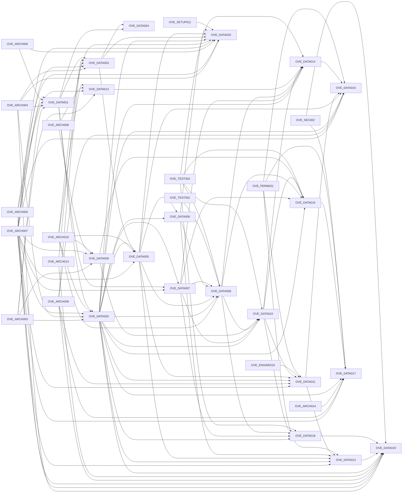

### ENGINE

```mermaid
flowchart LR
  OVE_ARCH001 --> OVE_ENGINE001
  OVE_ARCH003 --> OVE_ENGINE001
  OVE_ARCH008 --> OVE_ENGINE001
  OVE_SEC001 --> OVE_ENGINE001
  OVE_ARCH004 --> OVE_ENGINE002
  OVE_ARCH005 --> OVE_ENGINE002
  OVE_ARCH006 --> OVE_ENGINE002
  OVE_ARCH009 --> OVE_ENGINE002
  OVE_SETUP016 --> OVE_ENGINE002
  OVE_ARCH004 --> OVE_ENGINE003
  OVE_ARCH005 --> OVE_ENGINE003
  OVE_ARCH007 --> OVE_ENGINE003
  OVE_ARCH013 --> OVE_ENGINE003
  OVE_ARCH014 --> OVE_ENGINE003
  OVE_ENGINE002 --> OVE_ENGINE003
  OVE_ARCH004 --> OVE_ENGINE004
  OVE_ARCH006 --> OVE_ENGINE004
  OVE_ARCH007 --> OVE_ENGINE004
  OVE_DATA002 --> OVE_ENGINE004
  OVE_DATA005 --> OVE_ENGINE004
  OVE_DATA006 --> OVE_ENGINE004
  OVE_DATA020 --> OVE_ENGINE004
  OVE_ENGINE002 --> OVE_ENGINE004
  OVE_ENGINE003 --> OVE_ENGINE004
  OVE_ARCH004 --> OVE_ENGINE005
  OVE_ARCH006 --> OVE_ENGINE005
  OVE_ARCH007 --> OVE_ENGINE005
  OVE_DATA002 --> OVE_ENGINE005
  OVE_DATA005 --> OVE_ENGINE005
  OVE_DATA006 --> OVE_ENGINE005
  OVE_DATA020 --> OVE_ENGINE005
  OVE_ENGINE002 --> OVE_ENGINE005
  OVE_ARCH004 --> OVE_ENGINE006
  OVE_ARCH006 --> OVE_ENGINE006
  OVE_ARCH007 --> OVE_ENGINE006
  OVE_ARCH009 --> OVE_ENGINE006
  OVE_ARCH010 --> OVE_ENGINE006
  OVE_ENGINE002 --> OVE_ENGINE006
  OVE_ENGINE010 --> OVE_ENGINE006
  OVE_ARCH008 --> OVE_ENGINE007
  OVE_ARCH009 --> OVE_ENGINE007
  OVE_ENGINE006 --> OVE_ENGINE007
  OVE_SETUP016 --> OVE_ENGINE007
  OVE_ARCH004 --> OVE_ENGINE008
  OVE_ARCH005 --> OVE_ENGINE008
  OVE_ARCH012 --> OVE_ENGINE008
  OVE_ARCH013 --> OVE_ENGINE008
  OVE_ARCH014 --> OVE_ENGINE008
  OVE_ARCH007 --> OVE_ENGINE009
  OVE_ARCH012 --> OVE_ENGINE009
  OVE_ENGINE003 --> OVE_ENGINE009
  OVE_ENGINE007 --> OVE_ENGINE009
  OVE_ENGINE008 --> OVE_ENGINE009
  OVE_ENGINE021 --> OVE_ENGINE009
  OVE_SETUP016 --> OVE_ENGINE009
  OVE_ARCH003 --> OVE_ENGINE010
  OVE_ARCH004 --> OVE_ENGINE010
  OVE_ARCH005 --> OVE_ENGINE010
  OVE_ARCH007 --> OVE_ENGINE010
  OVE_ENGINE001 --> OVE_ENGINE010
  OVE_ENGINE002 --> OVE_ENGINE010
  OVE_ARCH003 --> OVE_ENGINE011
  OVE_ARCH004 --> OVE_ENGINE011
  OVE_ARCH007 --> OVE_ENGINE011
  OVE_ARCH008 --> OVE_ENGINE011
  OVE_ENGINE010 --> OVE_ENGINE011
  OVE_ARCH004 --> OVE_ENGINE012
  OVE_ARCH005 --> OVE_ENGINE012
  OVE_ARCH007 --> OVE_ENGINE012
  OVE_ARCH013 --> OVE_ENGINE012
  OVE_ENGINE011 --> OVE_ENGINE012
  OVE_SEC005 --> OVE_ENGINE012
  OVE_ARCH006 --> OVE_ENGINE013
  OVE_ARCH008 --> OVE_ENGINE013
  OVE_ARCH009 --> OVE_ENGINE013
  OVE_ENGINE011 --> OVE_ENGINE013
  OVE_ENGINE012 --> OVE_ENGINE013
  OVE_ARCH004 --> OVE_ENGINE014
  OVE_ARCH007 --> OVE_ENGINE014
  OVE_ENGINE011 --> OVE_ENGINE014
  OVE_ARCH007 --> OVE_ENGINE015
  OVE_DATA002 --> OVE_ENGINE015
  OVE_DATA007 --> OVE_ENGINE015
  OVE_ENGINE011 --> OVE_ENGINE015
  OVE_ARCH004 --> OVE_ENGINE016
  OVE_ARCH007 --> OVE_ENGINE016
  OVE_DATA002 --> OVE_ENGINE016
  OVE_DATA005 --> OVE_ENGINE016
  OVE_ENGINE011 --> OVE_ENGINE016
  OVE_ENGINE013 --> OVE_ENGINE016
  OVE_ARCH007 --> OVE_ENGINE017
  OVE_ARCH010 --> OVE_ENGINE017
  OVE_DATA005 --> OVE_ENGINE017
  OVE_ENGINE013 --> OVE_ENGINE017
  OVE_ENGINE014 --> OVE_ENGINE017
  OVE_ENGINE002 --> OVE_ENGINE018
  OVE_ENGINE010 --> OVE_ENGINE018
  OVE_ENGINE012 --> OVE_ENGINE018
  OVE_ENGINE013 --> OVE_ENGINE018
  OVE_TEST002 --> OVE_ENGINE018
  OVE_ARCH003 --> OVE_ENGINE019
  OVE_ARCH008 --> OVE_ENGINE019
  OVE_ARCH010 --> OVE_ENGINE019
  OVE_ENGINE007 --> OVE_ENGINE019
  OVE_ENGINE011 --> OVE_ENGINE019
  OVE_ENGINE011 --> OVE_ENGINE020
  OVE_ENGINE013 --> OVE_ENGINE020
  OVE_ENGINE019 --> OVE_ENGINE020
  OVE_ARCH005 --> OVE_ENGINE021
  OVE_ENGINE012 --> OVE_ENGINE021
  OVE_ENGINE019 --> OVE_ENGINE021
  OVE_ENGINE012 --> OVE_ENGINE022
  OVE_ENGINE013 --> OVE_ENGINE022
  OVE_ENGINE017 --> OVE_ENGINE022
  OVE_ENGINE019 --> OVE_ENGINE022
  OVE_SETUP010 --> OVE_ENGINE022
  OVE_ENGINE010 --> OVE_ENGINE023
  OVE_ENGINE012 --> OVE_ENGINE023
  OVE_ENGINE013 --> OVE_ENGINE023
  OVE_ENGINE019 --> OVE_ENGINE023
  OVE_ARCH005 --> OVE_ENGINE024
  OVE_ARCH009 --> OVE_ENGINE024
  OVE_ARCH010 --> OVE_ENGINE024
  OVE_ENGINE002 --> OVE_ENGINE024
  OVE_ENGINE013 --> OVE_ENGINE024
  OVE_ARCH004 --> OVE_ENGINE025
  OVE_ARCH005 --> OVE_ENGINE025
  OVE_ARCH007 --> OVE_ENGINE025
  OVE_ARCH009 --> OVE_ENGINE025
  OVE_ARCH013 --> OVE_ENGINE025
  OVE_DATA006 --> OVE_ENGINE025
  OVE_ENGINE006 --> OVE_ENGINE025
  OVE_ENGINE013 --> OVE_ENGINE025
  OVE_ENGINE010 --> OVE_ENGINE026
  OVE_SETUP011 --> OVE_ENGINE026
  OVE_ARCH010 --> OVE_ENGINE027
  OVE_ENGINE017 --> OVE_ENGINE027
  OVE_ENGINE019 --> OVE_ENGINE027
  OVE_ARCH007 --> OVE_ENGINE028
  OVE_ARCH010 --> OVE_ENGINE028
  OVE_ENGINE005 --> OVE_ENGINE028
  OVE_ENGINE012 --> OVE_ENGINE028
  OVE_ENGINE013 --> OVE_ENGINE028
  OVE_SEC005 --> OVE_ENGINE028
  OVE_ARCH003 --> OVE_ENGINE029
  OVE_ARCH006 --> OVE_ENGINE029
  OVE_ARCH007 --> OVE_ENGINE029
  OVE_ENGINE004 --> OVE_ENGINE029
  OVE_PAUSE005 --> OVE_ENGINE029
```

### PERM

```mermaid
flowchart LR
  OVE_ARCH003 --> OVE_PERM001
  OVE_ARCH007 --> OVE_PERM001
  OVE_ARCH008 --> OVE_PERM001
  OVE_SEC002 --> OVE_PERM001
  OVE_ARCH003 --> OVE_PERM002
  OVE_PERM001 --> OVE_PERM002
  OVE_SEC002 --> OVE_PERM002
  OVE_PERM001 --> OVE_PERM003
  OVE_PERM002 --> OVE_PERM003
  OVE_PERM001 --> OVE_PERM004
  OVE_PERM001 --> OVE_PERM005
  OVE_PERM003 --> OVE_PERM005
  OVE_PERM004 --> OVE_PERM005
  OVE_PERM001 --> OVE_PERM006
  OVE_PERM004 --> OVE_PERM006
  OVE_PERM001 --> OVE_PERM007
  OVE_PERM005 --> OVE_PERM007
  OVE_PERM006 --> OVE_PERM007
  OVE_SEC002 --> OVE_PERM007
  OVE_ARCH003 --> OVE_PERM008
  OVE_PERM001 --> OVE_PERM008
  OVE_ARCH007 --> OVE_PERM009
  OVE_ARCH009 --> OVE_PERM009
  OVE_PERM001 --> OVE_PERM009
  OVE_PERM008 --> OVE_PERM009
  OVE_PERM020 --> OVE_PERM009
  OVE_SEC005 --> OVE_PERM009
  OVE_AGENT016 --> OVE_PERM010
  OVE_AGENT018 --> OVE_PERM010
  OVE_ARCH004 --> OVE_PERM010
  OVE_ARCH006 --> OVE_PERM010
  OVE_ARCH007 --> OVE_PERM010
  OVE_PERM005 --> OVE_PERM010
  OVE_PERM006 --> OVE_PERM010
  OVE_PERM007 --> OVE_PERM010
  OVE_PERM008 --> OVE_PERM010
  OVE_PERM012 --> OVE_PERM010
  OVE_PERM018 --> OVE_PERM010
  OVE_PERM020 --> OVE_PERM010
  OVE_SEC002 --> OVE_PERM010
  OVE_ARCH007 --> OVE_PERM011
  OVE_ARCH010 --> OVE_PERM011
  OVE_DATA002 --> OVE_PERM011
  OVE_PERM002 --> OVE_PERM011
  OVE_PERM004 --> OVE_PERM011
  OVE_PERM005 --> OVE_PERM011
  OVE_PERM008 --> OVE_PERM011
  OVE_PERM009 --> OVE_PERM011
  OVE_PERM020 --> OVE_PERM011
  OVE_SEC002 --> OVE_PERM011
  OVE_ARCH007 --> OVE_PERM012
  OVE_ARCH010 --> OVE_PERM012
  OVE_DATA002 --> OVE_PERM012
  OVE_PERM006 --> OVE_PERM012
  OVE_PERM008 --> OVE_PERM012
  OVE_PERM009 --> OVE_PERM012
  OVE_PERM020 --> OVE_PERM012
  OVE_ARCH010 --> OVE_PERM013
  OVE_PERM001 --> OVE_PERM013
  OVE_PERM006 --> OVE_PERM013
  OVE_PERM008 --> OVE_PERM013
  OVE_AGENT018 --> OVE_PERM014
  OVE_ARCH007 --> OVE_PERM014
  OVE_ARCH010 --> OVE_PERM014
  OVE_DATA002 --> OVE_PERM014
  OVE_ENGINE029 --> OVE_PERM014
  OVE_PERM006 --> OVE_PERM014
  OVE_PERM008 --> OVE_PERM014
  OVE_PERM010 --> OVE_PERM014
  OVE_PERM013 --> OVE_PERM014
  OVE_PERM018 --> OVE_PERM014
  OVE_PERM020 --> OVE_PERM014
  OVE_ARCH010 --> OVE_PERM015
  OVE_PERM001 --> OVE_PERM015
  OVE_PERM008 --> OVE_PERM015
  OVE_SEC002 --> OVE_PERM015
  OVE_AGENT018 --> OVE_PERM016
  OVE_ARCH007 --> OVE_PERM016
  OVE_ARCH010 --> OVE_PERM016
  OVE_DATA002 --> OVE_PERM016
  OVE_ENGINE029 --> OVE_PERM016
  OVE_PERM008 --> OVE_PERM016
  OVE_PERM009 --> OVE_PERM016
  OVE_PERM010 --> OVE_PERM016
  OVE_PERM011 --> OVE_PERM016
  OVE_PERM015 --> OVE_PERM016
  OVE_PERM017 --> OVE_PERM016
  OVE_PERM018 --> OVE_PERM016
  OVE_PERM020 --> OVE_PERM016
  OVE_SEC002 --> OVE_PERM016
  OVE_ARCH010 --> OVE_PERM017
  OVE_ARCH012 --> OVE_PERM017
  OVE_BOX023 --> OVE_PERM017
  OVE_PERM005 --> OVE_PERM017
  OVE_PERM007 --> OVE_PERM017
  OVE_PERM010 --> OVE_PERM017
  OVE_PERM020 --> OVE_PERM017
  OVE_SEC002 --> OVE_PERM017
  OVE_ARCH004 --> OVE_PERM018
  OVE_ARCH007 --> OVE_PERM018
  OVE_ARCH010 --> OVE_PERM018
  OVE_PERM001 --> OVE_PERM018
  OVE_PERM019 --> OVE_PERM018
  OVE_PERM020 --> OVE_PERM018
  OVE_ARCH003 --> OVE_PERM019
  OVE_ARCH007 --> OVE_PERM019
  OVE_ARCH008 --> OVE_PERM019
  OVE_ARCH010 --> OVE_PERM019
  OVE_ARCH003 --> OVE_PERM020
  OVE_ARCH004 --> OVE_PERM020
  OVE_ARCH007 --> OVE_PERM020
  OVE_DATA001 --> OVE_PERM020
  OVE_DATA002 --> OVE_PERM020
  OVE_DATA003 --> OVE_PERM020
  OVE_PERM019 --> OVE_PERM020
  OVE_ARCH004 --> OVE_PERM021
  OVE_PERM019 --> OVE_PERM021
  OVE_SEC002 --> OVE_PERM021
  OVE_SEC003 --> OVE_PERM021
  OVE_ARCH005 --> OVE_PERM022
  OVE_ARCH007 --> OVE_PERM022
  OVE_ARCH012 --> OVE_PERM022
  OVE_ARCH013 --> OVE_PERM022
  OVE_ENGINE029 --> OVE_PERM022
  OVE_PERM019 --> OVE_PERM022
  OVE_PERM020 --> OVE_PERM022
  OVE_PERM021 --> OVE_PERM022
  OVE_SEC002 --> OVE_PERM022
  OVE_ARCH009 --> OVE_PERM023
  OVE_ENGINE012 --> OVE_PERM023
  OVE_ENGINE019 --> OVE_PERM023
  OVE_PERM008 --> OVE_PERM023
  OVE_PERM020 --> OVE_PERM023
  OVE_PERM022 --> OVE_PERM023
  OVE_DATA001 --> OVE_PERM024
  OVE_DATA002 --> OVE_PERM024
  OVE_DATA003 --> OVE_PERM024
  OVE_PERM011 --> OVE_PERM024
  OVE_PERM012 --> OVE_PERM024
  OVE_DATA001 --> OVE_PERM025
  OVE_DATA002 --> OVE_PERM025
  OVE_DATA003 --> OVE_PERM025
  OVE_PERM014 --> OVE_PERM025
  OVE_PERM016 --> OVE_PERM025
  OVE_ARCH009 --> OVE_PERM026
  OVE_ENGINE012 --> OVE_PERM026
  OVE_ENGINE019 --> OVE_PERM026
  OVE_PERM009 --> OVE_PERM026
  OVE_PERM010 --> OVE_PERM026
  OVE_PERM011 --> OVE_PERM026
  OVE_PERM012 --> OVE_PERM026
  OVE_ARCH009 --> OVE_PERM027
  OVE_ENGINE012 --> OVE_PERM027
  OVE_ENGINE019 --> OVE_PERM027
  OVE_PERM014 --> OVE_PERM027
  OVE_PERM025 --> OVE_PERM027
  OVE_ARCH009 --> OVE_PERM028
  OVE_ENGINE012 --> OVE_PERM028
  OVE_ENGINE019 --> OVE_PERM028
  OVE_PERM016 --> OVE_PERM028
  OVE_PERM025 --> OVE_PERM028
  OVE_PERM027 --> OVE_PERM028
  OVE_PAUSE001 --> OVE_PERM029
  OVE_PERM010 --> OVE_PERM029
  OVE_PERM014 --> OVE_PERM029
  OVE_PERM016 --> OVE_PERM029
  OVE_PERM010 --> OVE_PERM030
  OVE_PERM014 --> OVE_PERM030
  OVE_PERM016 --> OVE_PERM030
  OVE_PERM017 --> OVE_PERM030
  OVE_PERM026 --> OVE_PERM030
  OVE_PERM027 --> OVE_PERM030
  OVE_PERM028 --> OVE_PERM030
  OVE_SEC005 --> OVE_PERM030
  OVE_TEST002 --> OVE_PERM030
  OVE_TEST012 --> OVE_PERM030
  OVE_ARCH007 --> OVE_PERM031
  OVE_PERM009 --> OVE_PERM031
  OVE_PERM024 --> OVE_PERM031
  OVE_DATA002 --> OVE_PERM032
  OVE_DATA012 --> OVE_PERM032
  OVE_PERM012 --> OVE_PERM032
  OVE_PERM020 --> OVE_PERM032
  OVE_PERM024 --> OVE_PERM032
  OVE_PERM025 --> OVE_PERM032
```

### VIS

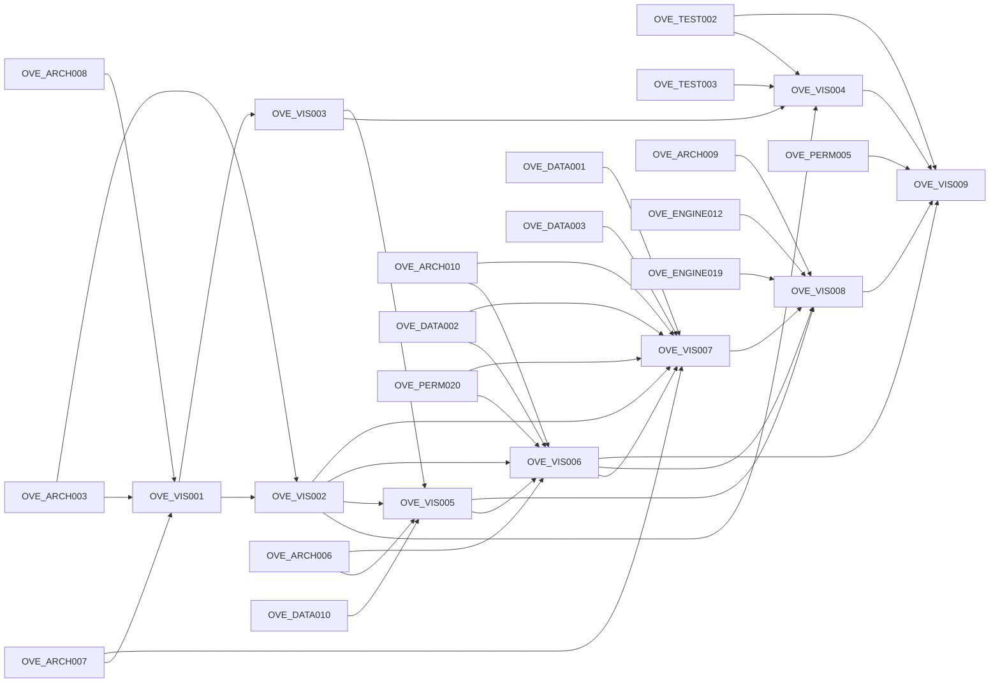

### BOX

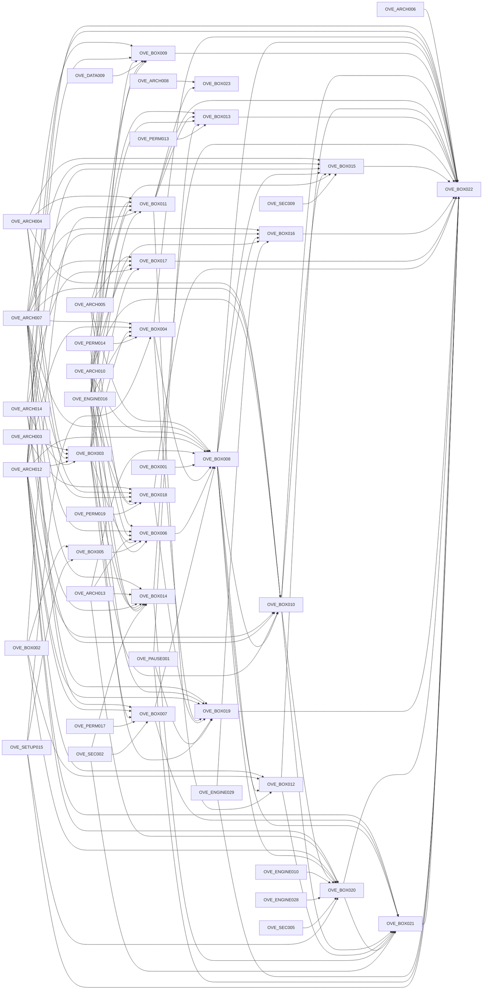

### PROV

```mermaid
flowchart LR
  OVE_ARCH003 --> OVE_PROV001
  OVE_ARCH006 --> OVE_PROV001
  OVE_ARCH007 --> OVE_PROV001
  OVE_ARCH003 --> OVE_PROV002
  OVE_ARCH007 --> OVE_PROV002
  OVE_ARCH008 --> OVE_PROV002
  OVE_ARCH012 --> OVE_PROV002
  OVE_PROV001 --> OVE_PROV002
  OVE_AGENT001 --> OVE_PROV003
  OVE_ARCH007 --> OVE_PROV003
  OVE_PROV001 --> OVE_PROV003
  OVE_PROV002 --> OVE_PROV003
  OVE_PROV020 --> OVE_PROV003
  OVE_ARCH003 --> OVE_PROV004
  OVE_ARCH004 --> OVE_PROV004
  OVE_ARCH007 --> OVE_PROV004
  OVE_BOX002 --> OVE_PROV004
  OVE_BOX020 --> OVE_PROV004
  OVE_SETUP015 --> OVE_PROV004
  OVE_TEST009 --> OVE_PROV004
  OVE_ARCH004 --> OVE_PROV005
  OVE_ARCH007 --> OVE_PROV005
  OVE_ARCH010 --> OVE_PROV005
  OVE_PROV004 --> OVE_PROV005
  OVE_PROV006 --> OVE_PROV005
  OVE_TEST009 --> OVE_PROV005
  OVE_ARCH004 --> OVE_PROV006
  OVE_PROV001 --> OVE_PROV006
  OVE_TEST006 --> OVE_PROV006
  OVE_ARCH004 --> OVE_PROV007
  OVE_ARCH012 --> OVE_PROV007
  OVE_PROV004 --> OVE_PROV007
  OVE_PROV006 --> OVE_PROV007
  OVE_SETUP015 --> OVE_PROV007
  OVE_ARCH004 --> OVE_PROV008
  OVE_ARCH007 --> OVE_PROV008
  OVE_BOX019 --> OVE_PROV008
  OVE_ENGINE016 --> OVE_PROV008
  OVE_PAUSE001 --> OVE_PROV008
  OVE_PROV005 --> OVE_PROV008
  OVE_PROV006 --> OVE_PROV008
  OVE_PROV009 --> OVE_PROV008
  OVE_PROV019 --> OVE_PROV008
  OVE_ARCH003 --> OVE_PROV009
  OVE_ARCH007 --> OVE_PROV009
  OVE_ARCH008 --> OVE_PROV009
  OVE_PROV001 --> OVE_PROV009
  OVE_PROV006 --> OVE_PROV009
  OVE_ARCH004 --> OVE_PROV010
  OVE_ARCH007 --> OVE_PROV010
  OVE_ARCH012 --> OVE_PROV010
  OVE_PROV001 --> OVE_PROV010
  OVE_PROV009 --> OVE_PROV010
  OVE_PROV015 --> OVE_PROV010
  OVE_PROV020 --> OVE_PROV010
  OVE_PROV027 --> OVE_PROV010
  OVE_PROV029 --> OVE_PROV010
  OVE_PROV034 --> OVE_PROV010
  OVE_TEST006 --> OVE_PROV010
  OVE_ARCH004 --> OVE_PROV011
  OVE_ARCH007 --> OVE_PROV011
  OVE_PROV010 --> OVE_PROV011
  OVE_PROV034 --> OVE_PROV011
  OVE_TEST006 --> OVE_PROV011
  OVE_ARCH004 --> OVE_PROV012
  OVE_ARCH007 --> OVE_PROV012
  OVE_ARCH012 --> OVE_PROV012
  OVE_BOX010 --> OVE_PROV012
  OVE_BOX020 --> OVE_PROV012
  OVE_ENGINE016 --> OVE_PROV012
  OVE_PROV034 --> OVE_PROV012
  OVE_SKILL013 --> OVE_PROV012
  OVE_ARCH004 --> OVE_PROV013
  OVE_ARCH007 --> OVE_PROV013
  OVE_ARCH010 --> OVE_PROV013
  OVE_CHIEF015 --> OVE_PROV013
  OVE_ENGINE016 --> OVE_PROV013
  OVE_NOTIF004 --> OVE_PROV013
  OVE_PAUSE001 --> OVE_PROV013
  OVE_PERM013 --> OVE_PROV013
  OVE_PERM014 --> OVE_PROV013
  OVE_PROV005 --> OVE_PROV013
  OVE_PROV006 --> OVE_PROV013
  OVE_PROV008 --> OVE_PROV013
  OVE_PROV009 --> OVE_PROV013
  OVE_PROV034 --> OVE_PROV013
  OVE_ARCH004 --> OVE_PROV014
  OVE_ARCH007 --> OVE_PROV014
  OVE_ARCH010 --> OVE_PROV014
  OVE_ARCH012 --> OVE_PROV014
  OVE_BOX015 --> OVE_PROV014
  OVE_BOX019 --> OVE_PROV014
  OVE_ENGINE016 --> OVE_PROV014
  OVE_NOTIF004 --> OVE_PROV014
  OVE_PROV006 --> OVE_PROV014
  OVE_PROV009 --> OVE_PROV014
  OVE_PROV019 --> OVE_PROV014
  OVE_PROV020 --> OVE_PROV014
  OVE_PROV034 --> OVE_PROV014
  OVE_SEC009 --> OVE_PROV014
  OVE_AGENT014 --> OVE_PROV015
  OVE_ARCH004 --> OVE_PROV015
  OVE_ARCH007 --> OVE_PROV015
  OVE_ARCH010 --> OVE_PROV015
  OVE_ARCH012 --> OVE_PROV015
  OVE_ENGINE016 --> OVE_PROV015
  OVE_PROV006 --> OVE_PROV015
  OVE_PROV009 --> OVE_PROV015
  OVE_PROV019 --> OVE_PROV015
  OVE_ARCH004 --> OVE_PROV016
  OVE_ARCH007 --> OVE_PROV016
  OVE_PROV001 --> OVE_PROV016
  OVE_PROV002 --> OVE_PROV016
  OVE_PROV020 --> OVE_PROV016
  OVE_PROV034 --> OVE_PROV016
  OVE_ARCH004 --> OVE_PROV017
  OVE_ARCH007 --> OVE_PROV017
  OVE_ARCH010 --> OVE_PROV017
  OVE_DATA001 --> OVE_PROV017
  OVE_DATA003 --> OVE_PROV017
  OVE_DATA007 --> OVE_PROV017
  OVE_ENGINE029 --> OVE_PROV017
  OVE_PROV001 --> OVE_PROV017
  OVE_PROV002 --> OVE_PROV017
  OVE_PROV006 --> OVE_PROV017
  OVE_PROV019 --> OVE_PROV017
  OVE_PROV020 --> OVE_PROV017
  OVE_PROV034 --> OVE_PROV017
  OVE_ARCH007 --> OVE_PROV018
  OVE_ARCH010 --> OVE_PROV018
  OVE_CHIEF015 --> OVE_PROV018
  OVE_DATA001 --> OVE_PROV018
  OVE_DATA003 --> OVE_PROV018
  OVE_DATA007 --> OVE_PROV018
  OVE_ENGINE016 --> OVE_PROV018
  OVE_ENGINE029 --> OVE_PROV018
  OVE_NOTIF004 --> OVE_PROV018
  OVE_PROV001 --> OVE_PROV018
  OVE_PROV003 --> OVE_PROV018
  OVE_PROV006 --> OVE_PROV018
  OVE_PROV009 --> OVE_PROV018
  OVE_PROV017 --> OVE_PROV018
  OVE_PROV019 --> OVE_PROV018
  OVE_PROV020 --> OVE_PROV018
  OVE_ARCH005 --> OVE_PROV019
  OVE_ARCH007 --> OVE_PROV019
  OVE_ARCH010 --> OVE_PROV019
  OVE_ARCH012 --> OVE_PROV019
  OVE_BOX017 --> OVE_PROV019
  OVE_ENGINE016 --> OVE_PROV019
  OVE_ENGINE029 --> OVE_PROV019
  OVE_PAUSE001 --> OVE_PROV019
  OVE_PROV009 --> OVE_PROV019
  OVE_ARCH007 --> OVE_PROV020
  OVE_ARCH010 --> OVE_PROV020
  OVE_ARCH012 --> OVE_PROV020
  OVE_BOX009 --> OVE_PROV020
  OVE_DATA001 --> OVE_PROV020
  OVE_DATA002 --> OVE_PROV020
  OVE_DATA003 --> OVE_PROV020
  OVE_DATA007 --> OVE_PROV020
  OVE_PERM009 --> OVE_PROV020
  OVE_PERM020 --> OVE_PROV020
  OVE_PROV001 --> OVE_PROV020
  OVE_PROV002 --> OVE_PROV020
  OVE_ARCH008 --> OVE_PROV021
  OVE_ARCH009 --> OVE_PROV021
  OVE_ENGINE013 --> OVE_PROV021
  OVE_ENGINE018 --> OVE_PROV021
  OVE_ENGINE019 --> OVE_PROV021
  OVE_PROV002 --> OVE_PROV021
  OVE_PROV014 --> OVE_PROV021
  OVE_PROV017 --> OVE_PROV021
  OVE_PROV019 --> OVE_PROV021
  OVE_PROV020 --> OVE_PROV021
  OVE_PROV022 --> OVE_PROV021
  OVE_ARCH004 --> OVE_PROV022
  OVE_ARCH007 --> OVE_PROV022
  OVE_ARCH012 --> OVE_PROV022
  OVE_BOX006 --> OVE_PROV022
  OVE_BOX007 --> OVE_PROV022
  OVE_BOX009 --> OVE_PROV022
  OVE_BOX010 --> OVE_PROV022
  OVE_BOX019 --> OVE_PROV022
  OVE_BOX022 --> OVE_PROV022
  OVE_BOX023 --> OVE_PROV022
  OVE_ENGINE016 --> OVE_PROV022
  OVE_ENGINE029 --> OVE_PROV022
  OVE_PERM017 --> OVE_PROV022
  OVE_PROV001 --> OVE_PROV022
  OVE_PROV002 --> OVE_PROV022
  OVE_PROV016 --> OVE_PROV022
  OVE_PROV020 --> OVE_PROV022
  OVE_PROV034 --> OVE_PROV022
  OVE_ARCH007 --> OVE_PROV023
  OVE_ARCH010 --> OVE_PROV023
  OVE_DATA001 --> OVE_PROV023
  OVE_DATA003 --> OVE_PROV023
  OVE_DATA007 --> OVE_PROV023
  OVE_ENGINE016 --> OVE_PROV023
  OVE_ENGINE029 --> OVE_PROV023
  OVE_NOTIF004 --> OVE_PROV023
  OVE_PERM009 --> OVE_PROV023
  OVE_PROV001 --> OVE_PROV023
  OVE_PROV019 --> OVE_PROV023
  OVE_PROV020 --> OVE_PROV023
  OVE_PROV001 --> OVE_PROV024
  OVE_PROV002 --> OVE_PROV024
  OVE_PROV005 --> OVE_PROV024
  OVE_PROV009 --> OVE_PROV024
  OVE_PROV019 --> OVE_PROV024
  OVE_PROV020 --> OVE_PROV024
  OVE_PROV034 --> OVE_PROV024
  OVE_TEST002 --> OVE_PROV024
  OVE_TEST003 --> OVE_PROV024
  OVE_TEST006 --> OVE_PROV024
  OVE_TEST009 --> OVE_PROV024
  OVE_AGENT003 --> OVE_PROV025
  OVE_ARCH007 --> OVE_PROV025
  OVE_PROV001 --> OVE_PROV025
  OVE_PROV002 --> OVE_PROV025
  OVE_PROV003 --> OVE_PROV025
  OVE_PROV020 --> OVE_PROV025
  OVE_PROV023 --> OVE_PROV025
  OVE_ARCH004 --> OVE_PROV026
  OVE_ARCH006 --> OVE_PROV026
  OVE_ARCH007 --> OVE_PROV026
  OVE_ARCH010 --> OVE_PROV026
  OVE_ARCH012 --> OVE_PROV026
  OVE_BOX019 --> OVE_PROV026
  OVE_BOX020 --> OVE_PROV026
  OVE_BOX022 --> OVE_PROV026
  OVE_ENGINE002 --> OVE_PROV026
  OVE_ENGINE004 --> OVE_PROV026
  OVE_ENGINE005 --> OVE_PROV026
  OVE_ENGINE016 --> OVE_PROV026
  OVE_ENGINE029 --> OVE_PROV026
  OVE_PROV004 --> OVE_PROV026
  OVE_PROV005 --> OVE_PROV026
  OVE_PROV008 --> OVE_PROV026
  OVE_PROV010 --> OVE_PROV026
  OVE_PROV011 --> OVE_PROV026
  OVE_PROV012 --> OVE_PROV026
  OVE_PROV013 --> OVE_PROV026
  OVE_PROV014 --> OVE_PROV026
  OVE_PROV015 --> OVE_PROV026
  OVE_PROV016 --> OVE_PROV026
  OVE_PROV017 --> OVE_PROV026
  OVE_PROV018 --> OVE_PROV026
  OVE_PROV019 --> OVE_PROV026
  OVE_PROV020 --> OVE_PROV026
  OVE_PROV022 --> OVE_PROV026
  OVE_PROV023 --> OVE_PROV026
  OVE_PROV025 --> OVE_PROV026
  OVE_PROV027 --> OVE_PROV026
  OVE_PROV028 --> OVE_PROV026
  OVE_PROV029 --> OVE_PROV026
  OVE_PROV034 --> OVE_PROV026
  OVE_ARCH007 --> OVE_PROV027
  OVE_ARCH010 --> OVE_PROV027
  OVE_ARCH012 --> OVE_PROV027
  OVE_BOX006 --> OVE_PROV027
  OVE_BOX007 --> OVE_PROV027
  OVE_BOX009 --> OVE_PROV027
  OVE_BOX014 --> OVE_PROV027
  OVE_BOX019 --> OVE_PROV027
  OVE_BOX020 --> OVE_PROV027
  OVE_BOX022 --> OVE_PROV027
  OVE_ENGINE016 --> OVE_PROV027
  OVE_ENGINE028 --> OVE_PROV027
  OVE_PERM017 --> OVE_PROV027
  OVE_PROV005 --> OVE_PROV027
  OVE_PROV007 --> OVE_PROV027
  OVE_PROV009 --> OVE_PROV027
  OVE_PROV012 --> OVE_PROV027
  OVE_PROV019 --> OVE_PROV027
  OVE_PROV025 --> OVE_PROV027
  OVE_PROV034 --> OVE_PROV027
  OVE_ARCH007 --> OVE_PROV028
  OVE_ARCH010 --> OVE_PROV028
  OVE_ARCH012 --> OVE_PROV028
  OVE_BOX016 --> OVE_PROV028
  OVE_BOX019 --> OVE_PROV028
  OVE_DATA001 --> OVE_PROV028
  OVE_DATA003 --> OVE_PROV028
  OVE_DATA007 --> OVE_PROV028
  OVE_ENGINE005 --> OVE_PROV028
  OVE_ENGINE016 --> OVE_PROV028
  OVE_ENGINE028 --> OVE_PROV028
  OVE_PROV005 --> OVE_PROV028
  OVE_PROV008 --> OVE_PROV028
  OVE_PROV009 --> OVE_PROV028
  OVE_PROV027 --> OVE_PROV028
  OVE_ARCH004 --> OVE_PROV029
  OVE_ARCH007 --> OVE_PROV029
  OVE_ARCH010 --> OVE_PROV029
  OVE_PROV005 --> OVE_PROV029
  OVE_PROV008 --> OVE_PROV029
  OVE_PROV009 --> OVE_PROV029
  OVE_PROV027 --> OVE_PROV029
  OVE_PROV028 --> OVE_PROV029
  OVE_AGENT014 --> OVE_PROV030
  OVE_ARCH007 --> OVE_PROV030
  OVE_ARCH010 --> OVE_PROV030
  OVE_BOX019 --> OVE_PROV030
  OVE_ENGINE016 --> OVE_PROV030
  OVE_PAUSE001 --> OVE_PROV030
  OVE_PROV001 --> OVE_PROV030
  OVE_PROV009 --> OVE_PROV030
  OVE_PROV010 --> OVE_PROV030
  OVE_PROV015 --> OVE_PROV030
  OVE_PROV017 --> OVE_PROV030
  OVE_PROV025 --> OVE_PROV030
  OVE_PROV027 --> OVE_PROV030
  OVE_PROV029 --> OVE_PROV030
  OVE_WFRT019 --> OVE_PROV030
  OVE_ARCH004 --> OVE_PROV031
  OVE_ARCH007 --> OVE_PROV031
  OVE_DISC003 --> OVE_PROV031
  OVE_ENGINE016 --> OVE_PROV031
  OVE_PAUSE001 --> OVE_PROV031
  OVE_PROV010 --> OVE_PROV031
  OVE_PROV016 --> OVE_PROV031
  OVE_PROV017 --> OVE_PROV031
  OVE_PROV025 --> OVE_PROV031
  OVE_PROV034 --> OVE_PROV031
  OVE_ARCH004 --> OVE_PROV032
  OVE_ARCH007 --> OVE_PROV032
  OVE_ENGINE016 --> OVE_PROV032
  OVE_MEM003 --> OVE_PROV032
  OVE_PAUSE001 --> OVE_PROV032
  OVE_PROV010 --> OVE_PROV032
  OVE_PROV016 --> OVE_PROV032
  OVE_PROV017 --> OVE_PROV032
  OVE_PROV019 --> OVE_PROV032
  OVE_PROV025 --> OVE_PROV032
  OVE_PROV027 --> OVE_PROV032
  OVE_PROV034 --> OVE_PROV032
  OVE_ARCH004 --> OVE_PROV033
  OVE_PROV008 --> OVE_PROV033
  OVE_PROV009 --> OVE_PROV033
  OVE_PROV013 --> OVE_PROV033
  OVE_PROV014 --> OVE_PROV033
  OVE_PROV015 --> OVE_PROV033
  OVE_PROV018 --> OVE_PROV033
  OVE_PROV024 --> OVE_PROV033
  OVE_PROV027 --> OVE_PROV033
  OVE_PROV029 --> OVE_PROV033
  OVE_TEST002 --> OVE_PROV033
  OVE_TEST006 --> OVE_PROV033
  OVE_TEST009 --> OVE_PROV033
  OVE_ARCH003 --> OVE_PROV034
  OVE_PROV001 --> OVE_PROV034
  OVE_PROV006 --> OVE_PROV034
  OVE_AGENT003 --> OVE_PROV035
  OVE_ARCH003 --> OVE_PROV035
  OVE_ARCH007 --> OVE_PROV035
  OVE_DATA009 --> OVE_PROV035
  OVE_PROV025 --> OVE_PROV035
  OVE_AGENT005 --> OVE_PROV036
  OVE_ARCH009 --> OVE_PROV036
  OVE_ENGINE011 --> OVE_PROV036
  OVE_ENGINE013 --> OVE_PROV036
  OVE_ENGINE017 --> OVE_PROV036
  OVE_ENGINE019 --> OVE_PROV036
  OVE_PAUSE005 --> OVE_PROV036
  OVE_PROV005 --> OVE_PROV036
  OVE_PROV006 --> OVE_PROV036
  OVE_PROV009 --> OVE_PROV036
  OVE_PROV029 --> OVE_PROV036
```

### WFRT

```mermaid
flowchart LR
  OVE_WFRT001
  OVE_ARCH007 --> OVE_WFRT002
  OVE_ARCH008 --> OVE_WFRT002
  OVE_ARCH010 --> OVE_WFRT002
  OVE_VIS001 --> OVE_WFRT002
  OVE_WFRT003 --> OVE_WFRT002
  OVE_ARCH007 --> OVE_WFRT003
  OVE_ARCH008 --> OVE_WFRT003
  OVE_ARCH009 --> OVE_WFRT003
  OVE_WFRT004 --> OVE_WFRT003
  OVE_ARCH003 --> OVE_WFRT004
  OVE_ARCH003 --> OVE_WFRT005
  OVE_ARCH007 --> OVE_WFRT005
  OVE_WFRT003 --> OVE_WFRT005
  OVE_WFRT004 --> OVE_WFRT005
  OVE_ARCH007 --> OVE_WFRT006
  OVE_ARCH008 --> OVE_WFRT006
  OVE_WFRT003 --> OVE_WFRT006
  OVE_ARCH010 --> OVE_WFRT007
  OVE_WFRT006 --> OVE_WFRT007
  OVE_ARCH010 --> OVE_WFRT008
  OVE_WFRT006 --> OVE_WFRT008
  OVE_ARCH010 --> OVE_WFRT009
  OVE_WFRT006 --> OVE_WFRT009
  OVE_ARCH003 --> OVE_WFRT010
  OVE_ARCH004 --> OVE_WFRT010
  OVE_ARCH009 --> OVE_WFRT010
  OVE_WFRT003 --> OVE_WFRT010
  OVE_WFRT005 --> OVE_WFRT010
  OVE_ARCH003 --> OVE_WFRT011
  OVE_WFRT010 --> OVE_WFRT011
  OVE_WFRT004 --> OVE_WFRT012
  OVE_WFRT010 --> OVE_WFRT012
  OVE_WFRT010 --> OVE_WFRT013
  OVE_VIS001 --> OVE_WFRT014
  OVE_VIS002 --> OVE_WFRT014
  OVE_WFRT010 --> OVE_WFRT014
  OVE_ARCH003 --> OVE_WFRT015
  OVE_ARCH003 --> OVE_WFRT016
  OVE_WFRT004 --> OVE_WFRT016
  OVE_WFRT015 --> OVE_WFRT016
  OVE_SEC004 --> OVE_WFRT017
  OVE_WFRT004 --> OVE_WFRT017
  OVE_WFRT010 --> OVE_WFRT017
  OVE_WFRT012 --> OVE_WFRT017
  OVE_WFRT016 --> OVE_WFRT017
  OVE_ARCH003 --> OVE_WFRT018
  OVE_WFRT005 --> OVE_WFRT018
  OVE_WFRT016 --> OVE_WFRT018
  OVE_ARCH003 --> OVE_WFRT019
  OVE_SEC004 --> OVE_WFRT019
  OVE_WFRT004 --> OVE_WFRT019
  OVE_WFRT005 --> OVE_WFRT019
  OVE_ARCH003 --> OVE_WFRT020
  OVE_WFRT005 --> OVE_WFRT020
  OVE_ARCH003 --> OVE_WFRT021
  OVE_ARCH007 --> OVE_WFRT021
  OVE_WFRT005 --> OVE_WFRT021
  OVE_WFRT020 --> OVE_WFRT021
  OVE_ARCH003 --> OVE_WFRT022
  OVE_WFRT005 --> OVE_WFRT022
  OVE_WFRT016 --> OVE_WFRT022
  OVE_WFRT017 --> OVE_WFRT022
  OVE_ARCH003 --> OVE_WFRT023
  OVE_ARCH007 --> OVE_WFRT023
  OVE_WFRT005 --> OVE_WFRT023
  OVE_WFRT013 --> OVE_WFRT023
  OVE_ARCH003 --> OVE_WFRT048
  OVE_ARCH009 --> OVE_WFRT048
  OVE_ENGINE011 --> OVE_WFRT048
  OVE_ENGINE013 --> OVE_WFRT048
  OVE_WFRT002 --> OVE_WFRT048
  OVE_WFRT005 --> OVE_WFRT048
  OVE_WFRT010 --> OVE_WFRT048
  OVE_ARCH003 --> OVE_WFRT049
  OVE_ARCH009 --> OVE_WFRT049
  OVE_ENGINE011 --> OVE_WFRT049
  OVE_ENGINE013 --> OVE_WFRT049
  OVE_PERM020 --> OVE_WFRT049
  OVE_WFRT002 --> OVE_WFRT049
  OVE_WFRT010 --> OVE_WFRT049
  OVE_WFRT017 --> OVE_WFRT049
  OVE_WFRT048 --> OVE_WFRT049
  OVE_ARCH003 --> OVE_WFRT050
  OVE_ARCH009 --> OVE_WFRT050
  OVE_ENGINE011 --> OVE_WFRT050
  OVE_ENGINE013 --> OVE_WFRT050
  OVE_ENGINE019 --> OVE_WFRT050
  OVE_WFRT048 --> OVE_WFRT050
  OVE_WFRT049 --> OVE_WFRT050
  OVE_AGENT018 --> OVE_WFRT051
  OVE_ARCH003 --> OVE_WFRT051
  OVE_ARCH009 --> OVE_WFRT051
  OVE_DATA005 --> OVE_WFRT051
  OVE_ENGINE011 --> OVE_WFRT051
  OVE_ENGINE013 --> OVE_WFRT051
  OVE_WFRT006 --> OVE_WFRT051
  OVE_WFRT007 --> OVE_WFRT051
  OVE_ARCH003 --> OVE_WFRT052
  OVE_ARCH007 --> OVE_WFRT052
  OVE_ARCH009 --> OVE_WFRT052
  OVE_DATA002 --> OVE_WFRT052
  OVE_ENGINE011 --> OVE_WFRT052
  OVE_ENGINE013 --> OVE_WFRT052
  OVE_ENGINE029 --> OVE_WFRT052
  OVE_PAUSE005 --> OVE_WFRT052
  OVE_PERM020 --> OVE_WFRT052
  OVE_WFRT002 --> OVE_WFRT052
  OVE_WFRT006 --> OVE_WFRT052
  OVE_WFRT007 --> OVE_WFRT052
  OVE_WFRT051 --> OVE_WFRT052
  OVE_DATA002 --> OVE_WFRT053
  OVE_PAUSE005 --> OVE_WFRT053
  OVE_PERM020 --> OVE_WFRT053
  OVE_WFRT006 --> OVE_WFRT053
  OVE_WFRT009 --> OVE_WFRT053
  OVE_WFRT052 --> OVE_WFRT053
  OVE_ARCH003 --> OVE_WFRT054
  OVE_ARCH009 --> OVE_WFRT054
  OVE_ENGINE011 --> OVE_WFRT054
  OVE_ENGINE013 --> OVE_WFRT054
  OVE_ENGINE019 --> OVE_WFRT054
  OVE_ENGINE027 --> OVE_WFRT054
  OVE_WFRT051 --> OVE_WFRT054
  OVE_WFRT052 --> OVE_WFRT054
  OVE_DATA018 --> OVE_WFRT055
  OVE_SEC004 --> OVE_WFRT055
  OVE_WFRT004 --> OVE_WFRT055
  OVE_WFRT005 --> OVE_WFRT055
  OVE_WFRT006 --> OVE_WFRT055
  OVE_WFRT008 --> OVE_WFRT055
  OVE_WFRT010 --> OVE_WFRT055
  OVE_WFRT016 --> OVE_WFRT055
  OVE_WFRT019 --> OVE_WFRT055
  OVE_ARCH014 --> OVE_WFRT056
  OVE_DATA018 --> OVE_WFRT056
  OVE_DATA019 --> OVE_WFRT056
  OVE_WFRT004 --> OVE_WFRT056
  OVE_WFRT005 --> OVE_WFRT056
  OVE_WFRT006 --> OVE_WFRT056
  OVE_WFRT009 --> OVE_WFRT056
  OVE_WFRT010 --> OVE_WFRT056
  OVE_WFRT016 --> OVE_WFRT056
  OVE_ARCH009 --> OVE_WFRT057
  OVE_DATA005 --> OVE_WFRT057
  OVE_ENGINE011 --> OVE_WFRT057
  OVE_ENGINE013 --> OVE_WFRT057
  OVE_PERM019 --> OVE_WFRT057
  OVE_WFRT006 --> OVE_WFRT057
  OVE_WFRT007 --> OVE_WFRT057
  OVE_WFRT051 --> OVE_WFRT057
```

### CHIEF

```mermaid
flowchart LR
  OVE_AGENT001 --> OVE_CHIEF001
  OVE_ARCH003 --> OVE_CHIEF001
  OVE_ARCH007 --> OVE_CHIEF001
  OVE_ARCH008 --> OVE_CHIEF001
  OVE_DATA013 --> OVE_CHIEF001
  OVE_DATA016 --> OVE_CHIEF001
  OVE_VIS001 --> OVE_CHIEF001
  OVE_CHIEF001 --> OVE_CHIEF002
  OVE_DATA013 --> OVE_CHIEF002
  OVE_DATA016 --> OVE_CHIEF002
  OVE_DEC001 --> OVE_CHIEF002
  OVE_MEM001 --> OVE_CHIEF002
  OVE_CHIEF001 --> OVE_CHIEF003
  OVE_CHIEF002 --> OVE_CHIEF003
  OVE_DATA009 --> OVE_CHIEF003
  OVE_PERM005 --> OVE_CHIEF003
  OVE_CHIEF001 --> OVE_CHIEF004
  OVE_DATA016 --> OVE_CHIEF004
  OVE_SEC002 --> OVE_CHIEF004
  OVE_AGENT018 --> OVE_CHIEF005
  OVE_BOARD003 --> OVE_CHIEF005
  OVE_CHIEF001 --> OVE_CHIEF005
  OVE_CHIEF002 --> OVE_CHIEF005
  OVE_DATA010 --> OVE_CHIEF005
  OVE_DATA014 --> OVE_CHIEF005
  OVE_DEC003 --> OVE_CHIEF005
  OVE_MEM003 --> OVE_CHIEF005
  OVE_SEC004 --> OVE_CHIEF005
  OVE_VIS002 --> OVE_CHIEF005
  OVE_ARCH005 --> OVE_CHIEF006
  OVE_CHAT006 --> OVE_CHIEF006
  OVE_CHAT009 --> OVE_CHIEF006
  OVE_CHIEF001 --> OVE_CHIEF006
  OVE_CHIEF003 --> OVE_CHIEF006
  OVE_CHIEF005 --> OVE_CHIEF006
  OVE_ENGINE004 --> OVE_CHIEF006
  OVE_ENGINE005 --> OVE_CHIEF006
  OVE_NOTIF004 --> OVE_CHIEF006
  OVE_PERM010 --> OVE_CHIEF006
  OVE_PERM020 --> OVE_CHIEF006
  OVE_PROV001 --> OVE_CHIEF006
  OVE_SEC004 --> OVE_CHIEF006
  OVE_AGENT010 --> OVE_CHIEF007
  OVE_AGENT018 --> OVE_CHIEF007
  OVE_ARCH009 --> OVE_CHIEF007
  OVE_BOARD003 --> OVE_CHIEF007
  OVE_CHIEF001 --> OVE_CHIEF007
  OVE_CHIEF006 --> OVE_CHIEF007
  OVE_DATA010 --> OVE_CHIEF007
  OVE_DEC003 --> OVE_CHIEF007
  OVE_PERM014 --> OVE_CHIEF007
  OVE_BOARD003 --> OVE_CHIEF008
  OVE_BOARD006 --> OVE_CHIEF008
  OVE_CHIEF004 --> OVE_CHIEF008
  OVE_CHIEF005 --> OVE_CHIEF008
  OVE_CHIEF006 --> OVE_CHIEF008
  OVE_CHIEF012 --> OVE_CHIEF008
  OVE_CHIEF015 --> OVE_CHIEF008
  OVE_AGENT008 --> OVE_CHIEF009
  OVE_AGENT018 --> OVE_CHIEF009
  OVE_BOARD008 --> OVE_CHIEF009
  OVE_CHIEF003 --> OVE_CHIEF009
  OVE_CHIEF006 --> OVE_CHIEF009
  OVE_PERM005 --> OVE_CHIEF009
  OVE_PERM020 --> OVE_CHIEF009
  OVE_AGENT004 --> OVE_CHIEF010
  OVE_AGENT007 --> OVE_CHIEF010
  OVE_CHIEF003 --> OVE_CHIEF010
  OVE_CHIEF006 --> OVE_CHIEF010
  OVE_CHIEF015 --> OVE_CHIEF010
  OVE_SKILL003 --> OVE_CHIEF010
  OVE_VIS002 --> OVE_CHIEF010
  OVE_CHIEF003 --> OVE_CHIEF011
  OVE_CHIEF006 --> OVE_CHIEF011
  OVE_CHIEF015 --> OVE_CHIEF011
  OVE_PERM010 --> OVE_CHIEF011
  OVE_VIS002 --> OVE_CHIEF011
  OVE_WFRT052 --> OVE_CHIEF011
  OVE_CHIEF003 --> OVE_CHIEF012
  OVE_CHIEF006 --> OVE_CHIEF012
  OVE_DEC003 --> OVE_CHIEF012
  OVE_DEC005 --> OVE_CHIEF012
  OVE_PERM020 --> OVE_CHIEF012
  OVE_CHIEF003 --> OVE_CHIEF013
  OVE_CHIEF006 --> OVE_CHIEF013
  OVE_CHIEF012 --> OVE_CHIEF013
  OVE_CHIEF015 --> OVE_CHIEF013
  OVE_DISC008 --> OVE_CHIEF013
  OVE_NOTIF004 --> OVE_CHIEF013
  OVE_WFRT053 --> OVE_CHIEF013
  OVE_AGENT006 --> OVE_CHIEF014
  OVE_ARCH009 --> OVE_CHIEF014
  OVE_CHIEF001 --> OVE_CHIEF014
  OVE_CHIEF006 --> OVE_CHIEF014
  OVE_DATA012 --> OVE_CHIEF014
  OVE_DATA015 --> OVE_CHIEF014
  OVE_NOTIF004 --> OVE_CHIEF014
  OVE_PERM020 --> OVE_CHIEF014
  OVE_SKILL008 --> OVE_CHIEF014
  OVE_ARCH009 --> OVE_CHIEF015
  OVE_CHIEF001 --> OVE_CHIEF015
  OVE_CHIEF006 --> OVE_CHIEF015
  OVE_DATA002 --> OVE_CHIEF015
  OVE_DATA012 --> OVE_CHIEF015
  OVE_NOTIF004 --> OVE_CHIEF015
  OVE_PERM020 --> OVE_CHIEF015
  OVE_WFRT053 --> OVE_CHIEF015
  OVE_CHIEF002 --> OVE_CHIEF016
  OVE_CHIEF004 --> OVE_CHIEF016
  OVE_CHIEF005 --> OVE_CHIEF016
  OVE_CHIEF006 --> OVE_CHIEF016
  OVE_DATA014 --> OVE_CHIEF016
  OVE_SEC004 --> OVE_CHIEF016
  OVE_BOARD003 --> OVE_CHIEF017
  OVE_BOARD008 --> OVE_CHIEF017
  OVE_CHAT009 --> OVE_CHIEF017
  OVE_CHIEF003 --> OVE_CHIEF017
  OVE_CHIEF006 --> OVE_CHIEF017
  OVE_CHIEF012 --> OVE_CHIEF017
  OVE_CHIEF015 --> OVE_CHIEF017
  OVE_AGENT004 --> OVE_CHIEF018
  OVE_CHIEF003 --> OVE_CHIEF018
  OVE_CHIEF015 --> OVE_CHIEF018
  OVE_NOTIF004 --> OVE_CHIEF018
  OVE_PROV018 --> OVE_CHIEF018
  OVE_PROV025 --> OVE_CHIEF018
  OVE_ARCH005 --> OVE_CHIEF019
  OVE_ARCH009 --> OVE_CHIEF019
  OVE_CHIEF007 --> OVE_CHIEF019
  OVE_CHIEF014 --> OVE_CHIEF019
  OVE_CHIEF015 --> OVE_CHIEF019
  OVE_ENGINE012 --> OVE_CHIEF019
  OVE_ENGINE019 --> OVE_CHIEF019
  OVE_CHIEF008 --> OVE_CHIEF020
  OVE_CHIEF013 --> OVE_CHIEF020
  OVE_CHIEF016 --> OVE_CHIEF020
  OVE_CHIEF017 --> OVE_CHIEF020
  OVE_CHIEF018 --> OVE_CHIEF020
  OVE_SEC004 --> OVE_CHIEF020
  OVE_TEST002 --> OVE_CHIEF020
  OVE_TEST006 --> OVE_CHIEF020
  OVE_TEST009 --> OVE_CHIEF020
```

### AGENT

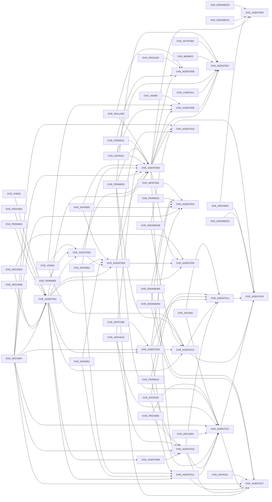

### CHAT

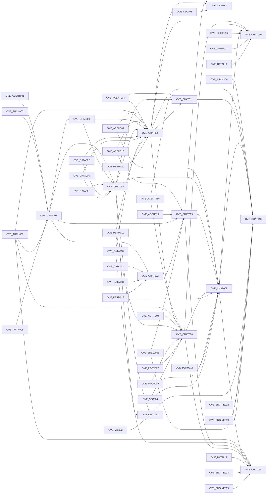

### SKILL

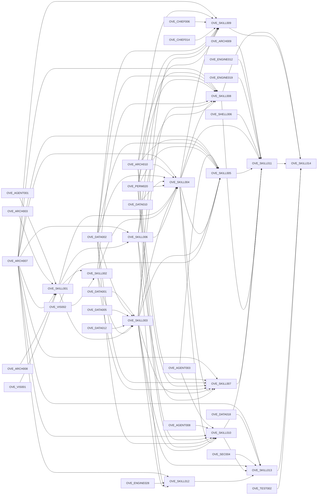

### BOARD

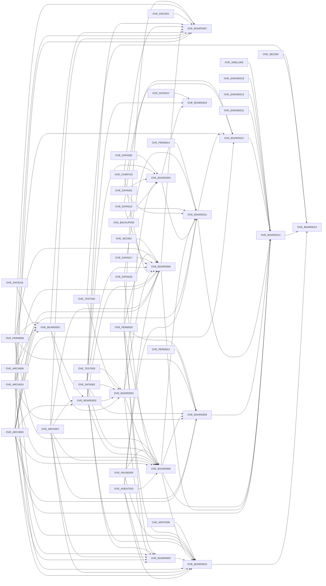

### DISC

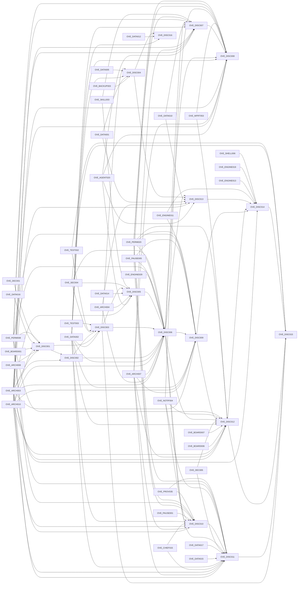

### DEC

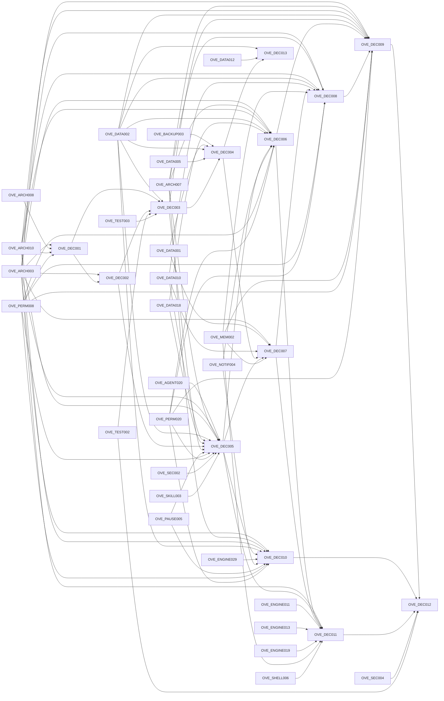

### MEM

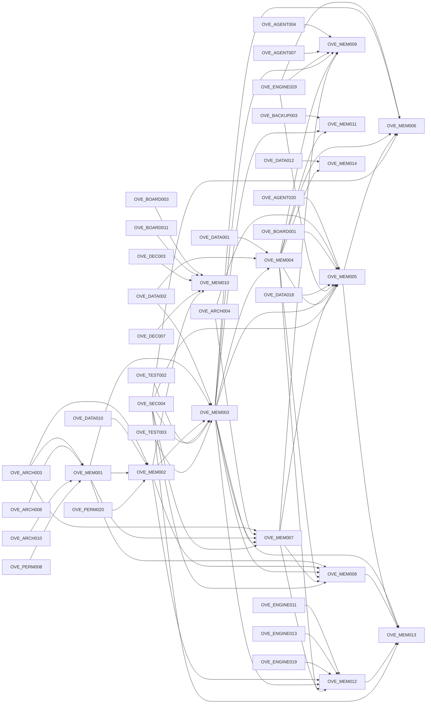

### TG

```mermaid
flowchart LR
  OVE_ARCH003 --> OVE_TG001
  OVE_ARCH007 --> OVE_TG001
  OVE_ARCH010 --> OVE_TG001
  OVE_ARCH012 --> OVE_TG001
  OVE_ARCH004 --> OVE_TG002
  OVE_ARCH007 --> OVE_TG002
  OVE_TEST012 --> OVE_TG002
  OVE_TG001 --> OVE_TG002
  OVE_ARCH007 --> OVE_TG003
  OVE_ARCH010 --> OVE_TG003
  OVE_ENGINE011 --> OVE_TG003
  OVE_ENGINE016 --> OVE_TG003
  OVE_SEC005 --> OVE_TG003
  OVE_TG001 --> OVE_TG003
  OVE_ARCH007 --> OVE_TG004
  OVE_DATA001 --> OVE_TG004
  OVE_TG001 --> OVE_TG004
  OVE_ARCH004 --> OVE_TG005
  OVE_ARCH007 --> OVE_TG005
  OVE_ARCH010 --> OVE_TG005
  OVE_ARCH012 --> OVE_TG005
  OVE_TEST012 --> OVE_TG005
  OVE_TG001 --> OVE_TG005
  OVE_TG002 --> OVE_TG005
  OVE_TG004 --> OVE_TG005
  OVE_ARCH004 --> OVE_TG006
  OVE_ARCH007 --> OVE_TG006
  OVE_ENGINE016 --> OVE_TG006
  OVE_TG003 --> OVE_TG006
  OVE_TG005 --> OVE_TG006
  OVE_AGENT005 --> OVE_TG007
  OVE_ARCH004 --> OVE_TG007
  OVE_CHAT013 --> OVE_TG007
  OVE_ENGINE019 --> OVE_TG007
  OVE_ENGINE020 --> OVE_TG007
  OVE_PAUSE007 --> OVE_TG007
  OVE_TG004 --> OVE_TG007
  OVE_TG006 --> OVE_TG007
  OVE_ARCH015 --> OVE_TG008
  OVE_PAUSE007 --> OVE_TG008
  OVE_TG007 --> OVE_TG008
  OVE_TG009 --> OVE_TG008
  OVE_ARCH004 --> OVE_TG009
  OVE_ARCH015 --> OVE_TG009
  OVE_TG002 --> OVE_TG009
  OVE_ARCH015 --> OVE_TG010
  OVE_PERM013 --> OVE_TG010
  OVE_PERM014 --> OVE_TG010
  OVE_PERM015 --> OVE_TG010
  OVE_TG004 --> OVE_TG010
  OVE_TG006 --> OVE_TG010
  OVE_TG009 --> OVE_TG010
  OVE_ENGINE016 --> OVE_TG011
  OVE_ENGINE019 --> OVE_TG011
  OVE_ENGINE020 --> OVE_TG011
  OVE_PAUSE005 --> OVE_TG011
  OVE_PERM027 --> OVE_TG011
  OVE_PERM028 --> OVE_TG011
  OVE_TG001 --> OVE_TG011
  OVE_TG006 --> OVE_TG011
  OVE_TG010 --> OVE_TG011
  OVE_ARCH012 --> OVE_TG012
  OVE_ENGINE011 --> OVE_TG012
  OVE_ENGINE016 --> OVE_TG012
  OVE_ENGINE017 --> OVE_TG012
  OVE_ENGINE019 --> OVE_TG012
  OVE_TG002 --> OVE_TG012
  OVE_TG003 --> OVE_TG012
  OVE_TG004 --> OVE_TG012
  OVE_TG005 --> OVE_TG012
  OVE_ARCH006 --> OVE_TG013
  OVE_ARCH010 --> OVE_TG013
  OVE_ARCH012 --> OVE_TG013
  OVE_ENGINE020 --> OVE_TG013
  OVE_PAUSE005 --> OVE_TG013
  OVE_TG005 --> OVE_TG013
  OVE_TG006 --> OVE_TG013
  OVE_TG007 --> OVE_TG013
  OVE_TG008 --> OVE_TG013
  OVE_TG010 --> OVE_TG013
  OVE_TG011 --> OVE_TG013
  OVE_TG012 --> OVE_TG013
  OVE_ENGINE018 --> OVE_TG014
  OVE_TEST002 --> OVE_TG014
  OVE_TEST012 --> OVE_TG014
  OVE_TG013 --> OVE_TG014
  OVE_ARCH012 --> OVE_TG015
  OVE_BACKUP008 --> OVE_TG015
  OVE_DATA012 --> OVE_TG015
  OVE_TG004 --> OVE_TG015
  OVE_NOTIF007 --> OVE_TG016
  OVE_PAUSE005 --> OVE_TG016
  OVE_TG010 --> OVE_TG016
  OVE_TG013 --> OVE_TG016
  OVE_ENGINE018 --> OVE_TG017
  OVE_TEST002 --> OVE_TG017
  OVE_TEST012 --> OVE_TG017
  OVE_TG014 --> OVE_TG017
```

### NOTIF

```mermaid
flowchart LR
  OVE_ARCH003 --> OVE_NOTIF001
  OVE_ARCH007 --> OVE_NOTIF001
  OVE_ARCH010 --> OVE_NOTIF001
  OVE_ARCH011 --> OVE_NOTIF001
  OVE_ARCH003 --> OVE_NOTIF002
  OVE_NOTIF001 --> OVE_NOTIF002
  OVE_DATA001 --> OVE_NOTIF003
  OVE_NOTIF001 --> OVE_NOTIF003
  OVE_AGENT003 --> OVE_NOTIF004
  OVE_ARCH007 --> OVE_NOTIF004
  OVE_ARCH010 --> OVE_NOTIF004
  OVE_ARCH015 --> OVE_NOTIF004
  OVE_DATA010 --> OVE_NOTIF004
  OVE_NOTIF001 --> OVE_NOTIF004
  OVE_NOTIF002 --> OVE_NOTIF004
  OVE_NOTIF003 --> OVE_NOTIF004
  OVE_ARCH010 --> OVE_NOTIF005
  OVE_BACKUP001 --> OVE_NOTIF005
  OVE_CHIEF015 --> OVE_NOTIF005
  OVE_CHIEF018 --> OVE_NOTIF005
  OVE_DISC001 --> OVE_NOTIF005
  OVE_NOTIF004 --> OVE_NOTIF005
  OVE_PERM013 --> OVE_NOTIF005
  OVE_PERM014 --> OVE_NOTIF005
  OVE_PERM015 --> OVE_NOTIF005
  OVE_TG005 --> OVE_NOTIF005
  OVE_WFRT007 --> OVE_NOTIF005
  OVE_ARCH007 --> OVE_NOTIF006
  OVE_DATA001 --> OVE_NOTIF006
  OVE_NOTIF002 --> OVE_NOTIF006
  OVE_ARCH004 --> OVE_NOTIF007
  OVE_ARCH007 --> OVE_NOTIF007
  OVE_ARCH012 --> OVE_NOTIF007
  OVE_ARCH015 --> OVE_NOTIF007
  OVE_NOTIF004 --> OVE_NOTIF007
  OVE_NOTIF006 --> OVE_NOTIF007
  OVE_TG005 --> OVE_NOTIF007
  OVE_ARCH007 --> OVE_NOTIF008
  OVE_ARCH012 --> OVE_NOTIF008
  OVE_NOTIF007 --> OVE_NOTIF008
  OVE_NOTIF009
  OVE_ARCH009 --> OVE_NOTIF010
  OVE_ENGINE011 --> OVE_NOTIF010
  OVE_ENGINE017 --> OVE_NOTIF010
  OVE_ENGINE019 --> OVE_NOTIF010
  OVE_NOTIF004 --> OVE_NOTIF010
  OVE_NOTIF006 --> OVE_NOTIF010
  OVE_ARCH004 --> OVE_NOTIF011
  OVE_ARCH012 --> OVE_NOTIF011
  OVE_ARCH014 --> OVE_NOTIF011
  OVE_NOTIF007 --> OVE_NOTIF011
  OVE_ARCH012 --> OVE_NOTIF012
  OVE_ENGINE017 --> OVE_NOTIF012
  OVE_NOTIF011 --> OVE_NOTIF012
  OVE_SHELL023 --> OVE_NOTIF012
  OVE_ARCH015 --> OVE_NOTIF013
  OVE_NOTIF001 --> OVE_NOTIF013
  OVE_DATA012 --> OVE_NOTIF014
  OVE_NOTIF003 --> OVE_NOTIF014
```

### PAUSE

```mermaid
flowchart LR
  OVE_ARCH003 --> OVE_PAUSE001
  OVE_ARCH007 --> OVE_PAUSE001
  OVE_ARCH010 --> OVE_PAUSE001
  OVE_ARCH007 --> OVE_PAUSE002
  OVE_DATA001 --> OVE_PAUSE002
  OVE_PAUSE001 --> OVE_PAUSE002
  OVE_ARCH007 --> OVE_PAUSE003
  OVE_ARCH010 --> OVE_PAUSE003
  OVE_ENGINE011 --> OVE_PAUSE003
  OVE_ENGINE016 --> OVE_PAUSE003
  OVE_PAUSE001 --> OVE_PAUSE003
  OVE_ARCH007 --> OVE_PAUSE004
  OVE_ARCH010 --> OVE_PAUSE004
  OVE_DATA010 --> OVE_PAUSE004
  OVE_ENGINE011 --> OVE_PAUSE004
  OVE_ENGINE016 --> OVE_PAUSE004
  OVE_PAUSE001 --> OVE_PAUSE004
  OVE_PAUSE003 --> OVE_PAUSE004
  OVE_ARCH004 --> OVE_PAUSE005
  OVE_ARCH010 --> OVE_PAUSE005
  OVE_PAUSE001 --> OVE_PAUSE005
  OVE_PAUSE002 --> OVE_PAUSE005
  OVE_ARCH004 --> OVE_PAUSE006
  OVE_ARCH007 --> OVE_PAUSE006
  OVE_ARCH010 --> OVE_PAUSE006
  OVE_PAUSE001 --> OVE_PAUSE006
  OVE_PAUSE005 --> OVE_PAUSE006
  OVE_ARCH009 --> OVE_PAUSE007
  OVE_ENGINE011 --> OVE_PAUSE007
  OVE_ENGINE017 --> OVE_PAUSE007
  OVE_ENGINE019 --> OVE_PAUSE007
  OVE_PAUSE003 --> OVE_PAUSE007
  OVE_PAUSE004 --> OVE_PAUSE007
  OVE_PAUSE006 --> OVE_PAUSE007
  OVE_ARCH006 --> OVE_PAUSE008
  OVE_BACKUP008 --> OVE_PAUSE008
  OVE_ENGINE016 --> OVE_PAUSE008
  OVE_NOTIF004 --> OVE_PAUSE008
  OVE_PAUSE002 --> OVE_PAUSE008
  OVE_PAUSE003 --> OVE_PAUSE008
  OVE_PAUSE004 --> OVE_PAUSE008
  OVE_PAUSE005 --> OVE_PAUSE008
  OVE_PAUSE006 --> OVE_PAUSE008
  OVE_ARCH006 --> OVE_PAUSE009
  OVE_PAUSE003 --> OVE_PAUSE009
  OVE_PAUSE004 --> OVE_PAUSE009
  OVE_PAUSE005 --> OVE_PAUSE009
  OVE_PAUSE006 --> OVE_PAUSE009
  OVE_PAUSE007 --> OVE_PAUSE009
  OVE_PAUSE008 --> OVE_PAUSE009
  OVE_TEST002 --> OVE_PAUSE009
  OVE_TEST012 --> OVE_PAUSE009
  OVE_TG013 --> OVE_PAUSE009
  OVE_ARCH009 --> OVE_PAUSE010
  OVE_DS036 --> OVE_PAUSE010
  OVE_DS037 --> OVE_PAUSE010
  OVE_DS042 --> OVE_PAUSE010
  OVE_DS043 --> OVE_PAUSE010
  OVE_PAUSE007 --> OVE_PAUSE010
  OVE_DS013 --> OVE_PAUSE011
  OVE_DS043 --> OVE_PAUSE011
  OVE_PAUSE010 --> OVE_PAUSE011
  OVE_DS048 --> OVE_PAUSE012
  OVE_DS055 --> OVE_PAUSE012
  OVE_PAUSE010 --> OVE_PAUSE012
  OVE_DS042 --> OVE_PAUSE013
  OVE_DS085 --> OVE_PAUSE013
  OVE_PAUSE007 --> OVE_PAUSE013
  OVE_PAUSE010 --> OVE_PAUSE013
  OVE_DS059 --> OVE_PAUSE014
  OVE_PAUSE007 --> OVE_PAUSE014
  OVE_PAUSE010 --> OVE_PAUSE014
  OVE_DS078 --> OVE_PAUSE015
  OVE_PAUSE010 --> OVE_PAUSE015
  OVE_PAUSE010 --> OVE_PAUSE016
  OVE_PAUSE011 --> OVE_PAUSE016
  OVE_PAUSE012 --> OVE_PAUSE016
  OVE_PAUSE013 --> OVE_PAUSE016
  OVE_PAUSE014 --> OVE_PAUSE016
  OVE_PAUSE015 --> OVE_PAUSE016
  OVE_SETUP012 --> OVE_PAUSE016
  OVE_TEST004 --> OVE_PAUSE016
  OVE_DATA012 --> OVE_PAUSE017
  OVE_PAUSE002 --> OVE_PAUSE017
```

### BACKUP

```mermaid
flowchart LR
  OVE_ARCH003 --> OVE_BACKUP001
  OVE_ARCH005 --> OVE_BACKUP001
  OVE_ARCH007 --> OVE_BACKUP001
  OVE_ARCH010 --> OVE_BACKUP001
  OVE_ARCH007 --> OVE_BACKUP002
  OVE_ARCH013 --> OVE_BACKUP002
  OVE_BACKUP001 --> OVE_BACKUP002
  OVE_DATA001 --> OVE_BACKUP002
  OVE_ARCH013 --> OVE_BACKUP003
  OVE_BACKUP001 --> OVE_BACKUP003
  OVE_BACKUP002 --> OVE_BACKUP003
  OVE_ARCH005 --> OVE_BACKUP004
  OVE_BACKUP001 --> OVE_BACKUP004
  OVE_ENGINE016 --> OVE_BACKUP004
  OVE_PERM031 --> OVE_BACKUP004
  OVE_BACKUP001 --> OVE_BACKUP005
  OVE_BACKUP003 --> OVE_BACKUP005
  OVE_ENGINE016 --> OVE_BACKUP005
  OVE_ARCH004 --> OVE_BACKUP006
  OVE_ARCH005 --> OVE_BACKUP006
  OVE_ARCH007 --> OVE_BACKUP006
  OVE_ARCH010 --> OVE_BACKUP006
  OVE_BACKUP001 --> OVE_BACKUP006
  OVE_BACKUP002 --> OVE_BACKUP006
  OVE_BACKUP003 --> OVE_BACKUP006
  OVE_BACKUP004 --> OVE_BACKUP006
  OVE_BACKUP005 --> OVE_BACKUP006
  OVE_BACKUP006 --> OVE_BACKUP007
  OVE_ENGINE011 --> OVE_BACKUP007
  OVE_ENGINE016 --> OVE_BACKUP007
  OVE_NOTIF004 --> OVE_BACKUP007
  OVE_PERM031 --> OVE_BACKUP007
  OVE_ARCH013 --> OVE_BACKUP008
  OVE_BACKUP003 --> OVE_BACKUP008
  OVE_BACKUP004 --> OVE_BACKUP008
  OVE_BACKUP006 --> OVE_BACKUP008
  OVE_DATA003 --> OVE_BACKUP008
  OVE_DATA020 --> OVE_BACKUP008
  OVE_PERM031 --> OVE_BACKUP008
  OVE_ARCH005 --> OVE_BACKUP009
  OVE_BACKUP004 --> OVE_BACKUP009
  OVE_BACKUP005 --> OVE_BACKUP009
  OVE_BACKUP007 --> OVE_BACKUP009
  OVE_BACKUP008 --> OVE_BACKUP009
  OVE_ENGINE011 --> OVE_BACKUP009
  OVE_ENGINE017 --> OVE_BACKUP009
  OVE_ENGINE019 --> OVE_BACKUP009
  OVE_ARCH012 --> OVE_BACKUP010
  OVE_BACKUP003 --> OVE_BACKUP010
  OVE_BACKUP008 --> OVE_BACKUP011
  OVE_BACKUP009 --> OVE_BACKUP011
  OVE_ENGINE018 --> OVE_BACKUP011
  OVE_TEST002 --> OVE_BACKUP011
```

### SHELL

```mermaid
flowchart LR
  OVE_ARCH007 --> OVE_SHELL001
  OVE_ARCH008 --> OVE_SHELL001
  OVE_ARCH009 --> OVE_SHELL001
  OVE_PAUSE001 --> OVE_SHELL001
  OVE_PROV002 --> OVE_SHELL001
  OVE_TG001 --> OVE_SHELL001
  OVE_CHIEF015 --> OVE_SHELL002
  OVE_ENGINE013 --> OVE_SHELL002
  OVE_ENGINE019 --> OVE_SHELL002
  OVE_PAUSE003 --> OVE_SHELL002
  OVE_PERM014 --> OVE_SHELL002
  OVE_PERM016 --> OVE_SHELL002
  OVE_PROV017 --> OVE_SHELL002
  OVE_PROV019 --> OVE_SHELL002
  OVE_PROV020 --> OVE_SHELL002
  OVE_SHELL001 --> OVE_SHELL002
  OVE_TEST002 --> OVE_SHELL002
  OVE_TG005 --> OVE_SHELL002
  OVE_ARCH012 --> OVE_SHELL003
  OVE_SETUP009 --> OVE_SHELL003
  OVE_SETUP010 --> OVE_SHELL003
  OVE_ARCH003 --> OVE_SHELL004
  OVE_ARCH011 --> OVE_SHELL004
  OVE_ENGINE006 --> OVE_SHELL004
  OVE_ENGINE007 --> OVE_SHELL004
  OVE_ENGINE019 --> OVE_SHELL004
  OVE_ENGINE022 --> OVE_SHELL004
  OVE_ENGINE023 --> OVE_SHELL004
  OVE_SHELL003 --> OVE_SHELL004
  OVE_ARCH003 --> OVE_SHELL005
  OVE_DS032 --> OVE_SHELL005
  OVE_ENGINE015 --> OVE_SHELL005
  OVE_ENGINE019 --> OVE_SHELL005
  OVE_SHELL004 --> OVE_SHELL005
  OVE_ARCH010 --> OVE_SHELL006
  OVE_ENGINE017 --> OVE_SHELL006
  OVE_ENGINE027 --> OVE_SHELL006
  OVE_SHELL001 --> OVE_SHELL006
  OVE_SHELL004 --> OVE_SHELL006
  OVE_SHELL005 --> OVE_SHELL006
  OVE_ARCH009 --> OVE_SHELL007
  OVE_ARCH011 --> OVE_SHELL007
  OVE_SHELL009 --> OVE_SHELL007
  OVE_DS004 --> OVE_SHELL008
  OVE_DS008 --> OVE_SHELL008
  OVE_SETUP010 --> OVE_SHELL008
  OVE_SHELL003 --> OVE_SHELL008
  OVE_SHELL004 --> OVE_SHELL008
  OVE_ARCH009 --> OVE_SHELL009
  OVE_DS009 --> OVE_SHELL009
  OVE_DS013 --> OVE_SHELL010
  OVE_DS032 --> OVE_SHELL010
  OVE_DS037 --> OVE_SHELL010
  OVE_SETUP009 --> OVE_SHELL010
  OVE_SHELL003 --> OVE_SHELL010
  OVE_SHELL004 --> OVE_SHELL010
  OVE_SHELL005 --> OVE_SHELL010
  OVE_SHELL006 --> OVE_SHELL010
  OVE_SHELL007 --> OVE_SHELL010
  OVE_SHELL008 --> OVE_SHELL010
  OVE_SHELL009 --> OVE_SHELL010
  OVE_DATA009 --> OVE_SHELL011
  OVE_DATA011 --> OVE_SHELL011
  OVE_DS037 --> OVE_SHELL011
  OVE_PERM026 --> OVE_SHELL011
  OVE_SHELL005 --> OVE_SHELL011
  OVE_SHELL006 --> OVE_SHELL011
  OVE_DS022 --> OVE_SHELL012
  OVE_DS032 --> OVE_SHELL012
  OVE_DS044 --> OVE_SHELL012
  OVE_SHELL009 --> OVE_SHELL012
  OVE_SHELL010 --> OVE_SHELL012
  OVE_DS009 --> OVE_SHELL013
  OVE_DS010 --> OVE_SHELL013
  OVE_DS028 --> OVE_SHELL013
  OVE_DS041 --> OVE_SHELL013
  OVE_SHELL007 --> OVE_SHELL013
  OVE_SHELL009 --> OVE_SHELL013
  OVE_SHELL010 --> OVE_SHELL013
  OVE_SHELL012 --> OVE_SHELL013
  OVE_DS035 --> OVE_SHELL014
  OVE_DS045 --> OVE_SHELL014
  OVE_SHELL007 --> OVE_SHELL014
  OVE_SHELL009 --> OVE_SHELL014
  OVE_SHELL010 --> OVE_SHELL014
  OVE_SHELL012 --> OVE_SHELL014
  OVE_SHELL013 --> OVE_SHELL014
  OVE_DS042 --> OVE_SHELL015
  OVE_SHELL001 --> OVE_SHELL015
  OVE_SHELL002 --> OVE_SHELL015
  OVE_SHELL005 --> OVE_SHELL015
  OVE_SHELL006 --> OVE_SHELL015
  OVE_SHELL007 --> OVE_SHELL015
  OVE_SHELL011 --> OVE_SHELL015
  OVE_DS028 --> OVE_SHELL016
  OVE_DS032 --> OVE_SHELL016
  OVE_DS042 --> OVE_SHELL016
  OVE_DS043 --> OVE_SHELL016
  OVE_SHELL007 --> OVE_SHELL016
  OVE_SHELL012 --> OVE_SHELL016
  OVE_SHELL015 --> OVE_SHELL016
  OVE_DS029 --> OVE_SHELL017
  OVE_PAUSE010 --> OVE_SHELL017
  OVE_PAUSE011 --> OVE_SHELL017
  OVE_SHELL010 --> OVE_SHELL017
  OVE_SHELL011 --> OVE_SHELL017
  OVE_SHELL016 --> OVE_SHELL017
  OVE_DS013 --> OVE_SHELL018
  OVE_DS017 --> OVE_SHELL018
  OVE_DS028 --> OVE_SHELL018
  OVE_DS032 --> OVE_SHELL018
  OVE_SHELL016 --> OVE_SHELL018
  OVE_ARCH011 --> OVE_SHELL019
  OVE_DS013 --> OVE_SHELL019
  OVE_DS031 --> OVE_SHELL019
  OVE_DS032 --> OVE_SHELL019
  OVE_PAUSE007 --> OVE_SHELL019
  OVE_SHELL003 --> OVE_SHELL019
  OVE_SHELL004 --> OVE_SHELL019
  OVE_SHELL010 --> OVE_SHELL019
  OVE_DS010 --> OVE_SHELL020
  OVE_DS021 --> OVE_SHELL020
  OVE_DS032 --> OVE_SHELL020
  OVE_DS037 --> OVE_SHELL020
  OVE_DS040 --> OVE_SHELL020
  OVE_ENGINE008 --> OVE_SHELL020
  OVE_ENGINE009 --> OVE_SHELL020
  OVE_SETUP010 --> OVE_SHELL020
  OVE_SHELL003 --> OVE_SHELL020
  OVE_SHELL004 --> OVE_SHELL020
  OVE_SHELL010 --> OVE_SHELL020
  OVE_SHELL019 --> OVE_SHELL020
  OVE_DS013 --> OVE_SHELL021
  OVE_DS032 --> OVE_SHELL021
  OVE_DS051 --> OVE_SHELL021
  OVE_ENGINE007 --> OVE_SHELL021
  OVE_SHELL020 --> OVE_SHELL021
  OVE_ARCH009 --> OVE_SHELL022
  OVE_DATA009 --> OVE_SHELL022
  OVE_DS037 --> OVE_SHELL022
  OVE_PAUSE001 --> OVE_SHELL022
  OVE_PERM013 --> OVE_SHELL022
  OVE_PERM015 --> OVE_SHELL022
  OVE_PROV014 --> OVE_SHELL022
  OVE_PROV018 --> OVE_SHELL022
  OVE_SHELL006 --> OVE_SHELL022
  OVE_SHELL008 --> OVE_SHELL022
  OVE_SHELL010 --> OVE_SHELL022
  OVE_ARCH012 --> OVE_SHELL023
  OVE_ENGINE017 --> OVE_SHELL023
  OVE_SETUP010 --> OVE_SHELL023
  OVE_SHELL003 --> OVE_SHELL023
  OVE_SHELL006 --> OVE_SHELL023
  OVE_SHELL010 --> OVE_SHELL023
  OVE_SHELL007 --> OVE_SHELL024
  OVE_SHELL009 --> OVE_SHELL024
  OVE_SHELL010 --> OVE_SHELL024
  OVE_ONB011 --> OVE_SHELL025
  OVE_SHELL009 --> OVE_SHELL025
  OVE_SHELL010 --> OVE_SHELL025
  OVE_DS104 --> OVE_SHELL026
  OVE_SETUP012 --> OVE_SHELL026
  OVE_SHELL011 --> OVE_SHELL026
  OVE_SHELL012 --> OVE_SHELL026
  OVE_SHELL013 --> OVE_SHELL026
  OVE_SHELL014 --> OVE_SHELL026
  OVE_SHELL016 --> OVE_SHELL026
  OVE_SHELL017 --> OVE_SHELL026
  OVE_SHELL018 --> OVE_SHELL026
  OVE_SHELL019 --> OVE_SHELL026
  OVE_SHELL020 --> OVE_SHELL026
  OVE_SHELL021 --> OVE_SHELL026
  OVE_SHELL022 --> OVE_SHELL026
  OVE_SHELL024 --> OVE_SHELL026
  OVE_SHELL025 --> OVE_SHELL026
  OVE_TEST004 --> OVE_SHELL026
  OVE_TEST005 --> OVE_SHELL026
  OVE_ARCH009 --> OVE_SHELL027
  OVE_SHELL009 --> OVE_SHELL027
  OVE_SHELL010 --> OVE_SHELL027
  OVE_SHELL007 --> OVE_SHELL028
  OVE_SHELL010 --> OVE_SHELL028
  OVE_SHELL025 --> OVE_SHELL028
```

### TRAY

```mermaid
flowchart LR
  OVE_ARCH012 --> OVE_TRAY001
  OVE_SETUP010 --> OVE_TRAY001
  OVE_ARCH009 --> OVE_TRAY002
  OVE_SHELL004 --> OVE_TRAY002
  OVE_SHELL005 --> OVE_TRAY002
  OVE_SHELL006 --> OVE_TRAY002
  OVE_SHELL007 --> OVE_TRAY002
  OVE_SHELL008 --> OVE_TRAY002
  OVE_SHELL010 --> OVE_TRAY002
  OVE_TRAY001 --> OVE_TRAY002
  OVE_ARCH007 --> OVE_TRAY003
  OVE_ARCH008 --> OVE_TRAY003
  OVE_ARCH010 --> OVE_TRAY003
  OVE_AGENT010 --> OVE_TRAY004
  OVE_AGENT018 --> OVE_TRAY004
  OVE_CHIEF015 --> OVE_TRAY004
  OVE_DATA011 --> OVE_TRAY004
  OVE_ENGINE006 --> OVE_TRAY004
  OVE_ENGINE013 --> OVE_TRAY004
  OVE_ENGINE019 --> OVE_TRAY004
  OVE_PAUSE003 --> OVE_TRAY004
  OVE_PERM014 --> OVE_TRAY004
  OVE_PERM016 --> OVE_TRAY004
  OVE_PROV019 --> OVE_TRAY004
  OVE_TRAY003 --> OVE_TRAY004
  OVE_DS085 --> OVE_TRAY005
  OVE_PAUSE013 --> OVE_TRAY005
  OVE_SHELL005 --> OVE_TRAY005
  OVE_SHELL006 --> OVE_TRAY005
  OVE_SHELL024 --> OVE_TRAY005
  OVE_TRAY002 --> OVE_TRAY005
  OVE_TRAY003 --> OVE_TRAY005
  OVE_TRAY004 --> OVE_TRAY005
  OVE_DS010 --> OVE_TRAY006
  OVE_DS029 --> OVE_TRAY006
  OVE_DS085 --> OVE_TRAY006
  OVE_TRAY002 --> OVE_TRAY006
  OVE_TRAY005 --> OVE_TRAY006
  OVE_ARCH012 --> OVE_TRAY007
  OVE_SETUP010 --> OVE_TRAY007
  OVE_SHELL003 --> OVE_TRAY007
  OVE_TRAY001 --> OVE_TRAY007
  OVE_PAUSE007 --> OVE_TRAY008
  OVE_PAUSE013 --> OVE_TRAY008
  OVE_SHELL009 --> OVE_TRAY008
  OVE_SHELL010 --> OVE_TRAY008
  OVE_TRAY005 --> OVE_TRAY008
  OVE_TRAY007 --> OVE_TRAY008
  OVE_DS013 --> OVE_TRAY009
  OVE_DS032 --> OVE_TRAY009
  OVE_DS040 --> OVE_TRAY009
  OVE_DS085 --> OVE_TRAY009
  OVE_ENGINE004 --> OVE_TRAY009
  OVE_PAUSE013 --> OVE_TRAY009
  OVE_SHELL019 --> OVE_TRAY009
  OVE_TRAY006 --> OVE_TRAY009
  OVE_TRAY007 --> OVE_TRAY009
  OVE_TRAY008 --> OVE_TRAY009
  OVE_DS104 --> OVE_TRAY010
  OVE_SETUP012 --> OVE_TRAY010
  OVE_TEST004 --> OVE_TRAY010
  OVE_TEST005 --> OVE_TRAY010
  OVE_TRAY005 --> OVE_TRAY010
  OVE_TRAY006 --> OVE_TRAY010
  OVE_TRAY007 --> OVE_TRAY010
  OVE_TRAY008 --> OVE_TRAY010
  OVE_TRAY009 --> OVE_TRAY010
```

### ONB

```mermaid
flowchart LR
  OVE_ARCH003 --> OVE_ONB001
  OVE_ARCH008 --> OVE_ONB001
  OVE_ARCH010 --> OVE_ONB001
  OVE_DATA009 --> OVE_ONB001
  OVE_PERM009 --> OVE_ONB001
  OVE_TG001 --> OVE_ONB001
  OVE_DATA001 --> OVE_ONB002
  OVE_DATA002 --> OVE_ONB002
  OVE_DATA003 --> OVE_ONB002
  OVE_DATA007 --> OVE_ONB002
  OVE_ONB001 --> OVE_ONB002
  OVE_TEST003 --> OVE_ONB002
  OVE_ARCH007 --> OVE_ONB003
  OVE_DATA002 --> OVE_ONB003
  OVE_DATA011 --> OVE_ONB003
  OVE_ONB001 --> OVE_ONB003
  OVE_ONB002 --> OVE_ONB003
  OVE_PERM031 --> OVE_ONB003
  OVE_PROV020 --> OVE_ONB003
  OVE_ARCH007 --> OVE_ONB004
  OVE_ONB001 --> OVE_ONB004
  OVE_PERM002 --> OVE_ONB004
  OVE_PERM031 --> OVE_ONB004
  OVE_SEC002 --> OVE_ONB004
  OVE_DATA011 --> OVE_ONB005
  OVE_DATA012 --> OVE_ONB005
  OVE_ONB003 --> OVE_ONB005
  OVE_ONB004 --> OVE_ONB005
  OVE_PERM002 --> OVE_ONB005
  OVE_PERM008 --> OVE_ONB005
  OVE_PERM011 --> OVE_ONB005
  OVE_PERM020 --> OVE_ONB005
  OVE_PERM031 --> OVE_ONB005
  OVE_BOX004 --> OVE_ONB006
  OVE_BOX006 --> OVE_ONB006
  OVE_BOX008 --> OVE_ONB006
  OVE_BOX010 --> OVE_ONB006
  OVE_BOX018 --> OVE_ONB006
  OVE_BOX019 --> OVE_ONB006
  OVE_ONB001 --> OVE_ONB006
  OVE_PERM017 --> OVE_ONB006
  OVE_PROV022 --> OVE_ONB006
  OVE_SETUP015 --> OVE_ONB006
  OVE_ARCH007 --> OVE_ONB007
  OVE_DATA002 --> OVE_ONB007
  OVE_ONB002 --> OVE_ONB007
  OVE_ONB003 --> OVE_ONB007
  OVE_ONB006 --> OVE_ONB007
  OVE_PERM020 --> OVE_ONB007
  OVE_PERM031 --> OVE_ONB007
  OVE_TG003 --> OVE_ONB007
  OVE_BOX008 --> OVE_ONB008
  OVE_BOX015 --> OVE_ONB008
  OVE_ONB001 --> OVE_ONB008
  OVE_PROV005 --> OVE_ONB008
  OVE_PROV014 --> OVE_ONB008
  OVE_PROV034 --> OVE_ONB008
  OVE_SEC009 --> OVE_ONB008
  OVE_ENGINE011 --> OVE_ONB009
  OVE_ENGINE013 --> OVE_ONB009
  OVE_ENGINE014 --> OVE_ONB009
  OVE_ENGINE015 --> OVE_ONB009
  OVE_ENGINE018 --> OVE_ONB009
  OVE_ENGINE019 --> OVE_ONB009
  OVE_ONB003 --> OVE_ONB009
  OVE_ONB004 --> OVE_ONB009
  OVE_ONB005 --> OVE_ONB009
  OVE_ONB006 --> OVE_ONB009
  OVE_ONB007 --> OVE_ONB009
  OVE_ENGINE011 --> OVE_ONB010
  OVE_ENGINE013 --> OVE_ONB010
  OVE_ENGINE016 --> OVE_ONB010
  OVE_ENGINE018 --> OVE_ONB010
  OVE_ENGINE019 --> OVE_ONB010
  OVE_ENGINE022 --> OVE_ONB010
  OVE_ONB008 --> OVE_ONB010
  OVE_ONB009 --> OVE_ONB010
  OVE_ARCH009 --> OVE_ONB011
  OVE_DS010 --> OVE_ONB011
  OVE_DS032 --> OVE_ONB011
  OVE_DS073 --> OVE_ONB011
  OVE_ONB009 --> OVE_ONB011
  OVE_SHELL005 --> OVE_ONB011
  OVE_SHELL006 --> OVE_ONB011
  OVE_SHELL012 --> OVE_ONB011
  OVE_DS022 --> OVE_ONB012
  OVE_DS031 --> OVE_ONB012
  OVE_DS074 --> OVE_ONB012
  OVE_ONB011 --> OVE_ONB012
  OVE_BOARDUI001 --> OVE_ONB013
  OVE_ONB009 --> OVE_ONB013
  OVE_ONB011 --> OVE_ONB013
  OVE_ONB012 --> OVE_ONB013
  OVE_PERM009 --> OVE_ONB013
  OVE_SHELL003 --> OVE_ONB013
  OVE_SHELL004 --> OVE_ONB013
  OVE_DS013 --> OVE_ONB014
  OVE_DS022 --> OVE_ONB014
  OVE_DS052 --> OVE_ONB014
  OVE_DS074 --> OVE_ONB014
  OVE_ONB011 --> OVE_ONB014
  OVE_BOX018 --> OVE_ONB015
  OVE_ONB001 --> OVE_ONB015
  OVE_ONB009 --> OVE_ONB015
  OVE_ONB011 --> OVE_ONB015
  OVE_ONB014 --> OVE_ONB015
  OVE_SHELL005 --> OVE_ONB015
  OVE_SHELL006 --> OVE_ONB015
  OVE_BOX018 --> OVE_ONB016
  OVE_DS021 --> OVE_ONB016
  OVE_DS036 --> OVE_ONB016
  OVE_DS040 --> OVE_ONB016
  OVE_ONB009 --> OVE_ONB016
  OVE_ONB015 --> OVE_ONB016
  OVE_PERM009 --> OVE_ONB016
  OVE_SHELL003 --> OVE_ONB016
  OVE_DS013 --> OVE_ONB017
  OVE_DS026 --> OVE_ONB017
  OVE_DS052 --> OVE_ONB017
  OVE_ONB010 --> OVE_ONB017
  OVE_ONB014 --> OVE_ONB017
  OVE_ONB015 --> OVE_ONB017
  OVE_SHELL003 --> OVE_ONB017
  OVE_DS040 --> OVE_ONB018
  OVE_ONB001 --> OVE_ONB018
  OVE_ONB009 --> OVE_ONB018
  OVE_ONB011 --> OVE_ONB018
  OVE_ONB015 --> OVE_ONB018
  OVE_DATA011 --> OVE_ONB019
  OVE_DS026 --> OVE_ONB019
  OVE_DS031 --> OVE_ONB019
  OVE_DS051 --> OVE_ONB019
  OVE_DS081 --> OVE_ONB019
  OVE_ONB009 --> OVE_ONB019
  OVE_ONB011 --> OVE_ONB019
  OVE_SHELL011 --> OVE_ONB019
  OVE_BOARDUI001 --> OVE_ONB020
  OVE_DS013 --> OVE_ONB020
  OVE_DS026 --> OVE_ONB020
  OVE_DS040 --> OVE_ONB020
  OVE_ONB011 --> OVE_ONB020
  OVE_TG012 --> OVE_ONB020
  OVE_DS013 --> OVE_ONB021
  OVE_DS031 --> OVE_ONB021
  OVE_DS040 --> OVE_ONB021
  OVE_ONB020 --> OVE_ONB021
  OVE_SHELL003 --> OVE_ONB021
  OVE_SHELL006 --> OVE_ONB021
  OVE_TG003 --> OVE_ONB021
  OVE_TG012 --> OVE_ONB021
  OVE_ONB009 --> OVE_ONB022
  OVE_ONB011 --> OVE_ONB022
  OVE_SHELL010 --> OVE_ONB022
  OVE_SHELL011 --> OVE_ONB022
  OVE_SHELL022 --> OVE_ONB022
  OVE_ONB005 --> OVE_ONB023
  OVE_ONB007 --> OVE_ONB023
  OVE_ONB010 --> OVE_ONB023
  OVE_ONB013 --> OVE_ONB023
  OVE_ONB016 --> OVE_ONB023
  OVE_ONB017 --> OVE_ONB023
  OVE_ONB018 --> OVE_ONB023
  OVE_ONB019 --> OVE_ONB023
  OVE_ONB021 --> OVE_ONB023
  OVE_ONB022 --> OVE_ONB023
  OVE_SEC003 --> OVE_ONB023
  OVE_TEST002 --> OVE_ONB023
  OVE_TEST004 --> OVE_ONB023
  OVE_TEST005 --> OVE_ONB023
  OVE_TEST006 --> OVE_ONB023
  OVE_TEST009 --> OVE_ONB023
  OVE_TEST010 --> OVE_ONB023
  OVE_TEST012 --> OVE_ONB023
  OVE_DATA016 --> OVE_ONB031
  OVE_ONB001 --> OVE_ONB031
  OVE_TG001 --> OVE_ONB031
  OVE_ARCH009 --> OVE_ONB032
  OVE_DATA002 --> OVE_ONB032
  OVE_DATA011 --> OVE_ONB032
  OVE_ENGINE016 --> OVE_ONB032
  OVE_ONB003 --> OVE_ONB032
  OVE_ONB031 --> OVE_ONB032
  OVE_ARCH009 --> OVE_ONB033
  OVE_DATA016 --> OVE_ONB033
  OVE_DATA017 --> OVE_ONB033
  OVE_ENGINE016 --> OVE_ONB033
  OVE_ONB004 --> OVE_ONB033
  OVE_ONB031 --> OVE_ONB033
  OVE_PERM031 --> OVE_ONB033
  OVE_SEC002 --> OVE_ONB033
  OVE_ARCH009 --> OVE_ONB034
  OVE_ENGINE016 --> OVE_ONB034
  OVE_ONB003 --> OVE_ONB034
  OVE_ONB031 --> OVE_ONB034
  OVE_TG003 --> OVE_ONB034
  OVE_TG005 --> OVE_ONB034
  OVE_ARCH009 --> OVE_ONB035
  OVE_DATA011 --> OVE_ONB035
  OVE_DATA017 --> OVE_ONB035
  OVE_ONB003 --> OVE_ONB035
  OVE_ONB006 --> OVE_ONB035
  OVE_ONB031 --> OVE_ONB035
  OVE_ONB034 --> OVE_ONB035
  OVE_PERM031 --> OVE_ONB035
  OVE_TG005 --> OVE_ONB035
  OVE_ARCH009 --> OVE_ONB036
  OVE_ARCH015 --> OVE_ONB036
  OVE_CHAT006 --> OVE_ONB036
  OVE_CHAT009 --> OVE_ONB036
  OVE_DATA011 --> OVE_ONB036
  OVE_DATA017 --> OVE_ONB036
  OVE_ONB001 --> OVE_ONB036
  OVE_ONB007 --> OVE_ONB036
  OVE_ONB031 --> OVE_ONB036
  OVE_DS009 --> OVE_ONB037
  OVE_DS013 --> OVE_ONB037
  OVE_DS015 --> OVE_ONB037
  OVE_DS017 --> OVE_ONB037
  OVE_DS031 --> OVE_ONB037
  OVE_DS032 --> OVE_ONB037
  OVE_DS040 --> OVE_ONB037
  OVE_DS046 --> OVE_ONB037
  OVE_DS051 --> OVE_ONB037
  OVE_ONB011 --> OVE_ONB037
  OVE_ONB031 --> OVE_ONB037
  OVE_BOARDUI001 --> OVE_ONB038
  OVE_ONB011 --> OVE_ONB038
  OVE_ONB019 --> OVE_ONB038
  OVE_ONB033 --> OVE_ONB038
  OVE_ONB036 --> OVE_ONB038
  OVE_ONB037 --> OVE_ONB038
  OVE_SHELL003 --> OVE_ONB038
  OVE_SHELL005 --> OVE_ONB038
  OVE_SHELL006 --> OVE_ONB038
  OVE_BOARDUI001 --> OVE_ONB039
  OVE_ONB011 --> OVE_ONB039
  OVE_ONB034 --> OVE_ONB039
  OVE_SHELL005 --> OVE_ONB039
  OVE_TG005 --> OVE_ONB039
  OVE_TG012 --> OVE_ONB039
  OVE_DS013 --> OVE_ONB040
  OVE_DS017 --> OVE_ONB040
  OVE_DS018 --> OVE_ONB040
  OVE_DS031 --> OVE_ONB040
  OVE_DS032 --> OVE_ONB040
  OVE_DS040 --> OVE_ONB040
  OVE_DS051 --> OVE_ONB040
  OVE_DS073 --> OVE_ONB040
  OVE_ONB011 --> OVE_ONB040
  OVE_ONB022 --> OVE_ONB040
  OVE_ONB035 --> OVE_ONB040
  OVE_ONB039 --> OVE_ONB040
  OVE_SHELL005 --> OVE_ONB040
  OVE_BOARDUI001 --> OVE_ONB041
  OVE_ONB009 --> OVE_ONB041
  OVE_ONB011 --> OVE_ONB041
  OVE_ONB034 --> OVE_ONB041
  OVE_SHELL010 --> OVE_ONB041
  OVE_ONB020 --> OVE_ONB042
  OVE_ONB021 --> OVE_ONB042
  OVE_ONB039 --> OVE_ONB042
  OVE_ONB041 --> OVE_ONB042
  OVE_TEST002 --> OVE_ONB042
  OVE_TEST004 --> OVE_ONB042
  OVE_TEST012 --> OVE_ONB042
  OVE_TG014 --> OVE_ONB042
  OVE_ONB038 --> OVE_ONB043
  OVE_ONB039 --> OVE_ONB043
  OVE_ONB040 --> OVE_ONB043
  OVE_ONB041 --> OVE_ONB043
  OVE_TEST002 --> OVE_ONB043
  OVE_TEST004 --> OVE_ONB043
  OVE_TEST012 --> OVE_ONB043
```

### WSPACE

```mermaid
flowchart LR
  OVE_ARCH011 --> OVE_WSPACE001
  OVE_BOARD001 --> OVE_WSPACE001
  OVE_DATA009 --> OVE_WSPACE001
  OVE_NOTIF001 --> OVE_WSPACE001
  OVE_PAUSE001 --> OVE_WSPACE001
  OVE_PERM013 --> OVE_WSPACE001
  OVE_PERM015 --> OVE_WSPACE001
  OVE_WFRT051 --> OVE_WSPACE001
  OVE_AGENT010 --> OVE_WSPACE002
  OVE_BOARD013 --> OVE_WSPACE002
  OVE_CHIEF007 --> OVE_WSPACE002
  OVE_DATA011 --> OVE_WSPACE002
  OVE_ENGINE019 --> OVE_WSPACE002
  OVE_ENGINE027 --> OVE_WSPACE002
  OVE_PAUSE007 --> OVE_WSPACE002
  OVE_PAUSE014 --> OVE_WSPACE002
  OVE_PERM027 --> OVE_WSPACE002
  OVE_PERM028 --> OVE_WSPACE002
  OVE_WFRT051 --> OVE_WSPACE002
  OVE_WSPACE001 --> OVE_WSPACE002
  OVE_ARCH009 --> OVE_WSPACE003
  OVE_ARCH011 --> OVE_WSPACE003
  OVE_DS005 --> OVE_WSPACE003
  OVE_DS032 --> OVE_WSPACE003
  OVE_DS044 --> OVE_WSPACE003
  OVE_DS045 --> OVE_WSPACE003
  OVE_WSPACE001 --> OVE_WSPACE003
  OVE_CHIEF007 --> OVE_WSPACE004
  OVE_DS022 --> OVE_WSPACE004
  OVE_DS032 --> OVE_WSPACE004
  OVE_DS059 --> OVE_WSPACE004
  OVE_WSPACE001 --> OVE_WSPACE004
  OVE_WSPACE002 --> OVE_WSPACE004
  OVE_WSPACE003 --> OVE_WSPACE004
  OVE_DS016 --> OVE_WSPACE005
  OVE_DS059 --> OVE_WSPACE005
  OVE_WSPACE001 --> OVE_WSPACE005
  OVE_WSPACE002 --> OVE_WSPACE005
  OVE_WSPACE003 --> OVE_WSPACE005
  OVE_DS059 --> OVE_WSPACE006
  OVE_PAUSE007 --> OVE_WSPACE006
  OVE_PAUSE014 --> OVE_WSPACE006
  OVE_WSPACE005 --> OVE_WSPACE006
  OVE_DS037 --> OVE_WSPACE007
  OVE_SHELL011 --> OVE_WSPACE007
  OVE_WSPACE005 --> OVE_WSPACE007
  OVE_DS032 --> OVE_WSPACE008
  OVE_DS033 --> OVE_WSPACE008
  OVE_DS037 --> OVE_WSPACE008
  OVE_DS060 --> OVE_WSPACE008
  OVE_NOTIF010 --> OVE_WSPACE008
  OVE_SHELL027 --> OVE_WSPACE008
  OVE_WSPACE001 --> OVE_WSPACE008
  OVE_WSPACE003 --> OVE_WSPACE008
  OVE_BACKUP009 --> OVE_WSPACE009
  OVE_DS022 --> OVE_WSPACE009
  OVE_DS032 --> OVE_WSPACE009
  OVE_DS060 --> OVE_WSPACE009
  OVE_ENGINE006 --> OVE_WSPACE009
  OVE_ENGINE007 --> OVE_WSPACE009
  OVE_TG012 --> OVE_WSPACE009
  OVE_WSPACE001 --> OVE_WSPACE009
  OVE_WSPACE003 --> OVE_WSPACE009
  OVE_DS013 --> OVE_WSPACE010
  OVE_DS031 --> OVE_WSPACE010
  OVE_DS032 --> OVE_WSPACE010
  OVE_WSPACE002 --> OVE_WSPACE010
  OVE_WSPACE003 --> OVE_WSPACE010
  OVE_DATA011 --> OVE_WSPACE011
  OVE_DS013 --> OVE_WSPACE011
  OVE_DS023 --> OVE_WSPACE011
  OVE_DS026 --> OVE_WSPACE011
  OVE_DS036 --> OVE_WSPACE011
  OVE_DS037 --> OVE_WSPACE011
  OVE_DS078 --> OVE_WSPACE011
  OVE_ENGINE019 --> OVE_WSPACE011
  OVE_WSPACE003 --> OVE_WSPACE011
  OVE_ARCH012 --> OVE_WSPACE012
  OVE_DATA011 --> OVE_WSPACE012
  OVE_DS013 --> OVE_WSPACE012
  OVE_DS036 --> OVE_WSPACE012
  OVE_DS040 --> OVE_WSPACE012
  OVE_DS074 --> OVE_WSPACE012
  OVE_PERM026 --> OVE_WSPACE012
  OVE_WSPACE011 --> OVE_WSPACE012
  OVE_WSPACE014 --> OVE_WSPACE012
  OVE_TEST004 --> OVE_WSPACE013
  OVE_TEST005 --> OVE_WSPACE013
  OVE_TEST010 --> OVE_WSPACE013
  OVE_WSPACE005 --> OVE_WSPACE013
  OVE_WSPACE006 --> OVE_WSPACE013
  OVE_WSPACE008 --> OVE_WSPACE013
  OVE_WSPACE009 --> OVE_WSPACE013
  OVE_WSPACE010 --> OVE_WSPACE013
  OVE_WSPACE011 --> OVE_WSPACE013
  OVE_ARCH009 --> OVE_WSPACE014
  OVE_ARCH011 --> OVE_WSPACE014
  OVE_DATA007 --> OVE_WSPACE014
  OVE_DS037 --> OVE_WSPACE014
  OVE_ENGINE019 --> OVE_WSPACE014
  OVE_PERM009 --> OVE_WSPACE014
  OVE_DS009 --> OVE_WSPACE015
  OVE_DS013 --> OVE_WSPACE015
  OVE_DS036 --> OVE_WSPACE015
  OVE_DS051 --> OVE_WSPACE015
  OVE_WSPACE014 --> OVE_WSPACE015
  OVE_TEST002 --> OVE_WSPACE016
  OVE_TEST004 --> OVE_WSPACE016
  OVE_WSPACE014 --> OVE_WSPACE016
  OVE_WSPACE015 --> OVE_WSPACE016
  OVE_ARCH009 --> OVE_WSPACE017
  OVE_DATA011 --> OVE_WSPACE017
  OVE_DS013 --> OVE_WSPACE017
  OVE_DS017 --> OVE_WSPACE017
  OVE_DS026 --> OVE_WSPACE017
  OVE_DS032 --> OVE_WSPACE017
  OVE_DS037 --> OVE_WSPACE017
  OVE_DS082 --> OVE_WSPACE017
  OVE_PAUSE014 --> OVE_WSPACE017
  OVE_SHELL011 --> OVE_WSPACE017
  OVE_AGENT005 --> OVE_WSPACE018
  OVE_DATA011 --> OVE_WSPACE018
  OVE_DATA015 --> OVE_WSPACE018
  OVE_DATA017 --> OVE_WSPACE018
  OVE_ENGINE019 --> OVE_WSPACE018
  OVE_ENGINE027 --> OVE_WSPACE018
  OVE_PERM026 --> OVE_WSPACE018
  OVE_PERM028 --> OVE_WSPACE018
  OVE_SKILL011 --> OVE_WSPACE018
  OVE_WFRT048 --> OVE_WSPACE018
  OVE_WSPACE017 --> OVE_WSPACE018
  OVE_DS013 --> OVE_WSPACE019
  OVE_DS032 --> OVE_WSPACE019
  OVE_DS078 --> OVE_WSPACE019
  OVE_DS081 --> OVE_WSPACE019
  OVE_WSPACE017 --> OVE_WSPACE019
  OVE_WSPACE018 --> OVE_WSPACE019
  OVE_ARCH012 --> OVE_WSPACE020
  OVE_DS013 --> OVE_WSPACE020
  OVE_DS024 --> OVE_WSPACE020
  OVE_DS025 --> OVE_WSPACE020
  OVE_DS036 --> OVE_WSPACE020
  OVE_DS040 --> OVE_WSPACE020
  OVE_PERM026 --> OVE_WSPACE020
  OVE_WSPACE014 --> OVE_WSPACE020
  OVE_WSPACE015 --> OVE_WSPACE020
  OVE_WSPACE018 --> OVE_WSPACE020
  OVE_WSPACE019 --> OVE_WSPACE020
  OVE_DS036 --> OVE_WSPACE021
  OVE_DS037 --> OVE_WSPACE021
  OVE_DS040 --> OVE_WSPACE021
  OVE_DS081 --> OVE_WSPACE021
  OVE_PERM026 --> OVE_WSPACE021
  OVE_WSPACE014 --> OVE_WSPACE021
  OVE_WSPACE015 --> OVE_WSPACE021
  OVE_WSPACE018 --> OVE_WSPACE021
  OVE_WSPACE019 --> OVE_WSPACE021
  OVE_DS017 --> OVE_WSPACE022
  OVE_DS026 --> OVE_WSPACE022
  OVE_DS028 --> OVE_WSPACE022
  OVE_DS036 --> OVE_WSPACE022
  OVE_DS040 --> OVE_WSPACE022
  OVE_DS078 --> OVE_WSPACE022
  OVE_DS081 --> OVE_WSPACE022
  OVE_PERM026 --> OVE_WSPACE022
  OVE_WSPACE014 --> OVE_WSPACE022
  OVE_WSPACE015 --> OVE_WSPACE022
  OVE_WSPACE017 --> OVE_WSPACE022
  OVE_WSPACE018 --> OVE_WSPACE022
  OVE_DATA015 --> OVE_WSPACE023
  OVE_DS013 --> OVE_WSPACE023
  OVE_DS017 --> OVE_WSPACE023
  OVE_DS023 --> OVE_WSPACE023
  OVE_DS026 --> OVE_WSPACE023
  OVE_DS040 --> OVE_WSPACE023
  OVE_DS078 --> OVE_WSPACE023
  OVE_DS082 --> OVE_WSPACE023
  OVE_WSPACE014 --> OVE_WSPACE023
  OVE_WSPACE015 --> OVE_WSPACE023
  OVE_WSPACE017 --> OVE_WSPACE023
  OVE_WSPACE018 --> OVE_WSPACE023
  OVE_DATA015 --> OVE_WSPACE024
  OVE_DS026 --> OVE_WSPACE024
  OVE_DS036 --> OVE_WSPACE024
  OVE_DS082 --> OVE_WSPACE024
  OVE_WSPACE014 --> OVE_WSPACE024
  OVE_WSPACE023 --> OVE_WSPACE024
  OVE_DS013 --> OVE_WSPACE025
  OVE_DS017 --> OVE_WSPACE025
  OVE_DS024 --> OVE_WSPACE025
  OVE_DS036 --> OVE_WSPACE025
  OVE_DS082 --> OVE_WSPACE025
  OVE_PERM026 --> OVE_WSPACE025
  OVE_WSPACE014 --> OVE_WSPACE025
  OVE_WSPACE015 --> OVE_WSPACE025
  OVE_WSPACE018 --> OVE_WSPACE025
  OVE_WSPACE023 --> OVE_WSPACE025
  OVE_DATA017 --> OVE_WSPACE026
  OVE_DS013 --> OVE_WSPACE026
  OVE_DS028 --> OVE_WSPACE026
  OVE_DS032 --> OVE_WSPACE026
  OVE_DS040 --> OVE_WSPACE026
  OVE_DS078 --> OVE_WSPACE026
  OVE_DS082 --> OVE_WSPACE026
  OVE_WSPACE017 --> OVE_WSPACE026
  OVE_WSPACE018 --> OVE_WSPACE026
  OVE_DATA011 --> OVE_WSPACE027
  OVE_DS023 --> OVE_WSPACE027
  OVE_DS036 --> OVE_WSPACE027
  OVE_DS040 --> OVE_WSPACE027
  OVE_DS078 --> OVE_WSPACE027
  OVE_WSPACE014 --> OVE_WSPACE027
  OVE_WSPACE015 --> OVE_WSPACE027
  OVE_WSPACE017 --> OVE_WSPACE027
  OVE_WSPACE018 --> OVE_WSPACE027
  OVE_AGENT006 --> OVE_WSPACE028
  OVE_DS019 --> OVE_WSPACE028
  OVE_DS032 --> OVE_WSPACE028
  OVE_DS033 --> OVE_WSPACE028
  OVE_DS036 --> OVE_WSPACE028
  OVE_DS078 --> OVE_WSPACE028
  OVE_SHELL027 --> OVE_WSPACE028
  OVE_SKILL011 --> OVE_WSPACE028
  OVE_VIS008 --> OVE_WSPACE028
  OVE_WSPACE018 --> OVE_WSPACE028
  OVE_WSPACE027 --> OVE_WSPACE028
  OVE_DATA011 --> OVE_WSPACE029
  OVE_DS026 --> OVE_WSPACE029
  OVE_DS030 --> OVE_WSPACE029
  OVE_DS036 --> OVE_WSPACE029
  OVE_DS040 --> OVE_WSPACE029
  OVE_DS078 --> OVE_WSPACE029
  OVE_WSPACE018 --> OVE_WSPACE029
  OVE_WSPACE027 --> OVE_WSPACE029
  OVE_DATA012 --> OVE_WSPACE030
  OVE_DS026 --> OVE_WSPACE030
  OVE_DS032 --> OVE_WSPACE030
  OVE_DS036 --> OVE_WSPACE030
  OVE_DS037 --> OVE_WSPACE030
  OVE_DS051 --> OVE_WSPACE030
  OVE_DS082 --> OVE_WSPACE030
  OVE_SHELL011 --> OVE_WSPACE030
  OVE_WSPACE014 --> OVE_WSPACE030
  OVE_WSPACE015 --> OVE_WSPACE030
  OVE_WSPACE018 --> OVE_WSPACE030
  OVE_WSPACE027 --> OVE_WSPACE030
  OVE_DS013 --> OVE_WSPACE031
  OVE_DS032 --> OVE_WSPACE031
  OVE_DS036 --> OVE_WSPACE031
  OVE_DS040 --> OVE_WSPACE031
  OVE_WSPACE017 --> OVE_WSPACE031
  OVE_WSPACE018 --> OVE_WSPACE031
  OVE_TEST004 --> OVE_WSPACE032
  OVE_TEST005 --> OVE_WSPACE032
  OVE_TEST010 --> OVE_WSPACE032
  OVE_WSPACE016 --> OVE_WSPACE032
  OVE_WSPACE019 --> OVE_WSPACE032
  OVE_WSPACE020 --> OVE_WSPACE032
  OVE_WSPACE021 --> OVE_WSPACE032
  OVE_WSPACE022 --> OVE_WSPACE032
  OVE_WSPACE023 --> OVE_WSPACE032
  OVE_WSPACE024 --> OVE_WSPACE032
  OVE_WSPACE025 --> OVE_WSPACE032
  OVE_WSPACE026 --> OVE_WSPACE032
  OVE_WSPACE027 --> OVE_WSPACE032
  OVE_WSPACE028 --> OVE_WSPACE032
  OVE_WSPACE029 --> OVE_WSPACE032
  OVE_WSPACE030 --> OVE_WSPACE032
  OVE_WSPACE031 --> OVE_WSPACE032
```

### CHATUI

```mermaid
flowchart LR
  OVE_ARCH009 --> OVE_CHATUI001
  OVE_ARCH011 --> OVE_CHATUI001
  OVE_DS038 --> OVE_CHATUI001
  OVE_SHELL027 --> OVE_CHATUI001
  OVE_AGENT001 --> OVE_CHATUI002
  OVE_CHAT001 --> OVE_CHATUI002
  OVE_CHAT002 --> OVE_CHATUI002
  OVE_CHATUI001 --> OVE_CHATUI002
  OVE_DS040 --> OVE_CHATUI002
  OVE_DS046 --> OVE_CHATUI002
  OVE_DS049 --> OVE_CHATUI002
  OVE_DS050 --> OVE_CHATUI002
  OVE_CHATUI001 --> OVE_CHATUI003
  OVE_ENGINE019 --> OVE_CHATUI003
  OVE_ENGINE027 --> OVE_CHATUI003
  OVE_SHELL004 --> OVE_CHATUI003
  OVE_AGENT005 --> OVE_CHATUI004
  OVE_AGENT010 --> OVE_CHATUI004
  OVE_CHAT013 --> OVE_CHATUI004
  OVE_CHATUI002 --> OVE_CHATUI004
  OVE_CHATUI003 --> OVE_CHATUI004
  OVE_SHELL011 --> OVE_CHATUI004
  OVE_CHAT001 --> OVE_CHATUI005
  OVE_CHAT013 --> OVE_CHATUI005
  OVE_CHATUI002 --> OVE_CHATUI005
  OVE_CHAT001 --> OVE_CHATUI006
  OVE_CHAT009 --> OVE_CHATUI006
  OVE_CHAT013 --> OVE_CHATUI006
  OVE_CHATUI003 --> OVE_CHATUI006
  OVE_CHATUI004 --> OVE_CHATUI006
  OVE_CHATUI005 --> OVE_CHATUI006
  OVE_ENGINE027 --> OVE_CHATUI006
  OVE_CHAT013 --> OVE_CHATUI007
  OVE_CHATUI004 --> OVE_CHATUI007
  OVE_CHATUI005 --> OVE_CHATUI007
  OVE_ENGINE015 --> OVE_CHATUI007
  OVE_PAUSE012 --> OVE_CHATUI007
  OVE_CHATUI001 --> OVE_CHATUI008
  OVE_DS005 --> OVE_CHATUI008
  OVE_DS009 --> OVE_CHATUI008
  OVE_DS022 --> OVE_CHATUI008
  OVE_SEC004 --> OVE_CHATUI008
  OVE_CHATUI001 --> OVE_CHATUI009
  OVE_DS052 --> OVE_CHATUI009
  OVE_SEC003 --> OVE_CHATUI009
  OVE_CHATUI005 --> OVE_CHATUI010
  OVE_DS032 --> OVE_CHATUI010
  OVE_DS046 --> OVE_CHATUI010
  OVE_CHATUI002 --> OVE_CHATUI011
  OVE_CHATUI008 --> OVE_CHATUI011
  OVE_CHATUI009 --> OVE_CHATUI011
  OVE_DS016 --> OVE_CHATUI011
  OVE_DS018 --> OVE_CHATUI011
  OVE_DS022 --> OVE_CHATUI011
  OVE_DS040 --> OVE_CHATUI011
  OVE_DS046 --> OVE_CHATUI011
  OVE_DS047 --> OVE_CHATUI011
  OVE_CHAT009 --> OVE_CHATUI012
  OVE_CHATUI006 --> OVE_CHATUI012
  OVE_CHATUI011 --> OVE_CHATUI012
  OVE_DS046 --> OVE_CHATUI012
  OVE_DS047 --> OVE_CHATUI012
  OVE_CHATUI011 --> OVE_CHATUI013
  OVE_DS055 --> OVE_CHATUI013
  OVE_PAUSE012 --> OVE_CHATUI013
  OVE_PERM013 --> OVE_CHATUI013
  OVE_PERM015 --> OVE_CHATUI013
  OVE_PERM027 --> OVE_CHATUI013
  OVE_PERM028 --> OVE_CHATUI013
  OVE_CHATUI013 --> OVE_CHATUI014
  OVE_DS022 --> OVE_CHATUI014
  OVE_DS024 --> OVE_CHATUI014
  OVE_DS036 --> OVE_CHATUI014
  OVE_PERM009 --> OVE_CHATUI014
  OVE_PERM028 --> OVE_CHATUI014
  OVE_CHAT013 --> OVE_CHATUI015
  OVE_CHATUI011 --> OVE_CHATUI015
  OVE_DATA015 --> OVE_CHATUI015
  OVE_DS057 --> OVE_CHATUI015
  OVE_SHELL027 --> OVE_CHATUI015
  OVE_CHAT002 --> OVE_CHATUI016
  OVE_CHATUI011 --> OVE_CHATUI016
  OVE_CHIEF014 --> OVE_CHATUI016
  OVE_DS057 --> OVE_CHATUI016
  OVE_SHELL027 --> OVE_CHATUI016
  OVE_CHATUI001 --> OVE_CHATUI017
  OVE_CHATUI002 --> OVE_CHATUI017
  OVE_DS019 --> OVE_CHATUI017
  OVE_DS020 --> OVE_CHATUI017
  OVE_DS022 --> OVE_CHATUI017
  OVE_DS032 --> OVE_CHATUI017
  OVE_DS033 --> OVE_CHATUI017
  OVE_DS044 --> OVE_CHATUI017
  OVE_DS049 --> OVE_CHATUI017
  OVE_CHATUI011 --> OVE_CHATUI018
  OVE_CHATUI013 --> OVE_CHATUI018
  OVE_CHATUI015 --> OVE_CHATUI018
  OVE_DS044 --> OVE_CHATUI018
  OVE_DS046 --> OVE_CHATUI018
  OVE_DS050 --> OVE_CHATUI018
  OVE_CHATUI001 --> OVE_CHATUI019
  OVE_DS048 --> OVE_CHATUI019
  OVE_PAUSE012 --> OVE_CHATUI019
  OVE_CHATUI001 --> OVE_CHATUI020
  OVE_CHATUI002 --> OVE_CHATUI020
  OVE_DS044 --> OVE_CHATUI020
  OVE_DS051 --> OVE_CHATUI020
  OVE_DS052 --> OVE_CHATUI020
  OVE_DS054 --> OVE_CHATUI020
  OVE_AGENT005 --> OVE_CHATUI021
  OVE_CHATUI004 --> OVE_CHATUI021
  OVE_CHATUI006 --> OVE_CHATUI021
  OVE_CHATUI017 --> OVE_CHATUI021
  OVE_SHELL011 --> OVE_CHATUI021
  OVE_SHELL027 --> OVE_CHATUI021
  OVE_CHATUI006 --> OVE_CHATUI022
  OVE_CHATUI010 --> OVE_CHATUI022
  OVE_CHATUI011 --> OVE_CHATUI022
  OVE_CHATUI012 --> OVE_CHATUI022
  OVE_CHATUI018 --> OVE_CHATUI022
  OVE_CHIEF019 --> OVE_CHATUI022
  OVE_SHELL011 --> OVE_CHATUI022
  OVE_AGENT005 --> OVE_CHATUI023
  OVE_CHATUI004 --> OVE_CHATUI023
  OVE_CHATUI007 --> OVE_CHATUI023
  OVE_CHATUI019 --> OVE_CHATUI023
  OVE_PAUSE012 --> OVE_CHATUI023
  OVE_SHELL027 --> OVE_CHATUI023
  OVE_AGENT005 --> OVE_CHATUI024
  OVE_AGENT010 --> OVE_CHATUI024
  OVE_BOARD013 --> OVE_CHATUI024
  OVE_CHATUI003 --> OVE_CHATUI024
  OVE_CHATUI009 --> OVE_CHATUI024
  OVE_CHATUI020 --> OVE_CHATUI024
  OVE_DEC011 --> OVE_CHATUI024
  OVE_PROV002 --> OVE_CHATUI024
  OVE_PROV019 --> OVE_CHATUI024
  OVE_PROV036 --> OVE_CHATUI024
  OVE_SHELL011 --> OVE_CHATUI024
  OVE_SHELL027 --> OVE_CHATUI024
  OVE_CHATUI021 --> OVE_CHATUI025
  OVE_CHATUI022 --> OVE_CHATUI025
  OVE_CHATUI023 --> OVE_CHATUI025
  OVE_CHATUI024 --> OVE_CHATUI025
  OVE_DS044 --> OVE_CHATUI025
  OVE_PAUSE011 --> OVE_CHATUI025
  OVE_PAUSE012 --> OVE_CHATUI025
  OVE_SHELL011 --> OVE_CHATUI025
  OVE_CHATUI011 --> OVE_CHATUI026
  OVE_CHATUI015 --> OVE_CHATUI026
  OVE_DS018 --> OVE_CHATUI026
  OVE_DS046 --> OVE_CHATUI026
  OVE_DS047 --> OVE_CHATUI026
  OVE_DS050 --> OVE_CHATUI026
  OVE_CHATUI009 --> OVE_CHATUI027
  OVE_CHATUI026 --> OVE_CHATUI027
  OVE_DS040 --> OVE_CHATUI027
  OVE_DS044 --> OVE_CHATUI027
  OVE_DS051 --> OVE_CHATUI027
  OVE_DS052 --> OVE_CHATUI027
  OVE_DS053 --> OVE_CHATUI027
  OVE_AGENT005 --> OVE_CHATUI028
  OVE_AGENT010 --> OVE_CHATUI028
  OVE_CHATUI004 --> OVE_CHATUI028
  OVE_CHATUI006 --> OVE_CHATUI028
  OVE_CHATUI026 --> OVE_CHATUI028
  OVE_PROV002 --> OVE_CHATUI028
  OVE_SHELL011 --> OVE_CHATUI028
  OVE_SHELL027 --> OVE_CHATUI028
  OVE_AGENT005 --> OVE_CHATUI029
  OVE_CHATUI003 --> OVE_CHATUI029
  OVE_CHATUI009 --> OVE_CHATUI029
  OVE_DS052 --> OVE_CHATUI029
  OVE_PROV036 --> OVE_CHATUI029
  OVE_AGENT005 --> OVE_CHATUI030
  OVE_CHATUI027 --> OVE_CHATUI030
  OVE_CHATUI028 --> OVE_CHATUI030
  OVE_DS036 --> OVE_CHATUI030
  OVE_DS053 --> OVE_CHATUI030
  OVE_PAUSE012 --> OVE_CHATUI030
  OVE_PROV036 --> OVE_CHATUI030
  OVE_CHAT013 --> OVE_CHATUI031
  OVE_CHATUI007 --> OVE_CHATUI031
  OVE_CHATUI015 --> OVE_CHATUI031
  OVE_CHATUI028 --> OVE_CHATUI031
  OVE_DS040 --> OVE_CHATUI031
  OVE_DS047 --> OVE_CHATUI031
  OVE_DS048 --> OVE_CHATUI031
  OVE_PAUSE012 --> OVE_CHATUI031
  OVE_SHELL027 --> OVE_CHATUI031
  OVE_CHATUI021 --> OVE_CHATUI032
  OVE_CHATUI022 --> OVE_CHATUI032
  OVE_CHATUI026 --> OVE_CHATUI032
  OVE_CHATUI027 --> OVE_CHATUI032
  OVE_CHATUI028 --> OVE_CHATUI032
  OVE_CHATUI029 --> OVE_CHATUI032
  OVE_CHATUI030 --> OVE_CHATUI032
  OVE_CHATUI031 --> OVE_CHATUI032
  OVE_DS044 --> OVE_CHATUI032
  OVE_PAUSE012 --> OVE_CHATUI032
  OVE_SHELL011 --> OVE_CHATUI032
  OVE_CHATUI006 --> OVE_CHATUI033
  OVE_CHATUI011 --> OVE_CHATUI033
  OVE_DS017 --> OVE_CHATUI033
  OVE_DS018 --> OVE_CHATUI033
  OVE_DS040 --> OVE_CHATUI033
  OVE_PROV002 --> OVE_CHATUI033
  OVE_TG005 --> OVE_CHATUI033
  OVE_ARCH011 --> OVE_CHATUI034
  OVE_CHAT001 --> OVE_CHATUI034
  OVE_CHATUI003 --> OVE_CHATUI034
  OVE_DS037 --> OVE_CHATUI034
  OVE_DS040 --> OVE_CHATUI034
  OVE_CHATUI011 --> OVE_CHATUI035
  OVE_SEC003 --> OVE_CHATUI035
  OVE_TEST004 --> OVE_CHATUI035
  OVE_CHATUI014 --> OVE_CHATUI036
  OVE_CHATUI016 --> OVE_CHATUI036
  OVE_CHATUI025 --> OVE_CHATUI036
  OVE_CHATUI035 --> OVE_CHATUI036
  OVE_DS105 --> OVE_CHATUI036
  OVE_TEST004 --> OVE_CHATUI036
  OVE_TEST005 --> OVE_CHATUI036
  OVE_TEST010 --> OVE_CHATUI036
  OVE_CHATUI032 --> OVE_CHATUI037
  OVE_CHATUI033 --> OVE_CHATUI037
  OVE_CHATUI035 --> OVE_CHATUI037
  OVE_DS105 --> OVE_CHATUI037
  OVE_TEST004 --> OVE_CHATUI037
  OVE_TEST005 --> OVE_CHATUI037
  OVE_TEST010 --> OVE_CHATUI037
```

### DISCUI

```mermaid
flowchart LR
  OVE_ARCH009 --> OVE_DISCUI001
  OVE_ARCH011 --> OVE_DISCUI001
  OVE_DS038 --> OVE_DISCUI001
  OVE_SHELL027 --> OVE_DISCUI001
  OVE_DISC001 --> OVE_DISCUI002
  OVE_DISCUI001 --> OVE_DISCUI002
  OVE_DS040 --> OVE_DISCUI002
  OVE_DS083 --> OVE_DISCUI002
  OVE_CHATUI003 --> OVE_DISCUI003
  OVE_DISC014 --> OVE_DISCUI003
  OVE_DISCUI002 --> OVE_DISCUI003
  OVE_SHELL011 --> OVE_DISCUI003
  OVE_CHATUI003 --> OVE_DISCUI004
  OVE_DISC001 --> OVE_DISCUI004
  OVE_DISC014 --> OVE_DISCUI004
  OVE_DISCUI003 --> OVE_DISCUI004
  OVE_ENGINE027 --> OVE_DISCUI004
  OVE_DISCUI002 --> OVE_DISCUI005
  OVE_DS032 --> OVE_DISCUI005
  OVE_DS044 --> OVE_DISCUI005
  OVE_DISCUI002 --> OVE_DISCUI006
  OVE_DS013 --> OVE_DISCUI006
  OVE_DS017 --> OVE_DISCUI006
  OVE_DS040 --> OVE_DISCUI006
  OVE_DS083 --> OVE_DISCUI006
  OVE_DISCUI002 --> OVE_DISCUI007
  OVE_DS016 --> OVE_DISCUI007
  OVE_DS018 --> OVE_DISCUI007
  OVE_DS032 --> OVE_DISCUI007
  OVE_DS040 --> OVE_DISCUI007
  OVE_DS047 --> OVE_DISCUI007
  OVE_DS083 --> OVE_DISCUI007
  OVE_DISCUI001 --> OVE_DISCUI008
  OVE_DS025 --> OVE_DISCUI008
  OVE_DS048 --> OVE_DISCUI008
  OVE_PAUSE012 --> OVE_DISCUI008
  OVE_DISCUI002 --> OVE_DISCUI009
  OVE_DS013 --> OVE_DISCUI009
  OVE_DS040 --> OVE_DISCUI009
  OVE_DS083 --> OVE_DISCUI009
  OVE_DS084 --> OVE_DISCUI009
  OVE_DISCUI004 --> OVE_DISCUI010
  OVE_DISCUI005 --> OVE_DISCUI010
  OVE_SHELL011 --> OVE_DISCUI010
  OVE_SHELL027 --> OVE_DISCUI010
  OVE_DISCUI004 --> OVE_DISCUI011
  OVE_DISCUI006 --> OVE_DISCUI011
  OVE_DS036 --> OVE_DISCUI011
  OVE_DS037 --> OVE_DISCUI011
  OVE_PAUSE012 --> OVE_DISCUI011
  OVE_SHELL027 --> OVE_DISCUI011
  OVE_CHATUI008 --> OVE_DISCUI012
  OVE_CHATUI009 --> OVE_DISCUI012
  OVE_CHATUI010 --> OVE_DISCUI012
  OVE_DISCUI004 --> OVE_DISCUI012
  OVE_DISCUI007 --> OVE_DISCUI012
  OVE_CHATUI007 --> OVE_DISCUI013
  OVE_DISCUI004 --> OVE_DISCUI013
  OVE_DISCUI008 --> OVE_DISCUI013
  OVE_DS036 --> OVE_DISCUI013
  OVE_PAUSE012 --> OVE_DISCUI013
  OVE_DISCUI004 --> OVE_DISCUI014
  OVE_DISCUI009 --> OVE_DISCUI014
  OVE_DS036 --> OVE_DISCUI014
  OVE_DS037 --> OVE_DISCUI014
  OVE_PAUSE012 --> OVE_DISCUI014
  OVE_SHELL027 --> OVE_DISCUI014
  OVE_DISCUI012 --> OVE_DISCUI015
  OVE_DISCUI014 --> OVE_DISCUI015
  OVE_DS013 --> OVE_DISCUI015
  OVE_DS040 --> OVE_DISCUI015
  OVE_DS057 --> OVE_DISCUI015
  OVE_DS084 --> OVE_DISCUI015
  OVE_DISC014 --> OVE_DISCUI016
  OVE_DISCUI012 --> OVE_DISCUI016
  OVE_DISCUI014 --> OVE_DISCUI016
  OVE_DS013 --> OVE_DISCUI016
  OVE_DS032 --> OVE_DISCUI016
  OVE_SHELL003 --> OVE_DISCUI016
  OVE_DISCUI010 --> OVE_DISCUI017
  OVE_DISCUI011 --> OVE_DISCUI017
  OVE_DISCUI012 --> OVE_DISCUI017
  OVE_DISCUI013 --> OVE_DISCUI017
  OVE_DISCUI014 --> OVE_DISCUI017
  OVE_DISCUI015 --> OVE_DISCUI017
  OVE_DISCUI016 --> OVE_DISCUI017
  OVE_DS109 --> OVE_DISCUI017
  OVE_SHELL011 --> OVE_DISCUI017
  OVE_SHELL027 --> OVE_DISCUI017
  OVE_DISCUI004 --> OVE_DISCUI018
  OVE_SEC003 --> OVE_DISCUI018
  OVE_TEST004 --> OVE_DISCUI018
  OVE_DISCUI017 --> OVE_DISCUI019
  OVE_DISCUI018 --> OVE_DISCUI019
  OVE_TEST004 --> OVE_DISCUI019
  OVE_TEST005 --> OVE_DISCUI019
  OVE_TEST010 --> OVE_DISCUI019
```

### WFED

Split by topological wave; each part contains at most 150 nodes. All edges are retained.

#### Wave 6, part 1

```mermaid
flowchart LR
  OVE_ARCH003 --> OVE_WFED001
  OVE_ARCH009 --> OVE_WFED001
  OVE_ARCH011 --> OVE_WFED001
  OVE_SETUP009 --> OVE_WFED001
```

#### Wave 7, part 1

```mermaid
flowchart LR
  OVE_ARCH003 --> OVE_WFED002
  OVE_WFED001 --> OVE_WFED002
  OVE_WFRT003 --> OVE_WFED002
  OVE_WFRT004 --> OVE_WFED002
```

#### Wave 8, part 1

```mermaid
flowchart LR
  OVE_WFED002 --> OVE_WFED003
  OVE_WFED002 --> OVE_WFED004
  OVE_WFED002 --> OVE_WFED055
  OVE_WFRT003 --> OVE_WFED055
```

#### Wave 13, part 1

```mermaid
flowchart LR
  OVE_ARCH003 --> OVE_WFED005
  OVE_WFED002 --> OVE_WFED005
  OVE_WFRT004 --> OVE_WFED005
  OVE_WFRT048 --> OVE_WFED005
```

#### Wave 14, part 1

```mermaid
flowchart LR
  OVE_ARCH003 --> OVE_WFED006
  OVE_WFED002 --> OVE_WFED006
  OVE_WFED004 --> OVE_WFED006
  OVE_WFED005 --> OVE_WFED006
  OVE_WFRT004 --> OVE_WFED006
  OVE_ARCH003 --> OVE_WFED013
  OVE_WFED002 --> OVE_WFED013
  OVE_WFED005 --> OVE_WFED013
  OVE_WFRT003 --> OVE_WFED013
```

#### Wave 15, part 1

```mermaid
flowchart LR
  OVE_ARCH003 --> OVE_WFED007
  OVE_ARCH011 --> OVE_WFED007
  OVE_WFED002 --> OVE_WFED007
  OVE_WFED003 --> OVE_WFED007
  OVE_WFED005 --> OVE_WFED007
  OVE_WFED006 --> OVE_WFED007
  OVE_ARCH003 --> OVE_WFED018
  OVE_ENGINE019 --> OVE_WFED018
  OVE_WFED002 --> OVE_WFED018
  OVE_WFED005 --> OVE_WFED018
  OVE_WFED013 --> OVE_WFED018
  OVE_WFRT002 --> OVE_WFED018
  OVE_WFRT010 --> OVE_WFED018
  OVE_WFRT048 --> OVE_WFED018
  OVE_WFRT049 --> OVE_WFED018
  OVE_WFRT050 --> OVE_WFED018
```

#### Wave 16, part 1

```mermaid
flowchart LR
  OVE_WFED002 --> OVE_WFED009
  OVE_WFED003 --> OVE_WFED009
  OVE_WFED005 --> OVE_WFED009
  OVE_WFED007 --> OVE_WFED009
  OVE_WFED002 --> OVE_WFED010
  OVE_WFED003 --> OVE_WFED010
  OVE_WFED006 --> OVE_WFED010
  OVE_WFED007 --> OVE_WFED010
  OVE_WFED002 --> OVE_WFED011
  OVE_WFED003 --> OVE_WFED011
  OVE_WFED005 --> OVE_WFED011
  OVE_WFED007 --> OVE_WFED011
```

#### Wave 17, part 1

```mermaid
flowchart LR
  OVE_WFED002 --> OVE_WFED012
  OVE_WFED003 --> OVE_WFED012
  OVE_WFED007 --> OVE_WFED012
  OVE_WFED009 --> OVE_WFED012
  OVE_WFED010 --> OVE_WFED012
  OVE_WFED011 --> OVE_WFED012
```

#### Wave 19, part 1

```mermaid
flowchart LR
  OVE_DS087 --> OVE_WFED014
  OVE_VIS001 --> OVE_WFED014
  OVE_WFED002 --> OVE_WFED014
  OVE_WFED005 --> OVE_WFED014
```

#### Wave 20, part 1

```mermaid
flowchart LR
  OVE_ARCH011 --> OVE_WFED015
  OVE_DS087 --> OVE_WFED015
  OVE_WFED002 --> OVE_WFED015
  OVE_WFED004 --> OVE_WFED015
  OVE_WFED005 --> OVE_WFED015
  OVE_WFED014 --> OVE_WFED015
```

#### Wave 25, part 1

```mermaid
flowchart LR
  OVE_ARCH007 --> OVE_WFED008
  OVE_DS096 --> OVE_WFED008
  OVE_WFED007 --> OVE_WFED008
  OVE_DS095 --> OVE_WFED016
  OVE_DS096 --> OVE_WFED016
  OVE_WFED003 --> OVE_WFED016
  OVE_WFED006 --> OVE_WFED016
  OVE_WFED007 --> OVE_WFED016
  OVE_WFED009 --> OVE_WFED016
  OVE_WFED010 --> OVE_WFED016
  OVE_WFED011 --> OVE_WFED016
```

#### Wave 26, part 1

```mermaid
flowchart LR
  OVE_TEST002 --> OVE_WFED017
  OVE_WFED002 --> OVE_WFED017
  OVE_WFED012 --> OVE_WFED017
  OVE_WFED013 --> OVE_WFED017
  OVE_WFED015 --> OVE_WFED017
  OVE_WFED016 --> OVE_WFED017
  OVE_ARCH007 --> OVE_WFED019
  OVE_WFED002 --> OVE_WFED019
  OVE_WFED003 --> OVE_WFED019
  OVE_WFED005 --> OVE_WFED019
  OVE_WFED007 --> OVE_WFED019
  OVE_WFED008 --> OVE_WFED019
```

#### Wave 27, part 1

```mermaid
flowchart LR
  OVE_ARCH011 --> OVE_WFED020
  OVE_DS013 --> OVE_WFED020
  OVE_DS032 --> OVE_WFED020
  OVE_DS040 --> OVE_WFED020
  OVE_WFED005 --> OVE_WFED020
  OVE_WFED013 --> OVE_WFED020
  OVE_WFED018 --> OVE_WFED020
  OVE_WFED019 --> OVE_WFED020
  OVE_ARCH011 --> OVE_WFED021
  OVE_DS036 --> OVE_WFED021
  OVE_WFED008 --> OVE_WFED021
  OVE_WFED019 --> OVE_WFED021
  OVE_AGENT001 --> OVE_WFED023
  OVE_AGENT005 --> OVE_WFED023
  OVE_AGENT016 --> OVE_WFED023
  OVE_ENGINE027 --> OVE_WFED023
  OVE_SHELL011 --> OVE_WFED023
  OVE_VIS001 --> OVE_WFED023
  OVE_WFED014 --> OVE_WFED023
  OVE_WFED019 --> OVE_WFED023
  OVE_DS087 --> OVE_WFED028
  OVE_WFED019 --> OVE_WFED028
  OVE_ARCH011 --> OVE_WFED030
  OVE_DS022 --> OVE_WFED030
  OVE_DS028 --> OVE_WFED030
  OVE_DS032 --> OVE_WFED030
  OVE_DS098 --> OVE_WFED030
  OVE_WFED005 --> OVE_WFED030
  OVE_WFED016 --> OVE_WFED030
  OVE_WFED019 --> OVE_WFED030
```

#### Wave 28, part 1

```mermaid
flowchart LR
  OVE_ARCH007 --> OVE_WFED022
  OVE_DS013 --> OVE_WFED022
  OVE_DS036 --> OVE_WFED022
  OVE_DS040 --> OVE_WFED022
  OVE_WFED008 --> OVE_WFED022
  OVE_WFED013 --> OVE_WFED022
  OVE_WFED018 --> OVE_WFED022
  OVE_WFED019 --> OVE_WFED022
  OVE_WFED020 --> OVE_WFED022
  OVE_WFED021 --> OVE_WFED022
  OVE_ARCH011 --> OVE_WFED024
  OVE_DS032 --> OVE_WFED024
  OVE_DS087 --> OVE_WFED024
  OVE_DS095 --> OVE_WFED024
  OVE_DS096 --> OVE_WFED024
  OVE_WFED015 --> OVE_WFED024
  OVE_WFED016 --> OVE_WFED024
  OVE_WFED019 --> OVE_WFED024
  OVE_WFED023 --> OVE_WFED024
  OVE_WFED028 --> OVE_WFED024
  OVE_ARCH011 --> OVE_WFED040
  OVE_DS013 --> OVE_WFED040
  OVE_DS025 --> OVE_WFED040
  OVE_DS026 --> OVE_WFED040
  OVE_DS032 --> OVE_WFED040
  OVE_DS034 --> OVE_WFED040
  OVE_DS067 --> OVE_WFED040
  OVE_DS097 --> OVE_WFED040
  OVE_SHELL011 --> OVE_WFED040
  OVE_SKILL001 --> OVE_WFED040
  OVE_SKILL011 --> OVE_WFED040
  OVE_WFED018 --> OVE_WFED040
  OVE_WFED019 --> OVE_WFED040
  OVE_WFED023 --> OVE_WFED040
  OVE_AGENT005 --> OVE_WFED050
  OVE_ENGINE019 --> OVE_WFED050
  OVE_ENGINE027 --> OVE_WFED050
  OVE_PERM026 --> OVE_WFED050
  OVE_SHELL005 --> OVE_WFED050
  OVE_SKILL011 --> OVE_WFED050
  OVE_VIS008 --> OVE_WFED050
  OVE_WFED002 --> OVE_WFED050
  OVE_WFRT002 --> OVE_WFED050
  OVE_WFRT006 --> OVE_WFED050
  OVE_WFRT010 --> OVE_WFED050
  OVE_WFRT050 --> OVE_WFED050
  OVE_WFRT054 --> OVE_WFED050
```

#### Wave 29, part 1

```mermaid
flowchart LR
  OVE_DS095 --> OVE_WFED025
  OVE_WFED019 --> OVE_WFED025
  OVE_WFED024 --> OVE_WFED025
  OVE_DS096 --> OVE_WFED026
  OVE_WFED008 --> OVE_WFED026
  OVE_WFED009 --> OVE_WFED026
  OVE_WFED016 --> OVE_WFED026
  OVE_WFED019 --> OVE_WFED026
  OVE_WFED024 --> OVE_WFED026
  OVE_ARCH011 --> OVE_WFED029
  OVE_DS015 --> OVE_WFED029
  OVE_DS017 --> OVE_WFED029
  OVE_DS032 --> OVE_WFED029
  OVE_DS098 --> OVE_WFED029
  OVE_WFED019 --> OVE_WFED029
  OVE_WFED024 --> OVE_WFED029
  OVE_ARCH003 --> OVE_WFED041
  OVE_VIS005 --> OVE_WFED041
  OVE_WFED002 --> OVE_WFED041
  OVE_WFED014 --> OVE_WFED041
  OVE_WFED023 --> OVE_WFED041
  OVE_WFED040 --> OVE_WFED041
  OVE_TEST002 --> OVE_WFED049
  OVE_WFED002 --> OVE_WFED049
  OVE_WFED004 --> OVE_WFED049
  OVE_WFED006 --> OVE_WFED049
  OVE_WFED007 --> OVE_WFED049
  OVE_WFED008 --> OVE_WFED049
  OVE_WFED009 --> OVE_WFED049
  OVE_WFED010 --> OVE_WFED049
  OVE_WFED011 --> OVE_WFED049
  OVE_WFED012 --> OVE_WFED049
  OVE_WFED013 --> OVE_WFED049
  OVE_WFED015 --> OVE_WFED049
  OVE_WFED016 --> OVE_WFED049
  OVE_WFED022 --> OVE_WFED049
  OVE_PAUSE001 --> OVE_WFED051
  OVE_PAUSE012 --> OVE_WFED051
  OVE_WFED050 --> OVE_WFED051
  OVE_WFRT002 --> OVE_WFED051
  OVE_WFRT006 --> OVE_WFED051
  OVE_WFRT010 --> OVE_WFED051
  OVE_ARCH011 --> OVE_WFED056
  OVE_DS013 --> OVE_WFED056
  OVE_DS017 --> OVE_WFED056
  OVE_DS018 --> OVE_WFED056
  OVE_DS026 --> OVE_WFED056
  OVE_DS031 --> OVE_WFED056
  OVE_DS032 --> OVE_WFED056
  OVE_DS036 --> OVE_WFED056
  OVE_WFED050 --> OVE_WFED056
  OVE_WFED055 --> OVE_WFED056
  OVE_WFED002 --> OVE_WFED061
  OVE_WFED013 --> OVE_WFED061
  OVE_WFED050 --> OVE_WFED061
  OVE_WFRT010 --> OVE_WFED061
  OVE_WFRT049 --> OVE_WFED061
  OVE_ARCH011 --> OVE_WFED084
  OVE_DS015 --> OVE_WFED084
  OVE_DS028 --> OVE_WFED084
  OVE_DS098 --> OVE_WFED084
  OVE_WFED050 --> OVE_WFED084
```

#### Wave 30, part 1

```mermaid
flowchart LR
  OVE_ARCH011 --> OVE_WFED032
  OVE_DS037 --> OVE_WFED032
  OVE_DS095 --> OVE_WFED032
  OVE_DS096 --> OVE_WFED032
  OVE_WFED006 --> OVE_WFED032
  OVE_WFED010 --> OVE_WFED032
  OVE_WFED016 --> OVE_WFED032
  OVE_WFED024 --> OVE_WFED032
  OVE_WFED025 --> OVE_WFED032
  OVE_ARCH011 --> OVE_WFED036
  OVE_DS013 --> OVE_WFED036
  OVE_DS026 --> OVE_WFED036
  OVE_DS029 --> OVE_WFED036
  OVE_DS036 --> OVE_WFED036
  OVE_WFED011 --> OVE_WFED036
  OVE_WFED014 --> OVE_WFED036
  OVE_WFED024 --> OVE_WFED036
  OVE_WFED025 --> OVE_WFED036
  OVE_ARCH011 --> OVE_WFED039
  OVE_DS022 --> OVE_WFED039
  OVE_DS026 --> OVE_WFED039
  OVE_DS028 --> OVE_WFED039
  OVE_DS032 --> OVE_WFED039
  OVE_WFED005 --> OVE_WFED039
  OVE_WFED019 --> OVE_WFED039
  OVE_WFED023 --> OVE_WFED039
  OVE_WFED024 --> OVE_WFED039
  OVE_WFED025 --> OVE_WFED039
  OVE_ARCH011 --> OVE_WFED042
  OVE_DS029 --> OVE_WFED042
  OVE_DS037 --> OVE_WFED042
  OVE_DS067 --> OVE_WFED042
  OVE_DS096 --> OVE_WFED042
  OVE_WFED014 --> OVE_WFED042
  OVE_WFED019 --> OVE_WFED042
  OVE_WFED023 --> OVE_WFED042
  OVE_WFED024 --> OVE_WFED042
  OVE_WFED025 --> OVE_WFED042
  OVE_WFED040 --> OVE_WFED042
  OVE_WFED041 --> OVE_WFED042
  OVE_AGENT005 --> OVE_WFED043
  OVE_ARCH011 --> OVE_WFED043
  OVE_DS037 --> OVE_WFED043
  OVE_WFED018 --> OVE_WFED043
  OVE_WFED023 --> OVE_WFED043
  OVE_WFED024 --> OVE_WFED043
  OVE_WFED040 --> OVE_WFED043
  OVE_WFED041 --> OVE_WFED043
  OVE_ARCH011 --> OVE_WFED052
  OVE_DS013 --> OVE_WFED052
  OVE_DS017 --> OVE_WFED052
  OVE_DS019 --> OVE_WFED052
  OVE_DS102 --> OVE_WFED052
  OVE_WFED050 --> OVE_WFED052
  OVE_WFED051 --> OVE_WFED052
  OVE_ARCH011 --> OVE_WFED062
  OVE_DS028 --> OVE_WFED062
  OVE_DS087 --> OVE_WFED062
  OVE_DS099 --> OVE_WFED062
  OVE_WFED061 --> OVE_WFED062
  OVE_ARCH011 --> OVE_WFED063
  OVE_DS032 --> OVE_WFED063
  OVE_DS044 --> OVE_WFED063
  OVE_DS103 --> OVE_WFED063
  OVE_WFED025 --> OVE_WFED063
  OVE_WFED050 --> OVE_WFED063
  OVE_WFED061 --> OVE_WFED063
  OVE_AGENT010 --> OVE_WFED079
  OVE_ARCH011 --> OVE_WFED079
  OVE_DS042 --> OVE_WFED079
  OVE_DS101 --> OVE_WFED079
  OVE_PAUSE010 --> OVE_WFED079
  OVE_WFED025 --> OVE_WFED079
  OVE_WFED050 --> OVE_WFED079
```

#### Wave 31, part 1

```mermaid
flowchart LR
  OVE_ARCH011 --> OVE_WFED027
  OVE_DS087 --> OVE_WFED027
  OVE_DS099 --> OVE_WFED027
  OVE_DS100 --> OVE_WFED027
  OVE_WFED008 --> OVE_WFED027
  OVE_WFED019 --> OVE_WFED027
  OVE_WFED024 --> OVE_WFED027
  OVE_WFED039 --> OVE_WFED027
  OVE_DS036 --> OVE_WFED053
  OVE_DS037 --> OVE_WFED053
  OVE_PAUSE010 --> OVE_WFED053
  OVE_PAUSE012 --> OVE_WFED053
  OVE_WFED050 --> OVE_WFED053
  OVE_WFED052 --> OVE_WFED053
  OVE_WFRT052 --> OVE_WFED053
  OVE_DS026 --> OVE_WFED054
  OVE_DS036 --> OVE_WFED054
  OVE_WFED050 --> OVE_WFED054
  OVE_WFED052 --> OVE_WFED054
  OVE_WFRT004 --> OVE_WFED054
  OVE_WFRT006 --> OVE_WFED054
  OVE_WFRT010 --> OVE_WFED054
  OVE_WFRT052 --> OVE_WFED054
  OVE_DS037 --> OVE_WFED057
  OVE_SHELL027 --> OVE_WFED057
  OVE_WFED002 --> OVE_WFED057
  OVE_WFED013 --> OVE_WFED057
  OVE_WFED022 --> OVE_WFED057
  OVE_WFED050 --> OVE_WFED057
  OVE_WFED052 --> OVE_WFED057
  OVE_WFED056 --> OVE_WFED057
  OVE_WFED061 --> OVE_WFED057
  OVE_WFRT049 --> OVE_WFED057
  OVE_DS036 --> OVE_WFED058
  OVE_WFED002 --> OVE_WFED058
  OVE_WFED050 --> OVE_WFED058
  OVE_WFED052 --> OVE_WFED058
  OVE_WFRT049 --> OVE_WFED058
  OVE_DS017 --> OVE_WFED059
  OVE_DS019 --> OVE_WFED059
  OVE_DS028 --> OVE_WFED059
  OVE_DS032 --> OVE_WFED059
  OVE_DS033 --> OVE_WFED059
  OVE_DS040 --> OVE_WFED059
  OVE_WFED013 --> OVE_WFED059
  OVE_WFED050 --> OVE_WFED059
  OVE_WFED052 --> OVE_WFED059
  OVE_WFED055 --> OVE_WFED059
  OVE_WFRT048 --> OVE_WFED059
  OVE_AGENT001 --> OVE_WFED064
  OVE_AGENT009 --> OVE_WFED064
  OVE_AGENT010 --> OVE_WFED064
  OVE_ARCH011 --> OVE_WFED064
  OVE_DS103 --> OVE_WFED064
  OVE_WFED050 --> OVE_WFED064
  OVE_WFED063 --> OVE_WFED064
  OVE_AGENT006 --> OVE_WFED065
  OVE_DS025 --> OVE_WFED065
  OVE_DS036 --> OVE_WFED065
  OVE_SHELL027 --> OVE_WFED065
  OVE_VIS005 --> OVE_WFED065
  OVE_VIS006 --> OVE_WFED065
  OVE_VIS008 --> OVE_WFED065
  OVE_WFED063 --> OVE_WFED065
  OVE_AGENT005 --> OVE_WFED067
  OVE_DS018 --> OVE_WFED067
  OVE_DS036 --> OVE_WFED067
  OVE_DS067 --> OVE_WFED067
  OVE_SKILL010 --> OVE_WFED067
  OVE_SKILL011 --> OVE_WFED067
  OVE_WFED063 --> OVE_WFED067
  OVE_DS013 --> OVE_WFED068
  OVE_DS022 --> OVE_WFED068
  OVE_DS040 --> OVE_WFED068
  OVE_PERM005 --> OVE_WFED068
  OVE_PERM026 --> OVE_WFED068
  OVE_SHELL027 --> OVE_WFED068
  OVE_WFED063 --> OVE_WFED068
  OVE_ARCH011 --> OVE_WFED069
  OVE_DS026 --> OVE_WFED069
  OVE_DS031 --> OVE_WFED069
  OVE_DS040 --> OVE_WFED069
  OVE_WFED002 --> OVE_WFED069
  OVE_WFED007 --> OVE_WFED069
  OVE_WFED061 --> OVE_WFED069
  OVE_WFED063 --> OVE_WFED069
  OVE_WFRT003 --> OVE_WFED069
  OVE_WFRT005 --> OVE_WFED069
  OVE_WFRT010 --> OVE_WFED069
```

#### Wave 32, part 1

```mermaid
flowchart LR
  OVE_ARCH011 --> OVE_WFED038
  OVE_DS022 --> OVE_WFED038
  OVE_DS026 --> OVE_WFED038
  OVE_DS036 --> OVE_WFED038
  OVE_WFED019 --> OVE_WFED038
  OVE_WFED021 --> OVE_WFED038
  OVE_WFED022 --> OVE_WFED038
  OVE_WFED024 --> OVE_WFED038
  OVE_WFED025 --> OVE_WFED038
  OVE_WFED026 --> OVE_WFED038
  OVE_WFED027 --> OVE_WFED038
  OVE_DS040 --> OVE_WFED060
  OVE_WFED050 --> OVE_WFED060
  OVE_WFED059 --> OVE_WFED060
  OVE_ARCH011 --> OVE_WFED070
  OVE_DS017 --> OVE_WFED070
  OVE_DS026 --> OVE_WFED070
  OVE_DS028 --> OVE_WFED070
  OVE_DS040 --> OVE_WFED070
  OVE_WFED069 --> OVE_WFED070
  OVE_WFRT015 --> OVE_WFED070
  OVE_WFRT016 --> OVE_WFED070
  OVE_WFRT049 --> OVE_WFED070
  OVE_ARCH011 --> OVE_WFED072
  OVE_DS023 --> OVE_WFED072
  OVE_DS026 --> OVE_WFED072
  OVE_DS030 --> OVE_WFED072
  OVE_DS031 --> OVE_WFED072
  OVE_DS080 --> OVE_WFED072
  OVE_WFED002 --> OVE_WFED072
  OVE_WFED007 --> OVE_WFED072
  OVE_WFED061 --> OVE_WFED072
  OVE_WFED069 --> OVE_WFED072
  OVE_WFRT003 --> OVE_WFED072
  OVE_WFRT005 --> OVE_WFED072
  OVE_WFRT010 --> OVE_WFED072
  OVE_WFRT023 --> OVE_WFED072
  OVE_AGENT005 --> OVE_WFED074
  OVE_ARCH011 --> OVE_WFED074
  OVE_DISC001 --> OVE_WFED074
  OVE_DS023 --> OVE_WFED074
  OVE_DS026 --> OVE_WFED074
  OVE_DS030 --> OVE_WFED074
  OVE_DS031 --> OVE_WFED074
  OVE_DS080 --> OVE_WFED074
  OVE_WFED002 --> OVE_WFED074
  OVE_WFED007 --> OVE_WFED074
  OVE_WFED061 --> OVE_WFED074
  OVE_WFED069 --> OVE_WFED074
  OVE_WFRT003 --> OVE_WFED074
  OVE_WFRT005 --> OVE_WFED074
  OVE_WFRT010 --> OVE_WFED074
  OVE_AGENT005 --> OVE_WFED075
  OVE_ARCH011 --> OVE_WFED075
  OVE_DS023 --> OVE_WFED075
  OVE_DS026 --> OVE_WFED075
  OVE_DS030 --> OVE_WFED075
  OVE_DS031 --> OVE_WFED075
  OVE_DS080 --> OVE_WFED075
  OVE_WFED002 --> OVE_WFED075
  OVE_WFED007 --> OVE_WFED075
  OVE_WFED061 --> OVE_WFED075
  OVE_WFED069 --> OVE_WFED075
  OVE_WFRT003 --> OVE_WFED075
  OVE_WFRT005 --> OVE_WFED075
  OVE_WFRT010 --> OVE_WFED075
  OVE_WFRT055 --> OVE_WFED075
  OVE_ARCH011 --> OVE_WFED077
  OVE_DS023 --> OVE_WFED077
  OVE_DS026 --> OVE_WFED077
  OVE_DS030 --> OVE_WFED077
  OVE_DS031 --> OVE_WFED077
  OVE_DS080 --> OVE_WFED077
  OVE_WFED002 --> OVE_WFED077
  OVE_WFED007 --> OVE_WFED077
  OVE_WFED061 --> OVE_WFED077
  OVE_WFED069 --> OVE_WFED077
  OVE_WFRT003 --> OVE_WFED077
  OVE_WFRT004 --> OVE_WFED077
  OVE_WFRT005 --> OVE_WFED077
  OVE_WFRT010 --> OVE_WFED077
  OVE_WFRT019 --> OVE_WFED077
```

#### Wave 33, part 1

```mermaid
flowchart LR
  OVE_DS029 --> OVE_WFED031
  OVE_DS037 --> OVE_WFED031
  OVE_DS096 --> OVE_WFED031
  OVE_WFED009 --> OVE_WFED031
  OVE_WFED016 --> OVE_WFED031
  OVE_WFED024 --> OVE_WFED031
  OVE_WFED025 --> OVE_WFED031
  OVE_WFED026 --> OVE_WFED031
  OVE_WFED030 --> OVE_WFED031
  OVE_WFED038 --> OVE_WFED031
  OVE_ARCH011 --> OVE_WFED033
  OVE_DS037 --> OVE_WFED033
  OVE_WFED016 --> OVE_WFED033
  OVE_WFED019 --> OVE_WFED033
  OVE_WFED024 --> OVE_WFED033
  OVE_WFED025 --> OVE_WFED033
  OVE_WFED038 --> OVE_WFED033
  OVE_ARCH011 --> OVE_WFED034
  OVE_DS037 --> OVE_WFED034
  OVE_WFED012 --> OVE_WFED034
  OVE_WFED023 --> OVE_WFED034
  OVE_WFED024 --> OVE_WFED034
  OVE_WFED025 --> OVE_WFED034
  OVE_WFED026 --> OVE_WFED034
  OVE_WFED038 --> OVE_WFED034
  OVE_ARCH011 --> OVE_WFED035
  OVE_DS026 --> OVE_WFED035
  OVE_DS028 --> OVE_WFED035
  OVE_DS029 --> OVE_WFED035
  OVE_DS092 --> OVE_WFED035
  OVE_WFED011 --> OVE_WFED035
  OVE_WFED024 --> OVE_WFED035
  OVE_WFED025 --> OVE_WFED035
  OVE_WFED026 --> OVE_WFED035
  OVE_WFED038 --> OVE_WFED035
  OVE_ARCH011 --> OVE_WFED044
  OVE_DS022 --> OVE_WFED044
  OVE_DS044 --> OVE_WFED044
  OVE_WFED001 --> OVE_WFED044
  OVE_WFED019 --> OVE_WFED044
  OVE_WFED024 --> OVE_WFED044
  OVE_WFED030 --> OVE_WFED044
  OVE_WFED038 --> OVE_WFED044
  OVE_WFED040 --> OVE_WFED044
  OVE_WFED042 --> OVE_WFED044
  OVE_WFED043 --> OVE_WFED044
  OVE_DS095 --> OVE_WFED045
  OVE_TEST002 --> OVE_WFED045
  OVE_TEST004 --> OVE_WFED045
  OVE_WFED002 --> OVE_WFED045
  OVE_WFED007 --> OVE_WFED045
  OVE_WFED008 --> OVE_WFED045
  OVE_WFED015 --> OVE_WFED045
  OVE_WFED019 --> OVE_WFED045
  OVE_WFED022 --> OVE_WFED045
  OVE_WFED024 --> OVE_WFED045
  OVE_WFED025 --> OVE_WFED045
  OVE_WFED026 --> OVE_WFED045
  OVE_WFED038 --> OVE_WFED045
  OVE_WFED039 --> OVE_WFED045
  OVE_ARCH011 --> OVE_WFED071
  OVE_DS023 --> OVE_WFED071
  OVE_DS026 --> OVE_WFED071
  OVE_DS030 --> OVE_WFED071
  OVE_DS031 --> OVE_WFED071
  OVE_DS080 --> OVE_WFED071
  OVE_WFED002 --> OVE_WFED071
  OVE_WFED007 --> OVE_WFED071
  OVE_WFED061 --> OVE_WFED071
  OVE_WFED069 --> OVE_WFED071
  OVE_WFED070 --> OVE_WFED071
  OVE_WFRT003 --> OVE_WFED071
  OVE_WFRT005 --> OVE_WFED071
  OVE_WFRT010 --> OVE_WFED071
  OVE_WFRT022 --> OVE_WFED071
  OVE_ARCH011 --> OVE_WFED076
  OVE_DS023 --> OVE_WFED076
  OVE_DS026 --> OVE_WFED076
  OVE_DS030 --> OVE_WFED076
  OVE_DS031 --> OVE_WFED076
  OVE_DS080 --> OVE_WFED076
  OVE_WFED002 --> OVE_WFED076
  OVE_WFED007 --> OVE_WFED076
  OVE_WFED061 --> OVE_WFED076
  OVE_WFED069 --> OVE_WFED076
  OVE_WFED070 --> OVE_WFED076
  OVE_WFRT003 --> OVE_WFED076
  OVE_WFRT005 --> OVE_WFED076
  OVE_WFRT010 --> OVE_WFED076
  OVE_WFRT048 --> OVE_WFED076
  OVE_WFRT056 --> OVE_WFED076
  OVE_DS087 --> OVE_WFED080
  OVE_WFED050 --> OVE_WFED080
  OVE_WFED072 --> OVE_WFED080
  OVE_WFRT006 --> OVE_WFED080
  OVE_WFRT007 --> OVE_WFED080
  OVE_WFRT008 --> OVE_WFED080
  OVE_WFRT009 --> OVE_WFED080
```

#### Wave 34, part 1

```mermaid
flowchart LR
  OVE_ARCH011 --> OVE_WFED037
  OVE_DS022 --> OVE_WFED037
  OVE_DS029 --> OVE_WFED037
  OVE_WFED024 --> OVE_WFED037
  OVE_WFED025 --> OVE_WFED037
  OVE_WFED031 --> OVE_WFED037
  OVE_WFED033 --> OVE_WFED037
  OVE_WFED034 --> OVE_WFED037
  OVE_WFED035 --> OVE_WFED037
  OVE_WFED036 --> OVE_WFED037
  OVE_WFED038 --> OVE_WFED037
  OVE_WFED042 --> OVE_WFED037
  OVE_TEST004 --> OVE_WFED048
  OVE_TEST005 --> OVE_WFED048
  OVE_WFED014 --> OVE_WFED048
  OVE_WFED017 --> OVE_WFED048
  OVE_WFED024 --> OVE_WFED048
  OVE_WFED027 --> OVE_WFED048
  OVE_WFED029 --> OVE_WFED048
  OVE_WFED035 --> OVE_WFED048
  OVE_WFED042 --> OVE_WFED048
  OVE_WFED044 --> OVE_WFED048
  OVE_ARCH011 --> OVE_WFED073
  OVE_DS023 --> OVE_WFED073
  OVE_DS026 --> OVE_WFED073
  OVE_DS030 --> OVE_WFED073
  OVE_DS031 --> OVE_WFED073
  OVE_DS080 --> OVE_WFED073
  OVE_WFED002 --> OVE_WFED073
  OVE_WFED007 --> OVE_WFED073
  OVE_WFED061 --> OVE_WFED073
  OVE_WFED069 --> OVE_WFED073
  OVE_WFED080 --> OVE_WFED073
  OVE_WFRT003 --> OVE_WFED073
  OVE_WFRT005 --> OVE_WFED073
  OVE_WFRT010 --> OVE_WFED073
  OVE_WFRT020 --> OVE_WFED073
  OVE_WFRT021 --> OVE_WFED073
  OVE_DATA006 --> OVE_WFED081
  OVE_ENGINE017 --> OVE_WFED081
  OVE_ENGINE027 --> OVE_WFED081
  OVE_WFED050 --> OVE_WFED081
  OVE_WFED080 --> OVE_WFED081
  OVE_WFRT051 --> OVE_WFED081
```

#### Wave 35, part 1

```mermaid
flowchart LR
  OVE_ARCH011 --> OVE_WFED046
  OVE_TEST004 --> OVE_WFED046
  OVE_WFED002 --> OVE_WFED046
  OVE_WFED024 --> OVE_WFED046
  OVE_WFED025 --> OVE_WFED046
  OVE_WFED026 --> OVE_WFED046
  OVE_WFED031 --> OVE_WFED046
  OVE_WFED032 --> OVE_WFED046
  OVE_WFED033 --> OVE_WFED046
  OVE_WFED034 --> OVE_WFED046
  OVE_WFED035 --> OVE_WFED046
  OVE_WFED037 --> OVE_WFED046
  OVE_WFED038 --> OVE_WFED046
  OVE_WFED039 --> OVE_WFED046
  OVE_WFED042 --> OVE_WFED046
  OVE_WFED044 --> OVE_WFED046
  OVE_TEST002 --> OVE_WFED047
  OVE_TEST004 --> OVE_WFED047
  OVE_WFED017 --> OVE_WFED047
  OVE_WFED018 --> OVE_WFED047
  OVE_WFED019 --> OVE_WFED047
  OVE_WFED020 --> OVE_WFED047
  OVE_WFED022 --> OVE_WFED047
  OVE_WFED024 --> OVE_WFED047
  OVE_WFED031 --> OVE_WFED047
  OVE_WFED032 --> OVE_WFED047
  OVE_WFED033 --> OVE_WFED047
  OVE_WFED034 --> OVE_WFED047
  OVE_WFED035 --> OVE_WFED047
  OVE_WFED036 --> OVE_WFED047
  OVE_WFED037 --> OVE_WFED047
  OVE_WFED038 --> OVE_WFED047
  OVE_WFED039 --> OVE_WFED047
  OVE_WFED042 --> OVE_WFED047
  OVE_WFED043 --> OVE_WFED047
  OVE_WFED044 --> OVE_WFED047
  OVE_AGENT005 --> OVE_WFED066
  OVE_DS025 --> OVE_WFED066
  OVE_DS028 --> OVE_WFED066
  OVE_DS030 --> OVE_WFED066
  OVE_DS080 --> OVE_WFED066
  OVE_PROV002 --> OVE_WFED066
  OVE_PROV018 --> OVE_WFED066
  OVE_WFED007 --> OVE_WFED066
  OVE_WFED063 --> OVE_WFED066
  OVE_DS088 --> OVE_WFED082
  OVE_DS089 --> OVE_WFED082
  OVE_DS090 --> OVE_WFED082
  OVE_DS091 --> OVE_WFED082
  OVE_DS092 --> OVE_WFED082
  OVE_DS094 --> OVE_WFED082
  OVE_DS095 --> OVE_WFED082
  OVE_WFED061 --> OVE_WFED082
  OVE_WFED072 --> OVE_WFED082
  OVE_WFED080 --> OVE_WFED082
  OVE_WFED081 --> OVE_WFED082
```

#### Wave 36, part 1

```mermaid
flowchart LR
  OVE_BOARD001 --> OVE_WFED078
  OVE_BOARD005 --> OVE_WFED078
  OVE_BOARD013 --> OVE_WFED078
  OVE_DS019 --> OVE_WFED078
  OVE_DS028 --> OVE_WFED078
  OVE_DS030 --> OVE_WFED078
  OVE_SHELL027 --> OVE_WFED078
  OVE_WFED007 --> OVE_WFED078
  OVE_WFED069 --> OVE_WFED078
  OVE_WFRT003 --> OVE_WFED078
  OVE_DS017 --> OVE_WFED083
  OVE_DS033 --> OVE_WFED083
  OVE_DS040 --> OVE_WFED083
  OVE_WFED063 --> OVE_WFED083
  OVE_WFED080 --> OVE_WFED083
  OVE_WFED082 --> OVE_WFED083
  OVE_WFRT006 --> OVE_WFED083
  OVE_WFRT051 --> OVE_WFED083
  OVE_ARCH009 --> OVE_WFED085
  OVE_ARCH011 --> OVE_WFED085
  OVE_DS044 --> OVE_WFED085
  OVE_DS045 --> OVE_WFED085
  OVE_PAUSE010 --> OVE_WFED085
  OVE_SHELL027 --> OVE_WFED085
  OVE_WFED025 --> OVE_WFED085
  OVE_WFED052 --> OVE_WFED085
  OVE_WFED053 --> OVE_WFED085
  OVE_WFED057 --> OVE_WFED085
  OVE_WFED058 --> OVE_WFED085
  OVE_WFED060 --> OVE_WFED085
  OVE_WFED062 --> OVE_WFED085
  OVE_WFED063 --> OVE_WFED085
  OVE_WFED079 --> OVE_WFED085
  OVE_WFED082 --> OVE_WFED085
  OVE_WFED084 --> OVE_WFED085
```

#### Wave 37, part 1

```mermaid
flowchart LR
  OVE_ARCH011 --> OVE_WFED086
  OVE_DS013 --> OVE_WFED086
  OVE_DS032 --> OVE_WFED086
  OVE_DS040 --> OVE_WFED086
  OVE_ENGINE007 --> OVE_WFED086
  OVE_WFED050 --> OVE_WFED086
  OVE_WFED085 --> OVE_WFED086
  OVE_DS107 --> OVE_WFED088
  OVE_TEST004 --> OVE_WFED088
  OVE_TEST005 --> OVE_WFED088
  OVE_WFED082 --> OVE_WFED088
  OVE_WFED085 --> OVE_WFED088
  OVE_TEST004 --> OVE_WFED089
  OVE_WFED053 --> OVE_WFED089
  OVE_WFED054 --> OVE_WFED089
  OVE_WFED057 --> OVE_WFED089
  OVE_WFED059 --> OVE_WFED089
  OVE_WFED065 --> OVE_WFED089
  OVE_WFED081 --> OVE_WFED089
  OVE_WFED085 --> OVE_WFED089
```

#### Wave 38, part 1

```mermaid
flowchart LR
  OVE_DS012 --> OVE_WFED087
  OVE_DS104 --> OVE_WFED087
  OVE_TEST004 --> OVE_WFED087
  OVE_TEST010 --> OVE_WFED087
  OVE_WFED082 --> OVE_WFED087
  OVE_WFED085 --> OVE_WFED087
  OVE_WFED086 --> OVE_WFED087
```

### RUNUI

```mermaid
flowchart LR
  OVE_ENGINE019 --> OVE_RUNUI001
  OVE_ENGINE027 --> OVE_RUNUI001
  OVE_PERM019 --> OVE_RUNUI001
  OVE_PERM023 --> OVE_RUNUI001
  OVE_PROV002 --> OVE_RUNUI001
  OVE_SHELL005 --> OVE_RUNUI001
  OVE_WFRT006 --> OVE_RUNUI001
  OVE_WFRT054 --> OVE_RUNUI001
  OVE_WFRT057 --> OVE_RUNUI001
  OVE_DS040 --> OVE_RUNUI002
  OVE_RUNUI001 --> OVE_RUNUI002
  OVE_WFRT006 --> OVE_RUNUI002
  OVE_ARCH011 --> OVE_RUNUI003
  OVE_DS025 --> OVE_RUNUI003
  OVE_DS044 --> OVE_RUNUI003
  OVE_DS075 --> OVE_RUNUI003
  OVE_RUNUI001 --> OVE_RUNUI003
  OVE_RUNUI002 --> OVE_RUNUI003
  OVE_SHELL027 --> OVE_RUNUI003
  OVE_ARCH011 --> OVE_RUNUI004
  OVE_DS013 --> OVE_RUNUI004
  OVE_DS017 --> OVE_RUNUI004
  OVE_DS040 --> OVE_RUNUI004
  OVE_DS045 --> OVE_RUNUI004
  OVE_RUNUI001 --> OVE_RUNUI004
  OVE_RUNUI002 --> OVE_RUNUI004
  OVE_WFED053 --> OVE_RUNUI004
  OVE_DS040 --> OVE_RUNUI005
  OVE_RUNUI001 --> OVE_RUNUI005
  OVE_WFRT003 --> OVE_RUNUI005
  OVE_WFRT006 --> OVE_RUNUI005
  OVE_ARCH011 --> OVE_RUNUI006
  OVE_DS023 --> OVE_RUNUI006
  OVE_DS028 --> OVE_RUNUI006
  OVE_DS076 --> OVE_RUNUI006
  OVE_RUNUI001 --> OVE_RUNUI006
  OVE_RUNUI005 --> OVE_RUNUI006
  OVE_DS040 --> OVE_RUNUI007
  OVE_PERM019 --> OVE_RUNUI007
  OVE_RUNUI001 --> OVE_RUNUI007
  OVE_WFRT057 --> OVE_RUNUI007
  OVE_ARCH011 --> OVE_RUNUI008
  OVE_DS013 --> OVE_RUNUI008
  OVE_DS017 --> OVE_RUNUI008
  OVE_DS028 --> OVE_RUNUI008
  OVE_DS030 --> OVE_RUNUI008
  OVE_DS069 --> OVE_RUNUI008
  OVE_RUNUI001 --> OVE_RUNUI008
  OVE_RUNUI007 --> OVE_RUNUI008
  OVE_ENGINE017 --> OVE_RUNUI009
  OVE_ENGINE027 --> OVE_RUNUI009
  OVE_RUNUI001 --> OVE_RUNUI009
  OVE_RUNUI005 --> OVE_RUNUI009
  OVE_RUNUI007 --> OVE_RUNUI009
  OVE_WFED080 --> OVE_RUNUI009
  OVE_DS040 --> OVE_RUNUI010
  OVE_PROV001 --> OVE_RUNUI010
  OVE_PROV002 --> OVE_RUNUI010
  OVE_RUNUI001 --> OVE_RUNUI010
  OVE_ARCH011 --> OVE_RUNUI011
  OVE_DS025 --> OVE_RUNUI011
  OVE_DS036 --> OVE_RUNUI011
  OVE_DS069 --> OVE_RUNUI011
  OVE_DS077 --> OVE_RUNUI011
  OVE_RUNUI001 --> OVE_RUNUI011
  OVE_RUNUI010 --> OVE_RUNUI011
  OVE_ARCH011 --> OVE_RUNUI012
  OVE_DS013 --> OVE_RUNUI012
  OVE_DS051 --> OVE_RUNUI012
  OVE_RUNUI001 --> OVE_RUNUI012
  OVE_SHELL027 --> OVE_RUNUI012
  OVE_WFRT006 --> OVE_RUNUI012
  OVE_WFRT007 --> OVE_RUNUI012
  OVE_WFRT051 --> OVE_RUNUI012
  OVE_DATA006 --> OVE_RUNUI013
  OVE_RUNUI001 --> OVE_RUNUI013
  OVE_WFED080 --> OVE_RUNUI013
  OVE_WFRT006 --> OVE_RUNUI013
  OVE_WFRT007 --> OVE_RUNUI013
  OVE_WFRT051 --> OVE_RUNUI013
  OVE_ARCH011 --> OVE_RUNUI014
  OVE_DS013 --> OVE_RUNUI014
  OVE_DS015 --> OVE_RUNUI014
  OVE_DS025 --> OVE_RUNUI014
  OVE_DS028 --> OVE_RUNUI014
  OVE_DS040 --> OVE_RUNUI014
  OVE_RUNUI004 --> OVE_RUNUI014
  OVE_RUNUI006 --> OVE_RUNUI014
  OVE_RUNUI012 --> OVE_RUNUI014
  OVE_RUNUI013 --> OVE_RUNUI014
  OVE_DS040 --> OVE_RUNUI015
  OVE_PERM007 --> OVE_RUNUI015
  OVE_RUNUI001 --> OVE_RUNUI015
  OVE_WFRT057 --> OVE_RUNUI015
  OVE_ARCH011 --> OVE_RUNUI016
  OVE_DS017 --> OVE_RUNUI016
  OVE_DS036 --> OVE_RUNUI016
  OVE_DS040 --> OVE_RUNUI016
  OVE_DS069 --> OVE_RUNUI016
  OVE_RUNUI001 --> OVE_RUNUI016
  OVE_RUNUI008 --> OVE_RUNUI016
  OVE_RUNUI015 --> OVE_RUNUI016
  OVE_SHELL027 --> OVE_RUNUI016
  OVE_ARCH011 --> OVE_RUNUI017
  OVE_DS024 --> OVE_RUNUI017
  OVE_DS025 --> OVE_RUNUI017
  OVE_DS036 --> OVE_RUNUI017
  OVE_DS037 --> OVE_RUNUI017
  OVE_RUNUI004 --> OVE_RUNUI017
  OVE_RUNUI012 --> OVE_RUNUI017
  OVE_SHELL003 --> OVE_RUNUI017
  OVE_WFRT051 --> OVE_RUNUI017
  OVE_WFRT054 --> OVE_RUNUI017
  OVE_ARCH011 --> OVE_RUNUI018
  OVE_DS013 --> OVE_RUNUI018
  OVE_DS040 --> OVE_RUNUI018
  OVE_RUNUI001 --> OVE_RUNUI018
  OVE_RUNUI004 --> OVE_RUNUI018
  OVE_SHELL027 --> OVE_RUNUI018
  OVE_WFRT006 --> OVE_RUNUI018
  OVE_WFRT007 --> OVE_RUNUI018
  OVE_ARCH009 --> OVE_RUNUI019
  OVE_ARCH011 --> OVE_RUNUI019
  OVE_DS044 --> OVE_RUNUI019
  OVE_DS045 --> OVE_RUNUI019
  OVE_PAUSE010 --> OVE_RUNUI019
  OVE_RUNUI003 --> OVE_RUNUI019
  OVE_RUNUI004 --> OVE_RUNUI019
  OVE_RUNUI006 --> OVE_RUNUI019
  OVE_RUNUI008 --> OVE_RUNUI019
  OVE_RUNUI009 --> OVE_RUNUI019
  OVE_RUNUI011 --> OVE_RUNUI019
  OVE_RUNUI014 --> OVE_RUNUI019
  OVE_RUNUI016 --> OVE_RUNUI019
  OVE_RUNUI017 --> OVE_RUNUI019
  OVE_RUNUI018 --> OVE_RUNUI019
  OVE_SHELL027 --> OVE_RUNUI019
  OVE_ARCH011 --> OVE_RUNUI020
  OVE_DS013 --> OVE_RUNUI020
  OVE_DS032 --> OVE_RUNUI020
  OVE_DS040 --> OVE_RUNUI020
  OVE_ENGINE007 --> OVE_RUNUI020
  OVE_RUNUI001 --> OVE_RUNUI020
  OVE_RUNUI019 --> OVE_RUNUI020
  OVE_DS012 --> OVE_RUNUI021
  OVE_DS104 --> OVE_RUNUI021
  OVE_RUNUI019 --> OVE_RUNUI021
  OVE_RUNUI020 --> OVE_RUNUI021
  OVE_TEST004 --> OVE_RUNUI021
  OVE_TEST010 --> OVE_RUNUI021
  OVE_WFED087 --> OVE_RUNUI021
  OVE_DS106 --> OVE_RUNUI022
  OVE_RUNUI019 --> OVE_RUNUI022
  OVE_TEST004 --> OVE_RUNUI022
  OVE_TEST005 --> OVE_RUNUI022
  OVE_RUNUI009 --> OVE_RUNUI023
  OVE_RUNUI014 --> OVE_RUNUI023
  OVE_RUNUI016 --> OVE_RUNUI023
  OVE_RUNUI017 --> OVE_RUNUI023
  OVE_RUNUI019 --> OVE_RUNUI023
  OVE_TEST004 --> OVE_RUNUI023
```

### BOARDUI

```mermaid
flowchart LR
  OVE_ARCH003 --> OVE_BOARDUI001
  OVE_ENGINE019 --> OVE_BOARDUI001
  OVE_ENGINE027 --> OVE_BOARDUI001
  OVE_SHELL004 --> OVE_BOARDUI001
  OVE_DS022 --> OVE_BOARDUI002
  OVE_DS052 --> OVE_BOARDUI002
  OVE_SEC004 --> OVE_BOARDUI002
  OVE_ARCH009 --> OVE_BOARDUI003
  OVE_ARCH011 --> OVE_BOARDUI004
  OVE_BOARD001 --> OVE_BOARDUI004
  OVE_BOARDUI002 --> OVE_BOARDUI004
  OVE_DS040 --> OVE_BOARDUI004
  OVE_BOARD013 --> OVE_BOARDUI005
  OVE_BOARDUI001 --> OVE_BOARDUI005
  OVE_BOARDUI004 --> OVE_BOARDUI005
  OVE_SHELL011 --> OVE_BOARDUI005
  OVE_SHELL027 --> OVE_BOARDUI005
  OVE_BOARDUI003 --> OVE_BOARDUI006
  OVE_BOARDUI005 --> OVE_BOARDUI006
  OVE_DS013 --> OVE_BOARDUI006
  OVE_DS019 --> OVE_BOARDUI006
  OVE_DS025 --> OVE_BOARDUI006
  OVE_DS044 --> OVE_BOARDUI006
  OVE_DS045 --> OVE_BOARDUI006
  OVE_DS062 --> OVE_BOARDUI006
  OVE_SHELL012 --> OVE_BOARDUI006
  OVE_BOARDUI003 --> OVE_BOARDUI007
  OVE_BOARDUI004 --> OVE_BOARDUI007
  OVE_BOARDUI005 --> OVE_BOARDUI007
  OVE_BOARDUI006 --> OVE_BOARDUI007
  OVE_DS061 --> OVE_BOARDUI007
  OVE_DS062 --> OVE_BOARDUI007
  OVE_BOARD013 --> OVE_BOARDUI008
  OVE_BOARDUI001 --> OVE_BOARDUI008
  OVE_BOARDUI005 --> OVE_BOARDUI008
  OVE_BOARDUI007 --> OVE_BOARDUI008
  OVE_DS062 --> OVE_BOARDUI008
  OVE_BOARD013 --> OVE_BOARDUI009
  OVE_BOARDUI001 --> OVE_BOARDUI009
  OVE_BOARDUI004 --> OVE_BOARDUI009
  OVE_BOARDUI005 --> OVE_BOARDUI009
  OVE_BOARDUI006 --> OVE_BOARDUI009
  OVE_DS032 --> OVE_BOARDUI009
  OVE_DS040 --> OVE_BOARDUI009
  OVE_DS044 --> OVE_BOARDUI009
  OVE_DS063 --> OVE_BOARDUI009
  OVE_SHELL027 --> OVE_BOARDUI009
  OVE_BOARD013 --> OVE_BOARDUI010
  OVE_BOARDUI001 --> OVE_BOARDUI010
  OVE_BOARDUI009 --> OVE_BOARDUI010
  OVE_DS013 --> OVE_BOARDUI010
  OVE_DS026 --> OVE_BOARDUI010
  OVE_DS036 --> OVE_BOARDUI010
  OVE_DS037 --> OVE_BOARDUI010
  OVE_DS063 --> OVE_BOARDUI010
  OVE_SHELL027 --> OVE_BOARDUI010
  OVE_BOARD013 --> OVE_BOARDUI011
  OVE_BOARDUI003 --> OVE_BOARDUI011
  OVE_BOARDUI005 --> OVE_BOARDUI011
  OVE_BOARDUI006 --> OVE_BOARDUI011
  OVE_BOARDUI010 --> OVE_BOARDUI011
  OVE_DS013 --> OVE_BOARDUI011
  OVE_DS032 --> OVE_BOARDUI011
  OVE_DS061 --> OVE_BOARDUI011
  OVE_BOARD013 --> OVE_BOARDUI012
  OVE_BOARDUI001 --> OVE_BOARDUI012
  OVE_BOARDUI003 --> OVE_BOARDUI012
  OVE_BOARDUI006 --> OVE_BOARDUI012
  OVE_DATA017 --> OVE_BOARDUI012
  OVE_DS013 --> OVE_BOARDUI012
  OVE_DS026 --> OVE_BOARDUI012
  OVE_DS030 --> OVE_BOARDUI012
  OVE_DS036 --> OVE_BOARDUI012
  OVE_BOARD001 --> OVE_BOARDUI013
  OVE_BOARDUI001 --> OVE_BOARDUI013
  OVE_BOARDUI005 --> OVE_BOARDUI013
  OVE_BOARDUI007 --> OVE_BOARDUI013
  OVE_BOARDUI009 --> OVE_BOARDUI013
  OVE_ENGINE027 --> OVE_BOARDUI013
  OVE_BOARDUI003 --> OVE_BOARDUI014
  OVE_BOARDUI005 --> OVE_BOARDUI014
  OVE_BOARDUI006 --> OVE_BOARDUI014
  OVE_BOARDUI007 --> OVE_BOARDUI014
  OVE_BOARDUI009 --> OVE_BOARDUI014
  OVE_DS013 --> OVE_BOARDUI014
  OVE_DS032 --> OVE_BOARDUI014
  OVE_DS062 --> OVE_BOARDUI014
  OVE_ARCH009 --> OVE_BOARDUI015
  OVE_ARCH011 --> OVE_BOARDUI015
  OVE_BOARD013 --> OVE_BOARDUI015
  OVE_BOARDUI006 --> OVE_BOARDUI015
  OVE_BOARDUI007 --> OVE_BOARDUI016
  OVE_BOARDUI009 --> OVE_BOARDUI016
  OVE_BOARDUI010 --> OVE_BOARDUI016
  OVE_BOARDUI011 --> OVE_BOARDUI016
  OVE_BOARDUI012 --> OVE_BOARDUI016
  OVE_BOARDUI014 --> OVE_BOARDUI016
  OVE_BOARDUI015 --> OVE_BOARDUI016
  OVE_TEST004 --> OVE_BOARDUI016
  OVE_TEST005 --> OVE_BOARDUI016
  OVE_TEST010 --> OVE_BOARDUI016
```

### DECUI

```mermaid
flowchart LR
  OVE_ARCH011 --> OVE_DECUI001
  OVE_BOARDUI002 --> OVE_DECUI001
  OVE_DEC001 --> OVE_DECUI001
  OVE_DS040 --> OVE_DECUI001
  OVE_BOARDUI001 --> OVE_DECUI002
  OVE_DATA011 --> OVE_DECUI002
  OVE_DEC011 --> OVE_DECUI002
  OVE_DECUI001 --> OVE_DECUI002
  OVE_SHELL027 --> OVE_DECUI002
  OVE_BOARDUI003 --> OVE_DECUI003
  OVE_DECUI002 --> OVE_DECUI003
  OVE_DS044 --> OVE_DECUI003
  OVE_SHELL012 --> OVE_DECUI003
  OVE_BOARDUI003 --> OVE_DECUI004
  OVE_DECUI001 --> OVE_DECUI004
  OVE_DECUI002 --> OVE_DECUI004
  OVE_DECUI003 --> OVE_DECUI004
  OVE_DS026 --> OVE_DECUI004
  OVE_DS029 --> OVE_DECUI004
  OVE_DS030 --> OVE_DECUI004
  OVE_DS034 --> OVE_DECUI004
  OVE_DS064 --> OVE_DECUI004
  OVE_BOARDUI001 --> OVE_DECUI005
  OVE_DEC011 --> OVE_DECUI005
  OVE_DECUI001 --> OVE_DECUI005
  OVE_DECUI002 --> OVE_DECUI005
  OVE_BOARDUI003 --> OVE_DECUI006
  OVE_DECUI003 --> OVE_DECUI006
  OVE_DECUI005 --> OVE_DECUI006
  OVE_DS016 --> OVE_DECUI006
  OVE_DS018 --> OVE_DECUI006
  OVE_DS022 --> OVE_DECUI006
  OVE_DS032 --> OVE_DECUI006
  OVE_DS040 --> OVE_DECUI006
  OVE_DS065 --> OVE_DECUI006
  OVE_BOARDUI001 --> OVE_DECUI007
  OVE_DEC011 --> OVE_DECUI007
  OVE_DECUI006 --> OVE_DECUI007
  OVE_DS025 --> OVE_DECUI007
  OVE_DS028 --> OVE_DECUI007
  OVE_DS037 --> OVE_DECUI007
  OVE_DS040 --> OVE_DECUI007
  OVE_DS065 --> OVE_DECUI007
  OVE_BOARDUI001 --> OVE_DECUI008
  OVE_DEC011 --> OVE_DECUI008
  OVE_DECUI006 --> OVE_DECUI008
  OVE_DS013 --> OVE_DECUI008
  OVE_DS026 --> OVE_DECUI008
  OVE_DS036 --> OVE_DECUI008
  OVE_DS037 --> OVE_DECUI008
  OVE_DS065 --> OVE_DECUI008
  OVE_ARCH011 --> OVE_DECUI009
  OVE_DEC001 --> OVE_DECUI009
  OVE_DECUI001 --> OVE_DECUI009
  OVE_BOARDUI001 --> OVE_DECUI010
  OVE_BOARDUI003 --> OVE_DECUI010
  OVE_DEC011 --> OVE_DECUI010
  OVE_DECUI006 --> OVE_DECUI010
  OVE_DECUI009 --> OVE_DECUI010
  OVE_DS013 --> OVE_DECUI010
  OVE_DS025 --> OVE_DECUI010
  OVE_DS026 --> OVE_DECUI010
  OVE_DS036 --> OVE_DECUI010
  OVE_DS037 --> OVE_DECUI010
  OVE_DS065 --> OVE_DECUI010
  OVE_BOARDUI003 --> OVE_DECUI011
  OVE_DEC011 --> OVE_DECUI011
  OVE_DECUI005 --> OVE_DECUI011
  OVE_DECUI006 --> OVE_DECUI011
  OVE_DS040 --> OVE_DECUI011
  OVE_DS063 --> OVE_DECUI011
  OVE_BOARDUI001 --> OVE_DECUI012
  OVE_DEC011 --> OVE_DECUI012
  OVE_DECUI007 --> OVE_DECUI012
  OVE_DS026 --> OVE_DECUI012
  OVE_DS028 --> OVE_DECUI012
  OVE_DS040 --> OVE_DECUI012
  OVE_DEC001 --> OVE_DECUI013
  OVE_DECUI002 --> OVE_DECUI013
  OVE_DECUI004 --> OVE_DECUI013
  OVE_DECUI006 --> OVE_DECUI013
  OVE_DS013 --> OVE_DECUI013
  OVE_DS032 --> OVE_DECUI013
  OVE_ENGINE027 --> OVE_DECUI013
  OVE_ARCH009 --> OVE_DECUI014
  OVE_ARCH011 --> OVE_DECUI014
  OVE_DEC011 --> OVE_DECUI014
  OVE_DECUI003 --> OVE_DECUI014
  OVE_DECUI004 --> OVE_DECUI015
  OVE_DECUI006 --> OVE_DECUI015
  OVE_DECUI007 --> OVE_DECUI015
  OVE_DECUI008 --> OVE_DECUI015
  OVE_DECUI010 --> OVE_DECUI015
  OVE_DECUI011 --> OVE_DECUI015
  OVE_DECUI013 --> OVE_DECUI015
  OVE_DECUI014 --> OVE_DECUI015
  OVE_TEST004 --> OVE_DECUI015
  OVE_TEST005 --> OVE_DECUI015
  OVE_TEST010 --> OVE_DECUI015
```

### AGUI

```mermaid
flowchart LR
  OVE_AGENT001 --> OVE_AGUI001
  OVE_AGENT010 --> OVE_AGUI001
  OVE_AGENT016 --> OVE_AGUI001
  OVE_ARCH011 --> OVE_AGUI001
  OVE_BOARDUI002 --> OVE_AGUI001
  OVE_DS040 --> OVE_AGUI001
  OVE_MEM001 --> OVE_AGUI001
  OVE_PERM005 --> OVE_AGUI001
  OVE_SKILL001 --> OVE_AGUI001
  OVE_AGENT005 --> OVE_AGUI002
  OVE_AGENT010 --> OVE_AGUI002
  OVE_AGUI001 --> OVE_AGUI002
  OVE_BOARDUI001 --> OVE_AGUI002
  OVE_PROV002 --> OVE_AGUI002
  OVE_PROV021 --> OVE_AGUI002
  OVE_SHELL011 --> OVE_AGUI002
  OVE_SHELL027 --> OVE_AGUI002
  OVE_AGUI002 --> OVE_AGUI003
  OVE_BOARDUI003 --> OVE_AGUI003
  OVE_DS044 --> OVE_AGUI003
  OVE_SHELL012 --> OVE_AGUI003
  OVE_AGUI001 --> OVE_AGUI004
  OVE_AGUI002 --> OVE_AGUI004
  OVE_AGUI003 --> OVE_AGUI004
  OVE_DS032 --> OVE_AGUI004
  OVE_DS066 --> OVE_AGUI004
  OVE_AGENT005 --> OVE_AGUI005
  OVE_AGUI001 --> OVE_AGUI005
  OVE_AGUI002 --> OVE_AGUI005
  OVE_BOARDUI001 --> OVE_AGUI005
  OVE_PERM026 --> OVE_AGUI005
  OVE_SKILL011 --> OVE_AGUI005
  OVE_AGUI003 --> OVE_AGUI006
  OVE_AGUI005 --> OVE_AGUI006
  OVE_DS035 --> OVE_AGUI006
  OVE_DS066 --> OVE_AGUI006
  OVE_SHELL027 --> OVE_AGUI006
  OVE_AGUI001 --> OVE_AGUI007
  OVE_AGUI003 --> OVE_AGUI007
  OVE_AGUI005 --> OVE_AGUI007
  OVE_AGUI006 --> OVE_AGUI007
  OVE_DS026 --> OVE_AGUI007
  OVE_DS030 --> OVE_AGUI007
  OVE_DS068 --> OVE_AGUI007
  OVE_PROV002 --> OVE_AGUI007
  OVE_AGENT005 --> OVE_AGUI008
  OVE_AGENT006 --> OVE_AGUI008
  OVE_AGUI003 --> OVE_AGUI008
  OVE_AGUI005 --> OVE_AGUI008
  OVE_AGUI007 --> OVE_AGUI008
  OVE_BOARDUI001 --> OVE_AGUI008
  OVE_DS025 --> OVE_AGUI008
  OVE_DS036 --> OVE_AGUI008
  OVE_VIS008 --> OVE_AGUI008
  OVE_AGENT005 --> OVE_AGUI009
  OVE_AGUI003 --> OVE_AGUI009
  OVE_AGUI005 --> OVE_AGUI009
  OVE_AGUI007 --> OVE_AGUI009
  OVE_DS018 --> OVE_AGUI009
  OVE_DS067 --> OVE_AGUI009
  OVE_DS068 --> OVE_AGUI009
  OVE_SKILL011 --> OVE_AGUI009
  OVE_VIS005 --> OVE_AGUI009
  OVE_AGUI003 --> OVE_AGUI010
  OVE_AGUI005 --> OVE_AGUI010
  OVE_AGUI007 --> OVE_AGUI010
  OVE_DS040 --> OVE_AGUI010
  OVE_DS070 --> OVE_AGUI010
  OVE_PERM026 --> OVE_AGUI010
  OVE_SHELL027 --> OVE_AGUI010
  OVE_AGUI001 --> OVE_AGUI011
  OVE_AGUI003 --> OVE_AGUI011
  OVE_BOARDUI001 --> OVE_AGUI011
  OVE_DS070 --> OVE_AGUI011
  OVE_MEM012 --> OVE_AGUI011
  OVE_AGENT005 --> OVE_AGUI012
  OVE_AGENT007 --> OVE_AGUI012
  OVE_AGUI003 --> OVE_AGUI012
  OVE_AGUI004 --> OVE_AGUI012
  OVE_AGUI005 --> OVE_AGUI012
  OVE_BOARDUI001 --> OVE_AGUI012
  OVE_DS025 --> OVE_AGUI012
  OVE_DS036 --> OVE_AGUI012
  OVE_AGENT005 --> OVE_AGUI013
  OVE_AGUI003 --> OVE_AGUI013
  OVE_AGUI005 --> OVE_AGUI013
  OVE_AGUI007 --> OVE_AGUI013
  OVE_BOARDUI001 --> OVE_AGUI013
  OVE_DS025 --> OVE_AGUI013
  OVE_DS026 --> OVE_AGUI013
  OVE_DS030 --> OVE_AGUI013
  OVE_DS036 --> OVE_AGUI013
  OVE_PERM026 --> OVE_AGUI013
  OVE_AGENT005 --> OVE_AGUI014
  OVE_AGUI003 --> OVE_AGUI014
  OVE_AGUI005 --> OVE_AGUI014
  OVE_AGUI006 --> OVE_AGUI014
  OVE_BOARDUI001 --> OVE_AGUI014
  OVE_DS036 --> OVE_AGUI014
  OVE_DS051 --> OVE_AGUI014
  OVE_AGUI002 --> OVE_AGUI015
  OVE_AGUI003 --> OVE_AGUI015
  OVE_AGUI004 --> OVE_AGUI015
  OVE_AGUI005 --> OVE_AGUI015
  OVE_DS032 --> OVE_AGUI015
  OVE_DS109 --> OVE_AGUI015
  OVE_AGUI003 --> OVE_AGUI016
  OVE_ARCH009 --> OVE_AGUI016
  OVE_ARCH011 --> OVE_AGUI016
  OVE_SHELL009 --> OVE_AGUI016
  OVE_AGUI004 --> OVE_AGUI017
  OVE_AGUI006 --> OVE_AGUI017
  OVE_AGUI007 --> OVE_AGUI017
  OVE_AGUI008 --> OVE_AGUI017
  OVE_AGUI009 --> OVE_AGUI017
  OVE_AGUI010 --> OVE_AGUI017
  OVE_AGUI011 --> OVE_AGUI017
  OVE_AGUI012 --> OVE_AGUI017
  OVE_AGUI013 --> OVE_AGUI017
  OVE_AGUI015 --> OVE_AGUI017
  OVE_AGUI016 --> OVE_AGUI017
  OVE_SETUP012 --> OVE_AGUI017
  OVE_TEST002 --> OVE_AGUI017
  OVE_TEST004 --> OVE_AGUI017
  OVE_TEST005 --> OVE_AGUI017
```

### SKUI

```mermaid
flowchart LR
  OVE_ARCH011 --> OVE_SKUI001
  OVE_BOARDUI002 --> OVE_SKUI001
  OVE_DS040 --> OVE_SKUI001
  OVE_SKILL001 --> OVE_SKUI001
  OVE_BOARDUI001 --> OVE_SKUI002
  OVE_SHELL011 --> OVE_SKUI002
  OVE_SKILL011 --> OVE_SKUI002
  OVE_SKUI001 --> OVE_SKUI002
  OVE_BOARDUI003 --> OVE_SKUI003
  OVE_DS044 --> OVE_SKUI003
  OVE_SHELL012 --> OVE_SKUI003
  OVE_SKUI002 --> OVE_SKUI003
  OVE_DS013 --> OVE_SKUI004
  OVE_DS045 --> OVE_SKUI004
  OVE_SKUI001 --> OVE_SKUI004
  OVE_SKUI002 --> OVE_SKUI004
  OVE_SKUI003 --> OVE_SKUI004
  OVE_DS032 --> OVE_SKUI005
  OVE_DS071 --> OVE_SKUI005
  OVE_SKUI001 --> OVE_SKUI005
  OVE_SKUI002 --> OVE_SKUI005
  OVE_SKUI003 --> OVE_SKUI005
  OVE_BOARDUI001 --> OVE_SKUI006
  OVE_DS032 --> OVE_SKUI006
  OVE_DS072 --> OVE_SKUI006
  OVE_SKILL011 --> OVE_SKUI006
  OVE_SKUI001 --> OVE_SKUI006
  OVE_SKUI003 --> OVE_SKUI006
  OVE_BOARDUI001 --> OVE_SKUI007
  OVE_BOARDUI002 --> OVE_SKUI007
  OVE_DS026 --> OVE_SKUI007
  OVE_DS036 --> OVE_SKUI007
  OVE_SKILL011 --> OVE_SKUI007
  OVE_SKUI003 --> OVE_SKUI007
  OVE_SKUI006 --> OVE_SKUI007
  OVE_AGENT005 --> OVE_SKUI008
  OVE_BOARDUI001 --> OVE_SKUI008
  OVE_DS024 --> OVE_SKUI008
  OVE_DS036 --> OVE_SKUI008
  OVE_SKILL011 --> OVE_SKUI008
  OVE_SKUI003 --> OVE_SKUI008
  OVE_SKUI006 --> OVE_SKUI008
  OVE_BOARDUI001 --> OVE_SKUI009
  OVE_DS025 --> OVE_SKUI009
  OVE_DS026 --> OVE_SKUI009
  OVE_DS036 --> OVE_SKUI009
  OVE_SKILL011 --> OVE_SKUI009
  OVE_SKUI003 --> OVE_SKUI009
  OVE_BOARDUI001 --> OVE_SKUI010
  OVE_DS036 --> OVE_SKUI010
  OVE_SKILL011 --> OVE_SKUI010
  OVE_SKUI003 --> OVE_SKUI010
  OVE_SKUI006 --> OVE_SKUI010
  OVE_VIS008 --> OVE_SKUI010
  OVE_BOARDUI001 --> OVE_SKUI011
  OVE_DS026 --> OVE_SKUI011
  OVE_DS035 --> OVE_SKUI011
  OVE_DS036 --> OVE_SKUI011
  OVE_DS040 --> OVE_SKUI011
  OVE_SKILL011 --> OVE_SKUI011
  OVE_SKUI003 --> OVE_SKUI011
  OVE_BOARDUI001 --> OVE_SKUI012
  OVE_BOARDUI002 --> OVE_SKUI012
  OVE_DS024 --> OVE_SKUI012
  OVE_DS036 --> OVE_SKUI012
  OVE_DS069 --> OVE_SKUI012
  OVE_DS072 --> OVE_SKUI012
  OVE_DS082 --> OVE_SKUI012
  OVE_SKILL011 --> OVE_SKUI012
  OVE_SKUI003 --> OVE_SKUI012
  OVE_SKUI006 --> OVE_SKUI012
  OVE_SKUI011 --> OVE_SKUI012
  OVE_BOARDUI001 --> OVE_SKUI013
  OVE_CHIEF014 --> OVE_SKUI013
  OVE_CHIEF019 --> OVE_SKUI013
  OVE_DS036 --> OVE_SKUI013
  OVE_DS057 --> OVE_SKUI013
  OVE_DS072 --> OVE_SKUI013
  OVE_SKILL011 --> OVE_SKUI013
  OVE_SKUI003 --> OVE_SKUI013
  OVE_SKUI006 --> OVE_SKUI013
  OVE_DS032 --> OVE_SKUI014
  OVE_DS109 --> OVE_SKUI014
  OVE_SKUI002 --> OVE_SKUI014
  OVE_SKUI003 --> OVE_SKUI014
  OVE_SKUI005 --> OVE_SKUI014
  OVE_SKUI006 --> OVE_SKUI014
  OVE_ARCH009 --> OVE_SKUI015
  OVE_ARCH011 --> OVE_SKUI015
  OVE_SHELL009 --> OVE_SKUI015
  OVE_SKUI003 --> OVE_SKUI015
  OVE_SETUP012 --> OVE_SKUI016
  OVE_SKUI005 --> OVE_SKUI016
  OVE_SKUI006 --> OVE_SKUI016
  OVE_SKUI007 --> OVE_SKUI016
  OVE_SKUI008 --> OVE_SKUI016
  OVE_SKUI009 --> OVE_SKUI016
  OVE_SKUI010 --> OVE_SKUI016
  OVE_SKUI011 --> OVE_SKUI016
  OVE_SKUI012 --> OVE_SKUI016
  OVE_SKUI013 --> OVE_SKUI016
  OVE_SKUI014 --> OVE_SKUI016
  OVE_SKUI015 --> OVE_SKUI016
  OVE_TEST002 --> OVE_SKUI016
  OVE_TEST004 --> OVE_SKUI016
  OVE_TEST005 --> OVE_SKUI016
```

### APPRUI

```mermaid
flowchart LR
  OVE_AGENT001 --> OVE_APPRUI001
  OVE_ARCH011 --> OVE_APPRUI001
  OVE_BOARDUI002 --> OVE_APPRUI001
  OVE_CHIEF001 --> OVE_APPRUI001
  OVE_DS040 --> OVE_APPRUI001
  OVE_DS051 --> OVE_APPRUI001
  OVE_PERM006 --> OVE_APPRUI001
  OVE_PERM013 --> OVE_APPRUI001
  OVE_PERM015 --> OVE_APPRUI001
  OVE_AGENT005 --> OVE_APPRUI002
  OVE_APPRUI001 --> OVE_APPRUI002
  OVE_BOARDUI001 --> OVE_APPRUI002
  OVE_CHIEF015 --> OVE_APPRUI002
  OVE_CHIEF019 --> OVE_APPRUI002
  OVE_PERM027 --> OVE_APPRUI002
  OVE_PERM028 --> OVE_APPRUI002
  OVE_SHELL011 --> OVE_APPRUI002
  OVE_APPRUI002 --> OVE_APPRUI003
  OVE_BOARDUI003 --> OVE_APPRUI003
  OVE_DS044 --> OVE_APPRUI003
  OVE_SHELL012 --> OVE_APPRUI003
  OVE_APPRUI001 --> OVE_APPRUI004
  OVE_APPRUI002 --> OVE_APPRUI004
  OVE_APPRUI003 --> OVE_APPRUI004
  OVE_DS032 --> OVE_APPRUI004
  OVE_DS056 --> OVE_APPRUI004
  OVE_AGENT005 --> OVE_APPRUI005
  OVE_APPRUI001 --> OVE_APPRUI005
  OVE_APPRUI002 --> OVE_APPRUI005
  OVE_BOARDUI001 --> OVE_APPRUI005
  OVE_CHIEF015 --> OVE_APPRUI005
  OVE_PERM027 --> OVE_APPRUI005
  OVE_PERM028 --> OVE_APPRUI005
  OVE_APPRUI001 --> OVE_APPRUI006
  OVE_APPRUI003 --> OVE_APPRUI006
  OVE_APPRUI005 --> OVE_APPRUI006
  OVE_DS032 --> OVE_APPRUI006
  OVE_DS040 --> OVE_APPRUI006
  OVE_DS051 --> OVE_APPRUI006
  OVE_DS058 --> OVE_APPRUI006
  OVE_APPRUI001 --> OVE_APPRUI007
  OVE_APPRUI003 --> OVE_APPRUI007
  OVE_APPRUI006 --> OVE_APPRUI007
  OVE_BOARDUI002 --> OVE_APPRUI007
  OVE_DATA019 --> OVE_APPRUI007
  OVE_DS051 --> OVE_APPRUI007
  OVE_DS052 --> OVE_APPRUI007
  OVE_APPRUI003 --> OVE_APPRUI008
  OVE_APPRUI005 --> OVE_APPRUI008
  OVE_APPRUI006 --> OVE_APPRUI008
  OVE_APPRUI012 --> OVE_APPRUI008
  OVE_BOARDUI001 --> OVE_APPRUI008
  OVE_DS026 --> OVE_APPRUI008
  OVE_DS036 --> OVE_APPRUI008
  OVE_DS055 --> OVE_APPRUI008
  OVE_PERM027 --> OVE_APPRUI008
  OVE_APPRUI003 --> OVE_APPRUI009
  OVE_APPRUI008 --> OVE_APPRUI009
  OVE_BOARDUI001 --> OVE_APPRUI009
  OVE_DS036 --> OVE_APPRUI009
  OVE_DS055 --> OVE_APPRUI009
  OVE_PERM026 --> OVE_APPRUI009
  OVE_WSPACE014 --> OVE_APPRUI009
  OVE_WSPACE015 --> OVE_APPRUI009
  OVE_APPRUI003 --> OVE_APPRUI010
  OVE_APPRUI005 --> OVE_APPRUI010
  OVE_APPRUI006 --> OVE_APPRUI010
  OVE_APPRUI012 --> OVE_APPRUI010
  OVE_BOARDUI001 --> OVE_APPRUI010
  OVE_DS026 --> OVE_APPRUI010
  OVE_DS036 --> OVE_APPRUI010
  OVE_DS055 --> OVE_APPRUI010
  OVE_DS058 --> OVE_APPRUI010
  OVE_PERM028 --> OVE_APPRUI010
  OVE_WSPACE014 --> OVE_APPRUI010
  OVE_WSPACE015 --> OVE_APPRUI010
  OVE_APPRUI003 --> OVE_APPRUI011
  OVE_APPRUI005 --> OVE_APPRUI011
  OVE_APPRUI006 --> OVE_APPRUI011
  OVE_APPRUI012 --> OVE_APPRUI011
  OVE_BOARDUI001 --> OVE_APPRUI011
  OVE_CHIEF015 --> OVE_APPRUI011
  OVE_CHIEF019 --> OVE_APPRUI011
  OVE_DS025 --> OVE_APPRUI011
  OVE_DS026 --> OVE_APPRUI011
  OVE_DS036 --> OVE_APPRUI011
  OVE_DS058 --> OVE_APPRUI011
  OVE_APPRUI001 --> OVE_APPRUI012
  OVE_APPRUI003 --> OVE_APPRUI012
  OVE_APPRUI005 --> OVE_APPRUI012
  OVE_DS040 --> OVE_APPRUI012
  OVE_DS055 --> OVE_APPRUI012
  OVE_SHELL004 --> OVE_APPRUI012
  OVE_APPRUI002 --> OVE_APPRUI013
  OVE_APPRUI003 --> OVE_APPRUI013
  OVE_APPRUI004 --> OVE_APPRUI013
  OVE_APPRUI005 --> OVE_APPRUI013
  OVE_DS032 --> OVE_APPRUI013
  OVE_DS040 --> OVE_APPRUI013
  OVE_DS109 --> OVE_APPRUI013
  OVE_APPRUI003 --> OVE_APPRUI014
  OVE_ARCH009 --> OVE_APPRUI014
  OVE_ARCH011 --> OVE_APPRUI014
  OVE_SHELL009 --> OVE_APPRUI014
  OVE_APPRUI004 --> OVE_APPRUI015
  OVE_APPRUI006 --> OVE_APPRUI015
  OVE_APPRUI007 --> OVE_APPRUI015
  OVE_APPRUI008 --> OVE_APPRUI015
  OVE_APPRUI009 --> OVE_APPRUI015
  OVE_APPRUI010 --> OVE_APPRUI015
  OVE_APPRUI011 --> OVE_APPRUI015
  OVE_APPRUI012 --> OVE_APPRUI015
  OVE_APPRUI013 --> OVE_APPRUI015
  OVE_APPRUI014 --> OVE_APPRUI015
  OVE_SETUP012 --> OVE_APPRUI015
  OVE_TEST002 --> OVE_APPRUI015
  OVE_TEST004 --> OVE_APPRUI015
  OVE_TEST005 --> OVE_APPRUI015
  OVE_WSPACE014 --> OVE_APPRUI015
```

### CONNUI

```mermaid
flowchart LR
  OVE_ARCH009 --> OVE_CONNUI001
  OVE_DS044 --> OVE_CONNUI001
  OVE_DS045 --> OVE_CONNUI001
  OVE_DS079 --> OVE_CONNUI001
  OVE_CONNUI001 --> OVE_CONNUI002
  OVE_PROV002 --> OVE_CONNUI002
  OVE_PROV021 --> OVE_CONNUI002
  OVE_CONNUI001 --> OVE_CONNUI003
  OVE_CONNUI002 --> OVE_CONNUI003
  OVE_CONNUI010 --> OVE_CONNUI003
  OVE_DS013 --> OVE_CONNUI003
  OVE_DS018 --> OVE_CONNUI003
  OVE_DS079 --> OVE_CONNUI003
  OVE_CONNUI001 --> OVE_CONNUI004
  OVE_CONNUI002 --> OVE_CONNUI004
  OVE_CONNUI010 --> OVE_CONNUI004
  OVE_DS021 --> OVE_CONNUI004
  OVE_DS026 --> OVE_CONNUI004
  OVE_DS036 --> OVE_CONNUI004
  OVE_DS079 --> OVE_CONNUI004
  OVE_PROV002 --> OVE_CONNUI004
  OVE_CONNUI001 --> OVE_CONNUI005
  OVE_DS013 --> OVE_CONNUI005
  OVE_DS018 --> OVE_CONNUI005
  OVE_DS079 --> OVE_CONNUI005
  OVE_SETUI005 --> OVE_CONNUI005
  OVE_SETUI006 --> OVE_CONNUI005
  OVE_CONNUI001 --> OVE_CONNUI006
  OVE_CONNUI002 --> OVE_CONNUI006
  OVE_DS013 --> OVE_CONNUI006
  OVE_DS032 --> OVE_CONNUI006
  OVE_DS036 --> OVE_CONNUI006
  OVE_DS040 --> OVE_CONNUI006
  OVE_DS052 --> OVE_CONNUI006
  OVE_PROV021 --> OVE_CONNUI006
  OVE_SHELL011 --> OVE_CONNUI006
  OVE_AGENT005 --> OVE_CONNUI007
  OVE_CONNUI002 --> OVE_CONNUI007
  OVE_DS024 --> OVE_CONNUI007
  OVE_DS036 --> OVE_CONNUI007
  OVE_DS037 --> OVE_CONNUI007
  OVE_PROV021 --> OVE_CONNUI007
  OVE_WSPACE014 --> OVE_CONNUI007
  OVE_CONNUI001 --> OVE_CONNUI008
  OVE_DS044 --> OVE_CONNUI008
  OVE_DS080 --> OVE_CONNUI008
  OVE_ENGINE024 --> OVE_CONNUI008
  OVE_SETUI001 --> OVE_CONNUI008
  OVE_CONNUI001 --> OVE_CONNUI009
  OVE_DS040 --> OVE_CONNUI009
  OVE_DS080 --> OVE_CONNUI009
  OVE_ENGINE024 --> OVE_CONNUI009
  OVE_SETUI001 --> OVE_CONNUI009
  OVE_AGENT005 --> OVE_CONNUI010
  OVE_CONNUI002 --> OVE_CONNUI010
  OVE_DS051 --> OVE_CONNUI010
  OVE_DS077 --> OVE_CONNUI010
  OVE_CONNUI001 --> OVE_CONNUI011
  OVE_DS013 --> OVE_CONNUI011
  OVE_DS018 --> OVE_CONNUI011
  OVE_DS051 --> OVE_CONNUI011
  OVE_DS079 --> OVE_CONNUI011
  OVE_ENGINE006 --> OVE_CONNUI011
  OVE_CONNUI001 --> OVE_CONNUI012
  OVE_DS040 --> OVE_CONNUI012
  OVE_DS079 --> OVE_CONNUI012
  OVE_CONNUI003 --> OVE_CONNUI013
  OVE_CONNUI004 --> OVE_CONNUI013
  OVE_CONNUI005 --> OVE_CONNUI013
  OVE_CONNUI006 --> OVE_CONNUI013
  OVE_CONNUI007 --> OVE_CONNUI013
  OVE_CONNUI008 --> OVE_CONNUI013
  OVE_CONNUI009 --> OVE_CONNUI013
  OVE_CONNUI010 --> OVE_CONNUI013
  OVE_CONNUI011 --> OVE_CONNUI013
  OVE_CONNUI012 --> OVE_CONNUI013
  OVE_DS032 --> OVE_CONNUI013
  OVE_DS040 --> OVE_CONNUI013
  OVE_TEST004 --> OVE_CONNUI013
```

### SETUI

```mermaid
flowchart LR
  OVE_ARCH009 --> OVE_SETUI001
  OVE_ARCH011 --> OVE_SETUI001
  OVE_DS045 --> OVE_SETUI001
  OVE_DS078 --> OVE_SETUI001
  OVE_ENGINE024 --> OVE_SETUI001
  OVE_PAUSE015 --> OVE_SETUI001
  OVE_DS023 --> OVE_SETUI002
  OVE_DS030 --> OVE_SETUI002
  OVE_DS037 --> OVE_SETUI002
  OVE_DS078 --> OVE_SETUI002
  OVE_ENGINE024 --> OVE_SETUI002
  OVE_SETUI001 --> OVE_SETUI002
  OVE_DS023 --> OVE_SETUI003
  OVE_DS030 --> OVE_SETUI003
  OVE_DS040 --> OVE_SETUI003
  OVE_DS078 --> OVE_SETUI003
  OVE_NOTIF010 --> OVE_SETUI003
  OVE_SETUI001 --> OVE_SETUI003
  OVE_TG012 --> OVE_SETUI003
  OVE_DS013 --> OVE_SETUI004
  OVE_DS023 --> OVE_SETUI004
  OVE_DS026 --> OVE_SETUI004
  OVE_DS030 --> OVE_SETUI004
  OVE_DS040 --> OVE_SETUI004
  OVE_DS078 --> OVE_SETUI004
  OVE_ENGINE022 --> OVE_SETUI004
  OVE_SETUI003 --> OVE_SETUI004
  OVE_SETUI001 --> OVE_SETUI005
  OVE_SHELL004 --> OVE_SETUI005
  OVE_TG005 --> OVE_SETUI005
  OVE_TG012 --> OVE_SETUI005
  OVE_DS013 --> OVE_SETUI006
  OVE_DS018 --> OVE_SETUI006
  OVE_DS026 --> OVE_SETUI006
  OVE_DS036 --> OVE_SETUI006
  OVE_DS040 --> OVE_SETUI006
  OVE_DS078 --> OVE_SETUI006
  OVE_SETUI001 --> OVE_SETUI006
  OVE_SETUI005 --> OVE_SETUI006
  OVE_BACKUP001 --> OVE_SETUI007
  OVE_BACKUP009 --> OVE_SETUI007
  OVE_DS023 --> OVE_SETUI007
  OVE_DS030 --> OVE_SETUI007
  OVE_DS040 --> OVE_SETUI007
  OVE_DS074 --> OVE_SETUI007
  OVE_DS078 --> OVE_SETUI007
  OVE_DS080 --> OVE_SETUI007
  OVE_SETUI001 --> OVE_SETUI007
  OVE_WSPACE014 --> OVE_SETUI007
  OVE_BACKUP009 --> OVE_SETUI008
  OVE_DS013 --> OVE_SETUI008
  OVE_DS024 --> OVE_SETUI008
  OVE_DS036 --> OVE_SETUI008
  OVE_DS074 --> OVE_SETUI008
  OVE_SETUI007 --> OVE_SETUI008
  OVE_WSPACE014 --> OVE_SETUI008
  OVE_DS013 --> OVE_SETUI009
  OVE_DS023 --> OVE_SETUI009
  OVE_DS078 --> OVE_SETUI009
  OVE_ENGINE006 --> OVE_SETUI009
  OVE_ENGINE024 --> OVE_SETUI009
  OVE_SETUI001 --> OVE_SETUI009
  OVE_DS015 --> OVE_SETUI010
  OVE_DS037 --> OVE_SETUI010
  OVE_ENGINE007 --> OVE_SETUI010
  OVE_SETUI001 --> OVE_SETUI010
  OVE_DS013 --> OVE_SETUI011
  OVE_DS018 --> OVE_SETUI011
  OVE_DS024 --> OVE_SETUI011
  OVE_DS036 --> OVE_SETUI011
  OVE_DS051 --> OVE_SETUI011
  OVE_DS074 --> OVE_SETUI011
  OVE_DS078 --> OVE_SETUI011
  OVE_ENGINE006 --> OVE_SETUI011
  OVE_ENGINE025 --> OVE_SETUI011
  OVE_SETUI001 --> OVE_SETUI011
  OVE_DS013 --> OVE_SETUI012
  OVE_DS032 --> OVE_SETUI012
  OVE_DS040 --> OVE_SETUI012
  OVE_SETUI001 --> OVE_SETUI012
  OVE_SETUI002 --> OVE_SETUI013
  OVE_SETUI003 --> OVE_SETUI013
  OVE_SETUI004 --> OVE_SETUI013
  OVE_SETUI006 --> OVE_SETUI013
  OVE_SETUI007 --> OVE_SETUI013
  OVE_SETUI008 --> OVE_SETUI013
  OVE_SETUI009 --> OVE_SETUI013
  OVE_SETUI010 --> OVE_SETUI013
  OVE_SETUI011 --> OVE_SETUI013
  OVE_SETUI012 --> OVE_SETUI013
  OVE_TEST004 --> OVE_SETUI013
  OVE_WSPACE016 --> OVE_SETUI013
```

## Capabilities

| Capability | Provider | Consumers |
| --- | --- | --- |
| adapter:AgentSessionGateway | OVE_PROV029 | - |
| adapter:AgentTurnRunner | OVE_PROV030 | - |
| adapter:ClaudeProvider | OVE_PROV010 | - |
| adapter:CliModelProvider | OVE_PROV010 | OVE_PROV011 |
| adapter:CodexProvider | OVE_PROV011 | - |
| adapter:ConnectionBackedHealthReader | OVE_PROV025 | - |
| adapter:DirectCommandGateImpl | OVE_CHIEF016 | - |
| adapter:DiscussionTurnRunner | OVE_PROV031 | - |
| adapter:HerdrLoginTerminal | OVE_ONB008 | - |
| adapter:HerdrTerminalLayer | OVE_PROV005 | - |
| adapter:InMemoryConcurrencyLimiter | OVE_PROV019 | - |
| adapter:MemoryBackupContributor | OVE_MEM011 | - |
| adapter:MemoryCascadeParticipant | OVE_MEM014 | - |
| adapter:OllamaProvider | OVE_PROV016 | - |
| adapter:ProviderRegistry | OVE_PROV026 | - |
| adapter:SandboxIsolationSelfTest | OVE_ONB006 | - |
| adapter:SqliteAgentMemoryRepository | OVE_MEM004 | - |
| adapter:SqliteConnectionRepository | OVE_PROV020 | - |
| adapter:SqliteMemoryIndex | OVE_MEM004 | - |
| adapter:SqliteModelUsageRepository | OVE_PROV017 | - |
| adapter:SqliteSessionRegistry | OVE_PROV028 | - |
| adapter:SummariserModel | OVE_PROV032 | - |
| api:access-requests.cancel | OVE_PERM028 | - |
| api:access-requests.decide | OVE_PERM028 | OVE_APPRUI010, OVE_CHATUI013, OVE_CHATUI014, OVE_TG011 |
| api:access-requests.file | OVE_PERM028 | - |
| api:access-requests.get | OVE_PERM028 | OVE_APPRUI005, OVE_CHATUI013 |
| api:access-requests.list | OVE_PERM028 | OVE_APPRUI002, OVE_WSPACE002, OVE_WSPACE018 |
| api:activity.list | OVE_WFRT057 | - |
| api:agent-api.access-request | OVE_AGENT015 | - |
| api:agent-api.decision | OVE_AGENT015 | - |
| api:agent-api.hello | OVE_AGENT015 | - |
| api:agent-api.inbox | OVE_AGENT015 | - |
| api:agent-api.message | OVE_AGENT015 | - |
| api:agent-api.report | OVE_AGENT015 | - |
| api:agent-api.whoami | OVE_AGENT015 | - |
| api:agents.archive | OVE_AGENT005 | - |
| api:agents.control | OVE_PROV036 | OVE_CHATUI030 |
| api:agents.create | OVE_AGENT005 | OVE_AGUI013 |
| api:agents.dynamic | OVE_AGENT007 | OVE_AGUI012 |
| api:agents.get | OVE_AGENT005 | OVE_AGUI005, OVE_APPRUI005, OVE_CHATUI028, OVE_SKUI008, OVE_WFED023, OVE_WFED043 |
| api:agents.list | OVE_AGENT005 | OVE_AGUI002, OVE_APPRUI002, OVE_CHATUI021, OVE_CHATUI023, OVE_CONNUI007, OVE_CONNUI010, OVE_TG007, OVE_WFED023, OVE_WFED074, OVE_WFED075, OVE_WSPACE018 |
| api:agents.states | OVE_AGENT010 | OVE_AGUI002, OVE_CHATUI004, OVE_CHATUI024, OVE_CHATUI028, OVE_WFED064, OVE_WFED079, OVE_WSPACE002 |
| api:agents.terminal | OVE_PROV036 | OVE_CHATUI024, OVE_CHATUI029 |
| api:agents.update | OVE_AGENT005 | OVE_AGUI005, OVE_AGUI009, OVE_AGUI014, OVE_SKUI008, OVE_WFED043, OVE_WFED066, OVE_WFED067 |
| api:agents.versions | OVE_AGENT005 | OVE_AGUI014 |
| api:agents.visibility | OVE_AGENT006 | OVE_AGUI008, OVE_WFED065, OVE_WSPACE028 |
| api:approvals.cancel | OVE_PERM027 | - |
| api:approvals.decide | OVE_PERM027 | OVE_APPRUI008, OVE_CHATUI013, OVE_TG011 |
| api:approvals.get | OVE_PERM027 | OVE_APPRUI005, OVE_CHATUI013 |
| api:approvals.list | OVE_PERM027 | OVE_APPRUI002, OVE_WSPACE002 |
| api:approvals.request | OVE_PERM027 | - |
| api:artifacts.content | OVE_DATA019 | OVE_APPRUI007 |
| api:artifacts.get | OVE_DATA019 | - |
| api:artifacts.list | OVE_DATA019 | - |
| api:audit.events.get | OVE_PERM023 | - |
| api:audit.events.list | OVE_PERM023 | - |
| api:audit.export | OVE_PERM023 | - |
| api:audit.verify | OVE_PERM023 | - |
| api:backup.export | OVE_BACKUP009 | OVE_SETUI008 |
| api:backup.folder | OVE_BACKUP009 | OVE_SETUI007 |
| api:backup.list | OVE_BACKUP009 | OVE_SETUI008 |
| api:backup.restore | OVE_BACKUP009 | OVE_SETUI008 |
| api:backup.run | OVE_BACKUP009 | OVE_SETUI008 |
| api:backup.settings | OVE_BACKUP009 | OVE_SETUI007 |
| api:backup.status | OVE_BACKUP009 | OVE_SETUI007, OVE_WSPACE009 |
| api:board.progress | OVE_BOARD013 | OVE_BOARDUI005, OVE_CHATUI024, OVE_WSPACE002 |
| api:board.search | OVE_BOARD013 | OVE_BOARDUI011 |
| api:board.task.assign | OVE_BOARD013 | - |
| api:board.task.create | OVE_BOARD013 | OVE_BOARDUI012 |
| api:board.task.defer | OVE_BOARD013 | OVE_BOARDUI010 |
| api:board.task.get | OVE_BOARD013 | OVE_BOARDUI009 |
| api:board.task.move | OVE_BOARD013 | - |
| api:board.task.note | OVE_BOARD013 | - |
| api:board.task.unblock | OVE_BOARD013 | OVE_BOARDUI010 |
| api:board.view | OVE_BOARD013 | OVE_BOARDUI005, OVE_BOARDUI008, OVE_BOARDUI011, OVE_BOARDUI015, OVE_WFED078 |
| api:chat.conversations | OVE_CHAT013 | OVE_CHATUI004 |
| api:chat.messages | OVE_CHAT013 | OVE_CHATUI004 |
| api:chat.read | OVE_CHAT013 | OVE_CHATUI004, OVE_CHATUI015 |
| api:chat.search | OVE_CHAT013 | - |
| api:chat.send | OVE_CHAT013 | OVE_CHATUI004, OVE_CHATUI007, OVE_CHATUI031, OVE_TG007 |
| api:chief.config | OVE_CHIEF019 | OVE_CHATUI022 |
| api:chief.escalation.decide | - | OVE_DISCUI015 |
| api:chief.escalation.get | - | OVE_DISCUI015 |
| api:chief.summary | OVE_CHIEF007 | OVE_WSPACE002, OVE_WSPACE004 |
| api:chief.turns | OVE_CHIEF019 | - |
| api:chief.workspace-summaries | - | OVE_TG008 |
| api:config.get | OVE_ENGINE024 | OVE_CONNUI008, OVE_SETUI001, OVE_SETUI009 |
| api:config.update | OVE_ENGINE024 | OVE_CONNUI008, OVE_CONNUI009, OVE_SETUI001, OVE_SETUI002 |
| api:connections.detect | OVE_PROV002, OVE_PROV021 | OVE_CONNUI002 |
| api:connections.list | OVE_PROV002, OVE_PROV021 | OVE_AGUI002, OVE_AGUI007, OVE_CONNUI002, OVE_WFED066 |
| api:connections.login.cancel | OVE_PROV021 | OVE_CONNUI006 |
| api:connections.login.start | OVE_PROV021 | OVE_CONNUI006 |
| api:connections.login.status | OVE_PROV021 | OVE_CONNUI006 |
| api:connections.remove | OVE_PROV021 | OVE_CONNUI007 |
| api:connections.status | OVE_PROV002, OVE_PROV021 | OVE_CHATUI024, OVE_CHATUI028, OVE_CHATUI033, OVE_CONNUI002 |
| api:connections.test | OVE_PROV002, OVE_PROV021 | OVE_CONNUI002, OVE_CONNUI004 |
| api:decision.facets | OVE_DEC011 | OVE_DECUI002 |
| api:decision.get | OVE_DEC011 | OVE_DECUI005 |
| api:decision.history | OVE_DEC011 | OVE_DECUI005, OVE_DECUI011 |
| api:decision.list | OVE_DEC011 | OVE_CHATUI024, OVE_DECUI002, OVE_DECUI014 |
| api:decision.review_date | OVE_DEC011 | OVE_DECUI012 |
| api:decision.status | OVE_DEC011 | OVE_DECUI008 |
| api:decision.supersede | OVE_DEC011 | OVE_DECUI010 |
| api:decision.verdict | OVE_DEC011 | OVE_DECUI007 |
| api:discussion.control | OVE_DISC014 | OVE_DISCUI003 |
| api:discussion.export | OVE_DISC014 | OVE_DISCUI016 |
| api:discussion.get | OVE_DISC014 | OVE_DISCUI003 |
| api:discussion.list | OVE_DISC014 | OVE_DISCUI003 |
| api:discussion.messages | OVE_DISC014 | OVE_DISCUI003 |
| api:discussion.outcome | OVE_DISC014 | OVE_DISCUI003 |
| api:discussion.owner-post | OVE_DISC014 | OVE_DISCUI003 |
| api:escalations.list | OVE_CHIEF015 | OVE_APPRUI002, OVE_APPRUI005 |
| api:escalations.resolve | OVE_CHIEF015 | OVE_APPRUI011 |
| api:events.subscribe | OVE_ENGINE017 | OVE_ENGINE027, OVE_RUNUI009, OVE_SHELL006, OVE_SHELL023, OVE_WFED081 |
| api:memory.diagnostics | OVE_MEM012 | - |
| api:memory.get | OVE_MEM012 | - |
| api:memory.list | OVE_MEM012 | OVE_AGUI011 |
| api:notifications.list | OVE_NOTIF010 | OVE_WSPACE008 |
| api:notifications.native-ack | OVE_NOTIF012 | OVE_SHELL023 |
| api:notifications.preferences | OVE_NOTIF010 | OVE_SETUI003 |
| api:notifications.read | OVE_NOTIF010 | OVE_WSPACE008 |
| api:notifications.unread-count | OVE_NOTIF010 | - |
| api:onboarding.checks | OVE_ONB009 | OVE_ONB015 |
| api:onboarding.checks.run | OVE_ONB009 | OVE_ONB015 |
| api:onboarding.checks.setup | OVE_ONB009 | OVE_ONB016 |
| api:onboarding.complete | OVE_ONB009 | OVE_ONB022 |
| api:onboarding.documentation.link | OVE_ONB033 | - |
| api:onboarding.documentation.linked | OVE_ONB033 | - |
| api:onboarding.documentation.suggestions | OVE_ONB033 | - |
| api:onboarding.documentation.unlink | OVE_ONB033 | - |
| api:onboarding.folder.provision | OVE_ONB009 | OVE_ONB013 |
| api:onboarding.folders.suggest | OVE_ONB009 | OVE_ONB013 |
| api:onboarding.folders.validate | OVE_ONB009 | OVE_ONB013 |
| api:onboarding.greeting.preview | OVE_ONB036 | - |
| api:onboarding.login.cancel | OVE_ONB010 | OVE_ONB017 |
| api:onboarding.login.input | OVE_ONB010 | OVE_ONB017 |
| api:onboarding.login.start | OVE_ONB010 | OVE_ONB017 |
| api:onboarding.login.stream | OVE_ONB010 | OVE_ONB017 |
| api:onboarding.progress | OVE_ONB009 | OVE_ONB018, OVE_ONB019, OVE_ONB022, OVE_ONB041 |
| api:onboarding.state | OVE_ONB009 | - |
| api:onboarding.summary | OVE_ONB035 | - |
| api:onboarding.telegram-decision | OVE_ONB034 | OVE_ONB039 |
| api:onboarding.workspace.confirm | OVE_ONB032 | - |
| api:owner_rules.create | OVE_DATA015 | OVE_WSPACE023 |
| api:owner_rules.edit | OVE_DATA015 | OVE_WSPACE023 |
| api:owner_rules.get | OVE_DATA015 | - |
| api:owner_rules.history | OVE_DATA015 | OVE_WSPACE023 |
| api:owner_rules.list | OVE_DATA015 | OVE_WSPACE018, OVE_WSPACE023 |
| api:owner_rules.proposals.list | OVE_DATA015 | OVE_WSPACE018, OVE_WSPACE024 |
| api:owner_rules.proposals.resolve | OVE_DATA015 | OVE_WSPACE024 |
| api:owner_rules.propose | OVE_DATA015 | - |
| api:pause.global | OVE_PAUSE007 | OVE_PAUSE010, OVE_SHELL019, OVE_TG007, OVE_TRAY008 |
| api:pause.state | OVE_PAUSE007 | OVE_TG008, OVE_WSPACE002, OVE_WSPACE006 |
| api:pause.workspace | OVE_PAUSE007 | OVE_PAUSE013, OVE_PAUSE014, OVE_TRAY008 |
| api:perm.check | OVE_PERM026 | - |
| api:perm.effective | OVE_PERM026 | OVE_AGUI005, OVE_AGUI010, OVE_WFED068, OVE_WSPACE022 |
| api:perm.local-confirmation.create | OVE_PERM009 | OVE_CHATUI014, OVE_ONB013, OVE_ONB016, OVE_WSPACE014 |
| api:perm.overrides | OVE_PERM026 | OVE_APPRUI009, OVE_WSPACE018, OVE_WSPACE025 |
| api:perm.policies | OVE_PERM026 | OVE_APPRUI009, OVE_SHELL011, OVE_WSPACE012, OVE_WSPACE018, OVE_WSPACE020, OVE_WSPACE021, OVE_WSPACE022 |
| api:perm.profiles | OVE_PERM026 | OVE_AGUI013 |
| api:project_docs.list | OVE_DATA017 | OVE_BOARDUI012, OVE_WSPACE018, OVE_WSPACE026 |
| api:project_docs.read | OVE_DATA017 | OVE_WSPACE026 |
| api:project_docs.register | OVE_DATA017 | - |
| api:project_docs.verify | OVE_DATA017 | OVE_WSPACE026 |
| api:proposals.decide | OVE_CHIEF014 | OVE_CHATUI016, OVE_SKUI013 |
| api:proposals.list | OVE_CHIEF014 | OVE_CHATUI016, OVE_SKUI013 |
| api:runs.cancel | OVE_WFRT052 | OVE_WFED053 |
| api:runs.events | OVE_WFRT051 | OVE_RUNUI013 |
| api:runs.export | OVE_WFRT051 | OVE_RUNUI017 |
| api:runs.get | OVE_WFRT051 | OVE_RUNUI012, OVE_WFED081, OVE_WFED083 |
| api:runs.list | OVE_WFRT051 | OVE_WSPACE002 |
| api:runs.node-executions | OVE_WFRT051 | OVE_WFED081 |
| api:runs.pause | OVE_WFRT052 | OVE_WFED053 |
| api:runs.resume | OVE_WFRT052 | OVE_WFED053 |
| api:runs.start | OVE_WFRT052 | OVE_WFED054 |
| api:runs.tool-calls | OVE_WFRT051 | - |
| api:shell.top-bar | OVE_SHELL002 | - |
| api:skills.archive | OVE_SKILL011 | - |
| api:skills.create | OVE_SKILL011 | OVE_SKUI009 |
| api:skills.get | OVE_SKILL011 | OVE_SKUI006, OVE_SKUI013 |
| api:skills.import | OVE_SKILL011 | OVE_SKUI011 |
| api:skills.list | OVE_SKILL011 | OVE_AGUI005, OVE_AGUI009, OVE_SKUI002, OVE_WFED040, OVE_WFED067, OVE_WSPACE018 |
| api:skills.review | OVE_SKILL011 | OVE_SKUI012 |
| api:skills.version | OVE_SKILL011 | OVE_SKUI007 |
| api:skills.visibility | OVE_SKILL011 | OVE_SKUI010, OVE_WSPACE028 |
| api:system.bridge.register | OVE_ENGINE022 | - |
| api:system.diagnostics | OVE_ENGINE025 | OVE_SETUI011 |
| api:system.health | OVE_ENGINE006 | OVE_CONNUI011, OVE_SETUI009, OVE_SETUI011, OVE_SHELL004, OVE_TRAY004, OVE_WSPACE009 |
| api:system.shutdown | OVE_ENGINE004 | OVE_TRAY009 |
| api:system.support_bundle | OVE_ENGINE025 | OVE_SETUI011 |
| api:system.version | OVE_ENGINE007 | OVE_SETUI010, OVE_SHELL004, OVE_SHELL021, OVE_WSPACE009 |
| api:telegram.connect | OVE_TG012 | OVE_ONB020, OVE_SETUI005 |
| api:telegram.pairing-code | OVE_TG012 | OVE_ONB021, OVE_SETUI005 |
| api:telegram.rotate-token | OVE_TG012 | OVE_SETUI005 |
| api:telegram.status | OVE_TG012 | OVE_ONB020, OVE_ONB021, OVE_ONB039, OVE_SETUI003, OVE_SETUI005, OVE_WSPACE009 |
| api:telegram.unpair | OVE_TG012 | OVE_SETUI005 |
| api:tray.summary | OVE_TRAY004 | - |
| api:visibility.impact | OVE_VIS008 | OVE_AGUI008, OVE_SKUI010, OVE_WFED065, OVE_WSPACE028 |
| api:visibility.proposals.create | OVE_VIS008 | - |
| api:visibility.proposals.decide | OVE_VIS008 | - |
| api:visibility.proposals.list | OVE_VIS008 | - |
| api:workflows.draft.from-version | OVE_WFRT049 | OVE_WFED018 |
| api:workflows.draft.get | OVE_WFRT049 | OVE_WFED018, OVE_WFED058 |
| api:workflows.draft.save | OVE_WFRT049 | OVE_WFED018, OVE_WFED057 |
| api:workflows.edit-as-new-version | OVE_WFRT049 | OVE_WFED058 |
| api:workflows.evidence-catalog | OVE_WFRT048 | OVE_WFED076 |
| api:workflows.expression.check | OVE_WFRT049 | OVE_WFED070 |
| api:workflows.get | OVE_WFRT048 | OVE_WFED018 |
| api:workflows.list | OVE_WFRT048 | OVE_WSPACE018 |
| api:workflows.node-types | OVE_WFRT048 | OVE_WFED005, OVE_WFED018 |
| api:workflows.publish | OVE_WFRT049 | OVE_WFED057 |
| api:workflows.validate | OVE_WFRT049 | OVE_WFED018, OVE_WFED057, OVE_WFED061 |
| api:workflows.versions.get | OVE_WFRT048 | OVE_WFED018, OVE_WFED059 |
| api:workflows.versions.list | OVE_WFRT048 | OVE_WFED059 |
| api:workflows.visibility | - | OVE_WSPACE028 |
| api:workspaces.create | OVE_DATA011 | OVE_WSPACE011 |
| api:workspaces.delete | OVE_DATA012 | OVE_WSPACE030 |
| api:workspaces.delete_preview | OVE_DATA012 | OVE_WSPACE030 |
| api:workspaces.get | OVE_DATA011 | OVE_ONB019, OVE_WSPACE012, OVE_WSPACE017, OVE_WSPACE018 |
| api:workspaces.list | OVE_DATA011 | OVE_DECUI002, OVE_SHELL011, OVE_WSPACE002 |
| api:workspaces.rename | OVE_DATA011 | OVE_WSPACE017 |
| api:workspaces.set_isolation | OVE_DATA011 | OVE_WSPACE027 |
| api:workspaces.update | OVE_DATA011 | OVE_ONB019, OVE_WSPACE029 |
| bin:fake-claude | OVE_TEST006 | OVE_ONB023 |
| bin:fake-codex | OVE_TEST006 | OVE_ONB023 |
| bin:fake-herdr | OVE_TEST009 | - |
| bin:fake-telegram-api | OVE_TEST012 | - |
| ci:boundaries | OVE_ARCH002 | - |
| ci:escape-tests | OVE_TEST007 | - |
| ci:perm-security-tests | OVE_PERM030 | - |
| ci:prov-security-tests | OVE_PROV033 | - |
| ci:ui-security-tests | OVE_WSPACE016 | - |
| ci:visibility-tests | OVE_VIS009 | - |
| client:memory | OVE_MEM012 | OVE_AGUI011 |
| contract:AccessAction | OVE_PERM007 | - |
| contract:AccessDecision | OVE_PERM007 | OVE_RUNUI015 |
| contract:AccessRequest | OVE_PERM015 | OVE_APPRUI001, OVE_TG010, OVE_WSPACE001 |
| contract:ActionClass | OVE_PERM006 | OVE_APPRUI001 |
| contract:ActivityEntry | OVE_WFRT057 | OVE_RUNUI001, OVE_RUNUI007 |
| contract:Actor | OVE_PERM008 | OVE_BOARD001, OVE_BOARD006, OVE_BOARD007, OVE_BOARD008, OVE_BOARD009, OVE_BOARD010, OVE_DEC001, OVE_DEC005, OVE_DEC006, OVE_DEC008, OVE_DEC009, OVE_DEC010, OVE_DISC001, OVE_DISC006, OVE_DISC007, OVE_DISC008, OVE_DISC009, OVE_DISC010, OVE_DISC011, OVE_DISC012, OVE_MEM001 |
| contract:Agent | OVE_AGENT001 | OVE_AGUI001, OVE_PROV003, OVE_WFED023 |
| contract:AgentApiSchema | OVE_AGENT015 | - |
| contract:AgentCallContext | OVE_AGENT013 | - |
| contract:AgentConfig | OVE_AGENT001 | OVE_AGUI001 |
| contract:AgentErrors | OVE_AGENT001 | - |
| contract:AgentMemoryEntry | OVE_MEM001 | OVE_CHIEF002, OVE_MEM007 |
| contract:AgentMessage | OVE_AGENT011 | - |
| contract:AgentRef | OVE_AGENT001 | OVE_AGENT020, OVE_APPRUI001, OVE_CHAT001, OVE_CHIEF001, OVE_SKILL001 |
| contract:AgentReport | OVE_AGENT014 | - |
| contract:AgentState | OVE_AGENT001 | OVE_AGUI001, OVE_CHATUI002, OVE_WFED064 |
| contract:AgentStateHint | OVE_AGENT009 | OVE_AGENT010 |
| contract:AgentStateView | OVE_AGENT010 | OVE_AGUI001 |
| contract:AgentSummary | OVE_AGENT016 | OVE_AGUI001, OVE_WFED023 |
| contract:AllowedDirectory | OVE_PERM001 | - |
| contract:ApiVersion | OVE_ARCH008 | OVE_ENGINE007 |
| contract:AppConfig | OVE_ARCH005 | OVE_BACKUP001, OVE_BOX017, OVE_PROV019 |
| contract:AppError | OVE_ARCH003 | OVE_BOARDUI001, OVE_ENGINE019, OVE_ONB001, OVE_WFRT004, OVE_WFRT005, OVE_WFRT010, OVE_WFRT015, OVE_WFRT016 |
| contract:ApprovalOverride | OVE_PERM006 | - |
| contract:ApprovalPreview | - | OVE_APPRUI001 |
| contract:ApprovalRequest | OVE_PERM013 | OVE_APPRUI001, OVE_CHAT002, OVE_CHAT009, OVE_PROV013, OVE_TG010, OVE_WSPACE001 |
| contract:Artifact | OVE_DATA018 | OVE_CHAT002 |
| contract:ArtifactProvenance | OVE_DATA018 | - |
| contract:AuditAction | OVE_PERM019 | - |
| contract:AuditEvent | OVE_PERM019 | OVE_BOX018, OVE_RUNUI001, OVE_RUNUI007, OVE_WFRT057 |
| contract:BackupRecord | OVE_BACKUP001 | - |
| contract:BackupSettings | OVE_BACKUP001 | - |
| contract:BackupStatus | OVE_BACKUP001 | - |
| contract:Board | OVE_BOARD001 | - |
| contract:BoardErrors | OVE_BOARD001 | - |
| contract:BoardView | OVE_BOARD001 | OVE_BOARDUI004 |
| contract:Budget | OVE_DATA009 | OVE_CHIEF003 |
| contract:BudgetStatus | OVE_PROV035 | - |
| contract:CanonicalPath | OVE_SEC002 | OVE_ONB004 |
| contract:CapabilitySet | OVE_PERM001 | - |
| contract:Channel | OVE_CHAT001 | - |
| contract:ChannelCapabilities | OVE_CHAT005 | - |
| contract:ChatErrors | OVE_CHAT001 | OVE_CHATUI034 |
| contract:ChatMessage | OVE_CHAT001 | OVE_CHATUI002, OVE_CHATUI005 |
| contract:ChatPushEvents | OVE_CHAT013 | OVE_CHATUI005, OVE_CHATUI006 |
| contract:ChiefAction | OVE_CHIEF001 | - |
| contract:ChiefConfig | OVE_CHIEF001 | - |
| contract:ChiefErrors | OVE_CHIEF001 | - |
| contract:ChiefPushEvents | OVE_CHIEF019 | - |
| contract:ChiefSummary | OVE_CHIEF001 | - |
| contract:CliProfile | OVE_PROV034 | OVE_PROV010, OVE_PROV011, OVE_PROV014, OVE_PROV027 |
| contract:Connection | OVE_PROV002 | OVE_AGENT001, OVE_CONNUI002, OVE_PROV016, OVE_PROV020, OVE_SHELL001 |
| contract:ConnectionStatus | OVE_PROV002 | - |
| contract:ConsentAction | OVE_DATA013 | - |
| contract:ConsentOverride | OVE_DATA013 | - |
| contract:Conversation | OVE_CHAT001 | OVE_CHATUI002 |
| contract:Decision | OVE_DEC001 | OVE_CHIEF002, OVE_DEC002, OVE_DECUI001 |
| contract:DecisionErrors | OVE_DEC001 | OVE_DECUI009 |
| contract:DecisionEvent | OVE_DEC001 | OVE_DEC002 |
| contract:DecisionProposal | OVE_DEC001 | OVE_DECUI009, OVE_DISC001 |
| contract:DecisionSummary | OVE_DEC001 | OVE_DECUI001 |
| contract:DecisionView | OVE_DEC001 | OVE_DEC002, OVE_DECUI001 |
| contract:DeliveryDecision | OVE_CHAT008 | - |
| contract:DeliveryReceipt | OVE_PROV009 | - |
| contract:DenyReason | OVE_PERM007 | - |
| contract:Discussion | OVE_DISC001 | OVE_BOARD007, OVE_DISC002, OVE_DISCUI002 |
| contract:DiscussionConfig | OVE_DISC001 | OVE_WFED074 |
| contract:DiscussionErrors | OVE_DISC001 | - |
| contract:DiscussionMessage | OVE_DISC001 | OVE_DISC002, OVE_DISCUI002 |
| contract:DiscussionOutcome | OVE_DISC001 | OVE_DISCUI002 |
| contract:DiscussionSummary | OVE_DISC001 | OVE_DISCUI002 |
| contract:EdgeDef | OVE_WFRT003 | OVE_WFED002, OVE_WFED013, OVE_WFED055 |
| contract:EffectivePermissions | OVE_PERM005 | OVE_AGUI001, OVE_WFED068 |
| contract:EntityId | OVE_ARCH007 | OVE_BACKUP001, OVE_NOTIF001, OVE_PAUSE001, OVE_PROV002, OVE_PROV009, OVE_SHELL001, OVE_TG001, OVE_TRAY003, OVE_WFRT002, OVE_WFRT003, OVE_WFRT006 |
| contract:ErrorCode | OVE_ARCH003 | - |
| contract:Escalation | OVE_CHIEF001 | OVE_APPRUI001 |
| contract:EventEnvelope | OVE_ARCH010 | OVE_BOARD001, OVE_DEC001, OVE_DISC001, OVE_ENGINE019, OVE_ENGINE027, OVE_MEM001, OVE_SHELL006, OVE_WFRT007, OVE_WFRT008, OVE_WFRT009 |
| contract:EventSubscription | OVE_ENGINE027 | OVE_CHATUI003 |
| contract:ExpressionAst | OVE_WFRT015 | OVE_WFED070 |
| contract:ExpressionScope | OVE_WFRT016 | OVE_WFED070, OVE_WFRT055 |
| contract:GatewayCaller | OVE_ENGINE011 | - |
| contract:HerdrConfig | OVE_PROV004 | - |
| contract:InboundChannelMessage | OVE_CHAT007 | - |
| contract:Lane | OVE_BOARD001 | OVE_BOARD002, OVE_WFED078 |
| contract:LocalActionOnboarding | OVE_ONB005 | - |
| contract:LocalProof | OVE_PERM009 | OVE_CHATUI014, OVE_ONB001 |
| contract:LocaleCode | OVE_ARCH011 | - |
| contract:MemoryContextPack | OVE_MEM001 | OVE_MEM008 |
| contract:MemoryEntryView | OVE_MEM001 | OVE_AGUI001 |
| contract:MemoryErrors | OVE_MEM001 | - |
| contract:MemoryProvenance | OVE_MEM001 | - |
| contract:MemoryScope | OVE_MEM001 | OVE_MEM002 |
| contract:MessagePart | OVE_CHAT002 | OVE_CHATUI002, OVE_CHATUI016 |
| contract:MessageRef | OVE_ARCH011 | OVE_CHATUI034, OVE_NOTIF001 |
| contract:ModelRef | - | OVE_PROV034 |
| contract:ModelSelection | OVE_PROV003 | OVE_PROV018, OVE_PROV025 |
| contract:ModelUsage | OVE_PROV002 | OVE_CONNUI002, OVE_PROV017, OVE_RUNUI001, OVE_RUNUI010 |
| contract:MountPlan | OVE_PERM017 | OVE_BOX007 |
| contract:NodeDef | OVE_WFRT003 | OVE_WFED002, OVE_WFED013, OVE_WFED055 |
| contract:NodeExecution | OVE_WFRT006 | OVE_RUNUI001, OVE_RUNUI005, OVE_RUNUI012, OVE_WFED050, OVE_WFED080, OVE_WFED083, OVE_WFRT051 |
| contract:NodeExecutionStatus | OVE_WFRT006 | - |
| contract:NodeHandler | OVE_WFRT005 | OVE_WFRT055, OVE_WFRT056 |
| contract:NodeStep | OVE_WFRT005 | - |
| contract:NodeTypeCatalog | OVE_WFRT048 | OVE_WFED005 |
| contract:NodeTypeDefinition | OVE_WFRT005 | OVE_WFRT048 |
| contract:Notification | OVE_NOTIF001 | OVE_WSPACE001 |
| contract:NotificationDelivery | OVE_NOTIF001 | - |
| contract:NotificationKind | OVE_NOTIF001 | - |
| contract:NotificationPreferences | OVE_NOTIF006 | - |
| contract:NotificationView | OVE_NOTIF001 | - |
| contract:OnboardingDocumentation | OVE_ONB031 | - |
| contract:OnboardingGreeting | OVE_ONB031 | - |
| contract:OnboardingRoutes | OVE_ONB001 | - |
| contract:OnboardingState | OVE_ONB001 | OVE_ONB031 |
| contract:OnboardingSummary | OVE_ONB031 | - |
| contract:OnboardingTelegramDecision | OVE_ONB031 | - |
| contract:OnboardingWorkspaceStep | OVE_ONB031 | - |
| contract:OvermindSkillContent | OVE_SKILL012 | - |
| contract:OwnerOperation | OVE_PERM008 | OVE_ONB005 |
| contract:OwnerRule | OVE_DATA013 | OVE_CHAT002, OVE_CHIEF001, OVE_CHIEF002 |
| contract:OwnerRuleProposal | OVE_DATA013 | - |
| contract:PauseSnapshot | OVE_PAUSE001 | OVE_WFED051, OVE_WSPACE001 |
| contract:PauseState | OVE_PAUSE001 | OVE_SHELL001 |
| contract:PermissionPolicy | OVE_PERM001 | - |
| contract:PermissionProfile | OVE_PERM001 | - |
| contract:PermissionProfileId | OVE_PERM001 | OVE_AGENT001 |
| contract:PortDecl | OVE_WFRT005 | - |
| contract:PortSchema | OVE_WFRT004 | OVE_WFED002, OVE_WFED005, OVE_WFED054, OVE_WFED077 |
| contract:Principal | OVE_PERM008 | - |
| contract:ProjectDocRef | OVE_DATA016 | OVE_BOARD001, OVE_CHIEF001, OVE_CHIEF002, OVE_CHIEF004, OVE_DISC001, OVE_ONB031 |
| contract:Proposal | OVE_CHIEF001 | - |
| contract:ProvConfig | OVE_PROV019 | OVE_CHATUI024, OVE_PROV008, OVE_PROV014, OVE_PROV015, OVE_PROV017, OVE_PROV018, OVE_PROV023, OVE_PROV032 |
| contract:ProviderCapabilities | OVE_PROV001 | OVE_RUNUI010 |
| contract:ReplyChunk | OVE_PROV009 | - |
| contract:ResolvedAgent | OVE_AGENT008 | - |
| contract:Right | OVE_PERM001 | - |
| contract:RouteContract | OVE_ARCH008 | OVE_ENGINE013, OVE_ONB001, OVE_PROV021, OVE_TRAY003 |
| contract:RouteScope | OVE_ENGINE013 | - |
| contract:RunStatus | OVE_WFRT006 | OVE_AGENT018 |
| contract:RunSummary | OVE_WFRT051 | OVE_WSPACE001 |
| contract:RunSummaryLite | OVE_AGENT018 | - |
| contract:RunTrace | OVE_WFRT006 | OVE_RUNUI001, OVE_RUNUI013, OVE_WFRT051, OVE_WFRT057 |
| contract:SandboxConfig | OVE_BOX017 | - |
| contract:SecretRef | OVE_ARCH012 | OVE_PROV002, OVE_PROV020, OVE_TG001, OVE_TG012 |
| contract:SessionSnapshot | OVE_PROV009 | - |
| contract:ShellRoutes | OVE_SHELL001 | - |
| contract:SimilarDecisionResult | OVE_DEC001 | - |
| contract:Skill | OVE_SKILL001 | OVE_AGUI001, OVE_SKUI001, OVE_WFED040 |
| contract:SkillAssignment | OVE_SKILL001 | OVE_SKUI001 |
| contract:SkillErrors | OVE_SKILL001 | - |
| contract:SkillPushEvents | OVE_SKILL011 | OVE_WFED040 |
| contract:SkillScanFinding | OVE_SKILL001 | OVE_SKILL006, OVE_SKUI001 |
| contract:SkillUsage | OVE_SKILL001 | OVE_SKUI001 |
| contract:SkillVersion | OVE_SKILL001 | OVE_SKUI001 |
| contract:Stance | OVE_DISC001 | OVE_DISC002, OVE_DISCUI002 |
| contract:SubscribeRequest | OVE_ENGINE017 | - |
| contract:Task | OVE_BOARD001 | OVE_BOARD002, OVE_BOARDUI004 |
| contract:TaskCard | OVE_BOARD001 | OVE_BOARDUI004 |
| contract:TaskDraft | OVE_BOARD001 | OVE_BOARD007, OVE_DISC001 |
| contract:TaskTimelineEntry | OVE_BOARD001 | OVE_BOARD002 |
| contract:TelegramChannelStatus | OVE_TG001 | OVE_ONB001, OVE_ONB031, OVE_SHELL001 |
| contract:TelegramConfig | OVE_TG001 | - |
| contract:TelegramPairing | OVE_TG001 | - |
| contract:TerminalObservation | OVE_PROV006 | - |
| contract:TerminalState | OVE_PROV006 | - |
| contract:Token | OVE_WFRT006 | OVE_WFED080 |
| contract:ToolCallRecord | OVE_WFRT057 | OVE_RUNUI001, OVE_RUNUI015 |
| contract:TopBarSummary | OVE_SHELL001 | OVE_SHELL006, OVE_SHELL015 |
| contract:Transport | OVE_ENGINE019 | OVE_WFRT050, OVE_WFRT054 |
| contract:TrayRoutes | OVE_TRAY003 | - |
| contract:TraySummary | OVE_TRAY003 | - |
| contract:TurnOutput | OVE_DISC001 | - |
| contract:UsageReport | OVE_VIS005 | OVE_WFED065 |
| contract:ValidationIssue | OVE_WFRT010 | OVE_WFED061, OVE_WFED069, OVE_WFED071, OVE_WFED072, OVE_WFED073, OVE_WFED074, OVE_WFED075, OVE_WFED076, OVE_WFED077 |
| contract:ValidationReport | OVE_WFRT010 | OVE_WFED018, OVE_WFED050, OVE_WFED051, OVE_WFED061 |
| contract:VersionInfo | OVE_ENGINE007 | - |
| contract:ViolationKind | OVE_PERM018 | - |
| contract:Visibility | OVE_VIS001 | OVE_AGENT001, OVE_CHIEF001, OVE_SKILL001, OVE_WFED014, OVE_WFED023, OVE_WFRT002, OVE_WFRT014 |
| contract:VisibilityBlockedBody | OVE_VIS006 | OVE_WFED065 |
| contract:VisibilityChangeResult | OVE_VIS006 | - |
| contract:VisibilityFields | OVE_VIS001 | - |
| contract:VisibilityProposal | OVE_VIS007 | - |
| contract:VisibilityScope | OVE_VIS003 | - |
| contract:VisibleEntityKind | OVE_VIS001 | - |
| contract:WizardChecks | OVE_ONB001 | - |
| contract:Workflow | OVE_WFRT002 | OVE_WFED050, OVE_WFED051, OVE_WFRT048 |
| contract:WorkflowDefinition | OVE_WFRT003 | OVE_RUNUI005, OVE_WFED002, OVE_WFED013, OVE_WFED055, OVE_WFED078 |
| contract:WorkflowDraft | OVE_WFRT002 | OVE_WFED018, OVE_WFED050, OVE_WFRT049 |
| contract:WorkflowRun | OVE_WFRT006 | OVE_AGENT018, OVE_RUNUI001, OVE_RUNUI002, OVE_RUNUI005, OVE_RUNUI018, OVE_WFED050, OVE_WFED051, OVE_WFED054, OVE_WFED080, OVE_WFRT051, OVE_WFRT052, OVE_WFRT057 |
| contract:WorkflowVersion | OVE_WFRT002 | OVE_WFED018, OVE_WFED050, OVE_WFED051, OVE_WFRT048, OVE_WFRT052 |
| contract:Workspace | OVE_DATA009 | OVE_BOX009, OVE_ONB001, OVE_SHELL011, OVE_WSPACE001 |
| contract:WorkspaceBudget | OVE_DATA009 | OVE_PROV035 |
| contract:WorkspaceProgress | OVE_BOARD001 | OVE_WSPACE001 |
| decision:auto-review | OVE_OSS007 | - |
| decision:engine-packaging | OVE_SETUP011 | - |
| decision:gateway-protocol | OVE_ENGINE001 | - |
| decision:herdr-in-container | OVE_BOX002 | - |
| decision:peer-credentials | OVE_ENGINE026 | - |
| decision:sandbox-channels | OVE_BOX002 | - |
| decision:sandbox-granularity | OVE_BOX001 | - |
| decision:sqlite-driver | OVE_SETUP011 | - |
| decision:tray-popover-webview | OVE_TRAY001 | - |
| doc:architecture | OVE_ARCH001 | - |
| doc:backup-encryption-decision | OVE_BACKUP010 | - |
| doc:desktop-navigation | OVE_SHELL009 | - |
| doc:desktop-window | OVE_SHELL008 | - |
| doc:escape-test-catalogue | OVE_TEST007 | - |
| doc:expression-grammar | OVE_WFRT015 | OVE_WFED070 |
| doc:flake-policy | OVE_TEST008 | - |
| doc:gateway-auth-rules | OVE_SEC005 | - |
| doc:gateway-protocol | OVE_ENGINE001 | - |
| doc:login-flow-security | OVE_SEC009 | - |
| doc:onboarding-navigation-rules | OVE_ONB041 | - |
| doc:onboarding-scenarios | OVE_ONB023 | - |
| doc:onboarding-step34-scenarios | OVE_ONB043 | - |
| doc:perm-pause-interaction | OVE_PERM029 | - |
| doc:sandbox-resource-budget | OVE_BOX001 | - |
| doc:secrets-policy | OVE_SEC003 | OVE_CHATUI009 |
| doc:security-requirements | OVE_SEC001 | - |
| doc:security-review-checklist | OVE_SEC007 | - |
| doc:supply-chain-policy | OVE_SEC006 | - |
| doc:telegram-security-rules | OVE_SEC008 | - |
| doc:test-strategy | OVE_TEST001 | - |
| doc:threat-model | OVE_SEC001 | - |
| doc:tray-architecture | OVE_TRAY001 | - |
| doc:untrusted-content-policy | OVE_SEC004 | - |
| doc:workflow-runtime | OVE_WFRT001 | - |
| event:access_request.created | OVE_PERM015 | OVE_NOTIF005 |
| event:access_request.decided | OVE_PERM015 | OVE_CHATUI013 |
| event:access_request.expired | OVE_PERM015 | - |
| event:access_request.requested | OVE_PERM015 | OVE_SHELL022 |
| event:access_request.resolved | OVE_PERM015 | OVE_NOTIF005 |
| event:agent.deleted | OVE_AGENT004 | OVE_MEM009 |
| event:agent.promoted | OVE_AGENT007 | OVE_MEM009 |
| event:agent.report.received | OVE_AGENT014 | OVE_PROV015, OVE_PROV030 |
| event:approval.decided | OVE_PERM013 | OVE_BOX013, OVE_CHATUI013, OVE_PROV013 |
| event:approval.expired | OVE_PERM013 | OVE_CHATUI013, OVE_PROV013 |
| event:approval.requested | OVE_PERM013 | OVE_NOTIF005, OVE_SHELL022 |
| event:approval.resolved | OVE_PERM013 | OVE_BOARD009, OVE_NOTIF005 |
| event:backup.completed | OVE_BACKUP001 | OVE_SETUI007 |
| event:backup.failed | OVE_BACKUP001 | OVE_NOTIF005, OVE_SETUI007 |
| event:board.lanes_changed | OVE_BOARD001 | OVE_BOARDUI013 |
| event:board.progress_changed | OVE_BOARD012 | - |
| event:board.task.status_changed | OVE_BOARD001 | OVE_MEM005 |
| event:channel.status.changed | OVE_TG005 | OVE_CHATUI033 |
| event:chat.message.created | OVE_CHAT001 | OVE_CHATUI006 |
| event:chat.message.delta | OVE_CHAT009 | OVE_CHATUI006, OVE_CHATUI012 |
| event:config.changed | OVE_ENGINE024 | OVE_SETUI001 |
| event:decision.outcome.proposed | OVE_DEC001 | - |
| event:decision.outcome.verdict_set | OVE_DEC001 | OVE_DECUI013 |
| event:decision.recorded | OVE_DEC001 | OVE_DECUI013 |
| event:decision.review_due | OVE_DEC001, OVE_DEC010 | - |
| event:decision.status.changed | OVE_DEC001 | OVE_DECUI013 |
| event:discussion.concluded | OVE_DISC001 | OVE_DISCUI004 |
| event:discussion.escalated | OVE_DISC001 | OVE_DISCUI004 |
| event:discussion.message.posted | OVE_DISC001 | OVE_DISCUI004 |
| event:discussion.outcome.approved | OVE_DISC001, OVE_DISC012 | OVE_DISCUI004 |
| event:discussion.started | OVE_DISC001 | OVE_DISCUI004, OVE_NOTIF005 |
| event:escalation.raised | OVE_CHIEF015 | OVE_NOTIF005 |
| event:escalation.resolved | OVE_CHIEF015 | OVE_NOTIF005 |
| event:memory.entry.added | OVE_MEM001 | - |
| event:memory.entry.quarantined | OVE_MEM001 | - |
| event:notification.changed | OVE_NOTIF001 | - |
| event:notification.created | OVE_NOTIF001 | - |
| event:onboarding.check_updated | OVE_ONB001 | OVE_ONB015 |
| event:onboarding.completed | OVE_ONB001 | OVE_ONB036 |
| event:onboarding.state_changed | OVE_ONB001 | - |
| event:override.changed | OVE_PERM012 | - |
| event:owner_rule.changed | OVE_DATA013 | - |
| event:owner_rule.proposal_resolved | OVE_DATA013 | - |
| event:owner_rule.proposed | OVE_DATA013 | - |
| event:pause.changed | OVE_PAUSE001 | OVE_DISC010, OVE_PERM029, OVE_SHELL022 |
| event:pause.drain.updated | OVE_PAUSE006 | - |
| event:perm.violation.threshold_reached | OVE_PERM018 | - |
| event:policy.changed | OVE_PERM011 | - |
| event:provider.concurrency_changed | OVE_PROV019 | - |
| event:provider.fallback_activated | OVE_CHIEF018 | OVE_NOTIF005 |
| event:provider.limit_reached | OVE_PROV018 | OVE_CHIEF018, OVE_SHELL022 |
| event:provider.limit_reset | OVE_PROV018 | - |
| event:provider.login_needed | OVE_PROV014 | OVE_SHELL022 |
| event:provider.login_restored | OVE_PROV014 | - |
| event:provider.model_switched | OVE_PROV018 | - |
| event:provider.terms_changed | OVE_PROV023 | - |
| event:run.action.ambiguous | OVE_WFRT008 | - |
| event:run.action.completed | OVE_WFRT008 | - |
| event:run.action.resolved | OVE_WFRT008 | - |
| event:run.action.started | OVE_WFRT008 | - |
| event:run.branch.paused | OVE_WFRT009 | - |
| event:run.branch.resumed | OVE_WFRT009 | - |
| event:run.budget_updated | OVE_WFRT007 | - |
| event:run.cancel_requested | OVE_WFRT007 | - |
| event:run.cancelled | OVE_WFRT007 | - |
| event:run.checkpoint_written | OVE_WFRT007 | - |
| event:run.completed | OVE_WFRT007 | OVE_NOTIF005 |
| event:run.created | OVE_WFRT007 | - |
| event:run.escalated | OVE_WFRT007 | OVE_RUNUI018 |
| event:run.escalation_resolved | OVE_WFRT007 | - |
| event:run.failed | OVE_WFRT007 | OVE_NOTIF005 |
| event:run.gate.evaluated | OVE_WFRT009 | OVE_WFED080 |
| event:run.join.resolved | OVE_WFRT009 | OVE_WFED080 |
| event:run.loop.exhausted | OVE_WFRT009 | OVE_WFED080 |
| event:run.loop.iterated | OVE_WFRT009 | OVE_WFED080 |
| event:run.node.cancelled | OVE_WFRT008 | OVE_WFED080 |
| event:run.node.dead_lettered | OVE_WFRT008 | - |
| event:run.node.failed | OVE_WFRT008 | OVE_BOARD010, OVE_WFED080 |
| event:run.node.ready | OVE_WFRT008 | - |
| event:run.node.resumed | OVE_WFRT008 | - |
| event:run.node.retry_scheduled | OVE_WFRT008 | - |
| event:run.node.skipped | OVE_WFRT008 | OVE_WFED080 |
| event:run.node.started | OVE_WFRT008 | OVE_BOARD010, OVE_WFED080 |
| event:run.node.succeeded | OVE_WFRT008 | OVE_BOARD010, OVE_WFED080 |
| event:run.node.waiting | OVE_WFRT008 | OVE_WFED080 |
| event:run.paused | OVE_WFRT007 | OVE_WFED080 |
| event:run.resumed | OVE_WFRT007 | OVE_WFED080 |
| event:run.started | OVE_WFRT007 | - |
| event:run.succeeded | OVE_WFRT007 | - |
| event:run.token.dropped | OVE_WFRT008 | - |
| event:run.token.emitted | OVE_WFRT008 | OVE_WFED080 |
| event:run.versions_pinned | OVE_WFRT007 | OVE_RUNUI012, OVE_RUNUI013 |
| event:run_grant.changed | OVE_PERM016 | - |
| event:sandbox.egress_blocked | OVE_BOX013 | - |
| event:sandbox.env_created | OVE_BOX018 | - |
| event:sandbox.env_destroyed | OVE_BOX018 | - |
| event:sandbox.env_started | OVE_BOX018 | - |
| event:sandbox.env_stopped | OVE_BOX018 | - |
| event:sandbox.image_progress | OVE_BOX018 | OVE_ONB006, OVE_ONB015, OVE_ONB016 |
| event:sandbox.violation | OVE_BOX018 | - |
| event:system.state_changed | OVE_ENGINE006 | - |
| event:task.assigned | OVE_BOARD001 | OVE_BOARDUI013 |
| event:task.created | OVE_BOARD001 | OVE_BOARDUI013 |
| event:task.deferred | OVE_BOARD001 | OVE_BOARDUI013 |
| event:task.moved | OVE_BOARD001 | OVE_BOARDUI013 |
| event:task.progress_reported | OVE_BOARD001 | OVE_BOARDUI013 |
| event:task.status_changed | OVE_BOARD001 | OVE_BOARDUI013 |
| event:telegram.channel.status.changed | OVE_TG005 | OVE_NOTIF005, OVE_ONB034, OVE_ONB039, OVE_SETUI005 |
| event:visibility.changed | OVE_VIS006 | - |
| event:visibility.proposed | OVE_VIS007 | - |
| event:workflow.published | OVE_WFRT002 | - |
| event:workspace.created | OVE_DATA009 | - |
| event:workspace.deleted | OVE_DATA009 | OVE_SHELL022 |
| event:workspace.renamed | OVE_DATA009 | - |
| event:workspace.updated | OVE_DATA009 | - |
| feature:editor-autosave | - | OVE_WFED057 |
| feature:editor-canvas-controller | - | OVE_WFED062, OVE_WFED079 |
| feature:editor-canvas-surface | - | OVE_WFED082, OVE_WFED084, OVE_WFED085 |
| feature:editor-edit-mode | - | OVE_WFED058, OVE_WFED085 |
| feature:editor-left-panel | - | OVE_WFED085 |
| feature:editor-selection | - | OVE_WFED063, OVE_WFED079, OVE_WFED085 |
| feature:editor-skill-dnd | - | OVE_WFED067 |
| feature:runs-a11y | OVE_RUNUI021 | - |
| feature:runs-events | OVE_RUNUI008 | - |
| feature:runs-export | OVE_RUNUI017 | - |
| feature:runs-header | OVE_RUNUI004 | - |
| feature:runs-list | OVE_RUNUI003 | - |
| feature:runs-live | OVE_RUNUI009 | - |
| feature:runs-manifest | OVE_RUNUI019 | - |
| feature:runs-outcome-banner | OVE_RUNUI018 | - |
| feature:runs-page | OVE_RUNUI019 | - |
| feature:runs-replay | OVE_RUNUI014 | - |
| feature:runs-reproducibility | OVE_RUNUI012 | - |
| feature:runs-states | OVE_RUNUI020 | - |
| feature:runs-toolcalls | OVE_RUNUI016 | - |
| feature:runs-trace | OVE_RUNUI006 | OVE_RUNUI014 |
| feature:runs-usage | OVE_RUNUI011 | - |
| feature:wfed-a11y | OVE_WFED087 | - |
| feature:wfed-agent-state-card | OVE_WFED064 | - |
| feature:wfed-dry-run | OVE_WFED054 | - |
| feature:wfed-edit-as-new | OVE_WFED058 | - |
| feature:wfed-expression-editor | OVE_WFED070 | OVE_WFED071, OVE_WFED076 |
| feature:wfed-form-agent | OVE_WFED077 | - |
| feature:wfed-form-discussion | OVE_WFED074 | - |
| feature:wfed-form-framework | OVE_WFED069 | - |
| feature:wfed-form-if | OVE_WFED071 | - |
| feature:wfed-form-join | OVE_WFED073 | - |
| feature:wfed-form-loop | OVE_WFED072 | - |
| feature:wfed-form-parallel | OVE_WFED073 | - |
| feature:wfed-form-quality_gate | OVE_WFED076 | - |
| feature:wfed-form-review | OVE_WFED075 | - |
| feature:wfed-header | OVE_WFED052 | - |
| feature:wfed-inspector | OVE_WFED063 | OVE_WFED083 |
| feature:wfed-inspector-permissions | OVE_WFED068 | - |
| feature:wfed-inspector-skills | OVE_WFED067 | - |
| feature:wfed-lane-binding | OVE_WFED078 | - |
| feature:wfed-legend | OVE_WFED084 | - |
| feature:wfed-model-picker | OVE_WFED066 | - |
| feature:wfed-open-agent-chat | OVE_WFED068 | - |
| feature:wfed-page | OVE_WFED085 | - |
| feature:wfed-page-states | OVE_WFED086 | - |
| feature:wfed-pinned-run-notice | OVE_WFED060 | - |
| feature:wfed-publish | OVE_WFED057 | - |
| feature:wfed-publish-dialog | OVE_WFED056 | - |
| feature:wfed-run-controls | OVE_WFED053 | OVE_RUNUI004 |
| feature:wfed-run-end-states | OVE_WFED083 | - |
| feature:wfed-run-overlay | OVE_WFED082 | OVE_WFED083 |
| feature:wfed-run-overlay-live | OVE_WFED081 | - |
| feature:wfed-run-overlay-model | OVE_WFED080 | OVE_WFED073 |
| feature:wfed-schema-field-editor | OVE_WFED077 | - |
| feature:wfed-supervision-strip | OVE_WFED079 | - |
| feature:wfed-validation-panel | OVE_WFED062 | - |
| feature:wfed-versions | OVE_WFED059 | - |
| feature:wfed-visibility-switch | OVE_WFED065 | - |
| feature:workflow-page | OVE_WFED085 | - |
| handler:chief.create_dynamic_agent | OVE_CHIEF010 | - |
| handler:chief.delegate | OVE_CHIEF009 | - |
| handler:chief.plan_from_docs | OVE_CHIEF008 | - |
| handler:chief.propose_skill | OVE_SKILL009 | - |
| handler:chief.record_decision | OVE_CHIEF012 | - |
| handler:chief.start_discussion | OVE_CHIEF013 | - |
| handler:chief.start_workflow | OVE_CHIEF011 | - |
| handler:chief.update_board | OVE_CHIEF017 | - |
| job:memory.compaction | OVE_MEM006 | - |
| job:memory.retention | OVE_MEM006 | - |
| job:memory.task-summary | OVE_MEM005 | - |
| lib:ShellPage | OVE_SHELL012 | - |
| lib:a11y-harness | OVE_TEST010 | OVE_BOARDUI016, OVE_CHATUI036, OVE_CHATUI037, OVE_DECUI015, OVE_DISCUI019, OVE_ONB023, OVE_WSPACE013, OVE_WSPACE032 |
| lib:a11yChecklist | OVE_DS104 | OVE_WFED087 |
| lib:access-request-decision | OVE_APPRUI010 | - |
| lib:access-request-state-machine | OVE_PERM015 | - |
| lib:active-workspace | OVE_SHELL011 | OVE_CHATUI004, OVE_CHATUI021, OVE_CHATUI022, OVE_CHATUI024, OVE_CHATUI025, OVE_CHATUI028, OVE_CHATUI032, OVE_DISCUI003, OVE_DISCUI010, OVE_DISCUI017, OVE_WFED023, OVE_WFED040 |
| lib:adr-en-0001-0014 | OVE_OSS010 | - |
| lib:adr-en-0015-0028 | OVE_OSS011 | - |
| lib:adr-index | OVE_OSS006 | - |
| lib:adr-slug-map | OVE_OSS006 | - |
| lib:adr-template | OVE_OSS006 | - |
| lib:adr-tooling | OVE_OSS006 | - |
| lib:agent-api-contract | - | OVE_ENGINE028 |
| lib:agent-base-image | OVE_BOX005 | - |
| lib:agent-chat-data | OVE_CHATUI028 | - |
| lib:agent-chat-e2e-suite | OVE_CHATUI037 | - |
| lib:agent-config-region | OVE_AGUI007 | - |
| lib:agent-controls | OVE_CHATUI030 | - |
| lib:agent-create-dialog | OVE_AGUI013 | - |
| lib:agent-dynamic-flow | OVE_AGUI012 | - |
| lib:agent-header-region | OVE_AGUI006 | - |
| lib:agent-instructions | OVE_SETUP019 | - |
| lib:agent-list-region | OVE_AGUI004 | - |
| lib:agent-memory-region | OVE_AGUI011 | - |
| lib:agent-message-rules | OVE_AGENT011 | - |
| lib:agent-rules | OVE_AGENT002 | - |
| lib:agent-scope-guard | OVE_AGENT013 | - |
| lib:agent-skills-assignment | OVE_AGUI009 | - |
| lib:agent-state-classifier | OVE_PROV006 | - |
| lib:agent-state-derivation | OVE_AGENT009 | OVE_WFED064 |
| lib:agent-states-live | OVE_AGUI015 | - |
| lib:agent-terminal-map | OVE_PROV005 | - |
| lib:agent-terminal-stream | OVE_CHATUI029 | - |
| lib:agent-token | OVE_ENGINE028 | OVE_AGENT013, OVE_AGENT015, OVE_SKILL012 |
| lib:agent-token-store | OVE_ENGINE028 | - |
| lib:agent-tools-region | OVE_AGUI010 | - |
| lib:agent-turn-step | OVE_WFRT019 | - |
| lib:agent-versions-tab | OVE_AGUI014 | - |
| lib:agent-view-models | OVE_AGUI001 | OVE_AGUI004, OVE_AGUI007, OVE_AGUI011 |
| lib:agent-visibility-region | OVE_AGUI008 | - |
| lib:agents-feature | OVE_AGUI016 | - |
| lib:agents-route | OVE_AGUI003 | OVE_AGUI004, OVE_AGUI006, OVE_AGUI007, OVE_AGUI008, OVE_AGUI009, OVE_AGUI010, OVE_AGUI011, OVE_AGUI012, OVE_AGUI013, OVE_AGUI014, OVE_AGUI015 |
| lib:allowed-directory-normalizer | OVE_PERM002 | OVE_ONB004 |
| lib:api-client | OVE_ENGINE019 | OVE_BACKUP009, OVE_BOARDUI001, OVE_CHATUI003, OVE_ENGINE027, OVE_NOTIF010, OVE_ONB009, OVE_ONB010, OVE_PAUSE007, OVE_PROV021, OVE_PROV036, OVE_RUNUI001, OVE_SHELL002, OVE_SHELL004, OVE_SHELL005, OVE_TG007, OVE_TG011, OVE_TG012, OVE_TRAY004, OVE_WFED018, OVE_WFED050, OVE_WFRT050, OVE_WFRT054, OVE_WSPACE002, OVE_WSPACE011, OVE_WSPACE014, OVE_WSPACE018 |
| lib:api-client-access-requests | OVE_PERM028 | OVE_APPRUI002, OVE_APPRUI005, OVE_APPRUI010, OVE_CHATUI013 |
| lib:api-client-agent-terminal | OVE_PROV036 | - |
| lib:api-client-agents | OVE_AGENT005 | OVE_AGUI002, OVE_AGUI005, OVE_AGUI008, OVE_AGUI012, OVE_AGUI013, OVE_AGUI014, OVE_CHATUI004, OVE_CHATUI021, OVE_CHATUI023, OVE_CHATUI024, OVE_CHATUI028, OVE_CHATUI029, OVE_CHATUI030, OVE_SKUI008, OVE_WFED023, OVE_WFED043, OVE_WFED050, OVE_WFED066 |
| lib:api-client-approvals | OVE_PERM027 | OVE_APPRUI002, OVE_APPRUI005, OVE_APPRUI008, OVE_CHATUI013 |
| lib:api-client-audit | OVE_PERM023 | OVE_RUNUI001 |
| lib:api-client-backup | OVE_BACKUP009 | OVE_WSPACE009 |
| lib:api-client-board | OVE_BOARD013 | OVE_BOARDUI005, OVE_BOARDUI008, OVE_BOARDUI009, OVE_BOARDUI010, OVE_BOARDUI011, OVE_BOARDUI012, OVE_CHATUI024 |
| lib:api-client-chat | OVE_CHAT013 | OVE_CHATUI004, OVE_CHATUI006, OVE_CHATUI007, OVE_CHATUI015 |
| lib:api-client-chief | OVE_CHIEF019 | OVE_APPRUI002, OVE_APPRUI011, OVE_CHATUI022, OVE_SKUI013 |
| lib:api-client-connections | OVE_PROV021 | OVE_AGUI002, OVE_CONNUI002 |
| lib:api-client-core | OVE_ENGINE019 | OVE_AGENT005, OVE_BOARD013, OVE_CHAT013, OVE_CHIEF019, OVE_DEC011, OVE_DISC014, OVE_MEM012, OVE_PERM023, OVE_PERM026, OVE_PERM027, OVE_PERM028, OVE_SKILL011, OVE_VIS008 |
| lib:api-client-decision | OVE_DEC011 | OVE_CHATUI024, OVE_DECUI002, OVE_DECUI005, OVE_DECUI007, OVE_DECUI008, OVE_DECUI010, OVE_DECUI012 |
| lib:api-client-discussion | OVE_DISC014 | OVE_DISCUI003, OVE_DISCUI004 |
| lib:api-client-events | OVE_ENGINE027 | OVE_BOARDUI001, OVE_BOARDUI013, OVE_CHATUI003, OVE_CHATUI006, OVE_DECUI013, OVE_DISCUI004, OVE_RUNUI001, OVE_RUNUI009, OVE_SHELL006, OVE_WFED023, OVE_WFED050, OVE_WFED081, OVE_WFRT054, OVE_WSPACE002, OVE_WSPACE018 |
| lib:api-client-http-transport | OVE_ENGINE023 | OVE_SHELL004 |
| lib:api-client-inprocess-transport | OVE_ENGINE020 | - |
| lib:api-client-notifications | OVE_NOTIF010 | OVE_WSPACE008 |
| lib:api-client-onboarding | OVE_ONB009 | OVE_ONB011 |
| lib:api-client-onboarding-documentation | OVE_ONB033 | OVE_ONB038 |
| lib:api-client-onboarding-greeting | OVE_ONB036 | OVE_ONB038 |
| lib:api-client-onboarding-login | OVE_ONB010 | - |
| lib:api-client-onboarding-summary | OVE_ONB035 | - |
| lib:api-client-onboarding-telegram-decision | OVE_ONB034 | - |
| lib:api-client-onboarding-workspace | OVE_ONB032 | - |
| lib:api-client-pause | OVE_PAUSE007 | OVE_PAUSE010, OVE_PAUSE013 |
| lib:api-client-perm | OVE_PERM026 | OVE_AGUI005, OVE_AGUI010, OVE_AGUI013, OVE_APPRUI009, OVE_WFED050, OVE_WFED068 |
| lib:api-client-provider | OVE_SHELL004 | OVE_CHATUI003, OVE_TRAY002 |
| lib:api-client-runs | OVE_WFRT054 | OVE_RUNUI001, OVE_RUNUI017, OVE_WFED050 |
| lib:api-client-shell | OVE_SHELL002 | - |
| lib:api-client-skills | OVE_SKILL011 | OVE_AGUI005, OVE_AGUI009, OVE_SKUI002, OVE_SKUI006, OVE_SKUI007, OVE_SKUI008, OVE_SKUI009, OVE_SKUI010, OVE_SKUI011, OVE_SKUI012, OVE_WFED040, OVE_WFED050, OVE_WFED067 |
| lib:api-client-socket-transport | OVE_ENGINE021 | OVE_ENGINE009 |
| lib:api-client-tauri-transport | OVE_ENGINE022 | OVE_ONB010, OVE_SHELL004 |
| lib:api-client-telegram | OVE_TG012 | OVE_ONB020, OVE_ONB021, OVE_ONB039, OVE_SETUI005, OVE_WSPACE009 |
| lib:api-client-transport | OVE_ENGINE019 | OVE_ENGINE020, OVE_ENGINE021, OVE_ENGINE022, OVE_ENGINE023, OVE_SHELL004, OVE_TEST004 |
| lib:api-client-tray | OVE_TRAY004 | - |
| lib:api-client-usage | - | OVE_RUNUI001 |
| lib:api-client-visibility | OVE_VIS008 | OVE_AGUI008, OVE_SKUI010, OVE_WFED050, OVE_WFED065 |
| lib:api-client-workflows | OVE_WFRT050 | OVE_WFED018, OVE_WFED050 |
| lib:app-navigation | OVE_SHELL027 | OVE_RUNUI003, OVE_RUNUI012, OVE_RUNUI016, OVE_RUNUI018, OVE_RUNUI019, OVE_WFED057, OVE_WFED065, OVE_WFED068, OVE_WFED078, OVE_WFED085 |
| lib:app-providers | OVE_SHELL010 | - |
| lib:app-router | OVE_SHELL010 | - |
| lib:approval-conflict-handling | OVE_APPRUI012 | OVE_APPRUI008 |
| lib:approval-decision-panel | OVE_APPRUI008 | - |
| lib:approval-detail-region | OVE_APPRUI006 | - |
| lib:approval-list-region | OVE_APPRUI004 | - |
| lib:approval-permanent-allow | OVE_APPRUI009 | - |
| lib:approval-previews | OVE_APPRUI007 | - |
| lib:approval-rules | OVE_PERM006 | - |
| lib:approval-state-machine | OVE_PERM013 | - |
| lib:approval-view-models | OVE_APPRUI001 | OVE_APPRUI004, OVE_APPRUI006 |
| lib:approvals-feature | OVE_APPRUI014 | - |
| lib:approvals-route | OVE_APPRUI003 | OVE_APPRUI004, OVE_APPRUI006, OVE_APPRUI007, OVE_APPRUI008, OVE_APPRUI009, OVE_APPRUI010, OVE_APPRUI011, OVE_APPRUI012, OVE_APPRUI013 |
| lib:approvals-states-live | OVE_APPRUI013 | - |
| lib:artifact-fake | OVE_DATA018 | - |
| lib:atomic-fs | OVE_ARCH013 | OVE_BACKUP002, OVE_BACKUP003, OVE_BACKUP008 |
| lib:audit-anchor | OVE_PERM022 | - |
| lib:audit-chain | OVE_PERM019 | - |
| lib:audit-no-secrets-test | OVE_PERM021 | - |
| lib:audit-redactor | OVE_PERM021 | - |
| lib:authorised-scope | OVE_MEM002 | OVE_MEM008, OVE_MEM010, OVE_MEM012 |
| lib:authorised-workspace-set | OVE_MEM002 | - |
| lib:autonomy-policy | OVE_CHIEF003 | - |
| lib:backup-catalog-fs | OVE_BACKUP005 | - |
| lib:backup-e2e-suite | OVE_BACKUP011 | - |
| lib:backup-errors | OVE_BACKUP001 | OVE_SETUI007 |
| lib:backup-failure-notifier | OVE_BACKUP007 | - |
| lib:backup-format | OVE_BACKUP003 | - |
| lib:backup-job-runner | OVE_BACKUP006 | - |
| lib:backup-manifest | OVE_BACKUP003 | - |
| lib:backup-snapshotter | OVE_BACKUP002 | OVE_BACKUP003 |
| lib:board-abuse-suite | OVE_BOARD014 | - |
| lib:board-builders | OVE_BOARD003 | - |
| lib:board-contract-suites | OVE_BOARD003 | - |
| lib:board-create-task | OVE_BOARDUI012 | - |
| lib:board-deferred-region | OVE_BOARDUI011 | - |
| lib:board-domain | OVE_BOARD002 | - |
| lib:board-fakes | OVE_BOARD003 | - |
| lib:board-lane-older | OVE_BOARDUI008 | - |
| lib:board-lanes-region | OVE_BOARDUI007 | - |
| lib:board-live | OVE_BOARDUI013 | - |
| lib:board-manifest | OVE_BOARDUI015 | - |
| lib:board-route | OVE_BOARDUI006 | - |
| lib:board-states | OVE_BOARDUI014 | - |
| lib:board-task-actions | OVE_BOARDUI010 | - |
| lib:board-ui-e2e | OVE_BOARDUI016 | - |
| lib:board-view-models | OVE_BOARDUI004 | OVE_BOARDUI007 |
| lib:boundaries-manifest | OVE_ARCH001 | - |
| lib:boundary-lint | OVE_ARCH002 | - |
| lib:box-errors | OVE_BOX003 | - |
| lib:branch-protection-spec | OVE_SETUP018 | - |
| lib:builders | OVE_TEST002 | OVE_BOARD003, OVE_BOARD014, OVE_DEC003, OVE_DEC012, OVE_DISC003, OVE_DISC015, OVE_MEM003, OVE_VIS004 |
| lib:builtin-profiles | OVE_PERM011 | - |
| lib:bundled-binaries-policy | OVE_SETUP015 | - |
| lib:caller-context | OVE_ENGINE011 | OVE_BOARD013, OVE_DEC011, OVE_DISC009, OVE_DISC014, OVE_MEM012 |
| lib:canonical-json | OVE_DATA007 | OVE_ENGINE015, OVE_WSPACE014 |
| lib:canvas-intent-translator | OVE_WFED016 | OVE_WFED017, OVE_WFED024, OVE_WFED026, OVE_WFED030, OVE_WFED031, OVE_WFED032, OVE_WFED033 |
| lib:canvas-model-mapper | OVE_WFED015 | OVE_WFED017, OVE_WFED024, OVE_WFED045 |
| lib:canvasGeometry | OVE_DS087 | OVE_WFED015, OVE_WFED027, OVE_WFED028 |
| lib:canvasHistory | OVE_DS096 | OVE_WFED008 |
| lib:canvasKeymap | OVE_DS096 | OVE_WFED026 |
| lib:capability-intersection | OVE_PERM004 | - |
| lib:channel-caller-binding | OVE_ENGINE020 | - |
| lib:chat-approval-card | OVE_CHATUI013 | - |
| lib:chat-builders | - | OVE_CHATUI035 |
| lib:chat-channel-status | OVE_CHATUI033 | - |
| lib:chat-data-hooks | OVE_CHATUI004 | - |
| lib:chat-e2e-scenarios | OVE_CHATUI035 | - |
| lib:chat-error-messages | OVE_CHATUI034 | - |
| lib:chat-feature-skeleton | OVE_CHATUI001 | - |
| lib:chat-live-sync | OVE_CHATUI006 | - |
| lib:chat-local-approval | OVE_CHATUI014 | - |
| lib:chat-markdown | OVE_CHATUI008 | OVE_DISCUI012 |
| lib:chat-message-cache | OVE_CHATUI005 | - |
| lib:chat-message-renderer | OVE_CHATUI011 | - |
| lib:chat-proposal-card | OVE_CHATUI016 | - |
| lib:chat-regions | OVE_CHATUI001 | - |
| lib:chat-rule-refusal | OVE_CHATUI015 | - |
| lib:chat-rules | OVE_CHAT003 | - |
| lib:chat-safe-text | OVE_CHATUI009 | OVE_DISCUI012 |
| lib:chat-send | OVE_CHATUI007 | OVE_DISCUI013 |
| lib:chat-streaming-view | OVE_CHATUI012 | - |
| lib:chat-thread-virtualization | OVE_CHATUI010 | OVE_DISCUI012 |
| lib:chat-view-models | OVE_CHATUI002 | - |
| lib:chief-action-dispatcher | OVE_CHIEF006 | OVE_SKILL009 |
| lib:chief-e2e-suite | OVE_CHIEF020 | - |
| lib:chief-injection-suite | OVE_CHIEF020 | - |
| lib:chief-view-e2e-suite | OVE_CHATUI036 | - |
| lib:ci-pipeline | OVE_SETUP006 | - |
| lib:ci-required-check | OVE_SETUP006 | - |
| lib:ci-setup-action | OVE_SETUP006 | OVE_OSS003, OVE_SETUP007, OVE_SETUP014 |
| lib:claude-cli-profile | OVE_PROV010 | - |
| lib:cli-dialog-parser | OVE_PROV013 | - |
| lib:cli-profile-registry | OVE_PROV034 | OVE_ONB008, OVE_PROV022 |
| lib:codeowners | OVE_OSS003 | - |
| lib:codex-cli-profile | OVE_PROV011 | - |
| lib:commit-conventions | OVE_SETUP005 | - |
| lib:compat-handshake | OVE_ENGINE007 | OVE_RUNUI020, OVE_SHELL004, OVE_SHELL021, OVE_WFED086 |
| lib:completion-tracker | OVE_PROV015 | - |
| lib:composition-root | OVE_ARCH006 | OVE_BOX022, OVE_ENGINE002, OVE_ENGINE013, OVE_PAUSE008, OVE_PAUSE009, OVE_PROV026 |
| lib:composition-root-wiring | OVE_ENGINE002 | OVE_PROV026 |
| lib:config | OVE_ARCH005 | OVE_ENGINE024 |
| lib:config-hot-reload | OVE_ENGINE024 | - |
| lib:connection-probes | OVE_PROV022 | - |
| lib:connection-vm | OVE_CONNUI002 | - |
| lib:connections-slot-registry | OVE_CONNUI001 | - |
| lib:consensus | OVE_DISC002 | - |
| lib:container-cli | OVE_BOX003 | - |
| lib:contract-check | OVE_ARCH008 | - |
| lib:contract-pipeline | OVE_ARCH008 | OVE_BOX023, OVE_DATA009, OVE_DATA013, OVE_ENGINE011, OVE_ENGINE019, OVE_ONB001, OVE_PROV002, OVE_PROV009, OVE_SHELL001, OVE_TRAY003, OVE_WFRT002, OVE_WFRT003, OVE_WFRT006 |
| lib:contract-suites | OVE_TEST003 | - |
| lib:contract-test-harness | OVE_TEST003 | OVE_BOARD003, OVE_DATA008, OVE_DATA010, OVE_DATA014, OVE_DATA016, OVE_DATA018, OVE_DEC003, OVE_DISC003, OVE_MEM003, OVE_ONB002, OVE_PROV024, OVE_VIS004 |
| lib:contributing-docs | OVE_OSS002 | - |
| lib:coverage-thresholds | OVE_SETUP004 | - |
| lib:crash-recovery | OVE_ENGINE005 | - |
| lib:credential-volumes | OVE_BOX009 | OVE_PROV020, OVE_PROV022, OVE_PROV027 |
| lib:csp | OVE_SETUP010 | - |
| lib:current-workspace | OVE_SHELL011 | OVE_CONNUI006, OVE_WSPACE007, OVE_WSPACE017, OVE_WSPACE030 |
| lib:cursor-pagination | OVE_DATA007 | - |
| lib:data-dir | OVE_ARCH005 | OVE_BACKUP004, OVE_BOX006, OVE_BOX008, OVE_BOX011, OVE_DATA001, OVE_DATA019, OVE_DATA020, OVE_ENGINE002, OVE_ENGINE003, OVE_ENGINE008, OVE_ENGINE010, OVE_ENGINE012, OVE_ENGINE021, OVE_ENGINE025, OVE_PERM022 |
| lib:data-directory-layout | OVE_ARCH005 | OVE_SETUP012 |
| lib:data-fakes | OVE_DATA008 | - |
| lib:decision-abuse-suite | OVE_DEC012 | - |
| lib:decision-accept-reject | OVE_DECUI008 | - |
| lib:decision-append-only-triggers | OVE_DEC004 | - |
| lib:decision-authority | OVE_PERM008 | - |
| lib:decision-builders | OVE_DEC003 | - |
| lib:decision-contract-suites | OVE_DEC003 | - |
| lib:decision-detail-region | OVE_DECUI006 | - |
| lib:decision-domain | OVE_DEC002 | - |
| lib:decision-fakes | OVE_DEC003 | - |
| lib:decision-fts-query | OVE_DEC007 | - |
| lib:decision-history-ui | OVE_DECUI011 | - |
| lib:decision-list-region | OVE_DECUI004 | - |
| lib:decision-projection | OVE_DEC002 | - |
| lib:decision-review-date | OVE_DECUI012 | - |
| lib:decision-search-context | OVE_DEC008 | - |
| lib:decision-states | OVE_DECUI013 | - |
| lib:decision-supersede-dialog | OVE_DECUI010 | - |
| lib:decision-supersede-form | OVE_DECUI009 | - |
| lib:decision-verdict | OVE_DECUI007 | - |
| lib:decision-view-models | OVE_DECUI001 | - |
| lib:decisions-manifest | OVE_DECUI014 | - |
| lib:decisions-route | OVE_DECUI003 | - |
| lib:decisions-ui-e2e | OVE_DECUI015 | - |
| lib:define-audit-action | OVE_PERM019 | - |
| lib:define-event | OVE_ARCH010 | OVE_BOARD001, OVE_BOX013, OVE_BOX018, OVE_DATA009, OVE_DATA013, OVE_DEC001, OVE_DISC001, OVE_MEM001, OVE_ONB001, OVE_PROV014, OVE_PROV018, OVE_PROV019, OVE_PROV020, OVE_PROV023, OVE_TRAY003, OVE_WFRT002, OVE_WFRT007, OVE_WFRT008, OVE_WFRT009 |
| lib:define-feature | OVE_ARCH009 | OVE_CONNUI001, OVE_SETUI001 |
| lib:define-node-config | OVE_WFRT003 | OVE_WFED069, OVE_WFED071, OVE_WFED072, OVE_WFED073, OVE_WFED074, OVE_WFED075, OVE_WFED076, OVE_WFED077 |
| lib:definition-canonical | OVE_WFRT003 | OVE_WFED055 |
| lib:delivery-guard | OVE_PROV008 | OVE_PROV029, OVE_PROV033 |
| lib:dependency-policy | OVE_SETUP008 | - |
| lib:dependency-register | OVE_SETUP008 | - |
| lib:design-crop-compare | OVE_TEST005 | OVE_BOARDUI016, OVE_RUNUI022, OVE_WFED048, OVE_WFED088, OVE_WSPACE013, OVE_WSPACE032 |
| lib:desktop-bridge-contract | OVE_ENGINE022 | OVE_SETUI004 |
| lib:desktop-gateway-bridge | OVE_SETUP010 | OVE_ENGINE022 |
| lib:desktop-platform | OVE_ARCH012 | OVE_SHELL003, OVE_TRAY001, OVE_TRAY007, OVE_WSPACE012, OVE_WSPACE020 |
| lib:desktop-query-layer | OVE_SHELL005 | OVE_RUNUI001, OVE_WFED050 |
| lib:desktop-save-file | OVE_SHELL003 | OVE_RUNUI017 |
| lib:desktop-scaffold | OVE_SETUP009 | OVE_SHELL010, OVE_WFED001 |
| lib:desktop-test-providers | OVE_SHELL005 | - |
| lib:dev-data-dir-guard | OVE_SETUP012 | - |
| lib:dev-environment | OVE_SETUP012 | - |
| lib:di-conventions | OVE_ARCH006 | OVE_DATA020 |
| lib:dir-intersection | OVE_PERM003 | - |
| lib:directories-actions-context | OVE_WSPACE019 | - |
| lib:discussion-abuse-suite | OVE_DISC015 | - |
| lib:discussion-builders | OVE_DISC003 | - |
| lib:discussion-contract-suites | OVE_DISC003 | - |
| lib:discussion-data-hooks | OVE_DISCUI003 | - |
| lib:discussion-domain | OVE_DISC002 | - |
| lib:discussion-e2e-scenarios | OVE_DISCUI018 | - |
| lib:discussion-engine | OVE_DISC006 | - |
| lib:discussion-live-sync | OVE_DISCUI004 | - |
| lib:discussion-prompts | OVE_DISC005 | - |
| lib:discussion-redaction | OVE_DISC013 | - |
| lib:discussion-view-e2e-suite | OVE_DISCUI019 | - |
| lib:discussion-view-models | OVE_DISCUI002 | - |
| lib:discussions-feature-skeleton | OVE_DISCUI001 | - |
| lib:discussions-regions | OVE_DISCUI001 | - |
| lib:doc-link-rules | OVE_CHIEF004 | - |
| lib:docs-check | OVE_OSS004 | - |
| lib:docs-en-reviewed | OVE_OSS013 | - |
| lib:docs-i18n-check | OVE_OSS005 | - |
| lib:docs-structure | OVE_OSS004 | - |
| lib:dsDocs | OVE_DS108 | - |
| lib:e2e-fixtures | OVE_TEST004 | OVE_BOARDUI016, OVE_CHATUI035, OVE_DECUI015, OVE_DISCUI018, OVE_RUNUI022, OVE_RUNUI023, OVE_WFED046, OVE_WFED047, OVE_WFED048, OVE_WFED088, OVE_WFED089 |
| lib:edgeAnchors | OVE_DS093 | - |
| lib:editor-action-bus | OVE_WFED038 | - |
| lib:editor-add-node | OVE_WFED031 | OVE_WFED037 |
| lib:editor-agent-directory | OVE_WFED023 | OVE_WFED024, OVE_WFED034, OVE_WFED039, OVE_WFED040, OVE_WFED042, OVE_WFED043 |
| lib:editor-agent-info | OVE_WFED014 | OVE_WFED023, OVE_WFED041 |
| lib:editor-announcer | OVE_WFED024 | OVE_WFED031, OVE_WFED032, OVE_WFED033, OVE_WFED034, OVE_WFED035, OVE_WFED036, OVE_WFED037, OVE_WFED038, OVE_WFED039, OVE_WFED042, OVE_WFED043, OVE_WFED046 |
| lib:editor-autosave | OVE_WFED022 | OVE_WFED038, OVE_WFED045 |
| lib:editor-clipboard-format | OVE_WFED012 | OVE_WFED034, OVE_WFED049 |
| lib:editor-clipboard-wiring | OVE_WFED034 | OVE_WFED037 |
| lib:editor-commands | OVE_WFED007 | OVE_WFED008, OVE_WFED009, OVE_WFED010, OVE_WFED011, OVE_WFED012, OVE_WFED016, OVE_WFED019, OVE_WFED045, OVE_WFED049, OVE_WFED066, OVE_WFED069, OVE_WFED071, OVE_WFED072, OVE_WFED073, OVE_WFED074, OVE_WFED075, OVE_WFED076, OVE_WFED077, OVE_WFED078 |
| lib:editor-commands-edge | OVE_WFED010 | OVE_WFED012, OVE_WFED016, OVE_WFED032 |
| lib:editor-commands-fragment | OVE_WFED012 | OVE_WFED034 |
| lib:editor-commands-group | OVE_WFED011 | OVE_WFED012, OVE_WFED016, OVE_WFED035, OVE_WFED036 |
| lib:editor-commands-node | OVE_WFED009 | OVE_WFED012, OVE_WFED016, OVE_WFED026, OVE_WFED031 |
| lib:editor-connect-wiring | OVE_WFED032 | - |
| lib:editor-connection-rules | OVE_WFED006 | OVE_WFED007, OVE_WFED010, OVE_WFED016, OVE_WFED032, OVE_WFED049 |
| lib:editor-delete-wiring | OVE_WFED033 | OVE_WFED037 |
| lib:editor-document-model | OVE_WFED002 | OVE_WFED003, OVE_WFED004, OVE_WFED005, OVE_WFED006, OVE_WFED007, OVE_WFED009, OVE_WFED010, OVE_WFED011, OVE_WFED012, OVE_WFED013, OVE_WFED014, OVE_WFED015, OVE_WFED019, OVE_WFED041, OVE_WFED045, OVE_WFED049, OVE_WFED050, OVE_WFED055, OVE_WFED057, OVE_WFED058, OVE_WFED061, OVE_WFED069, OVE_WFED071, OVE_WFED072, OVE_WFED073, OVE_WFED074, OVE_WFED075, OVE_WFED076, OVE_WFED077 |
| lib:editor-e2e-fixtures | OVE_WFED047 | - |
| lib:editor-feature-layout | OVE_WFED001 | OVE_WFED044 |
| lib:editor-gateway | OVE_WFED018 | OVE_WFED020, OVE_WFED022, OVE_WFED040, OVE_WFED043, OVE_WFED047 |
| lib:editor-graph-queries | OVE_WFED004 | OVE_WFED006, OVE_WFED015, OVE_WFED049 |
| lib:editor-group-wiring | OVE_WFED035 | OVE_WFED037 |
| lib:editor-history | OVE_WFED008 | OVE_WFED019, OVE_WFED021, OVE_WFED022, OVE_WFED027, OVE_WFED049 |
| lib:editor-ids | OVE_WFED003 | OVE_WFED007, OVE_WFED009, OVE_WFED010, OVE_WFED011, OVE_WFED012, OVE_WFED019 |
| lib:editor-lane-wiring | OVE_WFED036 | OVE_WFED037 |
| lib:editor-loader | OVE_WFED020 | - |
| lib:editor-node-catalog | OVE_WFED005 | OVE_WFED006, OVE_WFED007, OVE_WFED009, OVE_WFED011, OVE_WFED014, OVE_WFED015, OVE_WFED019, OVE_WFED020, OVE_WFED030, OVE_WFED039 |
| lib:editor-node-descriptor | OVE_WFED014 | OVE_WFED015, OVE_WFED023, OVE_WFED036, OVE_WFED041, OVE_WFED042 |
| lib:editor-node-search | OVE_WFED039 | OVE_WFED045 |
| lib:editor-perf-fixtures | OVE_WFED045 | - |
| lib:editor-provider | OVE_WFED044 | OVE_WFED046, OVE_WFED047 |
| lib:editor-save-state | OVE_WFED021 | OVE_WFED022, OVE_WFED038 |
| lib:editor-selection | OVE_WFED025 | OVE_WFED031, OVE_WFED033, OVE_WFED034, OVE_WFED035, OVE_WFED036, OVE_WFED037, OVE_WFED038, OVE_WFED039 |
| lib:editor-session | OVE_WFED019 | OVE_WFED020, OVE_WFED021, OVE_WFED022, OVE_WFED023, OVE_WFED024, OVE_WFED025, OVE_WFED026, OVE_WFED027, OVE_WFED028, OVE_WFED029, OVE_WFED030, OVE_WFED033, OVE_WFED038, OVE_WFED039, OVE_WFED042, OVE_WFED044, OVE_WFED045, OVE_WFED047 |
| lib:editor-shortcuts | OVE_WFED038 | OVE_WFED031, OVE_WFED033, OVE_WFED034, OVE_WFED035, OVE_WFED037, OVE_WFED046 |
| lib:editor-skill-assignment | OVE_WFED043 | OVE_WFED044 |
| lib:editor-skill-assignment-gateway | OVE_WFED043 | - |
| lib:editor-skill-drop | OVE_WFED042 | OVE_WFED044 |
| lib:editor-skill-drop-context | OVE_WFED024 | OVE_WFED042, OVE_WFED044 |
| lib:editor-skill-drop-state | OVE_WFED040 | OVE_WFED042 |
| lib:editor-skill-menu | OVE_WFED042 | OVE_WFED037 |
| lib:editor-skill-rules | OVE_WFED041 | OVE_WFED042, OVE_WFED043 |
| lib:editor-skills-data | OVE_WFED040 | OVE_WFED041, OVE_WFED042, OVE_WFED043 |
| lib:editor-snap | OVE_WFED026 | OVE_WFED031, OVE_WFED034, OVE_WFED035, OVE_WFED038 |
| lib:editor-test-builders | OVE_WFED002 | OVE_WFED017, OVE_WFED045, OVE_WFED046, OVE_WFED049 |
| lib:editor-viewport-store | OVE_WFED028 | OVE_WFED024 |
| lib:effective-permissions | OVE_PERM005 | OVE_AGENT002, OVE_CHIEF003, OVE_CHIEF009, OVE_VIS009 |
| lib:egress-approval-hook | OVE_BOX013 | - |
| lib:egress-path | OVE_BOX012 | - |
| lib:egress-proxy | OVE_BOX011 | - |
| lib:emergency-pause | OVE_SHELL019 | OVE_TRAY009 |
| lib:engine-bootstrap | OVE_ENGINE002 | - |
| lib:engine-cli-contract | OVE_SETUP016 | OVE_ENGINE009 |
| lib:engine-ensure-running-contract | OVE_SETUP010 | OVE_TRAY007 |
| lib:engine-entry | OVE_ENGINE002 | OVE_ENGINE018, OVE_TEST011 |
| lib:engine-executable | OVE_SETUP017 | - |
| lib:engine-lifecycle-state | OVE_ENGINE006 | - |
| lib:engine-lock | OVE_ENGINE003 | - |
| lib:engine-manifest | OVE_SETUP017 | - |
| lib:engine-scaffold | OVE_SETUP016 | - |
| lib:engine-service-entry | OVE_ENGINE009 | - |
| lib:engine-shutdown | OVE_ENGINE004 | - |
| lib:engine-status-gate | OVE_SHELL020 | - |
| lib:engine-version-info | OVE_SETUP016 | OVE_ENGINE007 |
| lib:ensure-running | OVE_ENGINE009 | OVE_SHELL020 |
| lib:entitlements | OVE_SETUP014 | - |
| lib:environment-lifecycle | OVE_BOX008 | OVE_ONB006, OVE_ONB008 |
| lib:environment-spec-builder | OVE_BOX007 | OVE_PROV022, OVE_PROV027 |
| lib:error-catalogue | OVE_ARCH003 | OVE_BOARD002, OVE_BOARD005, OVE_BOARD006, OVE_BOARD007, OVE_BOARD008, OVE_BOARD009, OVE_BOARD010, OVE_BOARD013, OVE_BOX003, OVE_DEC002, OVE_DEC005, OVE_DEC006, OVE_DEC008, OVE_DEC009, OVE_DEC010, OVE_DEC011, OVE_DISC002, OVE_DISC005, OVE_DISC006, OVE_DISC007, OVE_DISC008, OVE_DISC009, OVE_DISC010, OVE_DISC011, OVE_DISC012, OVE_DISC014, OVE_ENGINE019, OVE_MEM002, OVE_MEM007, OVE_PROV001, OVE_PROV009, OVE_PROV034, OVE_SHELL004, OVE_SHELL005 |
| lib:error-mapper | OVE_ARCH003 | OVE_ENGINE010, OVE_ENGINE011 |
| lib:error-messages | OVE_SHELL004 | OVE_SETUI005 |
| lib:escalation-resolution | OVE_APPRUI011 | - |
| lib:escape-adapter-fixtures | OVE_BOX021 | - |
| lib:escape-harness | OVE_TEST007 | - |
| lib:eslint-config | OVE_SETUP003 | - |
| lib:eslint-config-extension-dir | OVE_SETUP003 | - |
| lib:evaluate-access | OVE_PERM007 | - |
| lib:evaluate-wizard-gate | OVE_ONB001 | OVE_ONB006, OVE_ONB015, OVE_ONB018 |
| lib:event-bus | OVE_ARCH010 | OVE_SHELL006 |
| lib:event-hub | OVE_SHELL006 | OVE_BOARD013, OVE_CHAT005, OVE_CHAT013, OVE_DEC011, OVE_DISC014, OVE_ONB021, OVE_SKILL011, OVE_TRAY002 |
| lib:event-replay | OVE_DATA006 | OVE_RUNUI013, OVE_WFED081 |
| lib:event-store | OVE_DATA005 | - |
| lib:event-subscription-hub | OVE_ENGINE017 | - |
| lib:evidence-catalog-registry | OVE_WFRT056 | - |
| lib:expression-evaluator | OVE_WFRT016 | - |
| lib:expression-fuzz | OVE_WFRT017 | - |
| lib:expression-parser | OVE_WFRT015 | - |
| lib:expression-typecheck | OVE_WFRT017 | OVE_WFRT049 |
| lib:extension-generators | OVE_ARCH009 | OVE_ENGINE002, OVE_SHELL022, OVE_WFRT003, OVE_WFRT010 |
| lib:external-url-classifier | OVE_SHELL003 | OVE_ONB017 |
| lib:extract-reported-percent | OVE_SHELL002 | - |
| lib:fake-cli | OVE_TEST006 | OVE_CHIEF020 |
| lib:fake-cli-scenarios | OVE_TEST006 | OVE_PROV006, OVE_PROV010, OVE_PROV011, OVE_PROV024, OVE_PROV033 |
| lib:fake-clock | OVE_TEST002 | OVE_BOARD003, OVE_DEC003, OVE_DISC003, OVE_MEM003, OVE_PAUSE009, OVE_PROV024, OVE_PROV033, OVE_SKILL014, OVE_WFED045, OVE_WFED049 |
| lib:fake-discussion-agents | OVE_DISC003 | OVE_DISC015 |
| lib:fake-event-source | OVE_SHELL006 | - |
| lib:fake-herdr | OVE_TEST009 | OVE_CHIEF020, OVE_ONB023, OVE_PROV004, OVE_PROV005, OVE_PROV024, OVE_PROV033 |
| lib:fake-keychain | OVE_TEST002 | OVE_BACKUP011, OVE_ONB042, OVE_ONB043, OVE_TG014, OVE_TG017 |
| lib:fake-notification-repository | OVE_NOTIF003 | - |
| lib:fake-ollama-server | OVE_PROV016 | - |
| lib:fake-pause-gate | OVE_PAUSE005 | - |
| lib:fake-ports | OVE_TEST002 | OVE_PERM030, OVE_SKILL014, OVE_VIS009 |
| lib:fake-telegram-api | OVE_TEST012 | OVE_ONB023, OVE_ONB042, OVE_ONB043, OVE_PAUSE009, OVE_PERM030, OVE_SEC008, OVE_TG002, OVE_TG005, OVE_TG014, OVE_TG017 |
| lib:fake-telegram-repositories | OVE_TG004 | - |
| lib:fault-injection | OVE_TEST011 | - |
| lib:feature-manifest | OVE_ARCH009 | OVE_AGUI016, OVE_APPRUI014, OVE_BOARDUI003, OVE_BOARDUI015, OVE_CHATUI001, OVE_DECUI014, OVE_DISCUI001, OVE_ONB011, OVE_PAUSE010, OVE_RUNUI019, OVE_SHELL001, OVE_SHELL007, OVE_SHELL009, OVE_SHELL027, OVE_SKUI015, OVE_TRAY002, OVE_WFED001, OVE_WFED085, OVE_WSPACE003, OVE_WSPACE014, OVE_WSPACE017 |
| lib:feature-regions | OVE_BOARDUI003 | OVE_AGUI003, OVE_APPRUI003, OVE_BOARDUI006, OVE_BOARDUI007, OVE_BOARDUI011, OVE_BOARDUI012, OVE_BOARDUI014, OVE_DECUI003, OVE_DECUI004, OVE_DECUI006, OVE_DECUI010, OVE_DECUI011, OVE_SKUI003 |
| lib:file-save-dialog | OVE_SHELL003 | OVE_DISCUI016 |
| lib:first-run-guard | OVE_SHELL025 | - |
| lib:folder-id-registry | OVE_ONB004 | - |
| lib:folder-policy | OVE_ONB004 | - |
| lib:format-shortcut | OVE_SHELL024 | OVE_TRAY005 |
| lib:fts5-helper | OVE_DATA004 | - |
| lib:gap-classification | OVE_CHIEF004 | - |
| lib:gateway-agent-listener | OVE_ENGINE010 | OVE_AGENT015 |
| lib:gateway-audit | OVE_ENGINE016 | OVE_ONB010 |
| lib:gateway-auth | OVE_ENGINE012 | OVE_AGENT005, OVE_CHAT013, OVE_CHIEF019, OVE_ENGINE013, OVE_ENGINE018, OVE_ENGINE021, OVE_ENGINE022, OVE_ENGINE023, OVE_ENGINE028, OVE_PERM023, OVE_PERM026, OVE_PERM027, OVE_PERM028, OVE_SEC005, OVE_SKILL011, OVE_VIS008 |
| lib:gateway-authorization | OVE_ENGINE013 | OVE_PROV021 |
| lib:gateway-idempotency | OVE_ENGINE015 | OVE_CHATUI007, OVE_ONB009, OVE_SHELL005 |
| lib:gateway-inprocess-transport | OVE_ENGINE020 | OVE_TG007, OVE_TG011, OVE_TG013 |
| lib:gateway-loopback-mode | OVE_ENGINE023 | - |
| lib:gateway-middleware | OVE_ENGINE011 | - |
| lib:gateway-pipeline | OVE_ENGINE011 | OVE_ENGINE012, OVE_ENGINE013, OVE_ENGINE014, OVE_ENGINE015, OVE_ENGINE016, OVE_ENGINE020, OVE_ONB009, OVE_ONB010 |
| lib:gateway-principal | OVE_ENGINE011 | OVE_BACKUP007, OVE_BACKUP009, OVE_NOTIF010, OVE_PAUSE003, OVE_PAUSE004, OVE_PAUSE007, OVE_PROV036, OVE_TG003, OVE_TG012, OVE_WFRT048, OVE_WFRT049, OVE_WFRT050, OVE_WFRT051, OVE_WFRT052, OVE_WFRT054, OVE_WFRT057 |
| lib:gateway-push | OVE_ENGINE017 | OVE_BACKUP009, OVE_NOTIF010, OVE_NOTIF012, OVE_PAUSE007, OVE_PROV036, OVE_TG012 |
| lib:gateway-rate-limit | OVE_ENGINE014 | OVE_ENGINE017, OVE_ONB009 |
| lib:gateway-routes | OVE_ENGINE013 | OVE_BOARD013, OVE_DEC011, OVE_DISC014, OVE_MEM012 |
| lib:gateway-security-suite | OVE_SEC005 | OVE_PERM030 |
| lib:gateway-server | OVE_ENGINE010 | OVE_BOX020, OVE_DATA011, OVE_ENGINE011, OVE_ENGINE018, OVE_ENGINE023, OVE_ENGINE026, OVE_SEC005 |
| lib:gateway-test-support | OVE_ENGINE018 | OVE_ONB009, OVE_ONB010, OVE_PROV021 |
| lib:gateway-under-test | OVE_ENGINE018 | - |
| lib:git-hooks | OVE_SETUP005 | - |
| lib:glossary-bilingual | OVE_OSS005 | - |
| lib:herdr-bundle | OVE_SETUP015 | OVE_BOX004, OVE_BOX005, OVE_BOX020, OVE_ONB006, OVE_PROV004, OVE_PROV007 |
| lib:herdr-client | OVE_PROV004 | - |
| lib:herdr-detection-rules | OVE_PROV007 | - |
| lib:herdr-rules-generator | OVE_PROV007 | - |
| lib:i18n | OVE_SHELL007 | OVE_DS038 |
| lib:i18n-engine | OVE_ARCH015 | OVE_NOTIF013, OVE_ONB036, OVE_TG009 |
| lib:i18n-lint | OVE_ARCH011 | - |
| lib:i18n-provider | OVE_SHELL007 | OVE_SHELL013, OVE_SHELL014, OVE_SHELL015, OVE_SHELL016, OVE_SHELL024, OVE_SHELL028, OVE_TRAY002 |
| lib:i18n-ui | OVE_ARCH011 | OVE_AGUI001, OVE_AGUI016, OVE_APPRUI001, OVE_APPRUI014, OVE_BOARDUI004, OVE_BOARDUI015, OVE_CHATUI001, OVE_CHATUI034, OVE_DECUI001, OVE_DECUI009, OVE_DECUI014, OVE_DISCUI001, OVE_RUNUI003, OVE_RUNUI004, OVE_RUNUI006, OVE_RUNUI008, OVE_RUNUI011, OVE_RUNUI012, OVE_RUNUI014, OVE_RUNUI016, OVE_RUNUI017, OVE_RUNUI018, OVE_RUNUI019, OVE_RUNUI020, OVE_SETUI001, OVE_SHELL004, OVE_SHELL007, OVE_SHELL019, OVE_SKUI001, OVE_SKUI015, OVE_WFED001, OVE_WFED007, OVE_WFED015, OVE_WFED020, OVE_WFED021, OVE_WFED024, OVE_WFED027, OVE_WFED029, OVE_WFED030, OVE_WFED032, OVE_WFED033, OVE_WFED034, OVE_WFED035, OVE_WFED036, OVE_WFED037, OVE_WFED038, OVE_WFED039, OVE_WFED040, OVE_WFED042, OVE_WFED043, OVE_WFED044, OVE_WFED046, OVE_WFED052, OVE_WFED056, OVE_WFED062, OVE_WFED063, OVE_WFED064, OVE_WFED069, OVE_WFED070, OVE_WFED071, OVE_WFED072, OVE_WFED073, OVE_WFED074, OVE_WFED075, OVE_WFED076, OVE_WFED077, OVE_WFED079, OVE_WFED084, OVE_WFED085, OVE_WFED086, OVE_WSPACE001, OVE_WSPACE003, OVE_WSPACE014 |
| lib:idle-environment-policy | OVE_PROV019 | - |
| lib:ids | OVE_ARCH007 | - |
| lib:image-provisioner | OVE_BOX006 | OVE_ONB006, OVE_PROV022, OVE_PROV027 |
| lib:injection-corpus | OVE_SEC004 | OVE_BOARD014, OVE_CHIEF020, OVE_DEC012, OVE_DISC015, OVE_MEM007, OVE_MEM013, OVE_WFRT017 |
| lib:integrity-chain | OVE_DATA006 | - |
| lib:isolation-gate | OVE_BOX019 | - |
| lib:isolation-rows-context | OVE_WSPACE027 | - |
| lib:isolation-runner | OVE_SETUP021 | - |
| lib:issue-templates | OVE_OSS003 | - |
| lib:job-scheduler | OVE_ENGINE029 | - |
| lib:keyboard-test-helpers | OVE_TEST010 | OVE_BOARDUI016, OVE_CHATUI036, OVE_CHATUI037, OVE_DECUI015, OVE_DISCUI019, OVE_RUNUI021, OVE_WFED087, OVE_WSPACE013, OVE_WSPACE032 |
| lib:launch-spec-validator | OVE_PROV034 | - |
| lib:license-check | OVE_SETUP006 | - |
| lib:license-files | OVE_OSS001 | - |
| lib:license-header-policy | OVE_OSS001 | - |
| lib:limit-detector | OVE_PROV018 | - |
| lib:live-announcer | OVE_SHELL028 | - |
| lib:local-approval-flow | - | OVE_DISCUI014 |
| lib:log-context | OVE_ARCH004 | OVE_ENGINE011 |
| lib:logging-adapter | OVE_ARCH004 | - |
| lib:login-flow-checks | OVE_SEC009 | OVE_BOX015, OVE_ONB008, OVE_PROV014 |
| lib:login-orchestrator | OVE_PROV014 | - |
| lib:login-screen-reader | OVE_ONB008 | - |
| lib:memory-approval-repo | OVE_PERM025 | - |
| lib:memory-audit-log | OVE_PERM020 | - |
| lib:memory-builders | OVE_MEM003 | - |
| lib:memory-connection-repo | OVE_PROV020 | - |
| lib:memory-contract-suites | OVE_MEM003 | OVE_MEM004, OVE_MEM013 |
| lib:memory-fakes | OVE_MEM003 | OVE_MEM013 |
| lib:memory-logger | OVE_TEST002 | - |
| lib:memory-onboarding-repo | OVE_ONB002 | - |
| lib:memory-policy-repo | OVE_PERM024 | - |
| lib:memory-scope-policy | OVE_MEM002 | OVE_DEC007, OVE_DEC008, OVE_DEC009, OVE_DEC011 |
| lib:memory-write-guard | OVE_MEM007 | - |
| lib:mention-parser | OVE_CHAT003 | - |
| lib:message-part-builders | OVE_CHAT002 | - |
| lib:migration-naming | OVE_ARCH009 | - |
| lib:migration-runner | OVE_DATA003 | OVE_BACKUP008, OVE_ONB002, OVE_PERM020, OVE_PERM024, OVE_PERM025, OVE_PROV017, OVE_PROV018, OVE_PROV020, OVE_PROV023, OVE_PROV028, OVE_VIS007 |
| lib:mock-gateway | OVE_SETUP012 | OVE_AGUI017, OVE_APPRUI015, OVE_PAUSE016, OVE_SHELL026, OVE_SKUI016, OVE_TEST004, OVE_TRAY010 |
| lib:mock-gateway-control | OVE_TEST004 | OVE_BOARDUI016, OVE_CHATUI035, OVE_DECUI015, OVE_DISCUI018, OVE_ONB023, OVE_RUNUI022, OVE_RUNUI023, OVE_WFED045, OVE_WFED046, OVE_WFED047, OVE_WFED088, OVE_WFED089, OVE_WSPACE013, OVE_WSPACE016, OVE_WSPACE032 |
| lib:monorepo-skeleton | OVE_SETUP001 | - |
| lib:mount-plan | OVE_PERM017 | - |
| lib:multi-token | OVE_ARCH006 | OVE_ENGINE004, OVE_ENGINE005, OVE_ENGINE006, OVE_VIS005, OVE_VIS006 |
| lib:nav-model | OVE_SHELL009 | OVE_AGUI016, OVE_APPRUI014, OVE_SHELL010, OVE_SHELL024, OVE_SHELL027, OVE_SKUI015, OVE_TRAY008 |
| lib:no-secrets-assert | OVE_SEC003 | OVE_CHATUI009, OVE_ONB023 |
| lib:node-registry | OVE_WFRT005 | OVE_WFED069, OVE_WFED071, OVE_WFED072, OVE_WFED073, OVE_WFED074, OVE_WFED075, OVE_WFED076, OVE_WFED077, OVE_WFRT048, OVE_WFRT055, OVE_WFRT056 |
| lib:notif-errors | OVE_NOTIF001 | - |
| lib:notification-cascade | OVE_NOTIF014 | - |
| lib:notification-repository-sqlite | OVE_NOTIF003 | - |
| lib:notification-rules | OVE_NOTIF002 | - |
| lib:notification-rules-registry | OVE_NOTIF005 | - |
| lib:notification-sounds | OVE_NOTIF008 | - |
| lib:notification-strings | OVE_NOTIF013 | - |
| lib:notifications-macos | OVE_NOTIF011 | - |
| lib:notifier-composite | OVE_NOTIF012 | - |
| lib:notifier-osascript | OVE_NOTIF011 | - |
| lib:notifier-relay | OVE_NOTIF012 | - |
| lib:onboarding-e2e-suite | OVE_ONB023 | - |
| lib:onboarding-errors | OVE_ONB001 | - |
| lib:onboarding-machine | OVE_ONB003 | - |
| lib:onboarding-navigation-rules | OVE_ONB041 | - |
| lib:onboarding-step-registry | OVE_ONB011 | OVE_ONB041 |
| lib:onboarding-step34-e2e-suite | OVE_ONB043 | - |
| lib:onboarding-step34-errors | OVE_ONB031 | - |
| lib:onboarding-step4-security-suite | OVE_ONB042 | - |
| lib:onboarding-telegram-slot | OVE_ONB020 | - |
| lib:outbox | OVE_DATA002 | - |
| lib:owner-rule-fake | OVE_DATA014 | - |
| lib:ownership-lint | OVE_ARCH009 | - |
| lib:owns-check | OVE_SETUP020 | - |
| lib:parseUnifiedDiff | OVE_DS051 | OVE_APPRUI001, OVE_APPRUI007 |
| lib:path-canonicaliser | OVE_SEC002 | OVE_BOARD006, OVE_DEC005 |
| lib:path-guard | OVE_SEC002 | OVE_ARCH012, OVE_BOX007, OVE_BOX014, OVE_BOX021, OVE_CHIEF004, OVE_DATA017, OVE_DATA019, OVE_ONB004, OVE_ONB033, OVE_PERM010, OVE_PERM011, OVE_PERM016, OVE_PERM017, OVE_PERM021, OVE_PERM022 |
| lib:pause-cascade | OVE_PAUSE017 | - |
| lib:pause-domain | OVE_PAUSE001 | - |
| lib:pause-e2e-suite | OVE_PAUSE009 | - |
| lib:pause-errors | OVE_PAUSE001 | - |
| lib:pause-gate | OVE_PAUSE005 | - |
| lib:pause-module | OVE_PAUSE008 | - |
| lib:pause-repository-sqlite | OVE_PAUSE002 | - |
| lib:pause-restore-step | OVE_PAUSE008 | - |
| lib:pause-ui-e2e-suite | OVE_PAUSE016 | - |
| lib:peer-credentials | OVE_ENGINE026 | - |
| lib:perm-abuse-suite | OVE_PERM030 | - |
| lib:perm-arbitraries | OVE_PERM005 | - |
| lib:perm-errors | OVE_PERM001 | - |
| lib:perm-id-prefixes | OVE_PERM001 | - |
| lib:perm-pause-policy | OVE_PERM029 | - |
| lib:perm-property-suite | OVE_PERM005 | - |
| lib:pinned-bin | OVE_SETUP006 | OVE_SETUP007, OVE_SETUP014, OVE_SETUP015, OVE_SETUP017 |
| lib:platform-provider | OVE_SHELL003 | OVE_SHELL008 |
| lib:playwright-harness | OVE_TEST004 | OVE_AGUI017, OVE_APPRUI015, OVE_BOARDUI016, OVE_CHATUI035, OVE_CHATUI036, OVE_CHATUI037, OVE_DECUI015, OVE_DISCUI018, OVE_DISCUI019, OVE_ONB023, OVE_ONB043, OVE_PAUSE016, OVE_RUNUI021, OVE_RUNUI023, OVE_SHELL026, OVE_SKUI016, OVE_TRAY010, OVE_WFED045, OVE_WFED046, OVE_WFED047, OVE_WFED048, OVE_WFED087, OVE_WFED089, OVE_WSPACE013, OVE_WSPACE016, OVE_WSPACE032 |
| lib:policy-diff | OVE_PERM011 | - |
| lib:polish-originals | OVE_OSS005 | - |
| lib:port-schema-compat | OVE_WFRT004 | OVE_WFED006, OVE_WFRT012, OVE_WFRT017 |
| lib:port-schema-validator | OVE_WFRT004 | OVE_WFED054, OVE_WFRT055, OVE_WFRT056 |
| lib:port-token | OVE_ARCH006 | - |
| lib:pr-gate | OVE_OSS003 | - |
| lib:precedence-resolver | OVE_CHIEF002 | - |
| lib:preflight | OVE_SETUP015 | OVE_BOX004, OVE_BOX022 |
| lib:prettier-config | OVE_SETUP003 | - |
| lib:process-runner | OVE_ARCH014 | - |
| lib:project-doc-ref-fake | OVE_DATA016 | - |
| lib:prompt-assembly | OVE_SEC004 | OVE_AGENT012, OVE_AGENT014, OVE_CHAT008, OVE_CHAT009, OVE_CHIEF005, OVE_CHIEF006, OVE_CHIEF016, OVE_DISC003, OVE_DISC005, OVE_DISC006, OVE_MEM003, OVE_MEM005, OVE_MEM006, OVE_MEM008, OVE_SKILL013, OVE_WFRT019 |
| lib:prov-abuse-suite | OVE_PROV033 | - |
| lib:prov-builders | OVE_PROV024 | OVE_PROV033 |
| lib:prov-contract-suites | OVE_PROV024 | - |
| lib:prov-errors | OVE_PROV009 | - |
| lib:prov-fakes | OVE_PROV024 | OVE_PROV033 |
| lib:provider-errors | OVE_PROV001 | - |
| lib:provider-hosts | OVE_BOX023 | OVE_PERM017, OVE_PROV022 |
| lib:provider-module | OVE_PROV026 | - |
| lib:provider-registry | OVE_PROV026 | - |
| lib:query-keys | OVE_SHELL005 | - |
| lib:rail-slots | OVE_SHELL009 | - |
| lib:readme | OVE_OSS004 | - |
| lib:recovery-harness | OVE_TEST011 | - |
| lib:redaction | OVE_ARCH004 | OVE_AGENT012, OVE_BOX010, OVE_BOX015, OVE_BOX018, OVE_CHAT006, OVE_CHAT009, OVE_DATA019, OVE_ENGINE012, OVE_ENGINE025, OVE_PERM021, OVE_PROV004, OVE_PROV005, OVE_PROV006, OVE_PROV007, OVE_PROV008, OVE_PROV010, OVE_PROV012, OVE_PROV013, OVE_PROV014, OVE_PROV015, OVE_PROV016, OVE_PROV017, OVE_PROV022, OVE_PROV029, OVE_PROV031, OVE_PROV032, OVE_PROV033, OVE_TG002, OVE_TG007, OVE_TG009 |
| lib:redaction-corpus | OVE_SEC003 | OVE_CHATUI009, OVE_CHATUI035, OVE_DISCUI018, OVE_PERM021 |
| lib:redactor | OVE_ARCH004 | OVE_DISC005, OVE_DISC006, OVE_DISC013, OVE_MEM005, OVE_MEM007 |
| lib:release-pipeline | OVE_SETUP014 | - |
| lib:release-verification | OVE_SETUP014 | - |
| lib:renovate-config | OVE_SETUP008 | - |
| lib:repo-labels | OVE_SETUP018 | - |
| lib:repo-settings | OVE_SETUP018 | - |
| lib:report-crash | OVE_SHELL019 | - |
| lib:repository-base | OVE_DATA007 | OVE_DATA010, OVE_DATA014, OVE_DATA016, OVE_DATA018, OVE_ONB002, OVE_PROV017, OVE_PROV018, OVE_PROV020, OVE_PROV023, OVE_PROV028 |
| lib:research-design-docs-en | OVE_OSS012 | - |
| lib:restore-boot-step | OVE_BACKUP008 | - |
| lib:result | OVE_ARCH003 | OVE_AGENT020, OVE_BOARD002, OVE_BOARD005, OVE_BOARD006, OVE_BOARD007, OVE_BOARD008, OVE_BOARD009, OVE_BOARD010, OVE_BOARD011, OVE_BOARD012, OVE_BOARDUI001, OVE_BOX003, OVE_DEC002, OVE_DEC005, OVE_DEC006, OVE_DEC007, OVE_DEC008, OVE_DEC009, OVE_DEC010, OVE_DISC002, OVE_DISC005, OVE_DISC006, OVE_DISC007, OVE_DISC008, OVE_DISC009, OVE_DISC010, OVE_DISC011, OVE_DISC012, OVE_DISC013, OVE_ENGINE029, OVE_MEM002, OVE_NOTIF002, OVE_PROV001, OVE_PROV009, OVE_PROV034, OVE_PROV035, OVE_SETUP015, OVE_WFED001, OVE_WFED002, OVE_WFED005, OVE_WFED006, OVE_WFED007, OVE_WFED013, OVE_WFED018, OVE_WFED041, OVE_WFRT004, OVE_WFRT005, OVE_WFRT010, OVE_WFRT011, OVE_WFRT015, OVE_WFRT016, OVE_WFRT018, OVE_WFRT019, OVE_WFRT020, OVE_WFRT021, OVE_WFRT022, OVE_WFRT023, OVE_WFRT048, OVE_WFRT049, OVE_WFRT050, OVE_WFRT051, OVE_WFRT052, OVE_WFRT054 |
| lib:review-rules | OVE_OSS007 | - |
| lib:root-scripts | OVE_SETUP001 | - |
| lib:route-builders | OVE_SHELL027 | OVE_WSPACE008, OVE_WSPACE028 |
| lib:route-guards-slot | OVE_SHELL010 | OVE_SHELL025 |
| lib:route-links | OVE_SHELL027 | OVE_AGUI002, OVE_AGUI006, OVE_AGUI010, OVE_BOARDUI005, OVE_BOARDUI009, OVE_BOARDUI010, OVE_DECUI002 |
| lib:route-module | OVE_ARCH009 | OVE_AGENT005, OVE_AGENT015, OVE_CHAT013, OVE_CHIEF007, OVE_CHIEF014, OVE_CHIEF015, OVE_CHIEF019, OVE_DATA011, OVE_DATA015, OVE_DATA017, OVE_DATA019, OVE_ENGINE006, OVE_ENGINE007, OVE_ENGINE013, OVE_ENGINE024, OVE_ENGINE025, OVE_NOTIF010, OVE_ONB032, OVE_ONB033, OVE_ONB034, OVE_ONB035, OVE_ONB036, OVE_PAUSE007, OVE_PERM009, OVE_PERM023, OVE_PERM026, OVE_PERM027, OVE_PERM028, OVE_PROV021, OVE_PROV036, OVE_SKILL011, OVE_VIS008, OVE_WFRT048, OVE_WFRT049, OVE_WFRT050, OVE_WFRT051, OVE_WFRT052, OVE_WFRT054, OVE_WFRT057 |
| lib:route-registrar | OVE_ENGINE013 | OVE_ENGINE017, OVE_ENGINE020, OVE_ENGINE022, OVE_ONB009, OVE_ONB010, OVE_PROV021, OVE_SHELL002, OVE_TRAY004 |
| lib:route-table | OVE_SHELL009 | OVE_AGUI016, OVE_APPRUI014, OVE_SHELL025, OVE_SHELL027, OVE_SKUI015 |
| lib:routeEdge | OVE_DS093 | - |
| lib:rules-areas-context | OVE_WSPACE023 | - |
| lib:runner-runbook | OVE_SETUP021 | - |
| lib:runs-data-hooks | OVE_RUNUI001 | OVE_RUNUI003, OVE_RUNUI004, OVE_RUNUI006, OVE_RUNUI008, OVE_RUNUI009, OVE_RUNUI011, OVE_RUNUI012, OVE_RUNUI013, OVE_RUNUI016, OVE_RUNUI018, OVE_RUNUI020 |
| lib:runs-e2e-suite | OVE_RUNUI023 | - |
| lib:runs-events-model | OVE_RUNUI007 | OVE_RUNUI008, OVE_RUNUI009 |
| lib:runs-list-model | OVE_RUNUI002 | OVE_RUNUI003, OVE_RUNUI004 |
| lib:runs-pinned-model | OVE_RUNUI012 | OVE_RUNUI014, OVE_RUNUI017 |
| lib:runs-query-keys | OVE_RUNUI001 | - |
| lib:runs-replay-engine | OVE_RUNUI013 | OVE_RUNUI014 |
| lib:runs-toolcalls-model | OVE_RUNUI015 | OVE_RUNUI016 |
| lib:runs-trace-model | OVE_RUNUI005 | OVE_RUNUI006, OVE_RUNUI009 |
| lib:runs-usage-model | OVE_RUNUI010 | OVE_RUNUI011 |
| lib:runs-visual-suite | OVE_RUNUI022 | - |
| lib:sandbox-audit | OVE_BOX018 | - |
| lib:sandbox-exec | OVE_BOX010 | OVE_ONB006, OVE_PROV012, OVE_PROV022 |
| lib:sandbox-health | OVE_BOX004 | OVE_ONB006 |
| lib:sandbox-login-support | OVE_BOX015 | OVE_ONB008, OVE_PROV014 |
| lib:sandbox-macos | OVE_BOX022 | OVE_TEST007 |
| lib:sandbox-reaper | OVE_BOX016 | OVE_PROV028 |
| lib:sandbox-resources | OVE_BOX017 | OVE_PROV019 |
| lib:sanitizeTerminalText | OVE_DS052 | OVE_BOARDUI002, OVE_CHATUI009, OVE_CHATUI029, OVE_ONB017 |
| lib:sbom | OVE_SETUP007 | OVE_SETUP014 |
| lib:secret | OVE_ARCH012 | - |
| lib:secret-scanning | OVE_SETUP007 | - |
| lib:security-checklist-tool | OVE_SEC007 | - |
| lib:security-policy | OVE_OSS002 | - |
| lib:service-manager-launchd | OVE_ENGINE008 | OVE_SHELL020 |
| lib:settings-section-registry | OVE_SETUI001 | - |
| lib:shell-e2e-suite | OVE_SHELL026 | - |
| lib:shell-navigation | OVE_SHELL027 | OVE_CHATUI001, OVE_CHATUI015, OVE_CHATUI016, OVE_CHATUI021, OVE_CHATUI023, OVE_CHATUI024, OVE_CHATUI028, OVE_CHATUI031, OVE_DISCUI001, OVE_DISCUI010, OVE_DISCUI011, OVE_DISCUI014, OVE_DISCUI017 |
| lib:shell-page | OVE_SHELL012 | OVE_AGUI003, OVE_APPRUI003, OVE_BOARDUI006, OVE_DECUI003, OVE_SKUI003 |
| lib:shell-slots | OVE_SHELL012 | - |
| lib:shortcuts | OVE_SHELL024 | - |
| lib:skill-assignment-rule | OVE_VIS005 | OVE_AGUI009, OVE_WFED041 |
| lib:skill-create-dialog | OVE_SKUI009 | - |
| lib:skill-detach-flow | OVE_SKUI008 | - |
| lib:skill-edit-dialog | OVE_SKUI007 | - |
| lib:skill-import-dialog | OVE_SKUI011 | - |
| lib:skill-inspector-region | OVE_SKUI006 | - |
| lib:skill-install-targets | OVE_PROV012 | - |
| lib:skill-proposal-banner | OVE_SKUI013 | - |
| lib:skill-review-flow | OVE_SKUI012 | - |
| lib:skill-rules | OVE_SKILL002 | OVE_SKILL004, OVE_SKILL007, OVE_SKILL008 |
| lib:skill-scanner | OVE_SKILL006 | - |
| lib:skill-view-models | OVE_SKUI001 | OVE_SKUI004, OVE_SKUI005, OVE_SKUI006 |
| lib:skill-visibility-flow | OVE_SKUI010 | - |
| lib:skillDragPayload | OVE_DS067 | OVE_DS096, OVE_DS097, OVE_WFED042 |
| lib:skills-feature | OVE_SKUI015 | - |
| lib:skills-grid-region | OVE_SKUI005 | - |
| lib:skills-header-region | OVE_SKUI004 | - |
| lib:skills-route | OVE_SKUI003 | OVE_SKUI004, OVE_SKUI005, OVE_SKUI006, OVE_SKUI007, OVE_SKUI008, OVE_SKUI009, OVE_SKUI010, OVE_SKUI011, OVE_SKUI012, OVE_SKUI013, OVE_SKUI014 |
| lib:skills-states-live | OVE_SKUI014 | - |
| lib:socket-bridge | OVE_BOX020 | - |
| lib:spec-en-part1 | OVE_OSS008 | - |
| lib:spec-en-part2 | OVE_OSS009 | - |
| lib:sqlite-agent-repo | OVE_AGENT003 | - |
| lib:sqlite-approval-repo | OVE_PERM025 | - |
| lib:sqlite-audit-log | OVE_PERM020 | - |
| lib:sqlite-board-repos | OVE_BOARD004 | - |
| lib:sqlite-connection | OVE_DATA001 | - |
| lib:sqlite-core | OVE_DATA001 | OVE_AGENT003, OVE_AGENT011, OVE_BOARD004, OVE_BOARD011, OVE_BOARD012, OVE_CHAT004, OVE_DEC004, OVE_DEC007, OVE_DISC004, OVE_DISC013, OVE_MEM004, OVE_NOTIF003, OVE_NOTIF006, OVE_PAUSE002, OVE_PERM020, OVE_PERM024, OVE_PERM025, OVE_SKILL003, OVE_TG004, OVE_VIS007 |
| lib:sqlite-decision-repos | OVE_DEC004 | - |
| lib:sqlite-discussion-repos | OVE_DISC004 | - |
| lib:sqlite-driver-adapter | OVE_DATA001 | - |
| lib:sqlite-module | OVE_DATA020 | - |
| lib:sqlite-policy-repo | OVE_PERM024 | - |
| lib:sqlite-test-harness | OVE_DATA008 | - |
| lib:storybook | OVE_DS001 | OVE_TEST005, OVE_TEST010 |
| lib:supply-chain-check | OVE_SEC006 | - |
| lib:task-index-generator | OVE_SETUP023 | - |
| lib:task-linter | OVE_SETUP022 | - |
| lib:task-model | OVE_SETUP013 | - |
| lib:task-state-machine | OVE_BOARD002 | - |
| lib:task-tools | OVE_SETUP013 | - |
| lib:tauri-capabilities | OVE_SETUP010 | OVE_SHELL003, OVE_SHELL020, OVE_SHELL023, OVE_TRAY001, OVE_TRAY007 |
| lib:tauri-notification-bridge | OVE_SHELL023 | OVE_NOTIF012 |
| lib:tauri-shell | OVE_SETUP010 | OVE_SHELL003, OVE_SHELL008, OVE_TRAY007 |
| lib:tauri-tray | OVE_TRAY007 | OVE_TRAY008, OVE_TRAY009, OVE_TRAY010 |
| lib:telegram-adapter | OVE_TG013 | OVE_PAUSE009, OVE_SEC008 |
| lib:telegram-approval-bubbles | OVE_TG010 | - |
| lib:telegram-bot-api-client | OVE_TG002 | - |
| lib:telegram-bot-validator | OVE_TG002 | - |
| lib:telegram-callback-handler | OVE_TG011 | - |
| lib:telegram-cascade | OVE_TG015 | - |
| lib:telegram-e2e-suite | OVE_TG014 | OVE_ONB042 |
| lib:telegram-errors | OVE_TG001 | - |
| lib:telegram-formatter | OVE_TG009 | OVE_TG008, OVE_TG010 |
| lib:telegram-inbound-guard | OVE_TG006 | - |
| lib:telegram-module | OVE_TG013 | - |
| lib:telegram-notification-sink | OVE_TG016 | - |
| lib:telegram-pairing-domain | OVE_TG003 | - |
| lib:telegram-poller | OVE_TG005 | - |
| lib:telegram-rate-limiter | OVE_TG006 | - |
| lib:telegram-repositories-sqlite | OVE_TG004 | - |
| lib:telegram-resilience-suite | OVE_TG017 | - |
| lib:telegram-restore-sanitizer | OVE_TG015 | - |
| lib:telegram-router | OVE_TG007 | - |
| lib:telegram-security-suite | OVE_SEC008 | OVE_CHAT007 |
| lib:telegram-status-command | OVE_TG008 | - |
| lib:telegram-step-state | OVE_ONB039 | - |
| lib:terminal-observer | OVE_PROV005 | OVE_PROV029 |
| lib:terms-sources | OVE_PROV023 | - |
| lib:test-engine-harness | OVE_ENGINE018 | OVE_BACKUP011, OVE_TG014, OVE_TG017 |
| lib:test-evidence | OVE_TEST008 | - |
| lib:test-fake-gateway | OVE_TEST004 | OVE_ONB042, OVE_ONB043 |
| lib:test-lint-rules | OVE_TEST001 | - |
| lib:test-naming-convention | OVE_TEST001 | - |
| lib:test-utilities | OVE_TEST002 | OVE_WSPACE016 |
| lib:test-utils | OVE_TEST002 | OVE_AGUI017, OVE_APPRUI015, OVE_BOARD003, OVE_BOARD014, OVE_CHIEF020, OVE_DATA008, OVE_DEC003, OVE_DEC012, OVE_DISC003, OVE_DISC015, OVE_ENGINE018, OVE_MEM003, OVE_ONB023, OVE_PERM030, OVE_SHELL002, OVE_SKILL014, OVE_SKUI016, OVE_VIS009, OVE_WFED017, OVE_WFED045, OVE_WFED047, OVE_WFED049 |
| lib:theme-provider | OVE_SHELL008 | OVE_TRAY002 |
| lib:third-party-notices | OVE_OSS001 | - |
| lib:toast-rule-registry | OVE_SHELL022 | - |
| lib:top-bar-states | OVE_SHELL018 | - |
| lib:top-bar-view-model | OVE_SHELL015 | - |
| lib:topbar-pause-slots | OVE_SHELL017 | - |
| lib:transaction-helper | OVE_DATA002 | - |
| lib:translation-process | OVE_OSS005 | - |
| lib:tray-actions | OVE_TRAY008 | - |
| lib:tray-app | OVE_TRAY002 | - |
| lib:tray-content-slot | OVE_TRAY002 | - |
| lib:tray-e2e-suite | OVE_TRAY010 | - |
| lib:tray-engine-gate | OVE_TRAY009 | - |
| lib:tray-icons | OVE_TRAY007 | - |
| lib:tray-invalidating-events | OVE_TRAY003 | OVE_TRAY005 |
| lib:tray-mappers | OVE_TRAY005 | - |
| lib:tray-states | OVE_TRAY009 | - |
| lib:trusted-contributors | OVE_OSS003 | - |
| lib:ts-project-references | OVE_SETUP002 | - |
| lib:tsconfig-base | OVE_SETUP002 | - |
| lib:ui-a11y-test | OVE_DS012 | OVE_RUNUI021, OVE_WFED087 |
| lib:ui-error-mapper | OVE_SHELL004 | OVE_APPRUI012, OVE_ONB013 |
| lib:ui-floating | OVE_DS028 | - |
| lib:ui-fonts | OVE_DS004 | OVE_TEST005 |
| lib:ui-icon-pipeline | OVE_DS009 | - |
| lib:ui-kit-generators | OVE_DS039 | - |
| lib:ui-kit-scaffold | OVE_DS001 | - |
| lib:ui-live-data | OVE_CHATUI003 | OVE_DISCUI003, OVE_DISCUI004 |
| lib:ui-safe-text | OVE_BOARDUI002 | OVE_APPRUI007 |
| lib:ui-security-tests | - | OVE_SETUI013 |
| lib:ui-test-harness | OVE_TEST004 | OVE_CONNUI013, OVE_SETUI013 |
| lib:ui-visual-test | OVE_DS012 | - |
| lib:untrusted-text | OVE_SEC004 | OVE_BOARDUI002, OVE_CHATUI008, OVE_CHIEF005, OVE_DISC005, OVE_WFRT019 |
| lib:usage-parser | OVE_PROV017 | - |
| lib:use-active-rail-id | OVE_SHELL013 | - |
| lib:use-active-workspace | OVE_SHELL011 | OVE_BOARDUI005 |
| lib:use-agent-detail | OVE_AGUI005 | OVE_AGUI006, OVE_AGUI010, OVE_AGUI014, OVE_AGUI015 |
| lib:use-agent-draft | OVE_AGUI005 | OVE_AGUI006, OVE_AGUI007, OVE_AGUI009 |
| lib:use-agent-list | OVE_AGUI002 | OVE_AGUI003, OVE_AGUI004, OVE_AGUI015 |
| lib:use-announce | OVE_SHELL028 | - |
| lib:use-api-client | OVE_SHELL004 | OVE_BOARDUI001 |
| lib:use-app-config | OVE_SETUI001 | OVE_CONNUI008, OVE_CONNUI009, OVE_SETUI002 |
| lib:use-app-toast | OVE_SHELL022 | OVE_ONB022 |
| lib:use-approval-detail | OVE_APPRUI005 | OVE_APPRUI006, OVE_APPRUI012 |
| lib:use-approval-inbox | OVE_APPRUI002 | OVE_APPRUI003, OVE_APPRUI004, OVE_APPRUI013 |
| lib:use-backup | OVE_SETUI007 | OVE_SETUI008 |
| lib:use-board | OVE_BOARDUI005 | OVE_BOARDUI006, OVE_BOARDUI007, OVE_BOARDUI008, OVE_BOARDUI011, OVE_BOARDUI014 |
| lib:use-complete-onboarding | OVE_ONB022 | OVE_ONB040 |
| lib:use-connection | OVE_SHELL004 | - |
| lib:use-connections | OVE_CONNUI002 | - |
| lib:use-current-workspace | OVE_SHELL011 | - |
| lib:use-current-workspace-id | OVE_SHELL011 | OVE_AGUI002, OVE_APPRUI002, OVE_SKUI002 |
| lib:use-decision-detail | OVE_DECUI005 | OVE_DECUI006, OVE_DECUI011 |
| lib:use-decision-list | OVE_DECUI002 | OVE_DECUI003, OVE_DECUI004, OVE_DECUI013 |
| lib:use-document-title | OVE_SHELL025 | OVE_SHELL028 |
| lib:use-engine-read-only | OVE_SHELL020 | - |
| lib:use-event | OVE_SHELL006 | - |
| lib:use-format | OVE_SHELL007 | - |
| lib:use-gateway-mutation | OVE_BOARDUI001, OVE_SHELL005 | OVE_AGUI005, OVE_AGUI008, OVE_AGUI012, OVE_AGUI013, OVE_APPRUI008, OVE_APPRUI009, OVE_APPRUI010, OVE_APPRUI011, OVE_BOARDUI010, OVE_BOARDUI012, OVE_DECUI007, OVE_DECUI008, OVE_DECUI010, OVE_DECUI012, OVE_ONB013, OVE_ONB020, OVE_ONB038, OVE_ONB039, OVE_ONB041, OVE_SKUI007, OVE_SKUI008, OVE_SKUI009, OVE_SKUI010, OVE_SKUI011, OVE_SKUI012, OVE_SKUI013 |
| lib:use-gateway-query | OVE_SHELL005 | OVE_ONB011, OVE_ONB015, OVE_ONB038, OVE_ONB039, OVE_ONB040, OVE_TRAY005 |
| lib:use-gateway-resource | OVE_BOARDUI001 | OVE_AGUI002, OVE_AGUI005, OVE_AGUI011, OVE_AGUI014, OVE_APPRUI002, OVE_APPRUI005, OVE_BOARDUI005, OVE_BOARDUI008, OVE_BOARDUI009, OVE_BOARDUI013, OVE_DECUI002, OVE_DECUI005, OVE_SKUI002, OVE_SKUI006, OVE_SKUI013 |
| lib:use-greeting-preview | OVE_ONB038 | - |
| lib:use-invalidate-on-events | OVE_SHELL006 | OVE_ONB011, OVE_ONB015, OVE_ONB038, OVE_TRAY005 |
| lib:use-local-approval | OVE_WSPACE014 | OVE_APPRUI009, OVE_APPRUI010, OVE_APPRUI015, OVE_CONNUI007, OVE_SETUI007, OVE_SETUI008, OVE_WSPACE020, OVE_WSPACE021, OVE_WSPACE022, OVE_WSPACE023, OVE_WSPACE024, OVE_WSPACE025, OVE_WSPACE027, OVE_WSPACE030 |
| lib:use-locale | OVE_SHELL007 | - |
| lib:use-login-terminal | OVE_ONB017 | - |
| lib:use-main-navigation-listener | OVE_TRAY008 | - |
| lib:use-native-notification-bridge | OVE_SHELL023 | - |
| lib:use-navigate-to-route | OVE_SHELL010 | OVE_ONB022, OVE_ONB041, OVE_SHELL017, OVE_SHELL023, OVE_SHELL024, OVE_SHELL027, OVE_TRAY008 |
| lib:use-notification-preferences | OVE_SETUI003 | OVE_SETUI004 |
| lib:use-onboarding-documentation | OVE_ONB038 | - |
| lib:use-onboarding-state | OVE_ONB011 | OVE_ONB040, OVE_ONB041, OVE_SHELL025 |
| lib:use-page-title | OVE_SHELL028 | - |
| lib:use-pause | OVE_PAUSE010 | OVE_PAUSE011, OVE_PAUSE012, OVE_PAUSE014, OVE_PAUSE015, OVE_RUNUI019, OVE_SHELL017, OVE_WFED053, OVE_WFED079, OVE_WFED085 |
| lib:use-pause-guard | OVE_PAUSE012 | OVE_CHATUI007, OVE_CHATUI013, OVE_CHATUI023, OVE_CHATUI025, OVE_CHATUI030, OVE_CHATUI031, OVE_CHATUI032, OVE_DISCUI011, OVE_DISCUI013, OVE_DISCUI014, OVE_WFED051, OVE_WFED053 |
| lib:use-platform | OVE_SHELL003 | OVE_ONB013, OVE_ONB016, OVE_ONB017, OVE_ONB021, OVE_ONB038 |
| lib:use-route-namespaces | OVE_SHELL007 | - |
| lib:use-run-summary | - | OVE_APPRUI002, OVE_APPRUI005 |
| lib:use-selected-task | - | OVE_BOARDUI009 |
| lib:use-set-current-workspace | OVE_SHELL011 | OVE_ONB019, OVE_ONB022 |
| lib:use-shortcut | OVE_SHELL024 | - |
| lib:use-skill-detail | OVE_SKUI006 | OVE_SKUI014 |
| lib:use-skill-library | OVE_SKUI002 | OVE_SKUI003, OVE_SKUI004, OVE_SKUI005, OVE_SKUI014 |
| lib:use-step-leave-cleanup | OVE_ONB041 | - |
| lib:use-step2-footer | OVE_ONB018 | - |
| lib:use-switcher-controller | OVE_SHELL017 | - |
| lib:use-task-detail | OVE_BOARDUI009 | - |
| lib:use-telegram | OVE_SETUI005 | OVE_CONNUI005, OVE_SETUI006 |
| lib:use-telegram-decision | OVE_ONB039 | - |
| lib:use-top-bar-slots | OVE_SHELL016 | - |
| lib:use-top-bar-summary | OVE_SHELL015 | - |
| lib:use-tray-model | OVE_TRAY005 | OVE_TRAY006 |
| lib:use-tray-pause-model | OVE_PAUSE013 | OVE_TRAY005, OVE_TRAY008, OVE_TRAY009 |
| lib:use-tray-visibility | OVE_TRAY002 | - |
| lib:use-unread-notifications | OVE_WSPACE008 | - |
| lib:use-window-activity | OVE_SHELL008 | - |
| lib:use-wizard-checks | OVE_ONB015 | - |
| lib:use-wizard-step | OVE_ONB011 | OVE_ONB013, OVE_ONB018, OVE_ONB019, OVE_ONB020, OVE_ONB022, OVE_ONB038, OVE_ONB039, OVE_ONB040, OVE_ONB041 |
| lib:use-workspace-pause | OVE_PAUSE014 | OVE_WSPACE002, OVE_WSPACE006, OVE_WSPACE017 |
| lib:use-workspace-settings-data | OVE_WSPACE018 | - |
| lib:use-workspaces | OVE_SHELL011 | - |
| lib:use-workspaces-dashboard | OVE_WSPACE002 | - |
| lib:validation-rules-cycles | OVE_WFRT013 | - |
| lib:validation-rules-expressions | OVE_WFRT017 | - |
| lib:validation-rules-permissions | OVE_WFRT014 | - |
| lib:validation-rules-ports | OVE_WFRT012 | - |
| lib:validation-rules-references | OVE_WFRT014 | - |
| lib:validation-rules-structure | OVE_WFRT011 | - |
| lib:version-catalog | OVE_SETUP001 | - |
| lib:vis-errors | OVE_VIS001 | - |
| lib:visibility-conformance-suite | OVE_VIS004 | - |
| lib:visibility-fixtures | OVE_VIS004 | - |
| lib:visibility-invariants-suite | OVE_VIS009 | - |
| lib:visibility-rules | OVE_VIS002 | OVE_AGENT002, OVE_AGENT006, OVE_AGENT013, OVE_CHAT012, OVE_CHIEF005, OVE_CHIEF010, OVE_CHIEF011, OVE_SKILL002, OVE_SKILL005, OVE_WFRT014 |
| lib:visibility-sql | OVE_VIS003 | - |
| lib:visible-in-workspace-spec | OVE_VIS003 | - |
| lib:visual-regression | OVE_TEST005 | OVE_BOARDUI016, OVE_CHATUI036, OVE_CHATUI037, OVE_DECUI015, OVE_DISCUI019, OVE_ONB023, OVE_RUNUI022, OVE_SHELL026, OVE_TRAY010, OVE_WFED048, OVE_WFED088 |
| lib:visual-test-harness | OVE_TEST005 | OVE_AGUI017, OVE_APPRUI015, OVE_SKUI016 |
| lib:visualPagesA | OVE_DS105 | OVE_CHATUI036, OVE_CHATUI037 |
| lib:visualPagesB | OVE_DS106 | OVE_RUNUI022 |
| lib:visualPagesC | OVE_DS107 | OVE_WFED088 |
| lib:vite-config | OVE_SETUP009 | - |
| lib:vitest-shared-config | OVE_SETUP004 | - |
| lib:vitest-workspace | OVE_SETUP004 | - |
| lib:vr-review-report | OVE_TEST005 | - |
| lib:wfed-data-hooks | OVE_WFED050 | OVE_WFED053, OVE_WFED054, OVE_WFED056, OVE_WFED057, OVE_WFED058, OVE_WFED059, OVE_WFED060, OVE_WFED063, OVE_WFED064, OVE_WFED079, OVE_WFED081, OVE_WFED086 |
| lib:wfed-definition-diff | OVE_WFED055 | OVE_WFED056, OVE_WFED059 |
| lib:wfed-e2e-suite | OVE_WFED089 | - |
| lib:wfed-gate-serialiser | OVE_WFED076 | - |
| lib:wfed-header-model | OVE_WFED051 | - |
| lib:wfed-join-caption | OVE_WFED073 | - |
| lib:wfed-live-announcer | OVE_WFED087 | OVE_RUNUI021 |
| lib:wfed-live-validation | OVE_WFED061 | OVE_WFED062, OVE_WFED063, OVE_WFED069, OVE_WFED071, OVE_WFED072, OVE_WFED073, OVE_WFED074, OVE_WFED075, OVE_WFED076, OVE_WFED077, OVE_WFED082 |
| lib:wfed-loop-frame-label | OVE_WFED072 | OVE_WFED080, OVE_WFED082 |
| lib:wfed-node-forms | OVE_WFED069 | OVE_WFED070, OVE_WFED078 |
| lib:wfed-query-keys | OVE_WFED050 | - |
| lib:wfed-run-projection | OVE_WFED080 | OVE_RUNUI009, OVE_RUNUI013, OVE_WFED081, OVE_WFED082, OVE_WFED083 |
| lib:wfed-visual-suite | OVE_WFED088 | - |
| lib:workflow-definition-mapper | OVE_WFED013 | - |
| lib:workflow-mapper-fixtures | OVE_WFED017 | OVE_WFED047, OVE_WFED048 |
| lib:workflow-mappers | OVE_WFED013 | OVE_WFED017, OVE_WFED020, OVE_WFED022, OVE_WFED049, OVE_WFED057, OVE_WFED059, OVE_WFED061 |
| lib:workflow-validator | OVE_WFRT010 | OVE_WFED054, OVE_WFED061 |
| lib:workspace-builder | OVE_DATA010 | - |
| lib:workspace-fake | OVE_DATA010 | - |
| lib:workspace-gate | OVE_SHELL011 | - |
| lib:worktree-manager | OVE_BOX014 | - |
| lib:worktree-tools | OVE_SETUP013 | - |
| lib:ws-dashboard-model | OVE_WSPACE001 | - |
| lib:ws-dashboard-slots | OVE_WSPACE003 | OVE_WSPACE005 |
| lib:ws-settings-sections | OVE_WSPACE017 | - |
| node:agent | OVE_WFRT019 | OVE_WFED077 |
| node:discussion | - | OVE_WFED074 |
| node:end | OVE_WFRT018 | - |
| node:if | OVE_WFRT022 | OVE_WFED071 |
| node:join | OVE_WFRT021 | OVE_WFED073 |
| node:loop | OVE_WFRT023 | OVE_WFED072 |
| node:parallel | OVE_WFRT020 | OVE_WFED073 |
| node:quality_gate | OVE_WFRT056 | OVE_WFED076 |
| node:review | OVE_WFRT055 | OVE_WFED075 |
| node:start | OVE_WFRT018 | - |
| participant:agent-messages-recovery | OVE_AGENT017 | - |
| participant:agent-messages-shutdown | OVE_AGENT017 | - |
| participant:agent-presence-shutdown | OVE_AGENT017 | - |
| participant:agents-cascade | OVE_AGENT017 | - |
| participant:chat-cascade | OVE_CHAT014 | - |
| participant:chat-recovery | OVE_CHAT014 | - |
| participant:chat-shutdown | OVE_CHAT014 | - |
| participant:chief-turn-recovery | OVE_CHIEF006 | - |
| participant:chief-turn-shutdown | OVE_CHIEF006 | - |
| participant:escalations-cascade | OVE_CHIEF015 | - |
| participant:proposals-cascade | OVE_CHIEF014 | - |
| participant:run-recovery | OVE_AGENT019 | - |
| participant:run-shutdown | OVE_AGENT019 | - |
| participant:skills-cascade | OVE_SKILL003 | - |
| pkg:testing | OVE_TEST002 | - |
| port:AccessRequestRepository | OVE_PERM016 | - |
| port:AgentDirectory | OVE_AGENT020 | OVE_BOARD005, OVE_BOARD006, OVE_BOARD008, OVE_BOARD010, OVE_BOARD011, OVE_DEC005, OVE_DISC005, OVE_DISC007, OVE_DISC008, OVE_DISC013, OVE_MEM005 |
| port:AgentMemoryRepository | OVE_MEM003 | OVE_MEM004, OVE_MEM005, OVE_MEM006, OVE_MEM008, OVE_MEM009, OVE_MEM011 |
| port:AgentMessageRepository | OVE_AGENT011 | OVE_AGENT017 |
| port:AgentRepository | OVE_AGENT003 | OVE_AGENT016, OVE_AGENT017, OVE_AGENT020, OVE_NOTIF004, OVE_PROV025 |
| port:AgentSessionGateway | OVE_PROV009 | OVE_AGENT010, OVE_AGENT012, OVE_CHAT008, OVE_CHAT009, OVE_PROV010, OVE_PROV015, OVE_PROV018, OVE_PROV024, OVE_PROV029, OVE_PROV030, OVE_PROV033, OVE_PROV036 |
| port:AgentStateStore | OVE_AGENT010 | OVE_AGENT017 |
| port:AgentTokenIssuer | OVE_ENGINE028 | OVE_BOX020, OVE_PROV027, OVE_PROV028 |
| port:AgentTurnRunner | OVE_WFRT019 | OVE_PROV030, OVE_WFRT055 |
| port:AgentUsageReader | OVE_AGENT003 | OVE_PROV035, OVE_SKILL005, OVE_SKILL010 |
| port:AllowedDirectoryReader | OVE_PERM031 | OVE_BACKUP004, OVE_DATA017, OVE_ONB003, OVE_ONB004, OVE_ONB007, OVE_ONB033, OVE_ONB035 |
| port:ApprovalOverrideReader | OVE_PERM012 | OVE_PERM010 |
| port:ApprovalOverrideRepository | OVE_PERM012 | - |
| port:ApprovalRepository | OVE_PERM014 | - |
| port:ApprovalRequestReader | OVE_PERM014 | OVE_NOTIF005, OVE_TG010 |
| port:ApprovalVerifier | OVE_PERM014 | OVE_BOX004, OVE_BOX009, OVE_BOX014 |
| port:ArtifactEvidenceVerifier | OVE_DEC005 | - |
| port:ArtifactRepository | OVE_DATA018 | OVE_AGENT011, OVE_AGENT014, OVE_BOARD008, OVE_BOARD011, OVE_DEC005, OVE_DEC006, OVE_MEM005, OVE_SKILL013, OVE_WFRT055, OVE_WFRT056 |
| port:AtomicFileWriter | OVE_ARCH013 | OVE_ARCH005, OVE_BOX006, OVE_BOX008, OVE_BOX014, OVE_BOX020, OVE_DATA003, OVE_ENGINE008, OVE_ENGINE012, OVE_ENGINE025, OVE_PERM022, OVE_TEST002, OVE_TEST003 |
| port:AuditLog | OVE_PERM020 | OVE_BOARD005, OVE_BOARD006, OVE_BOARD007, OVE_BOARD008, OVE_BOARD009, OVE_BOARD010, OVE_DEC005, OVE_DEC006, OVE_DEC008, OVE_DEC009, OVE_DEC010, OVE_DISC006, OVE_DISC007, OVE_DISC008, OVE_DISC009, OVE_DISC010, OVE_DISC011, OVE_DISC012, OVE_MEM002, OVE_WFRT049 |
| port:AuditSigner | OVE_PERM019 | - |
| port:AuditSink | OVE_ENGINE016 | OVE_BACKUP004, OVE_BACKUP005, OVE_BACKUP007, OVE_BOX004, OVE_BOX006, OVE_BOX009, OVE_BOX013, OVE_BOX014, OVE_BOX015, OVE_BOX016, OVE_BOX018, OVE_BOX019, OVE_ONB032, OVE_ONB033, OVE_ONB034, OVE_PAUSE003, OVE_PAUSE004, OVE_PAUSE008, OVE_PROV008, OVE_PROV012, OVE_PROV013, OVE_PROV014, OVE_PROV015, OVE_PROV018, OVE_PROV019, OVE_PROV022, OVE_PROV023, OVE_PROV026, OVE_PROV027, OVE_PROV028, OVE_PROV030, OVE_PROV031, OVE_PROV032, OVE_TG003, OVE_TG006, OVE_TG011, OVE_TG012 |
| port:BackupCatalog | OVE_BACKUP001 | OVE_BACKUP005 |
| port:BackupContributor | OVE_BACKUP003 | OVE_BOARD004, OVE_DEC004, OVE_DISC004, OVE_MEM011 |
| port:BackupFolderGuard | OVE_BACKUP004 | - |
| port:BackupJobRunner | OVE_BACKUP001 | - |
| port:BlobStore | OVE_DATA019 | - |
| port:BoardCascadeParticipant | OVE_BOARD015 | - |
| port:BoardLaneBinding | OVE_BOARD010 | - |
| port:BoardPurgeGuard | OVE_BOARD004 | - |
| port:BoardReadModel | OVE_BOARD003 | OVE_MEM010 |
| port:BoardReader | OVE_BOARD003 | OVE_CHIEF005, OVE_CHIEF007, OVE_CHIEF008, OVE_CHIEF017 |
| port:BoardRepository | OVE_BOARD003 | - |
| port:BudgetService | OVE_PROV035 | OVE_DISC010, OVE_DISC011 |
| port:ChannelAdapter | OVE_CHAT005 | - |
| port:ChannelStatusReader | OVE_TG005 | OVE_NOTIF007, OVE_ONB034, OVE_ONB035, OVE_SHELL002 |
| port:ChatMessageRepository | OVE_CHAT004 | OVE_CHAT014 |
| port:CheckpointStore | OVE_DATA006 | OVE_ENGINE004, OVE_ENGINE005 |
| port:ChiefArbiter | OVE_DISC003 | - |
| port:ChiefConfigReader | - | OVE_PROV031 |
| port:ChiefGreetingPoster | OVE_ONB036 | - |
| port:ChiefModel | OVE_CHIEF006 | OVE_CHIEF016 |
| port:Clock | OVE_ARCH007 | OVE_AGENT004, OVE_AGENT010, OVE_AGENT012, OVE_AGENT016, OVE_AGENT017, OVE_AGENT018, OVE_AGENT019, OVE_BACKUP002, OVE_BACKUP006, OVE_BOARD002, OVE_BOARD005, OVE_BOARD006, OVE_BOARD007, OVE_BOARD008, OVE_BOARD009, OVE_BOARD010, OVE_BOX003, OVE_BOX004, OVE_BOX006, OVE_BOX008, OVE_BOX009, OVE_BOX010, OVE_BOX011, OVE_BOX014, OVE_BOX015, OVE_BOX016, OVE_BOX017, OVE_BOX018, OVE_BOX019, OVE_CHAT006, OVE_CHAT008, OVE_CHAT014, OVE_DATA001, OVE_DATA002, OVE_DATA003, OVE_DATA005, OVE_DATA007, OVE_DATA011, OVE_DATA012, OVE_DATA015, OVE_DATA017, OVE_DATA019, OVE_DATA020, OVE_DEC005, OVE_DEC006, OVE_DEC008, OVE_DEC009, OVE_DEC010, OVE_DISC006, OVE_DISC007, OVE_DISC008, OVE_DISC009, OVE_DISC010, OVE_DISC011, OVE_DISC012, OVE_ENGINE003, OVE_ENGINE004, OVE_ENGINE005, OVE_ENGINE006, OVE_ENGINE009, OVE_ENGINE010, OVE_ENGINE012, OVE_ENGINE014, OVE_ENGINE015, OVE_ENGINE016, OVE_ENGINE017, OVE_ENGINE025, OVE_ENGINE028, OVE_ENGINE029, OVE_NOTIF004, OVE_NOTIF006, OVE_NOTIF007, OVE_NOTIF008, OVE_ONB003, OVE_ONB004, OVE_ONB007, OVE_PAUSE002, OVE_PAUSE003, OVE_PAUSE004, OVE_PAUSE006, OVE_PERM009, OVE_PERM010, OVE_PERM011, OVE_PERM012, OVE_PERM014, OVE_PERM016, OVE_PERM018, OVE_PERM020, OVE_PERM022, OVE_PERM031, OVE_PROV001, OVE_PROV003, OVE_PROV004, OVE_PROV005, OVE_PROV008, OVE_PROV010, OVE_PROV011, OVE_PROV012, OVE_PROV013, OVE_PROV014, OVE_PROV015, OVE_PROV016, OVE_PROV017, OVE_PROV018, OVE_PROV019, OVE_PROV020, OVE_PROV022, OVE_PROV023, OVE_PROV025, OVE_PROV026, OVE_PROV027, OVE_PROV028, OVE_PROV029, OVE_PROV030, OVE_PROV031, OVE_PROV032, OVE_PROV035, OVE_SKILL004, OVE_SKILL005, OVE_SKILL006, OVE_SKILL007, OVE_SKILL008, OVE_SKILL009, OVE_SKILL010, OVE_SKILL012, OVE_SKILL013, OVE_TEST002, OVE_TEST003, OVE_TG002, OVE_TG003, OVE_TG004, OVE_TG005, OVE_TG006, OVE_VIS007, OVE_WFED008, OVE_WFED019, OVE_WFED022, OVE_WFRT005, OVE_WFRT021, OVE_WFRT023, OVE_WFRT052 |
| port:ConcurrencyLimiter | OVE_PROV019 | OVE_PROV024, OVE_PROV027, OVE_SHELL002, OVE_TRAY004 |
| port:ConfigStore | OVE_ARCH005 | OVE_BACKUP004, OVE_BACKUP006, OVE_BACKUP009, OVE_BOX017, OVE_CHIEF006, OVE_CHIEF019, OVE_ENGINE024, OVE_PROV019, OVE_TEST003 |
| port:ConnectionRepository | OVE_PROV020 | OVE_PROV003, OVE_PROV010, OVE_PROV014, OVE_PROV016, OVE_PROV017, OVE_PROV018, OVE_PROV022, OVE_PROV024, OVE_PROV025 |
| port:ConversationRepository | OVE_CHAT004 | OVE_CHAT014 |
| port:DatabaseLifecycle | OVE_DATA020 | OVE_BACKUP008 |
| port:DecisionCascadeParticipant | OVE_DEC013 | - |
| port:DecisionEventRepository | OVE_DEC003 | - |
| port:DecisionReadModel | OVE_DEC003 | OVE_MEM010 |
| port:DecisionReader | OVE_DEC003 | OVE_CHIEF005, OVE_CHIEF007, OVE_CHIEF012 |
| port:DecisionRepository | OVE_DEC003 | - |
| port:DecisionSearchIndex | OVE_DEC003 | OVE_DEC009 |
| port:DefineModule | OVE_ARCH006 | OVE_TG013 |
| port:DeliveryJournal | OVE_PROV008 | - |
| port:DiagnosticsContributor | OVE_ENGINE025 | - |
| port:DirectCommandGate | OVE_CHAT010 | - |
| port:DirectoryLister | OVE_ONB004 | OVE_ONB033 |
| port:DiscussionCascadeParticipant | OVE_DISC016 | - |
| port:DiscussionMessageRepository | OVE_DISC003 | - |
| port:DiscussionNodeBinding | OVE_DISC007 | - |
| port:DiscussionOutcomeRepository | OVE_DISC003 | - |
| port:DiscussionReadModel | OVE_DISC003 | - |
| port:DiscussionRepository | OVE_DISC003 | - |
| port:DiscussionTurnRunner | OVE_DISC003 | OVE_PROV031 |
| port:DocRefVerifier | OVE_BOARD006 | OVE_DISC012 |
| port:DrainReader | OVE_PAUSE006 | - |
| port:EffectProbe | OVE_PROV015 | - |
| port:EgressDecider | OVE_BOX011 | - |
| port:EscalationRepository | OVE_CHIEF015 | - |
| port:EventBus | OVE_ARCH010 | OVE_AGENT004, OVE_AGENT010, OVE_AGENT012, OVE_BACKUP006, OVE_BOARD005, OVE_BOARD006, OVE_BOARD007, OVE_BOARD008, OVE_BOARD009, OVE_BOARD010, OVE_BOARD012, OVE_BOX006, OVE_BOX008, OVE_BOX010, OVE_BOX011, OVE_BOX017, OVE_BOX018, OVE_BOX019, OVE_CHAT005, OVE_CHAT006, OVE_DATA002, OVE_DATA008, OVE_DATA020, OVE_DEC005, OVE_DEC006, OVE_DEC008, OVE_DEC009, OVE_DEC010, OVE_DISC006, OVE_DISC007, OVE_DISC008, OVE_DISC009, OVE_DISC010, OVE_DISC011, OVE_DISC012, OVE_ENGINE006, OVE_ENGINE017, OVE_ENGINE024, OVE_ENGINE028, OVE_NOTIF004, OVE_NOTIF005, OVE_PAUSE003, OVE_PAUSE004, OVE_PAUSE005, OVE_PAUSE006, OVE_PERM011, OVE_PERM012, OVE_PERM014, OVE_PERM016, OVE_PERM017, OVE_PERM018, OVE_PROV005, OVE_PROV013, OVE_PROV014, OVE_PROV015, OVE_PROV017, OVE_PROV018, OVE_PROV019, OVE_PROV020, OVE_PROV023, OVE_PROV026, OVE_PROV027, OVE_PROV028, OVE_PROV029, OVE_PROV030, OVE_SKILL004, OVE_SKILL005, OVE_SKILL007, OVE_SKILL008, OVE_SKILL009, OVE_SKILL010, OVE_TEST003, OVE_TG003, OVE_TG005, OVE_TG013, OVE_VIS006, OVE_VIS007 |
| port:EventStore | OVE_DATA005 | OVE_AGENT003, OVE_AGENT004, OVE_AGENT019, OVE_BOARD004, OVE_CHAT004, OVE_CHAT006, OVE_DATA006, OVE_DATA011, OVE_DATA012, OVE_DATA015, OVE_DEC004, OVE_DISC004, OVE_ENGINE004, OVE_ENGINE005, OVE_ENGINE016, OVE_ENGINE017, OVE_SKILL003, OVE_WFRT051, OVE_WFRT057 |
| port:FallbackRepository | OVE_PROV018 | OVE_PROV025 |
| port:GatewayListener | OVE_ENGINE010 | - |
| port:GitInfoReader | OVE_DATA017 | - |
| port:HealthCheck | OVE_ENGINE006 | - |
| port:IdGenerator | OVE_ARCH007 | OVE_AGENT004, OVE_AGENT012, OVE_BOARD005, OVE_BOARD006, OVE_BOARD007, OVE_BOARD008, OVE_BOARD009, OVE_BOARD010, OVE_BOX007, OVE_BOX008, OVE_BOX011, OVE_CHAT006, OVE_DATA005, OVE_DATA007, OVE_DATA011, OVE_DATA015, OVE_DATA017, OVE_DEC005, OVE_DEC006, OVE_DEC008, OVE_DEC009, OVE_DEC010, OVE_DISC006, OVE_DISC007, OVE_DISC008, OVE_DISC009, OVE_DISC010, OVE_DISC011, OVE_DISC012, OVE_ENGINE011, OVE_NOTIF004, OVE_PERM011, OVE_PERM012, OVE_PERM014, OVE_PERM016, OVE_PERM020, OVE_PROV008, OVE_PROV017, OVE_PROV018, OVE_PROV020, OVE_PROV030, OVE_PROV031, OVE_SKILL004, OVE_SKILL005, OVE_SKILL007, OVE_SKILL008, OVE_SKILL009, OVE_SKILL010, OVE_SKILL012, OVE_TEST002, OVE_TEST003, OVE_VIS007 |
| port:IdempotencyStore | OVE_ENGINE015 | - |
| port:InstanceLock | OVE_ENGINE003 | OVE_ENGINE009 |
| port:IntegrityFindings | OVE_DATA020 | - |
| port:IsolationSelfTest | OVE_ONB006 | - |
| port:IsolationStatus | OVE_BOX019 | OVE_PROV026 |
| port:JobScheduler | OVE_ENGINE029 | OVE_BOX016, OVE_BOX022, OVE_DEC010, OVE_DISC006, OVE_MEM005, OVE_MEM006, OVE_MEM009, OVE_PROV017, OVE_PROV018, OVE_PROV019, OVE_PROV022, OVE_PROV023, OVE_PROV026 |
| port:Keychain | OVE_ARCH012 | OVE_BACKUP010, OVE_TEST002, OVE_TEST003, OVE_TG001, OVE_TG005, OVE_TG012, OVE_TG013, OVE_TG015 |
| port:LocalApprovalGate | OVE_PERM031 | OVE_BACKUP004, OVE_BACKUP007, OVE_BACKUP008, OVE_DATA011, OVE_DATA012, OVE_DATA015, OVE_ONB005 |
| port:LocalConfirmationStore | OVE_PERM009 | - |
| port:Logger | OVE_ARCH004 | OVE_BACKUP006, OVE_BOX003, OVE_BOX011, OVE_DATA001, OVE_DATA002, OVE_DATA003, OVE_DATA019, OVE_DATA020, OVE_ENGINE002, OVE_ENGINE003, OVE_ENGINE004, OVE_ENGINE005, OVE_ENGINE006, OVE_ENGINE008, OVE_ENGINE010, OVE_ENGINE014, OVE_ENGINE016, OVE_NOTIF007, OVE_NOTIF011, OVE_PAUSE005, OVE_PAUSE006, OVE_PERM010, OVE_PERM018, OVE_PERM020, OVE_PROV004, OVE_PROV005, OVE_PROV010, OVE_PROV011, OVE_PROV016, OVE_PROV026, OVE_TEST002, OVE_TEST003, OVE_TG002, OVE_TG005, OVE_TG006, OVE_WFRT010 |
| port:LoginTerminalGateway | OVE_ONB008 | - |
| port:MemoryAdmin | OVE_MEM003 | OVE_AGENT007 |
| port:MemoryDeleteGuard | OVE_MEM004 | OVE_MEM006, OVE_MEM009, OVE_MEM014 |
| port:MemoryIndex | OVE_MEM003 | OVE_MEM004, OVE_MEM005, OVE_MEM006, OVE_MEM008, OVE_MEM011 |
| port:MemoryReadModel | OVE_MEM003 | OVE_MEM012 |
| port:MemoryReader | OVE_MEM003 | OVE_CHIEF005 |
| port:ModelProvider | OVE_PROV001 | OVE_CHIEF006, OVE_PROV010, OVE_PROV016, OVE_PROV022, OVE_PROV024, OVE_PROV030 |
| port:ModelUsageRepository | OVE_PROV017 | - |
| port:MountPlanApplier | OVE_PERM017 | OVE_PERM016 |
| port:NotificationDispatcher | OVE_NOTIF007 | OVE_NOTIF004, OVE_TG016 |
| port:NotificationPublisher | OVE_NOTIF004 | OVE_DEC006, OVE_DEC010, OVE_DISC008, OVE_DISC010, OVE_DISC011, OVE_DISC012 |
| port:NotificationRepository | OVE_NOTIF001 | - |
| port:NotificationRule | OVE_NOTIF005 | - |
| port:NotificationSink | OVE_NOTIF007 | OVE_TG016 |
| port:Notifier | OVE_ARCH012 | OVE_NOTIF007, OVE_NOTIF008, OVE_NOTIF011, OVE_NOTIF012, OVE_PERM022, OVE_SHELL023, OVE_TEST002, OVE_TEST003, OVE_TRAY001 |
| port:OnboardingRepository | OVE_ONB002 | OVE_ONB003, OVE_ONB007 |
| port:OnboardingStepWriter | OVE_ONB003 | OVE_ONB032, OVE_ONB034 |
| port:OwnerRuleChecker | OVE_DATA015 | OVE_DISC011 |
| port:OwnerRuleProposalRepository | OVE_DATA014 | - |
| port:OwnerRuleRepository | OVE_DATA014 | OVE_CHAT010, OVE_CHIEF005, OVE_CHIEF016, OVE_DISC005 |
| port:PathProbe | OVE_SEC002 | OVE_BOX007, OVE_DATA017, OVE_ONB033 |
| port:PauseGate | OVE_PAUSE005 | OVE_BOARD008, OVE_BOARD010, OVE_DEC005, OVE_DEC010, OVE_DISC006, OVE_DISC008, OVE_DISC009, OVE_DISC010, OVE_ENGINE029, OVE_PROV036, OVE_TG011, OVE_TG013, OVE_TG016, OVE_WFRT052, OVE_WFRT053 |
| port:PauseGateControl | OVE_PAUSE005 | - |
| port:PauseParticipant | OVE_PAUSE006 | - |
| port:PauseRepository | OVE_PAUSE001 | - |
| port:PauseState | - | OVE_BOX013, OVE_BOX019, OVE_BOX022, OVE_PROV008, OVE_PROV013, OVE_PROV019, OVE_PROV030, OVE_PROV031, OVE_PROV032 |
| port:PauseStateReader | OVE_PERM010 | OVE_AGENT019, OVE_CHAT006, OVE_CHAT008, OVE_CHIEF006, OVE_CHIEF011, OVE_PERM014, OVE_PERM029 |
| port:PendingApprovalsQuery | OVE_PERM014 | OVE_BOARD011 |
| port:PermissionProfileReader | OVE_PERM011 | OVE_AGENT004, OVE_AGENT008 |
| port:PolicyReader | OVE_PERM010 | - |
| port:PolicyRepository | OVE_PERM011 | - |
| port:ProbeEnvironmentProvider | OVE_PROV022 | - |
| port:ProcessRunner | OVE_ARCH014 | OVE_BOX003, OVE_BOX010, OVE_BOX014, OVE_BOX017, OVE_BOX022, OVE_DATA017, OVE_ENGINE003, OVE_ENGINE008, OVE_NOTIF011, OVE_TEST002, OVE_TEST003, OVE_WFRT056 |
| port:ProjectDocReader | OVE_CHIEF005 | OVE_CHIEF008, OVE_CHIEF016 |
| port:ProjectDocRefRepository | OVE_DATA016 | OVE_ONB033 |
| port:ProjectDocResolver | OVE_DATA017 | OVE_BOARD006, OVE_DISC011 |
| port:ProposalRepository | OVE_CHIEF014 | OVE_AGENT007 |
| port:ProviderHealthReader | OVE_PROV025 | OVE_CHIEF018, OVE_PROV032 |
| port:ProviderUsage | OVE_PROV017 | - |
| port:RecoveryParticipant | OVE_ENGINE005 | OVE_AGENT017, OVE_AGENT019, OVE_CHAT014, OVE_CHIEF006, OVE_PROV026, OVE_PROV028 |
| port:ReferenceCatalog | OVE_WFRT010 | OVE_WFRT048 |
| port:RestoreSanitizerStep | OVE_BACKUP008 | OVE_PAUSE008, OVE_TG015 |
| port:RestoreSanitizerStepRegistry | OVE_BACKUP008 | - |
| port:RunBranchControl | OVE_WFRT053 | OVE_DISC008, OVE_DISC012 |
| port:RunContextReader | OVE_PERM010 | OVE_PERM017 |
| port:RunExecutor | OVE_WFRT052 | OVE_AGENT019, OVE_WFRT053 |
| port:RunGrantRepository | OVE_PERM016 | OVE_PERM010 |
| port:RunReader | OVE_AGENT018 | OVE_AGENT012, OVE_AGENT013, OVE_AGENT014, OVE_AGENT019, OVE_CHIEF005, OVE_CHIEF007, OVE_CHIEF009, OVE_TRAY004, OVE_WFRT051 |
| port:SafeHttpFetcher | - | OVE_SKILL007 |
| port:Sandbox | OVE_ARCH012 | OVE_BOX003, OVE_BOX004, OVE_BOX007, OVE_BOX008, OVE_BOX009, OVE_BOX010, OVE_BOX012, OVE_BOX015, OVE_BOX016, OVE_BOX019, OVE_BOX020, OVE_BOX021, OVE_BOX022, OVE_PERM017, OVE_PROV007, OVE_PROV010, OVE_PROV012, OVE_PROV014, OVE_PROV015, OVE_PROV019, OVE_PROV022, OVE_PROV026, OVE_PROV027, OVE_PROV028, OVE_SEC009, OVE_TEST002, OVE_TEST003, OVE_TEST007 |
| port:SandboxHealthReader | OVE_PERM010 | - |
| port:SandboxSocketBridge | OVE_BOX020 | OVE_PROV004, OVE_PROV026, OVE_PROV027 |
| port:Scheduler | OVE_ENGINE029 | OVE_PERM014, OVE_PERM016, OVE_PERM022 |
| port:SecureRandom | OVE_SEC005 | OVE_BOX020, OVE_ENGINE012, OVE_ENGINE028, OVE_PERM009, OVE_SEC004, OVE_TG003 |
| port:ServiceManager | OVE_ARCH012 | OVE_ENGINE008, OVE_ENGINE009, OVE_TEST002, OVE_TEST003 |
| port:ServiceManager.impl | OVE_ENGINE008 | - |
| port:SessionRegistry | OVE_PROV028 | OVE_PROV029 |
| port:SessionTokenStore | OVE_ENGINE012 | - |
| port:ShutdownParticipant | OVE_ENGINE004 | OVE_AGENT017, OVE_AGENT019, OVE_CHAT014, OVE_CHIEF006, OVE_ENGINE029, OVE_PROV026 |
| port:SkillCatalog | OVE_SKILL003 | OVE_DEC005, OVE_DISC005, OVE_DISC007 |
| port:SkillFetcher | OVE_SKILL007 | - |
| port:SkillMaterializer | OVE_SKILL013 | OVE_PROV012 |
| port:SkillReader | OVE_SKILL003 | OVE_AGENT004, OVE_CHIEF010, OVE_SKILL010 |
| port:SkillRepository | OVE_SKILL003 | OVE_SKILL004, OVE_SKILL005, OVE_SKILL007, OVE_SKILL008, OVE_SKILL009, OVE_SKILL012 |
| port:SkillUsageRepository | OVE_SKILL003 | OVE_SKILL010 |
| port:SkillVersionReader | OVE_SKILL003 | OVE_AGENT008, OVE_SKILL013 |
| port:SqliteDatabase | OVE_DATA001 | OVE_BACKUP002, OVE_ONB002, OVE_PROV017, OVE_PROV018, OVE_PROV020, OVE_PROV023, OVE_PROV028 |
| port:SummariserModel | OVE_MEM003 | OVE_MEM005, OVE_MEM006, OVE_PROV032 |
| port:TaskBoardSync | OVE_BOARD003 | - |
| port:TaskRepository | OVE_BOARD003 | - |
| port:TaskSearch | OVE_BOARD003 | - |
| port:TaskTimelineRepository | OVE_BOARD003 | - |
| port:TelegramBotValidator | OVE_TG001 | - |
| port:TelegramCallbackStore | OVE_TG001 | OVE_TG011 |
| port:TelegramChannel | OVE_TG013 | - |
| port:TelegramPairingRepository | OVE_TG001 | - |
| port:TelegramStateStore | OVE_TG001 | - |
| port:TerminalLayer | OVE_PROV005 | OVE_ONB008, OVE_PROV008, OVE_PROV013, OVE_PROV024, OVE_PROV027, OVE_PROV029, OVE_PROV036 |
| port:TermsStateRepository | OVE_PROV023 | OVE_PROV025 |
| port:TextCompletion | OVE_PROV034 | OVE_PROV010, OVE_PROV016, OVE_PROV031, OVE_PROV032 |
| port:Translator | OVE_ARCH015 | OVE_CHAT005, OVE_NOTIF004, OVE_NOTIF007, OVE_NOTIF013, OVE_TEST002, OVE_TEST003, OVE_TG008, OVE_TG009, OVE_TG010 |
| port:UnitOfWork | OVE_DATA002 | OVE_AGENT003, OVE_AGENT004, OVE_AGENT011, OVE_BOARD003, OVE_BOARD004, OVE_BOARD005, OVE_BOARD006, OVE_BOARD007, OVE_BOARD008, OVE_BOARD009, OVE_BOARD010, OVE_BOARD015, OVE_CHAT004, OVE_CHAT006, OVE_CHIEF015, OVE_DATA005, OVE_DATA006, OVE_DATA010, OVE_DATA011, OVE_DATA012, OVE_DATA014, OVE_DATA015, OVE_DATA016, OVE_DATA017, OVE_DATA018, OVE_DATA019, OVE_DEC003, OVE_DEC004, OVE_DEC005, OVE_DEC006, OVE_DEC008, OVE_DEC009, OVE_DEC010, OVE_DEC013, OVE_DISC003, OVE_DISC004, OVE_DISC006, OVE_DISC007, OVE_DISC008, OVE_DISC009, OVE_DISC010, OVE_DISC011, OVE_DISC012, OVE_DISC016, OVE_ENGINE004, OVE_ENGINE005, OVE_ENGINE015, OVE_ENGINE016, OVE_MEM003, OVE_MEM004, OVE_ONB002, OVE_ONB003, OVE_ONB007, OVE_ONB032, OVE_PERM011, OVE_PERM012, OVE_PERM014, OVE_PERM016, OVE_PERM020, OVE_PERM024, OVE_PERM025, OVE_PERM032, OVE_PROV020, OVE_SKILL003, OVE_SKILL004, OVE_SKILL005, OVE_SKILL007, OVE_SKILL008, OVE_SKILL009, OVE_SKILL010, OVE_VIS006, OVE_VIS007, OVE_WFRT052, OVE_WFRT053 |
| port:VisibilityProposalRepository | OVE_VIS007 | - |
| port:VisibilityTargetAdapter | OVE_VIS006 | - |
| port:VisibilityUsageChecker | OVE_VIS005 | OVE_AGENT006 |
| port:VisibilityUsageProvider | OVE_VIS005 | - |
| port:WorkflowLaneSource | - | OVE_BOARD005 |
| port:WorkflowLaneSourceConsumer | OVE_BOARD005 | - |
| port:WorkflowReader | - | OVE_CHIEF011 |
| port:WorkspaceCascadeParticipant | OVE_DATA012 | OVE_AGENT017, OVE_BOARD015, OVE_CHAT014, OVE_CHIEF014, OVE_CHIEF015, OVE_DEC013, OVE_DISC016, OVE_MEM014, OVE_NOTIF014, OVE_PAUSE017, OVE_SKILL003, OVE_TG015 |
| port:WorkspaceCascadeRegistry | OVE_DATA012 | OVE_PERM032 |
| port:WorkspaceReader | OVE_DATA010 | OVE_VIS005 |
| port:WorkspaceRepository | OVE_DATA010 | OVE_AGENT004, OVE_AGENT006, OVE_AGENT007, OVE_BOARD006, OVE_BOARD011, OVE_BOARD012, OVE_CHAT006, OVE_CHAT012, OVE_CHIEF005, OVE_CHIEF007, OVE_DEC005, OVE_DEC007, OVE_DEC008, OVE_DISC007, OVE_DISC013, OVE_MEM002, OVE_NOTIF004, OVE_PAUSE004, OVE_SKILL004 |
| port:WorktreeManager | OVE_BOX014 | OVE_PROV027 |
| service:AgentMessageDeliverer | OVE_AGENT012 | - |
| service:AgentPresenceProjector | OVE_AGENT010 | - |
| service:BackupScheduler | OVE_BACKUP006 | - |
| service:ChannelFanout | OVE_CHAT005 | OVE_CHAT014 |
| service:ChatAgentDeliverer | OVE_CHAT008 | OVE_CHAT014 |
| service:ChiefContextBuilder | OVE_CHIEF005 | - |
| service:ChiefSummaryProjector | OVE_CHIEF007 | - |
| service:ChiefTurnWorker | OVE_CHIEF006 | - |
| service:DirectCommandCoordinator | OVE_CHAT010 | - |
| service:FallbackCoordinator | OVE_CHIEF018 | - |
| service:NotificationDispatcher | OVE_NOTIF007 | - |
| service:NotificationReminders | OVE_NOTIF008 | - |
| service:PauseCoordinator | OVE_PAUSE006 | - |
| service:ReplyStreamer | OVE_CHAT009 | OVE_CHAT014 |
| suite:agents-ui | OVE_AGUI017 | - |
| suite:approvals-ui | OVE_APPRUI015 | - |
| suite:editor-a11y | OVE_WFED046 | - |
| suite:editor-e2e | OVE_WFED047 | - |
| suite:editor-perf | OVE_WFED045 | - |
| suite:editor-properties | OVE_WFED049 | - |
| suite:editor-visual | OVE_WFED048 | - |
| suite:skills-security | OVE_SKILL014 | - |
| suite:skills-ui | OVE_SKUI016 | - |
| table:agent_messages | OVE_AGENT011 | - |
| table:agent_versions | OVE_AGENT003 | - |
| table:agents | OVE_AGENT003 | - |
| table:artifacts | OVE_DATA018 | - |
| table:audit_events | OVE_PERM020 | - |
| table:audit_head | OVE_PERM020 | - |
| table:boards | OVE_BOARD004 | - |
| table:chat_messages | OVE_CHAT004 | - |
| table:chat_messages_fts | OVE_CHAT004 | - |
| table:chat_read_state | OVE_CHAT004 | - |
| table:connections | OVE_PROV020 | - |
| table:conversations | OVE_CHAT004 | - |
| table:decision_events | OVE_DEC004 | - |
| table:decisions | OVE_DEC004 | - |
| table:decisions_fts | OVE_DEC007 | - |
| table:discussion_messages | OVE_DISC004 | - |
| table:discussion_outcome_revisions | OVE_DISC004 | - |
| table:discussions | OVE_DISC004 | - |
| table:escalations | OVE_CHIEF015 | - |
| table:event_log | OVE_DATA005 | OVE_TEST011 |
| table:idempotency_keys | OVE_ENGINE015 | - |
| table:lanes | OVE_BOARD004 | - |
| table:model_usage | OVE_PROV017 | - |
| table:notification_preferences | OVE_NOTIF006 | - |
| table:notifications | OVE_NOTIF003 | - |
| table:onboarding_state | OVE_ONB002 | - |
| table:owner_rule_proposals | OVE_DATA014 | - |
| table:owner_rule_versions | OVE_DATA014 | - |
| table:owner_rules | OVE_DATA014 | - |
| table:pause_state | OVE_PAUSE002 | - |
| table:pending_cleanups | OVE_DATA012 | - |
| table:perm_access_requests | OVE_PERM025 | - |
| table:perm_approval_overrides | OVE_PERM024 | - |
| table:perm_approvals | OVE_PERM025 | - |
| table:perm_policies | OVE_PERM024 | - |
| table:perm_policy_directories | OVE_PERM024 | - |
| table:perm_profiles | OVE_PERM024 | - |
| table:perm_run_grants | OVE_PERM025 | - |
| table:project_doc_refs | OVE_DATA016 | - |
| table:proposals | OVE_CHIEF014 | - |
| table:prov_deliveries | OVE_PROV028 | - |
| table:prov_fallbacks | OVE_PROV018 | - |
| table:prov_sessions | OVE_PROV028 | - |
| table:prov_terms_state | OVE_PROV023 | - |
| table:run_checkpoints | OVE_DATA006 | - |
| table:schema_migrations | OVE_DATA003 | - |
| table:skill_usage | OVE_SKILL003 | - |
| table:skill_versions | OVE_SKILL003 | - |
| table:skills | OVE_SKILL003 | - |
| table:task_timeline | OVE_BOARD004 | - |
| table:tasks | OVE_BOARD004 | - |
| table:tasks_fts | OVE_BOARD011 | - |
| table:telegram_callbacks | OVE_TG004 | - |
| table:telegram_pairing | OVE_TG004 | - |
| table:telegram_pairing_codes | OVE_TG004 | - |
| table:telegram_state | OVE_TG004 | - |
| table:vis_proposals | OVE_VIS007 | - |
| table:workspaces | OVE_DATA010 | - |
| test:memory-abuse-suite | OVE_MEM013 | - |
| ui:AccessRequestForm | OVE_DS058 | OVE_APPRUI010 |
| ui:AgentChatColumn | OVE_CHATUI026 | - |
| ui:AgentChatComposer | OVE_CHATUI031 | - |
| ui:AgentChatRoute | OVE_CHATUI032 | - |
| ui:AgentConfigForm | OVE_DS068 | OVE_AGUI007 |
| ui:AgentFactsBlock | OVE_DS053 | OVE_CHATUI027 |
| ui:AgentInspector | OVE_DS103 | OVE_WFED063 |
| ui:AgentList | OVE_DS066 | OVE_AGUI004 |
| ui:AgentProfileHeader | OVE_DS066 | OVE_AGUI006 |
| ui:AgentRow | OVE_DS066 | OVE_AGUI004 |
| ui:AgentStateCard | OVE_DS103 | OVE_WFED064 |
| ui:AgentStateChip | OVE_DS101 | OVE_WFED079 |
| ui:AgentStateChipsStrip | OVE_DS101 | OVE_WFED079 |
| ui:AgentTerminalPanel | OVE_DS053 | OVE_CHATUI027, OVE_CHATUI030 |
| ui:AgentTerminalPanelView | OVE_CHATUI027 | - |
| ui:AgentWorkCard | OVE_DS054 | OVE_CHATUI020 |
| ui:AlternativeCard | OVE_DS065 | OVE_DECUI006, OVE_DECUI010 |
| ui:AppErrorBoundary | OVE_SHELL019 | - |
| ui:AppRail | OVE_DS041 | OVE_SHELL013 |
| ui:ApprovalActions | OVE_DS055 | OVE_APPRUI008, OVE_APPRUI009, OVE_APPRUI010, OVE_CHATUI013, OVE_PAUSE012 |
| ui:ApprovalCard | OVE_DS055 | OVE_APPRUI008, OVE_APPRUI012, OVE_CHATUI013, OVE_PAUSE012 |
| ui:ApprovalDetail | OVE_DS058 | OVE_APPRUI006 |
| ui:ApprovalList | OVE_DS056 | OVE_APPRUI004 |
| ui:ApprovalListItem | OVE_DS056 | OVE_APPRUI004 |
| ui:ApprovalRow | OVE_DS034 | - |
| ui:ApprovalsButton | OVE_DS042 | OVE_SHELL015, OVE_SHELL016 |
| ui:ArtifactChip | OVE_DS040 | OVE_CHATUI011 |
| ui:Avatar | OVE_DS016 | OVE_CHATUI011, OVE_DISCUI007, OVE_DS046, OVE_DS047, OVE_DS048, OVE_DS049, OVE_DS050, OVE_DS054, OVE_DS056, OVE_DS057, OVE_DS058, OVE_DS059, OVE_DS061, OVE_DS065, OVE_DS066, OVE_DS072, OVE_DS076, OVE_DS083, OVE_DS084, OVE_DS085, OVE_DS088, OVE_DS101, OVE_DS103 |
| ui:AvatarStack | OVE_DS016 | OVE_DECUI006, OVE_DS059, OVE_DS071, OVE_WSPACE005 |
| ui:BindingNotice | OVE_DS047 | OVE_CHATUI011, OVE_CHATUI026, OVE_CHATUI031 |
| ui:BoardFilterBar | OVE_DS062 | OVE_BOARDUI006 |
| ui:BudgetField | OVE_DS068 | OVE_AGUI007 |
| ui:Button | OVE_DS013 | OVE_BOARDUI006, OVE_BOARDUI010, OVE_BOARDUI011, OVE_BOARDUI012, OVE_BOARDUI014, OVE_CONNUI003, OVE_CONNUI005, OVE_CONNUI006, OVE_CONNUI011, OVE_DECUI008, OVE_DECUI010, OVE_DECUI013, OVE_DISCUI006, OVE_DISCUI009, OVE_DISCUI015, OVE_DISCUI016, OVE_DS042, OVE_DS043, OVE_DS045, OVE_DS046, OVE_DS049, OVE_DS050, OVE_DS052, OVE_DS053, OVE_DS055, OVE_DS057, OVE_DS058, OVE_DS059, OVE_DS060, OVE_DS062, OVE_DS063, OVE_DS065, OVE_DS066, OVE_DS067, OVE_DS068, OVE_DS069, OVE_DS071, OVE_DS072, OVE_DS073, OVE_DS074, OVE_DS078, OVE_DS079, OVE_DS081, OVE_DS082, OVE_DS083, OVE_DS084, OVE_DS085, OVE_DS086, OVE_DS098, OVE_DS099, OVE_DS102, OVE_DS103, OVE_DS109, OVE_ONB014, OVE_ONB017, OVE_ONB020, OVE_ONB021, OVE_ONB037, OVE_ONB040, OVE_PAUSE011, OVE_RUNUI004, OVE_RUNUI008, OVE_RUNUI012, OVE_RUNUI014, OVE_RUNUI018, OVE_RUNUI020, OVE_SETUI004, OVE_SETUI006, OVE_SETUI008, OVE_SETUI009, OVE_SETUI011, OVE_SETUI012, OVE_SHELL010, OVE_SHELL018, OVE_SHELL019, OVE_SHELL021, OVE_SKUI004, OVE_TRAY009, OVE_WFED020, OVE_WFED022, OVE_WFED036, OVE_WFED040, OVE_WFED052, OVE_WFED056, OVE_WFED068, OVE_WFED086, OVE_WSPACE010, OVE_WSPACE011, OVE_WSPACE012, OVE_WSPACE015, OVE_WSPACE017, OVE_WSPACE019, OVE_WSPACE020, OVE_WSPACE023, OVE_WSPACE025, OVE_WSPACE026, OVE_WSPACE031 |
| ui:ButtonTones | OVE_DS014 | - |
| ui:CalloutAmber | OVE_DS040 | OVE_APPRUI013, OVE_DECUI011, OVE_DECUI012, OVE_DISCUI007, OVE_DISCUI015, OVE_DS080, OVE_DS083, OVE_SHELL020, OVE_WFED020, OVE_WFED022 |
| ui:CanvasInteractions | OVE_DS096 | OVE_WFED016, OVE_WFED024, OVE_WFED031, OVE_WFED032, OVE_WFED042 |
| ui:CanvasKeyboardInstructions | OVE_WFED038 | OVE_WFED044 |
| ui:CanvasLegend | OVE_DS098 | OVE_WFED029, OVE_WFED084 |
| ui:CanvasModel | OVE_DS087 | OVE_WFED014, OVE_WFED015, OVE_WFED080 |
| ui:CanvasPalette | OVE_DS098 | OVE_WFED030 |
| ui:CanvasStage | OVE_DS087 | OVE_WFED024 |
| ui:CanvasToolbar | OVE_DS099 | OVE_WFED027 |
| ui:CanvasViewportController | OVE_DS087 | OVE_WFED027, OVE_WFED062 |
| ui:Card | OVE_DS031 | OVE_DS040, OVE_DS046, OVE_DS047, OVE_DS049, OVE_DS051, OVE_DS052, OVE_DS054, OVE_DS055, OVE_DS057, OVE_DS058, OVE_DS059, OVE_DS060, OVE_DS061, OVE_DS063, OVE_DS065, OVE_DS066, OVE_DS070, OVE_DS071, OVE_DS074, OVE_DS076, OVE_DS078, OVE_DS079, OVE_DS080, OVE_DS081, OVE_DS082, OVE_DS083, OVE_DS084, OVE_DS098, OVE_DS101, OVE_DS103, OVE_ONB012, OVE_ONB019, OVE_ONB021, OVE_ONB037, OVE_ONB040, OVE_SHELL019, OVE_WFED056, OVE_WFED069, OVE_WFED071, OVE_WFED072, OVE_WFED073, OVE_WFED074, OVE_WFED075, OVE_WFED076, OVE_WFED077, OVE_WSPACE010 |
| ui:ChannelPill | OVE_DS042 | OVE_SHELL015, OVE_SHELL016 |
| ui:ChatComposer | OVE_DS048 | OVE_CHATUI019, OVE_CHATUI031, OVE_DISCUI008, OVE_PAUSE012 |
| ui:ChatHeader | OVE_DS050 | OVE_CHATUI002, OVE_CHATUI018, OVE_CHATUI026 |
| ui:CheckList | OVE_DS074 | OVE_ONB014 |
| ui:CheckRow | OVE_DS074 | OVE_ONB014, OVE_WSPACE012 |
| ui:Checkbox | OVE_DS024 | OVE_CHATUI014, OVE_CONNUI007, OVE_DS058, OVE_DS074, OVE_DS081, OVE_SETUI008, OVE_SETUI011 |
| ui:CheckboxRow | OVE_DS024 | OVE_RUNUI017, OVE_SKUI008, OVE_SKUI012, OVE_WSPACE020, OVE_WSPACE025 |
| ui:ChecksStepView | OVE_ONB014 | - |
| ui:ChiefComposer | OVE_CHATUI023 | - |
| ui:ChiefComposerArea | OVE_CHATUI019 | - |
| ui:ChiefConversationColumn | OVE_CHATUI018 | - |
| ui:ChiefConversationList | OVE_CHATUI021 | - |
| ui:ChiefConversationListView | OVE_CHATUI017 | - |
| ui:ChiefGreetingPreviewView | OVE_ONB037 | - |
| ui:ChiefLiveWorkPanel | OVE_CHATUI024 | - |
| ui:ChiefLiveWorkPanelView | OVE_CHATUI020 | - |
| ui:ChiefProposalCard | OVE_DS057 | OVE_CHATUI016, OVE_DISCUI015, OVE_SKUI013 |
| ui:ChiefRoute | OVE_CHATUI025 | - |
| ui:ChiefSummaryStrip | OVE_DS059 | OVE_WSPACE004 |
| ui:ChiefThread | OVE_CHATUI022 | - |
| ui:Chip | OVE_DS017 | OVE_RUNUI008, OVE_RUNUI016, OVE_WSPACE022 |
| ui:CliCard | OVE_CONNUI003 | - |
| ui:CliDetailRows | OVE_CONNUI010 | - |
| ui:CliLoginDialog | OVE_CONNUI006 | - |
| ui:CompletionSummary | OVE_ONB040 | - |
| ui:CompletionSummaryView | OVE_ONB040 | - |
| ui:Composer | OVE_DS027 | OVE_DS048 |
| ui:ComposerShell | OVE_DS027 | - |
| ui:ConfirmDialog | OVE_DS036 | OVE_AGUI008, OVE_AGUI012, OVE_AGUI014, OVE_APPRUI009, OVE_APPRUI011, OVE_BOARDUI010, OVE_CHATUI014, OVE_CHATUI030, OVE_CONNUI007, OVE_DISCUI011, OVE_DISCUI013, OVE_DISCUI014, OVE_ONB016, OVE_PAUSE010, OVE_SETUI006, OVE_SETUI008, OVE_SKUI008, OVE_SKUI010, OVE_WFED021, OVE_WFED036, OVE_WFED053, OVE_WFED058, OVE_WFED065, OVE_WFED067, OVE_WSPACE015, OVE_WSPACE021, OVE_WSPACE025, OVE_WSPACE027, OVE_WSPACE028, OVE_WSPACE031 |
| ui:ConnectionCard | OVE_DS079 | OVE_CONNUI003, OVE_CONNUI004, OVE_CONNUI005, OVE_CONNUI011, OVE_CONNUI012 |
| ui:ConnectionGrid | OVE_DS079 | OVE_CONNUI001, OVE_CONNUI003 |
| ui:ConnectionsRoute | OVE_CONNUI001 | - |
| ui:ConnectionsStep | OVE_ONB015 | - |
| ui:ConsentExceptionChips | OVE_DS082 | OVE_WSPACE025 |
| ui:ContainerSetupPanel | OVE_ONB016 | - |
| ui:ConversationList | OVE_DS049 | OVE_CHATUI002, OVE_CHATUI017 |
| ui:ConversationRow | OVE_DS033, OVE_DS049 | OVE_CHATUI017 |
| ui:CountBadge | OVE_DS019 | OVE_CHATUI017, OVE_DS041, OVE_DS049 |
| ui:CountPill | OVE_DS017 | - |
| ui:CrashScreen | OVE_SHELL019 | - |
| ui:DangerRow | OVE_DS082 | OVE_WSPACE030 |
| ui:DataTable | OVE_DS069 | OVE_DS081, OVE_RUNUI008, OVE_RUNUI011, OVE_RUNUI016, OVE_SKUI012 |
| ui:DaySeparator | OVE_DS046 | OVE_CHATUI011 |
| ui:DecisionDetail | OVE_DS065 | OVE_DECUI006, OVE_DECUI008 |
| ui:DecisionList | OVE_DS064 | OVE_DECUI004 |
| ui:DecisionRow | OVE_DS034, OVE_DS064 | OVE_DECUI004 |
| ui:Dialog | OVE_DS036 | OVE_AGUI008, OVE_AGUI012, OVE_AGUI013, OVE_APPRUI008, OVE_APPRUI010, OVE_APPRUI011, OVE_BOARDUI010, OVE_BOARDUI012, OVE_CHATUI014, OVE_CONNUI004, OVE_CONNUI006, OVE_DECUI008, OVE_DECUI010, OVE_PAUSE010, OVE_RUNUI011, OVE_RUNUI016, OVE_RUNUI017, OVE_SETUI006, OVE_SETUI008, OVE_SETUI011, OVE_SKUI007, OVE_SKUI008, OVE_SKUI009, OVE_SKUI010, OVE_SKUI011, OVE_SKUI012, OVE_SKUI013, OVE_WFED022, OVE_WFED036, OVE_WFED038, OVE_WFED054, OVE_WFED056, OVE_WFED065, OVE_WSPACE011, OVE_WSPACE012, OVE_WSPACE015, OVE_WSPACE020, OVE_WSPACE022, OVE_WSPACE024, OVE_WSPACE029, OVE_WSPACE030 |
| ui:DiffView | OVE_DS051 | OVE_APPRUI007 |
| ui:DiscussionComposer | OVE_DISCUI013 | - |
| ui:DiscussionComposerView | OVE_DISCUI008 | - |
| ui:DiscussionDeadlockResolution | OVE_DISCUI015 | - |
| ui:DiscussionFinishedView | OVE_DISCUI016 | - |
| ui:DiscussionHeader | OVE_DISCUI011, OVE_DS083 | OVE_DISCUI006 |
| ui:DiscussionHeaderView | OVE_DISCUI006 | - |
| ui:DiscussionList | OVE_DISCUI010, OVE_DS083 | OVE_DISCUI002, OVE_DISCUI005 |
| ui:DiscussionListView | OVE_DISCUI005 | - |
| ui:DiscussionMessage | OVE_DS083 | OVE_DISCUI002, OVE_DISCUI007 |
| ui:DiscussionResultPanel | OVE_DISCUI014, OVE_DS084 | OVE_DISCUI002, OVE_DISCUI009 |
| ui:DiscussionResultPanelView | OVE_DISCUI009 | - |
| ui:DiscussionRoute | OVE_DISCUI017 | - |
| ui:DiscussionThread | OVE_DISCUI012 | - |
| ui:DiscussionThreadView | OVE_DISCUI007 | - |
| ui:Divider | OVE_DS022 | OVE_DS041, OVE_DS044, OVE_DS085, OVE_DS099 |
| ui:DocRefChip | OVE_DS040 | OVE_CHATUI011, OVE_DISCUI009, OVE_DS082, OVE_DS084, OVE_WSPACE026 |
| ui:DocsList | OVE_DS082 | OVE_WSPACE026 |
| ui:DocumentationLinkSectionView | OVE_ONB037 | - |
| ui:DynamicAgentCard | OVE_DS066 | OVE_AGUI004 |
| ui:EdgeLabel | OVE_DS094 | - |
| ui:EdgeLayer | OVE_DS094 | - |
| ui:EdgeShape | OVE_DS094 | OVE_WFED082 |
| ui:EditorContextMenu | OVE_WFED037 | - |
| ui:EditorEmptyHint | OVE_WFED029 | - |
| ui:EditorLegendOverlay | OVE_WFED029 | OVE_WFED048 |
| ui:EditorLoadGate | OVE_WFED020 | - |
| ui:EditorSideRail | OVE_WFED044 | OVE_WFED046, OVE_WFED047, OVE_WFED048 |
| ui:EditorViewControls | OVE_WFED027 | OVE_WFED038, OVE_WFED048 |
| ui:EmptyState | OVE_DS032 | OVE_AGUI004, OVE_AGUI015, OVE_APPRUI004, OVE_APPRUI006, OVE_APPRUI013, OVE_BOARDUI009, OVE_BOARDUI011, OVE_BOARDUI014, OVE_CHATUI017, OVE_DECUI006, OVE_DECUI013, OVE_DISCUI005, OVE_DISCUI016, OVE_DS049, OVE_DS056, OVE_DS059, OVE_DS060, OVE_DS062, OVE_DS063, OVE_DS064, OVE_DS069, OVE_DS070, OVE_DS072, OVE_DS075, OVE_DS076, OVE_DS077, OVE_DS087, OVE_DS095, OVE_DS097, OVE_DS103, OVE_ONB011, OVE_ONB037, OVE_ONB040, OVE_RUNUI020, OVE_SHELL005, OVE_SHELL010, OVE_SHELL019, OVE_SHELL020, OVE_SHELL021, OVE_SKUI005, OVE_SKUI006, OVE_SKUI014, OVE_WFED020, OVE_WFED024, OVE_WFED029, OVE_WFED039, OVE_WFED040, OVE_WFED056, OVE_WFED059, OVE_WFED063, OVE_WFED086, OVE_WSPACE008, OVE_WSPACE010, OVE_WSPACE019, OVE_WSPACE026 |
| ui:ErrorState | OVE_DS109 | OVE_AGUI015, OVE_APPRUI013, OVE_SKUI014 |
| ui:EscalationReport | OVE_DS058 | OVE_APPRUI011 |
| ui:EvidenceList | OVE_DS040 | OVE_BOARDUI009, OVE_CHATUI011, OVE_DECUI007 |
| ui:FallbackOrder | OVE_DS080 | OVE_CONNUI008, OVE_WFED066 |
| ui:Field | OVE_DS026 | OVE_BOARDUI012, OVE_DECUI010, OVE_WFED054, OVE_WFED056, OVE_WFED069, OVE_WFED071, OVE_WFED072, OVE_WFED073, OVE_WFED074, OVE_WFED075, OVE_WFED076, OVE_WFED077, OVE_WSPACE011, OVE_WSPACE023, OVE_WSPACE029 |
| ui:FlowCanvas | OVE_DS095 | OVE_WFED016, OVE_WFED024, OVE_WFED025, OVE_WFED032, OVE_WFED045, OVE_WFED082 |
| ui:FolderPicker | OVE_DS074 | OVE_ONB012, OVE_SETUI007, OVE_SETUI008, OVE_SETUI011, OVE_WSPACE012 |
| ui:FolderStep | OVE_ONB013 | - |
| ui:FolderStepView | OVE_ONB012 | - |
| ui:GanttBar | OVE_DS021 | OVE_DS076 |
| ui:GlobalPauseButton | OVE_DS042 | OVE_PAUSE010, OVE_PAUSE013 |
| ui:GlobalPauseControl | OVE_PAUSE010 | OVE_SHELL017 |
| ui:GlobalPausePanel | OVE_DS078 | OVE_PAUSE015 |
| ui:GlobalPauseSettingsPanel | OVE_PAUSE015 | OVE_SETUI001 |
| ui:GroupFrame | OVE_DS092 | OVE_WFED035, OVE_WFED082 |
| ui:Icon | OVE_DS009 | OVE_CHATUI008, OVE_DS040, OVE_DS041, OVE_DS042, OVE_DS043, OVE_DS046, OVE_DS047, OVE_DS048, OVE_DS049, OVE_DS050, OVE_DS051, OVE_DS052, OVE_DS053, OVE_DS054, OVE_DS055, OVE_DS056, OVE_DS057, OVE_DS058, OVE_DS059, OVE_DS060, OVE_DS061, OVE_DS062, OVE_DS063, OVE_DS064, OVE_DS065, OVE_DS066, OVE_DS067, OVE_DS068, OVE_DS069, OVE_DS070, OVE_DS071, OVE_DS072, OVE_DS073, OVE_DS074, OVE_DS075, OVE_DS076, OVE_DS077, OVE_DS078, OVE_DS079, OVE_DS080, OVE_DS081, OVE_DS082, OVE_DS083, OVE_DS084, OVE_DS085, OVE_DS086, OVE_DS087, OVE_DS088, OVE_DS089, OVE_DS090, OVE_DS091, OVE_DS092, OVE_DS093, OVE_DS094, OVE_DS095, OVE_DS096, OVE_DS097, OVE_DS098, OVE_DS099, OVE_DS100, OVE_DS101, OVE_DS102, OVE_DS103, OVE_DS104, OVE_DS105, OVE_DS106, OVE_DS107, OVE_DS108, OVE_ONB037, OVE_SHELL013, OVE_WSPACE015 |
| ui:IconButton | OVE_DS015 | OVE_DS080, OVE_DS099, OVE_ONB037, OVE_RUNUI014, OVE_SETUI010, OVE_WFED029, OVE_WFED084 |
| ui:IfNode | OVE_DS091 | - |
| ui:InfoNote | OVE_DS040 | OVE_AGUI010, OVE_APPRUI012, OVE_CHATUI011, OVE_CHATUI027, OVE_CHATUI031, OVE_CHATUI034, OVE_CONNUI006, OVE_CONNUI009, OVE_CONNUI012, OVE_CONNUI013, OVE_DISCUI009, OVE_DS084, OVE_ONB016, OVE_ONB018, OVE_ONB020, OVE_ONB021, OVE_ONB037, OVE_ONB040, OVE_RUNUI014, OVE_RUNUI016, OVE_RUNUI018, OVE_RUNUI020, OVE_SETUI003, OVE_SETUI004, OVE_SETUI006, OVE_SETUI007, OVE_SETUI012, OVE_SHELL020, OVE_SKUI011, OVE_TRAY009, OVE_WFED060, OVE_WFED068, OVE_WFED069, OVE_WFED070, OVE_WFED083, OVE_WFED086, OVE_WSPACE012, OVE_WSPACE020, OVE_WSPACE021, OVE_WSPACE022, OVE_WSPACE023, OVE_WSPACE027, OVE_WSPACE029, OVE_WSPACE031 |
| ui:InspectorSection | OVE_DS103 | OVE_WFED063 |
| ui:JoinNode | OVE_DS090 | OVE_WFED082 |
| ui:Kbd | OVE_DS022 | OVE_DS078, OVE_DS085, OVE_DS099, OVE_WFED037, OVE_WFED038, OVE_WFED039 |
| ui:KeyValueList | OVE_DS051 | OVE_AGUI014, OVE_APPRUI006, OVE_APPRUI007, OVE_CHATUI027, OVE_CONNUI010, OVE_CONNUI011, OVE_DS077, OVE_DS079, OVE_ONB019, OVE_ONB037, OVE_ONB040, OVE_RUNUI012, OVE_SETUI011, OVE_SHELL021, OVE_WSPACE015, OVE_WSPACE030 |
| ui:Lane | OVE_DS062 | OVE_BOARDUI007, OVE_BOARDUI008, OVE_BOARDUI014 |
| ui:LaneBadge | OVE_DS019 | OVE_WFED078 |
| ui:LaneManagerDialog | OVE_WFED036 | - |
| ui:LaneRow | OVE_DS062 | OVE_BOARDUI007 |
| ui:LimitMeter | OVE_DS042 | OVE_SHELL015, OVE_SHELL016 |
| ui:LinkRow | OVE_DS040 | OVE_DECUI006, OVE_DECUI011 |
| ui:ListRow | OVE_DS033 | OVE_DS049, OVE_DS056, OVE_DS060, OVE_DS064, OVE_DS066, OVE_DS075, OVE_DS082, OVE_DS083, OVE_WFED059, OVE_WFED083, OVE_WSPACE028 |
| ui:LiveRegion | OVE_DS109 | OVE_AGUI015, OVE_APPRUI013, OVE_SKUI014 |
| ui:LiveWorkPanel | OVE_DS054 | OVE_CHATUI020 |
| ui:LocalApprovalDialog | OVE_WSPACE015 | OVE_APPRUI009, OVE_APPRUI010 |
| ui:LocalApprovalProvider | OVE_WSPACE014 | - |
| ui:LoginTerminalPanel | OVE_ONB017 | - |
| ui:LogoMark | OVE_DS010 | OVE_DS041 |
| ui:LogoTile | OVE_DS010, OVE_DS041 | OVE_DS079, OVE_DS085, OVE_DS086, OVE_ONB011, OVE_SHELL013, OVE_SHELL020, OVE_TRAY006 |
| ui:LoopNode | OVE_DS091 | - |
| ui:MarkdownPreview | OVE_DS072 | OVE_SKUI006, OVE_SKUI012, OVE_SKUI013 |
| ui:MemoryPanel | OVE_DS070 | OVE_AGUI011 |
| ui:Menu | OVE_DS029 | OVE_DECUI004, OVE_DS043, OVE_DS048, OVE_DS064, OVE_DS067, OVE_DS078, OVE_DS085, OVE_DS097, OVE_SHELL017, OVE_TRAY006, OVE_WFED031, OVE_WFED035, OVE_WFED036, OVE_WFED037, OVE_WFED042 |
| ui:MenuHeader | OVE_DS029 | - |
| ui:MenuItem | OVE_DS029 | - |
| ui:MenuLabel | OVE_DS029 | - |
| ui:MenuSeparator | OVE_DS029 | - |
| ui:MessageBubble | OVE_DS046 | OVE_CHATUI002, OVE_CHATUI011, OVE_CHATUI012, OVE_ONB037 |
| ui:MessageTable | OVE_DS046 | OVE_CHATUI011 |
| ui:MessageThread | OVE_DS046 | OVE_CHATUI010, OVE_CHATUI018, OVE_CHATUI026 |
| ui:Meter | OVE_DS021 | OVE_DS042, OVE_DS077 |
| ui:Minimap | OVE_DS100 | OVE_WFED027 |
| ui:ModelPicker | OVE_DS030 | OVE_AGUI007, OVE_AGUI013, OVE_DS068, OVE_DS103, OVE_WFED066 |
| ui:ModelPill | OVE_DS018, OVE_DS088 | - |
| ui:NewWorkspaceDialog | OVE_WSPACE011 | - |
| ui:NodeSearch | OVE_WFED039 | OVE_WFED027 |
| ui:NodeStateStyles | OVE_DS089 | OVE_WFED082 |
| ui:NodeTab | OVE_DS019 | OVE_DS088, OVE_DS102, OVE_WFED052 |
| ui:NodeTile | OVE_DS088 | OVE_WFED082 |
| ui:NodesPalettePanel | OVE_WFED030 | OVE_WFED031, OVE_WFED044 |
| ui:NotificationCenter | OVE_DS060 | OVE_WSPACE008 |
| ui:NotificationItem | OVE_DS033, OVE_DS060 | OVE_WSPACE008 |
| ui:NumberStepper | OVE_DS080 | OVE_CONNUI009, OVE_SETUI007, OVE_WFED071, OVE_WFED072, OVE_WFED073, OVE_WFED074, OVE_WFED075, OVE_WFED076, OVE_WFED077 |
| ui:OriginLine | OVE_DS040 | OVE_APPRUI006, OVE_CHATUI011, OVE_CHATUI033 |
| ui:OriginTag | OVE_DS018 | OVE_CHATUI033 |
| ui:OutcomeCard | OVE_DS065 | OVE_DECUI007 |
| ui:OwnerRuleRefusalCard | OVE_DS057 | OVE_CHATUI015 |
| ui:OwnerRuleRow | OVE_DS082 | OVE_WSPACE023 |
| ui:PageGrid | OVE_DS109 | OVE_DISCUI017 |
| ui:PageHeader | OVE_DS045 | OVE_BOARDUI006, OVE_CONNUI001, OVE_DS062, OVE_RUNUI004, OVE_SETUI001, OVE_SKUI004, OVE_WSPACE003 |
| ui:PageLayout | OVE_DS044 | OVE_AGUI003, OVE_APPRUI003, OVE_BOARDUI006, OVE_CHATUI017, OVE_CHATUI018, OVE_CHATUI025, OVE_CHATUI032, OVE_CONNUI001, OVE_DECUI003, OVE_RUNUI019, OVE_SHELL012, OVE_SKUI003, OVE_WFED085, OVE_WSPACE003 |
| ui:PairingPanel | OVE_ONB021 | - |
| ui:PaletteChip | OVE_DS098 | OVE_WFED030 |
| ui:PanelBoundary | OVE_SHELL019 | - |
| ui:ParallelNode | OVE_DS091 | - |
| ui:PathText | OVE_DS022 | OVE_CHATUI008, OVE_CHATUI014, OVE_WFED068 |
| ui:PauseBannerHost | OVE_PAUSE011 | OVE_CHATUI025, OVE_SHELL017 |
| ui:PausedBanner | - | OVE_PAUSE011 |
| ui:PausedReason | OVE_PAUSE012 | OVE_CHATUI013, OVE_CHATUI019, OVE_CHATUI023, OVE_CHATUI031, OVE_DISCUI008 |
| ui:PermissionChecklist | OVE_DS074 | OVE_ONB012, OVE_WSPACE012 |
| ui:PermissionMatrix | OVE_DS081 | OVE_WSPACE019, OVE_WSPACE021 |
| ui:Pill | OVE_DS017 | OVE_CHATUI033, OVE_DISCUI006, OVE_DS040, OVE_DS042, OVE_DS045, OVE_DS047, OVE_DS048, OVE_DS050, OVE_DS052, OVE_DS053, OVE_DS059, OVE_DS062, OVE_DS064, OVE_DS065, OVE_DS067, OVE_DS068, OVE_DS070, OVE_DS071, OVE_DS072, OVE_DS073, OVE_DS075, OVE_DS076, OVE_DS079, OVE_DS081, OVE_DS082, OVE_DS083, OVE_DS084, OVE_DS088, OVE_DS089, OVE_DS091, OVE_DS092, OVE_DS097, OVE_DS098, OVE_DS099, OVE_DS101, OVE_DS102, OVE_DS103, OVE_ONB037, OVE_ONB040, OVE_RUNUI004, OVE_SHELL018, OVE_WFED029, OVE_WFED052, OVE_WFED056, OVE_WFED059, OVE_WFED070, OVE_WFED083, OVE_WSPACE017, OVE_WSPACE023, OVE_WSPACE025 |
| ui:Popover | OVE_DS028 | OVE_DECUI007, OVE_DECUI012, OVE_DS042, OVE_DS099, OVE_RUNUI008, OVE_WFED035, OVE_WFED039, OVE_WFED059, OVE_WFED062, OVE_WFED066, OVE_WFED070, OVE_WFED078, OVE_WSPACE022, OVE_WSPACE026 |
| ui:Port | OVE_DS020 | OVE_DS088, OVE_DS090, OVE_DS091 |
| ui:PositionRow | OVE_DS084 | OVE_DISCUI009, OVE_DISCUI015 |
| ui:PositionTag | OVE_DS018 | - |
| ui:ProgressBar | OVE_DS021 | OVE_CONNUI004, OVE_ONB016, OVE_SHELL020 |
| ui:ProposalBanner | OVE_DS082 | OVE_SKUI012, OVE_WSPACE024 |
| ui:ProvenanceBlock | OVE_DS063 | OVE_BOARDUI009 |
| ui:QualityGate | OVE_DS091 | OVE_WFED082 |
| ui:QuickActions | OVE_DS048 | OVE_CHATUI019 |
| ui:QuickAddMenu | OVE_WFED031 | - |
| ui:Radio | OVE_DS024 | - |
| ui:RadioCardGroup | OVE_DS025 | OVE_AGUI008, OVE_AGUI012, OVE_AGUI013, OVE_APPRUI011, OVE_DECUI010, OVE_DS058, OVE_DS068, OVE_DS103, OVE_SKUI009, OVE_WFED065, OVE_WFED066 |
| ui:RailItem | OVE_DS041 | OVE_SHELL013 |
| ui:RelayNote | OVE_DS047 | OVE_CHATUI011 |
| ui:ResultCell | OVE_DS069 | OVE_RUNUI008, OVE_RUNUI016 |
| ui:ResultChip | OVE_DS047 | OVE_CHATUI011 |
| ui:ReviewNode | OVE_DS091 | - |
| ui:RoundBar | OVE_DS083 | OVE_DISCUI002, OVE_DISCUI006 |
| ui:RunLink | OVE_DS040 | OVE_APPRUI006, OVE_DISCUI006, OVE_RUNUI004, OVE_RUNUI018, OVE_WFED059, OVE_WFED060, OVE_WFED083 |
| ui:RunList | OVE_DS075 | OVE_RUNUI003 |
| ui:RunListItem | OVE_DS075 | OVE_RUNUI003 |
| ui:RunRow | OVE_DS034 | - |
| ui:RunTrace | OVE_DS076 | OVE_RUNUI006 |
| ui:SafeLink | OVE_BOARDUI002 | OVE_APPRUI007, OVE_SKUI007, OVE_SKUI012 |
| ui:SaveConflictDialog | OVE_WFED022 | - |
| ui:SaveDecisionsNode | OVE_DS090 | - |
| ui:SearchField | OVE_DS026 | OVE_DECUI004, OVE_DS064, OVE_DS097, OVE_WFED038, OVE_WFED039, OVE_WFED040 |
| ui:SectionLabel | OVE_DS022 | OVE_CHATUI017, OVE_DECUI006, OVE_DS049, OVE_DS051, OVE_DS052, OVE_DS053, OVE_DS054, OVE_DS055, OVE_DS056, OVE_DS057, OVE_DS058, OVE_DS063, OVE_DS065, OVE_DS066, OVE_DS068, OVE_DS070, OVE_DS072, OVE_DS073, OVE_DS074, OVE_DS075, OVE_DS077, OVE_DS083, OVE_DS084, OVE_DS098, OVE_DS103, OVE_ONB012, OVE_ONB014, OVE_WFED030, OVE_WFED038, OVE_WFED044 |
| ui:SegmentBar | OVE_DS021 | OVE_DS059, OVE_DS083 |
| ui:SegmentedControl | OVE_DS025 | OVE_BOARDUI006, OVE_DISCUI008, OVE_DS062, OVE_RUNUI003, OVE_RUNUI011, OVE_RUNUI014, OVE_RUNUI017, OVE_WFED040, OVE_WSPACE020 |
| ui:Select | OVE_DS030 | OVE_AGUI013, OVE_BOARDUI012, OVE_DECUI004, OVE_DS078, OVE_RUNUI008, OVE_SETUI002, OVE_SETUI003, OVE_SETUI004, OVE_SETUI007, OVE_WFED071, OVE_WFED072, OVE_WFED073, OVE_WFED074, OVE_WFED075, OVE_WFED076, OVE_WFED077, OVE_WFED078, OVE_WSPACE029 |
| ui:SelectButton | OVE_DS030 | OVE_DS064, OVE_DS078 |
| ui:SendButton | OVE_DS015 | - |
| ui:SettingRow | OVE_DS078 | OVE_SETUI002, OVE_SETUI003, OVE_SETUI004, OVE_SETUI006, OVE_SETUI007, OVE_SETUI009, OVE_SETUI011, OVE_WSPACE011, OVE_WSPACE027, OVE_WSPACE028, OVE_WSPACE029 |
| ui:SettingsNav | OVE_DS082 | OVE_WSPACE017 |
| ui:SettingsPage | OVE_DS078 | OVE_SETUI001 |
| ui:SettingsRoute | OVE_SETUI001 | - |
| ui:SettingsSection | OVE_DS078 | OVE_PAUSE015, OVE_SETUI001, OVE_SETUI002, OVE_SETUI003, OVE_SETUI006, OVE_SETUI007, OVE_SETUI009, OVE_WSPACE019, OVE_WSPACE022, OVE_WSPACE023, OVE_WSPACE026, OVE_WSPACE027 |
| ui:ShellFrame | OVE_SHELL012 | OVE_ONB011 |
| ui:ShellPage | OVE_SHELL012 | - |
| ui:ShellRail | OVE_SHELL013 | - |
| ui:ShellSubTabs | OVE_SHELL014 | - |
| ui:ShellTopBar | OVE_SHELL016 | - |
| ui:ShortcutsDialog | OVE_WFED038 | - |
| ui:SidePanel | OVE_DS044 | OVE_AGUI003, OVE_APPRUI003, OVE_BOARDUI009, OVE_CHATUI017, OVE_CHATUI020, OVE_CHATUI025, OVE_CHATUI027, OVE_CHATUI032, OVE_CONNUI001, OVE_CONNUI008, OVE_DECUI003, OVE_DISCUI005, OVE_RUNUI003, OVE_RUNUI019, OVE_SHELL012, OVE_SKUI003, OVE_WFED044, OVE_WFED063, OVE_WFED085, OVE_WSPACE003 |
| ui:Skeleton | OVE_DS032 | OVE_BOARDUI009, OVE_BOARDUI014, OVE_CHATUI010, OVE_CHATUI017, OVE_CONNUI006, OVE_CONNUI013, OVE_DECUI006, OVE_DECUI013, OVE_DISCUI005, OVE_DISCUI007, OVE_DS049, OVE_DS056, OVE_DS059, OVE_DS060, OVE_DS063, OVE_DS064, OVE_DS069, OVE_DS074, OVE_DS075, OVE_DS076, OVE_DS077, OVE_DS097, OVE_ONB037, OVE_ONB040, OVE_RUNUI020, OVE_SETUI012, OVE_SHELL005, OVE_SHELL010, OVE_SHELL012, OVE_SHELL016, OVE_SHELL018, OVE_TRAY009, OVE_WFED020, OVE_WFED030, OVE_WFED040, OVE_WFED086, OVE_WSPACE003, OVE_WSPACE004, OVE_WSPACE008, OVE_WSPACE009, OVE_WSPACE010, OVE_WSPACE017, OVE_WSPACE019, OVE_WSPACE028, OVE_WSPACE030, OVE_WSPACE031 |
| ui:SkillAssignment | OVE_DS068 | OVE_AGUI009 |
| ui:SkillCard | OVE_DS071 | OVE_SKUI005 |
| ui:SkillChip | OVE_DS018 | OVE_AGUI009, OVE_DISCUI007, OVE_DS083, OVE_DS103, OVE_WFED067 |
| ui:SkillDetail | OVE_DS072 | OVE_SKUI006 |
| ui:SkillDnd | OVE_DS067 | OVE_WFED040, OVE_WFED042 |
| ui:SkillDragChip | OVE_DS067 | OVE_DS097 |
| ui:SkillDropZone | OVE_DS067 | OVE_AGUI009, OVE_DS096, OVE_WFED042, OVE_WFED067 |
| ui:SkillFilterBar | OVE_DS071 | OVE_SKUI005 |
| ui:SkillGrid | OVE_DS071 | OVE_SKUI005 |
| ui:SkillPalette | OVE_DS097 | OVE_WFED040 |
| ui:SkillPaletteItem | OVE_DS034, OVE_DS097 | OVE_WFED040 |
| ui:SkillUsedChip | OVE_DS018, OVE_DS047 | OVE_CHATUI011, OVE_DECUI006 |
| ui:SkillsPanel | OVE_WFED040 | OVE_WFED044 |
| ui:SkillsTab | OVE_DS019 | OVE_DS088 |
| ui:SkillsTabDropTarget | OVE_DS089 | - |
| ui:SlotsPill | OVE_DS042 | OVE_SHELL015, OVE_SHELL016, OVE_WFED079 |
| ui:Spinner | OVE_DS013 | OVE_WSPACE015 |
| ui:StancePill | OVE_DS083 | OVE_DISCUI002, OVE_DISCUI007, OVE_DISCUI009 |
| ui:StartNode | OVE_DS090 | - |
| ui:StatTile | OVE_DS051 | OVE_CHATUI020, OVE_DS068 |
| ui:StatusDot | OVE_DS020 | OVE_CHATUI017, OVE_DS040, OVE_DS042, OVE_DS043, OVE_DS046, OVE_DS049, OVE_DS059, OVE_DS060, OVE_DS061, OVE_DS075, OVE_DS079, OVE_DS102 |
| ui:StatusPill | OVE_DS018 | OVE_CHATUI026, OVE_CONNUI003, OVE_CONNUI005, OVE_CONNUI011, OVE_DS045, OVE_DS050, OVE_DS054, OVE_ONB040, OVE_SETUI006, OVE_SETUI011 |
| ui:StatusRow | OVE_DS033 | - |
| ui:StatusText | OVE_DS020 | OVE_DS040, OVE_DS055, OVE_DS066, OVE_DS069, OVE_DS070, OVE_DS074, OVE_DS076, OVE_DS085, OVE_DS088, OVE_DS089, OVE_DS101 |
| ui:StepRing | OVE_DS020 | OVE_DS074 |
| ui:SubTabs | OVE_DS045 | OVE_RUNUI019, OVE_SHELL014, OVE_WFED085 |
| ui:Switch | OVE_DS023 | OVE_DS078, OVE_DS081, OVE_RUNUI006, OVE_SETUI002, OVE_SETUI003, OVE_SETUI004, OVE_SETUI007, OVE_SETUI009, OVE_WFED071, OVE_WFED072, OVE_WFED073, OVE_WFED074, OVE_WFED075, OVE_WFED076, OVE_WFED077, OVE_WSPACE011, OVE_WSPACE023, OVE_WSPACE027 |
| ui:SystemStatusList | OVE_DS060 | OVE_WSPACE009 |
| ui:TabPanel | OVE_DS035 | - |
| ui:Tabs | OVE_DS035 | OVE_AGUI006, OVE_DS045, OVE_DS068, OVE_SHELL014, OVE_SKUI011 |
| ui:TaskCard | OVE_DS061 | OVE_BOARDUI007, OVE_BOARDUI011 |
| ui:TaskDetail | OVE_DS063 | OVE_BOARDUI009, OVE_BOARDUI010 |
| ui:TaskProgress | OVE_DS061 | OVE_BOARDUI007 |
| ui:TelegramApprovalBubble | OVE_DS086 | - |
| ui:TelegramBubble | OVE_DS086 | - |
| ui:TelegramHeader | OVE_DS086 | - |
| ui:TelegramInputBar | OVE_DS086 | - |
| ui:TelegramManageDialogs | OVE_SETUI006 | OVE_CONNUI005 |
| ui:TelegramStep | OVE_ONB020 | - |
| ui:TelegramThread | OVE_DS086 | - |
| ui:TerminalBlock | OVE_DS052 | OVE_APPRUI007 |
| ui:TerminalPane | OVE_DS052 | OVE_CHATUI009, OVE_CHATUI020, OVE_CHATUI027, OVE_CHATUI029, OVE_CONNUI006, OVE_ONB014, OVE_ONB017 |
| ui:Text | OVE_DS005 | OVE_CHATUI008, OVE_DS040, OVE_DS045, OVE_DS046, OVE_DS047, OVE_DS048, OVE_DS049, OVE_DS050, OVE_DS051, OVE_DS052, OVE_DS053, OVE_DS054, OVE_DS055, OVE_DS056, OVE_DS057, OVE_DS058, OVE_DS059, OVE_DS060, OVE_DS061, OVE_DS062, OVE_DS063, OVE_DS064, OVE_DS065, OVE_DS066, OVE_DS067, OVE_DS068, OVE_DS069, OVE_DS070, OVE_DS071, OVE_DS072, OVE_DS073, OVE_DS074, OVE_DS075, OVE_DS076, OVE_DS077, OVE_DS078, OVE_DS079, OVE_DS080, OVE_DS081, OVE_DS082, OVE_DS083, OVE_DS084, OVE_DS085, OVE_DS086, OVE_DS087, OVE_DS088, OVE_DS089, OVE_DS090, OVE_DS091, OVE_DS092, OVE_DS093, OVE_DS094, OVE_DS095, OVE_DS096, OVE_DS097, OVE_DS098, OVE_DS099, OVE_DS100, OVE_DS101, OVE_DS102, OVE_DS103, OVE_DS104, OVE_DS105, OVE_DS106, OVE_DS107, OVE_DS108, OVE_DS109, OVE_WSPACE003 |
| ui:TextField | OVE_DS026 | OVE_AGUI013, OVE_BOARDUI012, OVE_CONNUI004, OVE_DECUI010, OVE_DECUI012, OVE_ONB017, OVE_ONB019, OVE_ONB020, OVE_SETUI004, OVE_SETUI006, OVE_SKUI007, OVE_SKUI009, OVE_SKUI011, OVE_WFED035, OVE_WFED036, OVE_WFED071, OVE_WFED072, OVE_WFED073, OVE_WFED074, OVE_WFED075, OVE_WFED076, OVE_WFED077, OVE_WSPACE011, OVE_WSPACE017, OVE_WSPACE022, OVE_WSPACE029, OVE_WSPACE030 |
| ui:TextLink | OVE_DS022 | OVE_BOARDUI002, OVE_CHATUI008, OVE_CHATUI011, OVE_WSPACE004, OVE_WSPACE009 |
| ui:Textarea | OVE_DS026 | OVE_AGUI007, OVE_AGUI013, OVE_APPRUI008, OVE_APPRUI010, OVE_APPRUI011, OVE_BOARDUI010, OVE_BOARDUI012, OVE_DECUI008, OVE_DECUI010, OVE_DS068, OVE_SKUI007, OVE_SKUI009, OVE_SKUI011, OVE_WFED054, OVE_WFED056, OVE_WFED070, OVE_WSPACE011, OVE_WSPACE023, OVE_WSPACE024 |
| ui:ThemeRoot | OVE_DS008 | OVE_SHELL008 |
| ui:TimeAxis | OVE_DS076 | OVE_RUNUI006 |
| ui:Timeline | OVE_DS063 | OVE_BOARDUI009, OVE_DECUI011 |
| ui:Toast | OVE_DS037 | OVE_BOARDUI010, OVE_DECUI007, OVE_DECUI008, OVE_DECUI010, OVE_DISCUI011, OVE_DISCUI014, OVE_PAUSE010, OVE_SHELL011, OVE_SHELL020 |
| ui:ToastProvider | OVE_DS037 | OVE_SHELL010, OVE_SHELL022 |
| ui:ToggleRow | OVE_DS081 | OVE_ONB019, OVE_WSPACE022 |
| ui:ToolsTable | OVE_DS070 | OVE_AGUI010 |
| ui:Tooltip | OVE_DS028 | OVE_DS041, OVE_DS042, OVE_DS043, OVE_DS076, OVE_DS089, OVE_RUNUI006, OVE_RUNUI014, OVE_SHELL013, OVE_SHELL016, OVE_SHELL018, OVE_WFED030, OVE_WFED084 |
| ui:TopBar | OVE_DS043 | OVE_PAUSE010, OVE_PAUSE011, OVE_SHELL016 |
| ui:TraceRow | OVE_DS076 | OVE_RUNUI006 |
| ui:TrayAgentRow | OVE_DS085 | OVE_TRAY006 |
| ui:TrayItem | OVE_DS085 | OVE_PAUSE013, OVE_TRAY006, OVE_TRAY009 |
| ui:TrayMenu | OVE_DS085 | OVE_PAUSE013, OVE_TRAY005, OVE_TRAY006 |
| ui:TrayMenuContainer | OVE_TRAY006 | - |
| ui:TrayWorkspaceGroup | OVE_DS085 | OVE_TRAY006 |
| ui:TypingIndicator | OVE_DS047 | OVE_CHATUI012, OVE_DISCUI007 |
| ui:UiDomainTypes | OVE_DS040 | OVE_AGUI001, OVE_APPRUI001, OVE_BOARDUI004, OVE_CHATUI002, OVE_DECUI001, OVE_DISCUI002, OVE_RUNUI002, OVE_RUNUI005, OVE_RUNUI007, OVE_RUNUI010, OVE_RUNUI015, OVE_SKUI001 |
| ui:UiLabels | OVE_DS038 | - |
| ui:UiLabelsProvider | OVE_DS038 | OVE_CHATUI001, OVE_DISCUI001 |
| ui:UnsavedChangesDialog | OVE_WFED021 | - |
| ui:UsageBarRow | OVE_DS077 | OVE_CONNUI010, OVE_RUNUI011 |
| ui:UsagePanel | OVE_DS077 | OVE_RUNUI011 |
| ui:ValidationBadge | OVE_DS099 | OVE_WFED062 |
| ui:ValidationPill | OVE_DS018 | OVE_WFED056 |
| ui:VerdictSelect | OVE_DS025 | OVE_DECUI007, OVE_DS065 |
| ui:VersionBadge | OVE_DS019 | OVE_BOARDUI006, OVE_DS045, OVE_DS062, OVE_DS072, OVE_DS102, OVE_WFED052, OVE_WFED059 |
| ui:VersionMismatchScreen | OVE_SHELL021 | - |
| ui:VisibilityBadge | OVE_DS019 | OVE_DS045, OVE_DS065, OVE_DS066, OVE_DS068, OVE_DS071, OVE_DS072, OVE_DS088, OVE_DS097, OVE_DS098, OVE_WSPACE028 |
| ui:VisuallyHidden | OVE_DS022 | OVE_DS109, OVE_SHELL012 |
| ui:WizardHost | OVE_ONB011 | - |
| ui:WizardLayout | OVE_DS073 | OVE_ONB011, OVE_ONB040 |
| ui:WizardStepper | OVE_DS073 | OVE_ONB011, OVE_ONB040 |
| ui:WorkflowCanvasPane | OVE_WFED024 | OVE_WFED025, OVE_WFED026, OVE_WFED027, OVE_WFED029, OVE_WFED031, OVE_WFED032, OVE_WFED033, OVE_WFED034, OVE_WFED035, OVE_WFED036, OVE_WFED037, OVE_WFED042, OVE_WFED045, OVE_WFED046, OVE_WFED047, OVE_WFED048 |
| ui:WorkflowHeader | OVE_DS102 | OVE_WFED052 |
| ui:WorkspaceCard | OVE_DS059 | OVE_PAUSE014, OVE_WSPACE005, OVE_WSPACE006 |
| ui:WorkspaceCardItem | OVE_WSPACE005 | - |
| ui:WorkspaceGrid | OVE_DS059 | OVE_WSPACE005 |
| ui:WorkspaceStep | OVE_ONB019 | - |
| ui:WorkspaceStepExtras | OVE_ONB038 | - |
| ui:WorkspaceSwitcher | OVE_DS043 | OVE_SHELL016 |
| ui:WorkspacesPage | OVE_WSPACE003 | - |
| ui:a11yAudit | OVE_DS104 | OVE_RUNUI021, OVE_SHELL026, OVE_TRAY010, OVE_WFED087 |
| ui:canvasEdgeTypes | OVE_DS095 | - |
| ui:canvasNodeTypes | OVE_DS095 | OVE_WFED082 |
| ui:fonts | OVE_DS004 | OVE_SHELL008 |
| ui:icons | OVE_DS009 | OVE_DS013, OVE_DS015, OVE_DS017, OVE_DS019, OVE_DS020, OVE_DS023, OVE_DS024, OVE_DS025, OVE_DS026, OVE_DS027, OVE_DS029, OVE_DS030, OVE_DS032, OVE_DS033, OVE_DS034, OVE_DS036, OVE_DS037, OVE_SHELL009 |
| ui:icons-extra | OVE_DS011 | - |
| ui:stateMaps | OVE_DS040 | OVE_AGUI001, OVE_APPRUI001, OVE_BOARDUI004, OVE_CHATUI002, OVE_DECUI001, OVE_RUNUI002, OVE_SKUI001 |
| ui:theme | OVE_DS008 | OVE_SHELL008 |
| ui:tokens | OVE_DS039 | OVE_DS040, OVE_DS041, OVE_DS042, OVE_DS043, OVE_DS044, OVE_DS045, OVE_DS046, OVE_DS047, OVE_DS048, OVE_DS049, OVE_DS050, OVE_DS051, OVE_DS052, OVE_DS053, OVE_DS054, OVE_DS055, OVE_DS056, OVE_DS057, OVE_DS058, OVE_DS059, OVE_DS060, OVE_DS061, OVE_DS062, OVE_DS063, OVE_DS064, OVE_DS065, OVE_DS066, OVE_DS067, OVE_DS068, OVE_DS069, OVE_DS070, OVE_DS071, OVE_DS072, OVE_DS073, OVE_DS074, OVE_DS075, OVE_DS076, OVE_DS077, OVE_DS078, OVE_DS079, OVE_DS080, OVE_DS081, OVE_DS082, OVE_DS083, OVE_DS084, OVE_DS085, OVE_DS086, OVE_DS087, OVE_DS088, OVE_DS089, OVE_DS090, OVE_DS091, OVE_DS092, OVE_DS093, OVE_DS094, OVE_DS095, OVE_DS096, OVE_DS097, OVE_DS098, OVE_DS099, OVE_DS100, OVE_DS101, OVE_DS102, OVE_DS103, OVE_DS104, OVE_DS105, OVE_DS106, OVE_DS107, OVE_DS108 |
| ui:tokens-color-accent | OVE_DS003 | - |
| ui:tokens-color-core | OVE_DS002 | - |
| ui:tokens-effects | OVE_DS007 | - |
| ui:tokens-layout | OVE_DS006 | OVE_DS109 |
| ui:tokens-typography | OVE_DS004 | OVE_DS005 |
| ui:useToast | OVE_DS037 | OVE_CHATUI034, OVE_CONNUI007, OVE_RUNUI017, OVE_SETUI002, OVE_SETUI010, OVE_SHELL011, OVE_SHELL022, OVE_WFED031, OVE_WFED032, OVE_WFED033, OVE_WFED034, OVE_WFED042, OVE_WFED043, OVE_WFED053, OVE_WFED057, OVE_WSPACE007, OVE_WSPACE008, OVE_WSPACE011, OVE_WSPACE014, OVE_WSPACE017, OVE_WSPACE021, OVE_WSPACE030 |
| usecase:AcceptDynamicAgent | OVE_AGENT007 | OVE_CHIEF014 |
| usecase:AcceptSkillProposal | OVE_SKILL008 | OVE_CHIEF014 |
| usecase:AcknowledgeProviderTerms | OVE_PROV023 | - |
| usecase:AddSkillVersion | OVE_SKILL004 | OVE_SKILL011 |
| usecase:AnswerCliDialog | OVE_PROV013 | - |
| usecase:AnswerStatusQuestion | OVE_CHIEF007 | - |
| usecase:AppendAudit | OVE_PERM020 | OVE_AGENT004, OVE_AGENT007, OVE_AGENT012, OVE_AGENT013, OVE_CHAT006, OVE_CHIEF006, OVE_CHIEF009, OVE_CHIEF012, OVE_CHIEF014, OVE_CHIEF015, OVE_ONB005, OVE_ONB007, OVE_PERM009, OVE_PERM010, OVE_PERM011, OVE_PERM012, OVE_PERM014, OVE_PERM016, OVE_PERM017, OVE_PERM018, OVE_PERM032, OVE_PROV020, OVE_SKILL004, OVE_SKILL005, OVE_SKILL007, OVE_SKILL008, OVE_SKILL009, OVE_SKILL010, OVE_VIS006, OVE_VIS007, OVE_WFRT052, OVE_WFRT053 |
| usecase:ApplyBackupRetention | OVE_BACKUP005 | - |
| usecase:ApplyOwnerRuleChange | OVE_DATA015 | OVE_CHIEF014 |
| usecase:ApplyVisibilityChange | OVE_VIS006 | - |
| usecase:ApprovalOverrideAdmin | OVE_PERM012 | - |
| usecase:ArchiveAgent | OVE_AGENT004 | - |
| usecase:ArchiveSkill | OVE_SKILL004 | - |
| usecase:AssembleChiefPrompt | OVE_CHIEF005 | - |
| usecase:AssignTask | OVE_BOARD008 | OVE_CHIEF009 |
| usecase:AuditMaintenance | OVE_PERM022 | - |
| usecase:AuthenticateAgentCall | OVE_AGENT013 | - |
| usecase:AuthenticateRequest | OVE_ENGINE012 | - |
| usecase:BuildChiefGreeting | OVE_ONB036 | - |
| usecase:BuildMountPlan | OVE_PERM017 | OVE_BOX007 |
| usecase:CancelCliLogin | OVE_PROV014 | OVE_ONB008, OVE_PROV021 |
| usecase:CancelRun | OVE_WFRT052 | - |
| usecase:ChangeAgentVisibility | OVE_AGENT006 | OVE_CHIEF014 |
| usecase:ChangeSkillVisibility | OVE_SKILL005 | - |
| usecase:CheckAccess | OVE_PERM010 | - |
| usecase:CheckCommandAgainstRules | OVE_CHIEF016 | OVE_CHAT010 |
| usecase:CloseLoginTerminal | OVE_ONB008 | - |
| usecase:CompleteOnboarding | OVE_ONB007 | - |
| usecase:ComputeVisibilityImpact | OVE_VIS005 | - |
| usecase:ConfirmPairing | OVE_TG003 | - |
| usecase:ConfirmWorkspaceStep | OVE_ONB032 | - |
| usecase:ConnectTelegramBot | OVE_TG012 | - |
| usecase:ConsumeApproval | OVE_PERM014 | - |
| usecase:CreateAccessRequest | OVE_PERM016 | OVE_AGENT014 |
| usecase:CreateAgent | OVE_AGENT004 | - |
| usecase:CreateDynamicAgent | OVE_AGENT007 | OVE_CHIEF010 |
| usecase:CreateLocalConfirmation | OVE_PERM009 | - |
| usecase:CreateNotification | OVE_NOTIF004 | OVE_BACKUP007, OVE_PAUSE008, OVE_PROV013, OVE_PROV014, OVE_PROV018, OVE_PROV023 |
| usecase:CreateOwnerRule | OVE_DATA015 | OVE_CHATUI015 |
| usecase:CreatePairingCode | OVE_TG003 | - |
| usecase:CreateProposal | OVE_CHIEF014 | OVE_SKILL009 |
| usecase:CreateSkill | OVE_SKILL004 | OVE_SKILL011 |
| usecase:CreateSupportBundle | OVE_ENGINE025 | - |
| usecase:CreateTask | OVE_BOARD006 | OVE_CHIEF008 |
| usecase:CreateWorkspace | OVE_DATA011 | OVE_ONB005 |
| usecase:DecideAccessRequest | OVE_PERM016 | - |
| usecase:DecideApproval | OVE_PERM014 | - |
| usecase:DecideProposal | OVE_CHIEF014 | - |
| usecase:DecideSkillVersion | OVE_SKILL008 | OVE_SKILL011 |
| usecase:DecideVisibilityProposal | OVE_VIS007 | - |
| usecase:DeclineDynamicAgent | OVE_AGENT007 | OVE_CHIEF014 |
| usecase:DelegateTask | OVE_CHIEF009 | - |
| usecase:DeleteWorkspace | OVE_DATA012 | OVE_ONB005 |
| usecase:DetectConnections | OVE_PROV022 | OVE_ONB006, OVE_PROV021 |
| usecase:EditOwnerRule | OVE_DATA015 | - |
| usecase:EnsureAgentEnvironment | OVE_PROV027 | OVE_PROV010, OVE_PROV032 |
| usecase:EnsureSandboxReady | OVE_BOX022 | OVE_PROV026 |
| usecase:ExpireAccessRequests | OVE_PERM016 | - |
| usecase:ExpireApprovals | OVE_PERM014 | - |
| usecase:ExportAudit | OVE_PERM022 | - |
| usecase:ExportBackup | OVE_BACKUP007 | - |
| usecase:FileAccessRequest | OVE_PERM016 | - |
| usecase:GetAgent | OVE_AGENT004 | - |
| usecase:GetAgentStates | OVE_AGENT010 | OVE_CHAT011, OVE_CHIEF007, OVE_TRAY004 |
| usecase:GetAgentSummary | OVE_AGENT016 | OVE_PERM010 |
| usecase:GetChiefSummary | OVE_CHIEF007 | - |
| usecase:GetCliLoginStatus | OVE_PROV014 | OVE_ONB008, OVE_PROV021 |
| usecase:GetConnection | OVE_PROV020 | OVE_PROV021 |
| usecase:GetConversation | OVE_CHAT011 | - |
| usecase:GetDiscussionSummary | - | OVE_CHIEF013 |
| usecase:GetMessage | OVE_CHAT012 | - |
| usecase:GetNotificationPreferences | OVE_NOTIF006 | - |
| usecase:GetOnboardingState | OVE_ONB003 | - |
| usecase:GetOnboardingSummary | OVE_ONB035 | - |
| usecase:GetOrCreateConversation | OVE_CHAT006 | OVE_ONB036 |
| usecase:GetPairingState | OVE_TG003 | OVE_ONB007, OVE_ONB021, OVE_ONB034 |
| usecase:GetPauseSnapshot | OVE_PAUSE003 | OVE_SHELL002, OVE_TRAY004 |
| usecase:GetRunSummary | OVE_AGENT018 | OVE_PERM010, OVE_PERM014, OVE_PERM016 |
| usecase:GetSkill | OVE_SKILL004 | - |
| usecase:GetSkillInspector | OVE_SKILL010 | - |
| usecase:GetTopBarSummary | OVE_SHELL002 | - |
| usecase:GetTraySummary | OVE_TRAY004 | - |
| usecase:GetUnreadCount | OVE_NOTIF004 | - |
| usecase:GetUsageSnapshot | OVE_PROV017 | OVE_PROV021, OVE_SHELL002 |
| usecase:GetWizardChecks | OVE_ONB006 | OVE_ONB035 |
| usecase:GetWorkspace | OVE_DATA011 | OVE_ONB032, OVE_ONB035, OVE_ONB036 |
| usecase:HandleDirectCommand | OVE_CHIEF017 | OVE_CHAT010 |
| usecase:HandlePolicyChangedForSandboxes | OVE_PERM017 | - |
| usecase:HandleProviderLimit | OVE_PROV018 | OVE_PROV033 |
| usecase:HandleProviderLimitReached | OVE_CHIEF018 | - |
| usecase:ImportSkill | OVE_SKILL007 | OVE_SKILL011 |
| usecase:IngestChannelMessage | OVE_CHAT007 | - |
| usecase:InitiateDiscussion | OVE_CHIEF013 | - |
| usecase:InstallSessionSkills | OVE_PROV012 | - |
| usecase:LinkOnboardingDoc | OVE_ONB033 | - |
| usecase:ListAccessRequests | OVE_PERM016 | OVE_SHELL002, OVE_TRAY004 |
| usecase:ListActivity | OVE_WFRT057 | - |
| usecase:ListAgentMessages | OVE_AGENT012 | - |
| usecase:ListAgentVersions | OVE_AGENT004 | - |
| usecase:ListAgents | OVE_AGENT004 | OVE_CHAT006, OVE_CHAT011, OVE_CHIEF010, OVE_CHIEF018 |
| usecase:ListAllowedDirectories | OVE_PERM031 | OVE_ONB003 |
| usecase:ListApprovals | OVE_PERM014 | OVE_SHELL002, OVE_TRAY004 |
| usecase:ListConnections | OVE_PROV020 | OVE_ONB003, OVE_PROV021, OVE_SHELL002 |
| usecase:ListConversations | OVE_CHAT011 | - |
| usecase:ListDiscussions | - | OVE_CHAT011 |
| usecase:ListEffectiveOwnerRules | OVE_DATA015 | - |
| usecase:ListEscalations | OVE_CHIEF015 | OVE_SHELL002, OVE_TRAY004 |
| usecase:ListFallbackCandidates | OVE_PROV018 | OVE_WFED066 |
| usecase:ListMessages | OVE_CHAT012 | - |
| usecase:ListNotifications | OVE_NOTIF004 | - |
| usecase:ListPendingApprovals | OVE_PERM014 | OVE_CHIEF007 |
| usecase:ListPendingRequestsForAgent | OVE_PERM016 | OVE_AGENT010 |
| usecase:ListPendingSkillReviews | OVE_SKILL008 | - |
| usecase:ListProjectDocs | OVE_DATA017 | OVE_ONB033, OVE_ONB035, OVE_ONB036 |
| usecase:ListProposals | OVE_CHIEF014 | - |
| usecase:ListSkillAssignments | OVE_SKILL010 | - |
| usecase:ListSkillLibrary | OVE_SKILL004 | - |
| usecase:ListSkillVersions | OVE_SKILL004 | - |
| usecase:ListSkillsForAgent | OVE_SKILL010 | OVE_WFED067 |
| usecase:ListWorkspaces | OVE_DATA011 | OVE_ONB003, OVE_TRAY004 |
| usecase:MarkConversationRead | OVE_CHAT011 | - |
| usecase:MarkNotificationsRead | OVE_NOTIF004 | - |
| usecase:MarkResultSeen | OVE_AGENT010 | - |
| usecase:MaterializeSkillsForRun | OVE_SKILL013 | OVE_PROV012 |
| usecase:MintAgentToken | OVE_ENGINE028 | - |
| usecase:Notify | OVE_NOTIF004 | OVE_AGENT007, OVE_CHAT008, OVE_CHIEF006, OVE_CHIEF013, OVE_CHIEF014, OVE_CHIEF015, OVE_CHIEF018 |
| usecase:OpenAgentConversation | OVE_CHAT011 | - |
| usecase:OpenLoginTerminal | OVE_ONB008 | - |
| usecase:PauseGlobal | OVE_PAUSE003 | - |
| usecase:PauseRun | OVE_WFRT052 | - |
| usecase:PauseRunBranch | OVE_WFRT053 | OVE_CHIEF013 |
| usecase:PauseWorkspace | OVE_PAUSE004 | - |
| usecase:PermissionPolicyAdmin | OVE_PERM011 | OVE_ONB005 |
| usecase:PlanFromDocumentation | OVE_CHIEF008 | - |
| usecase:PostAgentResult | OVE_CHAT009 | - |
| usecase:PostFirstChiefGreeting | OVE_ONB036 | - |
| usecase:PostSystemMessage | OVE_CHAT009 | OVE_CHIEF017, OVE_ONB036 |
| usecase:PrepareRunMounts | OVE_PERM017 | OVE_ONB006, OVE_PROV022, OVE_PROV027 |
| usecase:PreviewWorkspaceDeletion | OVE_DATA012 | - |
| usecase:ProposeKeepDynamicAgent | OVE_AGENT007 | - |
| usecase:ProposeOwnerRule | OVE_DATA015 | - |
| usecase:ProposeSkill | OVE_SKILL009 | - |
| usecase:ProposeVisibilityChange | OVE_VIS007 | - |
| usecase:ProvisionFirstFolder | OVE_ONB005 | - |
| usecase:QueryAudit | OVE_PERM023 | - |
| usecase:RaiseEscalation | OVE_CHIEF015 | OVE_CHIEF008, OVE_CHIEF010, OVE_CHIEF011, OVE_CHIEF013, OVE_CHIEF017, OVE_PROV013, OVE_PROV018 |
| usecase:ReadArtifact | OVE_DATA019 | - |
| usecase:ReadProjectDoc | OVE_DATA017 | - |
| usecase:RecordChiefDecision | OVE_CHIEF012 | OVE_CHIEF008, OVE_CHIEF017 |
| usecase:RecordDecision | OVE_DEC005 | OVE_CHIEF012 |
| usecase:RecordDecisionProposal | - | OVE_AGENT014 |
| usecase:RecordModelUsage | OVE_PROV017 | OVE_PROV030, OVE_PROV031, OVE_PROV032 |
| usecase:RecordSkillUsage | OVE_SKILL010 | OVE_SKILL013 |
| usecase:RecordTelegramDecision | OVE_ONB034 | - |
| usecase:RecordViolation | OVE_PERM018 | OVE_PERM010, OVE_PERM014, OVE_PERM016 |
| usecase:RecoverAgentSessions | OVE_PROV028 | - |
| usecase:RegisterAllowedDirectory | OVE_PERM002 | OVE_ONB005 |
| usecase:RegisterChannel | OVE_CHAT005 | - |
| usecase:RegisterProjectDoc | OVE_DATA017 | OVE_ONB033 |
| usecase:RejectSkillProposal | OVE_SKILL008 | OVE_CHIEF014 |
| usecase:RelayDirectCommand | OVE_CHAT010 | - |
| usecase:RemoveConnection | OVE_PROV020 | OVE_PROV021 |
| usecase:RenameWorkspace | OVE_DATA011 | OVE_ONB032 |
| usecase:ReportAccessRequest | OVE_AGENT014 | - |
| usecase:ReportCompletion | OVE_AGENT014 | - |
| usecase:ReportDecision | OVE_AGENT014 | - |
| usecase:ReportProgress | OVE_AGENT014 | - |
| usecase:RequestApproval | OVE_PERM014 | OVE_CHAT009, OVE_PROV013 |
| usecase:RequestEngineShutdown | OVE_ENGINE004 | - |
| usecase:RequestNetworkApproval | - | OVE_BOX013 |
| usecase:RequestRestore | OVE_BACKUP008 | - |
| usecase:RequireIsolation | OVE_BOX019 | OVE_ONB006, OVE_PROV008, OVE_PROV014, OVE_PROV022, OVE_PROV027, OVE_PROV028, OVE_PROV030 |
| usecase:RequireLocalProof | OVE_PERM009 | OVE_CHATUI014, OVE_PERM011, OVE_PERM012, OVE_PROV020, OVE_PROV023 |
| usecase:ResolveAgentForRun | OVE_AGENT008 | OVE_CHIEF009, OVE_SKILL010 |
| usecase:ResolveDiscussionDeadlock | OVE_CHIEF013 | - |
| usecase:ResolveEffectivePermissions | OVE_PERM010 | - |
| usecase:ResolveEscalation | OVE_CHIEF015 | - |
| usecase:ResolveModelForAgent | OVE_PROV025 | OVE_AGENT008, OVE_PROV027, OVE_PROV030, OVE_PROV031 |
| usecase:ResolveModelSelection | OVE_PROV003 | OVE_PROV025 |
| usecase:ResolveNotificationsBySubject | OVE_NOTIF004 | OVE_PROV014, OVE_PROV023 |
| usecase:ResolveOwnerRuleProposal | OVE_DATA015 | - |
| usecase:ResolveTelegramStepStatus | OVE_ONB034 | - |
| usecase:ResumeGlobal | OVE_PAUSE003 | - |
| usecase:ResumeRun | OVE_WFRT052 | - |
| usecase:ResumeRunBranch | OVE_WFRT053 | OVE_CHIEF013, OVE_CHIEF015 |
| usecase:ResumeWorkspace | OVE_PAUSE004 | - |
| usecase:RevokeAgentTokens | OVE_ENGINE028 | - |
| usecase:RunBackupNow | OVE_BACKUP007 | - |
| usecase:RunChiefTurn | OVE_CHIEF006 | - |
| usecase:RunProviderTermsCheck | OVE_PROV023 | - |
| usecase:RunStartupRecovery | OVE_ENGINE005 | - |
| usecase:RunWizardChecks | OVE_ONB006 | - |
| usecase:SaveConnection | OVE_PROV020 | OVE_PROV022 |
| usecase:SaveOnboardingProgress | OVE_ONB003 | - |
| usecase:ScanSkillText | OVE_SKILL006 | OVE_SKILL004, OVE_SKILL007, OVE_SKILL008, OVE_SKILL009, OVE_SKILL012 |
| usecase:SearchMessages | OVE_CHAT012 | - |
| usecase:SeedBuiltinSkills | OVE_SKILL012 | - |
| usecase:SelectAgentsForTask | OVE_CHIEF010 | - |
| usecase:SendAgentMessage | OVE_AGENT012 | - |
| usecase:SendOwnerMessage | OVE_CHAT006 | - |
| usecase:SetBackupFolder | OVE_BACKUP004 | - |
| usecase:SetConnectionStatus | OVE_PROV020 | OVE_PROV022 |
| usecase:SetProviderTermsStatus | OVE_PROV023 | - |
| usecase:SetWorkspaceIsolation | OVE_DATA011 | OVE_ONB032 |
| usecase:SetupIsolationSystem | OVE_ONB006 | - |
| usecase:StartAgentSession | OVE_PROV027 | OVE_CHAT008, OVE_PROV010, OVE_PROV029, OVE_PROV030, OVE_PROV033 |
| usecase:StartCliLogin | OVE_PROV014 | OVE_ONB008, OVE_PROV021 |
| usecase:StartDiscussion | OVE_DISC008 | OVE_CHIEF013 |
| usecase:StartRun | OVE_WFRT052 | OVE_CHIEF011, OVE_TEST011 |
| usecase:StartWorkflowFromChief | OVE_CHIEF011 | - |
| usecase:StoreArtifact | OVE_DATA019 | - |
| usecase:SuggestFolders | OVE_ONB004 | OVE_ONB009 |
| usecase:SuggestOnboardingDocs | OVE_ONB033 | - |
| usecase:SwitchAgentModel | OVE_PROV018 | OVE_CHIEF018 |
| usecase:TestConnection | OVE_PROV022 | OVE_PROV021 |
| usecase:TranslateCliDialogToApproval | OVE_PROV013 | OVE_PROV033 |
| usecase:UnlinkOnboardingDoc | OVE_ONB033 | - |
| usecase:Unpair | OVE_TG003 | - |
| usecase:UpdateAgentConfig | OVE_AGENT004 | - |
| usecase:UpdateNotificationPreferences | OVE_NOTIF006 | - |
| usecase:UpdateTask | OVE_BOARD008 | OVE_CHIEF017 |
| usecase:UpdateWorkspace | OVE_DATA011 | - |
| usecase:ValidateBackupFolder | OVE_BACKUP004 | - |
| usecase:ValidateFolderCandidate | OVE_ONB004 | OVE_ONB009 |
| usecase:ValidateWorkflow | OVE_WFRT010 | OVE_WFRT049 |
| usecase:VerifyAuditChain | OVE_PERM022 | - |
| usecase:VerifyProjectDocs | OVE_DATA017 | - |
| usecase:VerifyTurnOutcome | OVE_PROV015 | OVE_PROV010, OVE_PROV030, OVE_PROV033 |
| usecase:WorkspaceCascadeParticipant | OVE_PERM032 | - |
| usecase:WriteLoginTerminal | OVE_ONB008 | - |
| usecase:board.add-evidence | OVE_BOARD008 | - |
| usecase:board.assign-task | OVE_BOARD008 | - |
| usecase:board.block-task | OVE_BOARD009 | - |
| usecase:board.change-status | OVE_BOARD008 | - |
| usecase:board.claim-next-task | OVE_BOARD010 | - |
| usecase:board.create-task | OVE_BOARD006 | - |
| usecase:board.create-tasks-from-discussion | OVE_BOARD007 | OVE_DISC012 |
| usecase:board.create-tasks-from-plan | OVE_BOARD007 | - |
| usecase:board.defer-task | OVE_BOARD009 | - |
| usecase:board.get-progress | OVE_BOARD012 | - |
| usecase:board.get-progress-batch | OVE_BOARD012 | - |
| usecase:board.get-task-detail | OVE_BOARD011 | - |
| usecase:board.get-view | OVE_BOARD011 | - |
| usecase:board.move-task | OVE_BOARD008 | - |
| usecase:board.node-entered | OVE_BOARD010 | - |
| usecase:board.node-finished | OVE_BOARD010 | - |
| usecase:board.note-directive | OVE_BOARD008 | - |
| usecase:board.provision | OVE_BOARD005 | - |
| usecase:board.reconcile-lanes | OVE_BOARD005 | OVE_WFED078 |
| usecase:board.report-progress | OVE_BOARD008 | - |
| usecase:board.search-tasks | OVE_BOARD011 | - |
| usecase:board.unblock-task | OVE_BOARD009 | - |
| usecase:decision.add-evidence | OVE_DEC005 | - |
| usecase:decision.change-status | OVE_DEC005 | - |
| usecase:decision.collect-evidence-candidates | OVE_DEC006 | - |
| usecase:decision.find-similar | OVE_DEC009 | - |
| usecase:decision.get | OVE_DEC007 | - |
| usecase:decision.history | OVE_DEC007 | - |
| usecase:decision.list | OVE_DEC007 | - |
| usecase:decision.propose-outcome | OVE_DEC006 | - |
| usecase:decision.record | OVE_DEC005 | OVE_DISC011, OVE_DISC012 |
| usecase:decision.review-scan | OVE_DEC010 | - |
| usecase:decision.search-for-chief | OVE_DEC008 | - |
| usecase:decision.set-verdict | OVE_DEC006 | - |
| usecase:decision.supersede | OVE_DEC005 | - |
| usecase:discussion.approve-outcome | OVE_DISC012 | - |
| usecase:discussion.assemble-turn-prompt | OVE_DISC005 | - |
| usecase:discussion.cancel | OVE_DISC009 | - |
| usecase:discussion.conclude-now | OVE_DISC009 | - |
| usecase:discussion.draft-outcome | OVE_DISC012 | - |
| usecase:discussion.enforce-limits | OVE_DISC010 | - |
| usecase:discussion.export-transcript | OVE_DISC013 | - |
| usecase:discussion.get | OVE_DISC013 | - |
| usecase:discussion.list | OVE_DISC013 | - |
| usecase:discussion.messages | OVE_DISC013 | - |
| usecase:discussion.on-pause-changed | OVE_DISC010 | - |
| usecase:discussion.owner-post | OVE_DISC009 | - |
| usecase:discussion.pause | OVE_DISC009 | - |
| usecase:discussion.recover | OVE_DISC006 | - |
| usecase:discussion.reject-outcome | OVE_DISC012 | - |
| usecase:discussion.resolve-deadlock | OVE_DISC011 | - |
| usecase:discussion.resume | OVE_DISC009 | - |
| usecase:discussion.start-by-chief | OVE_DISC008 | - |
| usecase:discussion.start-from-node | OVE_DISC007 | - |
| usecase:discussion.step | OVE_DISC006 | - |
| usecase:escalation.raise | OVE_CHIEF015 | OVE_BOARD006, OVE_BOARD007, OVE_DISC010, OVE_DISC011 |
| usecase:memory.build-context-pack | OVE_MEM008 | - |
| usecase:memory.compact | OVE_MEM006 | - |
| usecase:memory.export | OVE_MEM011 | - |
| usecase:memory.on-agent-deleted | OVE_MEM009 | - |
| usecase:memory.on-agent-promoted | OVE_MEM009 | - |
| usecase:memory.release-quarantine-view | OVE_MEM007 | - |
| usecase:memory.shared-lookup | OVE_MEM010 | - |
| usecase:memory.summarise-task | OVE_MEM005 | - |
